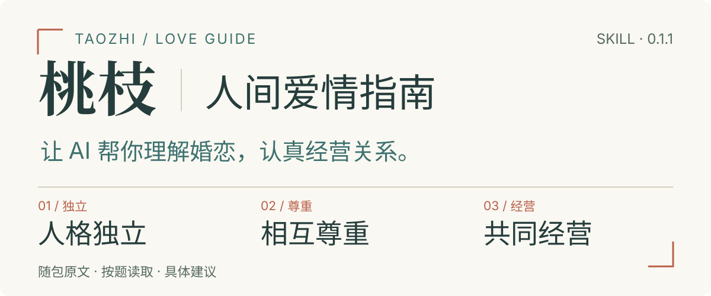
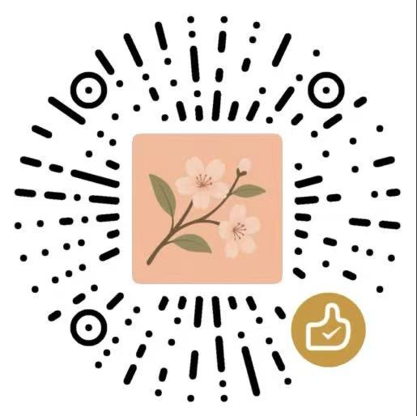
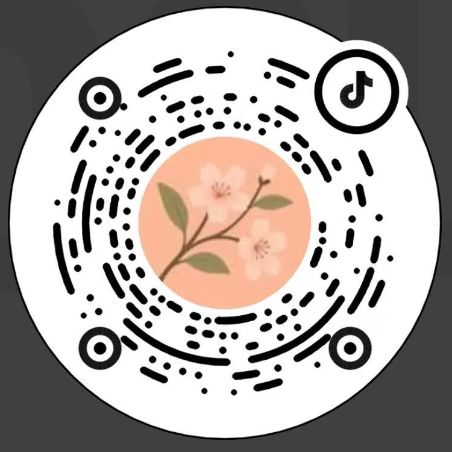

<p align="center">
  
</p>

# 人间爱情指南 · Taozhi Love Guide

**人格独立，相互尊重，共同经营。**

这是一个基于《人间爱情指南》的中文婚恋咨询 Skill，也是“人间爱情指南”开放项目的一部分。我们希望把书中的思考带进日常对话：在你困惑时帮助看清问题，在需要决定时梳理依据，在愿意经营关系时找到具体行动。

安装后，直接向 AI 讲述你的经历、感受和眼前要决定的事。你不必先给问题分类，也可以只说：“听我讲一会儿。”或者“帮我回一句话。”

**技能名：** `taozhi-love-guide` · **标准版：** `0.1.1` · **依据书稿：** 《人间爱情指南》`v1.2`

[项目背景与主张](#项目背景与主张) · [它能帮你做什么](#它能帮你做什么) · [在线安装](#在线安装) · [它怎样工作](#它怎样工作) · [随包资料与工具](#随包资料与工具) · [阅读与参与](#阅读与参与) · [自媒体与平台入口](#自媒体与平台入口) · [使用与分发声明](#使用与分发声明) · [致谢](#致谢)

## 项目背景与主张

你是否经常听到“A8”、“顶美”、“情绪价值”、“上位下位”、“大结果”这样的词？

你是否经常看到“颜值打分”，“择偶定位”，“能不能追”这样的短视频切片？

你是否经常看到对“大龄”，“单亲”，“有弟弟”，“普通家庭”大加贬低的自媒体内容？

你是否经常看到“男生验资、女生卡颜”、“海归高颜值专场”这样的“相亲局”宣传？  


你是否总是隐隐觉得这里有什么问题，但是又说不清楚原因？

没错，你发现了当代社会极为隐蔽的问题——“婚恋关系夜场化”。

一群原本在阴暗角落的虫豸，正在互联网上招摇过市，诱惑年轻人加入他们的“爱情买卖”。

他们挂着“门当户对”、“公平交换”的羊头，卖的却是“财色交易”、“伏低事大”的狗肉。

他们是渡江的白衣，是特洛伊的木马，是伪装成“明白人”的“诈骗犯”。  


曾经我们听到的爱情是“君当作磐石，妾当作蒲苇。蒲苇韧如丝，磐石无转移。”

再后来我们听到的爱情里被掺进了“潘驴邓小闲”，“力工”，“黄毛”。

现在我们听到的爱情里甚至出现了“钓养套杀”，“吊索榨换”。

“夜场关系学”被这些“见不到光的人”借着“人间清醒”的画皮，像雾霾一样在互联网上无孔不入，四处传播。

我们几乎已经到了逃无可逃，退无可退的境地！  


他们真的赢了吗？不！

**宣传思想阵地，你不去占领，敌人就会去占领。**

“人间爱情指南”项目就是我们反攻的集结号。

**我们旗帜鲜明地主张《致橡树》一样的爱情——人格独立，相互尊重，共同经营。**

我们号召所有厌恶“夜场关系学”的人团结起来：

打一场爱情保卫战，为了我们这个时代，也为了那不能遗忘的过去与不可辜负的未来。  


一万次批评的力量也比不上一次正确的示范。

幸福的家庭总是相似的。

《人间爱情指南》的目的就是探讨如何获得幸福的爱情与婚姻。

希望在你迷茫的时候，这本书能照亮你。

## 它能帮你做什么

一个入口，覆盖七类常见困惑。问题可以在对话中自然转换。

| 你正在面对的事 | 可以这样开口 |
| --- | --- |
| **自我定位** | “别人说我要求高，我想分清哪些是偏好，哪些是实际障碍。” |
| **择偶规划** | “工作圈子小，时间也少，我该去哪里认识合适的人？” |
| **关系推进** | “相处得不错，现在适合提出排他了解，还是再观察？” |
| **冲突修复** | “这次争执双方各有什么责任？我该怎么回应？” |
| **适婚协商** | “我们愿意结婚，但婚房和父母的条件谈不拢。” |
| **家庭分工与财务** | “家务看起来一人一半，为什么我还是一直很累？” |
| **风险与退出** | “我想结束关系，但还有住处、借款和共同事务要处理。” |

### 比如，你只想回一句话

> 我愿意和他确定恋爱关系，但他希望我辞职搬去他的城市。我不想辞职，又怕他觉得我不认真。帮我回一句。

可以这样表达：

> 我愿意和你认真交往，但我现在不想辞职搬家。我们可以先商量异地怎么相处，搬迁的事等工作和住处有具体安排后再一起决定。

这句回复把“愿意确立关系”和“是否辞职迁居”分开表达，对应书中的 [A.3 节点卡](references/passages/A.3/01.md)与 [D.4 高后果行动独立决定卡](references/passages/D.4/01.md)：**确定关系，不能替代对一次重大行动的决定。**

*以上为依据 Skill 规则编写的使用示例，不是实际用户案例或模型测评记录。实际回答取决于提供的事实、所用模型和资料读取情况。*

## 在线安装

项目仓库：[zion-shi/taozhi-love-guide](https://github.com/zion-shi/taozhi-love-guide)。本仓库的 `SKILL.md` 位于根目录，安装时需要同时保留 `book/`、`references/` 和 `scripts/`。

### 方式一：复制给 AI，让它从 GitHub 安装

将下面这段话发送给支持联网、文件操作和 Skill 安装的 AI 工具：

```text
请从 GitHub 安装“人间爱情指南”Skill：
https://github.com/zion-shi/taozhi-love-guide

请使用 v0.1.1 标签对应的版本。
技能名是 taozhi-love-guide，入口是仓库根目录的 SKILL.md。
请按当前工具支持的技能安装方式安装完整目录，
保留 book、references、scripts 及其内部文件和相对路径。
如果已有同名技能，请先告知我现有版本，不要直接覆盖。
安装完成后，请检查入口和关联资料可以读取，再告诉我如何调用。
```

这是一段安装请求，不是所有聊天工具都能执行。工具若没有联网、写入文件或加载 Skill 的能力，请使用下面的手动方式。

### 方式二：用 Git 安装到 Codex

适用于已安装 Git 的 macOS / Linux，在终端执行：

```bash
# 使用 Codex 的技能目录；设置了 CODEX_HOME 时跟随该目录
taozhi_skills_dir="${CODEX_HOME:-$HOME/.codex}/skills"
mkdir -p "$taozhi_skills_dir"

# 下载固定版本，保留完整技能文件
git clone --depth 1 --branch v0.1.1 \
  https://github.com/zion-shi/taozhi-love-guide.git \
  "$taozhi_skills_dir/taozhi-love-guide"
```

完成后，入口应为 `~/.codex/skills/taozhi-love-guide/SKILL.md`，或自定义 `CODEX_HOME` 下的对应位置。下一轮对话中调用该技能。

此命令固定到 `v0.1.1`，不会自动跟随后续版本。克隆标签时出现 `detached HEAD` 提示是正常现象，不影响读取 Skill。若目标目录已存在且非空，Git 会停止；请先比较或备份已有内容，再决定是否更新。

### 其他支持本地 Skill 的工具

先把完整仓库下载到你选择的空目录：

```bash
git clone --depth 1 --branch v0.1.1 \
  https://github.com/zion-shi/taozhi-love-guide.git
```

再按宿主的技能导入方式，导入生成的 `taozhi-love-guide/` 文件夹。各工具的安装位置、导入入口和调用语法可能不同；需要平台专用包时，使用对应平台的包，不能把标准包视为所有平台均可直接上传的格式。


### 方式三：下载 ZIP 后导入

无需 Git。下载[标准版 v0.1.1 ZIP](https://github.com/zion-shi/taozhi-love-guide/releases/download/v0.1.1/taozhi-love-guide-0.1.1-standard.zip)，解压后导入完整的 `taozhi-love-guide/` 文件夹。版本说明见 [v0.1.1 Release](https://github.com/zion-shi/taozhi-love-guide/releases/tag/v0.1.1)。

**不要只复制 `SKILL.md`。** 分析所需的任务说明、书稿和原文片段也必须能够被宿主读取。

### 安装后，直接提问

```text
使用 $taozhi-love-guide。

我们交往半年，最近总为周末怎么安排争执。
我希望保留独处时间，对方觉得这代表我不够在意。
请先帮我分清争执在哪里，再帮我写一句回复。
```

支持 `$技能名` 的宿主可以显式调用；其他宿主按其提供的方式选择 `taozhi-love-guide`，或使用自然语言请求调用。宿主需要能读取本地 Markdown 及关联文件；本包不包含独立聊天界面或模型服务。

## 它怎样工作

<p align="center">
  
</p>

**先接住当前的事。** 区分感受、自我评价、已报告行为、对方反馈、推测与未知。只追问会改变建议的关键信息，通常一次一个关键点；信息足够时就给出当前判断。

**分析要说明依据。** 先读任务说明，再按需查原文。实质分析应说明用了《人间爱情指南》v1.2 的哪个小节或模型、哪条原理，以及它如何解释本次经历。没有读到的内容不能冒充已引用。

**建议落到具体行动。** 说明谁做、怎样做、何时回看，以及哪些新事实会改变判断。承认感受，也保持基于事实的责任判断；用户可以接受、拒绝或修正建议。

书中的“四系统”分别观察**感情、生活、经济，以及跨领域的共同决定、履约与调整**。模型用于整理问题与检查适用条件，不提供人格诊断、分手概率或关系结果保证。只想倾诉或只求一句话时，不强加完整理论分析。

## 随包资料与工具

本标准版包含《人间爱情指南》v1.2 全文、**192 个小节、45 幅书稿 SVG 配图、7 份任务说明和 829 份原文片段**。按当前问题读取相关内容，不必每次加载整本书。

- [Skill 入口与规则](SKILL.md)
- [《人间爱情指南》v1.2 全文](book/人间爱情指南-全书整合稿-v1.2.md)
- [任务说明与原文片段](references/)
- [原文查阅工具](scripts/read_guide.py)与[现金流核算工具](scripts/cashflow.py)

### 手动查阅与现金流核算

在 Skill 目录运行，需要 Python 3，脚本只使用标准库，无需额外 Python 包。

```bash
# 读取与关系推进有关的任务说明和默认原文
python3 scripts/read_guide.py --task advance

# 用关键词定位，再按结果读取原文
python3 scripts/read_guide.py --search "辞职 迁居"

# 读取具体小节；输出提示有后续时，按提示继续
python3 scripts/read_guide.py --section D.4
```

读取器会校验索引、书稿及所读取片段。出现“校验失败”或“未载入”时，应处理资料缺口，不能当作已经读过。不支持 Python 时，可沿任务说明中的链接直接读取原文。

现金流演示命令：

```bash
python3 scripts/cashflow.py \
  --income 20000 --fixed 8000 --debt 2000 \
  --liquid 60000 --emergency 10000 --ordinary 15000
```

以上为演示输入，对应 FCR `50.00%`、DTI `10.00%`、SR `6.00 个月`、MR `4.00 个月`。金额须使用同一家庭范围、币种和一致时间口径；FCR 已含债务偿付，不能再加 DTI；SR 与 MR 使用同一存量，不能相加。这些数值只核对资源条件，不能单独证明关系健康或决定是否结婚。详见原文 [F.4](references/passages/F.4/01.md) 与 [F.5](references/passages/F.5/01.md)。


**本地资料不等于离线 AI。** 书稿与检索资料随包提供，但聊天内容怎样传输和处理，取决于宿主平台与所用模型。实际效果也取决于模型理解能力、资料访问能力和个案信息是否充分。

## 阅读与参与

“人间爱情指南”开放项目的目标，是建设由社区支持和运营的系列内容，传播“人格独立、相互尊重、共同经营”的爱情价值观。欢迎认同这一方向的读者参与讨论、提出反例、指出错误，并贡献后续内容。

**阅读全文：** 随包[书稿](book/人间爱情指南-全书整合稿-v1.2.md) · [项目网站](https://www.taozhi.love) · [百度网盘](https://pan.baidu.com/s/53VlbJ1891J7C41I6mDloxA?) · [夸克网盘](https://pan.quark.cn/s/baf25d454c64)

**微信公众号：** 搜索“桃枝”，通过“爱情指南”菜单参与：

| 入口 | 用途 |
| --- | --- |
| **加入读者群** | 按页面提示加入；无法直接加入时，留下联系方式，由人工协助。 |
| **来信提问** | 提交不同想法或尚未解答的困惑；受编辑规模限制，不保证每条来信均获回复或回复时效。 |
| **意见反馈** | 提交纠错与建议；希望参与后续编写时，可同时留下基本信息和联系方式。 |

公众号二维码见下方[自媒体与平台入口](#自媒体与平台入口)。

来信与回复在移除个人隐私信息后，可能通过社交媒体发布，也可能整合进后续更新。提交前请了解该参与方式。

### 社区与付费服务

“桃枝婚恋社区”相关账号由**青岛缘结神婚恋服务有限责任公司**运营，包含商业服务内容。

#### 婚恋社区

通过公众号“桃枝服务 → 加入社区”了解并申请。

#### 一对一付费咨询

通过“桃枝服务 → 1对1付费咨询”提交问题与联系方式，具体服务及价格以接洽时的信息为准。

#### 自愿支持项目

此项目当前由运营者以自然人身份运营。所有捐赠将被视为对运营者个人的“打赏”，并转入个人账户。感谢您对此项目及运营者的认可和支持。

<p align="center">
  <a href="assets/readme/personal-support.jpg"></a>
</p>


## 自媒体与平台入口

**桃枝婚恋社区**：以下账号由**青岛缘结神婚恋服务有限责任公司**运营，包含商业服务内容。

使用对应平台扫码；点击码图可查看大图。公众号中的“爱情指南”菜单提供读者群、来信提问和意见反馈入口。

<table>
  <tr>
    <td width="50%" align="center"><strong>微信公众号</strong><br>桃枝<br><br><a href="assets/readme/wechat-official.jpg"></a></td>
    <td width="50%" align="center"><strong>微信小程序</strong><br>桃枝婚恋社区<br><br><a href="assets/readme/wechat-miniprogram.png"></a></td>
  </tr>
  <tr>
    <td width="50%" align="center"><strong>抖音</strong><br>桃枝婚恋社区<br><br><a href="assets/readme/douyin-qr.png"></a></td>
    <td width="50%" align="center"><strong>小红书</strong><br>扫码查看账号<br><br><a href="assets/readme/xiaohongshu.jpg"></a></td>
  </tr>
  <tr>
    <td colspan="2" align="center"><strong>Bilibili</strong><br>桃枝婚恋社区<br><br><a href="assets/readme/bilibili-qr.png"></a></td>
  </tr>
</table>

**手动查找：** 抖音号 `385204945` · Bilibili UID `3546687337401086`。

## 使用与分发声明

依据《人间爱情指南》及开放项目的权利声明：

> 在非商业目的内容中，您可以自由下载、引用、分发《人间爱情指南》，但您在引用时必须声明内容出处，在分发时必须保持原始内容完整且无修改。

本项目按上述声明提供书稿内容。**公开提供内容不等于允许任意改作或商用。** 仓库未另附 MIT、Apache 等软件许可证，不能将上述书稿声明替换为此类软件许可。

Skill 沿用本书的一对一关系立场；双方可以拒绝或结束关系，已有责任另行处理。它不帮助欺骗、偷查、施压或操纵他人。面对正在发生的强迫、堵门或可信报复威胁，规则要求先处理眼前暴露与现实支持，再查资料。

---

<p align="center">
  
</p>

**希望在你迷茫的时候，这本书能照亮你。**

[安装 Skill](#在线安装)，从你现在最想处理的那件事开始。

## 致谢

> 谨以此书献给关桂琴、魏玉珍。

<p align="center">
  
</p>
