# 人间爱情指南

全书整合稿 v1.2 · 2026年11月4日

从认识自己、选择伴侣，到共同生活与面对变化，理解关系怎样生成，也参与创造值得期待的爱情。可以顺序阅读，或从[按问题阅读导航](#unit-A-1)进入；理论借鉴与采用边界见[附录L.2](#unit-L-2)。

<!-- toc-start -->

## 阅读目录

- [前言：值得奔赴，也值得共同创造](#preface)
  - [P.1 人间的爱情，从现实中的两个人开始](#unit-P-1)
  - [P.2 本书为谁而写，能够提供什么](#unit-P-2)
  - [P.3 怎样阅读，怎样按需使用](#unit-P-3)

**[第一部分 选择怎样的人生，创造怎样的关系](#part-1)**

- [第一章 婚恋与人生：我们经营关系，关系也塑造我们](#chapter-1)
  - [1.1 从完美爱情的幻想，走向亲手创造值得期待的爱情](#unit-1-1)
  - [1.2 关系与心理成长：两个人生怎样交织，又怎样彼此改变](#unit-1-2)
  - [1.3 爱的“三体问题”：喜欢与吸引、恋爱关系、婚姻共同体不能相互推定](#unit-1-3)
  - [1.4 好的爱情：人格和能力保持独立，情感与生活共同经营](#unit-1-4)
  - [1.5 好的关系对参与者的要求：五项品质与三正](#unit-1-5)
  - [1.6 五条行动原则：把判断落到可执行的选择](#unit-1-6)
  - [1.7 七条伦理主张：共同经营有底线，具体生活由当事人选择](#unit-1-7)
  - [1.8 风险专节：把关系当救援、把成长当改造、把责任当控制](#unit-1-8)
- [第二章 关系怎样生成：婚恋关系系统模型与健康关系的样子](#chapter-2)
  - [2.1 先看关系由什么组成：基础层、“3+1”核心层与周围环境](#unit-2-1)
  - [2.2 健康关系怎样逐渐形成：有效、稳定而可持续的良性循环](#unit-2-2)
  - [2.3 六个关键节点：运行基础、明确选择与可承担责任一起看](#unit-2-3)
  - [2.4 菱形演进模型：用两条轴观察关系重心与体验](#unit-2-4)
  - [2.5 四种典型关系结构：看双方长期得到什么、承担什么](#unit-2-5)
  - [2.6 怎样把愿望变成合作：三层经营与五个观察视角](#unit-2-6)
  - [2.7 风险专节：模型帮助看见事实，不能代替事实](#unit-2-7)
- [第三章 从人生方向到现实寻找：互联网婚恋的择偶策略](#chapter-3)
  - [3.1 先想要怎样生活，再确定需要怎样的伴侣](#unit-3-1)
  - [3.2 准备成为伴侣：基本自主、生活入口与可承担的投入](#unit-3-2)
  - [3.3 从零开始的互联网社交，缺少什么，需要补上什么](#unit-3-3)
  - [3.4 选择渠道：找到既可接触、又有机会相互选择的人](#unit-3-4)
  - [3.5 用四张短清单与探索方向校准，而非提前锁定理想类型](#unit-3-5)
  - [3.6 一边寻找一边收敛：不让搜索耗尽生成关系的注意力](#unit-3-6)
  - [3.7 风险专节：无限筛选、过早绑定与错误的自我解释](#unit-3-7)

**[第二部分 从陌生人到正式恋人](#part-2)**

- [第四章 吸引与两性吸引：从被看见到想靠近具体的人](#chapter-4)
  - [4.1 注意、喜欢、欣赏、欲望与亲密期待：我被什么吸引](#unit-4-1)
  - [4.2 吸引从哪里来：特点、偏好、经历与情境共同作用](#unit-4-2)
  - [4.3 为什么网上聊得来，见面却未必产生吸引](#unit-4-3)
  - [4.4 改善与展示：让真实的自己有机会被看见](#unit-4-4)
  - [4.5 给吸引发展的机会，也能接受拒绝并校准自己](#unit-4-5)
  - [4.6 风险专节：光环、过快确信与将资源兴趣误作关系基础](#unit-4-6)
- [第五章 把喜欢变成共同参与：约会、信任与排他选择](#chapter-5)
  - [5.1 善意、示好与承诺分开，让邀请能够被真实回应](#unit-5-1)
  - [5.2 从回应到参与：判断关系是否正在两人之间生成](#unit-5-2)
  - [5.3 约会既是了解，也是关系的创造过程](#unit-5-3)
  - [5.4 亲密可以逐步发展，身体接触需要独立且当下有效的同意](#unit-5-4)
  - [5.5 分段投入与礼物：使善意可持续，不把付出变成债权](#unit-5-5)
  - [5.6 善意与信任怎样增长：事实、意愿和方案各用其方法](#unit-5-6)
  - [5.7 节奏不同、降温或停滞时，增加信息而非延长空等](#unit-5-7)
  - [5.8 排他节点：持续双向情感生成之后，明确有限承诺](#unit-5-8)
  - [5.9 风险专节：把追求投入、身体亲密或模糊承诺当作权利](#unit-5-9)
- [第六章 排他中的深入了解：感情初步自持与恋爱确认](#chapter-6)
  - [6.1 从集中注意力到稳定互动：排他究竟要完成什么](#unit-6-1)
  - [6.2 什么叫感情系统初步自持：从新鲜刺激走向普通相处](#unit-6-2)
  - [6.3 从社交形象认识真实的人：必要核验与行为观察](#unit-6-3)
  - [6.4 重大方向先对齐，方案细节按阶段推进](#unit-6-4)
  - [6.5 条件重大事项：把个人意愿、外部条件与决定权限拆开](#unit-6-5)
  - [6.6 健康、身体与排他：按现实影响沟通，不以标签推断](#unit-6-6)
  - [6.7 信息不足怎样处理：有限暂缓与新的证据](#unit-6-7)
  - [6.8 正式恋爱确认：选择已经开始运行的关系](#unit-6-8)
  - [6.9 风险专节：空壳排他、核验越界与把对齐当作兑现](#unit-6-9)

**[第三部分 从正式恋爱到正式订婚](#part-3)**

- [第七章 让爱情在日常生长：回应、幸福与共同叙事](#chapter-7)
  - [7.1 对方此刻希望你做什么：分享、倾诉、求助与协商](#unit-7-1)
  - [7.2 亲密如何积累：需要、回应、反馈与再次靠近](#unit-7-2)
  - [7.3 幸福来自哪些体验：身体舒适、愉快情绪、连接与认同](#unit-7-3)
  - [7.4 关爱要可靠，惊喜可以变化](#unit-7-4)
  - [7.5 亲密需要空间：支持个人发展，也学习共同生活](#unit-7-5)
  - [7.6 共同叙事怎样形成，又怎样改变两个人](#unit-7-6)
  - [7.7 风险专节：单方情绪劳动、刺激依赖与叙事遮蔽](#unit-7-7)
- [第八章 从约会走进生活：责任、合作与冲突修复](#chapter-8)
  - [8.1 责任怎样逐渐形成：承诺、共同实践与合理依赖](#unit-8-1)
  - [8.2 用真实任务发展合作，不靠人为考验筛选人](#unit-8-2)
  - [8.3 合作需要权责相称：从“帮忙”到承担一段完整任务](#unit-8-3)
  - [8.4 从分歧看见结构：我们究竟在争什么](#unit-8-4)
  - [8.5 怎样决定先处理什么：严重性、影响与可改变程度](#unit-8-5)
  - [8.6 七步修复：处理本次冲突，也恢复信任、认同与连接](#unit-8-6)
  - [8.7 什么时候需要外部帮助：支持、澄清与权益保护](#unit-8-7)
  - [8.8 风险专节：单方接管、责任失配与冲突跨系统扩散](#unit-8-8)
- [第九章 两个人与两个社会网络：融入、支持与家庭自主](#chapter-9)
  - [9.1 社会融入不是公开一次身份，而是逐渐建立可持续联系](#unit-9-1)
  - [9.2 家庭如何影响婚姻：六条通道与四种实际结果](#unit-9-2)
  - [9.3 跨圈层关系怎样形成正循环：被看见、被尊重与共同参与](#unit-9-3)
  - [9.4 当伴侣父母不认可自己：改善具体印象，也识别无法解决的条件](#unit-9-4)
  - [9.5 保持自主判断与决定：资源依赖与冲突中的行为](#unit-9-5)
  - [9.6 特殊网络重叠：当感情、职业与资源权力相连](#unit-9-6)
  - [9.7 风险专节：家庭接口失控、单向融入与多中心否决](#unit-9-7)
- [第十章 身体与性亲密：情感绑定、身份叙事与自主选择](#chapter-10)
  - [10.1 性亲密的关系意义：快乐、情感绑定与不可撤回的经历](#unit-10-1)
  - [10.2 身份与叙事权力：共同经历怎样改变关系评估](#unit-10-2)
  - [10.3 重大亲密前先明确意愿、事实与后果，亲密后仍可更新选择](#unit-10-3)
  - [10.4 性忠诚、经营责任与具体同意，是三个不同问题](#unit-10-4)
  - [10.5 性健康与生育：把行为后果纳入共同决定](#unit-10-5)
  - [10.6 风险专节：绑定遮蔽判断、身份施压、失配与健康信息缺口](#unit-10-6)
- [第十一章 确认适婚：想要的生活，能否已经一起开始](#chapter-11)
  - [11.1 我们希望婚姻创造什么：八类价值与功能](#unit-11-1)
  - [11.2 谁来实现这些愿望：六类组合能力及其现实基础](#unit-11-2)
  - [11.3 静态适配：哪些不能抵销，哪些可以发展或共存](#unit-11-3)
  - [11.4 现实可行：愿意共同生活，还要有能够执行的路径](#unit-11-4)
  - [11.5 从已有经历判断亲密、合作、修复与社会支持](#unit-11-5)
  - [11.6 我们凭什么相信这些判断：重大信息、自然观察与剩余未知](#unit-11-6)
  - [11.7 从判断到决定：适婚判断与关键协商相互校验](#unit-11-7)
  - [11.8 风险专节：条件代替运行、表面平静与婚约冲动](#unit-11-8)
- [第十二章 婚事关键协商与正式订婚：把未来变成明确婚约](#chapter-12)
  - [12.1 哪些事情必须在正式订婚前说清](#unit-12-1)
  - [12.2 住房和父母出资：资金、产权、居住与治理分别协商](#unit-12-2)
  - [12.3 婚礼、彩礼和嫁妆：表达承诺，不购买支配权](#unit-12-3)
  - [12.4 建立家庭的关键原则：先形成能执行的共识](#unit-12-4)
  - [12.5 正式订婚：婚约明确、双方父母知情、婚礼安排确定](#unit-12-5)
  - [12.6 婚约怎样变更：避免沉没成本变成强制结婚](#unit-12-6)
  - [12.7 风险专节：隐藏条件、资源换权与婚约绑架](#unit-12-7)

**[第四部分 从婚约落实到长期共同生活](#part-4)**

- [第十三章 落实婚约，建立家庭：从约定到实际运行](#chapter-13)
  - [13.1 把婚约变成行动：明确任务、授权和变化条件](#unit-13-1)
  - [13.2 住房、资金和文件真正到位：核对实施事实](#unit-13-2)
  - [13.3 登记、仪式与家庭身份：分别完成各自任务](#unit-13-3)
  - [13.4 新家的启动期：把日常安排做出来，而不只是搬到一起](#unit-13-4)
  - [13.5 从筹备冲突恢复合作：别把婚礼办完当作问题结束](#unit-13-5)
  - [13.6 风险专节：承诺未落实、临时加码与筹备中的权责失衡](#unit-13-6)
- [第十四章 把家经营起来：生活分工、家庭经济与共同治理](#chapter-14)
  - [14.1 家庭治理：共同决定重要事项，日常执行适度授权](#unit-14-1)
  - [14.2 家务与照护：分配完整责任，也给执行者自主](#unit-14-2)
  - [14.3 公平不是每项对半：同时看领域、整体与生命周期](#unit-14-3)
  - [14.4 看见无偿贡献：感谢之外，还要有实际保障](#unit-14-4)
  - [14.5 家庭资金如何运行：共同责任与个人自主同时安排](#unit-14-5)
  - [14.6 三层时间安排：当期生活、年内预提与长期储备](#unit-14-6)
  - [14.7 财务健康与抗冲击：先看结构和短板，再看自检结果](#unit-14-7)
  - [14.8 婚后亲属协作：礼仪、互惠、祖辈照护与资源分配](#unit-14-8)
  - [14.9 风险专节：贡献不可见、资源控制与家庭功能单点依赖](#unit-14-9)
- [第十五章 成为家人，也继续相爱：长期亲密与关系恢复](#chapter-15)
  - [15.1 熟悉之后的爱情：激情、亲密与承诺可以不同步变化](#unit-15-1)
  - [15.2 让亲密重新有发生空间：先减负，再增加可持续连接](#unit-15-2)
  - [15.3 婚后外部吸引与忠诚：感受、边界、行为和选择分别看](#unit-15-3)
  - [15.4 失信之后为何补偿不够：修复承诺可信度与共同身份](#unit-15-4)
  - [15.5 旧伤反复与负面解释：辨认余波、重演和结构衰退](#unit-15-5)
  - [15.6 再生能力是否存在：从止损，到稳定，再到新的生成](#unit-15-6)
  - [15.7 风险专节：把约束当爱情、把补偿当修复、把平静当恢复](#unit-15-7)
- [第十六章 当人生改变：目标重谈、角色转换与家庭韧性](#chapter-16)
  - [16.1 当目标改变：给未来的对方留位置](#unit-16-1)
  - [16.2 角色如何重配：不要把暂时处境写成终身身份](#unit-16-2)
  - [16.3 收入下降或经营失败：修复经济模式，不急于否定婚姻](#unit-16-3)
  - [16.4 生育、疾病和养老：照护必须有持续承担的结构](#unit-16-4)
  - [16.5 抵抗力与恢复力：准备关键功能，而不是消除全部不确定性](#unit-16-5)
  - [16.6 共同体与个人怎样一起更新：重新讲述，也重新行动](#unit-16-6)
  - [16.7 风险专节：变化单方化、照护透支与用新绑定掩盖旧危机](#unit-16-7)
- [第十七章 当关系不再适合：退出、善后与重建生活](#chapter-17)
  - [17.1 为什么结束：不愿继续、不兼容、失效与危险分别处理](#unit-17-1)
  - [17.2 阶段不同，退出任务不同](#unit-17-2)
  - [17.3 怎样说清结束，又不把协商变成无限拉扯](#unit-17-3)
  - [17.4 善始善终：既有依赖、共同利益与有限过渡](#unit-17-4)
  - [17.5 危险关系的退出：先保护，再处理共同事务](#unit-17-5)
  - [17.6 重建生活：既理解过去，也恢复未来的选择能力](#unit-17-6)
  - [17.7 风险专节：退出报复、善后控制与重复损失](#unit-17-7)

**[第五部分 工具箱附录](#part-5)**

[附录 A 阅读导航、系统观察与升级节点](#appendix-group-A)

- [A.1 按问题找到当前最需要的内容](#unit-A-1)
- [A.2 四系统观察页：形成、功能、风险、损害与信息分栏](#unit-A-2)
- [A.3 节点卡：运行基础、明确选择与可承担后果分开](#unit-A-3)
- [A.4 最少记录怎样使用](#unit-A-4)

[附录 B 人生叙事、价值排序与择偶策略](#appendix-group-B)

- [B.1 人生叙事与共同生活想象](#unit-B-1)
- [B.2 四张短清单与不可妥协要求](#unit-B-2)
- [B.3 渠道和探索方向比较](#unit-B-3)
- [B.4 有限行动后的策略校准](#unit-B-4)

[附录 C 吸引、约会与双向情感观察](#appendix-group-C)

- [C.1 邀约与共同活动准备卡](#unit-C-1)
- [C.2 双向情感生成与初步自持观察页](#unit-C-2)
- [C.3 礼物、节奏与身份沟通卡](#unit-C-3)
- [C.4 日常经营六个入口](#unit-C-4)

[附录 D 重要事实、重大事项与分段投入](#appendix-group-D)

- [D.1 五步使用与信息状态](#unit-D-1)
- [D.2 五类问题的完整入口](#unit-D-2)
- [D.3 健康影响与知情沟通](#unit-D-3)
- [D.4 高后果行动独立决定卡](#unit-D-4)

[附录 E 适婚综合判断与婚约落实](#appendix-group-E)

- [E.1 八类价值与六类能力对齐页](#unit-E-1)
- [E.2 静态、现实、动态综合回顾](#unit-E-2)
- [E.3 推进、暂缓与不推进记录](#unit-E-3)
- [E.4 适婚—关键协商—正式订婚—家庭建立分栏](#unit-E-4)

[附录 F 家庭财务共同经营工具](#appendix-group-F)

- [F.1 资金功能、时间层次与账户结构](#unit-F-1)
- [F.2 资金来源、用途、权限与责任](#unit-F-2)
- [F.3 月度预算与计划预留模板](#unit-F-3)
- [F.4 FHS 常态健康：梳理日常财务的七个方面](#unit-F-4)
- [F.5 RRS 抗冲击及尾部风险：不能用平均分掩盖重大义务](#unit-F-5)
- [F.6 参考值、情境和未知的显示规则](#unit-F-6)
- [F.7 从入账到月末的完整算例](#unit-F-7)
- [F.8 不同家庭的适配与使用范围](#unit-F-8)

[附录 G 家庭分工、共同决定与责任](#appendix-group-G)

- [G.1 完整任务链清单](#unit-G-1)
- [G.2 权限、标准、授权与交接](#unit-G-2)
- [G.3 结构公平与角色变化](#unit-G-3)
- [G.4 个人主责与共同责任](#unit-G-4)

[附录 H 社交网络与亲属协作](#appendix-group-H)

- [H.1 网络影响与支持图](#unit-H-1)
- [H.2 跨差异的双向融入](#unit-H-2)
- [H.3 改善父母负面印象与验证自主](#unit-H-3)
- [H.4 婚后礼仪、同住、育儿和养老](#unit-H-4)

[附录 I 分歧理解与冲突修复](#appendix-group-I)

- [I.1 一事一议沟通卡](#unit-I-1)
- [I.2 十类议题与轻量记录](#unit-I-2)
- [I.3 重大问题双坐标矩阵与六步初始化](#unit-I-3)
- [I.4 七步修复操作页与三层结果](#unit-I-4)

[附录 J 风险准备、照护责任与退出安排](#appendix-group-J)

- [J.1 变化情境与关键功能](#unit-J-1)
- [J.2 责任来源、事件阶段与伦理层次](#unit-J-2)
- [J.3 有限照护和过渡交接](#unit-J-3)
- [J.4 危险关系与支持准备](#unit-J-4)
- [J.5 分阶段退出与重建](#unit-J-5)

[附录 K 身体自主、健康知情与排他边界](#appendix-group-K)

- [K.1 具体同意、拒绝与经历意义](#unit-K-1)
- [K.2 健康、避孕生育与专业咨询准备](#unit-K-2)
- [K.3 一对一排他、拒绝与违约边界](#unit-K-3)

[附录 L 术语、模型来源与使用边界](#appendix-group-L)

- [L.1 概念层次与核心模型索引](#unit-L-1)
- [L.2 理论借鉴与本书的使用边界](#unit-L-2)
- [L.3 工具适用范围与进阶观察](#unit-L-3)

[附录 M 婚恋关系各阶段风险清单与完整逐行速查表](#appendix-group-M)

- [M.1 阅读方式：问题性质与信息状态分开](#unit-M-1)
- [M.2 七阶段的任务与节点](#unit-M-2)
- [M.3 S1 吸引：被注意、初识与筛选](#unit-M-3)
- [M.4 S2 两性吸引：浪漫兴趣与亲密期待](#unit-M-4)
- [M.5 S3 善意表达与约会](#unit-M-5)
- [M.6 S4 排他性观察](#unit-M-6)
- [M.7 S5 正式恋爱至确认适婚、婚事关键协商](#unit-M-7)
- [M.8 S6 正式订婚后的婚约落实与家庭建立准备](#unit-M-8)
- [M.9 S7 婚后共同经营与变化适应](#unit-M-9)
- [M.10 跨系统传播与实际修复案例](#unit-M-10)
- [M.11 更新判断与选择下一步](#unit-M-11)
- [M.12 来源编码与边界](#unit-M-12)
- [M.13 补充机制与正文入口](#unit-M-13)

<!-- toc-end -->

---

## 前言：值得奔赴，也值得共同创造

### P.1 人间的爱情，从现实中的两个人开始

**带着对爱情的期待，也带着参与现实生活的意愿，开始阅读这本书。**

许青的工作方案改了好几次，终于被采纳。她想把这个好消息告诉程远，他却立即给出下一次怎样少走弯路的建议。她说：“我现在是想跟你说个好消息，不是急着复盘。”他听懂了，转而问起她最满意的部分，她重新愿意讲下去。

这是[第7.1节](#unit-7-1)里一对虚构恋人的片段。值得喜欢的地方很小：一个人没有因为最初听错就结束交谈，另一个人也不必把高兴收起来。那件费力做成的事，终于可以被喜欢的人看见，此刻的相处也因此多了一点亲近。

我们向往的爱情，可以从这样的普通日子里获得形状。疲惫时，有人愿意听，也能在确实忙不过来时告诉你何时再谈；生活乱成一团，两个人能接住各自答应的那一部分；你有了新的愿望，对方愿意了解它对你的意义，一起看怎样为它腾出空间。彼此仍有好奇，仍会欣赏，也仍期待下一次相见。

共同承担日常，会给亲密创造机会。事情有人认领并完成，休息便不总是靠另一人的透支换来；能够说出不同意见，靠近时也更容易感到自己是在选择。浪漫可以是一次认真准备的约会，也可以是忙碌之后终于腾出时间，两个人都有心情再听对方多讲一点。

走进这些日子的人，有自己的局限。我们会分心，会怕难堪，有时明知怎样说更好，话出口仍然带刺。关系中的学习，不需要等到某个人已经完美才开始；它需要有人愿意看见影响，承担自己能够承担的事，并让下一次的行动有所不同。对方可以帮助你，个人要做的那一部分仍由自己完成。

也会有努力之后仍然不适合的关系。有的人想走向不同的生活，有的承诺始终没有兑现，有的相处正在损害一个人的自主与安全。承认这些事实，才能保留真实的选择。一个人无法独自创造双方的参与，也没有义务用继续相处证明自己足够懂爱。

《人间爱情指南》所期待的，是两个人在现实生活中共同创造的幸福。你可以寻找愿意与你一起参与的人，亲手增加值得珍惜的经历，也在需要时修正方向。选择与经营都很重要，爱情值得奔赴，却没有谁能仅凭用力就保证结局。关系会改变我们对自己和生活的理解；值得期待的改变，应当给两个人都留出位置。

### P.2 本书为谁而写，能够提供什么

**把本书的方法用来理解事实、作出选择、改善相处，让它们服务于你的生活。**

本书主要写给希望从认识、吸引走向长期爱情与婚姻的成年人，尤其是那些从互联网认识陌生人的人。你们可能没有共同朋友，不知道彼此过去怎样生活，也缺少自然反复见面的机会。一次展示能带来兴趣，却不能代替相处；还不熟悉，也不意味着只能等对方先证明一切。

在这样的起点上，既需要主动创造可以共同参与的机会，也需要让了解跟得上投入。条件清单能帮助辨认部分差异，心动能告诉你愿不愿意靠近。随后还有许多只有在真实交往中才逐渐清楚的事：普通相处是否值得期待，双方能否承担已答应的任务，想要的生活是否相容，遇到变化又怎样调整。

书中会分别提供价值主张、解释关系的框架、不同阶段的行动方法，以及按需使用的工具。价值主张说明我们重视怎样的共同生活；解释框架帮助追问一件事怎样发生、又影响了什么；行动方法把问题放回当前任务；工具则帮助保存容易混淆的事实、约定与后续结果。

读到一个解释，你可以检查它是否符合眼前事实；填完一张表，则要继续看真实意愿、可用资源和后来的行动。方法可以帮助判断，最后仍要由你决定愿意与谁相处、接受怎样的生活。本书也不会用一个分数代替这些选择。

“为什么总是我主动？”可能需要先看对方怎样参与，以及你们是否已经作出排他选择。“没有争吵，却越来越不亲密”，需要了解平静的日常里还有什么积极价值。“父母愿意支持，但附带条件”，则涉及资助内容、决定权限和实际能承担的生活。它们看起来都是感情问题，下一步却未必相同。

已经恋爱或结婚的读者，也可以从这些问题进入。本书会继续写到共同生活中的财务、分工、亲属、照护与人生变化，也讨论关系无法继续时怎样处理善后。具体疾病、法律责任或复杂财务安排，需要适任的专业人员结合实际情况判断；这里提供的是理解问题和准备咨询的帮助。

### P.3 怎样阅读，怎样按需使用

**从当前问题进入，按需要选用工具；有现实危险时，优先寻找保护与支持。**

如果你正从零开始寻找关系，可以按全书顺序阅读。[第一章](#unit-1-1)至[第三章](#unit-3-1)帮助你想清人生方向、共同生活和现实寻找；[第四章](#unit-4-1)至[第六章](#unit-6-1)写从陌生人到正式恋人；[第七章](#unit-7-1)至[第十二章](#unit-12-1)进入恋爱日常、适婚判断与婚事协商。

[第十三章](#unit-13-1)至[第十七章](#unit-17-1)继续讨论婚约落实、家庭运行、人生变化和必要时的退出。附录在遇到具体问题时再用，可以通过[附录A.1](#unit-A-1)找到适合的入口。

已经处于关系中的读者，可以先读[第一章](#unit-1-1)和[第二章](#unit-2-1)建立共同的理解，再跳到当前问题。想快速找到入口时，打开[附录A.1：按问题找到内容](#unit-A-1)。先选最贴近的一行，读它指向的小节，再选一张确实能帮助当下决定的工具，不必同时启动整套记录。

章节顺序也不是统一进度表。排他了解需要双方确认，正式恋爱另有确认；认识多久，并不能自动回答你们走到了哪里。关于[身体边界](#unit-5-4)与[性亲密](#unit-10-1)的内容，可以按需要提前读。若准备搬迁、承担债务或作出其他后果重大的安排，也应先弄清这件事本身的条件，不能只凭关系身份放行。

普通相处不必变成考试。一次小误会已经说清，相关事情也妥善处理，两个人愿意继续生活，就可以到此为止。反复发生的问题，或牵涉较大代价的决定，才值得把事实、责任和后续变化留下简短记录。工具的作用是减少忘记与混淆，而不是要求谁全天观察、每天证明关系合格。

附录中的[家庭财务常态自检](#unit-F-4)与[家庭财务抗冲击自检](#unit-F-5)，帮助你看清收支、承担和可用资源。现金收支按明确口径计算，资料不足就留下待了解的事项；这些工具不提供综合总分，也不作为已经验证的预测量表。需要了解概念怎样借鉴和使用，可读[附录L.2](#unit-L-2)；工具及进阶模型的适用范围见[附录L.3](#unit-L-3)。

如果已经出现具体威胁、跟踪或强迫，阅读顺序应让位于眼前的保护需要。可直接转到[17.5的危险分支](#unit-17-5)及[附录J.4](#unit-J-4)，不必先完成普通协商或共同修复。结束关系，也不需要先把本书所有步骤做完。

读过以后，可以先带走一个与你眼前生活有关的问题，做一件自己能够承担的小事，再看发生了什么。有时你会获得新的了解，有时会创造一次值得期待的相处，也有时会更清楚地知道某条路不适合自己。让阅读帮助你参与生活，书中的方法才有了落点。

## 第一部分 选择怎样的人生，创造怎样的关系

### 第一章 婚恋与人生：我们经营关系，关系也塑造我们

*本章情境均为虚构，用来说明判断过程，不代表真实人物经历或统计结果。*

#### 1.1 从完美爱情的幻想，走向亲手创造值得期待的爱情

**值得期待的爱情，来自双方真实的参与，也来自对日常摩擦的共同处理。**

你也许认真想过自己希望遇见什么样的人：谈得来，有吸引力，处事可靠，对未来有相近的打算。你并不指望对方十全十美，只是希望找到一个人，让许多事情终于不必那么费力。消息能够被理解，关心能够被接住，意见不同时也不用总担心关系就此结束。

这样的愿望值得保留。困难在于，我们容易把“相处可以轻松一些”再向前推一步，变成“只要选对了人，相处就会自然顺利”。于是，一次说不清楚的委屈、一段疲惫的日子，甚至对晚饭和周末安排的不同意见，都可能被看成选错人的证据。

现实中的伴侣会困、会忙，会在你很想倾诉时只剩下一点耐心。有些需要说出来才能被理解，有些安排即使双方都愿意，也会被工作和生活打乱。接受这些事实，并不等于降低对诚实、尊重和安全的要求。我们要放下的是毫无摩擦的保证，同时学会辨认：眼前的摩擦有没有被共同处理，处理之后，生活是否有所改善。

##### 想一想，你们会怎样度过一个普通周末

设想两种周末。两位约会对象的纸面条件都符合你的期待，都说愿意认真发展关系，也都临时遇到了工作安排。

在第一种情境里，对方提前告诉你：“周六恐怕赶不上了。我知道你把这半天留出来了。周日下午你有空吗？没空的话，我们重新找时间。”你还是失望，甚至有点生气。后来约会真的补上了，你们聊起那天的工作，也一起发现一家愿意再去的小店。被打乱的安排没有变成一场完美约会，但你知道自己的时间被算在其中。

在另一种情境里，对方每次都说下次一定，却迟迟不提出能落实的时间。你腾出周末、等到晚上，再听一句“最近实在忙”。忙碌可能是真的；对方是否有能力和意愿给这段交往留下位置，仍然没有答案。此时继续增加等待，并不会自动增加了解。

这两种相处的差别，在于是否说明变化、考虑另一人的投入，并把承诺变成行动。你可以提出一次具体安排，看对方怎样回应；也可以不再为没有着落的邀请持续空出时间。眼前的决定可以依据这些行为，不必先猜透对方的全部品格或动机。

挑选伴侣时，我们在看对方拥有怎样的条件，也在选择自己愿意反复进入怎样的日常。相近的收入、教育和兴趣，不能保证同样的生活。一次失败之后，你面对的是愿意听你说完的人，还是急于证明“早就提醒过你”的人；一顿普通晚饭，是两个人都能参与的休息，还是其中一人完成全部准备后才获准坐下。条件通过具体相处，才变成你的生活体验。

##### 值得期待的生活，需要双方留下位置

本书希望与你一起寻找的，是“有人可爱，有家可回，有路可走”的生活。有人愿意认真听你讲一个不太重要、却让你开心的发现；遇到困难时，能够商量谁先做什么；各自想往前走时，不必先证明自己已经不爱对方。这样的生活里可以有惊喜、欲望、玩笑和探索，也有终于不用独自扛完一件小事的松弛。

它需要真实的参与。你答应了周末一起出门，就不能总把共同安排留到其他选择之后；对方因为你的承诺调整了生活，你也需要考虑由此产生的合理依赖。进入关系，会自愿让出一部分随时改变计划的自由，换来双方可以相互期待、一起安排未来的可能。

共同约会需要协调时间，照护也有相应的承担内容。合理的约束来自具体承诺和共同生活的需要，能够说明缘由，也容许讨论调整。如果对方进而要求决定你与谁交朋友，或用“既然爱我”要求满足所有愿望，就需要把越出的边界说清楚。

共同创造还意味着，有些美好的东西需要你先做一点。主动分享一个好消息，安排一次双方负担得起的见面，把自己真正关心的问题说清楚。观察对方是否也在回应、发起和承担，关系才有机会从一个人的想象变成两个人的经历。谨慎可以帮助你控制投入的后果，却不能替代参与本身。

努力并不保证两个人最后适合。有些愿望不能协调，有些合作始终只有一方在做。爱情也无法包办全部幸福：朋友、工作、兴趣以及独处，都仍然可以支撑你的人生。承认这些限制，能使期待有一个现实的位置，而不必在“对方应当满足一切”和“爱情根本不值得”之间来回摆动。

你可以先想一个希望与伴侣共创的普通场景：疲惫回家后怎样相处，周末怎样留出共同时间，一人失意时另一人能做什么。再想一想，你愿意为它承担哪一部分，对方是否也愿意参与。认清爱、敢于爱、享受爱，从这些能够发生的小事开始。共同经历累积起来之后，它还会改变你怎样理解自己、安排未来。

#### 1.2 关系与心理成长：两个人生怎样交织，又怎样彼此改变

**关系会改变人的愿望、理解与行动条件，成长仍需要本人的选择和投入。**

认识一个人以前，你已经有自己的生活。你可能习惯独自处理困难，也可能很在意别人的评价；有些目标想了很久，有些计划只是还没遇到机会。对方同样带着经历、习惯和未完成的愿望走来。两个人逐渐亲近，是这些原本各自延伸的人生开始交织，但没有因此变成同一个人的人生。

你们会拥有一些共同的记忆，也会对同一件事产生不同感受。一段旅行对你是放松，对方却记得预算超支的紧张；一次沉默对你是终于平静下来，对方却以为自己被拒绝。共同生活的叙事需要交流和修订，不能由声音更大或表达更熟练的人独自写定。

##### 能力带入关系，也在关系中发展

经营关系需要一些可以逐步学习的能力：察觉自己需要什么，说出需要而不要求对方猜中；在失望时承受一会儿不舒服，不立即用伤人的行动把它推出去；承认自己的选择有后果，也容许对方与自己不同。

这些说来清楚，做起来并不轻松。一个人可能知道该解释，却因为羞耻而回避；知道不该迁怒，却在连续加班后失去耐心。学习不能只停在“下次控制好情绪”：还可以把重要谈话放到有精力的时候，先说明暂时讲不清楚，并约一个可行的重谈时间。如果已经造成伤害，疲惫能帮助解释经过，却不能代替道歉、补救和调整。

成熟不是进入爱情前必须取得的证书。一个不太会表达的人，可以在被听见的经历中逐渐学会表达；一个习惯包办的人，也可以学习把问题交还给对方处理。重要的是，困难能否被承认，学习有没有实际发生，以及学习期间的负担是否仍在双方能够接受的范围内。

伴侣可以提供支持，却无法替你完成所有改变。当每一次情绪都只能由同一个人安抚，每一个决定都要由对方代做，关系就可能背上超出两人能力的任务。朋友、学习资源和适任的专业支持，可以分别承担不同帮助。获得这些支持，并不取消亲密；它让亲密关系不必独自承担一个人的全部人生。

##### 三条改变人的路径

可以沿三条路径观察关系怎样影响一个人，再结合当事人的经历、工作和其他生活条件判断。

第一条路径是，共同经历改变目标的排序。原来只想尽快升职的人，可能在一段稳定而愉快的共同生活中，开始珍惜能够一起吃晚饭的时间；原来打算一直留在本地的人，也可能因为共同探索而愿意考虑其他地方。改变不是自动发生的，更不意味着其中一种人生天然更好。需要辨认的是：这个愿望是否被本人认可，代价有没有被看见，相关安排能否承受。

第二条路径是，反复的回应改变解释。你试着说出一个需要，对方认真询问细节，后来也有行动，你便多了一份“我的需要可以被讨论”的依据。若表达反复遭到嘲笑或惩罚，你可能开始少说，甚至把尚未说出口的需要判成自己的麻烦。这种收缩不能仅凭“现在不吵了”就叫作成熟。

第三条路径是，分工、照护和社会联系改变能力与依赖。一人获得稳定的家务支持，可能腾出时间学习；长期退出某项事务的人，也可能逐渐不了解它怎样运行。伴侣介绍的朋友可能打开新的生活入口，持续阻断外界联系则会减少可用支持。需要看具体改变了哪些资源、信息和行动机会，不能只用“我们越来越离不开彼此”概括。

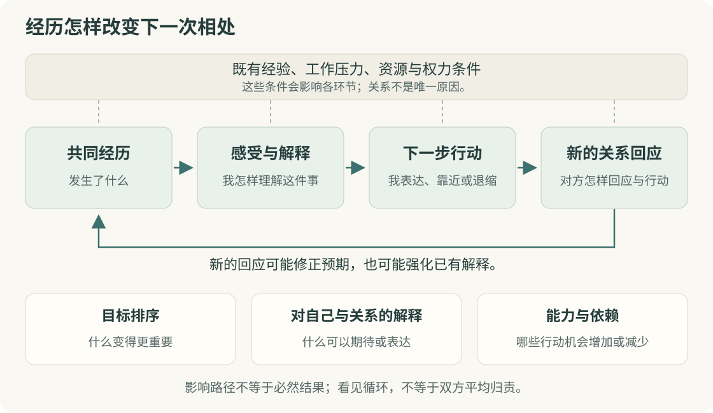

*[图1-1](#figure-1-1)　箭头表示一种需要结合事实判断的影响路径，不表示每个人都会依次、完整地经历这些步骤。回应可能改善或损害下一次相处；看见循环，也不等于双方责任各占一半。*

设想一个一直想参加职业培训的人。课程需要占用几周的晚上，原有工作仍能安排，但独自承担的生活事务让其迟迟没有报名。伴侣知道后，提出在课程期间接手两项具体家务，两人也确认了费用能够承担。报名的人仍需自己申请、上课、完成作业；支持改变的是行动条件，没有替代这份努力。

眼下两人已经有了支持方案，接下来要看家务是否按约接手、本人是否报名并参加学习。若后来获得新机会，再结合原有能力、课程质量、工作环境和个人投入回顾：伴侣的支持改变了什么，其他条件又起了什么作用。这样才看得清合作的实际价值。

另一种相处则令人退缩：伴侣每次听到培训计划都说“你哪有那个本事”，并在对方查课程时讥讽其不安分。提出计划的人逐渐不再提起，表面上分歧减少了，行动空间却可能正在收缩。仍要了解工作是否变忙、课程是否合适、本人是否改变了兴趣；同时，已经发生的贬低需要单独处理，不能因为还存在其他解释，就将它从判断中抹去。

一个人也可能经过考虑后，主动放弃原计划，为自己更重视的生活腾出空间。区分这种选择与受压后的退缩，不能只问最后有没有报名，还要看其是否能自由说出偏好、获得信息、提出不同意见，以及未来是否保有调整的机会。旁观者喜欢哪一种选择，并不是判断自主的标准。

##### 变化之后，仍然需要重新安排生活

人的愿望会变，能力和可用资源也会变。你们可以因此重谈分工、生活地点和未来目标，但新的自我理解不会自动抹去旧承诺带来的后果。若一人曾依据共同安排减少工作，另一人改变计划时，就需要把已形成的依赖放进协商，而不是只宣布“我现在想通了”。如何承担、怎样调整，可以接着读[责任的形成](#unit-8-1)和[目标改变后的重谈](#unit-16-1)。

观察关系对自己的影响，不需要每天做一份成长报告。遇到明显变化时，可以回看：最近我更敢说什么，又越来越不敢说什么？哪些能力和支持增加了，哪些正在减少？这种变化与双方的具体行动有什么关系，还有哪些外部条件在起作用？沿着这些变化，可以找到眼前最需要的支持、协商或保护。

关系能够成为支持成长的环境，也可能让人的生活逐渐变窄。把方向辨认清楚，才知道哪些改变值得共同创造，哪些安排需要修正。接着看[爱的“三体问题”](#unit-1-3)：喜欢一个人、形成恋爱关系、建立婚姻共同体，究竟分别需要什么。

#### 1.3 爱的“三体问题”：喜欢与吸引、恋爱关系、婚姻共同体不能相互推定

**幸福伴侣并非命定唯一，选择与经营同样重要，心动、恋爱和婚姻各有需要回答的问题。**

“我们明明很喜欢彼此，为什么还是不能好好在一起？”这个问题里的“在一起”，可能指向几件不同的事：愿意见面和亲近，能够持续相处，或者准备把长期生活组织在一起。若不先分清正在谈哪一件事，很容易让“喜不喜欢”承担所有解释。

“爱的三体问题”是本书借用“三体”这个名称组织问题的方式，并非物理定律在爱情中的应用。它同时观察喜欢与吸引、恋爱关系、婚姻共同体：三者互相影响，却各自包含需要回答的问题。

##### 心动提供靠近的动力，相处增加新的任务

喜欢与吸引，首先是个人对另一个人的情绪和靠近体验。你想听对方说话，会惦记下一次见面，可能向往亲密接触。吸引可以来自外貌、气质、能力、资源，也可以来自相处中逐渐发现的具体特点。你确实有这种感受，并不能证明对方同样愿意，更不能让对方因此负有回应义务。

恋爱关系则需要两个人作出明确选择，并在持续互动中落实。除了靠近的愿望，你们还会面对时间怎样安排、需要怎样表达、约定怎样遵守、误会和失约怎样处理。一个人非常想念另一个人，并不等于两人已经建立了这种关系；即使明确了恋人身份，互动质量也仍需在相处中继续形成。

婚姻共同体进一步涉及长期生活的组织。在哪里生活，怎样分工，钱怎么安排，双方是否愿意进入生育与育儿计划，怎样连接双方家庭，遇到变化如何承担和调整，都可能进入共同生活的协商。涉及个人身体的选择，仍由本人决定。亲密依然重要，只是两人需要处理的责任、时间跨度和社会联系增加了。登记、制度与具体权益的专业问题，也不能由感情体验直接作答。

| 讨论对象 | 需要回答的主要问题 | 不能由它直接推出 |
| --- | --- | --- |
| 喜欢与吸引 | 我是否愿意了解、靠近这个具体的人？对方是否也有回应？ | 对方愿意恋爱，或两人能够长期合作。 |
| 恋爱关系 | 我们是否明确选择彼此，能否持续产生积极体验、互惠与信任？ | 关键人生目标相容，或已具备婚姻安排。 |
| 婚姻共同体 | 我们是否愿意并能够组织长期生活、责任与社会连接？ | 每项行动都已获同意，或吸引和亲密会自动保持。 |

三个对象的组织范围和任务不同，不能据此给感情排高低。恋爱可以有深厚承诺，婚姻也可能缺少亲密；两个人可以认真相爱，同时选择不结婚。本书面向希望走向长期爱情与婚姻的人，因此会继续讨论婚姻需要什么，但不会把结婚写成所有感情都必须抵达的终点。

##### 四种组合，四种不同的问题

一种情形是，双方互相喜欢，日常相处也能产生愉快与信任，对长期生活有相容的方向，并愿意共同落实。它为继续发展提供了基础，但未来仍会出现新任务。此时值得做的是增加真实相处和相称的共同安排，让期待获得更多现实支持。

另一种情形是，两个人约会愉快，也能相互照顾，却在重要生活目标上难以形成安排。设想其中一人已经决定长期去外地发展，另一人明确希望在本地共同定居。喜欢和相处中的善意都可能是真的，距离与居住目标也同样需要回答。先了解时间、地点及可调整范围，再判断是否存在双方愿意承担的方案；不能因为此刻还爱，就把这个问题无限推迟。

也有两个人看起来很适合合作：收支习惯相近，家庭安排能够协调，彼此都可靠，却缺少至少一方希望拥有的浪漫吸引。继续了解或许会带来变化，也可能不会。已有的合作条件可以支持探索，不能兑换亲近意愿，更不能制造结婚义务。是否愿意接受这样的关系，需要由当事人真实选择。

还有一种情形是吸引很强，持续互动却很难成立。你们每次见面都很投入，之后的联系和安排却始终由一人维持；或双方都想亲近，却无法处理反复发生的失约。这里需要观察的是参与、履约和修复，而不是再证明心动有多强。找出具体障碍，才知道能够调整什么，以及继续投入是否值得。

现实中的关系会在这些方面呈现更多组合，也会随经历改变：曾经合拍的目标可能分开，初见时有限的吸引可能增长，原本不会合作的人也可能学会部分方法。愿意探索时，就继续相处并留意实际变化；希望本身还不能替你回答结果。

##### 幸福不只系于一个人，选择与经营同样重要

能够与你走入婚姻，并最终共同幸福度过一生的伴侣，并不指向某个命定的特定人。一个具体的人当然有无法复制的特点，你们共同经历的事也有自己的意义；但值得珍惜这段经历，不等于你的幸福只能由这个人实现。

正因为未来存在不同的可能，选择伴侣就有真实的意义。你需要辨认彼此是否愿意参与、想要的生活能否相容，以及遇到困难时能否共同承担。选中了合适的人，仍要通过日常回应、履行承诺和不断调整，把可能的幸福变成实际生活。选择与经营同样重要，二者都不能替另一项完成任务。

如果已经确认当前关系不合适，或者对方拒绝继续，你可以重新开始。失去这段关系，并不意味着失去了未来幸福生活的可能；也不必为了守住“唯一的人”，不断接受自己无法承受的相处。接受一次拒绝、结束一段不适合的关系，可以为与其他合适的人共同生活留下空间。

这一点并不抹去分离的难过。你可以珍惜曾经的经历，也承认它已经不能继续。已有的排他约定需要遵守，结束时应处理的责任仍要处理；在这些事情逐步安排的同时，自己的生活也可以重新展开。幸福需要在未来继续创造，无须把它永远留在某个人身上。

当你说“我们是不是不够爱”时，可以再问得准确一点：欠缺的是靠近意愿、持续相处，还是长期生活的可行安排？收入不能代答是否愿意亲近，心动不能代答是否生育或在哪生活。问题被分清以后，下一步才可能是合适的了解、协商、尝试或停止。

[第6.2节](#unit-6-2)会借助激情、亲密、承诺观察感情的组成，与这里讨论的关系对象有所区别。[第17.6节](#unit-17-6)则进一步讨论分离后怎样恢复选择能力。眼前可以先问自己：我希望推进的究竟是哪一种关系，它还需要哪些真实的了解、参与和安排？

#### 1.4 好的爱情：人格和能力保持独立，情感与生活共同经营

**共同生活可以相互依赖，双方仍应保有判断、参与决定和调整生活的能力。**

《致橡树》中各自站立又相互支持的意象，也是本书所向往的关系。把这种向往放进现实生活，便会遇到一个问题：各自站立，是否意味着任何时候都不能依赖对方？

如果独立要求每个人经济完全分开、所有事务都能独自完成，那么疾病、生育、学习或职业转换就很容易被看成不合格的证明。这样的要求忽略了共同生活的重要价值：人可以通过分工和支持，在某些时候拥有比单独生活更多的行动空间。关键是依赖怎样形成、受到什么保障，以及是否仍然保有自己的判断和选择。

人格独立，是能够承认自己的感受，形成判断，表达愿意或不愿意。能力上的独立，是保有理解处境、参与决定和采取基本行动的能力；在自己暂时做不到时，也有获取必要帮助、重新组织生活的路径。需要别人照护的人依然拥有主体性，不会因为行动受限而失去决定自身生活的资格。

##### 同样是不对称的投入，关系可以很不相同

设想一对已经共同生活的伴侣，其中一人准备转换职业，预计有一段收入减少的时期。双方一起看过必要开支，约定由另一人暂时多承担费用，转换职业的一方仍参与预算，也能支配约定范围内的个人开支。到约定时间，两人根据实际进展重新讨论，必要时调整工作路径或支出。

这份支持不必逐笔等额返还，也容许职业转换未能如愿。支持者需要确实负担得起，接受支持的人应诚实说明进展，双方都能讨论变化。外部条件变差时，就重新核算和调整方案，不能仅凭过去的承诺不断增加一方的负担。

对照另一种情境：多出钱的一方要求对方交出全部账户信息、停止与某些朋友联系，连是否继续求职也须听其决定，并以停止必要支持威胁不同意见。问题已经从费用分担变成利用依赖限制选择。收入差距本身不能说明两种情境的差异，实际权限、可用信息和调整空间才能。

因此，判断独立，不只是问“谁养谁”，还要看谁能了解共同事务，谁能提出异议，谁仍有可用支持。一份分工如果持续消耗某人的能力，却不给其保障和重谈机会，即使双方嘴上都称它为爱，也值得重新审视。

##### 三条原则，需要同时成立

**人格独立、共同经营。**你保有自己的想法，也认真处理共同生活已经产生的需要。个人职业方向不能由伴侣代选，但若一项改变会影响已经依此安排的生活，就需要说明影响、讨论过渡。自主并不使已承诺的责任凭空消失。

**合理分工、动态协商。**分工可以依据能力、精力和偏好形成，不必每件事对半。随着健康、工作或照护负担变化，原来的合理安排也可能失去基础。协商不是等一个人耗尽之后才开放的特殊机会，而应当能在条件改变时重新启动。

**互爱互信、保留余地。**信任允许我们不必事事监督，也可以暂时多承担一些；保留余地则让支持不以切断所有退路为代价。必要的信息、个人联系和可用资源，使双方在困难或变化中仍能行动。具体需要保留多少、通过什么方式保留，应当结合处境，而不是套用同一份资产或生活能力标准。

这三条原则支持的是共同生长：双方因爱与共同生活意愿参与，通过合作改善生活，在变化中仍有发展的空间。它不要求两个人每时每刻同步进步。有人在恢复，有人在探索，有时只是一起守住能够承受的日常，也可能是有价值的经营。

##### 看一笔投入，要看它进入了什么安排

花时间、花钱、承担照护，可以出于不同考虑。同一段关系中，人既会享受当下，也会明确费用、期待长期互惠。下表帮助辨认一笔投入怎样被理解，而非给参与者固定分类。

| 投入逻辑 | 它主要看什么 | 放进长期关系时需要辨认什么 |
| --- | --- | --- |
| 即时体验导向 | 此刻是否愉快、满足。 | 当前快乐很重要，但是否有人承担了被忽略的后续成本？ |
| 逐笔对价 | 这一项付出是否尽快获得等值返还。 | 明确费用可以减少误会；若事事即时结算，互补和时间差是否还有空间？ |
| 欺骗性套利 | 通过虚假身份、意图或投入信号，取得单方利益。 | 对方是否因重要信息被歪曲，作出了本来不会接受的投入？ |
| 共同经营 | 让贡献、需要、负担与未来安排形成可持续的互惠。 | 贡献是否被看见，保障能否使用，安排能否兑现和重谈？ |

明确餐费、借款或个人预算，并不使爱情庸俗；有现实需要，也不自动构成套利。真正需要追问的是，双方究竟同意了什么，重要事实是否真实，以及承担能否长期维持。要求先付出的人如果只能给出模糊未来，却持续拒绝说明兑现方式，“为我们好”就不足以支持更多投入。

共同经营可以期待回报，包括被关心、被支持和共同生活的改善。它也容纳合理的时间差。两者能够同时存在，依靠的是可见的行动、可用的保障与真实的调整机会，而不是要求其中一人证明自己无所求。具体怎样安排分工和保障，见[第14.2节的完整任务承担](#unit-14-2)与[第14.4节的依赖与保障](#unit-14-4)。

#### 1.5 好的关系对参与者的要求：五项品质与三正

**责任、忠诚、尊重、透明与共同体意识，要落实为意图、身份和行动的相称。**

两个人可以认可同一种爱情愿景，却在日常中作出很不相同的选择。本书用责任、忠诚、尊重、透明、共同体五项品质，说明参与关系时应怎样对待彼此。这些要求需要在具体行动中理解，不能靠一次答题完成判断。

设想你们约好了周六一起处理一件重要事务，对方为此取消了其他安排。你临时遇到困难，能否说明情况、考虑对方已作的投入、一起调整，并完成仍可完成的部分？这个普通场景里，几项品质会同时起作用，不需要等到重大危机才能看见。

**责任，是承接承诺与合理依赖。**答应过的事，需要履行；做不到时，要尽早说明并处理影响。对方因为双方安排作出的合理调整，也应纳入考虑。责任有来源、有范围，不是只要对方失望，你就必须满足其所有要求。

**忠诚，是遵守双方认可的关系边界。**它需要先知道彼此约定了什么，而不是各自在心里设一份标准，再等对方触犯。若意愿改变，应诚实说明，重新协商或结束相应关系，不能一边继续接受原承诺带来的信任，一边暗中违反它。忠诚也不授权伴侣无限监控。

**尊重，是承认对方的人格、感受与选择。**不同意一种解释，可以说明理由；不能因为自己更有资源或更善于表达，就使另一人的拒绝失效。尊重并不要求赞同全部意见，而要求在意见不同的时候，对方仍然是能够参与和决定的人。

**透明，是诚实说明影响共同决定的重要事实。**需要公开到什么范围，与当前共同事项有关。共同安排依赖一笔资金时，它是否真实可用就很重要；普通交往中的个人日记，则不能仅凭“我们应该透明”被强行索取。合理隐私与必要知情可以同时存在，隐藏关键事实也不能靠“这是隐私”自动获得正当性。

**共同体，是把共同生活真正放进行动。**做选择时看见双方的需要和共同后果，成果能够共享，风险也有合理承担。当一个决定只方便了自己，却把所有成本交给对方，就需要重新讨论。共同体不会使个人消失，也不要求由资源较少的一方服从资源较多的一方。

五项品质需要分别落实。生活中受到照顾，也仍然有权要求诚实；另一人承担较多费用，也仍须尊重自己的身体与交往选择。判断时回到具体事项，分清已经做到的、出了问题的和尚待了解的部分。

##### 三正：意图、名义、行为相称

本书把心正、名正、行正简称为“三正”。“正”在这里不是给人作整体道德定性，而是要求希望建立的关系、明确使用的身份、实际承担的行为相匹配。

| 三正 | 需要弄清什么 | 可以观察或讨论什么 |
| --- | --- | --- |
| 心正 | 想要怎样的交往，是否如实表达重要意愿。 | 本人的说明，与持续行动是否相容；保留无法直接知道的内心部分。 |
| 名正 | 双方究竟确认了什么身份与承诺。 | 是否共同确认，范围是否清楚，有没有一方单独升级称谓。 |
| 行正 | 行动是否与已说明的意愿和约定相称。 | 如何参与、履约，偏差发生后怎样处理。 |

有人坦诚地说：“我想认真了解你，但现在不能承诺以后结婚。”这说明意愿有范围，不等于欺骗。对方可以据此决定是否继续，也可以因为自己需要更明确的婚姻方向而拒绝。坦诚不会保证关系达成，却使选择更接近真实条件。

另一种情境是，一个人反复以“我们迟早是一家人”为由，要求对方承担长期伴侣式的时间、照护和经济投入，却始终回避确认当下身份与责任。需要追问的不是这句话够不够浪漫，而是两人到底约定了什么，为什么新增要求总由一方承担，以及重要意愿是否被有意说得比实际更确定。

意愿和行动之间出现落差，可能是缺少时间、资源或方法，也可能是意愿已经改变却不敢承认，还可能是借承诺取得投入、根本不打算履责。一次失约往往不足以区分这些原因；若欺瞒已经明确，就应处理已知行为，不能一直用“不会表达”解释过去。

能增加信息的，是具体而相称的下一步：请对方说明目前愿意承担什么，把安排缩到实际可做的范围，再看是否行动；已经发生的损失，则看其是否承认和补救。如果口头解释不断变化，实际利益始终单向流动，还拒绝澄清关键事实，这些新增证据就应当改变你的选择。

你不一定需要先证明对方的真实内心，才能停止不适合的投入。能够接受什么、当前承诺是否被履行，本身就与选择有关。三正帮助你减少自欺和含混，也要求你把自己的有限意愿说清楚，让对方同样拥有选择的依据。

#### 1.6 五条行动原则：把判断落到可执行的选择

**以兑现更新判断，以相称投入与分担维持合作，并给尊重和修复留下空间。**

临时变更、突然提出的承诺、情绪上来的争执，都可能让人顾不上平时认同的道理。下面五条原则帮助你在精力有限时抓住要紧的事。遇到犹豫、明显变化或重大投入，找出对应的一条使用即可，普通相处不必逐项检查。

##### 依据行动和兑现更新判断

一句承诺提供了意愿信息，履行让你知道它能否进入现实。原来只是“以后多陪你”，后来变成双方都能承担的安排，并在不同情境中持续做到，判断就可以随之改变。出错时是否说明、补救，往往比从不承认困难的保证更有用。

你可以把下一步缩小为一项有意义的具体安排，给新信息出现的机会，但不需要制造危机测试对方。若反复没有行动，就相应减少对承诺的依赖；若出现一次已经足够严重的侵害，也不必为了凑够“长期模式”而继续暴露自己。审慎不是永远不相信，也不是永远给下一次机会。

##### 在投入中保留基本生活与选择能力

接近一个人，会占用时间和注意，也可能带来真实依赖。需要保留的，是能够支撑日常、获得信息和求助的生活基础：必要收入或其他可用保障、重要社会联系，以及在共同事务中理解和参与的机会。条件有限时，可以先守住最关键的一个入口，再逐步补足。

例如，为了方便见面而连续取消朋友聚会，可以把共同时间与个人时间都提前留出；生病需要照护时，则一起讨论实际可用的帮助，使依赖有合适的安排。这条原则同样约束付出者：不能故意制造对方的经济、生活或情感困境，再把摆脱困境的条件设成服从自己。

##### 重大绑定前，形成相称了解、明确意愿与可行安排

一个决定会改变什么、由谁承担、能否承受，需要与它的后果相称。普通约会不必完成整套婚前调查；共同负担、迁居或长期照护等安排，则不能仅凭已有感情跳过关键事实。缺少决定性信息时，可以保留关系中的其他互动，同时暂缓相关行动。

这里要把身体同意与共同事务授权分开。对拥抱说了愿意，后来不想继续接触，就应当停止；愿意拥抱，也不等于同意进一步亲密。身体接触取决于当下、具体、自愿的同意，不需要用一段合理解释换取停止的资格。

共同事务可以有双方事先认可、范围明确的执行授权。例如，在约定额度内支付日常采购，不必每次重新开会。但这个安排不能被扩大为替另一人答应借名担保。新行动改变了责任范围，就需要独立了解与本人重新确认；原有身份和日常付款习惯都不能替代它。

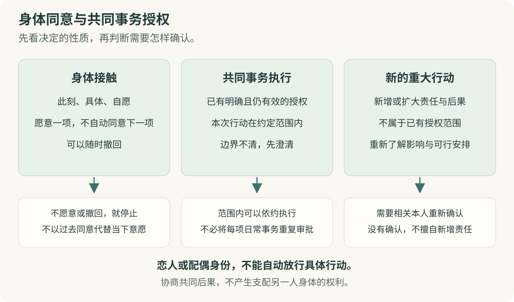

*[图1-2](#figure-1-2)　这是本书的关系决策边界图，不判断具体合同或授权的法律效力。个人职业、生育意愿等变化可以讨论共同后果，讨论本身不产生支配另一人身体与核心选择的权利。*

##### 分担与真实能力、贡献、需要和风险相称

两人不必投入同样的钱、时间和体力，但应当知道当前安排依靠谁多承担了什么。让一方减少工作来照顾家庭，不能只承诺未来会感激，还要讨论眼下可用的生活保障、其参与决定的方式，以及条件改变后怎样重新分配。

先把正在发生的负担说清楚，再找双方确实能做的安排。没有足够资源时，可以减少任务、改变节奏或寻求实际可达的支持；不能把缺口全部改称某个人不够爱。额外承担一旦超过可接受范围，就需要调整，不能靠不断延长的未来回报维持。

##### 面对分歧处理具体问题，保留尊重与修复空间

一次争执可能只是时间安排不合，也可能触及重要目标。先说清楚这一回发生了什么、造成了什么影响、需要调整什么，比直接评价对方整个人更容易找到可处理的位置。你可以愤怒，可以说不，也可以暂时离开谈话；羞辱、威胁和反复以分手逼迫服从，并不会因为情绪真实就变得合理。

一般分歧中，协商和协调是值得优先尝试的做法。两个人可能都没得到最想要的结果，却找到愿意接受的安排：这次先处理必要事务，下次再补共同活动；预算暂时有限，就换一种体验。双方都能接受的妥协，不自动证明爱已经消失，关系也不能靠一人始终任性、另一人始终让步来维持。

愿意继续且能够安全协商时，可以采用[第8.6节的修复步骤](#unit-8-6)，再看改变是否落实。有明确危险时，应直接寻找[保护与独立支持](#unit-17-5)；已不愿继续，也可以[说清结束](#unit-17-3)，无须耗尽全部修复办法。

这些原则允许人有偏差，也要求人对偏差作出回应。不必在一次疲惫的争论后判自己毫无能力，可以先把造成的影响处理掉，把下一次最容易失败的环节变得可做。原则的价值，体现在日常是否因此更清楚、更可承担。

#### 1.7 七条伦理主张：共同经营有底线，具体生活由当事人选择

**共同经营应以真实选择、人格平等和责任为基础，并保障双方结束关系的权利。**

两个人怎样安排钱、家务、个人时间和家庭联系，可以有很大差异。本书不把某一种具体生活方式定为唯一正确，却需要说明自己支持什么、反对什么。否则，“只要双方觉得合适”就可能遮住信息被隐瞒、拒绝受到惩罚，或者一人根本没有参与选择的事实。

前面讨论的[共同生长](#unit-1-4)指向希望创造的生活，[五项品质](#unit-1-5)说明参与者怎样对待彼此，[行动原则](#unit-1-6)帮助处理具体选择。本节进一步说明本书支持哪些底线，以及双方应保有怎样的地位。这些伦理主张表达的是本书的价值立场。

##### 七条底线，约束双方的行动

**一，不把伴侣工具化、单方套利。**人可以给彼此带来照护、资源、愉悦和支持，这些价值值得享受。但不能把对方仅仅当成利益来源，通过歪曲事实和意图，使其承担自己并未真正接受的代价。这里反对的不是有需要，而是剥夺对方依据真实情况选择的机会。

**二，人格平等，尊重双方的感受与需要。**平等不要求每项投入相同，却要求任何一人的需要都不能因为收入、出身或能力较弱而自动失去讨论资格。谁更能承担，可以影响分工；谁更有钱，并不因此拥有更高的人格地位。

**三，行为与责任和关系阶段、明确约定相称。**约会的善意不自动生成恋人权利，恋人的承诺也不自动包含所有婚姻安排。阶段帮助理解双方通常正在形成什么，但具体责任仍要看实际承诺、参与和合理依赖，不能只靠一个称谓包办。

**四，重视责任、忠诚和重要事实透明。**共同生活要能依赖真实信息和已作承诺。愿望变化可以诚实说明，不能持续接受旧承诺的好处，同时隐瞒已经改变的关键条件。对方据此改变选择，是其应有的空间。

**五，不通过操纵、强迫或羞辱维持关系。**害怕失去可以被理解，却不能成为限制行动、扭曲事实或贬损人格的理由。已经确认的侵害，应当按具体行为及后果处理，不能降格成“表达方式不同”或“价值观不一致”。

**六，主动经营，不等待关系自动改善。**如果双方选择继续，就各自承担能够明确的参与：发起一次共同体验，说明一个重要需要，完成自己认领的事项，或修正已造成的问题。主动经营不等于一人永久包办，也不要求维持任何已经不愿继续的关系。

**七，保留退出能力和权利。**两个人都能够选择继续，也能够选择结束。退出不需要先证明另一人坏，不应以对方同意、完全没有依赖或全部善后完成为资格；同时，已经形成的合理责任需要另行辨明和处理。

##### 用底线判断行动，不用它替所有人选择生活

设想两人认真谈过未来：一人明确希望建立有孩子的家庭，另一人确定不愿生育，双方都不愿以委屈自己为代价继续。一个人决定结束这段关系，并不需要先将另一个人判成自私。他们可以承认已有的好，也承认当前没有双方愿意接受的共同方向。

如果还有物品要归还，或双方已经确认应共同承担的费用尚未处理，可以在结束关系后继续安排。善后承担以具体约定及责任来源为依据，不赋予任何人继续索取亲密的权利。[第17.4节](#unit-17-4)会进一步说明怎样处理既有依赖与有限过渡。

如果有人以伤害、报复或泄露隐私威胁对方不准离开，就应优先安排[保护与可用支持](#unit-17-5)。善后可以采用更安全的方式，不要求受威胁者为证明负责而当面对质、独自赴约或继续维持身份。

也有问题来自普通能力局限：忘了安排、理解有偏差、暂时没有资源。这些需要看影响、学习与调整，不宜直接判为恶意。但若关键事实已经表明一人在有意限制另一人的选择，也不能以“大家都不完美”将其抹平。伦理判断应当随事实更准确，而不是随着自己想留或想走任意改变。

这些底线不能替你挑选伴侣，却能帮助你对选择负责：愿意继续时，真实地参与；出现问题时，准确地处理；不愿继续时，承认这一选择，同时辨明尚未完成的合理责任。生活方式可以不同，人的选择与承担都应当有清楚的位置。

#### 1.8 风险专节：把关系当救援、把成长当改造、把责任当控制

**需要支持可以坦然表达，关系中的帮助与责任应当支持生活、保留选择。**

期待被爱、希望得到帮助、担心失去，都不是侵害。风险出现在这些愿望通过某些行动不断加重负担、扭曲信息或压缩选择的时候。在关系开始之前或刚刚形成时，先看正在发生什么，比急于判断谁“心理不成熟”更有用。

##### 让一段关系承担全部人生

设想一个人为了尽快确定关系，取消了朋友聚会，也放弃一次原本重要的工作安排，只想随时等到对方有空。其实际希望在几年内结婚生育，却怕一说出来就被拒绝，于是反复表示“我什么都可以”。此时双方还没有形成明确承诺，也没有共同生活或共同经济安排。

眼前已经出现的是个人支持和工作机会减少、重要目标被隐藏、相处投入增加。接下来需要了解：这些选择是否受到对方要求，双方各自知道什么，投入者还能否停止或调整。查清这些行为，才有依据判断是否存在操纵，而不是仅从一个人急切地想恋爱就替对方定性。

如果一个人越来越依赖“被选中”来确认自身价值，对拒绝的恐惧就可能使其更不敢表达差异；差异越不清楚，双方越可能在错误预期中继续投入。哪怕对方并无恶意，后来得知真实目标，也可能发现此前理解并不一致。隐瞒与过量投入没有消除不确定，只是让澄清变得更昂贵。

可以先恢复一项不依赖关系进展的生活安排，例如联系仍可信任的朋友、重新评估工作机会，或停止为没有确定的邀请持续空出全部时间。再在合适时说明真实方向：“我希望走向婚姻，也有自己的时间考虑。现在不要求你承诺结果，但想知道我们是否朝相近方向了解。”对方的回答可能让关系继续，也可能使差异更早显现。

真正有帮助的是恢复可用支持。朋友、收入或居住选择不足时，可以先找到现实可达的一处资源，再逐步建立生活基础。多一点可以依靠的人和事，就多一点坦然表达需要的空间，无须等到事事独立才开始生活。

##### 用含混目标换取身份与投入

有的人因为害怕拒绝而不敢说出真实需要，也有人明知目标不同，仍用对方期待的说法取得身份和好处。这两种情形的意图不能仅凭外观判定，持续误导造成的影响却都需要处理。尤其当一方已经清楚知道某项事实足以改变对方的选择，还反复加以隐瞒时，就不能只把问题解释成胆小或表达困难。

可先说明目前确认的事实与意愿，停止沿用会造成误解的称谓和保证，再看双方是否愿意在真实条件下继续。对受到影响的人来说，不必承担查清全部内心的任务；当前信息不足、承诺不相称，已经可以成为暂缓新增责任的理由。已经发生的损害则另行辨明，不因后来愿意坦诚就自动消失。

##### 把共同成长变成单方面的改造

共同成长有时会被说成：“等我把你的性格改好，我们就能幸福。”但希望对方学习一种必要技能，与要求对方成为另一个人，之间有实际区别。前者可以说明具体任务、可学的方法和本人是否愿意；后者可能不断扩大标准，把任何不同意见都解释成不成熟。

例如，讨论一人负责的事务怎样按时完成，可以进入分工与支持；要求其放弃所有被伴侣看不上的朋友和兴趣，才能证明愿意成长，则在改变其生活边界。如果既不给独立选择，也不接受不同结果，“为你好”就不能证明安排正当。帮助的效果应当能回到本人认可的需要，而不是只符合帮助者想塑造的形象。

责任也可能被用来固定这种控制：“我为你付出这么多，你就不能拒绝。”已经付出的时间和资源，需要按真实约定理解，不能转成对另一人全部生活的所有权。若一方利用经济依赖、羞辱或威胁阻止不同选择，就需要处理这些具体限制，不能再要求受影响者以更多牺牲证明自己负责。

想被支持是一种愿望，把全部支撑集中到尚不可靠的关系里会增加风险，已经发生的隔离、欺瞒或强迫则需要实际处理。辨认时分别看这些层次，不因一个人处境困难就判其危险，也不因另一个人提供了帮助就认可其全部安排。

如果仍能自主选择，可以先限制新增负担、恢复信息和外部联系，并判断对方是否愿意接受真实边界；如果表达边界可能招致报复，应优先寻找与实际处境相适应的独立支持，不必冒险证明对方会怎样反应。具体安排见[第17.5节](#unit-17-5)及[附录J.4](#unit-J-4)。

到这里，我们确定了希望共同创造什么，也说明了参与应有的边界。[下一章](#unit-2-1)会进一步讨论：关系究竟怎样从两个人的好感，逐渐形成能够运行的共同生活？哪些变化说明它正在生成，哪些只是身份、承诺或投入造成的错觉？

### 第二章 关系怎样生成：婚恋关系系统模型与健康关系的样子

*本章的模型是本书组织观察与行动的框架，情境均为虚构。图中的箭头用于说明条件与过程，不代表已测出的因果强度。*

#### 2.1 先看关系由什么组成：基础层、“3+1”核心层与周围环境

**理解一段关系，要同时看双方的意愿与意义、实际运行，以及周围环境的影响。**

两个人都很优秀，关系却未必好过；已经确定身份，也可能还不知道怎样一起安排一件小事。个人拥有的条件，要经过实际相处，才能形成彼此可以使用的支持。本章用婚恋关系系统模型，帮助你看清这种转变，以及它在哪些地方遇到了困难。

这里的“系统”，指相互联系、会彼此影响的一组活动和安排。邀请得到怎样的回应，会影响下一次是否主动；工作时间改变，会影响见面和事务分工；谁能决定一笔支出，也会影响信任与个人空间。它又是开放的，因为双方始终与朋友、家庭、工作和社会环境保持联系，无法只靠两人的意愿安排一切。

先设想林岚和周衡准备约着看展。两人从互联网认识，他们实际相识和见面的经过会在[第3.3节](#unit-3-3)展开，这里先借这个场景理解模型。

假设两人对展览都有兴趣，需要商量时间、路线、费用和临时改期；朋友推荐的活动、工作排班，也会影响选择。同一次邀约便把兴趣、安排、资源、共同决定和外界条件连在了一起。

##### 三处观察位置，回答不同问题

**基础层，观察双方重视什么、怎样理解关系。**其中包括价值观、人生叙事、自主意愿和共同体认同。价值观影响你愿意优先保护什么；人生叙事影响你如何解释自己的经历与未来；自主意愿关乎本人是否愿意参与；共同体认同则涉及你们是否逐渐把某些事情理解为“我们共同的事”。

林岚希望在本地发展，周衡未来的工作地点尚未确定，这些人生安排会影响以后的选择。各自的价值观与人生叙事在相遇前已经存在；哪些计划愿意共同承担、会不会形成“我们的未来”，则要在交往中逐渐了解。初识的好感不能替双方作出这些决定。

**核心层，观察关系实际怎样运行。**本书把它分为感情、生活、经济三个主要功能领域，加上跨领域的治理系统，因此简称“3+1”。它们分别帮助我们看见靠近的价值、事务的完成、资源的安排，以及双方如何共同决定和调整。

| 功能领域 | 主要处理什么 | 在看展情境里看什么 |
| --- | --- | --- |
| 感情 | 吸引、亲密、关爱、回应、幸福体验与共同意义。 | 是否愿意见面，相处能否带来双方认可的愉快和了解。 |
| 生活 | 活动、时间、空间、日常事务与照护。 | 时间和路线是否可行，谁查信息，临时变化怎样处理。 |
| 经济 | 资源获取、配置、使用、积累和实际责任。 | 费用是否清楚、可承担，付费方式是否为双方接受。 |
| 治理 | 身份、承诺、边界、权责、决策、履约与修复。 | 谁能改变安排，重要变动如何说明，不同意时能否讨论。 |

治理跨越前三个领域，但它并不站在人的上方发号施令。作决定、执行或反对的始终是具体的人。治理也会直接带来价值：你的意见被认真听取，约定能落实，错误可以纠正，会使共同参与更有依据。它不能只靠规则数量证明良好，更不能把一方服从另一方当作协调成功。

**周围环境，观察谁和什么条件正在影响两人。**父母、亲属、朋友、雇主、服务组织，以及资源和制度环境，都可能带来帮助、义务、信息或限制。朋友能推荐活动、提供不同看法，却不会因此取得决定两人身份的权限。两人的行动也会改变这些连接，例如更换时间后，能否继续参加原有的朋友聚会。

外部影响并不总要经过双方同意才发生。工作排班改变、服务临时不可用，都可能直接缩小可选方案。边界可以限制不当干预，却不能把所有现实限制挡在门外。既要辨明哪些事由两人决定，也要承认有些条件暂时改变不了，再寻找实际可行的安排。

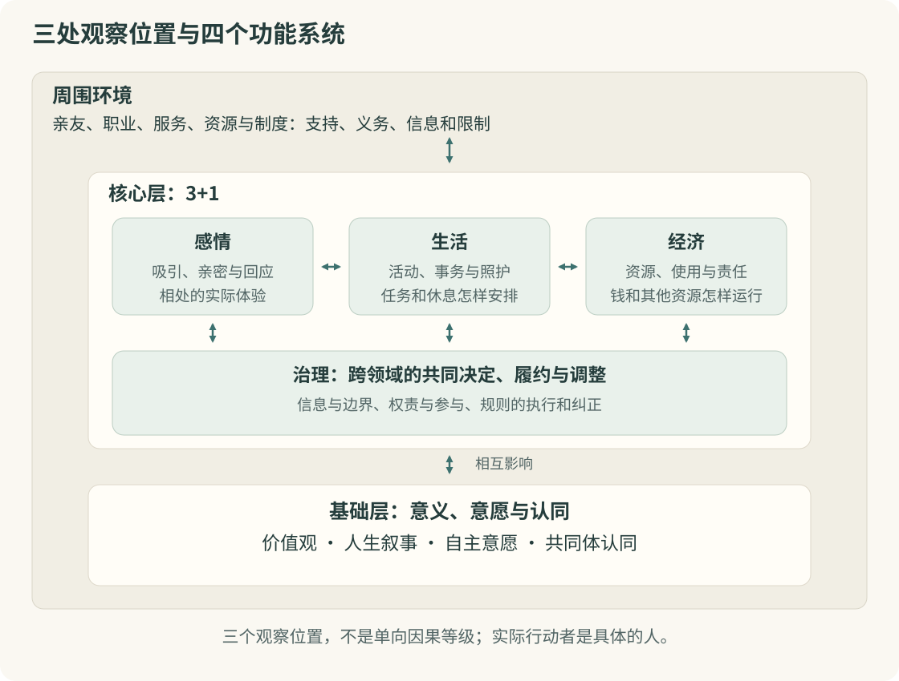

*[图2-1](#figure-2-1)　方框表示观察范围，不是四个独立部门，连线也未穷尽全部直接影响。基础、运行与环境可以相互影响；社会网络属于周围环境，风险则可能出现在各处，都不是新增的第五个内部系统。*

##### 一件事可以跨领域，一份资源不能重复计算

一次付账既涉及经济，也可能表达关心；提前讨论费用既属于治理，也可能使相处更放松。这不意味着必须选一个唯一归属。我们画出不同领域，是为了辨认同一事件有哪些作用，而不是把日常生活拆成互不来往的盒子。

信任也有不同对象。你可能相信对方关心你，却不相信其会按约定告知变动；也可能相信对方办事可靠，却尚未有亲近的愿望。把信任全部塞进感情领域，会漏掉承诺、规则和执行的部分。

功能可以重叠，资源不能凭此增加。两人可支配的一笔钱，能够支持活动，也可能带来安心，但仍只有这一笔钱；同一段空闲时间，不能同时被算成全程工作、全程照护和完整休息。谁拥有资源、谁能使用、谁承担成本，应当回到真实安排。

同样需要分开的是，**个人会做、口头愿意做、两人实际做过**。周衡擅长规划旅行，不等于他已经与林岚形成了合作；两人都说“可以商量”，也不等于出现分歧时确实能商量。只有发生过的互动，才能支持相应范围的判断。对还未发生的部分，可以保留期待，也应当保留未知。

三层观察可以同时进行：价值观会影响行动，经历也会改变价值排序；工作条件影响合作，两人又可能通过合作改变部分生活条件。[下一节](#unit-2-2)讨论这些活动怎样逐渐形成能够持续运行的关系。

#### 2.2 健康关系怎样逐渐形成：有效、稳定而可持续的良性循环

**健康关系依靠双方可承担的参与形成良性循环，并能看见和调整实际负担。**

一次舒服的见面，可能使你愿意再约；第二次活动中，对方认真对待你的建议，你开始期待自己的需要能够被听见；你也更愿意主动安排、分享和承担。双方的参与由此有机会互相接续，逐渐形成一些不必每次从零开始的习惯和预期。

这是一条有益的强化路径：合理投入带来积极反馈，积极反馈支持信任与关系认同，双方因而愿意继续参与。它需要双方有意愿、接得到回应，也负担得起安排。如果投入始终由一人增加，就要看看另一人是否愿意参与，不能把不断加码当成共同发展的证明。

##### 从一次活动，到可以依靠的安排

接触提供互动机会，重复互动让双方获得新信息，也可能形成实际功能。一次各自买票，只能说明这次费用怎样处理；后来共同计划出行，讨论预算、完成各自任务，变动时能重新安排，才逐渐提供了经济与治理合作的证据。

在这个过程中，双方可以明确新的承诺，让原本偶然发生的互动有了更稳定的期待。更多领域的合作又可能连接起来：费用安排减少争执，分工释放休息时间，愉快体验增加继续参与的动力。共同体由此逐渐拥有两人单独生活时并不存在的合作能力，但它仍需要双方真实参与，不能从个人条件直接相加得出。

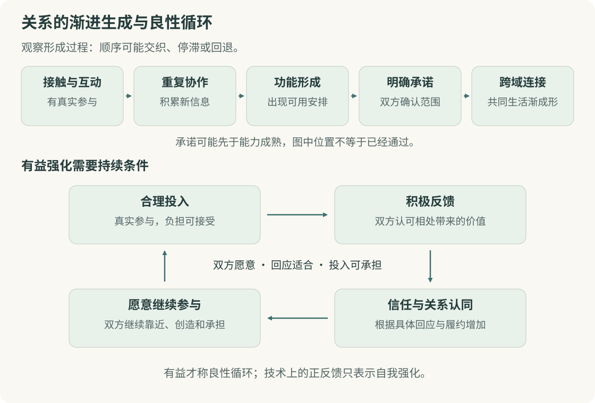

*[图2-2](#figure-2-2)　这是理解过程的示意，不是自动升级路线。功能可以同时形成、停滞或回退；承诺也可能先于能力成熟。每一步都需要看实际发生了什么。*

早期没有共同账户，不等于经济系统失灵，因为两人可能还没有承担共同经济任务。已经共同生活，并明确约定谁承担必要费用，却持续无法落实，则是另一种问题。还没形成、正在形成、已经形成但运行受损，需要不同的行动，不能用同一个“不健康”概括。

##### 六个词，分别回答六个问题

看见一些功能之后，还要问它们运行得怎样。日常语言常把“稳定”“有效”“能继续”混在一起，模型需要把这些判断分开。

| 概念 | 要回答的问题 | 单凭什么还不够 |
| --- | --- | --- |
| 有效 | 双方重视的关系价值，能否在安全、自主和可承受负担下实现？ | 家务做完、账单付清，或旁人觉得这段关系很好。 |
| 自持 | 在合理外部交换和普通可承担投入下，必要功能与重要价值能否持续？ | 偶尔一次表现很好，或靠某人长期超负荷撑住。 |
| 稳定 | 明确的一种状态或范围，是否持续了一段时间？ | 持续本身不说明状态值得维持。 |
| 可存续 | 在当前条件和给定时间内，是否存在双方可接受、能够执行的继续路径？ | 现在还在一起，或对遥远未来的笼统保证。 |
| 抵抗 | 冲击发生时，必要功能受到多大影响？ | 从未遇到相应冲击，不能算已经证明抵抗能力。 |
| 恢复 | 功能受损之后，能否恢复或重建可行安排，需多久、由谁承担？ | 事件过去、停止争吵，或只恢复了其中一个领域。 |

一个家庭每天都有饭吃、事务也完成得不错，但如果全部依赖一人长期压缩睡眠、放弃必要休息，其局部产出不能证明整体有效。还要看这个人付出了什么、是否愿意、负担是否可以调整。共同体的成果不能把承担者藏起来。

一段关系也可能多年没有明显争执，因为某个人已不敢说出不同意见。这样的状态可以稳定，稳定的却是沉默与受限。反过来，近期因为搬家或照护而忙乱，并不自动证明整个关系不可继续；若有可承担的过渡安排和现实恢复路径，判断会不同。

自持尤其容易被误解成“什么都由两个人自己完成”。工资、可负担的服务、亲友自愿且可靠的帮助，本来就是开放生活中的正常资源。借助这些支持不是天然失败。要查的是它们是否真实可用、条件能否接受、是否可持续，而不是要求家庭脱离社会独自运转。

可存续还必须说明时间和条件。现有安排能支撑近期过渡，不等于长期目标已经解决；今天有困难，也不等于没有经过调整继续生活的路径。若只能依赖所有人每天完美执行、从不生病、从不遇到变化，方案就可能只有纸面上的可行性。找不到路径时，可以承认尚不清楚，而不必宣判一切永远无解。

##### 循环的方向，与结果的好坏要分开

技术上的正反馈指自我强化。一次适当回应增加靠近，靠近又创造更多回应机会，可以形成有益的强化；监控使表达收缩，收缩又被解释成更可疑，从而带来更多监控，也可能形成自我强化。两者都不能仅凭“正”字判断好坏，后者的控制责任也不会因为形成了循环就平均分配。

负反馈则指对某种偏离的抑制。发现可调整支出超出计划，双方减少非必要开支，可能使偏差缩小；用惩罚压下异议，也可能减少可见争执，却损害自主和真实信息。我们因此用“良性循环”说明有益的强化，用“纠错调节”说明有益的调整，不把技术名称当价值判断。

反馈也不是说出来就会生效。有人不知道问题，有人知道却不敢说，有人愿意改却没有资源；从行动改变到体验改善，还可能需要时间。需要找出停在哪一处，再决定是增加信息、减少负担、改变安排，还是处理限制表达的行为。反复要求“多沟通”，未必改变了真正的障碍。

##### 补住缺口，也要看谁在承担

设想一对已经共同生活的伴侣，其中一人失业。双方说明了可用储备和必要支出，商量近期减少哪些开支；另一人暂时多承担一部分费用，也提供情感支持。只要这些投入真实可用、负担可接受，并有重新评估的时间，它就可能帮助生活度过冲击，而不需要立即恢复原来的收入与分工。

某项家庭功能出现缺口后，由其他人、资源或调整额外补位，本书称为**家庭功能代偿**，下文简称代偿。它与正常分工不同：原来就约定一人做饭、一人采购，首先是协作；采购者暂时无法履行，另一人增加任务或另找服务，才是针对缺口的补位。若新状况成为长期现实，就要建立新的持续安排，而不是让“暂时多扛一下”无限延长。

对照另一种情境：失业消息被隐瞒，缺口靠借债和伴侣不知情的额外负担掩盖，必要支出暂时仍能支付。生活看起来照常运行，承担方式却已改变。此时需要查清隐瞒造成的影响、实际负担和偿付路径，单看账单付清或出现借款，都不足以理解发生了什么。

即使后来收入恢复，也只解决了一部分事情。若隐瞒曾使对方在错误信息下安排生活，仍需说明事实、处理已形成的影响，并改变关键决定的参与方式；信任是否恢复，还要看后续行动。资金问题传播到了治理与感情，修复就不能只停在资金这一处。

同样，一次现金缺口也不必自动毁掉亲密和合作。不同领域可以互相支持，但不能凭“相互代偿”创造不存在的钱、时间和精力。判断时分别看个人、各功能领域和共同生活：保护了什么，谁多承担，多久还能承受，何时需要调整。

健康的运行不是永远顺利，而是有价值的相处能在现实条件中得到延续，偏差能够被看见并得到相称处理。没有遇到过的压力仍然未知，无须为了证明恢复力故意制造考验。依据实际互动逐步作出选择，具体怎样把握关系推进的节点，见[下一节](#unit-2-3)。

#### 2.3 六个关键节点：运行基础、明确选择与可承担责任一起看

**每次增加关系承诺，都要同时看运行基础、双方的明确选择和新增责任能否承担。**

两个人相处很好，却从未共同确认关系，其中一人不能仅凭默契宣布双方已经是恋人。反过来，两人已经确认恋爱，也可能发现相处长期只有一方主动、关键承诺难以落实。前一种情况缺少共同选择，后一种情况需要看已经成立的身份有没有得到实际运行支持。

**同意使约定成立，运行证据支持这项选择是否适宜。**两者各自回答不同问题，再加上新增责任能否承载，构成每个节点都要看的三要素。它们不能相互抵销：善意很多，不能替对方同意；双方同意，也不能把不可承担的后果变成已经有了安排。

本书提出六个节点，帮助希望走向长期爱情与婚姻的人逐步增加承诺。它们是一条审慎的行动路线，不是所有现实关系必经的仪式，也不能预测照做以后就会幸福。你可以在节点上继续、暂缓或结束；继续增加了解，并不总要同时增加绑定。

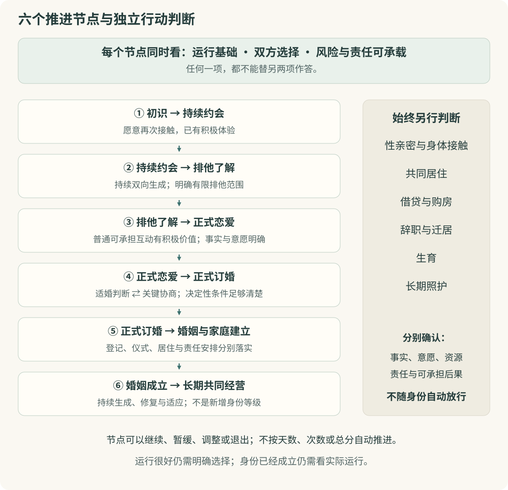

*[图2-3](#figure-2-3)　每个节点都要同时看运行基础、双方选择、风险与责任是否可承载。最后一项是持续经营，不是新增身份等级；旁侧列出的具体行动始终需要独立判断。*

##### 从愿意再见，到明确恋人身份

**第一个节点，初识到持续约会。**需要的基础是双方愿意再次接触，互动已开始产生一些积极体验。你不必在首次见面就知道对方是否适合结婚，可以提出下一次具体邀请，看看两人能否继续参与。此时的新选择是继续认识，承担的也主要是与当前活动相称的时间、费用和基本告知。

**第二个节点，持续约会到排他了解。**依据是持续的双向兴趣与积极反馈，而且双方都在主动创造接触。排他需要明确约定范围、参与责任和退出告知，不能把自己减少接触其他人的选择，自动写成对方的承诺。它提供集中了解的空间，并不意味着家庭功能已经成熟，也不同于本书接下来所说的正式恋爱确认。

**第三个节点，排他了解到正式恋爱。**这里增加的关键依据，是感情开始初步自持：普通、可承担的互动，能够持续带来双方认可的积极情感价值，参与不靠长期单方透支，并已有基本的承诺与边界协作。频繁联系可以帮助了解，但如果内容只是例行报到，不能独自证明这种积极价值已经存在。

同时，足以影响当前选择的关键事实应当相对清楚，重大方向没有当前不能接受的障碍，双方明确选择恋人身份。不是所有远期问题都要在此解决；但已知会改变决定的重要问题，也不能因为气氛很好就略过。[第6.2节](#unit-6-2)说明怎样观察感情初步自持，[第6.3节](#unit-6-3)至[第6.7节](#unit-6-7)讨论必要了解与尚未明确的事项，[第6.8节](#unit-6-8)再落到正式恋爱确认。

林岚和周衡如果在几次普通活动中都愿意靠近、相处愉快，这可以支持继续了解。若后来形成持续的双向参与，才有讨论排他的基础；再有普通可承担相处中的积极价值、必要事实和明确选择，才能讨论本书建议的正式恋爱节点。这些条件要在实际交往中逐步形成，模型只是帮助两人看清每一步还需要什么。

##### 从恋爱，走向共同生活的长期组织

**第四个节点，正式恋爱到正式订婚。**此时要综合看已知个人条件与共同生活目标是否相容，多个功能领域能否基本协调，婚姻路径是否有现实可行性。日常相爱仍然重要，但居住、婚育、资源与主要责任等决定性事项，已经不能只留在“以后总会有办法”的层面。

适婚判断与婚事关键协商需要往返校验。你可能先觉得两人适合，再在讨论住房或长期地点时发现原先依赖的条件并不成立；也可能在协商后找到双方愿意承担的新安排，使原先的疑问得到回答。决定性未知应保留为前提，不能先给出无条件的适婚结论，再首次讨论会推翻结论的事项。

本书把清楚的婚约、必要家庭告知和婚礼安排纳入正式订婚的约定。具体处理应符合真实家庭情况与双方选择，父母是否接纳不能被增写成普遍资格，出资也不自动赋予家长审批两人关系的权力。这是本书用于安排任务的定义，不代表对所有地方婚约法律含义的判断。

**第五个节点，正式订婚到婚姻与家庭建立。**重点从形成共识转向真实落实：相关登记、仪式、居住和责任安排各自怎样完成，资金或其他支持是否确实可用，计划变化时能否一起处理。承诺得到落实之前，不能按已经兑现使用；订婚后出现的新事实，也仍然可以改变选择。

**第六个节点，婚姻成立到长期共同经营。**它不是第六次身份升级。共同生活会不断产生任务，也会遇到职业、健康、家庭和意愿的变化。两人需要继续生成价值、处理损害和调整安排，而不能把已经完成的登记或仪式当作经营已经结束。

##### 身份向前，不意味着所有行动一起放行

性亲密、同居、借贷、购房、辞职迁居、生育和长期照护，各自改变不同的依赖与后果。对某项行动愿意与否，所需事实是否清楚，资源与责任怎样安排，应当分别确认。[第1.6节](#unit-1-6)所区分的身体同意、共同事务和有效授权，也仍然适用。

例如，两个人可以明确选择恋爱，同时因为工作地点未定而暂不共同居住；可以决定结婚，同时对一项新增借贷说不。限制一项尚无条件承担的行动，不自动否定整段感情。反过来，已经发生亲密或共同投入，也不能替尚未达成的身份与未来承诺作答。

在具体节点上，只收集与当前选择相称的信息。联系减少时，可以先了解工作负担、原来的联系习惯、对继续交往的意愿，再看一次可行安排能否落实；不必立即给出“不爱”的结论，也不能以忙碌为理由无限忽略持续失约。新的事实应当改变判断，不能让模型永远支持自己最想要的答案。

这些节点提供次序，但不规定见面次数、交往天数或统一分数。经历中的自然变化可以增加信息，未发生的压力继续保持未知。关系推进得审慎，意味着愿望、实际运行与承担后果逐渐对得上，而不是把所有不确定都清空后才允许靠近。

#### 2.4 菱形演进模型：用两条轴观察关系重心与体验

**观察吸引、责任、体验与经营的变化，是为了找出亲近机会被什么支持或挤压。**

有时关系中的任务都在完成，你却觉得两个人很久没有好好靠近。也有时相处充满新鲜感，一涉及安排和承担就散开了。四系统能够帮助定位具体问题，菱形演进模型则提供另一种简便观察：此刻是什么在推动双方靠近，你们共同的时间和精力主要用在什么地方？

菱形的两条轴是**吸引—责任、体验—经营**。前一条观察愿意靠近的动力与承接承诺的力量，后一条观察当下相处的体验与为了延续关系而作的组织、创造和调整。它是核心模型的衍生视角，不增加另一套关系系统。

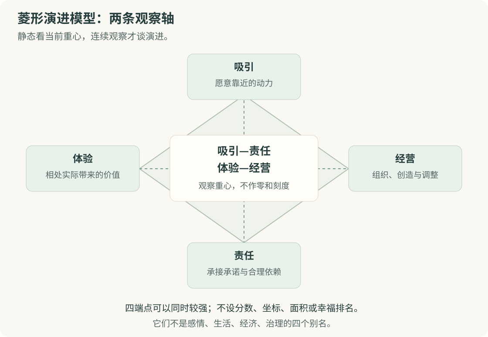

*[图2-4](#figure-2-4)　两条轴不是此消彼长的刻度，不设置分数、坐标或面积评价。四端点可以同时得到支持；观察不同时期的变化，才谈得上“演进”。*

**吸引**让你愿意靠近这个人，包括想见面、欣赏和亲近的动力。**体验**是相处当中实际得到什么，例如愉快、被理解、共同探索或有意义的陪伴。**责任**使已作承诺和合理依赖进入行动。**经营**则通过安排、主动创造、合作与调整，使关系有机会继续产生价值。

这四者并不互相排斥。一个人可以很想见伴侣，也认真考虑对方因为约定而空出的时间；两个人一起安排一次负担得起的短途活动，既是在经营，也可能带来很好的体验。经营不必只有开会、记账和修补问题，主动为相处创造机会同样属于其中。

因此，四个端点不是感情、生活、经济、治理的别名。一次愉快旅行可以同时需要四系统参与，也可以同时包含吸引、体验、责任和经营。[第2.1节的四系统视角](#unit-2-1)帮助你找活动领域，菱形图帮助你观察动力和活动重心，两者不需要逐格配对。

##### 同样“最近不够亲近”，需要不同解释

设想一对伴侣正在搬家。订服务、打包、核对费用占去了许多晚上，双方仍然按约定办事，却很少有轻松聊天和共同休闲。此时，责任与经营占据了较多精力，体验和靠近的机会受到挤压。接下来要看，这份忙乱能否缓解，双方是否仍有靠近的意愿。

若主要是临时负荷，搬家告一段落、两人得到休息后，是否愿意重新安排普通相处，可以增加信息。此时先降低不必要标准、给恢复留出时间，可能比要求立即浪漫更切合处境。但不能仅因为“忙完就好了”听起来合理，就把它当作已被证明的结论。

若负荷已经下降，两人仍持续回避靠近，就要进一步了解：是否有未处理的不满，是否缺少双方都愿意的体验，或继续亲近的意愿是否发生变化。它们需要不同的回答；安排一次昂贵旅行，未必能处理其中任何一个真正障碍。

若搬家的规划、执行和收尾始终落在一人身上，另一人只是觉得生活运转正常，就需要先看负担分配。特别是承担者连异议也不能提出时，不能一边描述其持续受损，一边因为费用结清、事情做完，就称治理整体良好。恢复亲密可能需要先改变现实安排，而非要求疲惫者多一些好脸色。

这几种解释也可能并存。比较不同时期的任务、双方体验和表达空间，才能判断哪些条件真正改变了相处。

##### 观察重心，是为了找到下一步

使用这幅图时，可以先问两个问题：最近哪些共同活动让双方愿意再次靠近，哪些事务持续消耗了这种机会？如果想作一点改变，缺的是意愿、可用时间、实际资源，还是可以提出并落实调整的空间？答案会把抽象的“关系变淡了”推进到一个更具体的问题。

观察随后真实发生的变化，再更新理解。若减少负担后相处恢复，临时负荷的解释就获得了更多支持；若分工已改、机会已有而某一方仍不愿靠近，就不能继续把全部问题归给忙碌。新的证据也可能表明，原先提出的调整根本没有落实，这时应先处理执行，不能评价方法已经失效。

年龄和关系年限都不能替你画好这幅图。长期婚姻可以继续有吸引、探索与快乐，新关系也需要责任和可承担的安排。好的经营应当让重要体验更有机会发生，而不是把所有亲近都排到事务清单完成以后。[第七章](#unit-7-1)、[第八章](#unit-8-1)及[第十四章](#unit-14-1)会在日常回应、合作与家庭经营中运用这些区别。

#### 2.5 四种典型关系结构：看双方长期得到什么、承担什么

**判断关系结构，要看长期收益、负担和调整空间，并随新的事实修正。**

如果只问两个人有多爱，很容易漏掉另一些重要事实：谁持续得到支持，谁承担成本，贡献是否受到保障，条件变化时谁能提出调整。感情体验很重要，但它不能独自描述长期共同生活的全部样子。

本书用搭伙生活、寄生套利、共损锁定、共同生长四种典型结构，描述实际的连接与运行安排。同一关系的不同领域可能呈现混合特征，也会随着行动和环境改变。这些描述并不穷尽现实，更不是给人固定性格或给感情浓度排队。

这里的收益，包括双方真正重视的愉快、照护、支持、共同生活及发展机会；成本则包括钱、时间、精力、承担的风险和被放弃的选择。并不是把它们换成一种货币再相减。需要看见的是具体的人得到了什么、承担了什么，以及这种安排是否仍然为其接受。

##### 四种结构分别强调什么

**搭伙生活，以生活便利和资源合作作为主要连接。**两人可能能分担开支、配合事务，却缺少某一方希望拥有的亲密或共同发展。若双方了解并接受这种方式，它不自动构成危险；若一方盼望更丰富的爱情，另一方只愿意维持事务合作，就需要承认期待的差异。搭伙也并不保证低冲突，利益和生活习惯同样可能发生碰撞。

**寄生套利，强调持续获益与成本转嫁。**一方长期取得利益，把主要成本、风险和责任推给另一方，又通过欺瞒、工具化、拒绝合理互惠或阻断调整维持这种安排。判断需要这些行为及后果的依据，不能因为收入较少、不擅长家务，或主要提供情感支持，就直接作出定性。

**共损锁定，强调持续损害与调整受阻相互纠缠。**互动不断制造损害，经济依赖、共同责任、社会压力或控制又使改变与退出困难；继续损耗，可能进一步削弱行动能力。它与共同遇到失业、疾病等困难不同，关键是互动是否持续制造或加重损害，以及为什么不能有效调整。

**共同生长，强调相爱和共同生活意愿得到实际合作支持。**双方核心需要有回应，贡献受到保障，个人保有主体性，关系能够随处境改变。成长可以不同步，也可以包含照护与恢复期；某段时间共同守住可承受的生活，同样可能有价值，不要求所有收益一直上升。

共同生长既是本书追求的方向，也是一种需要生活证据支持的结构描述。两人都说想共同成长，并不能证明实际已经做到；合作某一方面很好，也不能替其他领域的严重损害作答。愿景用于指引行动，结构判断则要回到已经发生的安排。

##### 保持背景相同，看哪些事实改变判断

设想一人暂时失业，另一人提供当前主要收入并承担大部分家务，失业者给予重要的情感支持。双方提供的价值和承受的负担都需要被看见；这样的安排属于什么结构，还要看是否真实认可、有没有保障、能否调整。下面用四种不同条件作对照。

| 新增的具体事实 | 它怎样改变判断 |
| --- | --- |
| 双方真实认可当前互补；承担者负担可接受，能够提出调整；失业者如实说明情况，也参与可做的事务，未来安排可以重谈。 | 支持把当前安排理解为互补合作；符合共同生长的一些条件，不因贡献形式不对称就判寄生。 |
| 双方坦诚主要需要生活便利与资源合作，并不期待更多浪漫；分工和费用均为双方接受。 | 更接近自愿搭伙的连接方式。若后来一方需要改变，仍须重新讨论，不能援引旧选择压住新需要。 |
| 一方隐瞒已经恢复的收入，继续要求另一人承担全部费用，并拒绝合理分工、压制对负担的异议。 | 出现维持单方获益和转嫁成本的明确依据，支持进一步判断是否形成寄生套利结构。 |
| 持续争执、惩罚和报复性撤回合作使双方生活越来越差，住房与债务依赖又阻碍调整，长期消耗还减少了各自可用支持。 | 出现共损与锁定的机制。需要辨明具体行为、责任和可用路径，不把继续存在当作稳定健康。 |

判断要随事实改变：若查明收入没有隐瞒、承担者也能自由调整，“收入不对称”便不足以支持套利判断；若原以为双方自愿，后来发现表达异议会遭威胁，就应重新看待这份安排。

共损描述后果和改变受阻，并不说明双方造成了同样的伤害。存在强迫或控制时，责任仍要归到具体行动上，受影响者的保护反应不能自动被写成同等过错。相应地，双方都受过损失，也不能证明其中任何一个有权继续限制对方。

同一关系可以有令人珍惜的陪伴，同时存在严重失衡；也可以在某段时间承担不对称，却仍有可靠的互惠和自主。把这些部分分别看见，比选出一个标签后用它解释一切更有用。判断结构，是为了知道需要保护什么、改变什么，以及是否愿意继续，而不是为了获得一句对人的终身判词。

[适婚判断](#unit-11-1)、[分工与公平](#unit-14-3)、[依赖与保障](#unit-14-4)和[是否退出](#unit-17-1)的讨论，还会用到这些区别。始终保留的问题是：新增哪一条事实，会使我改变当前判断？如果无论出现什么证据，都只能得出同一个标签，模型就没有帮助我们理解现实。

#### 2.6 怎样把愿望变成合作：三层经营与五个观察视角

**合作要把参与意愿、完整任务和调整办法接起来，再配齐实际执行条件。**

“我们都愿意好好过”，并不能自动使事情有人做。两个人可能都认同要照顾家人，却以为对方已经安排好；一人确实接下了任务，也可能缺少联系信息、授权或实际可用的服务。合作需要把愿望接到行动条件上。

共同生活的组织可以从经营意愿、角色分工、协商机制三个层次来看，分别回答：愿不愿参与，事情怎样落实，原安排不再合适时怎么办。

##### 经营意愿、角色分工、协商机制

**经营意愿**首先看双方是否愿意为共同生活实际投入。愿意享受陪伴，不一定等于愿意承担每一项共同任务；愿意承担，也需要说清当前能做到什么。如果根本不愿参与，其他人不能靠不断解释、提醒和代做，替其生成意愿。

**角色分工**把共同任务、责任和相应权限落实到人。任务不只是最后一个动作，还包括发现需要、查信息、准备、执行与必要善后。若一个人负责做，另一个人始终负责记住、提醒、检查和收尾，就不能只按可见动作宣布已经合理分担。

**协商机制**让安排可以在条件变化后重新讨论。何时需要告知，谁可以提出调整，哪些事能按已有授权处理，暂时谈不拢怎样应对，都要有可启动的办法。它可以很简单：发现下周任务无法完成，就尽早说明，重排必要事项；不必为每件小事写一份正式协议。

三层缺少任何一处，都可能出现不同问题：有意愿却无人落实；有人做，却长期超出负担；规则已经存在，却不允许提出改变。共同体也不能只靠某个特别能干的人，把这三种缺口全部补上。

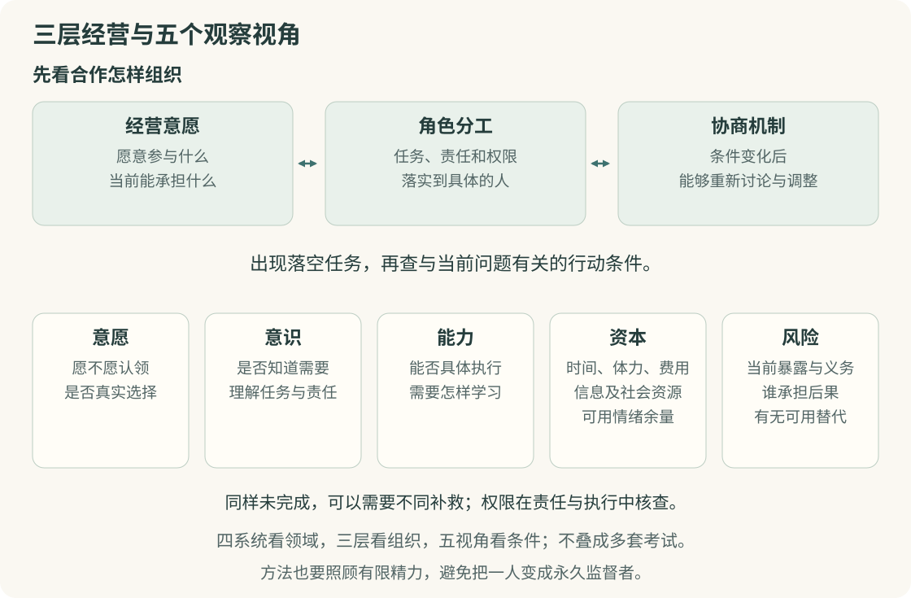

*[图2-5](#figure-2-5)　五视角按当前问题选用，不是每项任务都做五份评分。权限要在具体责任与执行条件中核查，不另造一套人格量表。*

##### 同样没有做到，原因可能不同

设想双方原本需要安排一次临时照护，到了约定时间却没有接上。先处理眼前的实际需要，再还原哪里没有落实。责问“你到底爱不爱这个家”，会把几种本来可以区分的问题压成一句话。

本书用**意愿、意识、能力、资本、风险**五个视角观察行动条件。“资本”在这里指可用的时间、体力、经济、社会资源和情绪余量，不只指资产，也不意味着它们都能换成统一分数。“风险”包括现实暴露与承担的义务，不只是一个人是否具有风险意识。

| 观察视角 | 在照护安排落空时查什么 | 对应的行动 |
| --- | --- | --- |
| 意愿 | 是否确实愿意接下这项任务，还是只是为了结束争论随口答应？ | 明确是否认领及当前可承担范围；不能用无限提醒替代真实选择。 |
| 意识 | 是否知道任务有多紧急、还缺哪些环节，是否以为另一人已安排？ | 说明需要与责任，把触发提醒和交接做得简单可见。 |
| 能力 | 是否会完成预约、联系、交接和异常处理？ | 学习或试做，必要时寻找具备所需能力的人，不假定只要肯就会。 |
| 资本 | 是否有连续时间、必要信息与授权、可用费用和实际服务？ | 配齐条件、减少或改排任务；确认替代资源确实能够到位。 |
| 风险 | 现有安排把谁暴露在什么后果下，谁已承担责任，失败是否还有可用替代？ | 先保护不能延误的需要，限制新增负担，建立与后果相称的备选。 |

若事实是双方都以为对方负责，就需要明确认领和全流程；若负责者有责任，却拿不到联系信息或相应授权，就需要处理执行权限；若已经会安排、也有费用，但所需时段根本没有可用服务，就必须更换真实路径或调整其他任务。三种情形不能用同一场关于态度的谈话解决。

这些原因需要由事实区分。有人最初确实不会，经过支持后开始改善；有人知道怎样做，却持续拒绝已经认领的责任。观察条件改变之后的行动，才能看清需要继续提供帮助，还是需要处理拒绝承担的问题。

##### 让合作减少负担，而不是增加一层监督

执行方法必须适合有限精力的人。若某项高频任务需要一人每天提醒三次，原安排可能还没有减少管理负担。可以把提醒放在双方认可的地方，明确谁接收、何时反馈，尽量让任务由认领者完成全流程，而不是把伴侣变成监督者。

如果调整后仍反复失败，要看哪一处没有变化。说了要减负，任务却一点没少，就不能据此判断减负无效；服务始终不可用，也不能每次再提同一份虚假备选。必要时缩减任务、重新分工或停止新增责任，不能只要求某个人付出更多耐心。

几套模型各有用途：[四系统](#unit-2-1)帮助找到活动领域，本节的三层经营说明怎样组织，五视角帮助辨认行动条件。[第十一章](#unit-11-1)还会用六类组合能力讨论共同生活需要实现的功能。找到足够解释当前问题的视角和可行下一步，就可以先行动，再看真实结果。

#### 2.7 风险专节：模型帮助看见事实，不能代替事实

**模型应随事实修正判断，当前功能、未来风险、已发生损害和未知信息要分别看待。**

模型让一些原本模糊的问题变得清楚，也可能使人过早确信。刚学会一个词，就把伴侣放进某种结构；看到一次分工完成，就认定整段关系已经可靠；或者因为双方多年没有分开，就忽略其中一人的生活越来越窄。这些用法都让解释走在了事实前面。

先把四种信息分开，会减少这种错误。它们可以同时存在，也不能互相替代。

| 信息 | 要说明什么 | 需要避免的跳步 |
| --- | --- | --- |
| 当前功能 | 现在什么已经能做到，依靠怎样的安排。 | 某次成功便等于长期成熟，或一个领域好就全部好。 |
| 风险暴露 | 哪种未来变化可能通过什么路径带来后果。 | 看见一种可能性就当作已经发生，或用标签代替路径。 |
| 已发生损害 | 谁已经受到什么影响，哪些事实支持这一判断。 | 用其他优点平均掉侵害，或把真实损害降格成单纯想法。 |
| 信息不足 | 对当前决定还缺什么，现有说法来自哪里。 | 未知算通过，或未知直接算对方有罪。 |

例如，一人最近没有参与原定活动，这是需要核对的行为；其是否失去兴趣，是一种解释；如果你为此多次承担无法接受的费用，已经发生的负担又是另一件事。工作突变、身体疲惫、习惯差异、意愿改变，都可能需要辨认，不能只选最能安慰自己或最能指责对方的说法。

能够区分解释的事实，通常比更多猜测有用。对方说明一段明确的忙碌期，愿意共同调整，之后确实恢复参与，就增加了负荷解释的支持；若时间条件已经改变，仍持续拒绝任何可行安排，就需要更新对参与意愿的判断。无论最后采用哪种解释，已由你承担的不合理负担仍需要处理。

##### 把运行结果作为证据，把既成绑定作为后果

设想两人已经有过亲密经历，一方因此觉得彼此当然会走向婚姻，另一方却从未作出这样的承诺。经历很重要，也可能改变感受与依赖，但它不能填补尚未确认的身份、目标和责任。越在意这段经历，越需要把现实期待说清楚，而不是把它当作未来已经成立的证明。

再看另一对共同出行的人：分工真实兑现，费用变更经过讨论，遇到小问题也能修正。这些经历让他们对相应合作有了更具体的信任。重大生活方向和未遇到的压力仍要另行了解，但已经完成的协作也值得肯定。

具体履约可以支持对相应合作的判断；亲密经历则需要连同感受、依赖和双方明确的意愿一起理解。已经投入很多、现在难以离开，说明退出有代价，却不能证明继续升级就是合适的选择。

已有依赖当然需要认真处理，但处理依赖与决定是否新增责任不是同一件事。准备共同迁居、承担债务或作其他重大安排时，仍应单独确认必要事实、意愿与承载条件；不因为已经走到这一步，就省略下一步本来需要的判断。

##### 只使用能够帮助当前决定的部分

你不需要每天记录四系统、三层经营和五视角的全部变化。过度记录本身会占用时间，还可能使双方开始表演、回避或感到被监督。记录应服务一个具体问题，有信息就用信息，没有用途的字段可以不填；一次互动不够说明长期趋势，也不必为了补齐表格而制造情境。

最少可以留下三句话：我现在知道什么，仍不知道什么，下一步为什么与这些信息相称。例如：“最近两次活动没有落实，原因目前只有对方自述；我还不知道能否形成双方可执行的安排；先讨论一次具体计划，暂不增加依赖这项安排的投入。”[附录A.4](#unit-A-4)把这种记录整理成可按需使用的一页工具。

局部任务遇到困难，就调整相应环节；已经发生严重侵害，则先安排[保护与独立支持](#unit-17-5)。决定性条件不清楚时，可以暂缓对应行动；已经不愿继续，也可以[结束关系](#unit-17-3)，无须先证明所有改善路径都不存在。

模型应当帮助你做出更准确、可承担的选择，包括发现值得增加的投入。两个人正在共同创造快乐、可靠与新的能力时，持续参与也有价值。谨慎与积极并不冲突：让绑定随着真实生成、明确选择与可承载的责任逐渐加深，而不让模型把所有靠近都变成无穷无尽的审查。

我们已经有了一幅值得寻找的关系图景，也知道不能从标签和条件直接推定结果。[下一章](#unit-3-1)回到尚未认识具体对象时的现实问题：怎样在有限时间和精力里，找到有机会接触、相互选择，并愿意一起生成这些价值的人。

### 第三章 从人生方向到现实寻找：互联网婚恋的择偶策略

*本章人物与故事均为虚构。*

#### 3.1 先想要怎样生活，再确定需要怎样的伴侣

**择偶条件应服务于想要的生活，并分清个人底线、可调偏好和仍待了解的事实。**

林岚能很快说出一些希望伴侣具备的条件。但如果继续问：“和这个人生活之后，一个普通星期会是什么样？”答案就没那么现成。她不只是想找到一个各方面都好的人。她希望继续发展本地的工作，也希望结束一天的忙碌之后，有人愿意听她说话，两人能共同安排生活，而不是永远等下一次难得见面。

林岚的工作相对稳定，她有留在本地发展的理由。另一个人可能希望迁往外地，或更重视流动与探索。各自认真选择的生活，也需要看看能否放在一起；留在本地并不天然比到外地发展更成熟。

先从眼前的一周想起，比从完美伴侣的画像想起更容易发现实际需要。工作日能为见面留下多少空间？独处、朋友和家庭事务各占什么位置？周末想休息还是活动？遇到忙碌，哪些事情仍要有人承担？再向前看：职业地点、婚育方向和已有照护责任，会怎样改变这幅图景？

不必在第一次认识时问完这些问题。它们首先帮助自己辨认，想要的究竟是一段偶尔带来兴奋的相处，还是能够进入日常的陪伴，以及自己愿意为了这种生活作哪些调整。愿望可以尚不完整，但不能总把“以后再说”留给未来的伴侣处理。

条件只有进入生活，才显出具体意义。收入可以增加选择空间，也会让某些愿望更容易落实；但不能只凭收入，推定一个人的时间安排、消费习惯或合作方式。即使两人收入相近，实际能过的生活也可能不同。

假设甲的工作明确需要频繁出差，乙的工作地点较固定，二人收入相近。希望经常共同生活的人，可能更容易与乙安排日常；愿意接受分段相聚的人，也可能与甲形成双方认可的生活。这里发生作用的是已知工作安排及当事人的需要，不是“收入高的人一定没时间”的推断。

同样，温和、能干、有趣都是可能珍惜的特点，却不能只问有没有。温和是否也容得下认真谈分歧？能干是否包括愿意参与共同事务？有趣的活动是否在双方可承担的范围内？这些问题需要在[具体接触](#unit-3-3)中逐步获得回答。

为了开始寻找，可以先把自己的要求放进几个不同位置。它们帮助明确用途，不要求把所有感受填成分数。

| 目前的要求 | 需要说清什么 | 可以怎样表达 |
| --- | --- | --- |
| 真正不能接受的情形 | 为什么影响本人是否进入或继续关系，而不仅是有点失望。 | “我目前不接受为了刚开始的关系迁居。” |
| 长期重视的生活条件 | 它支持哪种重要生活；能否通过其他可行安排实现。 | “我希望有稳定的共同相处时间，需要了解各自工作安排。” |
| 可以变化的偏好 | 喜欢它的理由是什么，真实接触是否可能改变判断。 | “我偏爱周末外出，但也愿意看看安静相处是否舒服。” |
| 基本吸引与亲近意愿 | 是否自主愿意以潜在恋人的方式继续了解，而非仅觉得对方条件不错。 | “我认可这个人，却还不确定是否想进一步靠近。” |

每一项都可以认真对待，区别在于不能互相冒充。偏好很强，可以坚持，但不因此成为所有人的道德义务；暂时没有吸引，可以留出自愿了解的空间，也可以不继续。不能因为对方“已经很好”，就要求自己产生并不存在的亲近意愿。

这里容易混淆三个判断。不可通约，是不同价值不能简单换算成同一单位，再用一个方面的优势抵销另一个方面的缺失。例如，收入不能直接兑换一个人的亲密意愿。它并不禁止人权衡，也不意味着不同需要一出现就没有共处办法。

个人不可妥协，表达的是“这件事我目前不愿放弃”。当事人应尽量理解其后果，但不必先证明这是一条普遍真理，才有权拒绝。当前不相容，则是已知的重要意愿或现实条件存在冲突，当前无法形成双方都能接受的方案。关键条件未清楚时，应保留未知，不能仅因暂时想不出办法就认定不相容。这是对当前组合的判断，不必扩大为对两个人价值的评价。

周衡下一阶段的工作地点尚未确定。把这项条件与林岚希望本地发展的意愿放在一起，首先得到的是一个需要了解的问题：地点有多大调整空间，两人各自接受怎样的相处安排？还不能直接得出他们一定无法相处，也不能用“喜欢了自然会解决”提前把问题注销。

如果后来双方都确定不迁居，也都不愿接受异地，而工作又不能调整，才有更具体的依据说当前没有可接受方案。如果一方愿意考虑某种过渡，也要继续问期限、代价和实际条件。愿意讨论，不能当作已经接受；短期能够勉强执行，也不自动代表长期能承担。

有些条件会减少可以考虑的对象，这是选择的真实代价。但不能随意估出几个比例再相乘，宣布“符合你要求的人几乎不存在”。条件可能相关，统计人群可能不同，更不知道其中谁与你实际可接触、谁也愿意选择你。即使有一份很大的名单，也不能由名单直接得到关系。

因此，调整要求要看它真实起了什么作用。可以调整某项表现形式，保留它所服务的需要；可以在经验增加后发现原来没有那么重视某种偏好；也可能确认一项底线必须保留，并接受寻找更慢。一次没有结果，不足以决定应该全盘降低要求；一次强烈心动，也不足以决定重要限制都可以消失。

开始时不妨留下几句能被现实检验的话：“我希望过怎样的普通生活。”“哪些安排我目前不能接受。”“哪些条件仍可以探索。”“为了认识一个具体的人，我实际愿意拿出什么。”这些问题为[四张短清单](#unit-3-5)提供起点，也为真正认识一个人之后调整想法保留了空间。

#### 3.2 准备成为伴侣：基本自主、生活入口与可承担的投入

**进入关系需要为共同参与留出真实空间，也要把个人主责与可承担的支持说清。**

林岚并不觉得自己没有时间。她能工作、见朋友，也会安排休息。可当她真的准备认识新的人，才发现所有能正常见面的时段都已有安排。偶尔在深夜聊几句，对她很方便；但如果希望对方持续进入生活，仅有这些零碎时间可能不够。

这不证明她不真诚。愿望与生活结构之间还差一步：现有安排里，哪一部分可以调整，哪一部分确实不能动？如果每次都等对方找到时段、考虑交通，再等自己临时确认，关系能否发生，就很大程度上被交给了另一个人反复组织。

她可以先为一次普通见面留出一个真实时段，不必立刻承诺每个周末都空着。提前处理一项可移动的事务，选交通和费用都能承受的安排，邀请对方提出可行时间，再决定是否成行。若临时变化，也由自己说明并参与寻找替代办法，而不只留下一句“最近太忙”。

留出入口，并不等于永久随叫随到。重要工作、已承诺的照护、必要休息和原有社会联系不会因新恋情自动消失。真正需要调整的，是一面期待持续的关系，一面默认所有新增时间和组织工作都由别人承担。双方都可能忙，能否把有限空间接起来，才是眼前的问题。

与完全没有入口相比，还有一种相反的期待：希望伴侣出现之后，所有难以处理的生活都会一起好起来。有个人替自己决定工作，安排日常，稳定情绪，解决与家人的关系，自己便终于可以开始生活。期待被支持可以理解，但这张清单往往没有说明对方愿意承担什么、能承担多少，以及哪些工作仍属于本人。

另看一个求职情境：伴侣愿意陪求职者整理经历、讨论几个选择。求职者却逐渐把寻找岗位、决定方向、回应招聘方乃至每次受挫后的全部安抚，都交给伴侣。伴侣疲惫时，他又把无法继续接手理解为不爱自己。问题不在于接受过帮助，而在于支持的范围不断扩大，却没有真实确认与可承担安排。

可以从其中一件事重新划清。本人决定希望尝试的职业方向，说明哪一步确实困难；伴侣如果愿意，可以约定一次讨论或承担一个明确任务。需要其他支持时，了解真正可获得的渠道，而不是仅在计划上写“找人帮忙”。具体执行可以获得帮助甚至适当委托，个人主责不等于每一步都只能独自完成。

三类问题尤其需要分开处理：

| 具体问题 | 本人和伴侣分别能做什么 | 不能默认为已经发生什么 |
| --- | --- | --- |
| 职业、健康管理或情绪调节遇到困难 | 本人承担相应主责，表达困难；伴侣在愿意且可承担的范围内支持，必要时共同寻找其他可用帮助。 | 伴侣自动成为所有决定的代办者、全部后果的承担者。 |
| 个人变化影响已认可的共同生活安排 | 把影响、已有承诺和可用调整空间说清，共同讨论涉及的资源与责任。 | 只因最初是个人事务，就可突然撤销已经共同认可的承担。 |
| 对人生方向、人格价值或具体身体接触作选择 | 本人保有判断与身体自主；对方可以表达需要、讨论共同后果并决定是否继续关系。 | 出资、受影响或提供帮助便获得支配另一方的权力。 |

婚恋准备也不能变成另一场入学考试。经济困难、身体限制或需要亲友支持，不自动取消一个人建立关系的可能。需要看的，是当前生活有哪些必要功能，支持是否真实可用，谁已经承担、谁愿意新增承担，以及两个人的选择与负担能否成立。

如果一个人需要协助处理某些日常事务，却能表达偏好、理解相关安排，并有可靠支持，他并不因此没有主体性。反过来，一个收入很高、凡事都能独自处理的人，也未必愿意给共同生活留位置。把自主理解成永不需要帮助，会漏掉前一种可能；把能力强等同于会做伴侣，则会误读后一种情况。

支持条件不足时，困难也是真实的。必要照护无人接续、眼下没有能承担的相处时间，都不能只靠态度积极解决。可以先缩小近期安排，重新确认资源，或暂缓增加新承诺。这里调整的是行动及其时机，不是宣布这个人不值得被爱。

准备也包括承认自己的反应方式。疲惫时可能不想回复，受挫时可能只想得到赞同，被追问时可能防御。无需先彻底消除这些反应，才允许自己接近别人；但要有一点处理偏差的意愿：说明容量，不让对方无限猜测；发现失约，参与补救；不同意时表达自己的理由，而不是默认别人必须读懂。

偶尔失误可以补救，反复出现的问题则需要重看安排：它是否可执行，本人是否愿意调整，负担是否始终落在另一方？事实还不清楚，就先处理可辨认的缺口；已经明确拒绝承担，则要依据这一点决定还能否继续原来的安排。

林岚暂时不需要重做整个人生。她先在日历里留出一个可行时段，并愿意为一次普通活动承担自己的安排。如果对方没有兴趣，这段空出来的时间也不构成别人应当赴约的债务。如果双方都愿意，才可能有一次真实接触，再根据体验决定下一次。

当生活里有了这样的入口，[下一节](#unit-3-3)需要考虑在哪里遇见人，以及那个场景能提供哪些了解机会。平台上的资料和文字会提供一些信息，却不会自动把两个账号变成能一起相处的具体的人。

#### 3.3 从零开始的互联网社交，缺少什么，需要补上什么

**平台帮助发现，真实互动增加了解，相称核验为具体决定提供依据。**

林岚和周衡通过婚恋平台开始交谈。几次文字交流之后，他们发现彼此能接住一些话题，也都表示希望了解有可能长期发展的关系。周衡说，自己目前可以在本地见面，但下一阶段的工作地点还没有确定。林岚说明了自己希望本地发展的想法，两人没有急着替这个问题许诺答案。

这已经比只看资料页多了一些认识，却还不知道对方真实相处时是什么样。聊天顺畅，可以说明此刻的交流有吸引力；生活安排、表达方式、是否愿意共同组织一次活动，还需要其他情境才能看见。对未来的自述也只是自述，不能与已经落实的条件混在一起。

互联网接触的一个难处，是发现一个人和进入彼此生活，经常需要分别完成。在共同学习、工作或活动中，人们可能不必专门发起约会，就有机会再次相遇，看见对方在不同事情中的样子。陌生人通过资料开始交往时，这些条件未必已经存在。

本书借“社会焦点”描述一种有助于理解的场景：人围绕某项共同活动、兴趣或角色，获得反复接触的机会。它起作用，是因为交流有事情可依托、下一次相遇相对容易，也能逐渐补充行为和社会背景信息。这个概念帮助分析环境，不证明只要共同活动就会相爱，更不能用来认证熟人的可靠性。

如果原来依靠熟人场景自然形成的条件，现在需要两人自己创造，仍旧等待“有缘就会发展”，便可能把必要的组织工作遗漏。平台扩大了可以发现谁的范围，却不替双方决定愿不愿再见，也不保证有人持续创造相处。

| 维度 | 熟人共同活动场景常提供什么 | 典型平台接触需要补什么 |
| --- | --- | --- |
| 见面重复性 | 工作、学习、活动带来再次见面 | 主动安排可以持续的接触，而非只等偶然上线 |
| 共同活动 | 一起做事，话题有所依托 | 创造双方愿意参与的活动，允许偏好不同 |
| 场景信息 | 看见具体行为、状态与变化 | 用真实互动补充资料页，不把自述当全部事实 |
| 社会上下文 | 共同朋友、角色和既往经历 | 逐渐认识自然社会联系，保留合理隐私 |
| 身份核实 | 部分身份由熟悉情境支持 | 对影响当前决定的重要陈述作相称核验 |
| 互动发动 | 场景本身提供交流机会 | 双方参与安排，不能长期只靠一人推动 |
| 生长节奏 | 可以先熟悉，再辨认浪漫兴趣 | 给自愿了解留空间，不要求一次见面裁决全部未来 |

表里的区别不是两类人谁更真实。兴趣群也可能由线上开始，平台也可能组织共同活动；熟人圈同样会误传消息，朋友熟悉一个人的某一面，不代表掌握其全部情况。重要的是当前这个渠道实际提供了什么，而不是它被叫作线上还是线下。

补充了解也不是无限调查。准备一次普通见面，先解决双方是否愿意、如何到达、时间费用是否可承担，以及必要的基本信息。未来如果要共同居住或承担重大义务，再增加与那些决定相称的核验。不能把眼下不需要的全部私人资料，当成获得一次交流的入场券。

林岚提出周末去看一个小展览，周衡看过介绍后表示有兴趣，并参与确认了双方都能到达的地点和时间。他们事先说明票费，各自购票，不把活动设计成必须整天相处的安排。见面地点是正常开放的公共场所；双方都保留结束活动和自行离开的空间。

看展时，周衡没有一直找话展示自己。他在一件作品前说没看懂，林岚也笑着承认自己只注意到其中一个细节，两人由此聊起不同的理解。活动结束后，他们又走了一小段路。林岚觉得这一段不用刻意填满的交谈很舒服；周衡也表达了这次相处愉快。

这次活动新增的事实很有限，却是具体的：两人愿意为一次相处付出时间，能共同完成基本安排，在现场有话可说，也能容纳一点不同理解。它尚不能证明长期稳定、婚姻适合或所有关键陈述真实。下一次是否还愿意参与，仍需两人的行动回答。

距离暂时不允许见面的人，也可以通过自愿的语音、视频和共同参与的线上活动增加了解。这些交流可能产生真实情感，但尚未共同经历的日常仍然未知。不能为了抹去未知，催促对方承担高额旅费、进入私密空间或接受不愿意的身体接触。

可以用三句话记住分工：平台帮助发现，互动帮助生成，相称核验支持决定。发现谁、彼此怎样相处、某项事实是否可信，是相关但不同的工作。逐渐增加实际经验，才有机会让一个资料账户成为生活中可以理解、欣赏或决定不再靠近的具体的人。

#### 3.4 选择渠道：找到既可接触、又有机会相互选择的人

**渠道的价值在于能否支持现实可行、双方自愿的接触，而非展示多少优秀对象。**

如果一个渠道每天都让人看见很多符合条件的人，却长期无法形成正常交流，这个渠道对自己的实际作用就值得重看。可见的人口不是可以获得的伴侣池。对方可能不在能够见面的地方，目标不同，没有兴趣，或者同样没有可用时间。

这里的“可接触”也不是能够找到账号或发出消息，而是存在双方自愿、现实可行的认识机会。一个人被许多人关注，不代表与你的生活更相容；一个活动参与者少，也不代表其中必有合适的人。评价渠道，要从实际能发生什么开始。

设想一位专业能力不错、初次文字聊天却容易拘谨的人。在一种快速浏览、迅速决定是否继续的接触方式里，他很难展示日常的耐心和兴趣。参加自己确实喜欢、也能够持续参加的共同活动，可能让别人有机会看到这些特点。增加的是被理解的机会，不是对浪漫结果的保证。

他仍然可以改善照片和基本表达，让别人容易理解自己，但不必把所有没有结果都解释成履历不够强。如果两人始终无法正常相遇，再增加一项证书未必改变这一点。改善个人行为、改变接触场景、调整生活入口，是不同的选择，可以同时做，也可以先处理最明显的限制。

| 比较问题 | 看哪些真实条件 | 这项条件仍不能证明什么 |
| --- | --- | --- |
| 目标是否有相遇机会？ | 活动目的、参与者表达的关系期待，是否允许自然认识 | 同场参与不等于单身、有恋爱意愿或愿意选择我 |
| 地域与时间是否可达？ | 是否有双方自愿且负担合理的交流、见面安排 | 见得到不等于生活方向长期相容 |
| 是否容易重复接触？ | 活动是否持续，双方是否愿意再参与 | 经常见面不等于已经产生浪漫兴趣 |
| 能看到什么上下文？ | 实际行为、角色、共同活动与自然社会联系 | 背景丰富不等于所有陈述真实 |
| 互动由谁发动？ | 谁提出、回应和参与安排，缺席后是否还有共同调整 | 一次主动或一次拒绝不概括全部意愿 |
| 投入、噪声和暴露怎样？ | 实际时间、费用、无效信息、隐私要求及退出难度 | 成本高不等于对象更适合，成本低也不等于一定可持续 |

比如，一个资料浏览渠道让你看到不少关注的对象，但他们大多不能在你的可用时间和地域内见面；另一个共同兴趣活动人数较少，却能让你正常参与并与人反复交流。后者可能更适合解决眼下“没有真实接触”的问题，但参与者有没有恋爱意愿、彼此是否吸引，仍要继续认识。

两条渠道不必决出永久优胜者。婚恋平台可以帮助表达寻找长期关系的目的，兴趣活动可以增加生活上下文，朋友介绍可以补充双方已知的信息。每条路径提供的内容不同，也可能留下不同缺口。可以选少数自己能持续使用的方式，不需要把所有途径都经营成另一份工作。

如果希望进入某个资源更丰富的圈子，要把参与方式和成本说清。活动费用能否负担？需要维持怎样的消费和时间安排？自己是否真有兴趣和参与空间？进入一次聚会不等于已建立归属，借伴侣的身份接触别人，也不等于自然获得独立信任与互惠关系。[第九章](#unit-9-1)会继续讨论这些过程。

资源本身可以形成吸引，不能因此把重视资源的人一概判断为套利。如果一个人主要展示社会资源，却又敌视所有被这些资源吸引的人，就很难继续认识对方是否也关心具体的自己。需要观察的是，对方如何看待真实生活、合理责任和边界，而不是先要求所有人假装不在意自己的显著优势。

反过来，一项优势也不保证长期相处价值。更合适的做法，是让接触场景容得下其他方面：怎样聊天、怎样对待不同意见、是否愿意共同安排普通活动。不能用不断提高消费来验证喜欢，也不必通过刻意撤回正常支持制造考验。现实中已经发生的选择，才是继续理解的材料。

选择一个渠道时，最好能说出具体理由：“这里存在我能够参与的重复活动，投入可以承担，也有机会了解目标是否相近。”再留一个调整条件：“如果持续参加后仍没有正常认识的机会，或投入明显超过可承受范围，就减少或更换。”理由和触发条件比“这里的人更优质”更能支持行动。

渠道合适，最多先把相遇变得可行。一次谈得来还要看是否愿意再见，愿意再见还要看双方怎样参与。接下来需要一套[能随真实经验修订的简短记录](#unit-3-5)，避免刚认识一个人，就急于证明他符合自己早已写好的全部想象。

#### 3.5 用四张短清单与探索方向校准，而非提前锁定理想类型

**把底线、长期需要、初始吸引和自身条件分开记录，再用实际相处校准。**

林岚起初期待的周末很丰富：有新地方可去，有新活动可体验，最好每一次都值得记住。看展之后，最让她愿意再想起周衡的，却有一部分来自展览外的普通交谈。她不用努力证明自己懂得什么，也没有被催促立即决定下一项活动。

这不足以让她宣布自己已经找到最重要的终生需要，却给原来的想象添了一条修正：有新鲜活动很好，但每次都安排得满满当当，并不是她愿意再次相处的必要条件。她想再了解的，是这种能好好说话的空间能否继续出现。

如果只有一张理想伴侣清单，这种变化很容易被解释成“标准降低了”，或者“终于发现他完全符合”。两种说法都太快。她只是从一次具体体验里发现，原先并列的要求承担着不同功能，需要分开记录。

四张短清单分别是不可妥协条件、长期关系优先项、初始吸引最低线、自身实际条件与可提供的相处体验。它们不是四组分数，也不要求写满。每一项写出生活影响、自己的理由，以及什么新经验或条件可能改变理解，就有了以后校准的依据。

| 清单 | 它帮助处理什么 | 容易误用的地方 |
| --- | --- | --- |
| 不可妥协条件 | 确认什么情形会使本人不愿进入或继续，以及这项要求的具体范围 | 把所有失望都写成底线，或为了某人临时抹掉仍不接受的事实 |
| 长期关系优先项 | 说清长期重视的生活，需要什么安排支持 | 将一种实现方式当成唯一方式，或者假定优先项能相互无限抵销 |
| 初始吸引最低线 | 承认是否自主愿意以潜在恋人的方式继续靠近 | 设统一外貌分数，要求第一次就有强烈激情，或勉强自己交出亲密 |
| 自身实际条件与可提供体验 | 看自己真实能参与什么、有哪些限制、能带来怎样的普通相处 | 给自己定价，夸大资源，或只列优势而把组织劳动全部留给对方 |

不可妥协清单里的“生育方向相容”，可以是本人十分重要的要求，但仍应说明自己当前是否确定、接受什么范围。别人不愿选择同样方向，不因此就是不负责任；方向未明确也不能先当成已经一致。相应事实和意愿要在关系深入时逐渐澄清，不靠清单替对方回答。

长期优先项则可以从想实现的生活倒推。例如“收入高”背后可能是希望已有责任能承担、住房安排有选择，或生活更宽裕。这些需要并不完全相同。写清实际需要，才有机会理解不同收入、支出、工作时间和居住方案的组合；这并不要求读者假装不重视经济条件。

初始吸引最低线也不是最低规格。一种合适的写法是：“我不勉强，愿意以可能发展恋爱的方向再认识这个人。”它允许吸引继续发展，也允许后来没有发展。仅仅觉得对方善良、条件好，不自动满足自己的亲近意愿；暂时拘谨，也不必立刻被解释成永远不可能喜欢。

最后一张清单把自己放回真实互动中。林岚现在能提供的，是一次安排得出的普通见面，参与讨论活动，表达自己的兴趣和限制。她不能承诺随时可见，也不愿为了刚开始的关系迁居。写明这些，不是在展示缺点，而是在让对方有机会判断自己是否愿意进入这样的相处。

探索时，可以分别留意相处舒适、吸引明显、生活方向相容这三个方向。舒适让人愿意放松，吸引让人想进一步靠近，方向相容让未来有讨论基础。一个人可以同时带来几种感受，也可能只有其中一种；这些是观察角度，不是三类固定人群。

被强烈吸引时，仍要看普通相处是否舒服、未来安排是否有空间；条件方向相近时，也需要看有没有本人愿意的亲近。不要为了完成探索，安排固定人数或按比例分配约会。人不是用来填满某个样本格子的材料，对方同样在理解和选择你。

回到林岚，她目前可以作三种不同记录。一次愉快的普通交谈支持了“我重视能被认真听见”；活动不必密集，则修正了她对每次约会形式的想象；周衡未来地点仍未知，本地生活能否成立没有答案。这三项互不替代。愉快没有把地点问题解决，地点未定也没有使愉快变成假的。

值得回顾的不是所有聊天细节，而是那些确实改变判断的事情：自己为什么愿意或不愿再见，对方是否也参与，某项条件怎样实际影响了相处。[附录B.2](#unit-B-2)可以承接这四张短清单，[B.4](#unit-B-4)帮助记录必要变化。没有新信息时，不必反复重填来制造一种进展感。

#### 3.6 一边寻找一边收敛：不让搜索耗尽生成关系的注意力

**寻找应给了解具体的人留下精力，投入随经验调整，排他仍须双方明确约定。**

人可能一边认真寻找，一边没有足够注意力了解任何一个具体的人。刚回复一个话题，又想看看有没有条件更合适的账号；见面时想到另一场尚未确定的约会；回去之后忙着比较，却没想起对方提过的那件事。选项仍在增加，相处未必因此更深入。

早期有限并行并非天然有错。尚未确认共同意愿时，正常认识不同的人，可以帮助看清自己的需要，也避免把全部未来压在一次陌生接触上。问题在于投入数量是否已经超出真实承载，以及是否让对方误以为存在并未确认的承诺。

“有限”不需要一个人人通用的人数。若已经记不清答应过什么、没有时间认真参与、不断让已约好的活动为新对象让路，就有具体理由减少负荷。对已有约定的诚实，不必等到排他之后才开始；没有排他，也不意味着可以随意误导别人。

林岚与周衡看展之后，又围绕日常安排和工作近况交流过。双方都发起过话题，也都表达愿意再见。周衡下一阶段的地点仍未确定，他们没有把一次更新的消息说成已经落实的工作方案。这些互动给了林岚继续了解的理由，尚不足以支持长期生活的结论。

她决定减少新开启的零散匹配，把一点时间留给下一次见面。两人商量了一次普通散步，并选了可行时段；这时活动还没有发生。减少搜索没有增加她对周衡的权利，也没有在两人之间自动产生排他。她可以为自己的注意力作选择，不能据此要求对方已经作出相同选择。

主动收敛的价值，要看省出的空间去了哪里。如果只是停止点开新资料，却继续等待别人安排所有相处，生成关系所需的工作仍然没有发生。若把空间用于认真回应、提出一项对方也愿意的活动、了解此前未说清的问题，才有了新的经验来源。

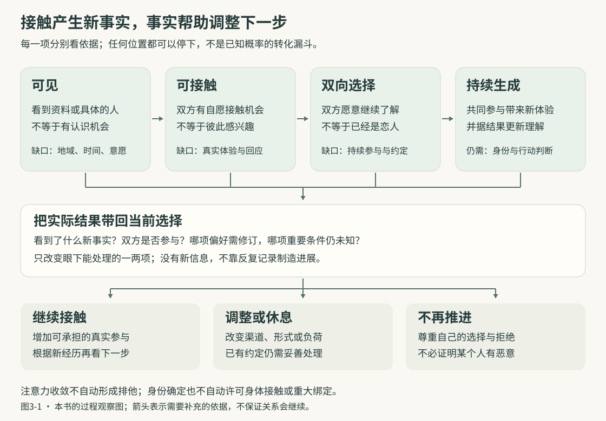

*[图3-1](#figure-3-1)展示不同判断及其回看关系，不是必经流水线，也不表示已知转化概率。每一步都允许不继续；清楚的排他约定另在[第五章](#unit-5-8)讨论。*

投入也应随这些经验变化。分段投入不只是早期少花钱、少期待。了解加深、双方参与和可靠性获得更多支持后，可以增加真实相处、关心与共同安排。若永远只允许别人先证明，自己始终不参与，也很难观察两人能够形成怎样的关系。

增加普通投入，与承担重大绑定仍是两件事。愿意多见一次、多了解一项生活安排，并不要求同时担保、迁居或作大额赠予。后者需要与其后果相称的事实、意愿和可行安排；不能因为把注意力集中到一个人身上，就跳过这些判断。

如果实践没有带来新的认识，可以调整不同层次的内容。渠道可能没有提供可行接触，表达可能让人误解自己的目标，活动形式可能不适合展示真实特点。优先项与偏好也可以因经验改变。先找哪一个环节的事实支持调整，避免每次失望都重写全部人生要求。

底线的修订需要更清楚的理由：原来列的是偏好，表述比实际需要更严，或者一段经验确实改变了自己的接受范围。因为怕失去某个人，便在心里仍不接受的情况下宣称已经接受，往往只是把冲突往后移；别人也无权替你宣布“到了这个阶段就该妥协”。

疲惫时可以休息。暂停增加新接触，不必变成对已经明确的安排失约：该说明的说明，该取消或改期的共同处理。休息可以给判断留余地，但不是保证重启后会成功的方法；如果暂停之后仍想改变寻找目标，也可以重新认识自己的选择。

一个值得保留的回看时点，是发生了新事实，或者原定的有限尝试已经结束。问这段行动让你更了解了什么，哪个障碍反复出现，下一步只改哪一两件事。不必每天检查是否离婚姻更近。寻找本身占用生活，而生活也需要给工作、朋友、独处和快乐留下位置。

#### 3.7 风险专节：无限筛选、过早绑定与错误的自我解释

**寻找受挫时，应依据具体事实调整行动，避免把焦虑变成无限筛选或过早绑定。**

被拒绝之后，人很容易想赶快得到一个完整解释。“我还不够好”会带来改造自己的冲动，“这个群体都不认真”可以暂时保护自尊，“只要条件再严一点”则似乎能防止下一次失望。但一个结果通常没有提供这么多信息，过快的解释反而会改变后续选择。

设想有人在一段时间没有遇到愿意继续的人之后，增加了不少筛选条件，也把更多费用用在形象与消费展示上。他看到的可接触对象变少，投入却在增加。这几件事同时发生，还不能证明是哪一项造成了没有结果。

要回看，新增条件究竟排除了什么，排除的是否确实无法接受；展示有没有让人误解可持续生活；所用渠道是否还有目标相近、地域可达的人；自己是否仍有时间正常互动。如果这些事实不清，就不能把“条件太多”或“魅力不够”直接写成唯一原因。

一种可能的恶性循环，是焦虑让人增加比较与展示，过高负荷又带来疲惫；疲惫时更依赖容易判断的标签，具体的人更难被了解。持续没有新经验，焦虑便得到强化。这里需要逐步核对实际发生了哪些环节，不能仅因一个人单身或要求较高，就认定他已陷入循环。

另一种风险来自“不能再失败”。为了保住一次看似难得的接触，有人隐藏真实需求，承诺自己并不接受的未来，或者提前付出难以收回的金钱、隐私与生活安排。越投入越难承认差异，后面的选择就可能越来越受已有成本推动。

此时先把下一步缩小。仍愿意了解，可以保留普通接触，同时暂停尚无相称依据的重大绑定；真实不接受某项安排，就说明这一点，让双方依据实际条件决定。已经明确发生欺骗、威胁或越界时，先处理具体侵害与[保护需要](#unit-17-5)，不用继续制造投入来检验对方是否会变好。

| 当前看到的情况 | 还要区分什么 | 相称的下一步 |
| --- | --- | --- |
| 对方很热情，却尚缺实际了解 | 兴趣、表达习惯、短期投入或其他意图；单靠频率不能定性 | 在自愿、可承担的接触中看共同参与，不自动增加重大绑定 |
| 多次只有资料浏览，没有真实相遇 | 地域时间、目标、渠道与表达限制 | 选一项可改变的限制，安排有限尝试，保留仍未知的原因 |
| 关键生活方向已有明确分歧 | 当前是否存在双方可接受的方案 | 说明接受范围；没有方案可以不继续，不需要将对方判坏 |
| 资源或安排尚不清楚 | 未知是否影响当前行动及可承担后果 | 取得相称信息，必要时暂缓对应行动；未知不填成安全结论 |
| 已确认欺骗、威胁或强迫 | 当前侵害、可用支持与安全条件 | 停止相应新增暴露，寻求合适支持；不以反复受伤或当面对质作前提 |

这些情形不能混成一张“危险人物”名单。背景差异、单一强吸引或频繁示好，可以成为进一步留意的问题，但不是恶意的证明。反过来，明确侵害也不能因为对方有其他优势，就被改称为普通磨合。行为事实与问题性质，比醒目的标签更能支持选择。

同样要防止把早期困难直接解释成共同系统失败。两人尚未形成稳定生活与经济合作时，不能凭一次活动不顺，就诊断婚姻治理失灵。可以确认某次没有履约，辨认其影响，决定是否再接触；判断的范围应与已有事实相称。

搜索里还有两个常见跳步。第一是把可见的优秀人口当作自己可获得的对象，省略了接触、双向选择和持续参与。相似背景可能提供话题或相遇条件，却不保证重复互动和相互喜欢；共同网络与持续维系也还需要实际参与。它们可以互相促进，不是每段关系必须逐一通关的程序。

第二是把几项条件的比例相乘，得到看似精确的机会判断。条件之间可能有关联，所描述的人群也未必与你实际接触的人群相同。没有可靠数据，最多说明某些要求怎样收窄选择、怎样影响生活，不能用一个计算出来的极小数字要求自己放弃所有重要需要。

跨越较大社会距离时，也要看实际增加的消费、地域、亲属期待和融入成本。有些代价可以协商，有些暂时不能承担。检查具体路径，既不把跨圈层关系写成注定失败，也不让“爱情无关条件”掩盖眼前确实需要有人支付和承受的部分。

本章到这里，产生的应是一项可以实行的接触或调整。你可以继续了解，缩小并行，休息，换一条途径，或者不再推进某段接触。条件表帮助选择方向，却不能替两个人生成感情。[下一章](#unit-4-1)从已经能被看见的具体的人开始，讨论为什么愿意靠近，以及这种愿意怎样在相处中发展或消退。

## 第二部分 从陌生人到正式恋人

### 第四章 吸引与两性吸引：从被看见到想靠近具体的人

*本章人物与情境均为虚构。*

#### 4.1 注意、喜欢、欣赏、欲望与亲密期待：我被什么吸引

**看清自己被什么吸引，再分别判断是否愿意恋爱、亲近或组织共同生活。**

[看展之后](#unit-3-3)，林岚愿意再见周衡。她记得两人在作品前说起不同理解，也记得后来那段不需要不断安排话题的步行。可是，问到她是否已经想成为他的恋人，答案还没有那么明确。愿意继续认识是真的，关系会发展到哪里尚不知道，也是真的。

吸引不必一开始就只有一种清楚的感受。一个人的照片使你停下浏览，谈吐让你愿意继续聊天，某项能力让你欣赏，身体和气质让你产生欲望，被理解的经验又可能带来亲近期待。它们可以交织，也可能只有其中一部分；不是先完成注意，再依次走到爱情的五级阶梯。

可以先把感受说具体，看看它支持怎样的下一步选择。下表中的体验可以同时出现，也可以随着交往改变。

| 此刻的体验 | 可以怎样具体描述 | 尚不能由它直接推出什么 |
| --- | --- | --- |
| 注意 | “这个特点让我停下来，想知道更多。” | 已经喜欢对方，或已经了解其生活 |
| 喜欢 | “我享受与这个人聊天、做某件事。” | 愿意恋爱，或愿意接受所有相处形式 |
| 欣赏 | “我认可他的能力、选择或处事方式。” | 自己会产生身体欲望或恋人期待 |
| 欲望 | “我对这个具体的人有身体靠近的冲动。” | 对方同意、对方可靠，或双方适合长期生活 |
| 亲密期待 | “我希望被他理解，也想了解和分享他的日常。” | 双方已确认身份，或共同生活一定可行 |

一个人处理事情的方式，可能同时引发欣赏和亲近；一次被认真回应的经历，也可能改变原本普通的印象。外表依然吸引你，相处中的某些行为却让你不愿继续，这同样可以如实承认。几种感受不必被强行合并成一个答案。

本书说的一般吸引，主要指对一个人或其某些特点感兴趣、愿意进一步接触的动力。两性吸引则进一步关注，对这个具体对象是否存在浪漫兴趣和亲密期待。一般吸引可以与后者同时出现，也可能一直没有发展为后者；某次身体欲望也未必伴随成为恋人的意愿。

因此，喜欢一场活动、喜欢被照顾的体验和想成为这个人的恋人，要分别问。它们可以同时成立，也可以不同。一次活动安排得很好，让你心怀感谢，不代表你必须通过身体接触表达感谢；对方为你提供了帮助，也没有因此取得恋人身份。

设想一位成功而幽默的人，和他相处能听到有意思的故事，也能得到有用建议。你愿意欣赏，甚至愿意保持普通来往，却并不希望与他进入浪漫关系。这不必被解释成你不懂珍惜，也不证明他的优势都是假的。优势带来的价值与本人是否愿意亲近，是不同判断。

也可能初次见面的印象并不突出，后来某次普通交流中，对方记得你之前提到的一个小问题，又认真听你说起新的打算。你开始想主动分享日常，也想知道他的一天。这可以成为亲近增加的线索，但不能直接代替对方是否同样愿意、现实安排是否相容。

资源也可以是这份吸引的一部分。一个人的生活条件、可用支持和处理现实问题的能力，可能与自己希望的生活有关。无需证明感情完全脱离物质，才允许自己承认喜欢。需要继续辨认的是：这一部分满足了什么，自己是否也关心具体的人，其他相处体验和责任安排又是什么样。

强烈心动有时让未来显得格外清楚，仿佛已经知道两人会怎样生活。这时尤其需要分清亲身体验和想象填补的部分。后来接触可能增加吸引，也可能修正期待；“第一次最强烈”或“越熟悉越不吸引”，都不足以概括每个人的经历。

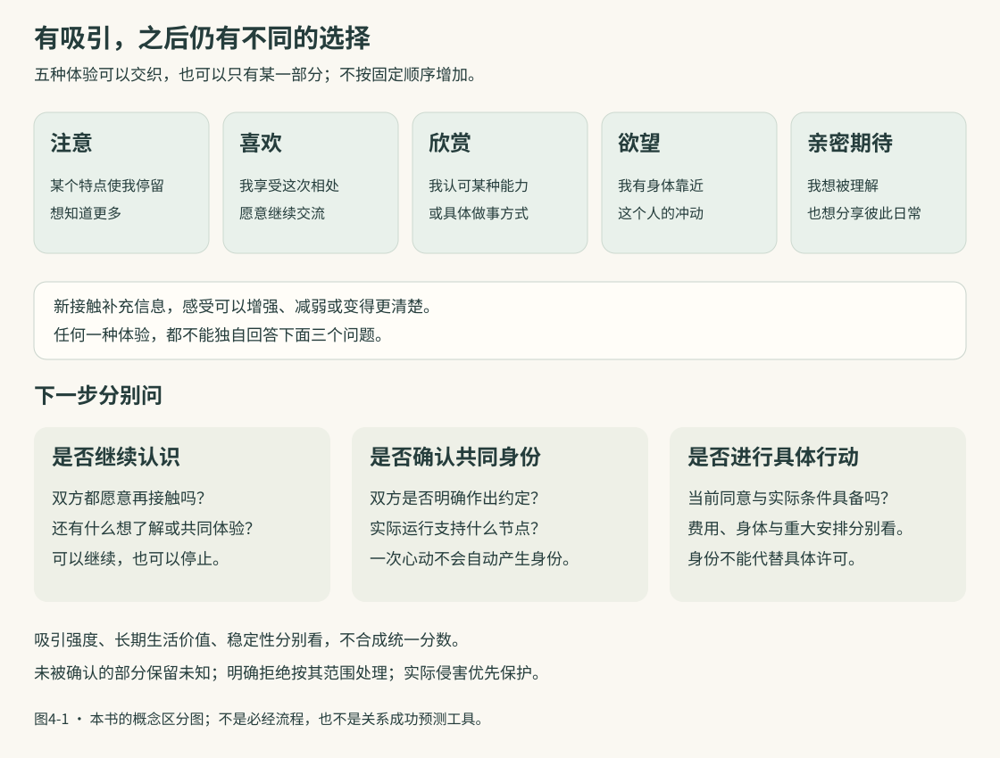

*[图4-1](#figure-4-1)把可交织的体验与后续判断分开。新接触可能改变任何一种体验；图中没有固定升级顺序，也没有统一的吸引分数。*

林岚此时可以说：“我喜欢这次相处，也欣赏周衡对同一件事有自己的理解，我想再认识他。”她不需要为了证明认真，提前宣布身体亲近或恋人意愿已经明确。周衡表达相处愉快，也只说明他已经表达的范围。[第五章](#unit-5-1)会讨论怎样让个人的感受进入双方自由回应的互动。

#### 4.2 吸引从哪里来：特点、偏好、经历与情境共同作用

**吸引由特点、偏好、经历与情境共同形成，其强度、长期价值和稳定性应分别判断。**

同一特点，对不同人可能有不同意义。健谈的人让一个人觉得轻松，也可能让另一个人觉得没有表达空间；职业投入让人欣赏，也可能与希望大量共同相处的生活发生冲突。不是先找出一个普遍最有吸引力的特点，再把它放到所有人身上。

可以从七个方面观察吸引的来源，辨认它怎样进入具体体验。不同人重视的内容会有差异，表中的次序不表示重要性排名。

| 来源 | 怎样进入具体体验 | 还需要辨认什么 |
| --- | --- | --- |
| 外貌与身体 | 外形、神态、声音、动作和身体气质，使人愿意注意或靠近 | 本人的真实偏好；照片、现场感受与身体意愿是否相同 |
| 个性与情绪体验 | 幽默、温和、活力或表达方式，使相处带来某种感受 | 是普通相处中的体验，还是只在特定场合出现 |
| 知识能力 | 对问题的理解、实际技能与行动，让人欣赏或信任某项能力 | 某领域优秀是否真正进入两人的生活，不能外推为全面可靠 |
| 资源与生活条件 | 收入、时间、支持网络及现实安排，为某种生活提供可能 | 资源是否可用、附带什么条件，维持方式是否可承担 |
| 价值观与生活方式 | 对重要事情的态度、日常节奏和追求，让人感到有共同方向 | 口头相似是否对应实际选择，差异有无可接受安排 |
| 关系能力 | 愿意听、能表达、会协作，或偏差后能修补，带来被理解和可依靠感 | 已观察到哪项行为，是否反复只靠另一方承担 |
| 共同经历与特殊联系 | 一起做过的事、共享的记忆和理解，使彼此变得具体 | 经历的分量与当前意愿分别看，不能由共同过去索取未来 |

个人经历、眼前需要和人生阶段，会进入对这些特点的理解。刚经历一段缺乏支持的生活，可能格外珍惜被认真回应；计划投入新的事业，也可能更在意生活安排的弹性。这是可以回到本人经历讨论的路径，不是从一个偏好倒推出一段隐藏历史。

喜欢成熟的人，不能证明必有某种童年创伤；偏爱安静，也不证明曾经受到伤害。同一经历可以被不同人作不同理解，同一个人也可能在经历变化后调整偏好。如果没有具体事实，就把解释留在待了解的位置，而不是用一个心理故事替本人定义自己。

除了辨认来源，还要分别问三个问题。强烈、值得长期珍惜、容易持续，并不是同一个意思。

| 判断轴 | 所问的问题 | 一个区别示例 |
| --- | --- | --- |
| 当前吸引强度 | 此刻有多想注意、靠近或继续了解？来自哪种体验？ | 一次活动让人很兴奋，尚不知普通日常是否也愿相处 |
| 长期生活价值 | 这项特点怎样进入自己希望的生活，与其他需要是否相容？ | 很欣赏职业投入，但仍需面对共同时间是否够用 |
| 稳定性 | 吸引所依赖的特点、情境和维持方式，会怎样受时间、资源与生活变化影响？ | 如果只有高额消费才能维持相处，而双方无法持续承担，基础就需重看 |

三条轴不生成总分。一项对长期生活有价值的能力，不一定立刻带来强烈心动；强烈身体吸引也不证明其余条件可靠。把感受记清，有助于决定愿不愿接近；把另外两项看清，才不至于让一份当下感受承担全部未来判断。

讨论社会文化和男女群体偏好时，要先看比较的是什么。询问“你重视什么”，与观察人在真实条件下选择了谁，提供的信息不同。平均结果还需结合群体内部差异和人生阶段理解；某项特点被重视到什么程度，需要具体证据，不能靠故事或印象配出权重。

即便有可靠的群体比较，也不能替眼前的人决定应该喜欢谁，更不能从平均偏好推出每个人都应终身维持某种外貌、收入或角色。

社会评价容易被带进自我要求。有人把事业成功设成值得被爱的前提，有人担心只有保持年轻外貌才能被选择。可以认真发展自己看重的优势，同时问：它是否服务自己认可的生活，维护成本是什么，条件改变之后还有哪些关系基础？不必把所有外界评价都变成人生任务。

单项不突出，不意味着其他特点没有被认识的价值。但确实存在具体对象无法接受的短板。例如对方明确说衣物清洁影响了相处，自己也确认有可以改善的习惯，继续展示知识或收入就没有处理这个问题。它是一个具体行为的影响，不是一只适用于所有人、永远由同一短板决定的木桶。

显著优势也可能带来新的判断困难。设想有人主要展示昂贵消费，随后关注和邀约增加，但这些人是否愿意共同承担普通生活还不清楚。若把关注数量当成综合适配已经提高，就跳过了对方的目标、参与能力和实际相处。

还有一种误读，是把某项优势引来的注意，当成自己在其他方面也具有同样吸引力，进而抬高对候选对象的要求，或忽略影响相处的具体行为。需要回看关注究竟来自什么、实际互动支持了什么，而不是用人数证明对自己的全部评价。

当注意有限、接触又很多，单一优势带来的询问可能占满精力，让原本有机会慢慢认识的人难以得到回应。此时需要调整展示与接触方式，增加普通互动的信息，而不是敌视所有被这项优势吸引的人。只有进一步看到具体意图与行为，才能辨认兴趣、需要差异或利用。

找出真正值得改善的一项，再让真实的特点有机会被看见，会比一边不断加码展示、一边猜测所有人的动机更有方向。[下一节](#unit-4-3)讨论接触从屏幕进入现场后，原来依据有限信息形成的吸引，怎样被新体验修正。

#### 4.3 为什么网上聊得来，见面却未必产生吸引

**新的接触会修正原有印象，是否继续靠近，应依据实际体验与双方意愿。**

回看林岚和周衡[第一次见面](#unit-3-3)，刚到展览入口时，并没有文字聊天那样轻松。屏幕上可以想好再回复，现场却要同时面对声音、表情、停顿和两个人不完全相同的节奏。最初几句话有些客气，直到他们在作品前说起不同理解，交流才逐渐松下来。

拘谨随着交谈逐渐缓和，后来的相处给林岚留下了舒服的时刻，也增加了好奇。她因此愿意再了解，而不是因为相信“见够次数自然会喜欢”。一次见面中的变化，值得比最初印象看得更完整。

文字交流中的愉快可以真实，但它所提供的信息有选择范围。一个人可以挑选自己较擅长的话题，删掉不满意的表达，隔一段时间再作回应。照片也只能呈现某些时刻。现场增加了感官与互动信息，原来的认识因此需要调整，而不是必然有人破坏了约定。

| 线上已经可能看见的内容 | 现场或其他接触增加的信息 | 应怎样使用变化 |
| --- | --- | --- |
| 经过选择的照片与文字介绍 | 神态、动作、声音与当前状态 | 允许感受被修正；有具体失实再辨认失实，不把不如想象都叫欺骗 |
| 某些共同话题和表达 | 即时回应、停顿、不同意见与活动节奏 | 看自己是否仍愿接触，也给局部紧张保留不同解释 |
| 对未来的自述 | 实际能安排的时间、参与方式与有限兑现 | 新行动支持相应判断，不证明尚未经历的长期生活 |

例如，文字中喜欢一位擅长讲故事的人，见面后却发现自己一直没有机会说话，可以具体留意互动方式。说明感受之后，看看对方是否愿意听、能否调整；若仍持续打断或轻视已经表达的不适，就把这些行为纳入判断。这样既能处理具体问题，也不必急着给自己或对方下一个人格结论。

有时问题并非互动失礼，而是自己确实没有产生想要的身体或浪漫靠近。对方可能礼貌、可靠，也让聊天顺利，仍不能由这些优点推定自己应该有感觉。将这种体验如实承认，比勉强继续，再把对方的期待拖得更远，更容易保持清楚。

也有人第一次没有强烈心动，但仍有好奇。愿意再了解一次，就可以与对方讨论一项双方都能接受的普通活动。换一个更适合交流的情境，可能补充不同信息；但改变场景不是保证结果的方法，更不能把“这次还不算真正认识我”变成永远不能拒绝的理由。

三种选择可以并列存在：已经愿意继续认识，可以再约；没有强烈感觉却仍有真实好奇，可以自愿增加一点接触；已经明确不愿再靠近，可以停止。这里没有统一的正确次数。重要的是选择出于本人意愿，而不是害怕被评价肤浅、冷漠或不懂珍惜。

重复接触有价值，是因为它能够带来新信息与共同经历，不是因为次数本身会积累成爱情。同一种明显不适如果持续出现，也可能使拒绝更清楚。仅有接触便利、熟悉或可靠，没有让本人愿意以恋人方向靠近，就不能把它们换成身体或浪漫义务。

照片与文字有时会放大某个优点，也可能漏掉在现场才容易显现的吸引。真实清晰的形象能帮助初识，却不能呈现全部神态、谈吐与行动。如果照片偏好筛掉了所有稍有差异的人，也可能没有机会发现其他来源；愿意适当扩大了解范围是可选做法，不能因此强迫自己忽略明确的不愿意。

对异地或暂不能见面的人，语音、视频和共同参与的线上活动也能增加信息，但它们不等于已经共同经历日常。感情可以真实，尚缺的生活经验仍然可以存在。对重大行动而言，不能因为情感已经很强，就把这些未知视为不再重要。

林岚和周衡已经商量的下一次散步，此时仍只是安排。它有机会让两人看看，在不靠新展览持续提供话题时，是否还愿意分享与倾听。选择一次这样的相处，不要求预先承诺爱上对方；活动若顺利，也仍不能代替地点、长期生活与身份的进一步判断。

需要安排下一次接触时，可以用[附录C.1](#unit-C-1)整理兴趣、时间、负担与替代方案。它帮助把一项邀约说清楚，不要求把每次轻松相处都变成填表任务。

#### 4.4 改善与展示：让真实的自己有机会被看见

**改善从具体问题和真实优势着手，让自己更容易被理解，也能承接日后的相处。**

希望更有吸引力，不一定意味着否定现在的自己。它可以是让生活更有秩序，让别人容易理解自己，或者发展一项本人也珍惜的能力。真正需要分清的是，正在改善什么问题，这个改变能否长期承接，以及谁有权决定是否值得。

清洁、守约、基本礼貌和清楚表达，可以从实际行为着手。安静、喜欢研究或不愿高消费，则未必是需要消除的缺陷。若只因某一个人偏好不同，就要求自己变成永远热闹、随时有空或能承担任何消费的人，可能让开始交往的样子与后来的生活越离越远。

改善可以分成三个方向，作用并不相同。

| 方向 | 可以处理的具体问题 | 怎样保持真实与可承担 |
| --- | --- | --- |
| 基础生活与行为 | 清洁准备、守约、告知变化、听见对方表达 | 先处理已知问题，不用全面自我否定；需要支持时承认实际条件 |
| 真实优势的发展 | 知识、技能、兴趣和生活组织能力，让本人认可的生活更丰富 | 发展首先服务自己的人生，不为换取某个人喜欢无限加码 |
| 场景与表达适配 | 照片过旧、介绍难懂、只有单一展示，或场合看不见真实特点 | 用近期真实资料与具体经历补充信息，选择自己也愿参与的活动 |

继续看[第三章那位初次文字聊天较拘谨的人](#unit-3-4)，可以尝试三种改善：补充反映近期生活的清晰照片，用外行也能理解的语言讲一件有意思的经历，以及选择双方确实感兴趣的共同活动。这三个动作分别改善形象信息、理解入口和实际接触，不需要把他改造成完全不同的性格。

例如，介绍工作时只有职位、技术名词和履历，对方可能不知道如何接话。换成一次自己怎样处理问题、为什么觉得有意思的短小经历，便多了能够交流的内容。说清楚之后也要给对方表达空间，不能将“让人理解自己”变成一段只能听完的个人演讲。

如果对方依然对这个话题没有兴趣，可以换到双方愿意谈的事情，也可以承认彼此兴趣不同。表达改善增加了被理解的机会，没有承诺一定产生浪漫吸引。不能因为自己已经认真准备，就要求对方必须给出相应好感。

展示也应能被日后生活承接。近期真实照片可以减少不必要的想象差距，讲清正在做的事可以让人理解选择。夸大履历、借用并不属于自己的生活条件，或者靠超出负担的消费开局，则会让后续相处建立在错误期待上。获得一次关注，不能证明这种开局值得维持。

愿意展示资源，并不需要伪装清贫；愿意展现身体或外貌优势，也不必否定自己的偏好。可以展示真实的一部分，同时让对方有机会认识其他方面：自己重视什么，怎样度过普通一天，如何表达不同意见，愿意为相处做些什么。是否适合，还要由具体互动增加依据。

选择熟悉的兴趣或知识分享场景，是让自己更自然地参与，不是将对方放进一场必须欣赏自己的表演。对方也应能表达兴趣、提出不同安排或选择不参加。如果活动只允许一人展示，另一人负责配合，彼此了解的范围仍然很有限。

保持接触连续性，可以来自真实的回应与共同安排。不需要故意制造稀缺、冷淡或嫉妒，也不把连续发消息当成帮助对方产生感觉的技术。对方是否回应、双方还有多少精力，会影响合适节奏；明确拒绝之后，增加曝光不是继续追求的理由。

近期可以只选一个动作。若问题是介绍过于抽象，就准备一段真实、容易理解的经历；若反复迟到，就检查时间安排并承担变化说明；若没有合适场景，就找一项本人愿意持续参与的活动。改变哪一点，应由具体问题支持，不需要同时经营外貌、财富、谈吐和所有兴趣。

判断改变是否值得，还要看它是否改善自己的生活，而不只看有没有得到某个人的回应。能够被自己认可、维持得起、在不合适时可以停止的改变，更容易成为自己的能力。对方依然可能没有恋爱兴趣，这个结果会令人失望，却不能把真实获得的成长全部撤销。

#### 4.5 给吸引发展的机会，也能接受拒绝并校准自己

**给吸引留下双方自愿的发展空间；面对拒绝，尊重选择，并依据具体反馈校准自己。**

喜欢有时在后来的接触中才变得具体：更想知道这个人怎样想，也更愿分享自己的日常。只要双方愿意，可以给这份感受一些发展空间；也有人在更多接触后，更清楚自己不想继续。

要看的不是见过多少次，而是接触增加了什么：双方是否更愿意认识具体的人，是否共同创造机会，普通相处是否仍有积极体验。只有单方不断邀请、另一方因不便拒绝而配合，不能凭活动已经发生就认定双向吸引在增长。

慢热可以表达本人尚在理解自己的体验，不能要求别人无限等待；强烈心动也不需要立刻换成重大承诺。相似经历带来的“终于有人懂我”，可以是重要的连接，但还需要看双方是否愿意了解共同话题之外的生活，而不只欣赏彼此在某一件事上的一致。

给机会，指双方仍愿意时继续创造真实接触。它不等于承诺最终一定相爱。若其中一方已经明确不愿成为恋人，可以结束这条发展方向，既不需要贬低对方，也不需要证明对方永远不会改变。

拒绝带来的失望不必被否认。花了时间、认真准备、曾经想象过未来，结束会有实际分量。但这些付出不能用来索回身份或身体亲近。对方没有义务为了让一段努力显得值得，继续扮演并不愿意的角色。

先看被拒绝的究竟是什么：本次活动、某种身体接触，还是继续发展关系。一次时间不便不能自动扩大为拒绝全部交往；拒绝身体接触也不一定等于不愿再见。反过来，已经明确表示不愿发展恋爱，不能再把它解释成只是在等待更强烈的追求。

对一次明确的关系拒绝，首先能够确认的是，这一次没有形成继续发展的双向选择。它是不是因为吸引不足，需要另外的事实支持。不能因为最终结果相同，就把所有不同原因合并成“我还不够好”。

再看另一对有好感的人：一方已经确定长期去外地工作，另一方不愿接受异地，也没有可以迁居的方案。停止发展可以来自这种现实的不相容，不需要先把已有吸引否定。

在这种情况下，继续提高外貌、收入或表达技巧，未必改变当前的居住条件。可以珍惜实际发生过的好感，同时承认没有找到愿意承担的生活路径。不能用“如果真的喜欢就一定会来”替对方接受代价，也不能把不愿承担等同于全部感受虚假。

再把事实、对方评价和自己的解释分开。事实可能是对方明确不愿再发展；“我们不合适”是对方作出的判断；“所有人都不会喜欢我”则是自己增加的推论。最后一句并没有被这次选择证明，却可能影响下一次是否愿意表达、是否会隐藏需要或急于迎合。

保持自尊也不意味着所有反馈都该忽略。例如，一个人在不同交流里反复打断别人，多位直接参与者都说明自己没有表达空间，他回看过程也发现了同样行为。这里有具体依据支持改善倾听，不需要先接受“我整个人没有价值”的结论。

修改可以从下一次交流中的一个动作开始：让对方把一件事说完，再表达自己的理解；若自己急着回应，可以承认并把话题交还。行动以后仍要看实际互动，而不是把一次克制当作问题已经解决。对方也可以选择不继续，改善并不自动撤销其先前决定。

连续不顺时，可以比较渠道与目标错配、真实特点没有被看见、具体行为影响相处、生活约束不兼容，以及有限样本中的偶然。哪种解释更值得采用，要有可区分的事实：见不到人与见到了但方向不同，不是一回事；不同对象都指出同一行为，与一个人单纯偏好不同，也不一样。

不必为了找到完整原因，持续要求已经拒绝的人解释或提供证据。当前选择可以先被尊重，后续自我校准则使用已经知道的事实。停止追求不以查清全部动机为前提，保留疑问也不代表必须继续投入。

若双方仍愿继续，却不清楚这种靠近支持什么决定，[附录C.2](#unit-C-2)把双向兴趣与普通相处中的持续价值放在相邻两区。它用于整理实际体验，不凭次数确认恋爱，也不要求为了填写“遇到波动怎么办”而故意制造冲突。

工作、朋友、兴趣与其他真实生活，仍可以提供认识自己的依据。短暂而真实的相处，也不因最终没有成为恋人就全部失去意义。经历可以改变你对自己的理解，但无须让一次结束接管全部人生叙事。下一次想改变什么，还应回到自己希望过的生活，而不只问怎样重新赢得某个人的认可。

#### 4.6 风险专节：光环、过快确信与将资源兴趣误作关系基础

**心动可以推动了解，涉及信任、金钱与亲密的决定仍须各有依据。**

当一项优势特别醒目，其余部分很容易暂时退到背景。外貌、财富、才华或高度默契，都可能让人更想继续认识。风险不在于产生了吸引，而在于把这份体验扩展成尚无依据的确信：既然如此动心，对方的其他陈述应该也可信，两人的未来应该也能成立。

这种扩展可能发生在几个环节：先被某个特点吸引，再想象它会怎样改善自己的生活，进而把想象中的共同未来当作已有基础。当后续要求涉及隐私、金钱或生活安排时，期待可能使人更难停下来核对。需要留意的是具体判断是否超出了事实，而非仅凭心动强烈就认定自己或别人失去判断力。

例如，一人看到对方展示优越的生活条件，很快开始想象共同居住与旅行。认识不久，对方提出请其转一笔钱，或者将首次见面安排在私密空间。此前被资源吸引，不说明这些要求应该被接受；提出要求本身，也还需要看具体内容，不能仅由这一情境就宣布诈骗已经成立。

可以先把想象与已知陈述分开。自己希望未来有怎样的生活，是本人的愿望；对方展示过什么、说过什么、是否真实可用，是另一组问题；对方现在要求自己做什么，又需要单独判断。三者不能因为情绪很强，就被连成一个无需核对的承诺。

对于尚无相称依据的转账，可以拒绝或暂缓，不必先完整证明对方有恶意。对于自己不接受的私密见面，可以提出公共场所等本人愿意的安排，也可以不见。双方仍需自愿，地点调整也不提供绝对安全保证；如果拒绝之后出现威胁、强迫或持续骚扰，就依据这些新事实处理。

| 目前的依据 | 不应混成什么 | 当前可以怎样行动 |
| --- | --- | --- |
| 高频热情、很早谈未来，尚缺实际了解 | 自动认定真心、自动认定欺骗，或直接确认长期可靠 | 看具体表达与参与，维持可承担接触，重要事实继续核对 |
| 身份、资源或安排尚无足够信息 | 因为动心就当已确认，或把未知一律判成危险 | 对影响当前行动的事实作相称了解，必要时暂缓对应行为 |
| 本人或对方已明确不愿继续某项接触 | 用付出、身体经历或持续追求推翻拒绝 | 尊重其范围；不愿继续关系时结束推进，相关既有事项另处置 |
| 已确认冒名欺骗、强迫或跟踪等行为 | 降格成表达方式不同，继续靠更大投入验证 | 优先保护、减少新增暴露并获得合适支持，不等待反复伤害 |

普通相处可以增加展示之外的信息。对方是否也关心你的日常，愿不愿参与合理安排，面对实际疑问和真实拒绝怎样回应，都比单看一个优势更有内容。这里说的是自然发生的互动，不是故意撤回已认可支持、假造困难或制造嫉妒来测试真心。

某次回应令人安心，只能支持相应判断，不证明所有未来情境可靠；一次普通活动没有带来强烈感觉，也不能反过来证明对方危险。活动是两个人真实相处的机会，不是一次就能揭穿全部内心的实验。

资源兴趣仍然不能被当成套利证据。若主要展示财富，靠近的人因此关注生活条件并不奇怪；继续需要了解的是，他们是否也在意具体的人、普通相处和合理责任。若出现虚假承诺、隐瞒关键事实或越过明确边界，应处理这些行为，不把最初产生资源吸引的人一并定罪。

早期损害也有实际分量。尚未共同生活或形成共同财务时，泄露个人信息、遭受欺骗或过度支出，已经可能损害个人安全、资源与自我理解，并改变正在形成的关系。处理时要说清受损的是什么、现在能做什么；开始约会本身，并不表示已经建成家庭的经济与治理安排。

一见钟情可以提供强烈的认识动力，却不能提供对方可靠、双方适婚或具体行动已获同意的证据。尚未心动的人可以决定是否再了解，明确不愿的人可以停止；有现实冲突时处理冲突，有信息缺口时取得相称信息，有实质侵害时先保护。不同问题需要不同的动作。

吸引让靠近成为值得期待的事情，能够开始一段关系的还需要双方实际参与。[下一章](#unit-5-1)把关注点从“我有什么感受”移到“怎样表达，又怎样看见对方自由的回应”：让好感进入真实互动，而不把一次心动变成另一人必须履行的承诺。

### 第五章 把喜欢变成共同参与：约会、信任与排他选择

*本章人物与情境均为虚构。*

#### 5.1 善意、示好与承诺分开，让邀请能够被真实回应

**把好感、邀请和承诺说清，让对方能够了解你的方向，也能自由回应。**

[散步时间商量好后](#unit-3-6)，林岚把集合地点发给周衡：“我们就按之前说的时间，在公园入口见？走走、聊聊天。你看看交通方不方便。”周衡说可以，但晚些时候另有安排，希望这次大约走一个小时。她接受了这个长度，没有把它理解成对方只愿付出最低限度。

两人把愿意再见落实成了具体安排。林岚想多了解周衡，周衡也愿意留出时间；他们还没有确认排他，更没有约定成为恋人。一次邀请可以有明确方向，而不必承担所有未来承诺。

善意、示好与承诺常出现在同一句话里，却需要分清含义。你说“路上小心”，可以只是普通关心；说“上次和你聊天很开心，我想单独再见你”，则让对方更容易知道你的靠近方向。排他和恋爱还涉及双方愿意承担什么，不能由语气有多亲密来替代。

| 表达的范围 | 可以表达什么 | 还没有因此成立什么 |
| --- | --- | --- |
| 普通善意 | 关心近况，提供本人愿意且能承担的帮助 | 浪漫兴趣、接受帮助者的感情回报 |
| 表达好感 | 欣赏具体特点，愿单独了解，提出有内容的邀请 | 对方同样喜欢，或双方已排他 |
| 提议排他 | 希望集中了解，并提出具体的有限约定 | 对方已经接受，或正式恋人身份 |
| 确认恋爱 | 双方自主愿意成为恋人，并说清相应期待 | 性亲密、共同财务或婚姻决定 |

表达可以略走在现状前面。若完全不说明意图，只盼对方从无数次提醒喝水、问候早安中猜出浪漫期待，彼此可能一直理解不同。适度说明“我想以可能发展恋爱的方向了解你”，是让对方有信息作选择；“我们将来一定会是一家人”，则不能在尚未共同选择时当成既定事实。

清楚并不需要盛大的场面。对方知道做什么、花多久、怎样到达、费用和负担如何，才容易给出真实回应。尚有不确定处可以商量，不必把全部方案做好后只留一个“同意”。[附录C.1](#unit-C-1)可以帮助整理这些问题，也允许简单的邀约用几句话说完。

对同一项邀请，接受、调整和拒绝都应当有位置。“好，我也想去”可以继续落实；“这个时间不行，换到周日怎样”是在共同组织；“我不想继续以约会的方向见面”则需要被尊重。被拒绝后可以失望，也可以减少投入或停止追求；不能口头说随意，实际却用羞辱、反复追问或故意冷落逼对方改口，把恢复关心变成对方答应的交换条件。

也有人尚未问过对方意愿，就买好昂贵的双人行程，再说：“都付钱了，你就陪我去吧。”对方此时面对的不只是活动，还要承担拒绝会使人损失的压力。提前付款不能取得对方的参与权；能否取消、怎样承担自己先作决定的后果，应由付款者先处理。

公开表白或突然出现在工作地点，也可能让一个原本可以私下回答的问题变得难以拒绝。现场有人围观、同事会追问，接受者可能为了尽快结束尴尬而顺从。选择没有这些压力的沟通方式，能够让本人意愿更容易被听见。场面很动人，也不能证明答案更真实。

主动者不必用包办一切证明诚意。先提出邀请的人，可以问对方愿意做什么、何时方便，也可以说明自己能承担的范围。被邀请者的参与可以是选时间、提活动、关心对方近况，不必每次与主动者形式完全相同。双方都应逐渐从“有人安排，我就出现”走向对这段接触有自己的投入。

被追求的人也有需要诚实面对的部分。尚未确定感受，可以说明仍在了解；已经知道不想发展，却不断许下自己并不认可的未来，以换取伴侣式照顾或资源，就不只是慢热。判断这种情况需要看真实表达与行为，不能因为一次犹豫，就宣判对方在利用人。

[第一章的“三正”](#unit-1-5)在这里有具体用途：心正，是不把帮助暗设为回报交易；名正，是当前只在了解，就不借准伴侣名义索取权限；行正，是让安排、投入和已确认的约定相称。这是检查自己怎样行动，也检查已有行为与表达是否一致，不是凭一句表白看透对方内心。

林岚可以为即将到来的散步高兴，也可以承认自己还没有答案。周衡愿意赴约，是有意义的回应。接下来要看的，是这次接触和后来的参与里，两个人是否都越来越具体，而不是由谁先说出最动听的一句话决定关系。

#### 5.2 从回应到参与：判断关系是否正在两人之间生成

**从双方持续创造接触、关心和分享的实际参与中，辨认关系是否正在生成。**

“他每条消息都回，是不是也喜欢我？”如果只看回复，答案仍然有限。有的人回复及时，有的人工作中很少看手机；也有人善于延续聊天，却始终不愿安排实际接触。回复是一个行为，它带来什么，还要看后续是否出现彼此愿意的相处。

散步前，周衡给林岚发来一张路边小画的照片，说让他想起了看展时两人的不同理解。林岚说起自己为何会注意那种颜色，反问他平常是否也会随手拍东西。这次交流不是她提出问题、他完成回答，而是他带着对前次相处的记忆，主动打开了一个新的话题。

这个细节支持周衡在参与，也让林岚感到自己的表达被记住了。它不能单独证明爱情，却比“回复没有断过”多了一点内容：两人共同经历的事情开始被带回日常，而对方也愿意继续了解具体的她。

观察参与，不是算谁先发了几条消息。可以看谁在创造接触、落实安排，谁会记得对方关心的事，又怎样表达自己的需要。发起的形式不同，仍可能有实质回应；形式相似，内容也可能始终空泛。一个人负责全部邀请和追问，另一人只作礼貌回应，不能仅凭聊天持续就算作同样投入。

| 看起来相似的表现 | 需要继续辨认的事实 | 当前可以支持什么 |
| --- | --- | --- |
| 言辞热烈，常说想见面 | 是否共同提出可行安排；不能成行时有无真实说明与补充选择 | 热烈表达可以被听见，尚未落实的部分不能算成共同经历 |
| 表达不多，但会安排并赴约 | 相处中是否愿意了解、关心和分享，还是只有礼貌出席 | 行动可增加继续了解的依据；可靠出席仍不自动等于浪漫意愿 |
| 暂时忙碌、回应变少 | 是否说明变化，是否仍愿创造可承担接触，原先约定怎样处理 | 可以依据实际参与调整节奏，不只靠消息频率判爱意 |

话题本身也会变化。起初谈一部电影或一项活动，后来知道对方为什么在意，再逐渐谈到“我们怎样相处更舒服”。这些内容可以交织，不是由浅入深的问答级别。关系生成在于彼此有机会表达、回应和形成新的体验，不在于谁更快拿到了全部个人资料。

积极价值同样需要看见。准时出现、把费用算清楚，可以让安排可靠，却不自动使两人想以恋人方向靠近。若每次活动都能完成，双方却始终没有兴趣了解对方，只有“这个人条件不错，我应该坚持”的压力，还要回到[第四章对不同感受的辨认](#unit-4-1)，理解自己是否真的愿意靠近。

温和的起步也不需要被贬低。没有强烈激情，但愿意听这个人说话，会在日常想起他，希望再创造一点共同时间，可以是继续了解的理由。相反，身体欲望强烈也不能包办可靠性判断。可靠与吸引分别发展，某一项明确不愿意，不能靠另一项好处强行抵销。

若尚有好奇，一位读者可以给自己安排两至四次低负担、不同场景的接触，作为一个可选回顾窗口，看看有没有新信息和更具体的靠近意愿；怎样回顾，见[5.7](#unit-5-7)。这个数字没有通过线的意义，也不构成欠对方的最低次数；双方随时可以因真实意愿改变安排，明确拒绝或危险更不必等窗口结束。

有人在追求者停止安排后，才重新主动联系。原因可能是终于意识到想念，也可能是舍不得原有帮助，或只是不习惯联系中断。仅凭“回来找我了”无法区分。若本人仍愿意，可以看看对方现在具体希望什么，是否提出并履行新的共同安排，不用故意消失去制造这一结果。

持续只有挽回的话，没有新增参与，也可以成为停止投入的实际理由。你不必先证明对方从未真心，才决定这份相处不足以支持自己继续。若重新联系后出现真实而可持续的改变，也应承认新事实，而不是只为维护原先判断把一切都解释成操纵。

这里始终有三个问题：我是否想靠近；两人是否都愿实际接触；双方是否接受某种身份及义务。第一个需要本人理解体验，第二个要看共同参与，第三个还须明确约定。林岚和周衡已有前两方面的新线索，接下来的一次散步可以继续创造体验；他们还没有共同决定进入恋爱。

#### 5.3 约会既是了解，也是关系的创造过程

**约会既增加了解，也创造共同体验；可承担的活动和真实回应，让靠近有了具体内容。**

到了约定那天，林岚和周衡按时见面，却发现原打算走的一段步道正在维护。周衡提议换到公园另一侧。林岚看了路程，说绕完整圈会超过原先约好的时间，不如只走开放的这一段，回到入口再分别离开。两人这样调整了，没有把不能按原计划走完当成这次约会失败。

原计划没有全部实现，散步仍然可以是一次愉快的相处。遇到这件小事时，两人都能提出意见，接受可承担的调整，仍愿意一起度过这段时间。他们多知道了对方怎样处理这次变化，更复杂的合作尚未发生。

如果整次约会只剩下“他处理意外得几分”，就错过了另一半意义。两个人在一起做事，会有新的内容可以回忆，也可能看见平常资料里没有的幽默、节奏和体贴。约会既让我们认识已有的特点，也让某种关系经验第一次出现。

走了一会儿，林岚说起工作中一个拖了许久的问题终于处理完。周衡顺口问起下一步，她笑着打断：“先别催我下一步，今天想高兴一下。”他停下来，说记得她前些时候为这件事烦过，又问最难解决的部分是什么。她把原本只想简短提一句的事，多讲了一点。

这次调整不只提供了“能够沟通”的证据：林岚有一会儿感到自己的努力被听见，两人也多知道了对方怎样理解一件事。约会的价值正是在这样的实际回应中形成，而不是只给已有特点打分。

赞美可以落在注意到的具体表现上，庆祝也不需要夸张兴奋。平静、好奇或暂时不知道怎样回答，都可以是真实反应，只要仍给另一人参与的空间。怎样分清分享、倾诉、求助与协商，见[7.1节](#unit-7-1)。

了解也不等于审讯。连续追问收入、过去关系和家庭细节，却不回应对方说出的感受，可能让见面像资格核查。可以谈重要方向，但私密程度应随当前需要、双方舒适和本人选择逐步深入。你讲了一个秘密，不使对方负有交出同等秘密的义务；交换痛苦经历也不建立必须继续的关系。

安排活动同样要给两个人留位置。共同兴趣可以提供话题，普通散步可以让节奏慢下来，一起完成小计划则增加合作内容。选哪一种，先看双方是否有兴趣，时间、交通、费用、饮食和精力能否承担。有饮食需要就提前说明，不用等到现场勉强配合；尚未定的环节可以共同决定。

提前准备替代方案，是减少临时负担，不是要求控制所有意外。若只够一小时，就不必把多个地点塞进去；若预算有限，可以坦率选择低负担活动。出现天气、开放时间或身体状态变化，重新询问是否继续、怎样调整。暂时取消也可能是合理结果，不一定需要用更大的活动补偿失落。

对首次或背景不足的接触，本书建议优先开放场所，保留本人可用的交通和对外联系，并让可信的人知道必要行程。保护详细住址、资产及其他敏感资料，也不影响进行有内容的交流。这些安排只是减少某些限制条件，不能保证绝对安全，更不能成为事后指责受侵害者的标准。

语音、视频、文字和见面可以互相补充。线上共同做一件事能够留下真实记忆，但密集聊天仍未必让人看见日常负担；一次旅行有很多相处细节，也不能证明全部婚姻生活可靠。选择活动的目的，是共同创造有价值的经历，不是安排一个足以检验全部品质的考试。

故意失约看对方是否宽容、制造嫉妒看是否在乎、忽冷忽热让人更加关注，都会改变对方面对的信息和压力。得到的反应未必来自原本的关系条件，也可能破坏本来可以形成的信任。没有必要靠冒险刺激、炫耀或虚构生活制造强烈记忆，普通相处同样可以有值得珍惜的内容。

散步按两人重新商量的路线结束。林岚说，这样走走聊聊也很好；周衡提起附近一处自己愿意再去的书店，问她以后有没有兴趣。她说愿意，具体时间另约。没有特别盛大的安排，两人仍有了想继续分享的事情。

把结果说清，也让感情有继续生长的空间：活动令人愉快，欣赏对方的一个表现，愿意以恋人方向继续了解，是相关而不同的感受。林岚和周衡不需要立即把它们合成最终答案，但可以直接说“我愿意再见你”，再用新的共同参与接住这句话。

#### 5.4 亲密可以逐步发展，身体接触需要独立且当下有效的同意

**亲密可以按双方的意愿发展，每一次身体接触都需要具体、自由且当下有效的同意。**

相处愉快以后，想靠近一点，是可以理解的愿望。但两个人的亲密未必沿着同一条线增长。愿意讲生活中的烦恼，可能先于身体亲近；会想念对方，也未必已经想进入他的全部生活。情感理解、浪漫兴趣、身体亲近与生活参与，可以互相影响，却不需要同步。

另一对男女在约会快结束时，男方想吻女方，她向后退了一点，说：“我还不想这样，不过今天和你见面挺开心的。”他停下，没有继续靠近，也没有要求她解释到令自己满意。两人仍可以说完正在谈的事，再决定是否约下一次；她没有因此欠下“下次一定可以”的保证。

这里同时存在两个真实答案：她愿意继续约会，她不愿意此刻接吻。若把后一个答案解释成“既然不喜欢，之前就不该出来”，就把本来不同的决定绑在了一起。约会不是对一切亲密行为的预先同意，身体拒绝也不需要用彻底结束交往来证明认真。

为了把正在讨论的行为说清楚，本书区分四类接触。分类只是谈话范围，不能用来安排对方应该达到的进度。

| 接触范围 | 例子或所谈内容 | 不能连带推定什么 |
| --- | --- | --- |
| 普通社交接触 | 一般社交距离及相应接触 | 已有浪漫意愿，或任何触碰都被默认接受 |
| 轻度浪漫亲近 | 双方愿意的牵手、短拥等 | 可以继续亲吻，或对方已经接受恋人身份 |
| 明确浪漫亲近 | 双方愿意的亲吻、长拥等 | 性亲密同意，或下一次仍愿意同样行为 |
| 性亲密 | 需要单独作出决定的性行为与相关安排 | 婚约、以后继续亲密，或已解决健康及生育事项 |

同一种动作也可能有不同意义。短拥在一种情境中是礼节，在另一种情境中是浪漫表达；不能只按动作名称判断对方的意思。要看具体场合、已经说清的意愿和当下反应，不拿分类替本人回答。

本书建议，尚未正式确认恋爱时，以双方愿意的轻度亲近为主，让真实了解尽量先于更复杂的身体经历与绑定。这是本书的审慎建议，不是按身份分配身体权利。没有恋人身份并不取消自主决定，已有身份也不取得亲密许可；实际行为仍需独立、具体且当下有效的同意。

抽手、后退、僵硬、犹豫或其他不适出现时，先停下来，给对方空间，再自然确认。停止不需要等到一声坚决的“不”，也不该把沉默、不反抗或害怕破坏气氛当作同意。没有清楚把握，就不要继续推进；对方改变了意愿，先前的愿意也不能被拿来要求完成。

停止还包括停止施压。手虽然收回，却用冷脸、反复叹气或“是不是嫌弃我”要求安抚，仍可能让拒绝变得难以坚持。有失望可以自己处理，必要时结束这次活动；不能使对方通过继续身体行为来证明自己善良，或负责恢复你的自尊。

在上述情境中，女性有权决定此刻愿意什么，不必先确保男方不会失落，才能表达身体边界；男性应当尊重她对具体行为的拒绝与暂停。这一原则同样适用于双方：任何一方都不能因性别、主动角色或曾经发生的亲密而被默认始终愿意。

还要区别拒绝身体行为和拒绝继续交往。若女方已经明确说不愿发展，或者要求停止联系，男方仍不断到住处或工作地点等候，就不是等待一次亲密许可，而是在越过已经表达的关系决定。不能将制造生活压力解释成足够坚持就能获得的爱情。

遇到恶意纠缠、强迫或危险，优先考虑当下的人身安全，可以根据现实条件选择或并行采取离开、联系可信支持、求助与必要报警。无法独自离开时也可以求助，不需要先完成体面解释，更不要求冒险对质以证明拒绝明确。持续接触与报复的具体保护准备，见[第十七章危险关系退出的讨论](#unit-17-5)。

感动和依赖也不能替浪漫意愿回答。一个人在低谷中接受帮助，可能真切感到被支持，却未必想成为帮助者的恋人。表达善意可以让对方知道你在意他，同时保留其他支持来源和本人选择。帮助他恢复生活，不应附带必须以爱情偿还的条件；对方也不应靠虚假承诺索取无边界投入。

涉及性亲密，还需要分别考虑健康知情、避孕生育安排、个人意义和可能后果。性经历可以使关系更有分量，也可能增加身份期待与退出心理成本，但不能代替尚未解决的问题。[第十章](#unit-10-1)进一步讨论这些机制；每一次具体行为仍由当事人自由决定，不能用更亲密换一个尚未明确的答案。

#### 5.5 分段投入与礼物：使善意可持续，不把付出变成债权

**让投入随真实了解与共同参与逐步增加，兼顾赠送成本、接受价值和双方认可的意义。**

周衡后来为书店见面提出了具体时间，确认林岚也方便，再把交通和集合处说清。林岚带来一枚普通纸质书签，是因为他在交流中提过喜欢这种简单的小物件。周衡说正好用得上。两人在店里各看了一会儿，也把自己感兴趣的书拿给对方看，最后一起聊起各自为什么喜欢它们。

这次见面中，一人在小礼物上用心，另一人在活动安排上投入，双方也都参与了交流。没有谁需要当场找到等价礼物结清往来。礼物可以为已有的关注增加一个具体表达，却不需要被用来购买下一次约会或某种身份。

理解礼物，至少要分开三件事。

| 看哪一面 | 具体问题 | 为什么可能与另外两面不同 |
| --- | --- | --- |
| 赠送成本 | 花了多少金钱、时间和心力，赠送者能否承担？ | 对一人很重的负担，对另一人未必有相同意义 |
| 接受价值 | 对方是否喜欢、用得上、愿意参与，是否带来额外负担？ | 昂贵物品可能不合偏好，体验也可能挤占不愿付出的时间 |
| 关系意义 | 是感谢、示好、纪念，还是某种双方已说清的承诺？ | 赠送者的期待不自动成为接受者的理解，更不能单方产生身份 |

例如，有人认真挑了昂贵饰品，对方却不习惯佩戴，也担心收下之后被期待更快亲密。不能只凭价格宣布这是一份对方应该高兴接受的礼物；也不能只因没喜欢就说赠送者毫无诚意。可以承认心意，同时说明偏好、负担及愿不愿接受，不把三件事争成一场人格审判。

消费习惯也可能造成另一种错位：赠送者已经为礼物压缩日常开支，接受者却把它看成普通用品，并不知道这笔负担。前者以为心意被轻视，后者未必作了同样理解。此时需要说清真实预算与各自偏好，辨认是这件东西不合意，还是双方接受不了同一种消费安排；不能只按收入推定一个人想要多贵的礼物。

赠送前可以先问自己：如果最后没有发展，这次成本我能接受吗？它是否挤压自己的生活或已经承担的责任？我有没有暗中把对方的感情、身体或身份写进回报计划？若答案暴露出很重的期待，先缩小投入、讲清意愿，比事后拿账单解释“我已经为你做了这么多”更可承担。

普通赠礼、借贷和共同费用，也应在投入前分别说明。买一份愿意送的礼物，与把钱暂借给对方、为已约定的共同活动垫付费用，关系不同。真实借款或已确认费用需要按具体事实处理，不能把所有钱都说成感情失败后一笔勾销；同样不能事后将原本自愿赠送改称对方承诺过的感情交换。

这里讨论的是投入前如何理解与表达，不替具体争议判定法律责任。若金额、承诺或权属需要专业确认，应整理真实材料另行处理。无论具体财物最后怎样处理，都不使一方取得要求另一方继续恋爱或身体亲密的权利。

分段投入不只是限制早期花费。随着真实了解、相应信任和共同参与增加，可以投入更多时间、关注、安排与双方愿意的帮助，让关系有机会形成更丰富的体验。若始终只允许自己最低程度参与，却期待得到深厚关系，也没有为生成提供足够条件。

增加多少、增加到哪里，要与当下理解和本人能力相称。能够承担更多普通相处，不等于应该借款、迁居或共同负债；愿意表达更深的感受，也不等于把全部生活支持交给一个刚认识的人。每一种投入都有自己的内容和后果，不需要随一个身份标签整齐上调。

若只有消费不断加码才有回应，先把真实负担讲出来：“这样的活动我不能经常安排，我愿意一起做些普通的事，你想试哪一种？”这可以增加新信息。如果双方都愿意，也能在可承担活动中相处，就有新的基础；若对方只接受自己无法承担的方式，可以承认期待不相容。

说明预算不需要伪装贫穷，也不需要突然撤回所有关怀观察对方是否着急。调整来自真实条件，就把条件说清；原来已经明确承担的事情，也不能为了测试真心而随意推翻。重视资源本身不应被惩罚，需要判断的是具体方式、意愿与责任能否相容。

选择低负担礼物时，可以从对方明确说过的兴趣、实用品或共同记忆出发，也可以是双方愿意参与的体验。是否用得上、参与是否舒服，比“看起来足够贵”更能指导选择。有来有往也可以是关心、时间和组织活动，不必把不同贡献折成统一价格。

林岚记住了一项小喜好，周衡落实了一次双方愿意的见面。这份往来值得被珍惜，正因为两人的行动包含各自的心意，也为对方保留了选择。付出能够参与关系的创造，不能替关系作最终决定。

#### 5.6 善意与信任怎样增长：事实、意愿和方案各用其方法

**信任依据具体事实与履约经验更新；核实事实、表达意愿与协商方案，各有需要完成的任务。**

几次接触以后，林岚知道周衡会回应安排，能够按时出现，也愿意在路线变化时一起商量。这些经验让她更愿继续认识，却没有使之前那个问题消失：周衡下一阶段会在哪里工作？一次守时，回答不了长期在哪里生活。

谈到这个问题时，周衡说自己愿意争取留在本地，但工作安排尚未确定。林岚告诉他，本地发展对自己仍然重要，她不能先把“以后总有办法”当成可接受的共同计划。两人可以继续了解，但需要把能否选择、可选路径及何时会有新信息逐步弄清。

真诚愿望有意义，只是与现实方案不同。即使周衡此刻完全诚实，也可能没有得到所希望的安排；即使眼下有一个方案，也需要本人愿意付出相应代价。把这几类问题分开，才能知道接下来应当问什么，而不是重复要求“你到底够不够爱”。

| 所问的问题 | 应怎样取得相应依据 | 在本例中的下一步 |
| --- | --- | --- |
| 事实是什么？ | 对影响当前选择的客观事项作必要、相称且有权限的核实 | 弄清目前工作安排与真实选项，尚未确定的结果保留未知 |
| 本人愿意什么？ | 由本人诚实表达，也留意行动是否与其一致 | 周衡是否愿争取本地，林岚是否接受异地及什么范围，不能由第三方代答 |
| 怎样才能做到？ | 共同协商可选方案，核对资源、权限、限制并看实际实施 | 谁能作决定、需要何种条件；没有可行路径时，不把意愿当成方案已经成立 |

信任也有不同内容。一个人有能力做好某件事，未必会诚实告知所有问题；一个人真诚想承担，也未必有当前能力；一个人能按承诺完成工作，也仍需看他是否在意双方利益。能否做到、是否诚实履责、是否考虑彼此，不能由一种讨喜表现全部证明。

信任增长需要具体范围。小事中的多次兑现，会使下一次同类安排更有依据；对重大身份或财务陈述，则还需要适当的信息来源。你可以珍惜一个人的体贴，同时对重要事实提出疑问。没有必要先把对方视为骗子才核实，也不应为了显得信任而放弃一切事实判断。

另有一人听到对方说“住房不用担心”，后来才讲清，是父母名下的房屋，目前允许他本人居住，伴侣是否能够一起住还没有确认。已经知道的生活条件，不等于本人产权，也不等于共同居住条件已经落实。这时应问清原话所指、使用安排和涉及的人，不能让听者的想象继续填空。

如果原先只是概括居住状况，澄清能够减少误解；如果曾明确声称自己拥有产权，后来证据表明并非如此，就要处理具体不实，不能继续用“表达不够清楚”遮盖。含混、自我误解和有意误导，需要依据陈述、所知信息与后续行为分别辨认，不能由一次不清楚推定全部品行，也不能无限宽解明确欺骗。

核实不等于无限搜查。持续约会时，可以谈现有关系状态、是否希望结婚、生育和定居方向；详细敏感资料按当前决定的必要性逐步深入。查询关键客观事实时，使用正规、相称并获得必要授权的方式，不侵入账号，不绕过权限代查，也不凭一张来源未核的截图就认定已获官方确认。具体核实方法见[6.3](#unit-6-3)。

若已有子女、亲属照护或其他持续责任，会实际影响时间、资金和共同生活方向，也可按相关程度逐步了解。不了解家庭负担是信息缺口，不是用家世替一个人定性；只问与当前选择相关的内容，不要求初识就交出全部家庭档案。

有些信息暂时没有可用核实路径，可以明确写下缺口，缩小依赖它的行动，或者暂缓相应决定。不能因为不想错过就假定已满足，也不能因为尚未完整了解就判定一切有恶意。对已知会影响当前选择的重大方向，早谈有价值；“以后再说”不能把决定性障碍一直移到更深绑定以后。

还可以在自然相处中看行为分布：承诺哪些事情，实际完成哪些；出错后是否告知、承担并补救；条件改变时怎样调整。不是收集一个人所有失误，而是看与本人需要有关的模式。一两次讨喜行为不足以认识所有领域，持续失约且没有变化也不能只靠新的保证抹去。

严重事实不需要等待形成次数。若已经确认对方使用虚假身份索取钱财，或者在拒绝后实施强迫、威胁，就应依据当前事实保护自己，不必再安排几次见面观察是否一直如此。温和的不确定和实际侵害，需要不同的处理。

林岚和周衡现在多了一项明确任务：让工作地点从含混的未来愿望，逐步变成可说明的事实与选择。他们已有的好感可以继续存在，却不能替这个任务作答。[第六章](#unit-6-1)会进一步把必要核验、重要方向与感情运行放在一起，支持是否确认正式恋爱的判断。

#### 5.7 节奏不同、降温或停滞时，增加信息而非延长空等

**节奏不同或关系停滞时，把等待落到可行的新接触、信息或调整，再决定是否继续。**

书店见面后，林岚更想把精力集中到与周衡的相处上。她问他，是否愿意暂时只以可能发展恋爱的方向了解彼此。周衡说喜欢现在的接触，但还没有想清楚是否要作排他约定，也无法保证每周都在同一时段见面。

林岚有些失落。她原以为几次愉快相处之后，对方也会自然作出同样选择。两人随后把问题拆开：愿不愿继续见面，接触怎样安排，是否愿意排他，不是一个答案。周衡还想继续认识，她也愿意再相处，但这次谈话没有形成排他约定。

接触、了解和承诺的速度可以不同。有的人愿频繁见面，却不急于定义关系；有人不需要每天聊天，却较早希望集中了解；还有人已有热情，但重要生活条件尚不清楚。差异不必立即解释为谁不认真，也不能因为差异正常，就要求一方无限接受自己不愿意的状态。

先看接下来还有没有共同参与。林岚希望有一个能够落实的新安排，周衡看清近期工作安排后，主动提出一个可行时段，建议再走一段较短的路线。林岚接受了。两人也同意，在这次相处后再谈各自的感受与期待，不在中间假装排他已经成立。

这份有限观察有实际内容：看看双方真实时间能否协调，普通见面是否仍有愿意靠近的体验，以及本人对集中了解的意愿有没有变化。它不保证周衡到时一定接受，也不要求林岚持续做更多事来换一个答案。如果当前开放状态已使她无法接受，她可以停止，不必先完成这次安排。

等待容易失去边界，是因为“再给一点时间”听起来温和，却没有说明时间里会发生什么。一次新的活动、对一个重要事实的澄清、实际负担的调整，都可能带来信息；只是把相同的对话延后，未必改变任何条件。回顾要问新增了什么，而不是仅问忍耐够不够久。

| 当前情况 | 可以协商的下一步 | 何时应重新选择 |
| --- | --- | --- |
| 都愿接触，但时间节奏有差异 | 找一个实际能承担的安排，允许说明与调整 | 反复无法落实、负担始终单方承担，或本人不愿再接受这种状态 |
| 有兴趣，某项关键事实仍未知 | 明确要弄清什么、谁能提供信息，暂缓依赖它的决定 | 没有可行了解路径，或新事实已经显示当前不相容 |
| 一人想排他，另一人未确定 | 在双方都接受的范围内继续了解，或选择停止 | 新信息没有增加，或继续开放已不符合一方真实意愿 |
| 已明确拒绝继续发展 | 停止推进，必要的既有事项另行处理 | 以后只有出现新的双向意愿才可能重新认识，不要求对方留位 |

降温也有不同解释。工作挤压时间、相处不够舒服、重要方向出现差异，或者本来就没有足够兴趣，都可能表现为联系减少。可以用一项具体询问或可承担的邀请增加信息，但不必把所有原因查清。对方持续不愿再安排，已经足以让本人决定不再维持原来的投入。

审慎不需要故意冷淡。你可以认真表达自己的喜欢，也承认还不清楚是否适合；可以愿意见面，同时拒绝同居或共同财务。反过来，对方态度热烈，也不能要求你同步增加所有承诺。不同决定有不同后果，节奏可以分别商量。

若需要一个便于记忆的安排，也可以把一至三个月持续有效接触作为一次可选回顾窗口。这只是日程示例，不是恋爱或排他的期限。要看的仍是实际接触、信息增长与双方意愿；月份满了不会自动合格，尚未满也不构成继续等待的义务。

小分歧未必需要启动全套分析。比如一人希望提前确定时间，另一人常临近才回复，可以就这一件事商量何时告知及无法确认时怎样处理；确有需要再用[附录I.1的一事一议沟通卡](#unit-I-1)。若问题是现实时间本来不足，一句“以后注意”不能凭空增加余量。

未来重新联系同样需要当前选择。曾经喜欢、曾经认真等过，不使任何人拥有保留名额。若后来条件变化，双方愿意，可以重新认识；若不愿意，仍可拒绝。一个阶段停止，不必宣判一切从未真实，也不需要为了证明自己当初认真，继续无限等待。

#### 5.8 排他节点：持续双向情感生成之后，明确有限承诺

**持续双向情感生成支持排他提议，双方明确接受的范围构成有限承诺。**

后来那次散步按两人新约的时段成行。路线短一些，周衡没有赶着塞进更多活动；林岚也主动说起自己最近想做的一件事，听他讲工作里的烦恼。结束后，两人都表达了还想继续相处。这次并没有特别强烈的戏剧性，却是双方再次把话变成了共同时间。

回看这段接触，林岚曾主动邀约、分享日常并记住周衡的喜好；周衡主动带来与共同经历有关的话题、安排书店，也为时间差异提出可行选择。两人有过真实的愉快、关心与再次靠近。它们共同支持讨论集中了解，不是因为见面次数已经达标。

林岚再次说明：“这几次下来，我是更想了解你了。我想认真看看我们能不能成为恋人，你现在怎么想？”周衡说：“我也愿意。之前没想清楚的事，我们还是继续弄清楚，但我想先集中了解彼此。”这一次，双方给出了明确的愿意，接着讨论它具体包括什么。

本书所说的排他了解，是尚未正式确认恋人身份时，自愿、对等地集中探索的一项有限约定。它以持续双向情感生成为运行基础，包括双方真实创造接触，在互动中反复表达兴趣、关心和再次靠近的意愿。仅有一人追求、另一人礼貌接受，还没有提供同样的基础。

运行基础帮助判断适不适宜提出排他，不能替本人接受提议。两人已经很亲近，也可能有一方不愿作这项约定；反过来，说了“排他”，也不会自动使尚未发生的感情出现。把依据和同意分开，才能既看见正在形成的关系，又不给任何人代答。

林岚与周衡确认，在这段了解期间，不与第三方发展浪漫或性关系；合理优先安排彼此的接触，认真参与，而不是让一个人长期空等。若意愿改变，就清楚告知，不在约定仍有效时暗中恢复与他人的发展，再要求对方事后接受。

他们也各自说明，目前没有现存婚姻关系，也没有与第三方的恋爱、排他约定或其他会与本次选择冲突的关系承诺。这是本人作出的重要陈述，不能替代其余必要事实的核验；如果后来发现并不真实，必须处理实际冲突，而不是因为已经排他就免于追问。

相互优先不等于随叫随到。正常工作、朋友和个人生活仍有位置，不要求交出账号、实时报告行踪或取消所有普通社交。两人可以说明什么互动属于约定中的浪漫发展，避免用“我们都懂”掩盖实际理解不同；范围不能事后由一方无限扩大。

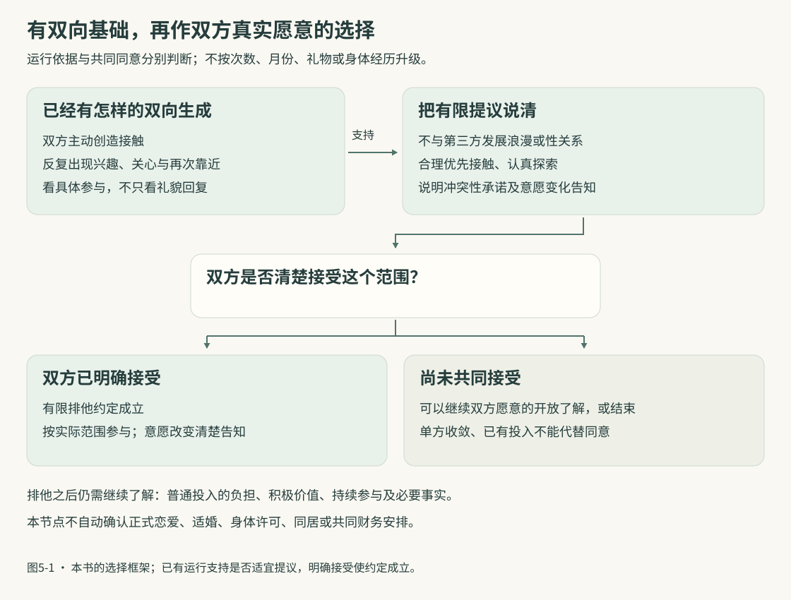

*[图5-1](#figure-5-1)区分双向生成、有限提议与双方确认；未能共同接受时，可以继续双方愿意的开放了解，也可以结束。图不按次数或月份升级。*

排他这一节点不要求已经完成家庭生活和经济系统的协作，也不要求先证明适婚。普通而可承担的投入，能否在各自真实生活里持续带来积极情感价值，还需要继续了解。已有普通相处是有用线索，排他约定本身却不是[感情初步自持](#unit-6-2)的证明。

这个选择也没有解决林岚与周衡的工作地点问题。他愿意争取本地，实际结果仍未知；她重视本地发展，没有因这次约定取消自己的需要。两人选择继续集中了解，同时保留必要的后续判断，而不是用身份把不确定性宣布消失。

若周衡这一次仍不愿排他，林岚可以决定是否继续双方接受的开放状态，也可以不再推进。提出希望和说明自己的选择，并不等于逼迫；惩罚拒绝、以先前投入索取同意，才使对方难以自由回答。两人都不必为了保住机会，承诺自己不愿承担的范围。

结束排他约定需要清楚告知，但不要求对方批准，才能收回继续发展的意愿。若出现威胁或纠缠，告知方式和时机要服从实际保护条件，不能强求当面完成；已有物品、费用或其他责任则另作适当处理。退出权与必要善后，可以同时成立。

至此，林岚和周衡有了共同接受的排他了解约定。他们不是仅靠猜测互相等候，也尚未正式成为恋人。[第六章](#unit-6-1)要在这个更集中的相处中，继续看普通投入的负担、持续参与、必要事实与重要方向，决定下一项双方真实愿意的选择。

#### 5.9 风险专节：把追求投入、身体亲密或模糊承诺当作权利

**投入、亲密和承诺都须保留真实选择；发现欺骗、强迫或持续不参与，应改变当前行动。**

例如，一方送了礼物、安排几次消费，随后在对方拒绝接吻时说：“我花了这么多，你至少应该表示一下。”原本可以出于自愿的心意，此时被用来要求另一种回报。问题不只在礼物贵不贵，而在于拒绝是否还被允许。

若赠送者把投入理解为已经购买的身份，新的付出就可能不断增加对回应的预期。回应不符合想象时，又用更大投入试图改变结果，或开始索取、责备。对方为了避免冲突勉强配合，还可能被误读为已经接受这套交换。这里需要辨认具体环节，而不是只计算双方谁花得更多。

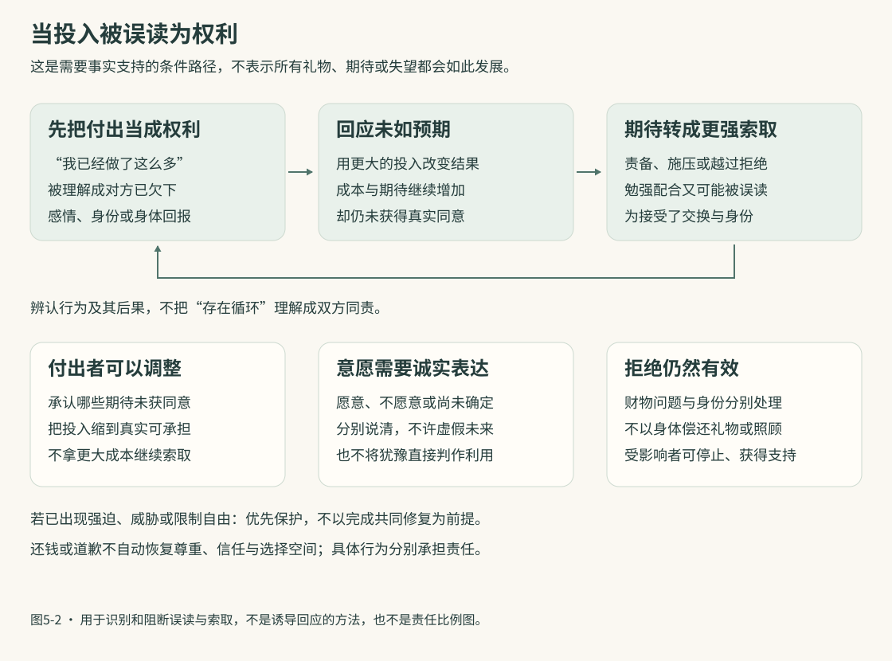

*[图5-2](#figure-5-2)说明一种有条件的循环，不判定所有送礼、期待或失望都会发展成控制。循环中的行为分别归责，不能因此平均分配责任。*

在另一种情境中，接受者明知没有发展意愿，却用虚假的恋爱或婚姻期待持续索取资源，也应处理其具体不诚实。两种情况不能相互开脱：有人犹豫不代表利用，有人付出也不获得身体权利。如果一方已经明确拒绝而另一方继续施压，不能要求被施压者为循环承担同等责任。

消费压力还会进入其他方面。有人不敢说不喜欢活动，担心被指责不知感恩；有人为了让投入看起来值得，勉强同意身份或暴露隐私。一旦选择空间受损，仅退还一件物品或补一句道歉，未必处理了羞辱、信任与后续接触的问题。

可以先停止把身份和身体当作偿还方式，再按具体事实分开处理财物、真实意愿与下一步接触。正常误解有机会澄清，能力和预算问题可以调整；不相容也可以停止。若有强迫、威胁或限制自由，保护应先行，不要求继续约会或共同修复来证明给过机会。

除了礼物索取，还需要按具体事实区分以下情境。相似表现可能需要不同处理，标签不能替代判断。

| 具体情境 | 先区分什么 | 对应行动 |
| --- | --- | --- |
| 用婚姻目标换取性或钱财，已有具体事实证明相关表达是有意虚构 | 未走到婚姻与从开始就作虚假表示不同；未核方向不能直接称骗 | 暂停或结束当前关系，停止新增金钱、隐私或亲密投入，处理已有事项；实际侵害优先保护 |
| 收入与消费陈述持续矛盾，又频繁借钱 | 资源不足、陈述不清与有意隐瞒分别看，未知不等于已可靠 | 澄清影响当前决定的事实，拒绝或暂缓本人不愿承担的借款 |
| 反复失约，没有告知、补救或实际变化 | 一次意外与持续不参与不同，原因说明也不等于履约 | 调整安排或停止投入，不用再给一次证明品行的机会作为退出条件 |
| 很快要求同居、共同负债或共管账户 | 浪漫热情与承担这些安排的条件不同 | 具体事项独立核实与协商，条件不足时暂缓，不由排他一次许可 |
| 当众贬低，拒绝后辱骂、威胁或报复 | 实际伤害不能都降格成笨拙表达或不懂浪漫 | 处理已发生行为；有危险时减少接触、获取支持，不强制当面对质 |
| 场所封闭，交通或住宿被控制，无法按本人意愿离开 | 选择私密环境本身与实际限制退出不同 | 对不愿的安排可以拒绝；出现阻拦、强迫时进入保护路径，可先求助 |
| 一方持续没有恋人意愿，却靠条件合适强推身份 | 生活优势与本人想进入爱情不同 | 不以承诺或更深绑定制造感受，可以停止当前恋爱方向 |
| 现存关系、子女或亲属照护责任、重要履历尚不清楚 | 实际义务与家世标签不同，自述与相应支持信息也不同 | 逐步了解影响当前选择的内容，不把未核当已核，也不据家庭背景定罪 |
| 婚育、健康或重大方向尚未了解清楚 | 信息缺口与已知不相容、欺瞒分别看 | 获取当前决定所需信息，未知不填已满足，必要时暂缓依赖它的选择 |

真实的慢热、临时忙碌和一次失约，不自动构成危险；同样，持续拒不履约、明确重大冲突或已确认欺骗，也不能被一句“每个人都不同”无限宽解。观察不是永远等待，应让新事实改变当前行动。

关系是否可以继续，有时只需问一个实际问题：双方现在愿意什么，能共同做什么，这份接触是否仍符合本人需要。停止推进不必先给对方判定坏人。保护也不必先完成对全部事实的解释；证据足以影响安全或当前决定时，就可以采取相应行动。

排他仍然只由持续双向情感生成与明确接受的有限约定支持，不由餐费、礼物、身体经历或约会次数代替。它使已经出现的靠近进入更集中的了解，并不保证普通相处可以持续，也不证明所有重要事实已经清楚。[下一章](#unit-6-1)将在这个真实起点上继续，而不让身份先替未来作答。

### 第六章 排他中的深入了解：感情初步自持与恋爱确认

*本章人物与情境均为虚构。*

#### 6.1 从集中注意力到稳定互动：排他究竟要完成什么

**排他之后，让双向意愿进入可承担的日常，并继续了解影响恋爱选择的事实与方向。**

[确认排他以后](#unit-5-8)，林岚和周衡仍然各有工作、朋友和自己的安排。两人已经愿意集中了解，现实时间却没有因此自动增加。周衡不能保证每周同一时段见面，林岚也不想把所有空闲都留成待命。接下来需要共同做的，是让已经表达的愿意进入普通生活。

两人已有双向的兴趣、关心和共同经历，也明确了有限排他范围。现在需要进一步了解：相处能否在日常条件下持续，双方实际得到什么、承担多少，还有哪些事实和方向会影响成为恋人的选择。

排他可以减少同时推进多段浪漫关系的干扰，却不能自动使人诚实，也不能保证感情增长。没有再接触其他对象，只说明相应范围内的承诺得到遵守；若彼此始终没有时间、没有话题或没有继续靠近的意愿，排他本身并不补出这些内容。

两人先把近期能提供的时间说清。林岚周日午后有空，周衡确认这一时段可以安排；平日是否交流，则根据各自的工作和精力，不规定每晚都要完成一段聊天。林岚提出，若已经约好的安排要改变，希望尽早知道。周衡也说明，自己愿意认真参与，但不能把所有临时工作都预先排除。

这样的商量没有创造无限时间，却让两人知道这次可以怎样接近。认真参与意味着为接触留出实际空间，已答应的事尽力落实，变化发生时及时说明；它不意味着保证成为恋人，更不意味着已经答应结婚。有限承诺也需要履行，只是不能扩大成尚未接受的全部责任。

因此，排他期不只是“等感觉”。可以增加普通相处，看看双方怎样分享、关心与回应；可以了解影响当前选择的重要事实；也可以讨论方向差异是否存在现实可接受的安排。问题不需要一次全部问完，但每一段额外等待，应当有机会带来新的体验或理解。

如果因为距离、工作或其他条件难以见面，就如实承认观察受到限制。线上交流可以保持真实联系，却不自动证明共同日常已经可行；连续排他几个月，也不会把没有经历的事情变成经验。[第五章给出的示例回顾窗口](#unit-5-7)只是方便安排回顾，不构成统一的关系推进门槛。

| 实际发展到哪里 | 可以考虑的出口 | 需要说明的部分 |
| --- | --- | --- |
| 普通相处已有持续价值，相关事实与方向支持，双方都想成为恋人 | 清楚确认正式恋爱 | 身份及基本责任由双方接受，具体身体与重大行动仍单独决定 |
| 双方仍愿了解，有一个确实可能澄清的缺口 | 围绕该事项有限继续 | 这次了解什么、怎样增加信息，未解决时是否还愿意继续 |
| 不想继续浪漫发展，但双方都愿保留普通联系 | 结束排他，转普通社交 | 普通联系也需双方愿意，不能单方保留伴侣式服务 |
| 一方不愿，或相处方式已无法接受 | 结束当前发展，恢复独立选择 | 清楚说明变化，合理善后，不要求对方保留位置 |

这些出口不是对人品的排名。例如，两人都守约，也能体面交流，但一方发现自己更希望保持朋友关系。承认这个答案，不是证明之前全是假意；继续以排他名义让另一方等待，反而会掩盖已经明确的变化。

若后来想重新集中了解，需要届时新的双向意愿和约定。不能一边不断退出，一边要求对方始终不接触别人。结束也不以取得对方批准为条件，遇到危险时更不需要先完成当面说明，才允许保护自己。

林岚和周衡当前仍想继续。他们先落实一项普通安排，同时保留工作地点这个待澄清问题。接下来有价值的，不是证明排他持续得够久，而是看这些相处能否让两个人都获得愿意维持的情感生活。

#### 6.2 什么叫感情系统初步自持：从新鲜刺激走向普通相处

**普通相处反复带来双方认可的积极价值，且双方愿意、能够持续参与，才有初步自持的基础。**

“我们一直联系，也没有吵架。”这句话可以描述关系的一部分，却没有回答相处是否让双方都感到值得。联系可能来自喜欢，也可能靠一个人不断发动；平静可能来自相处舒服，也可能因为另一个人一直不敢表达需要。

本书所说的感情系统初步自持，是关心、表达、回应与积极体验已经在普通而可承担的相处中反复出现，双方都愿意并能持续参与。它不只是还想再见一次，还要看互动能否继续产生本人认可的情感价值，以及维持它的投入是否能被双方承受。

“自持”并不意味着自动运转。约时间、听对方说话、表达欣赏、说明变化，都需要实际参与。这里要区分的是正常投入与长期透支：若一人必须不断催促、加码消费或压住需要，才能让联系不断，维持的代价本身就需要被看见。

可以比较三种情境，分别看联系怎样维持、双方实际得到什么。

| 表面情况 | 进一步看到什么 | 对初步自持意味着什么 |
| --- | --- | --- |
| 每次昂贵活动都很快乐 | 对普通见面没有意愿，或尚未有过相关经历；一方难以持续承担费用 | 活动中的快乐真实，普通相处基础仍不足或未知，不能直接填成已自持 |
| 联系不算密集 | 双方会关心具体近况，主动安排可承担活动，相处后仍想继续 | 有持续价值与真实参与的依据，不因消息少自动否定 |
| 从来没有明显争执 | 一方一直压住疲惫和不满，怕表达后对方不再联系 | 平静没有说明双方都获得重要价值，需看未被表达或回应的需要 |

判断快乐来自什么，不是要求证明感情纯粹。共同活动、资源和新鲜体验都可以有价值；问题是，如果只有不断升级刺激才有相处，双方是否能够、也是否愿意持续这样生活。可以诚实调整活动与负担，再看真实意愿，不能突然撤回支持制造考验。

林岚与周衡在排他后仍会分享日常，也有普通见面。原定周日的一次活动前，周衡告知临时工作使时间发生变化，提出改到另一天，缩短这次活动。工作原因当时是他的自述，林岚知道的实际事实，是原安排需要改变、他主动说明并给出了可选方案。

她有些失落，希望以后能在知道变化时尽早告诉自己。周衡也承认，自己先忙着应付工作，晚了一些才想起告知。两人另选了双方能留出的时段，后来完成了一次较短散步。她没有因此得到永不改期的保证，他也没有因有工作理由就免去对已经约定之事的处理。

那次相处中，周衡说起一件让自己烦闷的工作琐事。林岚没有马上替他作决定，先听他讲完，再问是否想一起想办法。他说事情还在，但讲完没有那么堵了。林岚也说，这样不用赶许多项目、能把话说完的相处，让自己觉得轻松，愿意再安排。

这些是双方实际获得的体验：有人听见自己的具体处境，有分享与关心，也有再靠近的愿望。费用和时长都没有超出两人认可的范围；他们分别表示，目前的参与没有要求自己长期挤压必要休息或透支支出。这仍是当前范围的了解，不代表未来任何负担都能承担。

自然忙碌出现后，能够说明、调整并重新连接，是新增信息。它不需要被夸大为已经经历重大困难，也不意味着以后每次都能恢复。如果尚未出现过波动，就如实保留未知，不能通过故意冷落、制造冲突或撤回关怀补上这一栏。

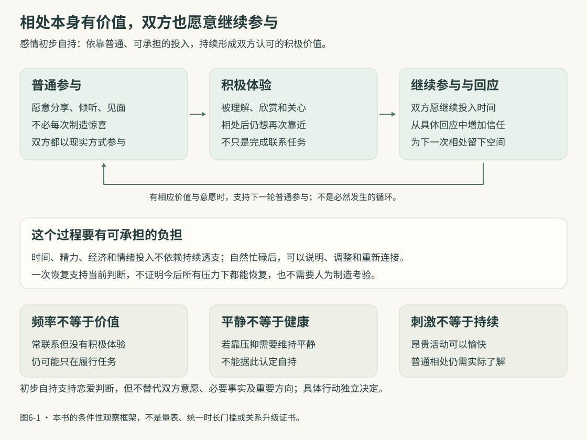

*[图6-1](#figure-6-1)中的循环需要真实经历支持，不保证每次互动都顺利。负担、自主与双方认可的价值必须一起看，不能只看联系持续。*

爱情三角所关注的激情、亲密和承诺，可以在这里作辅助观察：是否有想靠近的动力，是否逐渐形成理解与分享，是否愿意承担已经接受的有限约定。它们不需要同步达到某个分数，也不能把其中一项替换成全部。这个三角视角关注一段关系中的情感与承诺构成；[第一章的“三体问题”](#unit-1-3)则区分吸引、恋爱和婚姻三类不同对象与选择，二者用途不同。

| 辅助视角 | 本阶段具体看什么 | 不能单独推出什么 |
| --- | --- | --- |
| 激情 | 对具体人的浪漫或身体靠近动力，而非只喜欢一项活动 | 对方同意或未来生活可靠 |
| 亲密 | 实际的理解、分享与被关心体验，彼此是否变得具体 | 必然想成为恋人，或所有信息都该公开 |
| 承诺 | 本阶段接受的有限约定，及愿意为其持续参与的选择 | 已有婚约，或无需再看实际履行 |

在本书的使用方式里，愿意靠近为参与提供动力，被理解的体验使继续相处有价值，有限约定帮助双方为这种相处留出空间。但任何一环都可能不足：有激情却不愿承担，有约定却没有积极体验，或者彼此理解却更愿做朋友。后续日常经营仍要看这些内容怎样变化，不靠图形替本人定义爱情。

还要问自己想要的是友谊、特殊活动体验，还是以恋人的身份继续走近。一个人可靠、温和，也许很适合做朋友；若本人没有恋人意愿，就不能只因运行平稳而把它命名为爱情。反过来，激情还没有达到自己想象中的强度，也不自动否定已经存在的真实喜欢和自主选择。

初步自持可以脆弱，仍需后续经营。它不要求全部共同生活能力都已成熟，不要求表达完全对称，也不要求消除所有疲惫。它要保留的是已经发生的基础：普通相处确实有积极价值，双方愿意且能参与，而不是把“以后一定会更喜欢”当成今天已经拥有的东西。[附录C.2](#unit-C-2)可帮助整理这些具体依据。

#### 6.3 从社交形象认识真实的人：必要核验与行为观察

**围绕当前选择核实重要事实，辨明材料的来源、时点与范围，并在实际交往中认识行为。**

越愿意靠近一个人，越有必要分清自己喜欢的形象与已经了解的事实。提出核验，不必先把对方视为不诚实；愿意相信，也不需要把重要缺口当成已经填好。先问的是，哪件事实会改变当前选择，以及取得它需要多大范围的信息。

必要了解包括基本身份、当前婚姻和冲突性伴侣承诺、已有子女与实际责任、真实居住和工作条件，以及被作为重要前提的学历、职业、收入或资源陈述。重大债务、健康等敏感事项，按实际影响与即将作出的决定触发，不要求刚进入排他就提供全部私人证明。

一些政务、教育等官方服务，可以用于核对身份、学历、社保、个税或婚姻状态；银行、第三方支付机构也有各自的官方渠道，提供其范围内的信用相关记录、报告或评估。部分地区还能在线取得官方提供的无犯罪记录证明。具体可用服务随事项、地区、时点及本人权限而不同，核对以本人依法有权取得、自愿展示且与当前决定相关的内容为限。

渠道正式，仍要看材料究竟证明什么。社保、个税记录不能当然替代婚姻状态证明；支付平台的某类信用记录或评估，不等同于国家统一征信。每份记录都应核对出具机构、对应事项和涵盖期间，不能由其中一项推定全部私人关系、财务情况或未来可靠性。

林岚和周衡此前都说没有现存婚姻或冲突性关系承诺。这是重要表达，也仍是本人陈述。他们决定先核对与当前选择相关的基本身份和实际工作信息，采用本人愿意、具有相应权限的方式，查看必要部分，遮盖无关号码，不互相留存完整资料。其他重要状态需要继续取得相称支持，不能由一次查看全部证明。

| 信息或材料 | 先看它实际支持什么 | 不宜外推到什么 |
| --- | --- | --- |
| 平台上的认证或标记 | 该平台实际核过哪一项、何时核过、适用什么范围 | 平台未核的婚姻、财务与全部品行 |
| 本人有权展示的相关证件或记录 | 记录对应的人、事项、时间与可核对的出处 | 没有列出的事实、之后的变化与未来行为 |
| 单张截图或转发材料 | 其中可见内容，完整语境、出处和时效是否仍缺 | 已经完成官方核验或证明不存在其他情况 |
| 朋友或亲属的介绍 | 对方亲自知道什么，还是转述本人自述 | 所有私人状态，或介绍者并未亲历的事实 |
| 自然互动中的实际行动 | 在这个范围怎样参与、兑现和处理偏差 | 其他领域已经全面可靠，或长期忠诚已获保证 |

不同材料不应只按数量叠加。例如，三位朋友都说某人单身，追问信息来源后，发现都只是听本人这样介绍。三次转述不是三份独立核实。它们可以帮助理解社交表述，却没有增加原本缺少的独立依据。

[第五章的住房例](#unit-5-6)也可以这样使用：一条父母允许本人居住的消息，即使真实，也只支持相应的居住安排，不能替本人产权或未来共同居住的许可作答。若只是继续约会，无须由此索取全部房产档案；若要据此决定迁居或共同购房，就需在行动前澄清相应权属、条件与权限。

信息状态至少分成五种：本人陈述；已有与当前决定相称的支持；尚待确认；尚未讨论；出现实质前后矛盾。这些状态描述的是当前依据，不是给人贴上诚实程度标签。意见不同也应单列，不能把对方不赞成误填成事实未核。

某项材料显示的日期较早，可能只是尚未覆盖现在；两次说法不同，则需要知道是否发生变化、原话含义有何差别。如果新事实已经证明重要陈述不实，就不能无限写作“也许误会”。尚待核实、普通差异与证实欺瞒，后续处理不同，[6.9](#unit-6-9)会进一步区分。

核验的对等，是双方都有提出、说明、限定及拒绝越界要求的权利，不是你看过一项信息，我就必须交出同样数量的隐私。必要时当面适度查看，遮盖无关部分；普通婚恋了解不以收存证件、流水或完整病历副本为目标。实际办理事务或保护权益需要材料时，再按必要性、授权和相应规则另处置。

正规渠道存在，不表示伴侣或第三方可以任意查询他人的完整资料。没有相应权限时，不能以感情重要为由侵入账号、绕过授权或要求他人代查。拒绝越界要求本身不证明欺瞒；若信息缺口让自己无法接受，可以暂缓对应选择或结束，而不强迫披露。

诚信、尊重与合作，则还要在自然行为里看。一个人是否愿承担已接受的责任，出错后如何说明，对方有不同需要时怎样回应，不能由一张证书替代。MBTI等类型标签至多可以成为讨论偏好的话题，本书不用它淘汰对象、解释全部行为或认证婚恋前景。

测量稳定性、对某项用途是否有效、能否预测具体婚恋结果，是不同的验证问题。没有相应证据，就不能从一个测试类型推出“必然适合”或“必然不忠”。对当前需要的事实，回到合适来源；对本人选择，听其真实表达；对共同生活是否能运行，继续看实践。

[附录D.1](#unit-D-1)帮助把这几类问题分别记录，[D.2](#unit-D-2)提供完整入口。工具不是为了查到毫无不确定才允许靠近，而是避免重要决定依赖错误事实，同时保留每个人对自己的信息与选择的合理边界。

#### 6.4 重大方向先对齐，方案细节按阶段推进

**及早谈清重大方向与不可接受之处，再随具体决定落实资源、权限和行动方案。**

“我们都想认真谈恋爱”，还可能包含不同的未来。有人希望较快进入婚姻，有人愿意长期交往却暂不考虑结婚；有人把有孩子看作重要人生方向，有人已经明确不希望生育。这些差异不能只靠眼下相处舒服绕过去，也不需要第一次见面就把全部方案定完。

当前先要明确的，是本人真实立场、不可接受之处和已知约束。可以从下面五类普遍重大事项谈起，看彼此希望的生活能否相容。它们帮助发现分歧和选择空间，不用于评定谁有没有恋爱资格。

| 方向 | 此时值得谈清什么 | 仍需在后续具体化什么 |
| --- | --- | --- |
| 结婚方向与时间底线 | 是否希望婚姻，对探索和等待能接受什么范围，哪些时间限制已真实存在 | 是否与这个人结婚、婚约及婚礼安排，不由一般意愿提前确定 |
| 生育意愿 | 希望、不希望或尚未决定；这对当前选择有何重要性 | 具体身体决定、健康解释、时间及照护安排，须在相应行为前另谈 |
| 居住定居 | 希望在哪里生活，职业和照护有哪些约束，是否接受异地 | 实际迁居路径、住房和生活运行，不由喜欢自动落实 |
| 基本经济可行性 | 期望生活的支付来源、既有义务、负担与必要缓冲 | 具体预算、分工和重大财务安排，不设统一财富门槛 |
| 一对一排他与忠诚原则 | 是否愿意遵守一对一排他承诺，具体边界是否明确 | 具体接触边界、告知和变化处理，不用含混标签代答 |

“尚未决定”是可以诚实表达的答案，却不等于已经一致。另一方可以接受继续了解，也可以认为这种不确定无法支持自己的时间安排。不能逼迫一个人作虚假确定，也不能用自己尚未确定，要求另一个人无期限等待。

林岚和周衡进一步谈过婚姻与生育方向。两人都希望未来有婚姻，也都表达希望有孩子；目前是在了解能否与这个具体的人建立相应生活，并没有答应彼此一定结婚或立即生育。林岚不要求现在就谈婚礼，但不愿将重要方向一直留到很深绑定后才第一次面对。

对于本地生活，周衡与工作方沟通后，得知下一轮安排预计在下个月反馈。他自愿让林岚查看与自己安排相关的通知部分。通知提供了一个预计反馈时点，并没有确定他一定留在本地；他愿意争取和能否成功，仍是不同信息。

林岚说，她愿意继续了解，但不会因排他就答应辞职迁居，也不把长期异地当成自己已接受的未来。周衡认可这个边界，没有要求她证明喜欢就跟随。他们约定，在下一轮安排反馈后重新讨论；若反馈延期，也要把变化说清，而不是把未知无声地延续下去。

此时有了可用的下一步，却还没有解决定居。是否能在这个未知下继续恋爱，需要本人判断其当前后果、可接受范围和退出代价；不能由旁观者替林岚决定应该等多久。若她要求恋爱开始前就必须确定长期同城，而周衡无法提供这个条件，停止也是成立的选择。

基本经济可行性同样需要回到想过的生活。当前收入不错，不证明某个住房、育儿或照护方案一定能支付；收入较低，也不自动取消建立关系的可能。要把期望支出、已有责任和真正可用的来源放在一起，不能把父母口头支持、未来涨薪或尚未获得的机会当作已到位资金。

租房与购房可以是不同路径。共同讨论居住是普遍任务，但必须先买房并不是所有人的统一资格。若某一方确实把特定住房条件视作个人不可妥协，就如实说明，并检查自己或拟议来源能否落实；这项偏好不能被假称为所有人的客观标准。

方向相容也不等于生活已经运转。两人都希望公平分担，还需要在具体事务里说明谁承担什么、谁有资源、如何调整；都希望有孩子，也不代表身体、时间和照护安排已被许可。恋爱阶段会逐渐提供更多合作经验，适婚判断则要到相应阶段综合这些事实。

可以暂时不知道某个细节，但不能隐瞒自己已经知道的决定性障碍。若本人无论如何不接受某种生活，就不要先说“都可以”，希望以后靠关系更深迫使对方改变。诚实的分歧有时会使关系停止，也能让双方不用在错误期待上继续增加代价。

#### 6.5 条件重大事项：把个人意愿、外部条件与决定权限拆开

**把个人意愿、资源控制和决定权限分别说清，才能找到双方愿意且现实可行的路径。**

有些问题不是每对伴侣都会遇到，却会在出现时直接影响选择。本人一句“我不介意”，未必能够改变外部条件；需要别人支持，也不等于本人毫无自主。先看谁愿意什么、谁掌握哪项资源、谁能够作出具体决定，才知道下一步能做什么。

另一对伴侣讨论住房时，一方本人不要求婚俗礼金，但两人设想的住房首付款，需要其父母支持；父母又表示，只有按他们认可的婚俗安排，才愿提供这笔资金。本人说“我不在意礼金”，表达的是个人立场，并没有使资金条件消失。

| 要分开的部分 | 本例已经知道什么 | 仍需确认或选择什么 |
| --- | --- | --- |
| 个人立场 | 本人不要求该礼金，对方也有自己的接受范围 | 双方是否接受父母所提方案，不能替对方答应 |
| 资源控制 | 关键资金由父母掌握，目前附带条件 | 支持金额、形式、时间和条件是否明确、是否真正可用 |
| 实际权限 | 本人可以表达和选择，不能单方调动父母资金 | 是否有本人能落实的替代路径，不能只说“我去说服” |
| 当前行动 | 拟议住房方案依赖这项尚未落实的支持 | 在条件清楚前，暂缓依赖它的付款、签约或其他绑定 |

父母愿意怎样使用自己的资源，与是否有权替两人决定全部婚恋生活，是不同问题。资助可以有真实条件，也可能进入不当干预；要看具体要求、可拒绝性及其后果，不能只凭存在外援就判控制，也不能因为出了钱就默认拥有所有决定权。

一种下一步，是由掌握资源的人把条件说清，再由双方判断是否接受。另一种，是认真计算不依赖这笔钱的路径，例如不同住房方式或延后安排。但替代方案也要有实际支付来源、可承担负担和双方意愿；一句“那就不靠他们”并不比原来的口头承诺更能落实。

类似的条件事项，可以按实际触发选择讨论，不必在排他期全部审一遍。

| 条件事项 | 什么情况下需要进入讨论 | 重点落到哪里 |
| --- | --- | --- |
| 婚俗与礼金 | 已知要求可能决定是否继续或怎样结婚 | 谁提出、谁接受、谁支付，有没有不能接受的条件 |
| 住房与产权要求 | 共同居住依赖特定房屋或出资安排 | 权属、使用、出资和实际居住选择分别确认 |
| 既有子女 | 当前关系将影响照护、接触或长期安排 | 既有责任真实存在，不能凭新伴侣意愿清零 |
| 持续亲属照护 | 时间、居住或支出将长期受影响 | 当前责任、可用支持、本人能承担的范围 |
| 附条件第三方资金 | 计划依赖父母、前任或其他来源 | 来源是否可用，条件、权限及撤回后果 |
| 异地或特殊职业 | 接触、迁居、时间或安全条件明显不同 | 本人选择空间、现实限制与双方可接受方案 |
| 宗教文化及特别生活要求 | 日常实践或重要仪式影响共同生活 | 本人真实要求、能协商什么，不能假设同背景就一致 |
| 健康形成的具体限制 | 某项行为、照护或婚育安排受影响 | 实际功能和专业解释，不按标签替本人决定 |
| 个人不可妥协条件 | 某项要求将决定本人是否继续 | 明确含义及后果，不能借“不可通约”包装所有偏好 |
| 特别财产约定 | 拟作有长期影响的财产安排 | 真实目的、权利责任和专业审核所需事实 |
| 婚后财务管理机制 | 双方对账户、预算、权限有重要期待 | 管理方式、参与权和责任，具体实施在相应绑定前落实 |

同一套住房里，还可能同时存在四个问题：谁拥有，谁可以住，谁管理费用与日常事务，谁参与共同生活的决定。拥有资源不自动回答全部生活权限，负责管理也不等于资源已经归管理者所有。若这些问题混在“到时都听你的”里，就很难知道真正同意了什么。

原则可以早谈，具体文本与执行要在相关行动前处理。比如是否接受某种财产安排，可以影响现在的选择；其具体效力、责任和可实施方式，则需根据真实材料与适用规则取得专业支持。本书不凭一张填写表保证文本有效，也不让“还没订婚”成为隐藏重要条件的理由。

个人不可妥协，是本人不愿接受什么；不可通约，是不同价值不能简单折成一个共同尺度。某项要求谈不拢，不会因此自动变成不可通约；父母提出的条件，也不自动成为本人的立场。把这些区别说清，有助于发现真正的选择空间，也允许在没有可接受路径时停止。

完整入口与单项记录见[附录D.2](#unit-D-2)。需要追问的不是“你到底听不听父母”，而是这项资源由谁决定，眼前方案依赖什么，失去它后还有没有双方愿意且能承担的路径。

#### 6.6 健康、身体与排他：按现实影响沟通，不以标签推断

**围绕具体行为与共同生活的实际影响沟通健康，分别尊重专业事实、身体意愿和关系约定。**

谈健康，不是给对方贴一个适合或不适合恋爱的标签。当前行为是否安全、某种生活需要怎样照护、时间和费用由谁承担、婚育选择是否受实质影响，是不同的问题。病名不能独自回答这些内容，良好外观也不能替相关信息作答。

还有一对伴侣准备共同活动，一方说明，自己已有的健康限制使长时间站立不舒服，原先设想的共同活动需要调整。对方此时首先需要知道的是，这次活动有哪些实际限制、本人希望怎样安排、是否有需要先向专业人士确认的事项，而不是立刻索取全部病史。

两人可以讨论本人愿意且可承担的活动方式，也可以暂缓这次安排。已知某项活动受限，不证明全部共同生活都不可行；能够完成一次短活动，也不证明长期照护或婚育问题已解决。每项信息要回到它实际影响的决定，不用一个成功或失败的片段包办全部判断。

| 当前需要 | 有必要了解的范围 | 不能用什么代替 |
| --- | --- | --- |
| 即将发生的身体行为 | 与该行为有关的重要健康信息、保护安排和本人同意 | 恋人身份、排他承诺、既往经历或一份无关检查 |
| 共同活动与日常生活 | 实际功能、限制、本人需要与可用支持 | 根据病名想象全部能力，或仅看外表认定没有负担 |
| 可能持续的照护与费用 | 具体任务、现有责任、时间和资源，哪些仍需专业解释 | 一句“我会照顾你”就算已经具备长期能力 |
| 重要婚育选择 | 对相关选择有何影响，需要哪些专业说明和个人决定 | 强迫检查、用结果证明忠诚，或由一方替另一方决定身体 |

已知事实若实质影响他人的当前安全和重要选择，就需要适当知情；不能明知有相关重要信息，却要求对方在误解下作决定。与此同时，亲密关系不赋予一方强制取得完整病历、基因资料、账号或全部检查结果的权利。需要与范围应当说明，不能无限扩张。

专业解释和个人选择也不同。专业人士可以在其能力范围内解释相关事实与风险，当事人则决定本人愿不愿接受相应行为或共同安排。不能用“专业上可以”迫使本人愿意，也不能只凭个人希望，就假称专业问题已经没有影响。

资料需要看出处、日期、对象和适用范围。一次检查回答的是其能够覆盖的问题，不能由此宣告所有风险清零，更不能把任何检查当成永久安全或忠诚证明。具体需要什么检查、何时进行和怎样解释，应依实际问题获得专业建议，本书不在缺少依据时填入统一方案。

若合理边界内的信息仍不足，可以保留未知，暂缓受影响的身体行为或重大安排。拒绝披露不等于自动有病或欺骗；另一方无法接受这个缺口，也没有义务继续承担不确定的后果。双方可以不同意继续，而不通过强迫公开或人格贬低换取答案。[附录D.3](#unit-D-3)帮助整理需要专业解释的问题。

健康知情不能替一对一排他承诺作答，也不使任何人必须接受打破排他的提议。开放式性关系存在法律、生理健康和心理健康风险；本书不展开这类安排，相关拒绝与守约边界见[10.5节](#unit-10-5)。

私人幻想、过往经历和当前实际行为应当分开。描述想象不等于已经实施，过往经历也不自动证明现在违约；是否守约，依据已经确认的承诺与实际行为判断。一方改变想法不能单方面取消既有排他，更不能追认此前的违约。另一方可以拒绝有关提议，也可以选择结束关系。

身体同意、健康知情和关系约定各有自己的问题。它们会互相影响，却不能相互替代。[第十章](#unit-10-1)还会讨论亲密经历带来的积极价值、身份期待和绑定后果；这里先让每一项当前决定建立在相关信息与本人真实意愿上。

#### 6.7 信息不足怎样处理：有限暂缓与新的证据

**把重要未知写成具体问题，明确它影响的决定、可用的了解方法和未解时的选择。**

“我还不放心”可能指向一项重要缺口，也可能已经变成没有终点的调查。先把它变成具体问题：不知道什么，为什么影响现在的决定，什么信息有可能改变判断？若不能说明这些，就容易不断增加材料，却没有增加真正需要的认识。

不是所有未知都在同一时点解决。继续普通见面、确认恋爱、同居、共同借款和生育，依赖的条件不同。对当前安全或即将发生的高后果行动有直接影响的信息，不能以阶段尚早拖延；尚未进入的共同生活任务，也不必全部提前验证。

| 需要明确的内容 | 怎样写得具体 | 避免什么混淆 |
| --- | --- | --- |
| 未知本身 | 哪项陈述、意愿或条件还不清楚？ | 把“整个人靠不靠谱”当成一个可一次查完的问题 |
| 当前影响 | 它会改变哪项选择，后果是什么？ | 因一个无关未知阻断全部接触，或忽视决定性缺口 |
| 了解方法 | 谁能提供什么，权限和范围是否合适？ | 无权查询却设法代查，或收集大量同源转述 |
| 处理节点 | 最迟在什么具体行动前，需要达到怎样的清楚程度？ | 只写“以后再说”，等已经绑定后才处理 |
| 未解出口 | 到时仍未知，本人愿继续、暂缓还是结束？ | 把延长观察当成对方必须最终提供确定答案的义务 |

林岚和周衡随后完成了对基本身份、实际居住工作及当前婚姻状态的相称核对。用于关键状态的信息有可核对的来源、时点与范围，由本人有权取得并自愿展示；需要解释材料能证明什么的部分，另向具备相应能力的渠道确认。这些实际核对，为先前的本人陈述增加了相应支持。

如[6.3所讨论的正式渠道与材料范围](#unit-6-3)，核实应按具体事项选择来源。两人这次确认了上述范围的事实，没有因此查清全部私人状态。其他冲突性伴侣承诺，还要结合诚实表达与实际交往了解；当前没有发现实质矛盾，也不保证未来永不隐瞒。核验的作用，是减少影响当前选择的具体缺口。

工作地点则保留为另一种未知。当前知道双方希望争取本地，也有下一轮安排的预计反馈时点；不知道最终地点、可调整空间和长期共同生活路径。林岚目前愿意在这个范围继续了解，不愿预先承担迁居或长期异地。周衡接受她的选择，不把继续相处解释成她已经答应跟随。

这项未知的回看节点，是工作安排反馈及任何相关迁居、离职决定之前。若反馈延期，就更新下一步，而不是悄悄沿用原先预期；若长期没有新信息，或林岚发现自己已不能接受这种状态，她可以重新选择。明确一个回看条件，不保证到时一定有满意答案。

例如，某人两次说出的收入不同，后来在自愿说明与相关材料中，澄清一处指固定报酬，另一处包含当期浮动部分。材料在相应期间支持这个区别，原来的矛盾得到解释；但不能继续把有波动的一项当作未来固定收入，也不能从这里推定没有其他债务。

另一种结果是，某个关键的现有关系事实始终无法得到与当前选择相称的确认。即使尚未证明欺骗，也可以暂缓或拒绝升级，甚至停止交往。拒绝不是对他人全部人格的判决，只需承认自己无法在这个信息状态下作愿意的选择。

事实已获支持，也不等于方案已完成。知道某项资源确实存在，还要看能否使用、附带什么条件；双方都同意一项安排，还要看是否有权限、是否实际实施；一次做成，也不证明长期都能做到。这几类证据不能在记录里被一个“已确认”全部代替。

长期共同经营能力需要在更多真实情境中认识，不能在排他期提前验证一生。相应未知可以留给后续阶段，并在重大行动前再判断。相反，已经出现的威胁、重大欺瞒或身体边界侵害，不能以“还在了解”延后处理，保护与停止不需要完整证明对方所有动机。

有限暂缓的价值，是把不确定转成能够执行的下一步；如果方法根本不会带来新信息，或者本人已不愿承担等待，就不必为了显得谨慎继续。[附录D.1](#unit-D-1)记录最少必要内容，[D.4](#unit-D-4)则帮助把高后果行动从恋人身份里单独拿出来判断。

#### 6.8 正式恋爱确认：选择已经开始运行的关系

**在感情初步自持、重要事实与方向可接受的基础上，由双方自主确认恋人身份及基本责任。**

林岚发现，自己想见周衡，已经不只是因为还有资料没了解清楚。遇到有意思的事会想告诉他，疲惫时愿意听他说几句普通近况；他们的相处不必总有新活动，也能留下被理解和想继续靠近的感觉。周衡也表达了相似的愿望：他希望以恋人的身份认真和她继续，而不只维持一项集中了解的约定。

这个愿望还要与实际情况放在一起。两人的普通参与已有反复发生的积极体验，当前投入可承担；一次自然忙碌后，双方经历了说明、调整与重连。关键身份信息已有当前范围的相称支持，工作地点仍未确定，但双方知道这个未知意味着什么，也愿意在暂不作迁居等承诺的条件下继续。

| 确认前分别回答 | 本例中的当前依据 | 尚未由此证明什么 |
| --- | --- | --- |
| 感情是否初步自持？ | 普通相处有双方认可的价值，双方参与，当前负担可承担 | 所有重大压力下都能恢复，或以后无需经营 |
| 是否都想成为恋人？ | 两人分别表达本人愿望，不靠礼物、排他时长或内疚代答 | 一方有愿望就可以替另一方确认 |
| 决定性事实是否足够清楚？ | 当前关键身份及实际生活信息已有相称支持 | 未来行为、所有隐私或所有财务条件已经查清 |
| 有没有当前无法接受的重大障碍？ | 重要方向已谈，地点未知及其边界由双方当前接受 | 地点已经落实，或同意承担所有未知后果 |
| 是否理解并接受基本责任？ | 愿意承担持续伴侣身份、对等忠诚、诚实尊重与积极参与 | 具体性行为、同居、借贷、购房或婚约许可 |

这些答案不是分数。较强的喜欢不能抵销本人明确不接受的生活路径，材料充分也不能补出并不存在的恋人意愿。每一项都应按它自己的内容回答，允许“不知道”“还不愿意”或“我不能接受”真实出现。

林岚说：“我现在想认真和你谈恋爱。还有些事没定下来，但我想继续的是和你这段关系。”周衡回答：“我也是。我愿意成为你的恋人，那些还没解决的事，我们继续说清、一起面对能面对的部分。”两人随后确认，继续遵守对等排他，诚实说明重要变化，也都主动参与这段关系。

正式恋爱在本书中意味着一种持续性的伴侣身份。相较于排他了解，双方不再只以“是否成为恋人”为当前任务，而是选择让已经开始运行的关系进入更多真实生活。它需要参与，也保留本人自主，不把一句“以后我们一起”扩大成全部事项已经共同决定。

是否立即见父母、怎样向朋友介绍、公开到什么范围，都可以根据现实情况再商量。确认恋爱也不自动意味着同居、发生性行为或共享资金；每项行动仍要看本人意愿、必要信息、资源与责任。林岚没有因此答应离开本地，周衡也没有获得替她决定职业的权限。

[第一章的三正](#unit-1-5)在这里再次落地：心正，是本人真实想建立这段关系；名正，是双方清楚接受恋人身份，不让另一方靠合照或亲吻猜测；行正，是已经有相应运行，也愿按确认的范围参与。不能只在称呼上升级，实际仍把全部关注和责任留给一个人。

也可能身份核验没有发现问题，生活条件也可以接受，但一方始终不想成为恋人，仍可以拒绝。这不是清单失灵，而是清单本来就不能制造意愿。条件合格不使某个人拥有被选择的权利，接受者也无须证明对方不好，才能说自己不愿意。

另一种可能是已有身体亲密，却缺乏普通相处的持续价值，或者重要障碍尚无法接受。经历会有分量，也可能使退出更难受，但不能代替新的同意。可以继续有任务的了解，也可以停止；实际借款、物品与隐私责任分别善后，不用继续扮演恋人来偿还。

林岚和周衡的确认，并没有让以后每一天自动轻松。它使两人有了一个清楚的共同选择：愿意将喜欢放进更长的日常，试着更好地理解、支持与协作。下一次分享好消息，不必是为了通过观察；一次意见不同，也不必马上证明选错了人。接下来要做的，是让这份选择继续产生双方愿意生活其中的内容。

#### 6.9 风险专节：空壳排他、核验越界与把对齐当作兑现

**分别处理信息缺口、不相容、违约和侵害，让当前事实决定核实、调整、停止或保护的行动。**

有了排他名义，却总是一个人安排、等待和安抚；一方要求另一方停止所有浪漫接触，自己却不按同样范围行动；为了弄清事实，核验逐渐变成索取密码、定位和切断朋友。这些是不同问题，不能都用“再深入了解一下”处理。

例如，双方说好认真集中了解，实际却始终只有一方提出见面和话题。另一方不愿作任何可行安排，只在对方想停止时强调“你已经答应过排他”。这里既要看当前是否仍有双向感情，也要看有限约定是否被用来维持单向供给。

身份压力可以增加等待与投入，长期没有新相处又使判断停滞；为了获得确定感，有人转而要求更多私人信息。若再用共同账户、同居等绑定证明认真，本来尚未形成的合作就开始承担更高后果。问题会从感情压力进入生活、资源和自主，不能只靠再换一个更正式的称呼解决。

| 当前事实 | 不能混成什么 | 相应处理 |
| --- | --- | --- |
| 对暧昧、前任接触或告知范围尚未说清 | 已经证明背叛，或可以由一方事后任意定义 | 澄清具体范围，决定是否都愿接受，不追溯创造原不存在的义务 |
| 已明确对等约定，一方却反复只要求对方遵守 | 只是表达风格不同，或双方都应各退一步 | 按实际违约、影响与本人意愿处理，可暂停或结束，不让身份掩盖双标 |
| 关键身份仍待核实，材料有普通差异 | 自动有罪，或为了信任就假定无事 | 区分支持范围与缺口，决定相称了解、暂缓或结束 |
| 已证实重大身份欺瞒，隐瞒现存婚姻或冲突性伴侣承诺 | 仅仅还没到升级时机 | 立即暂停当前交往或结束，处理既有暴露与后果；不只暂停下一步升级 |
| 强索密码、定位、切断朋友或以身份换取身体和资金 | 深爱或排他的当然权限 | 守住具体决定范围；已出现强迫、限制自由或可信威胁时优先保护 |
| 反复否认可核实事实、重写明确约定，并持续贬损人格和判断能力 | 一次记忆不同，或只是双方沟通技巧不足 | 依据行为和后果辨认控制，可立即暂停交往或结束，不等完整动机证明 |

对一项普通记忆差异，可以核对时间、原话与情境，看看是否存在可以解释的变化。若已经有清楚事实，对方仍反复要求你否定所知，又用“你能力太差、说什么都不可信”让你放弃判断，就不能只归为记性不同。这里要处理的是事实、决定权与持续贬损，而不是教受影响者怎样更温柔地提问。

也要保留四个区别。本人可以表达受伤、不舒服或失望；关于发生过什么的陈述可以核对；对他人动机的解释可以讨论；共同关系身份须双方确认。承认一种体验，不等于必须接受其全部因果解释；修正解释，也不能让现实失责、资源缺口或不当权力消失。

对具体行为的批评，与持续人格化贬低不同。“这次没有及时告知影响了我的安排”指向可以讨论的事实；反复将人的需要和主张都说成无理，再否定其人格或能力，会侵蚀表达与选择空间。如果你持续处在这种处境，可以立即暂停交往或结束，不需要先证明对方符合某个临床标签，或完全查明其恶意。

资料补齐也不等于已经修复。若对方先越权查看账号，后来拿到某项真实信息，真实信息不会取消越权；若曾故意欺骗，后来补交材料，也还要处理此前的选择怎样被影响、当前是否仍愿继续，以及规则和信任是否有现实修复空间。一次道歉不能代替这些不同结果。

依赖父母或前任，也需要看具体资源与权限。有的人仍承担已有子女责任，有的人住房或生活资金依赖他人，这些事实可能限制某项方案，却不能只凭关系称谓判定危险。若外部人实际能够迫使当事人违背共同选择，或者重要责任被持续隐瞒，就要处理真实限制与欺瞒，不能靠排他宣布第三方已经没有影响。

本人愿意改变时，可以支持其澄清真实权限、尝试能够做到的行动；不能由伴侣接管其判断与成长，也不能把“以后会独立”预支为今天已经可以共同决定。已有努力和仍存在的限制都要如实看，是否继续由各自选择。

一对一排他是否已经共同确认，具体交往边界是否清楚，需要分别说明。任何人都可以拒绝打破排他的提议；已明确不愿遵守一对一承诺时，可以停止关系。提出提议不自动证明已经违约，实际违约、强迫与威胁则按行为处理。拒绝披露超范围资料，也不等于自动承认过错。

一旦有敲诈、性胁迫、限制自由、跟踪或报复等实际危险，优先保护并获得适合当前处境的支持，不要求完成共同修复、继续核验或再次见面后才退出。尚有未知可以保留未知；不能接受其处理方式，也可以自主停止，而不强迫任何人交出全部隐私。

正式恋爱值得期待，是因为两个人已经愿意并开始创造一种可以持续的情感生活。它不是条件清单发出的证书，也不是取消自主的承诺。[第三部分](#unit-7-1)将继续建设日常感情、生活合作和社会联系，认识性亲密带来的体验与绑定，再以新的实际运行判断是否适婚。

## 第三部分 从正式恋爱到正式订婚

### 第七章 让爱情在日常生长：回应、幸福与共同叙事

*本章人物与情境均为虚构。*

#### 7.1 对方此刻希望你做什么：分享、倾诉、求助与协商

**先听懂对方是在分享、倾诉、求助还是协商，再按真实需要和自己的能力回应。**

许青给程远发来消息：“前面改了好几次的方案，今天终于被采纳了。”程远认真看完，马上说：“下次你可以更早找人问意见，就不用改这么多遍。”这条建议未必没有用，许青却不太想继续讲了。她原本想让喜欢的人知道，自己今天有一件值得高兴的事。

许青与程远已经共同确认恋人身份，普通相处也有双方愿意维持的积极价值。成为恋人以后，仍可能听错意图、忙得分心，也仍需要创造值得期待的日常。

许青说：“我现在是想跟你说个好消息，不是急着复盘。”程远这才回答：“我刚才直接想到怎么少改几遍了。这件事你坚持了这么久，终于做成了。最后哪部分让你最满意？”她重新讲起修改中最费力的地方。等她讲完，他再问是否想讨论下一次，她说今天先不急。

这一次调整没有让程远变成读心者。他只是听见了新的信息，改变了回应任务：先与她分享喜悦，再询问是否需要建议。关心有没有被接收到，需要看对方此刻在做什么，不能只看自己的回答是否正确。

同一句“今天很累”，可能是希望有人听见，也可能是请求接手一件事。若两人正在决定周末安排，它还可能是在提出调整。语句提供线索，却不总能独自给出完整意图。

| 此刻主要在做什么 | 可以从哪些具体线索判断 | 相称的回应起点 |
| --- | --- | --- |
| 分享 | 带来一件想让你知道的事，期待共同高兴或交流 | 关注事情的具体意义，跟着问一点，而非立即评分和改进 |
| 倾诉 | 描述经历与感受，暂时没有请你作决定或处理事务 | 先听发生了什么，承认其感受，再看是否需要其他支持 |
| 求助 | 已提出要帮忙做的事，或希望一起解决的问题 | 明确自己能否帮、帮到哪里，必要时补问关键条件 |
| 协商 | 方案涉及双方时间、资源、责任或已有共同安排 | 听懂各自需要，再讨论选择、权限和实际承担，不能以倾听代替同意 |

四种任务会在一次交流中转换。一个人可以先庆祝，接着请教；也可以先倾诉，再决定怎样处理。如果还不清楚，一句“你想让我先听听，还是现在一起想办法”已经能降低不少猜测成本，不必开场就让对方给自己的情绪分类。

也不要把确认意图变成另一种拖延。对方已经明确说“能帮我看一下这两段哪里没说清吗”，你若仍连续问“你是真的要建议，还是只想被理解”，反而增加负担。先接收已有线索，必要时短问一句，回应后再看是否合适；已经清楚的请求，直接说明能否承担。

遇到坏消息，需要再分开感受、事实和解释。对方说“今天被同事针对了，气得什么都不想做”，你可以听见愤怒和委屈，却未必知道同事是否确实有意针对。可以先问发生了哪一段，让对方把经历讲清，不急着替同事辩护，也不因想表示支持就认定全部动机。

“这件事让你很难受”回应的是体验；“对方当时说了什么”澄清的是事实；“这是否说明他故意针对你”讨论的是解释。它们不必同时得出同一种答案。事实后来得到修正，不会使当时的委屈自动变成假的；委屈真实，也不会使每一种解释都因此正确。

决定还要另看权限。理解一个人的愤怒，不等于必须替他报复；知道他厌倦工作，不等于可以替他决定去留。个人事务保留本人选择，涉及已经约定的共同资源和新增共同义务，则不能由一人的情绪直接决定全部安排。

另有两人准备出行，已经约定共同预算。一方因为最近很累，希望把行程换成贵得多的安排。另一方可以认真听其想休息的需要，也可以说：“我愿意一起找更轻松的方式，但增加到这个支出，我现在不能接受。”接下来谈减少行程、改变日期或其他可承担方案，理解与不同意可以同时存在。

若双方都疲惫，也不必硬撑着给出一场完美对话。可以说明：“我现在听得不太进去，怕随口答你。我们晚些再说，可以吗？”这需要一个实际能接续的安排，而不是将每次需要都推给没有日期的以后。紧迫事项则要及时说明自己当前能帮多少，并寻找当下可用的办法。

[附录I.1](#unit-I-1)可以在谈话反复混乱时帮忙分开事件、感受、解释与希望的回应；涉及个人与共同事务时，再用[G.4](#unit-G-4)看谁能决定。普通分享无须先填表。工具的作用是让两个人更容易说清，而不是让想靠近的人先完成一套手续。

那天许青没有因为少得到一条建议而少获得关心。她讲完后，程远更知道这项工作为什么值得她高兴，也知道她在困难处怎样坚持。一次具体的欣赏，使她愿意把这一天多讲一些。恋人开始了解的，不只是对方遇到什么问题，还有哪些事会让这个人眼睛发亮。

#### 7.2 亲密如何积累：需要、回应、反馈与再次靠近

**需要被表达、回应真正有用、体验得到反馈，才可能形成双方愿意再次靠近的循环。**

“我明明为你做了很多。”这句话说的是投入，尚未说明对方实际得到什么。替人安排一整天活动，可能使对方感到被记得，也可能让一个需要休息的人更加疲惫；认真提出建议，可能帮上忙，也可能错过了对方此刻只想分享的喜悦。

回应要在真实需要、当时状态和具体方式中被体验为合适，才可能增加被理解、被关心或愿意靠近的感觉。本书把这个过程称作亲密循环：需要被表达，回应真正落地，接收者反馈实际体验，双方据此调整，并更愿意创造下一次表达和靠近的机会。

它是一条有条件的路径。首先，两人得愿意参与；表达不能总换来羞辱或惩罚，拒绝某项安排也不应使本人失去基本尊重。这样的安全合作底座，使人比较敢于说出需要和不同意见，却还不能独自创造爱情。

愿意继续靠近，还需要对这个具体的人有喜欢、欣赏与偏爱，需要相处带来快乐、连接和共同意义。可信、可协商、可退出，不能代替这些积极内容；反过来，强烈愉快也不能抵销持续伤害。让人敢参与和让人想参与，会在好的互动中彼此支持。

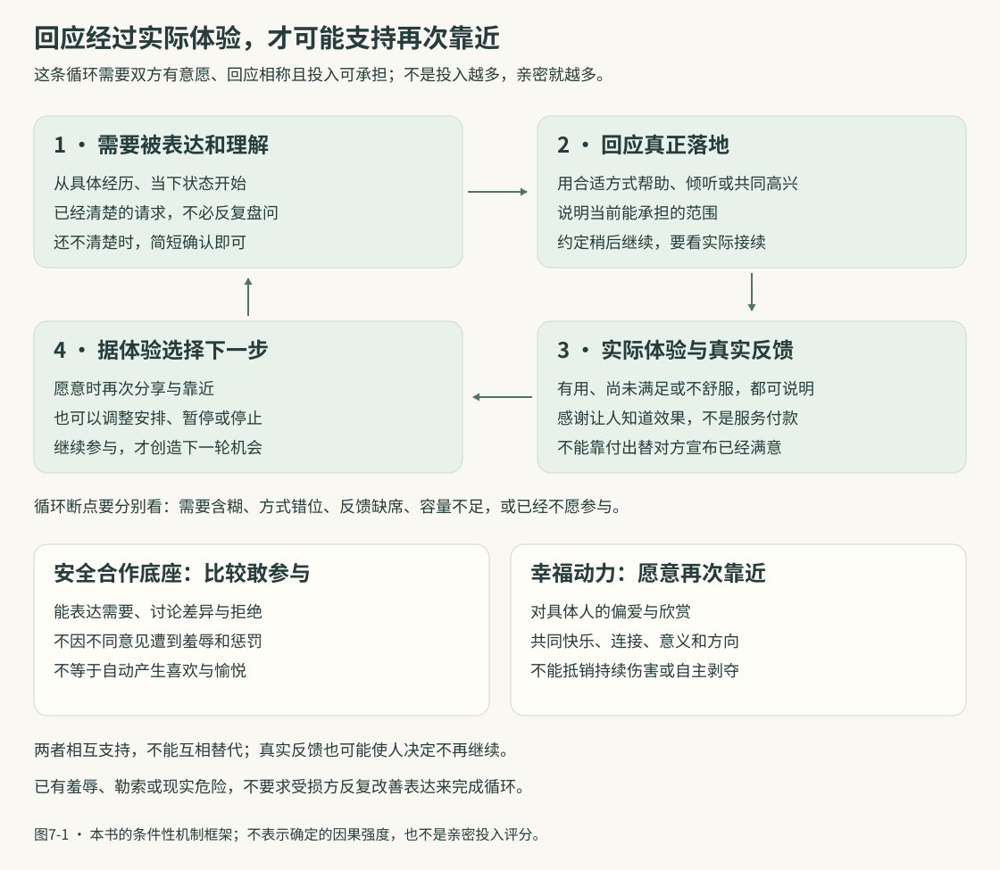

*[图7-1](#figure-7-1)用于寻找具体断点，不用于给投入标价。反馈可以是感谢，也可以是不舒服或尚未满足；是否产生亲密，要看真实体验。*

后来一个工作日，许青想讲一件让自己烦闷的事，程远一边处理手头事情，一边很快给出回答。她脱口而出：“你从来不关心我。”这句全称判断并不符合他们此前的全部经历，却表达了眼前没有被认真听见的失落。

等两人停下来，她把话改得具体些：“上次方案做成时，你后来问我哪部分最难，我觉得很好。今天我也想先把事情说完，你能先别急着给办法吗？”她没有抹去以前的好，也没有为了维护以前的好而否认今天的不舒服。

程远放下手头事情，听她讲完，再确认哪些是已经发生的事、哪些还是她的猜测。许青说：“这样我比较能把自己的想法理顺。现在可以一起看看下一步了。”回应从听到共同想办法，随她当前需要发生了变化；帮助是否有用，由她的体验提供了新信息。

另一次晚间交流，程远已经很疲惫。他直接说今天难以认真听，问能否第二天再谈。许青当时的事情不紧迫，接受了这个安排。第二天他主动接起话题，听她补完前一天没说的内容。延期没有被包装成完美回应，也没有停留在一句“以后再说”。

调整方式和说明自己当前的精力，都可能有用。要看许青是否感到被听见、程远是否实际腾出空间，以及双方是否还愿主动分享，而不只听话说得多体贴。这两次做成了，不代表以后每个需要都能得到满足。

| 循环停在哪里 | 可以补充了解什么 | 有条件的调整方向 |
| --- | --- | --- |
| 需要含糊，双方理解不同 | 已经表达了什么，对方听成什么？ | 将眼前具体需要说清，不要求随时猜中 |
| 回应很用力，方式却错位 | 哪部分有用，哪部分增加了负担？ | 调整方式和范围，不只加倍投入 |
| 付出被接收，却没有反馈 | 对方是否感到帮助，是否不知怎样表达？ | 真实说出效果，让下一次选择有依据，不强索感谢 |
| 有意愿但当下容量不足 | 现在能做多少，之后是否真有可用时间？ | 缩小任务、明确接续，必要时找其他支持 |
| 需要已经清楚，对方持续拒绝合理参与 | 是暂时限制、无法满足，还是不愿承担与调整？ | 看实际事实与意愿，不再只要求表达者换更好的说法 |

反馈不只是称赞，也不需要像支付服务费一样对等结算。真有帮助时，可以说清“你刚才先问我在担心什么，让我觉得没那么孤单”；方式不适合时，也可以承认对方认真准备，同时说明自己需要调整。感谢不会产生继续服务的无限义务，不舒服也不必为了回馈而隐藏。

同样，不宜轻易把一次不合适的回应说成对方全部付出都没有意义，更不要从方式错误跳到人格和能力贬低。但尊重努力不要求虚报效果。如果每次提出新标准都否认对方已经做过的事，双方很难知道怎样才有用；若标准改变来自新的事实和真实需要，则应该说清变化，而不是被要求永远维持旧答案。

若一方已经反复清楚表达，对方仍以羞辱回应，或者只在对方屈从后才恢复关怀，问题就不只是表达技巧。亲密循环不能要求受损方更温柔、更感恩来消除现实伤害。普通容量限制、缺乏意愿与惩罚性控制，需要依据具体行为分别处理，不能全归成沟通不够好。

需要、回应和体验之间还会有时间差。现在做了一件有帮助的事，对方可能仍累，也可能需要一段真实持续的行动才愿意多说。不能因没有立刻换来笑容就撤回尊重，更不能用故意冷落测试这次回应是否有效。[附录C.4](#unit-C-4)帮助回看少量真实经历，不把每天相处变成效果考核。

亲密的积累，包含“以后有事仍想告诉你”的愿望，也包含“和你在一起有一些事本身就很好”。它既需要认真接住困难，也需要共同高兴、欣赏与放松。下一步不只是减少回应失误，还要主动为这段日常创造值得两个人期待的体验。

#### 7.3 幸福来自哪些体验：身体舒适、愉快情绪、连接与认同

**共同创造适合当下状态的体验，让舒适、快乐、连接与认同在真实参与中发生。**

有一周，两个人都忙得不想再赶行程。许青原本想周末去远一点的地方，后来提议就在附近散步，晚些到自己家一起做顿简单的饭。程远说出了想吃的东西，也提出由自己采购和处理其中一道菜。他们把安排缩小了，见面的期待并没有因此消失。

那次散步没有需要打卡的路线，走累了就坐一会儿。做饭时，两人各自完成说好的部分，聊起这一周几件不起眼的小事。吃过饭，他们一起收拾。许青后来觉得，那天最舒服的不是做了多少项目，而是不必赶着证明这个周末值得；程远也喜欢两个人一起把一件小事做完的感觉。

另一周，精力宽裕一些，他们报名参加了一个都感兴趣的小型手作活动。许青更愿意提前看安排，程远则明确了自己想尝试的内容，并实际完成报名相关事务。活动中两人各做各的，也会看对方做到哪一步，结束时一起收好材料。结果并不精致，却留下了可以一起笑起来的细节。

两种相处没有高低之分。前一种外部花费较少，需要有人考虑采购、做饭和收拾；后一种增加了活动费用与往返安排，也带来不同的发现。实际收益来自他们当时的状态、偏好和参与，不是由活动名称或支出金额直接决定。

本书用四类体验帮助看见这些收益。它们是观察窗口，不是必须同时达到的幸福分数，也不意味着快乐只能从伴侣那里取得。

| 体验窗口 | 日常里可能怎样出现 | 容易看错的地方 |
| --- | --- | --- |
| 身体舒适 | 能休息、不必硬赶，活动强度与身体状态合适 | 不等于必须有性行为，也不是替本人判断什么接触舒服 |
| 愉快情绪 | 被逗笑、发现新事物、一起庆祝或放松 | 强烈刺激与昂贵消费不自动增加快乐，也不证明整体关系健康 |
| 连接与归属 | 愿意说话，有具体回应，在共同活动中感到彼此在场 | 人在一起或照片好看，不等于实际有连接 |
| 价值与身份认同 | 自己在意的事被认真对待，愿承认并参与“我们”的生活 | 不等于靠外界羡慕维持关系，也不要求抹去个人差异 |

同一次散步，可以带来身体放松和交流，也可能因为疲惫、天气或不断被催促而令人不舒服。与其问这项活动是否属于标准约会，不如问两个人实际获得了什么，谁承担了额外操心，下一次有没有可以调整的地方。

另一对伴侣花了不少钱旅行，其中一人把每天排得很满，另一人已经累了，仍被要求按时拍照、赶路。回来后，策划者拿支出来证明用心，接收者却只记得一路被催促。问题并非旅行本身不好，而是花费没有经过当下需要与参与方式，变成本人认可的体验。

这里也不能要求策划者凭空知道一切。接收者可以尽早说明自己走不动、想停一停或不喜欢哪种安排；安排者需要愿意听见并调整。若一个人已经多次说清，仍被要求忍耐并表达感谢，就不应再把全部缺口归成不会表达需求。

共同创造快乐，可以有不同分工。擅长规划的人多做一点准备没有问题，另一人仍需提供偏好、参加选择、履行自己接受的部分。有的人不太会想新点子，却能认真准备、回应与收尾；这与始终只等别人服务，是不同的实际参与。

尤其不要把“为关系制造快乐”再交给已经超负荷的人。若一方承担大部分事务和照护，再要求其每周策划新鲜活动，可能只增加另一项劳动。可以先减掉不必要安排，调整已有分担，让两个人真正有精力相处。感情投入需要空间，而不只是口头被列为重要。

日常中的可靠陪伴，与偶尔从工作、生活和经济压力中抽身放松，各有价值。重要问题可以留出专门时间处理，不必让每次见面都变成预算会议；也不能因为需要快乐，就永远不谈已经影响生活的问题。能够暂时放下，是在为连接留出位置，不是让另一人独自扛着未被处理的成本。

许青和程远没有因为那顿饭舒服，就认定以后所有共同生活都不会出问题。他们只是更清楚，怎样的一段周末能让双方恢复一点精神、增加一点欣赏。关系中的幸福可以很具体：知道有人愿意与你认真过一个普通下午，也愿意在状态不同的时候，重新商量这个下午怎样过。

#### 7.4 关爱要可靠，惊喜可以变化

**让关怀与尊重保持可靠，按对方当下的需要和双方负担，调整关爱的表达形式。**

被关心的可预期，和每次形式完全相同，不是一回事。你可以知道对方会认真对待重要的事，却不知道这次会选哪首歌、怎样庆祝、记住哪个细节。可靠的是关怀与尊重，能够变化的是表达的形式。

许青生日将近，程远想到约几位朋友一起聚一聚。他记得她平时喜欢与熟人热闹地聊天，还没有发出邀请，先问她这次想怎样过。许青说，最近应付的事情太多，这回更想安静一点，只两个人吃顿饭。

程远有些失望，原本已经想象好大家在一起的场面，也担心简单吃饭会不会显得不用心。许青解释，自己喜欢他记得这个日子，只是不想再花力气招呼一场聚会。平时喜欢热闹的线索没有错，却不能直接代答她这一次的需要。

两人最后商量，选一个当下能负担、也不必赶时间的安排，吃过饭一起翻翻最近活动的照片。后来见面时，程远特意挑出了[手作活动中](#unit-7-3)两个人都笑得很开心的那张。许青记得那次不太成功的作品，也记得他当时认真帮忙收尾的样子。被记住的，是共同经历里的具体部分。

这个变化没有取消程远的心意，也没有要求他将想法全部藏起来。他可以说原本想怎样准备，许青也可以表达现在更想要什么；两个人共同调整，才让准备成为当下能够接收到的关爱。商量形式不必破坏惊喜，有时恰好让剩下的细节更值得期待。

一次安排可以沿着四个问题往前走：已有的偏好线索是什么，当前是否还适用；自己能承担什么；对方实际怎样接收；下次有哪些值得保留或调整。它们不必逐项询问，也不需要每次准备后打分，只需让关爱有机会被现实校正。

已有偏好值得记住，但不能被固定成一张永久需求表。一个人可以某次想热闹，另一次想安静；以前喜欢实物礼物，眼下更需要一段不被打断的共同时间。这样的变化应尽量说清，接收者也不必因为自己曾经喜欢某种形式，就一直配合到底。

看一个独立反例：某人为伴侣准备高成本行程，对方此前已说明这段时间身体疲惫、需要少赶路。安排者仍坚持原方案，见对方没有高兴起来，就说“我花这么多心思，你连感动都不肯给”。原本的关爱开始变成索取回报，实际需要反而被挤出了讨论。

此时需要回到已经知道的需要、可以调整的安排和真实成本，而不是要求接收者用兴奋证明自己懂得感恩。拒绝一种礼物或活动形式，不等于否认送礼者全部感情；确实欣赏其中用心，也不要求接受不愿承受的安排。[第五章关于投入不产生身份和身体债权的原则](#unit-5-5)，在恋人之间同样成立。

稳定关怀也允许改变方式。忙碌期可以把长活动缩成短见面，暂时做不到的事需要说明并按现实重新安排；可靠不等于永远不失误。要看变化后关心是否还在、必要承诺怎样处理、双方是否仍有真实参与，而不是要求每次都复刻最热烈的时候。

故意失联、制造嫉妒、撤回关爱等待对方屈从，是另一种变化。它们让不确定和痛苦成为牵动行为的手段，不能与正常忙碌、需要休息或一次惊喜失误混在一起。人并不需要先害怕失去，才能再次看见伴侣的吸引力。

一次准备不合适，双方愿意校正，属于可以继续认识彼此的经历；长期不理会已经清楚表达的需要，又不断要求对方表现满意，则需要看实际参与方式与权力问题。不能仅靠下一份更贵的礼物覆盖这个差别。

关爱能够持续，不是因为对方永远不会变化，而是因为你愿意继续认识这个正在变化的人。熟悉不必只剩重复，也可以让一个小细节承载更多意思。许青看到那张照片时，开心的并非生日必须有多大场面，而是程远记得，他们曾一起度过一个很好笑、也很轻松的下午。

#### 7.5 亲密需要空间：支持个人发展，也学习共同生活

**为个人发展保留空间，也为共同生活提供真实参与；自主选择与共同后果分别处理。**

一个周末，许青想参加朋友的聚会，程远想留半天自己待着。两人没有把这两个愿望解释成谁在退缩，而是看看已经约好的共同时间怎样安排。最后各自保留周六活动，周日再一起吃饭；到时两人按约见面，也有了可以带回关系里的不同近况。

这个例子的关键，不是恋人每周都应分开一天，而是个人空间与共同参与在当时都得到保留。独处可以让人恢复，朋友、兴趣和工作也可以带来内容与支持。它们不是爱情之外应当被清空的杂物；但只剩各自生活、始终没有共同参与，也不能单凭一句独立就解释完。

辨认两者，需要看实际过程。一个人说明自己想休息，之后仍主动接近、履行认可的安排，与不断取消全部见面、拒绝讨论任何共同需要不同。另一方可以表达想多相处，也不能把这个愿望扩大成要求交出全部时间、朋友或行踪。

[第八章会展开责任怎样分配](#unit-8-3)。这里先分清三个范围，避免用“我们”代答本人，或者用“我自己决定”把共同后果全部推给对方。

| 责任范围 | 可以怎样支持或协商 | 不宜怎样越过范围 |
| --- | --- | --- |
| 共同事务 | 已认可的共同活动、共同资源和新增共同义务，明确双方参与与承担 | 一方先替双方承诺，再要求对方配合 |
| 个人主责但可获支持 | 职业、学习等由本人主导，涉及共同时间、费用和分工的后果另行商量 | 伴侣替本人生活，或本人以自主为由单方占用共同资源 |
| 个人核心责任 | 本人的诚实、身体同意和最终选择由本人承担，可以获得信息和情感支持 | 让伴侣替自己同意，或要求其供给全部自我价值与人生意义 |

再看另一对已经共同生活的伴侣：一方想参加进修课程，这个愿望可以由本人提出和判断；若课程将占用原来负责家务的时间、使用已有共同预算，就还需要谈这些变化。想学习，不自动表示另一人已答应接管所有事务。

他们可以具体查看哪些工作必须有人做，哪些可以减少，是否存在真实可用的外部支持。假如另一方愿意在课程期间多承担一项任务，就说清范围和再讨论的节点；如果不愿或没有能力，也可以提出。不能把拒绝某种分工直接说成反对对方成长。

反过来，共同承担后果不意味着伴侣获得审批全部人生选择的权限。对学习内容可以不同意，对现实成本可以协商；本人是否愿意选择一条职业道路，仍由本人作出。若重要后果找不到双方能接受的安排，需要重新选择路径或面对不相容，而不是让谁更有道理就取得对另一人的支配。

支持还要区别于监督改造。问对方是否需要协助、提供本人愿意接受的反馈，可以帮助其行动；代设全部目标、反复检查表现，再用羞辱催促，则可能使成长变成服从。一个人选择暂时不发展某项能力，也不因此欠伴侣一份持续进步的成绩单。

不过，阶段性需要帮助与长期拒绝本人责任同样不同。遇到实际困难，可以请求支持；若维持全部生活都要靠伴侣持续催促、代办和补救，已有负担需要被正视。不能一边把对方当作唯一管理者，一边以自主为由拒绝讨论其承担的后果。

这并不要求所有资源彻底分开。两个人可以愿意共享、照顾、扶持，只是共享的范围、负担与变化后怎样调整，需要真实成立。照护中的正常依赖不自动损害爱情；让照护者失去休息、发展和拒绝空间，却会改变这段依赖的实际性质。照护者的实际保障见[第十四章的相关讨论](#unit-14-4)。

许青与程远那次分开活动后，没有进行完整的行踪汇报，也没有故意制造一点秘密来维持吸引。许青说了聚会里一件有趣的事，程远讲自己安静下来后想起的一个周末点子。个人经历被本人愿意地带进交流，为相处增加内容；它不需要以嫉妒或竞争为代价。

保留空间，并不会自动让人更相爱。它要与真实参与、已接受责任和本人偏好一起看。亲密值得期待的一部分，是可以被靠近，也可以在需要时喘口气；不是永远没有距离，而是两个人仍愿意在各自生活里为对方留出具体位置。

#### 7.6 共同叙事怎样形成，又怎样改变两个人

**以真实经历、不同体验和后续行动更新共同叙事，让“我们”的故事支持表达与选择。**

回想[前一段忙碌的日子](#unit-7-2)，许青说：“我们现在好像更能互相照顾了。”程远想到的是，那次自己疲惫时提出改天再聊，她接受了。许青想到的却是，第二天他真的主动接起话题。两个人使用了同一个词，记住的支持并不完全相同。

这就是共同叙事开始形成的地方：双方怎样理解“我们是谁、经历了什么、为什么还愿意继续”。它不是一份必须措辞一致的回忆录，而是具体经历、各自解释与后来行动逐渐连接起来的认识。

如果程远只记得许青体谅自己，却不记得后来需要重新回应，就可能把这段故事理解为她应该一直等待。许青若只记得当晚的失落，也可能忽略之后真实发生的接续。回顾不是强迫双方取一个折中答案，而是把各自记得的事实和体验都放回来。

许青还提起[另一次交流](#unit-7-2)：“那回我想说工作的烦闷，你一边忙一边答我，我还是不好受。后来你停下来听，我当然感觉好些；但前面那会儿也是真的不舒服。”程远承认自己那次没有认真听。两人因此把“更能互相照顾”说得具体些：可以说明疲惫，也要处理已经约好的接续；可以指出错位，不必把以前所有好都抹掉。

同一次延期，可以被解释为不在意，也可以被解释为真实容量不足。两种解释会影响下一次选择：前一种可能让人少说、试探，后一种可能让人愿意协调时间。该采用哪种理解，不能只凭哪一种听起来更积极，要看后续行动和其他相关事实。

| 共同经历 | 需要保留的不同理解 | 后来哪些事实支持更新 |
| --- | --- | --- |
| 一次交流延期 | 被留下等待的失落，与疲惫时希望休息的需要可以同时存在 | 约定是否具体，之后是否主动接续，是否反复只让一人等待 |
| 一次活动改小 | 有人担心不够用心，有人希望减少负担 | 双方是否真实参与，体验是否改善，准备和收尾由谁承担 |
| 一段时间相互支持 | 各自获得的帮助可能不同，也可能仍有被遗漏的成本 | 是否允许说出遗漏，下一次安排有没有据此改变 |

这里的善意解释，是在事实支持范围内保留不止一种可能，不是选择一个好听的故事来遮住已经发生的问题。若之后多次没有接续，原来的理解就要更新；若一直由一个人承担成本，“我们很会互相支持”也需要重新检查。

叙事还会反过来改变个人目标。许青回顾那次散步和简餐时说，自己以前容易担心周末没安排够就浪费了。现在她发现，留白可以让两个人更有精力说话，于是开始想把可自由调整的共同时间放进以后出行的期待。改变来自她认可的实际体验，不是程远替她规定怎样才算会生活。

程远也说，自己曾把能迅速给出办法看得很重要，后来发现，记得许青在意的具体部分同样能使她愿意交流。他想继续保留提供帮助的能力，也愿意先了解她现在需要什么。关系提供了新的经验，他仍需要自己选择并练习，不能由一句共同成长自动完成改变。

关系塑造目标，也可能沿着另一条路发生。例如，一人每次提出自己的学习计划，都被指责不顾关系，后来逐渐不敢再提，甚至开始觉得自己不应该有这些愿望。表面上两人的目标更一致了，实际选择空间却在缩小。不能只因变化发生在关系中，就把它称为成长。

理解这些变化，要看本人实际得到什么、承担什么，能否重新表达和协商。愿意因新体验调整生活排序，与在持续惩罚下压住愿望，不应被同一个“为了我们”概括；本人自己的说法，也需要放在真实处境与行动中理解。

回顾过后，许青与程远谈起未来的旅行：不想把行程排得太满，也希望及时说明精力和安排变化。这只是共同期待，尚未形成具体旅行方案，更没有证明他们已经能够处理全部预算、分工和冲突。[第八章](#unit-8-2)将让这些期待进入真实任务。

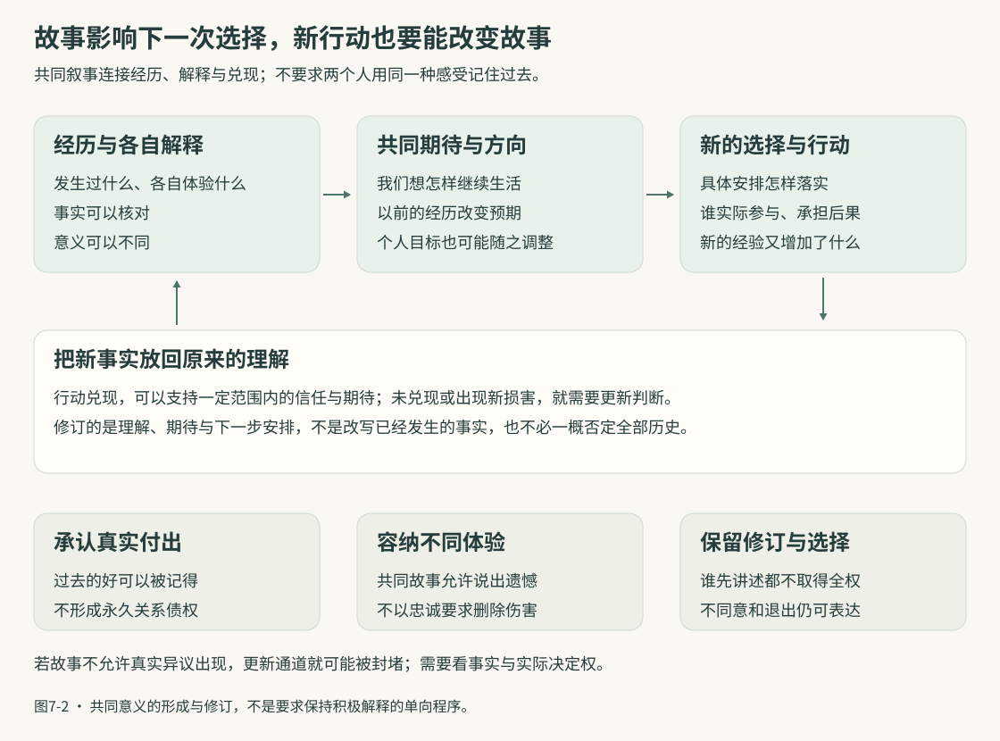

*共同叙事会影响下一次选择，新行动也必须有机会改变原来的故事。允许不同体验出现，才能保留更新的入口。*

也有这样的情境：某人常说“我们一路都靠彼此支持”，另一人却一直承担全部协调和收尾。只要后者说累，前者就指责其破坏共同回忆。故事不再帮助两个人理解经历，而是在规定哪些经验有资格被说出来。

这样的共同认同不能靠要求受损方更积极来建立。真实贡献值得被看见，遗憾和伤害也可以保留；谁先讲出一个故事，谁讲得更动听，都不因此拥有全部事实与身份的定义权。共同叙事不取消本人对经历的解释空间，也不取消事实核对。

同样，一次失败不必推翻所有历史。某次关心真实发生过，今天仍可能有需要修正的问题；今天不愿继续，也不必证明过去每一次快乐都是假的。愿意保留这些不同层次，才可能在感谢已有经历的同时，清醒判断当前关系。

许青与程远正在形成的故事，还没有一个已经保证的结局。它只是让两人更清楚，自己愿意一起过怎样的日子，又需要用什么行动使这份愿望可信。共同方向因此有了温度，也有了可以被现实检验和修订的内容。

#### 7.7 风险专节：单方情绪劳动、刺激依赖与叙事遮蔽

**辨明回应减少背后的错位、负荷、意愿与控制，用实际变化判断该调整、停止还是保护。**

日常相处不总让人舒服，有时是疲惫，有时是需要与方式不合，也可能是对方已经不愿参与，甚至在利用关怀施压。表面上都像回应减少，实际需要看的事实与可以采取的行动并不相同。

许青与程远的错位已有具体调整：重新听见分享、说明疲惫、之后接续、缩小不适合的活动。但并非所有冷淡都能这样解决。下面比较另外几种相处情境，看哪些需要真实减负，哪些涉及意愿差异，哪些已经损害表达与选择。

第一种过程，是支持负荷长期集中到一个人身上。对方每次不舒服，都期待其立即停下自己的事、倾听和安抚；当支持者也有需要，讨论却很快被转回对方。单次多照顾一些可以是双方愿意的支持，持续没有休息、回应和重新分配空间，性质就不同了。

支持者越来越疲惫，开始少说话、减少接触；另一方把这种退缩解释为不爱，再增加索取和证明要求。协调损耗随之增加，剩余的积极相处越来越少。看见循环，不意味着双方各负一半责任，更不能把全部问题归为疲惫者没有保持温柔。

阻断点在真实减负和新的参与。可以明确当前能承担多少、哪些需要其他支持、对方愿意怎样回应与调整；要观察实际空闲、休息和双向关心是否增加。正常照护中的阶段不对称不自动是寄生，持续拒绝任何调整也不能永久称为特殊时期。

第二种过程，是只有不断增加刺激才愿意参与。例如，一人多次愿意参加昂贵或强烈的新活动，却明确拒绝普通相处；为了保持接触，另一人不断加码，已经超出能长期承担的费用与精力。快乐可能在某些活动里真实发生，但维持快乐的方式开始侵蚀生活余量。

这不等于喜欢旅行、关注资源就一定在利用人。要看本人是否对具体伴侣、普通相处和共同承担仍有兴趣；尚未经历普通生活，属于需要增加了解，不能直接认定完全没有基础。可以诚实调整到可承担的安排，再看双方真实意愿，不靠故意装穷、失联或撤回支持测试动机。

若两人只能在某种本人无法持续的生活方式里相处，就需要面对当前组合与期待是否可接受。不能用更大的借贷、共同支出或身份绑定维持热闹；资源问题也不会因为一次活动很开心就自动消失。这里的刺激依赖是对参与方式的描述，不是临床诊断。

第三种过程，是共同故事遮住了实际损害。某人一再说“我们一直很幸福”，另一人只要谈被忽略、被越界的经历，就被指责破坏关系。为了维持这个故事，后者越来越少表达，也不敢向朋友说出真实处境；外表安静下来，能够校正问题的信息却减少了。

此时感情问题已经进入治理：谁可以说明事实，谁的体验被允许存在，谁有资格决定是否继续。阻断不能只靠补一次浪漫安排，需要恢复真实表达、拒绝和获得独立信息的空间，并处理已经发生的伤害。对方若不允许这些空间存在，不能要求受损方先学会更积极地看待关系。

情绪勒索还需要单独识别。正常失望，是本人表达感受和愿望；需要休息，可以说明容量并调整交流。反复以“不照做就是不爱”为由羞辱，惩罚拒绝，或只在对方放弃合理边界后才恢复关怀，则可能把失去关系的恐惧变成迫使服从的手段。

并不是所有带条件的关系选择都属于勒索。一个人不接受长期异地，发现没有共同路径后选择离开，可以是其真实底线；不能仅因另一方失望就认定其在控制。区别要看是否诚实表达本人选择，还是利用羞辱、报复、隔离或侵害来取消另一人的选择权。

例如，一方要求取消与朋友的见面，并威胁若不照做就公开对方的私密信息。这里已有明确的施压方式和可信后果，不能先安排一次更温柔的沟通或共同旅行来消除它。应按实际处境获得独立支持、减少暴露；不要求先证明完整动机或等待身体暴力。

| 减少回应的一种解释 | 哪些事实有区分作用 | 当前可以怎样做 |
| --- | --- | --- |
| 表达或方式错位 | 具体说明后愿意调整，实际体验随之改变 | 选择一个小调整，回看是否真的有用，不把问题无限归给表达者 |
| 现实容量不足 | 有相应负荷，能说明限制，在较可承担条件下仍愿参与 | 减少负荷或调整安排，观察接续，不以熬到透支证明爱情 |
| 缺少意愿或最低需要难相容 | 必要信息已清楚，普通参与仍长期无法形成，或本人明确不愿 | 暂缓新增绑定，决定是否继续；也可以结束，不靠更强刺激强留 |
| 惩罚性控制或现实威胁 | 拒绝后遭羞辱、隔离、勒索或严重自主剥夺 | 优先独立支持和相称保护，不把共同修复当作退出前提 |

这张表比较的是解释与证据，不是看一个表面动作就给人分类。一次没有回复可能信息不足；已经出现可信威胁，也不需要把其他解释都逐个排除才保护。没有完整确定性，仍可根据自己能否接受当前处境作出选择。

普通困难有没有改善，要看行动：需要是否更清楚，负担是否真的减少，原有责任有没有处理，是否重新出现双方认可的积极体验。一次道歉、一次热闹或一句更好听的共同故事，都不能代替这些不同结果。感谢过去也不要求继续接受当前伤害。

已有恋人身份，不证明适合进入婚约；暂缓新增绑定，也不取消本人随时停止不愿继续的关系。相应的判断可结合[附录M.7](#unit-M-7)，现实危险的支持入口见[J.4](#unit-J-4)。还不知道的部分如实保留，不将观察时间越长自动理解为已经安全。

日常经营最终要留下的，是普通、可承担相处中持续出现的关心、欣赏、愉悦和再次靠近的愿望，而不只是关系还没有结束。愿意靠近给合作提供动力，共同承担也会改变亲密。[下一章](#unit-8-1)让这些愿望进入真实任务，看看责任怎样形成，分工怎样运转，分歧又怎样被实际处理。

### 第八章 从约会走进生活：责任、合作与冲突修复

一起把事情做好，会给爱情增加一种很具体的安心。出发前，有人记得确认时间；一方临时忙不过来，另一方能接住必要事务；安排出了差错，两个人知道从哪里重新开始。共同生活的吸引力，不只在有人陪伴，也在不用始终独自发现、安排和收拾一切。

在[第七章](#unit-7-6)，许青与程远开始期待一段不太赶的旅行；现在要把期待变成实际安排。一次旅行能够增加有限的合作经验，但不能替他们完成全部适婚判断。

*本章人物与情境均为虚构；其他人的情境另行介绍。*

#### 8.1 责任怎样逐渐形成：承诺、共同实践与合理依赖

**按承诺、共同实践与合理依赖辨认责任，再结合实际能力安排履行、调整与有限善后。**

许青与程远开始商量短途旅行时，程远说：“住宿我来找，按我们说好的条件订。周五前把结果发你。”这句话比“以后带你出去玩”具体得多。它涉及一件双方已经认可的事、可辨认的结果和时间，也让许青可以把注意力放到交通上。

此时形成的是有限的预订责任。程远需要理解两人的住宿需要，在约定范围内完成安排；若做不到，应及时说明，使许青有机会调整。它没有使他承担许青今后全部出行，也没有让许青因为接受安排就欠下一次亲密接触或更深的身份承诺。

责任的依据不只有一句正式承诺，也可能在共同生活中逐渐形成。但这并不表示，谁心里想得更多，谁就能向对方提出更多要求。先区分下面三种情形，才能知道究竟是在澄清期待，还是在处理已有安排。

| 情形 | 需要查明的事实 | 能据此讨论什么 |
| --- | --- | --- |
| 单方设想 | 对方是否知道、是否认可，还是只有自己在推演未来 | 先表达愿望，不能把未被接受的设想当对方违约 |
| 双方默示的安排 | 是否反复按同一方式行动，双方知情、接受受益，并据此安排自己的事 | 承认已经存在的实践及合理期待，变化时说明和重谈 |
| 重大共同计划 | 是否共同认可，谁参与选择，谁因此迁居、减少工作或承担照护，依赖如何形成 | 讨论更具体的履行、风险分担和过渡善后，不只问有没有签过一张纸 |

另有两人一直按“周末一人采购、一人做饭”合作，都知道并接受这个安排。采购者不能仅以没有每周口头承诺为由，突然完全不管，又让另一人直到做饭时才发现。相反，偶尔接受一次帮助，并不自动构成对方以后永远承担这项工作的默契。

辨认合理依赖，还要看对方能否知道自己的行动会被用于什么安排。独自辞职后才告诉伴侣“我都是为了你”，与双方认真讨论、共同决定迁居，并明确由谁承担过渡支持不同。前者不能仅凭本人牺牲制造共同承诺；后者也不能在需要善后时，被一句“辞职毕竟是你自己的决定”全部抹去。

确定了依据，仍须再看责任范围、已经履行多少、当前能力和其他责任。它们回答不同问题。一个人确实失去部分收入，可能已经无法按原方案支持生活；这会迫使双方缩减、重排或寻求可用接续，却不能倒推出当初共同认可的依赖从未存在。

反过来，有责任也不意味着拥有无限资源。若要求已经超过现实能力，继续强调承诺不会自动产生钱、时间或技能。可以讨论本人还能承担什么、哪些损失能够减少、哪些事情需要其他安排；承认无法满足全部需要，有时比许诺继续兜底更负责任。

在本书中，责任循环将形成、履行与调整连起来：共同定义事务与责任，形成责任认同，实际履责，识别贡献；环境发生变化后重新分配，再确认新的安排。它关注的不是谁领到了任务名称，而是本人是否理解并认领、是否有条件实施，以及履行后有没有真实回应。

许青若接下交通安排，程远就不应每过一会儿催她交作业；程远完成预订，许青也可以看见其中的比较与确认工作。若其中一人忽然忙不过来，循环要在变化处重开：说明已经做到哪里、还缺什么、对方能否接续，而不是让责任靠沉默自动转移。

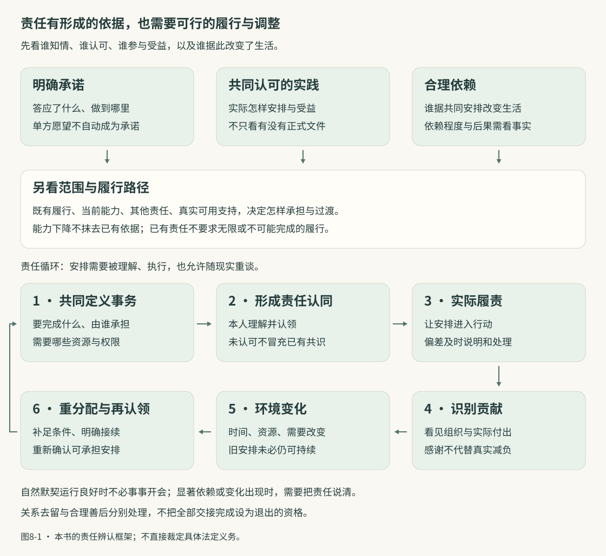

*先判断责任如何形成，再看怎样履行与调整。能力变化影响可行路径，不能把已有依据擦掉；已有依据也不产生无限义务。*

再看另一对恋人遇到的照护困难：病中一方当前需要生活协助，伴侣曾明确答应短期送饭和陪同处理必要事务，对方据此暂未另找帮助。后来照顾者自己的工作和已有家庭事务也需要处理。眼前要判断的是已有支持怎样调整；具体病情、治疗和法定义务，则需要相应信息另行确认。

眼前有紧迫需要时，先按实际情况联系可达、适任的帮助，照顾者在自身能力内协助。进入短期安排，要分清已经答应什么，病人自己能做什么，双方接受哪些支持。若需要持续更久，就应重估负荷、费用和可用资源，不能把最初几天的答应默认为终身照护。

假如原先答应的时段已经无法继续，照顾者应尽早说清，提供必要的任务信息，协助寻找并确认实际可接续的安排；还没答应或没到位的人不能写成已有后援。本人能够继续的部分、无法承担的缺口及尚待联系的支持分别保留，不能用一句“已经交接”掩盖仍无人处理的需要。

这仍不要求照顾者保证所有缺口最终消失。结束恋爱可以与有限善后分开推进，不必先等对方同意或一切交接完成才有资格离开；已经形成的事务责任，也不因身份改变便自动清零。继续陪护不等于必须结婚，选择分开也不必把过去的照顾说成没有意义。

[附录J.2](#unit-J-2)和[J.3](#unit-J-3)帮助把责任来源、紧急或持续阶段、可承担范围与接续分开。涉及具体法定义务时另需按实际事实确认，不能从本书的伦理分析直接推出法律结论。日常分工则可以借[G.3](#unit-G-3)回看责任循环，不必把每次买菜都变成正式会议。

爱情中的可靠，包含认真对待已经让对方据以生活的安排；也包含承认条件变了，及时一起寻找可行的下一步。自然默契运行良好时，可以轻松地继续；显著依赖或重大变化出现时，把它说清，是为了让两个人都不必靠猜测承担后果。

#### 8.2 用真实任务发展合作，不靠人为考验筛选人

**用双方真正需要的任务发展合作，从实际参与、结果与调整中积累相应范围的经验。**

许青想去一个不太远的地方走走，程远想有时间慢慢吃顿饭。他们选择两天一夜的短途旅行，不是为了给彼此出考题，而是确实想把这段时间一起过好。比较路线、安排费用和保留休息，都是使这个愿望落地的工作。

两人先看各自真正可用的周末和费用，确认目前都能接受共同分担部分不超过两千元的出行预算，再约定哪些属于这次共同支出。这个数字只是本例中两人的选择，不是情侣旅行的标准。买各自想要的东西另行决定，也不因为旅行就默认共同居住或发生性行为。

许青先查交通，做出一个看起来很充实的安排。程远看后问：“车站到住的地方还有多久？这些都算进去，会不会又在赶路？”她才发现，自己只盯着车上的时间，漏掉了两端往返和等候。原本想轻松出门的两个人，差点把周末排成赶场。

许青有点不高兴：“我都查这么久了，你才说。”程远也没有立刻给出完整替代方案。他先把自己查到的接驳时间放回来，两人一起去掉一个可去可不去的地点。许青重新比较路线，补上总耗时，后来找到双方愿意接受的安排；程远把住宿位置与路线接上。

这里出现过一次具体的计划失误，也出现了补充信息和改进。它没有证明许青不适合共同生活，也不证明程远已经是出色的旅行组织者。较有价值的事实是：遗漏被指出以后，两人最终愿意回到任务，实际修改了会影响休息的安排，而不是只要求对方认可自己的辛苦。

合作经验要从组合中观察。一个人很会独自出行，不表示愿意考虑伴侣的预算和节奏；一个人从没订过这种交通，也不表示学不会。个人能力、参与意愿、两人的配合方式和外部条件，都可能改变结果，不能拿其中一项替代全部判断。

| 任务进行到哪里 | 可以看见什么 | 还不能据此认定什么 |
| --- | --- | --- |
| 开始前 | 是否都想做这件事，目标、时间和费用是否可承担 | 口头想法已经成为执行能力 |
| 执行中 | 谁发现遗漏，是否提供关键信息，是否完成已认领部分 | 一人把事情办完，就表示双方都已合作 |
| 条件变化后 | 是否及时说明，有没有实际补救和新的安排 | 一次调整成功，就能应对所有长期压力 |

另一对伴侣出行时，一方没有订票经验，第一次漏看乘车地点，后来主动核对、修正，并在下一次自然出行中提前确认。可以支持判断的是这条实际学习轨迹。若信息已清楚、必要条件也具备，对方却反复说“你反正会弄”，一直拒绝承担认领的工作，就不能继续只用缺经验解释。

结果成功也可能遮住单方兜底。旅行顺利，但一人完成全部查找、提醒、改订和结算，另一人只按时出现，观察到的是前者有能力把任务撑住，并非两人已经形成可持续合作。这不意味着每次投入必须等量，而是要看这种分工是否知情认可、实际可承担，以及负担增加时能否调整。

[本书的三层经营](#unit-2-6)，在这里很具体：双方愿不愿一起做，谁认领哪部分，变化以后怎样重谈。遇到阻碍，再用意愿、意识、能力、资本和风险五个视角查找原因。例如没意识到接驳时间与知道后拒绝处理不同；时间实在不够，也不能仅靠更认真来解决。

这些观察同时服务生活与学习。一个人在新任务中发现自己更擅长某一部分，另一个人愿意学会原来不会的事情，关系便不只是把已有技能相加，也在形成新的协作方式。贡献被看见、改进后有更多休息，能让下一次共同做事更值得期待；这需要真实收益，不靠“我们配合很好”的评价代替。

不必为了取得更多证据而搬到一起、共同买房、替对方担保或生育。普通出行、采购、做一顿饭、安排一次彼此确实需要的帮助，都可以提供对应范围的经验。模拟讨论能澄清想法，却不能冒充已经有过长期照护、家庭收支或育儿的运行记录；没有发生的任务也不能记作失败。

同样，不要偷偷失联、假装生病、诱导借款，逼对方证明可靠。这类做法制造的是人为压力与信息不对称，可能先损害本来能够发展的信任。看自然发生的变化，公开说出自己的需要，比把伴侣放进秘密考试更能帮助真实选择。

就目前的许青与程远而言，补足路线信息并改进安排，支持了有限的合作判断；他们怎样处理已经付费后的变化仍未知。下一步是完成本来就想完成的预订，在授权范围内各自执行。[附录G.1](#unit-G-1)帮助看见完整任务，[A.2](#unit-A-2)则帮助分开生活结果、实际负担与其他系统的变化，不必每次活动都填满两张表。

#### 8.3 合作需要权责相称：从“帮忙”到承担一段完整任务

**让认领任务的人拥有相称权限，承担从发现到收尾的过程，并在越过约定范围前重新协商。**

“你要我做什么就说。”有时是一句愿意帮忙的话，有时却使另一人始终负责发现问题、制定方案、提醒开始、检查结果。最后一个动作被分出去了，整个任务的管理仍留在同一个人手里。

许青与程远要避免的，不是每一次相互询问，而是默认总有人替另一个人记得所有事。许青认领交通，程远认领住宿，意味着各自负责把相关结果做到可以使用：先理解需要，查清条件，完成预订，再把必要信息和后续变化接上。

这次两人把交通预算定为六百元、住宿六百元，剩余八百元用于共同选择的餐饮、当地交通和活动，共同分担的预算上限仍为两千元。住宿按两间房、一晚安排。双方认为各承担普通共同支出的一半可接受，由各自代付后按实际支出核对；未花掉的预算不算已经发生的费用。

费用之外，还约定周六中午前到达、周日晚上八点前各自到家，行程不要太赶。住宿需要与路线衔接，两间房的安排不能被预订者自行改成一间。目的地内的具体选择可以有弹性，改变费用上限、时间限制或已确认的基本住宿条件，则要重新谈。

| 任务环节 | 许青：交通 | 程远：住宿 |
| --- | --- | --- |
| 发现与计划 | 核对出发、返回和接驳，比较全程耗时及费用 | 结合路线确认位置、两间房与入住条件，比较总费用 |
| 执行 | 在六百元及共同时间范围内选择可用方案并预订 | 在六百元与已确认条件内选择房源并预订 |
| 跟进与知情 | 提供必要乘车信息，关注时间变化并说明 | 提供订单要点、位置与变更条件，确认安排可用 |
| 异常处理 | 超出时间、费用或影响住宿时，先带着可选方案回谈 | 超出费用、改变房间安排或影响路线时，先回谈，不能先作既成事实 |

这张表给的是足够做事的范围。交通方案符合约定时，许青不需要为了同等可行的细小差别逐项请程远批准；程远也不必就每个房间装饰细节征求同意。但执行者不能把“不用事事问”理解为“其他人的成本由我决定”。分工使方法有自主，不会取消已经认可的限制。

必要信息也应双向提供。许青需要知道程远实际能出发的时间，程远需要知道许青对住宿的基本要求；一方隐去关键限制，等订好后才提出，另一方再努力也无法提前满足。若刚出现新情况，可以重谈；若原本知道却未说明，则还要看因此增加了谁的返工与费用。

共同标准还应相对稳定。在一个独立反例中，一人按约买好食材，另一人不断临时追加做法，却把不能及时完成都算成对方敷衍。此时改善不能只靠执行者更快；要看哪些新增要求确实必要、谁有能力完成，以及原先结果为何不断被否定。

合理核对与微管理也不同。付款前共同确认关键时间、预算和不可代决事项，是保护双方都受影响的决定。标准已经清楚，仍要求执行者每一步照自己的习惯，再不断收回选择，就可能形成指挥、退缩、接管、抱怨的循环。这里既要看控制，也要看真实风险，不能把任何检查都叫不信任。

若因长期失约确实需要暂时缩小授权，说明范围和恢复条件，比假装已经完全信任更诚实。执行者仍需承担能承担的部分，受影响者也有权不再继续新增合作。授权不足不能成为所有失约的解释，能力暂缺也不应直接变成人格判词。

三类责任的区别，正是在这些具体后果中显出来。共同出行中已经认可的预算与分工，是共同事务；个人职业发展仍由本人主责，伴侣可以提供有限支持，但若变化影响已有共同安排，需要协商那些后果；个人的自我价值与人生意义，可以因爱而得到支持，却不能全部交给伴侣负责。

同一个事项可能跨越几类。准备一次面试，学习和选择主要由本人负责；两人已约好的出行如何调整，需要双方讨论。伴侣可以帮忙练习，却不因此成为其职业裁判。身体同意与核心人格也不能通过日常授权代管；谁受影响，并不自动拥有对另一人一切选择的否决权。

在既定范围内，许青完成了交通预订，程远完成了原住宿预订，各自支付六百元并交换必要信息。两人确实减少了一部分相互催办，也更具体地感受到有人一起承担。然而，[后来出现一个更吸引程远的住宿选择时](#unit-8-4)，问题将不再是他会不会操作预订，而是他是否仍把共同约定当回事。

[附录G.1](#unit-G-1)、[G.2](#unit-G-2)和[G.4](#unit-G-4)分别帮助查看任务是否完整、授权是否清楚、责任边界在哪里。工具的目的，是让人腾出精力生活，而不是把相处变成逐项验收。如果安排减少了反复提醒，也使双方得到实际休息与自主，它才完成了原本应当服务的事情。

#### 8.4 从分歧看见结构：我们究竟在争什么

**从具体事实出发，分别看利益、感受、权责与共同认同，按实际行为承担相应责任。**

争的是同一顿饭，问题也可能不同。一个人在意健康，一个人在意预算，还有人只是累得不想再准备。若一开始就把对方称作懒惰或吝啬，真正需要调整的条件便被遮住了。旅行争议同样要先回到发生过的事情，再看它怎样改变了双方的体验。

原预订完成后，程远看中了同一片区另一家住宿。他认为环境更好、不影响原路线，便取消原住宿、改订新住宿。仍是两间房一晚，但总价从六百元变成八百元。他没有事先与许青商量，直到后来发送新订单时，才说两人各多出一百元就行。

原款六百元已全额退回，程远支付新订单八百元；新订单当时已不能无损取消。当前住宿比原预算增加了两百元，不能把已经退回的旧款再次计入损失。

许青看到信息后说：“不是说好了吗？怎么订完才告诉我？”程远解释自己是想住得舒服些，接着补了一句：“又没让你多出多少。”他说的本意，不能代替许青实际失去的选择：她原本有权一起决定这两百元值不值得增加，以及是否愿意改变已经确认的方案。

费用和过程因此要分别看。即使两人都付得起，预算也不会自动失效；即使新地方确实更好，也不能证明先做后说就合理。若程远后来独自承担差额，能处理这部分费用，但“共同决定是否算数”的疑问仍需要别的事实来回应。

许青感到自己像被安排去旅行的人，而不是一起安排旅行的人。这是她对经历的解释与感受，值得认真听见；它不直接证明程远蓄意贬低她，更不能仅凭此认定他在所有事情上都要控制。程远对意图的说明有助于理解，却不能取消已经发生的越权。

本书把这种分歧分成四层来看。层次不是越深越真实，也不要求每次小摩擦都找到童年或人格原因；它帮助确定，到底有什么需要处理。

| 层次 | 本次旅行中有依据的内容 | 仍无依据的结论 |
| --- | --- | --- |
| 本次事实与利益 | 超出已确认住宿预算两百元，先变更后告知；额外费用和后续行程需要安排 | 新旧付款全部损失，或所有旅行费用已失控 |
| 个人解释与尊严感受 | 许青感到参与权被忽视；程远自述想改善体验，并因被质问而防御 | 感到受轻视便证明对方蓄意羞辱；有好意便没有责任 |
| 反复出现的权责机制 | 此次已出现越过授权边界；是否长期反复尚未证实 | 将此前回应错位自动改写成多次预订越权 |
| 共同体认同 | 对“这件事由我们共同安排”的信心受影响 | 一次争执已经证明全部共同生活不可能，或只是补钱就全恢复 |

共同体认同在这里不是要求许青为了“我们”接受全部安排，而是她能否相信自己仍是共同事务的参与者。允许她不同意、认真处理改变了什么，才可能支持这种认同。若把异议本身称作破坏团结，就把需要修复的参与权再剥夺一次。

再看原因，可以区分事实误解、需要差异、资源不足、责任分歧、反复行为模式与核心目标冲突。本例中，订单与原约定能支持一次越权判断；双方对住宿体验的重视程度可能不同，却不足以解释为何没有先商量。还没有事实支持长期操控模式，也没有出现已经确认、无法协调的共同生活目标冲突。

辨认原因还要看本人是否愿意调整、实际条件是否允许。愿意履责却缺时间、技能或权限，就要看能否学习、补足授权、取得实际可用的支持或重排任务；明白约定、具备条件却持续拒绝已认领的责任，就要面对责任分歧，不能只要求另一人不断提醒、换一种说法。

两人的回应可以相互影响：许青越急，程远越防御；他的淡化又使她更生气。看见这个循环，有助于暂停无效争执，却不能把最初越权和对越权的不满各算一半责任。若其中还有具体辱骂或威胁，应分别处理其行为；不能仅因受影响者没有温和表达就取消原有责任。

还要分清退开是在做什么：因疲惫暂停，可以约定能做到的回谈；因可信威胁或强迫而避开接触，应先保护自己、寻找独立支持。不能把这种保护反应当成同等过错，也不要求先承诺回谈才有资格保护自己。

也有确实只需澄清的误会。在另一个独立例中，接收者把修改后的集合时间看成旧时间，双方对照消息发现后，重新确认即可；若没有新增损失或其他问题，不必再推导谁缺乏共同体意识。结构分析的价值之一，就是让可以结束的小事真的结束。

没有争吵的关系也不因此虚假。日常兑现、拒绝被接纳和真实合作，都能提供理解彼此的经验。已经发生的冲突若得到实际处理，可能增加可靠感；这不意味着必须先受一次伤害，才能确认爱情。边界也不需要靠被侵犯才成立。

许青与程远当前需要的，是核清费用和可选安排，承认此次决定过程出了什么问题，再判断是否愿意继续这趟旅行。[I.1](#unit-I-1)可以帮助各自说清事实、感受与期待，[I.4](#unit-I-4)则保留四层结构。不同层次的疑问，可以有不同的处理速度，而不必一次谈话全部消失。

#### 8.5 怎样决定先处理什么：严重性、影响与可改变程度

**先处理安全与当前不可接受的障碍，再结合影响、资源和意愿，为普通分歧安排可行的处理顺序。**

知道问题在哪里，还不等于现在有精力同时处理一切。许青想立刻问清以后是否都要这样，程远则反复解释新住宿有多好。两人说得越来越急，原准备继续确认的旅行活动却还在等答复。如果此时仍往下付钱，就可能增加一笔双方尚未愿意共同承担的支出。

他们先停下新增的收费预订，核对现有订单能否调整，以及改变会有什么真实后果。情绪过载的部分约到当晚有空时再谈；在回谈以前，不再把付款或订好更多东西当作推进旅行。这是先控制当前暴露，不是宣布原争议已经解决。

处理顺序不能只由声音大小决定，也不能只数发生了几次。严重性涉及损害了什么；频率和持续时间影响负担怎样积累；范围决定还牵连哪些生活；恢复条件则要看有无资源、权限和参与意愿。这些因素要结合具体事实，不合成一个代替本人选择的总分。

一次可信的严重威胁，即使以前没发生过，也可能需要先保护；每天争论茶杯放哪里，若双方都能接受并且没有持续损害，也未必需要投入同样精力。反过来，看似细小的安排若长期使一人无法休息，就不能仅因属于家务而归为小事。行为名称不直接决定影响等级。

先辨安全与不可协调的核心目标，能避免把有限精力花在不适合的路径上。现实胁迫转向独立支持；若本人已经明确不愿继续，也不必再完成普通矩阵。对仍愿合作的一般分歧，才进一步比较影响与调整空间。

[附录I.3](#unit-I-3)的双坐标中，纵轴是问题持续存在对重要需要、正常生活与权利的影响；横轴是以当前资源、意愿和条件形成可持续共处方案的难度。它不是“这人有多难被我改好”，也不是要求双方对影响作同一评分。

就“越权变更后怎样继续共同预订”这一件事，两人的初始定位并不相同：

| 谁在定位 | 怎样理解持续影响 | 怎样理解形成可行方案的难度 |
| --- | --- | --- |
| 程远 | 起初主要看多了两百元，觉得影响有限 | 认为自己承担差额便可以结束，低估了决定过程的问题 |
| 许青 | 在意共同约定是否会再次失效，影响不只在费用 | 愿讨论清楚变更范围，但是否能信任，需要看后续执行 |

交换理由后，矩阵的用途不是选出谁的坐标才正确，而是发现双方根本没有在衡量同一份损害。当前有明确约定、有能力处理费用，也有继续讨论的意愿，普通修复有可尝试的空间；对执行能否持续，仍需要[后续执行的事实](#unit-8-6)。[I.3](#unit-I-3)按选议题、描述场景、各自定位、交换原因与方案、记录共识或分歧、实践后回看展开，不必每次小争执都做一遍。

具体结果可以不同。有些问题能够解决，例如核对并结清错误款项；有些差异可以在自由知情下接纳，例如各自保留不同的旅行爱好。某些风险可以隔离，如暂时各自管理个人开销，并停止尚未认可的共同付款。隔离须看是否真能阻断后果，不能只换一个账户名称便宣布没有关联。

暂缓则需要重开条件。许青与程远把进一步讨论放到当晚，是为了让双方能够听完，不是把异议拖到她忘记。若又出现新费用、时间截止或本人已不愿继续，需要提前重看；反复推迟且持续由一人承担损失，就不能再把“以后再说”当成有用安排。

去哪里度假与是否生育，也不能只按一个轻、一个重贴标签。前者可能只是地点偏好，也可能牵涉本人无法承担的费用和身体条件；后者涉及重大生活方向，却仍要分清是当前信息不足、时间选择可谈，还是已经确认的意愿不相容。没有人必须为维持关系无限推迟不可放弃的核心需要，更不能替别人作身体决定。

普通分歧默认可以先尝试理解、调整与修复。这种处理倾向保留了学习和重新合作的机会，但不产生必须和好的义务。分手不宜被当作迫使服从的日常威胁；诚实表达自己已不愿继续，则不需要证明其他办法全部失败。

当晚能安静通话，是许青与程远开始处理的条件，不是修复的结果。旧不适再次被触及时，也不自动构成一次新的违约；需要查的是原损害是否处理、现在有没有新行为，以及约好的方案是否奏效。接下来，他们要把暂停后的时间真正用于解决这些问题。

#### 8.6 七步修复：处理本次冲突，也恢复信任、认同与连接

**修复以安全和自愿为前提，靠实际行动处理事务、恢复可信规则，并重新创造双方愿意的连接。**

本书把修复整理成七步，目的是让该处理的事情有落点。它不是经过一句道歉就能完成的仪式，也不要求每次轻微分歧都按顺序填表。已经自然说清并解决的部分可以略过，仍卡住的地方需要回来；整套过程始终以真实安全和本人愿意参与为条件。

##### 一、安全与稳定条件

许青与程远当时没有威胁或强迫行为，主要是越说越急。他们先停止争执和新增预订，按约在当晚各自有空时通话。许青说自己仍很生气，程远接受不必立刻听到她说没事。能够听完、允许暂停并保留选择，是此时开始讨论的最低条件。

如果情况变成羞辱、可信报复或身体胁迫，就应转向独立支持，而不是继续训练双方更好地表达。普通暂停也要处理时间敏感的必要事务，并有真实回谈条件；故意不回应、只等对方服从后才恢复联系，不是同一种暂停。

##### 二、分别陈述并交换事实、感受、解释和期待

两人对照原预算、旧订单、新订单和通知，确认程远在未征得同意时增加了两百元，原款已退、新款已付。许青说自己担心以后共同约定也会被绕过；程远说当时把环境改善看得太重，以为自己做好安排再说就可以。他的意图来自本人说明，实际付款和告知先后则可以核对。

许青希望先确认自己有没有权拒绝新增费用，程远原先以为只需讨论值不值得升级。把期待说清后，他们才发现，自己一直在回答不同问题。某些事实若暂时有分歧，可以核对并保留未知；不要求受影响者先承认对方没有恶意，才允许讨论已经发生的后果。

##### 三、确认冲突结构

他们把本次处理范围放在费用、越过授权的决定过程，以及由此受损的共同安排感。程远承认，住宿交给他执行，不表示他可以更改共同预算。许青则把“你以后是不是都会这样”的担心与已发生事实分开：她需要看之后的行为，目前不能把疑问当作全部未来的定论。

两人也看见，程远淡化费用使许青更急，她的追问又使他更想证明自己只是好意。暂停这个相互加剧的过程，可以帮助继续处理，却不改变他应为此次越权负责。若对方始终否认已经核清的行为，或不承认另一人的决定资格，结构问题就没有因谈话完成而消失。

##### 四、处理本次事件

程远为先变更后告知和“没多出多少”的淡化道歉，明确额外两百元由自己承担，不要求许青分担，也不挤掉原本共同认可的餐饮与出行预算。这笔差额已包含在他支付的新住宿款八百元中，结算时归他个人承担，不是再向住宿方多付一次。

两人核对了现有住宿的时间、位置与两间房安排。许青认为新地方本身可以接受，仍愿意完成旅行，因此选择保留现有订单；这次知情后的选择，不倒过来证明此前已经授权。她也可以选择不去，不能因为程远承担了差额，就被要求用成行或身体亲密表示原谅。

本次重新协商后，两人接受约定范围内的出行支出总上限增至两千两百元：共同分担部分仍不超过两千元，额外两百元由程远确认可承担并单独负担。个人承担差额与许青接受新安排，两者都已说清。共同费用按实际支出核对，没花掉的预算不算欠款。若继续调整还会产生费用，须先说明方案；没有可接受路径，也可以停止旅行，分别处理已有事务。

##### 五、约定未来行为和责任

他们没有把规则改成任何动作都要审批，而是确认原来需要被执行的边界：约定范围内可以自主选择，越过共同费用、时间或基本条件，先提出变更再决定。说明时要包含改变什么、为什么、增加谁的负担、还有哪些可行选择；没有得到答复，不等于同意新增绑定。

双方愿意继续共同安排生活，但暂不从这次处理推导更大的财务或生活绑定。程远承诺负责提供关键变更信息，许青在已同意的范围内不逐步接管。他们期待恢复的“我们”，是能够一起作出选择的两个人，不是一个决策者加一个默认接受者。

约定只有在本人认领、资源和权限可用时才有意义。若一人不愿停止越权，或所谓方案只是要求另一人永远忍耐，不能登记成已经形成共识。必要时缩小合作、暂缓安排，或者不再继续关系。

##### 六、执行观察

这次旅行后来实际完成。住宿差额由程远单独承担，普通支出依约核对，两人没有再把未认可的付费项目直接加入行程。事务由此有了结果，但许青仍不愿仅凭这一趟就宣布以后完全没有问题。

旅行结束后的一个周末，程远认领联系餐厅。原想去的小店临时休息，他查到的一个备选地点较远，会突破两人已经说好的返回时间。这次他在预订前说明情况。许青仍想按时回去，两人改选附近可行的餐厅，程远完成预订，见面也按时结束。

这是一次自然发生的变更，支持“新的边界得到了一次实际执行”，没有证明全部未来都可靠。许青说，这次她不用在付款以后争取参与，让她更愿意继续共同安排。若以后又出现隐瞒、未处理的旧损失或方案确实无法执行，就按新事实重开；不能只凭一次成功让她永久取消疑问。

##### 七、重新创造积极连接

那次晚饭并不只剩下预算和规则。许青主动说起旅行时沿河慢慢走的那段路，程远记得她看到岸边树影时停下来。两人重新谈起当时觉得有趣的细节，也听彼此说最近的生活。她愿意分享这段愉快回忆，是她当时真实的选择，不是对补偿的回礼。

理解、欣赏、感谢和共同活动，可以让冲突之外再次有值得靠近的经验。它们回应已经发生的修复，也可能帮助关系继续生成；但若伤害仍在继续，换一家餐厅、送一份礼物不会自动解决。积极连接也不等于必须性亲密，或者必须马上恢复原来的亲密程度。

若一方已经不愿继续，能完成的事务和善后仍可以处理，第七步不能被用来强迫复合。即使双方都想继续，感情恢复也有自己的进程；完成约定与立即感觉安心，并不是同一件事。

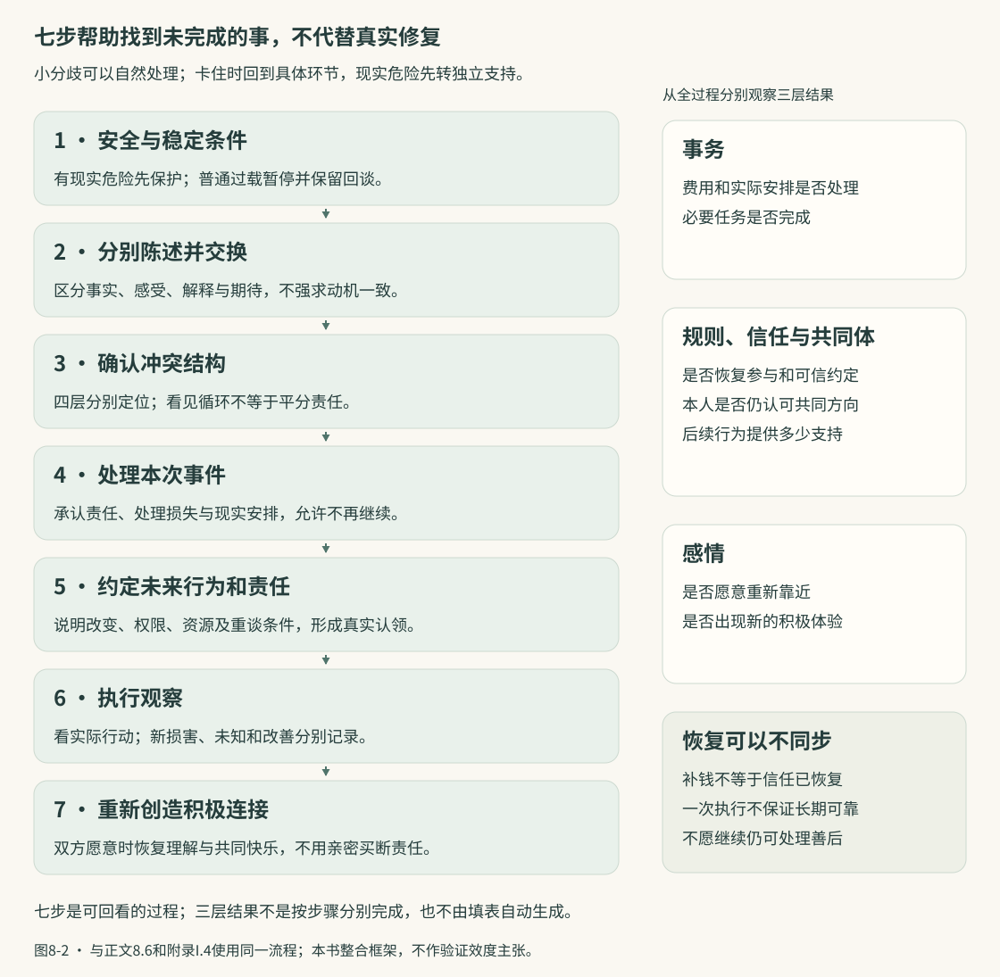

[图8-2](#figure-8-2)与[本节的七步说明](#unit-8-6)及[附录I.4](#unit-I-4)使用同一流程；三层结果分别观察。

| 修复结果 | 这个案例已经出现什么 | 仍需保留什么判断 |
| --- | --- | --- |
| 事务 | 费用归属说清并实际承担，旅行与后续安排完成 | 不能由事务完成推导所有责任都已可靠 |
| 规则、信任与共同体认同 | 越权得到承认，变更边界重申，下一次自然变更中实际保留双方参与 | 一次执行支持局部改善，长期可持续性仍要随真实生活观察 |
| 感情 | 双方愿意再见面，重新分享愉快回忆与近况 | 不要求不适立即清零，也不以继续相处保证必然适婚 |

一个常见误区是：“钱都补了，你还想怎样？”在独立的类似情境中，受影响者可能已没有资金缺口，却仍担心自己的意见再次被绕开。继续追问规则怎样落实，并非自动索要第二次赔偿；相反，反复把已解决的小事记成新违约，也需要回到具体事实。

这套七步是本书的整合方法，[附录I.4](#unit-I-4)使用相同顺序和三层结果，不另设另一套必须完成的程序。它帮助两个人辨认哪里已经恢复、哪里仍缺行动、什么时候需要回来；修复的证据最终在实际生活里，而不在表格全部打勾的一刻。

#### 8.7 什么时候需要外部帮助：支持、澄清与权益保护

**按情绪、事实、资源或保护的具体需要寻找合适帮助，确认支持可用，并保留当事人的决定权。**

两人无法解决所有问题，并不奇怪。可能是缺少知识，可能是资源不足，也可能是一说到某件事就陷入原来的互动。外部帮助有价值，但先要说明希望别人帮助什么。找人听一听、查明一个具体事实、暂时接手事务和保护权益，是不同的需要。

| 此刻需要的帮助 | 可以提供什么信息 | 支持者的权限边界 |
| --- | --- | --- |
| 情绪支持 | 本人愿意说的经历、现在最难受的部分、希望被怎样陪伴 | 可以倾听，不因听到一方说法就替整段关系诊断人格 |
| 事实与专业澄清 | 与问题直接有关的记录、已知条件和明确疑问 | 解释其能力范围内的事项，不承诺解决所有互动与去留 |
| 现实资源协助 | 需要哪项帮助、何时、多久、实际成本与可接续范围 | 本人是否愿意、能否到位都要确认，不能被情侣默认征用 |
| 权益与危险保护 | 当前相关行为、可信威胁、已有暴露与本人需要 | 优先独立支持，不以共同对质或公开准备为取得帮助的条件 |

回看[许青与程远的旅行准备](#unit-8-2)，如果他们当时只是不了解某条接驳路线，可以向熟悉当地的朋友询问出行信息；若临时有事务难以完成，也可以提出明确、有限的协助请求。这样的求助会为具体任务增加可用信息，不需要请朋友判断许青是否太计较。

请亲友投票谁对谁错，往往改变了问题的结构：双方开始争取各自支持者，原本需要核对的预订与授权，被转成谁有更多人站在一边。亲友可以有立场，但多人转述同一个说法，并不等于多份独立证据；也不能把朋友的赞同当成对方必须服从的理由。

求助时可以少说与目的无关的信息。只需询问订单处理，就不必附上伴侣全部隐私；想找人陪伴，可以说明希望被倾听，而不是请其去联系、指责对方。隐私成本与可能转述的范围应事先考虑，但这不要求身处危险的人先完美整理材料才有资格求助。

专业支持也要与问题匹配。双方仍愿处理普通反复冲突，可以了解相关帮助怎样工作、是否适合当前处境、怎样保密、需要多少时间和费用。一个人的专业身份不自动证明其掌握所有事实、没有偏向或能够保证修复；共同决定也不能因此全部外包。

涉及财产权属时，更需要把问题说具体。另有两人准备使用父母提供的一笔款项，却不知道资金是什么性质、给谁、附什么条件。他们应先向实际提供者确认事实，再就资金与拟进行的交易、权利和责任分别取得相应专业解释。不能只问“这样算不算爱”，也不能由本书直接判定归谁所有。

真正相关的第三方拥有自己的决定与权益。父母的钱、朋友的房间、亲属的时间，都不能因两人想共同生活就自动可用。情侣可以自主决定是否继续关系，却不能替别人许诺出资、处置财产或承担照护。[H.1](#unit-H-1)帮助看清实际依赖，是否可用仍须落实到具体人。

若一方已经使用强迫、控制或可信报复，联合讨论未必提供对等表达的条件。对方可能获得更多敏感信息，或事后惩罚求助者。此时优先选择能独立联系的适任支持，不强制公开对质、共同咨询，也不要求先向施压者解释全部准备。[J.4](#unit-J-4)处理这种分流，不能由普通七步覆盖过去。

获得支持之后，仍要看原问题有没有真实变化：资源是否到位，事实是否更清楚，承担者能否休息，决定是否仍由本人自愿作出。一次谈话令人舒服，不证明所有权益已经得到保护；一份专业说明解决了具体问题，也不替人决定是否继续相爱。

外部帮助的意义，是增加两人或当事人可用的理解、资源与选择。普通冲突可以回到[I.4](#unit-I-4)继续处理，已经不愿继续则按相应路径善后。支持者可以陪伴这段过程，但不应成为另一个要求本人交出决定权的人。

#### 8.8 风险专节：单方接管、责任失配与冲突跨系统扩散

**看清任务如何完成、谁承担代价，以及问题怎样扩散；按实际损害调整合作、停止新增风险或退出。**

旅行是否完成，不足以说明合作是否良好。如果一个人包办全部事情，另一人持续不履责，行程仍可能照常结束；若一方只能忍住异议，表面安静也可能很快回来。需要观察的是事情怎样完成，谁承担了代价，以及变化后是否还有共同调整的空间。

先分开技能生疏、责任失配与侵害。不会订票却愿意学习、说明困难并实际改进，与知道任务却持续拒绝参与不同；双方都愿意做但时间资源确实不足，又与一方利用羞辱让对方不敢拒绝不同。低效率不是品德诊断，现实侵害也不能一直降格成能力问题。

许青与程远经历了[一次越权后的实际补救](#unit-8-6)，没有据此证明长期单方接管。为了比较哪些行为会改变判断，下面设想两种不同走向：起点都是住宿预订超出两百元，且未及时告知。这是两种假设对照，分别看新增行为及其后果。

| 相同起点后的不同发展 | 新增的可观察事实 | 当前判断与行动 |
| --- | --- | --- |
| 分支A：主动说明并补救 | 执行者在对方另行付款前主动说清变更和差额，承认越权，尊重拒绝，承担相应费用，并在后续自然安排中实际遵守边界 | 费用与治理问题都存在，但已有有限改善证据；可以按本人意愿继续观察，不因一次补救直接升级绑定 |
| 分支B：持续隐瞒并否认参与资格 | 执行者隐去真实条件，被发现后仍说“交给我就没你决定的份”；知情和拒绝不断被阻断 | 已出现进一步的治理与自主问题，不能只改善表达；缩小暴露、取得独立支持，按真实严重性判断是否继续，可信威胁另作危险处理 |

分支A不是说有好意即可免责。它只是显示，错误发生以后，主动承认、补救和改变行动能提供不同于继续侵害的证据。分支B也不是一次防御话语便足以概括全部人格，而是新设了持续隐瞒与否认参与的行为，判断应据这些事实改变。

一条最小的跨系统传导可以从这里看清：任务偏离约定，带来额外费用和协调负担；未告知使另一人失去参与；如果再以贬低回应异议，信任与亲近意愿可能受损。它不是必然逐级发生的公式，每一处都要标明是否已经发生。

回到许青与程远已经发生的经历：住宿差额和额外讨论确已出现，许青也表达了参与感受损；长期重复模式尚未证实，感情没有全面崩溃。图中的联系表示可能的传导路径，判断这段关系时，仍只依据已经发生的行为与体验。

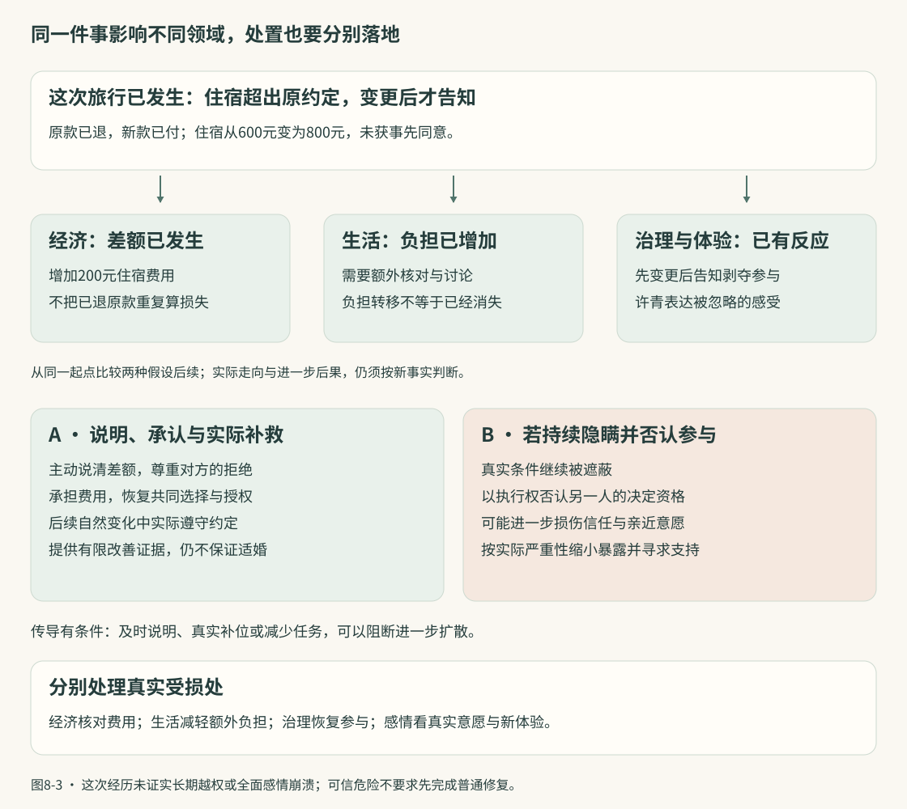

*区分已发生的费用与参与问题、本人已经表达的感受，以及尚未发生的进一步损害。修复对应实际受损处，不能只让图的起点恢复。*

对应处置也要分开。经济方面核对真实差额与承担方式；生活方面处理增加的工作和时间；治理方面恢复必要知情、有效参与与可信的变更规则；感情方面看本人是否愿意再靠近，有没有新的积极体验。钱已经由执行者承担，不代表另一人已经恢复信任；仍需支持，也不等于不够爱。

还有一种独立反例：执行者发现自己临时无法完成任务，及时说明已做和未做部分，双方确认另一人愿意短暂接续，并相应减少其其他负担。局部故障可能就停在这里，没有进一步成为隐瞒和怨恨。补位只有真实可用且双方认可时才有效，不能把负担转走便算系统已经恢复。

单方接管有时会形成自己的循环：一个人担心失败，于是不断指挥；另一人越来越少参与；前者为了完成事情全部接手，又因辛苦而抱怨。也可能起点就是一方长期拒绝承担，使另一人被迫接管。两种起因不能互相替换，更不能要求已超载者承担培养对方全部能力的任务。

在有安全、意愿与条件的普通情境中，可以重新认领一段可承担的完整任务，补足权限和信息，观察是否减少反复提醒，是否产生真实休息。对仍有决定性未知的高后果行动，暂缓新增绑定；对持续侵害，不应不断追加共同任务来证明对方还能被改变。

是否适婚，要在[第十一章](#unit-11-1)综合双方受益、核心方向、资源与实际合作。自然扰动后的恢复提供一种证据，但只由一人维持的平静、一次旅行成功或一次修复，均不足以完成判断。未经历的困难保留为未知，不必人为制造来取得考核结果。

已有责任与是否升级仍分别处理。不准备进入更深绑定，可以继续处理已形成的费用和有限善后；不愿继续关系，也不以完成七步为资格。[A.2](#unit-A-2)帮助看清哪些系统实际受影响，[M.7](#unit-M-7)与[J.5](#unit-J-5)则帮助把当前阶段的问题、停止新增暴露和退出善后接起来。

两个人愿意共同承担，生活才可能既有结果，也给人留出休息、期待与选择。这份合作发生在真实环境里：朋友能提供什么，父母的支持附带什么条件，工作又会怎样改变时间与资源，都在影响两人的安排。[下一章](#unit-9-1)将把这些联系放进共同生活，讨论怎样获得支持，又怎样保有自己的决定。

### 第九章 两个人与两个社会网络：融入、支持与家庭自主

*本章人物与情境均为虚构。*

#### 9.1 社会融入不是公开一次身份，而是逐渐建立可持续联系

**通过可承担的往来建立联系，让双方都有被理解、受尊重和自主参与的空间。**

第一次见到伴侣的朋友，或者被介绍给父母，很容易让人觉得关系终于得到了确认。有人会认真安排衣服和礼物，回家后反复琢磨一句评价；也有人希望只要对方家人喜欢自己，以后的事情就会顺利。被欢迎当然值得高兴，但一次见面能说明的，仍只是这次接触发生了什么。

公开身份、能够参与、得到基本尊重和逐渐形成互惠，是不同的进展。名字被介绍过，不等于意见能够被听见；经常参加聚餐，也不等于可以拒绝不合适的安排。社会融入要看你能否以自己的身份进入往来，而不是只成为“某人的对象”，负责配合所有既有习惯。

沈宁与梁川已经正式恋爱，希望以后在本地共同生活，尚未订婚或为共同住房签约。第一次一起参加梁川家的小范围午饭前，沈宁有些紧张，问该怎样称呼长辈、家里是否有什么需要知道的习惯。梁川说明平常叫叔叔阿姨即可，父母喜欢饭后坐一会儿，不用准备一场正式展示。

沈宁提前说好，下午还有朋友聚会，两点前需要离开。梁川答应了，却忘记把这个安排告诉父母。饭后她准备起身，母亲有些意外：“才来就走啊？”沈宁一时不知道怎样回答，怕自己解释越多，越显得是在找借口。

梁川这才意识到信息没有接上。他说：“她之前和我说过，是我没告诉你们。今天按约好的时间走，下次我们提前约个不赶的时候。”父母仍觉得相处时间短，但没有继续要求她留下。两人在约定时间前离开，原本可能被理解为不愿往来的行为，至少有了具体解释。

这件事不需要变成对沈宁礼貌、孝顺或爱不爱的考试。她没有临时失约，也不该为了证明诚意取消自己的全部安排。梁川熟悉双方的信息，承担说明责任，比让刚进入家庭的人独自猜测和解释更可行；承认自己漏传消息，也使问题没有继续转成对她态度的猜疑。

下一次约午饭，梁川先说清大家方便的时段，母亲也直接问沈宁能待到什么时候。那天父亲聊起附近旧街的变化，沈宁说自己前不久去过，拿出手机中几张街景照片。父亲指出一处她没有注意的旧建筑，两人接着聊了起来。她不用讲一段证明自己优秀的话，也有了一点属于自己的参与内容。

这里已经增加了一条具体联系：父亲愿意听她的观察，她也对他的生活经验产生兴趣；母亲在安排时间时开始直接询问她。还没有形成的是遇到重大分歧时的信任，也没有证实所有家庭习惯都能相容。下一次可以继续交换感兴趣的信息，或约一次都方便的普通往来，无需立刻升级为全家共同旅行。

伴侣的重要作用，是帮助双方建立能直接理解彼此的联系。他可以介绍背景、澄清漏掉的信息、在误解出现时说清自己的责任，但不必永久成为唯一翻译者。若所有问题都只能经过他转述，你既无法知道原话，也没有表达自己条件的机会；一旦转述出错，双方就容易各自对着一个想象中的人作反应。

直接联系也需要范围。交换活动时间、普通兴趣或相关生活习惯，通常已经足够支持一次往来；不必为了证明真诚，把两人的争执、健康资料、收入明细或过去的亲密经历一起公开。什么信息确实影响某项共同安排，就在相称范围内说明；社交开放不意味着失去隐私。

两个人的网络不必合并成一个圈子。你可以认识对方重要的朋友，也保留不需要伴侣参加的活动。联系本身需要时间、情绪投入和往来成本，过多应酬会挤掉休息与两个人的生活。适当互惠可以是回应邀请、关心一件对方在意的事、承担自己答应的事项，不是每次礼物都要按价格找平。

亲友关系还能补充观察。你会看到伴侣怎样回应朋友的请求、能否按约完成小事、是否把家人的需求全部转给别人。但“他家人都说他可靠”与“你看见他在具体事情上可靠”不是同一份依据。几位亲属若都在转述同一个故事，传播人数增加了，独立事实并没有因此增加。

反过来，部分亲友不喜欢你，也不能直接否定两人的关系。有些人只是兴趣不同，仍能保持基本尊重和必要合作；有些家庭见面频繁，却不允许新人表达任何不同意见。需要看的是实际相处、反对理由、资源依赖和可以执行的边界，不是争取所有人都给满分。

[附录H.1](#unit-H-1)帮助你只画出与当前事情有关的人和联系，[H.2](#unit-H-2)用来回看双方是否都有参与空间。已经轻松运行的往来，不必次次做记录。关系生成也可以发生在亲友之间：一个问题被认真回答，一项安排考虑到你的时间，一段共同兴趣被记住，下次相见就多了一点愿意靠近的理由。

#### 9.2 家庭如何影响婚姻：六条通道与四种实际结果

**沿具体联系辨认家庭带来的风险、相处条件、积极体验与危机支持，分别核实实际影响。**

“对方家庭条件好不好”看起来像一个问题，里面却挤着许多不同的事情。有人担心负债和照护，有人希望遇事能有人帮忙，也有人真正害怕的是亲属不停干预。只用一个家庭等级来概括，会把可用支持与不可支配的财富混在一起，也会漏掉已经发生的外部行为。

本书用六条通道追问家庭影响如何进入两个人的生活。它们是观察入口，不是给某种出身划定命运。每条通道都要再接上具体事实：谁与谁有实际联系，什么资源或义务正在被依赖，发生变化时会影响什么，以及双方能调整哪一部分。

| 六条家庭影响通道 | 需要看见的实际连接 |
| --- | --- |
| 身份及经济风险 | 身份信息、亲属经济活动或既有事务，是否已与本人的工作、财产、声誉或共同生活发生具体联系；不能由同姓或亲缘直接推定全部责任 |
| 养老照护负担 | 谁需要何种照护，谁已承担、谁愿继续，时间与费用怎样进入未来生活；不能只按兄弟姐妹人数平均分配 |
| 可用支持资源 | 对方是否真的愿意提供，范围与条件是什么，何时能够调用；有财富、口头愿意和实际可用分别看 |
| 生活习惯 | 作息、饮食、来访、节日往来与居住方式，会不会进入共同生活，哪些可以各自保留 |
| 成长经历与沟通方式 | 本人怎样理解过去，现在遇到不同意见怎样表达、回应和行动；经历提供线索，不替代当前行为 |
| 父母干预和边界 | 谁提出要求，掌握什么实际资源，能对哪些事项作决定，意见不同时会发生什么 |

沈宁与梁川的住房问题，最初就藏在一句“家里可以帮一点”里。此前一次家庭谈话中，梁川父母亲自表示愿意考虑支持本地购房，不用于外地。已经知道的是这一用途方向；金额、资金性质、提供时间、其他条件和是否实际可用，尚未说清，也没有到账。

沈宁接受以后在本地生活的方向，不等于已经接受所有未知条件。梁川愿意继续问清，不等于能够代父母保证资金。父母看上去有一定资产，也不能直接填成两个人可支配的购房预算；他们可能还承担其他安排，愿意支持的部分也可能与两人想象不同。

因此，四种状态要分开：有能力出资、本人愿意出资、双方接受具体条件，以及支持可以按需要实际使用。它们可以逐步接上，也可能停在其中一处。询问金额、用途和偿还安排，若与当前决定确有关系，是为了看清现实，并不自动说明谁斤斤计较。

外部影响有时经过伴侣的承接，例如他把父母的意见当作两人必须执行的决定；有时则在他反对时直接发生。另有两人原先确实依赖一项已确认的住房支持，提供者后来撤回。即使双方都不同意撤回，资金缺口也已经改变可选住房，不能靠再表态一次“我们有自己的主意”把钱变回来。

类似地，亲属若已持续骚扰，或者冒用当事人的关系向熟人索取财物，影响也不必等待本人认可才出现。此时需要辨认具体接触、实际授权、已造成的后果与可用保护，不能只讨论家风，也不能要求伴侣先完成全部人格成长才有资格求助。具体财产和法律责任仍需按事实另行核实。

边界能调节一些连接，例如不把私人资料交给无关亲属，不替他人作未经授权的承诺，或停止依赖尚未落实的资助。它不能保证隔绝所有外部变化。看见这一点，才能既要求当事人处理自己能够处理的部分，又不把剩余的客观约束都解释为他不够独立。

下面比较两种假设做法，看看预支未落实资助的风险怎样产生，又能在哪一步阻断。这只处理这一条路径，不保证消除所有住房风险。

| 条件示意 | 这条路径怎样形成或被阻断 | 仍须保留的判断 |
| --- | --- | --- |
| 把未确认的资助算进预算，据此签约付款 | 未落实的支持被当成可用资源 → 新的付款或履约责任形成 → 若支持未到位，就需要面对实际缺口 | 这是可能发生的后果，不能据此认定当前已经欠款或违约 |
| 核清之前，暂不依赖这笔资助作新的签约付款承诺 | 未落实的支持仍记为未知 → 暂不形成这项新增责任 → 这条由预支资助造成的暴露被阻断 | 住房需要和原有困难仍在，既有责任另行处理；不等于已找到替代方案 |

这里改变的是一条具体连接。它不能把后来撤回的资源变回来，也不能保证亲属停止骚扰；不同来源的影响仍需分别处理。

家庭也能使生活变得更容易。另有一对已婚伴侣出现收入下降，原来的付费照护安排难以继续。双方先核对工作时间和必要开支；一位父亲没有急于批评谁选错工作，而是询问实际缺口，明确自己愿意在接下来两周中的约定时段协助接送孩子。

父亲确认了可用时间，夫妻与孩子核对接送安排，其他时段仍由夫妻负责。那两周，接送确实完成，原来承担较多协调的一方减少了几次奔波。两人把省出的时间用于休息和讨论下一步工作安排，没有立即塞进更多应酬。帮助由此提供了合作余力，不是只在口头上多了一个后援。

这个过程有几个真实条件：父亲本人愿意且能够承担，接送与孩子和夫妻的时间相匹配，帮助没有附带接管夫妻全部选择的要求，省出的精力也确实回到了承担者。两周只是本例安排，不自动延长；后来是否仍需帮助，要重新讨论，不能把一次自愿支持写成长期随叫随到。

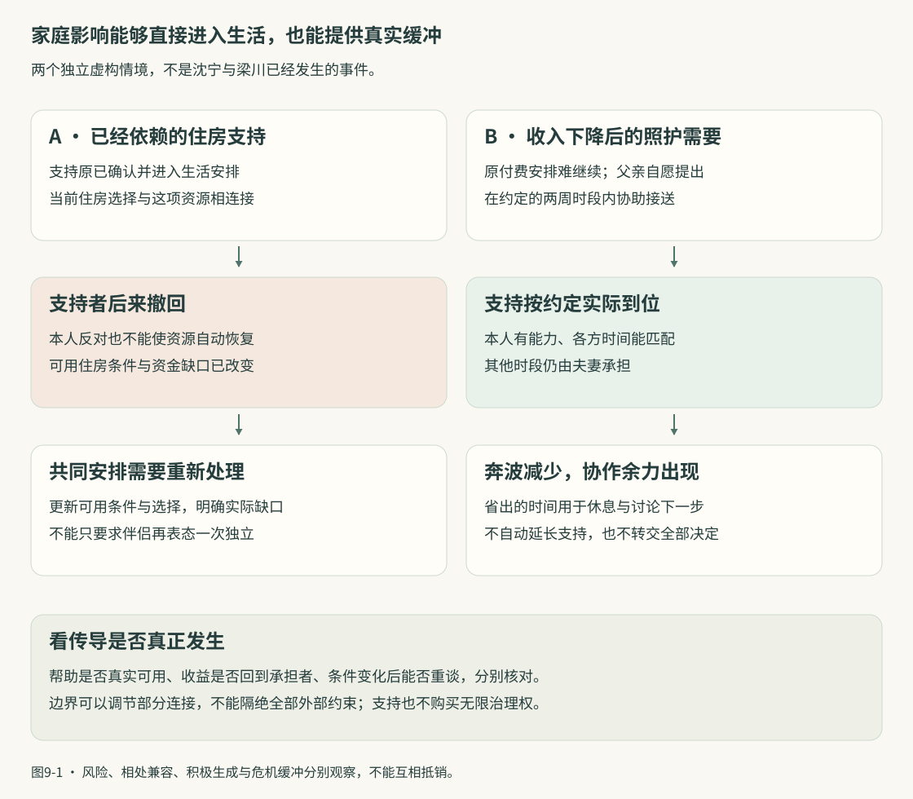

同一条家庭通道，需要观察四种不同结果。它是否带来风险，日常相处能否兼容，是否产生新的互惠与积极体验，以及困难时有没有可靠缓冲。这些结果不能彼此抵销：一次资助有用，不表示羞辱可以忽略；平时并不亲近，也不妨碍一项双方都接受的短期支持真正减负。

| 观察结果 | 在当前生活中问什么 |
| --- | --- |
| 风险 | 哪种具体行为或条件会造成何种损害，影响已经发生还是仍未知 |
| 相处兼容 | 日常方式能否在可承担范围内协调，哪些差异可以并存 |
| 积极生成 | 是否增加了理解、互惠、参与和愿意再次往来的体验 |
| 危机缓冲 | 遇到真实困难时，谁愿意提供什么，支持是否确实到位并减轻负担 |

贫穷、父母离异或某位亲属曾有问题，不能代替对本人的判断；家庭富裕和声誉良好，也不能替代对具体依赖的核对。要认识的是正在发生怎样的联系，而不是一个抽象家世。[附录H.1](#unit-H-1)把这些联系画出来后，你可能发现需要处理的只是一个未说明的支持条件，也可能发现所谓许多后援其实都依赖同一个人。

六条通道说明影响从哪里进入，四种结果帮助辨认它产生了什么作用。若还需看清哪些共同功能受到影响，可以接[附录A.2四系统观察页](#unit-A-2)，分别记录感情、生活、经济和治理中已发生的变化、未来暴露与未知；只填写当前决定有关的部分，不因一处资源缺口便宣布整段关系都已失灵。

当支持尊重每个人的限度，又能在需要时落到实处，两个人就不必只靠彼此硬撑。保持自主并不是把所有帮助挡在门外，而是尽量让帮助、义务与决定范围说得清楚，使受到支持的人仍能参与自己的生活。

#### 9.3 跨圈层关系怎样形成正循环：被看见、被尊重与共同参与

**让参与成本可承担、贡献能被看见、资源与支配分开，跨差异的联系才有持续发展的机会。**

生活圈不同的人相爱，吸引有时正来自彼此不熟悉的经验。一个人带你认识新的活动，另一人让你发现原来忽略的日常。差异能够增加内容，也会改变参与成本：怎样花钱、怎样招待朋友、什么话题能自然进入，以及不熟悉规则时能不能开口询问。

梁川熟悉的一群朋友常在较贵的餐厅聚会。沈宁参加过一次，喜欢其中一些交谈，却不愿按那样的频率消费。她也不想每次都等梁川付钱，才能出现在他的朋友面前。这里已知的是活动费用与消费习惯不合她的安排，不能由此直接推断两人的全部资产规模或人格差异。

她没有一开始就把话说得很完整，只说最近不想出去。梁川起初以为她不喜欢那些朋友，后来听她提起开销，才知道自己把熟悉的消费方式当成了默认选项。她不是拒绝所有往来，而是在避免一项需要反复承担、却不好意思每次提出的负担。

两人另约一次小范围活动，请朋友在公园走走，再去价格事先都能接受的店吃饭。沈宁提出自己熟悉的一段步行路线，梁川核对交通和返程时间。几位朋友愿意参加，活动后来实际完成；没有来的人只说明这次没参加，不能据此推定不接纳她。

活动中，沈宁不只是在努力跟上别人的话题。她知道沿路一处旧建筑的用途，朋友接着问起以前的街景；梁川发现另一个返回方式，更适合一位当天赶时间的人。双方的具体投入都被看见，这次往来也没有突破沈宁认可的消费范围。她愿意再参加类似活动，理由比“应该融入”更具体了一点。

另一次，梁川也参加了沈宁与朋友原有的普通散步。他不熟悉大家提到的一些地方，问了几个问题，并在约定范围内接手寻找方便休息的店。沈宁负责介绍彼此，给他说明话题背景，没有要求他靠表现证明值得进入自己的圈子。两边都出现实际接触，才称得上双向参与的开始。

本书将支持这种过程的条件整理为八个节点。它们会相互影响，不要求按顺序过关，也不意味着每项都做得漂亮才可以相爱。作用是让人看见：共同活动为什么能继续，哪一处负担正在阻断参与，以及资源差异有没有被变成对人的支配。

| 八个节点 | 它支持什么，怎样落到具体生活 |
| --- | --- |
| 具体认同 | 看见这个人的兴趣、经验、能力和真实需要；沈宁对街景的兴趣与梁川对路线的投入，都能成为交流内容 |
| 平等尊重 | 即使不熟悉某种消费和礼仪，也可以提问、拒绝和表达；不让新人先证明贡献，才取得被正常对待的资格 |
| 方向相容 | 双方希望的生活能否找到共同路径；都愿留在本地是一条已知方向，不代替住房、生育或其他关键协商 |
| 资源与控制分离 | 提供费用或机会不自动取得对方的身份、身体及全部生活决定权；资源提供者也保有自己的范围和选择 |
| 消费可持续 | 活动的费用、频率和时间能反复承担，不靠一人透支、借款或长期掩饰困难维持表面合群 |
| 双向融入 | 双方各自重要的人和生活内容都有入口，不把一方整个网络变成另一方必须适应的唯一世界 |
| 贡献可见 | 组织、信息、技能和实际回应能被看见并产生合理反馈；不只认可付款，也不把低资源一方固定为服务者 |
| 变化重谈 | 工作、收入、家庭和身体状态变化后，重新安排参与方式；过去愿意不等于今后都能承担 |

这些节点形成正向循环，需要中间步骤真正发生。安排可承担，人才更容易带着自己的状态参与；参与被认真回应，才可能增加下一次愿意来往的动力。若省下的费用又被更多活动耗掉，或者表达困难总被嘲讽，循环就未必接得上。一次开心聚会也还不能证明今后的条件全部相容。

如果邀约、解释习惯和安排活动长期落在同一人身上，已经使其疲惫，可以借[附录G.3结构公平与角色变化](#unit-G-3)回看：哪些沟通仍需本人负责，哪些任务能由另一人完整接手，哪些活动应减少。先听承担者真正需要什么，再看调整是否把休息和选择还给了他；一句感谢不能代替尚未处理的负荷，也不能把不愿参加解释为不重视关系。

一种相反的过程是，一方为了跟上较贵的生活方式持续动用本来不能动的钱，却不愿说出困难；另一方见他每次都来，以为这种安排一直被接受。后来某次突然拒绝，便被解释成感情变淡。真正需要处理的是此前不可持续的参与成本及相互误读，不只是要求拒绝者态度更热情。

费用较低也不是唯一正确答案。有人愿意为一次共同期待的活动多承担一些费用，对方也愿意接受，可以在范围清楚、本人可拒绝的前提下安排。不能一边主动以资源优势吸引，又把所有重视这项优势的人都判为套利；也不能由“平等”反过来要求资源更多的一方无限提供。

两个人仍需看，吸引是否进一步指向具体的人，是否愿意共同承担真实生活，以及核心方向能否协调。若一方只接受持续高消费、另一方明确不愿那样生活，或者要求资源较少者永久服从，几次礼貌聚会解决不了这个差异。融入方法不能替代对生活方向与权利的判断。

对沈宁与梁川来说，目前已有两次不同圈子的实际接触，也发现了更可承担的活动方式。今后若工作时间或费用条件改变，需要重谈的就是这些安排，而不是让某人证明自己仍然“配得上”。[附录H.2](#unit-H-2)把八个节点接到事实和负担上；它留下的是下一次能怎样相处，不是对人的综合得分。

#### 9.4 当伴侣父母不认可自己：改善具体印象，也识别无法解决的条件

**先弄清不认可的具体原因，再看事实澄清、现实方案与接触调整能否带来真实变化。**

“父母不喜欢我”常让人急于找一个能扭转局面的办法。有人准备更贵的礼物，有人反复解释自己没有问题，也有人希望伴侣立刻与父母决裂。先弄清不认可具体指什么，比增加一次证明更重要。同样一句“不合适”，背后可能是误会、真实生活担忧，也可能是始终不承认你有自己的选择。

| 反对主要来自哪里 | 这次应处理什么 | 什么新事实会改变判断 |
| --- | --- | --- |
| 信息误差 | 由知道情况的人澄清具体事实，别让新人证明一个并不存在的问题 | 事实补足后，对方是否修正原判断 |
| 礼仪或习惯误会 | 说清原约定与各自习惯，协商下次怎样安排 | 相同信息下，是否仍把普通差异解释为恶意 |
| 现实生活担忧 | 面对住房、工作、费用或照护的具体条件，不用人品保证代替方案 | 条件是否落实，担忧是否随之缩小或更新 |
| 身份偏见 | 辨认是否只按出身或身份否定本人，保留能交流的具体事项 | 对实际行为是否开放，还是不断增加与事实无关的门槛 |
| 希望保有控制 | 明确要求涉及谁的资源和决定，拒绝时会有什么真实后果 | 是否接受合理参与范围，或继续把无关服从当作条件 |

沈宁与梁川[之前午饭中的时间误会](#unit-9-1)，已经通过说明和下一次安排得到部分处理。后来谈及未来生活，梁川母亲又问：“你们不是已经准备马上买房了吗？工作和开销算清楚没有？”这一次，不能把问题仍当成多坐一会儿就能改善的礼貌印象。

梁川先说明，他们只是都希望在本地生活，没有决定立即买房，也没有定婚期。父母愿考虑的购房支持还缺金额、性质和时间，不能据此开始付款。沈宁确认自己也没有要求梁川先给出一套房；她希望按能执行的条件讨论以后怎样住，而不是先把日期宣布出去。

母亲听完后，承认自己把“想在本地稳定下来”理解成了近期已经决定买房，不再按那个时间表催他们下决定。这是一个可以观察的更新：原先的紧迫担忧包含信息误差，澄清之后有所变化。它不证明其他住房问题已经解决，更不意味着父母所有疑虑都只是多想。

谈话里还出现了另一项此前未说清的期待：母亲希望将来办一场较大规模的婚宴，并认为既然家里可能支持买房，婚宴安排应主要听父母意见。这时要继续辨认，她是在表达想法、希望参与，还是把它设为不能协商的出资条件；两人不能用沉默让它自动变成已经接受的方案。

梁川没有把这项要求直接转交给沈宁，让她独自负责说服父母。他先向父母说明，自己也不希望为了场面承担超出可接受范围的安排，婚宴尚需两人共同讨论。他能做的是表达本人立场和问清条件，不能保证父母必然同意，也不能替沈宁允诺接受所有习俗。

改善印象仍可以在普通往来中发生。按说好的时间出现、认真回应一件相关的事、承认自己漏掉的信息，比临时把自己包装成没有缺点的人更有用。但这些行为的作用，是让真实的你被看见；它们不保证对方一定改观，更不构成取得基本尊重的交换价格。

如果对方担心的是一项确实没有落实的生活条件，就需要一起看条件，而不是反复说“我很爱他，所以一定没问题”。如果对方明确只按身份排斥，或每解决一个问题就再搬出一个无关门槛，也不能永远把责任归为自己还不够会表现。观察判断是否会随事实更新，能帮助决定继续投入还有没有意义。

另有一对伴侣已经说清住房计划和时间误会，长辈仍在聚会中反复以出身贬低其中一人，要求其当众认错，又不允许解释。需要处理的是不尊重的行为及接触边界，不能再安排一轮更昂贵的展示，把“下次表现好一点”当作保护。

伴侣此时能够做什么，要落到行动：是否当场制止自己可以制止的贬低，是否停止继续安排同样的暴露，是否愿意与本人讨论今后的往来和现实替代。若环境已存在可信威胁，不要求受影响者留在现场等一次完美表态，也不把当面对质作为唯一证明支持的方法。

现实目标可以只是基本尊重、正常联系和可持续合作。你无需与伴侣父母都成为亲密朋友，父母也无需放弃自己的全部看法；需要的是不同意见不被用来剥夺你参与生活的资格。[附录H.3](#unit-H-3)一边记录具体担忧如何变化，一边检查本人能够执行什么，避免把一场看似和气的谈话误写成所有条件已经解决。

#### 9.5 保持自主判断与决定：资源依赖与冲突中的行为

**自主既看本人怎样判断，也看资源、权限和实际执行；表态不能替代尚未具备的选择条件。**

“你放心，我会站在你这边。”听到这句话，人可能暂时松一口气，但它仍没回答几件现实问题：他自己怎样理解这件事，必要资源在谁手中，哪些事情有权决定，以及意见不一致时准备怎样行动。自主不是一句态度，也不能简单等同于不用父母的钱。

梁川告诉沈宁，自己不要求大型婚宴，也不希望她为了潜在住房支持接受全部婚俗。他能表达的是个人立场；父母是否出资、愿接受何种条件，仍由他们作出自己的选择。两人的共同住房和婚宴方案，需要在这些现实条件下判断，不能由一句“我不在意”宣布限制已经消失。

沈宁最在意的，也不只是听见他反对大场面。她问：“如果他们坚持，我们现在会答应什么？会不会先订了再让我接受？”梁川停了一会儿，说自己还没有现成的替代住房方案，但可以先明确不替她答应，也不把父母的期待说成两人的决定。

随后一次与父母的电话中，梁川说明两人没有确认婚宴规模，不会先预订场地。他问清前次谈话中的意思：父母已明确只考虑本地购房支持，婚宴要求是否还可以讨论，其他出资条件又是什么。母亲当时仍希望多请亲友，没有给出完整条件；梁川没有转述为“都谈好了”。

这次有了有限的边界执行：他说明自己的判断，没有越过沈宁同意先作承诺，也把尚未解决的部分带回来。没有发生的是父母资金已经落实，或两人已经具备不靠资助的完整方案。双方愿意核算其他住房安排，但尚无确定房源、费用和可调用资源，暂时不能把“可以想办法”记成可行替代。

| 自主的四个方面 | 本例已有的依据 | 还不能推定什么 |
| --- | --- | --- |
| 本人判断 | 梁川本人不要求大型婚宴，也不愿替沈宁接受全部婚俗 | 他说得清楚，就一定能隔绝全部父母影响 |
| 资源条件 | 父母愿考虑本地购房支持，资金与其余条件仍未落实 | 潜在资助已经属于两人可支配的预算 |
| 实际权限 | 梁川能表达自己的意愿，不能代父母出资，也不能替沈宁同意 | 谁承担部分费用，谁就能决定全部婚姻安排 |
| 边界执行 | 已说明不先预订、不替双方答应，并如实保留未解决处 | 一次行动已经证明所有未来压力都能处理 |

没有依赖父母钱的人，也可能在每次分歧时把选择交给父母，要求伴侣无条件配合；资源有限的人则可能诚实说明限制，承担自己能作的决定，并与伴侣一起寻找可执行安排。资源和能力会影响选择空间，但不能从某个收入水平直接推出完整的自主程度。

所谓“六人多中心治理”，说的也不是有六个人参与就必然出问题。问题出在情侣或夫妻与双方父母之间，多个实际否决中心彼此重叠，权利、承诺和后果却没有对应起来。两人刚谈好的事项，转头又分别答应家里另一套要求；每次调整都要所有人重新同意，最后谁都能否决，却没有人完整承担无法落实的后果。

若两人又各自把争执交给父母裁决，并答应按家里的立场坚持到底，原本的分歧就增加了新的阵营与承诺。即使两人后来愿意调整，也还要面对各自答应家里的要求。亲友可以提供建议，但一方获得的支持不代替另一方对共同方案的同意。

正常咨询和支持不属于这种混乱。父母对自己愿提供多少、接受什么用途表达意见，有其真实位置；当夫妻的安排涉及长辈照护、住房使用或其他权益，也应认真听取实际承担者的条件。问题是这些特定事项的决定范围，是否被扩张成对所有婚恋选择的支配。

| 具体事项 | 需要谁参与，不能怎样越界 |
| --- | --- |
| 是否相爱、继续关系或进入婚姻 | 由两位当事人分别自主选择；父母知情、关切与提供支持，不代替任何一人的同意 |
| 父母愿意处分哪些自己的资源 | 尊重真实权利人的选择；情侣或夫妻不能替父母保证出资、放弃其真实权益 |
| 接受支持后有哪些具体安排 | 根据实际权利、共同约定及有效授权明确；涉及具体权属或协议效果须另行核实，不从“出钱了”直接推出全部治理权 |
| 日常往来和实际照护 | 由相关承担者说明意愿、时段与限度；双方主要协调己方亲属，不能代表所有人无限承诺 |

承担成本者的利益需要被认真纳入，但受到影响也不自动取得对全部事项的否决权。父母不能用出资购买两人的婚姻决定，夫妻也不能为了证明独立，要求父母必须无条件交出资源。某种支持条件不被接受，可能意味着必须另找路径；这是真实代价，不靠声称谁更有道理就能消除。

要把这些判断接到婚事推进上，可以借[附录E.4的四栏记录](#unit-E-4)，分别写当前适婚判断依赖什么、关键条件谈到哪里、是否已正式订婚，以及具体安排是否实施。本例仍有住房条件和替代路径未核清，不能把“我已向父母说过”填成双方已接受完整方案。暂缓的是依赖这些未知条件的安排；普通往来和对其他现实路径的了解仍可继续。

如果本人长期缺少独立判断和执行的练习，换一个环境不保证立刻具备能力。支持可以是一起整理相关信息、讨论一个具体选择、帮助找到可接触的独立支持，再由本人承担能承担的行动。不能把原先由父母包办，变成由伴侣接管全部联系、决定和后果，并把新的依赖叫作成长。

成长没有一个可以提前验收完毕的终点，关系也会反过来改变人。但长期可能成长，不是现在就可以预支的履约能力。需要按当前状态判断共同安排是否承担得起，不用婚姻逼迫成熟，也不要求一人用无限照护维持另一个人的改变过程。

曾经愿意支持，可以形成具体的已承担事项与合理善后，却不意味着从此不得停止关系。本人是否主动学习、是否愿认领责任、支持是否正在产生真实变化，都可以成为继续判断的依据。[附录H.3](#unit-H-3)帮助回看这些不同部分；它检验的是当前行动与条件，不是给一个人颁发“已经独立”的终身证明。

#### 9.6 特殊网络重叠：当感情、职业与资源权力相连

**角色重叠时，分别确认私人、组织与共同事务的权限，并核实能够独立使用的表达和支持渠道。**

有些关系里，拒绝一次私人安排的顾虑，不只来自怕对方难过，还来自担心工作评价、居住或经营机会受到影响。当同一个人同时连接亲密关系、职业与关键资源时，两个人的分歧就可能通过其他角色传出去，退出一种关系也未必能立即停止另一种依赖。

再看甲与乙这对恋人，乙的父亲丙是参与甲工作评价的主管。乙不在该单位任职，也没有被授权安排甲的工作。乙想送甲一本自己购买的书，与乙说“我可以让爸爸给你安排一个好岗位”，涉及的是两种不同性质的事情。

送出自己的书，是一项私人选择；岗位安排会影响组织的实际任务和其他人，乙没有权替组织承诺。丙在家里是父亲，在单位则承担具体的受托职责。即使他本人愿意帮助，也需要核对实际制度、授权与相关权益，不能把对家人的好意直接变成工作决定的全部依据。

甲可以谢谢乙的心意，同时说明自己希望按正常渠道了解机会，不把父亲是否给予特殊安排当作爱的证明。乙可以分享本人确知的公开机会或帮助理解信息，但不能保证录用、评价或岗位结果。社会联系可以提供有用信息，是否有权作出某项决定仍要另看。

| 当前使用的是哪一种角色或资源 | 需要分别辨认什么 |
| --- | --- |
| 私人赠礼、个人时间和经验 | 本人是否愿意，资源是否确属本人可处置，接受后是否被追加无关要求 |
| 工作机会、岗位评价和组织安排 | 实际授权、既有程序、组织任务及同事等相关人的权益，不能只凭家庭称呼作承诺 |
| 共同创业或合作资源 | 谁投入什么、谁有何种决定权限、已有承诺怎样落实，亲密关系变化后合作如何继续或结束 |

这里的风险不只在有没有发生偏袒，也在关键选择是否都被同一条联系控制。谁掌握甲的评价信息，甲能否了解真实要求，意见有分歧时是否有其他有效渠道，离开恋爱关系后是否仍能正常处理工作，这些才是需要核对的事实。

甲查明单位有不由丙一人决定的人事沟通渠道，并确认自己可以就具体岗位事项使用它。这个渠道提供了独立了解与表达的入口，不保证任何职业结果，也不能据此宣布私人关系对工作毫无影响。若只是听人说“公司总会公平处理”，还不能把它记成已经可用的支持。

甲与乙也需要说清彼此不准备做什么：不把私人争执带给主管裁决，不通过父亲索要对方未同意公开的工作信息，不以调岗或辞职作为证明感情的必要动作。事情若已经实际影响工作，仍要通过对应的真实渠道处理，不能只靠恋人安慰一句“他不会那样”。

反过来，若丙确实按公开的岗位要求评价甲，不把家中分歧带进工作，乙也尊重正常职业选择，这种重叠并不自动等于剥削或注定失败。判断依据是角色怎样运行，是否保留不同意见和相称退出的空间，而不是仅凭“上司的家属”这一身份下结论。

如果出现以工作损失逼迫继续恋爱、索取隐私或接受不愿意的安排，就需要面对具体施压和可用保护。此时私人关系中的沟通未必足够，应考虑独立可信支持及适当专业渠道。有关职业程序和具体法律责任，要按实际制度与事实核实，不从本例推演一条各地通用的处理路线。

同样的分辨适用于家族企业、共同创业和高度重叠的朋友圈。一家企业即使由亲属持有，也可能涉及员工、客户、合作伙伴等人的实际权益和承诺；不能把这些人当作两个人谈恋爱时可随意调配的背景。给伴侣的一个方便，若把成本转给其他人，仍要看自己是否有这样的权限。

信息与支持的来源也值得检查。若所谓三个中间人都只转述同一位负责人，或者几种后备机会都依赖同一家企业，它们并不因为名字不同就成为独立选择。增加一条可用联系可能有帮助，但维护联系、转换工作和安排生活都有成本，不能简单要求当事人“换个圈子就好”。

[附录H.1](#unit-H-1)可以分别标出私人、组织与共同事务的联系；在[H.2](#unit-H-2)中记实际参与时，也要保留谁不能替谁作承诺。涉及迁居、共同创业或职业转变等重大行动，再用[D.4](#unit-D-4)核对具体条件。关系结束后的必要接续见[J.5](#unit-J-5)：结束私人关系不自动处理完全部合作，尚有事务联系也不恢复恋人权利。

这些安排的价值，是让感情有真实选择的余地，让工作和合作也能按各自应有的依据运行。亲密关系可以增加理解与支持，但不应要求一个人把所有生活出口都交给同一个人保管。

#### 9.7 风险专节：家庭接口失控、单向融入与多中心否决

**把亲友的具体影响接到资源、参与和决定权限上，及时处理条件变化、单向负担与实际侵害。**

家庭接口，是两个人与外部亲友交换信息、资源、支持和义务的具体位置。住房资助、节日安排、一项照护承诺，都可能成为这样的连接。接口失控，不是亲属一出现就有问题，而是条件未被看见，或某项有限支持逐渐被当作对其他生活的无限决定资格。

沈宁与梁川当前有的，是父母愿考虑本地购房支持，以及母亲希望大型婚宴、较多参与决定的表达。资金、其余条件和婚宴协商尚未落实。两人已经能指出问题在哪里，但尚未得到一个可以据以购房、订婚和预订场地的完整安排。

从这个起点，可以比较两种假设走向；具体结果仍要由后续事实确认。

| 假设后来出现的新事实 | 能支持什么判断与行动 | 仍不能跳过什么 |
| --- | --- | --- |
| 父母明确接受婚宴规模继续由相关人协商，不把自己最初偏好设为不可改变的前提；两人愿继续了解资助 | 条件有协商空间，可以有限接受继续讨论，并把已认可部分记清 | 资金金额、性质、时间与其余条件仍需落实；愿意谈不等于住房可用或已经适婚 |
| 父母明确只愿在举办其指定大型婚宴的条件下资助，双方明确不接受；当前又没有落实别的可承担住房路径 | 该项支持不能进入已接受方案，暂缓依赖它的婚约准备及付款，另看现实替代或是否继续 | 不假定父母必会让步，也不把未核算的租住或借款当现成答案；具体善后与关系选择分别处理 |

第二种情境里，父母决定不提供自己的钱，本身不自动构成控制侵害；两人也可以拒绝附带条件。真正难处是当前想要的生活安排与可用资源没有接上。若在此之外又出现公开羞辱、可信威胁或强迫，就需要另按这些行为处理，不能让“父母有权不出钱”掩盖已经发生的侵害。

例如，共同计划依赖某项支持，支持条件发生变化，伴侣却为避免冲突仍说“没问题”，另一人据此安排生活。后来条件无法落实，费用、时间和亲属关系一起进入争执；双方再为各自家庭辩护，原本可以较早说明的资源问题便扩散为不信任。

阻断的地方也在具体连接上。已知条件应在相关决定前说明；本人不能保证的部分不要代为承诺；收到新信息后及时更新安排；需要重谈的事项由真正有权限的人参与。若已经产生额外费用、劳动或受辱体验，就分别处理，不以住房问题有了办法宣布全部损害消失。

信息也会沿网络扩散。在另一个家庭中，甲向母亲描述一次分歧，母亲又转给亲属群，几位亲属分别向乙表达批评。乙觉得被围住，减少参加聚会；甲再把减少接触解释成“你本来就不愿融入”。如果这一解释继续被转述，尚待核对的解释与现实压力就可能相互加强。

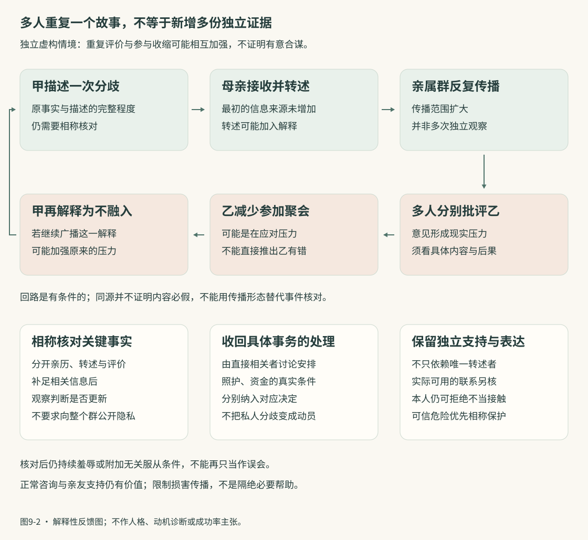

多人表达意见，不说明每个人都有一份独立观察；同源也不说明原故事一定是假的。要分清最初发生什么、转述中增加了什么、谁亲自见到，以及评价带来了哪些实际后果。乙减少接触，也可能是在应对压力，不能直接当作原指责已经被证明。

可以处理的部分包括停止把私人分歧不断广播，由直接相关者核对必要事实，让乙有独立表达与支持的入口，并把亲属真实承担的事项单独谈清。无需向整个群公开隐私来争取清白，也不能要求所有亲友先统一意见，两个人才有权作自己的选择。

单向融入则可能较安静：一方不断参加另一方的活动，自己的朋友、兴趣与时间逐渐被挤掉；每次不参加都要解释，另一方却从不进入其生活。需要辨认的是具体不对等及其后果，不能只数见面次数。有时可以通过减少应酬和增加双向参与调整；若明确拒绝对方保留自己的支持与生活，则已不只是活动安排不够周到。

| 当前证据属于哪种情况 | 与当前阶段相称的处理 |
| --- | --- |
| 信息不足 | 如资助金额、用途或其他条件未清，先找有权决定者核对；暂不实施依赖该信息的重大行动，不把未知判成低风险或已有恶意 |
| 有现实改善空间的一般问题 | 如时间误会、消费负担或任务转嫁，明确谁调整什么，观察后续实际执行；一次承诺不等长期改变 |
| 已确认核心不相容或不可承受 | 核心要求明确不能接受、现实又无双方愿承担的路径时，暂缓或结束相关安排；不靠婚姻促成必然让步 |
| 真实危险或严重侵害 | 具体暴力、持续严重骚扰、可信威胁、严重自主剥夺等，先组织独立支持与相称保护，不以完成家庭协商或反复受伤为前提 |

家庭成员冒用身份索取财物、利用亲属关系持续不当侵占，或把本人反对当作可以忽略的事情，都需要面对具体事实。单有模糊传闻与已经存在现实接触危险不是同一种信息状态；判断不能停在家庭学历或行业标签上，也不应把明确行为软化成“每家习惯不同”。

当事人对自己知情、参与、纵容或实际可以处理的部分，需要承担相应责任；外部约束确实无法完全隔绝时，又不能把所有后果归咎于他没有足够独立。伴侣可以理解他的困难，同时根据自身可承担范围选择不进入更深的绑定。这两件事并不矛盾。

因此，当前是否具备进一步判断基础，要看基本相处、真实支持、本人判断和边界执行，而不是所有亲友是否都满意。如果某项推进仍依赖未确认可用的支持，或核心安排因外部否决而没有双方接受的可执行路径，就先处理影响这项推进的缺口；已有可执行边界、代价可以承担，也只是为[第十一章适婚判断](#unit-11-1)与[第十二章关键协商](#unit-12-1)提供更扎实的材料。

附录[H.1](#unit-H-1)、[H.2](#unit-H-2)与[H.3](#unit-H-3)帮助留下最少而有用的记录，阶段风险可回看[M.7](#unit-M-7)。已经有可信危险时，直接使用[J.4](#unit-J-4)所提示的独立支持，不必走完普通融入过程。社会联系值得经营，是因为它能增加理解、共同生活的内容和可用帮助；任何人的支持都不应成为购买全部自主的凭证。

经过日常相处、共同任务和社会往来，两个人已经能认识更多真实的彼此。[下一章](#unit-10-1)讨论另一种可能增加快乐与连接，也可能加重绑定和身份期待的经历：性亲密。它的意义需要当事人自己表达，具体同意、健康知情与未来安排仍须分别看，不能由朋友认可、父母支持或关系身份代为决定。

### 第十章 身体与性亲密：情感绑定、身份叙事与自主选择

愿意靠近一个人，有时也包括身体上的向往。被喜欢的人渴望，能够表达自己而不必扮演，与对方共享只属于两人的时刻，都可以是爱情值得期待的部分。认真讨论性亲密，不应把这些感受全部翻译成风险；也不能因为经历美好，就跳过其中不同的意愿与后果。

本章可以提前阅读。放在[第九章](#unit-9-1)之后，不意味着必须依次见过父母、完成每项合作，再按书中的顺序发生性行为。这里讨论的是：怎样让亲密出于真实选择，怎样理解它带来的变化，以及经历发生后，怎样仍能看清眼前的人和关系。

#### 10.1 性亲密的关系意义：快乐、情感绑定与不可撤回的经历

**性亲密可以带来快乐与更深的联系；珍惜经历的同时，仍需分别判断双方意义、现实条件和未来选择。**

有些亲密的快乐很直接：身体愉悦、彼此吸引、愿意一起度过私密时刻。有些快乐来自相处方式：原来可以说出不自在，可以提出希望，不必为了维持气氛一直迎合。对方听见之后愿意调整，比一句“我很爱你”更具体地让人感到自己被接纳。

这样的经历能够成为两人共同生活的一部分。后来回想起当时的害羞、笨拙和温柔，感情可能有了新的落点。性亲密既不只是某种生活功能，也不只是一张用来判断关系的凭证。它本身可以有价值，参与者也可以希望这份价值留在持续的爱情里。

本书所说的情感绑定，是经历、感受、期待和已有投入使这段关系对人更有分量，更难被当作随意可以换掉的相遇。它不等于强迫，也不等于永久依附。愿意珍惜、愿意再投入，可能包含清楚而自主的选择；只有进一步看具体事实，才能知道这种联系正在支持双方，还是正在掩盖问题。

**同一件事，可以有不同的分量**。一个人将性亲密看作郑重的选择，另一个人更看重当下的自愿和吸引；原本就很依赖这段关系的人，与另有稳定生活和支持的人，承受的失去可能不同。家庭评价、以往经历和对未来的设想，也会改变当事人怎样理解这件事。不能由某个性别，或一个生理名词，直接推出谁必然更依恋。

赵禾与陆安是成年恋人，已经确认一对一排他，尚未订婚。下面借这对虚构人物比较三种可能走向：[情境A：期待接近](#chapter-10-case-a)、[情境B：意义不同](#chapter-10-case-b)、[情境C：身份施压](#chapter-10-case-c)。三者分别在各自条件下成立，不是先后发生的三段经历。本章其他例子也均为虚构。

**情境A：期待接近。** 亲密前，赵禾问：“对你来说，走到这一步，意味着我们以后要怎样继续？”陆安起先只说“当然是认真谈”，赵禾又说明，自己关心的是认真了解与婚姻承诺之间的区别。谈清后，两人都愿意以婚姻为方向继续了解，都不把这次选择当作已经决定与对方结婚。在这一情境中，与这次选择有关的必要信息已有相称了解，双方接受的保护安排也已落实；这不等于对一切后果作出保证。

经历之后，两人都觉得更亲近。赵禾说出曾担心不够自然，陆安承认自己也有紧张；谁都没有要求对方给这次经历打分。后来一次普通约会中，赵禾愿意讲工作上的挫败，陆安先听完，没有马上劝解。新的共同经历与后续回应连在一起，使两人更愿意表达，而不只是多了一项“已经做过”的事。

**情境B：意义不同。** 同样的问题没有问清。“认真谈”被赵禾理解为两人已共同选择以婚姻为方向继续了解，陆安理解的却是珍惜当前恋爱，并不确定自己是否想进入婚姻。亲密经历对双方都有愉快的部分，但之后一谈未来，差异就显现出来。两人比以前更了解彼此，也发现这份了解未必支持继续。

这一差异不自动证明有人设计欺骗。需要核对的是，当时实际说过什么，是否有意让对方相信一个自己并不打算履行的承诺，以及如今能否诚实说明。明确许诺后反口、刻意隐瞒已有安排，与双方把模糊话听成不同意思，不能用同一种解释包办。失落可以真实存在，欺骗仍需要相应事实。

后来真诚地改变想法，与一开始便用虚假承诺获取亲密，也需要区分。前者仍要诚实说明变化，并处理已形成的真实责任；不能因为后来的选择不同，就倒推当时一定在说谎。

**经历不可撤回，是指历史不能变成没有发生**。人可以停止以后某项行为，可以结束关系，也可以逐渐改变对过去的理解，却不能通过这些决定把共同经历删除。这既不意味着感情必然永久增强，也不意味着一个人的价值发生升降。[情境B](#chapter-10-case-b)里即使后来不再相爱，那段经历曾经带来的快乐仍可以是真的。

正因为经历有分量，而理解未必一致，本书建议将性关系尽量放在正式恋爱的中期或中后期。这里以了解程度定位：已经有一些日常感情、真实合作和社会关系了解，能够辨认可能阻断关系的关键事实与方向，也能就当前身体行为作出知情、自愿的决定。不是统一的月份，更不要求先完成所有家庭见面。

这是基于经历、身份期待及后果的审慎建议，不是性经历决定人格价值的标准，也不是延后就不会受伤的保证。已发生亲密的人仍能补充了解、暂停或退出；没有发生性行为的人，也不因此失去适婚资格。[K.1](#unit-K-1)帮助说清具体意愿与经历意义，[D.4](#unit-D-4)帮助分别判断高后果行动；两者都不要求用下一次亲密证明上一次选择正确。

#### 10.2 身份与叙事权力：共同经历怎样改变关系评估

**让共同经历的意义与新事实并存，保留各自解释过去、评价当前关系和决定未来的权利。**

亲密以后，有人会觉得：“我们终于更像一对真正的伴侣了。”即使恋人身份早已明确，这句话仍可能表达一种体验上的变化。但它也可能悄悄多出另一个意思：“既然已经如此，以前还能商量的事，现在就不该再拒绝。”两句话之间，差的是从个人意义跳到了对另一人的要求。

本章的**身份影响**，指一段经历加强了当事人对“我们是什么关系、应当承担什么承诺”的理解。**叙事权力**则指某种关于共同经历的解释，在双方讲述过去、理解现在和决定未来时获得了更大分量。它可能来自真诚认同，也可能借助依赖、羞耻或外部评价形成；实际影响力本身，不等于正当的支配权。

[第七章7.6](#unit-7-6)已经说明，感受、事实、解释与共同身份需要分开。这里新增的难点是：性经历一旦进入自我理解，人未必只是在评价对方，也可能在维护自己已经作出的选择。原本想问“我们是否合适”，后来却急着回答“我当初不可能选错”。新的问题因此变得难以提出。

这条路径需要条件。若一个人把亲密理解为不可改变的身份，又觉得承认不合适等于承认自己没有价值，提出疑问就会更困难；若对方或周围人不断用这种解释评价自己，困难还会增加。可辨认的线索是问题被怎样处理，例如已知的人生方向冲突一直搁置，却开始用婚约压住疑问。仅仅舍不得、想再试一次，并不足以说明判断已经失效。

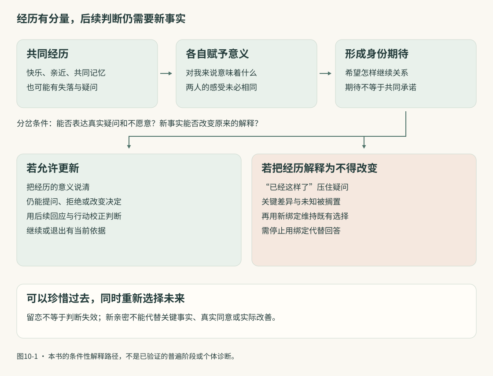

[图10-1](#figure-10-1)是一组有条件的路径，不表示所有人都会依次经历这些变化。关键分岔在于：已有意义能否与新事实并存，真实的不愿意能否表达；没有任何箭头可以直接把性经历变成婚姻义务。

回到[情境B](#chapter-10-case-b)。赵禾听见陆安仍不能确认婚姻方向，先脱口而出：“那我们之前算什么？”这里首先有受伤和困惑，并不能只凭这句话就判定赵禾在控制。赵禾有权说明这段经历为什么重要，也有权认为目前的关系不能满足自己的期待。需要止住的是另一种跳跃：因为它对自己很重要，就认定对方已经同意了尚未达成的承诺。

陆安起初回答“你想太远了”，使赵禾更难开口。随后陆安承认这句话轻慢了赵禾的在意，改为说明：“我喜欢和你在一起，也珍惜之前的事。但我其实还没想定，自己以后要不要结婚。”这不是消除了分歧，而是把分歧放回可以判断的位置。赵禾不用先证明过去全是假的，才能考虑不再继续。

以婚姻为交往方向，仍不等于现在已决定与眼前人结婚。这一情境中的差异在于陆安尚未确定自己是否想进入婚姻，并非仅仅还在判断两人是否适婚。赵禾可以重视前一种方向共识，也不能据此要求另一人提前完成后一种判断。

**情境C：身份施压。** 两人已有性亲密，仍未订婚。陆安用“都到这一步了”要求赵禾立即答应订婚，并说继续犹豫就是没有责任心。赵禾明确表示尚未同意婚约之后，陆安仍把过去经历当作必须答应的理由。这里已出现把经历转换为义务、否认当前决定权的施压，不再只是两人赋予经历的意义不同。

| 眼前的表达或行为 | 它支持什么判断 | 还不能据此推出什么 |
| --- | --- | --- |
| “这对我很重要，我希望认真谈未来” | 一方表达意义和期待，需要听清 | 对方已承诺结婚，或者表达者必在操纵 |
| “你还没决定，我很难过，也要想想自己是否继续” | 对方的自由与自己的选择可以并存 | 难过本身就是对当次行为的强迫 |
| 明知尚未同意，仍以经历和羞辱要求立即答应婚约 | 已有具体身份施压，应处理这种要求 | 已发生所有身体控制，或已有某种人格诊断 |
| 亲密后仍能提问、拒绝，且有新的实际回应 | 存在表达与判断继续开放的证据 | 一次回应足以证明长期适配或全部安全 |

[情境A](#chapter-10-case-a)提供了另一条路。在这里，亲近带来了更多真实表达，后续回应又为继续判断提供了依据。赵禾能说工作受挫，陆安能听见需要，过去的经历给新的表达提供了一点信任；新的回应又让这种信任有了当下依据。人选择继续，也可能是因为此刻仍在获得真实价值，不能一概解释成舍不得已经付出的成本。

如果你发现自己被“已经这样了”困住，可以只把两件事分开写：我想珍惜什么；眼下究竟有什么没有回答。前一栏可以是快乐、被理解和共同记忆，后一栏可以是尚未确认的婚姻意愿、实际失信或某次不被尊重的拒绝。让两栏同时存在，比要求自己立刻否定过去更接近真实处境。

什么会改变后续判断，要看问题本身。误读需要听清原意，未落实安排需要实际落实，明确施压需要停止并恢复可拒绝的空间；再多一次亲密不能替代这些变化。[K.1](#unit-K-1)可帮助整理两种意义。共同历史让双方都有讲述自身经历的依据，却不让任何一人独占故事，更不自动制造新的排他、身体或婚姻债权。

#### 10.3 重大亲密前先明确意愿、事实与后果，亲密后仍可更新选择

**亲密前说清影响选择的意愿、事实与后果，经历发生后仍可根据当下意愿和新信息更新决定。**

不少重要问题难以开口，不是因为它们不重要，而是人怕破坏气氛、显得不信任，或者听见不想听的答案。于是，明明希望认真了解，却只问了一句“你是认真的吗”；明明还不确定，又觉得此时退缩会让对方难堪。越是容易被气氛推着走，越值得在尚能从容说话的时候，把影响选择的意思讲清。

不必安排一场涵盖所有人生问题的面试。先问自己：什么答案会使我今天不愿意？如果你只愿意在双方已确认恋爱的条件下选择，就先确认身份；一对一排他承诺是否已确认、是否存在与之冲突的现实关系，也应在必要范围内问清。对方给出的回答不符合期待，可以改变决定，不能靠发生亲密迫使答案以后变好。

| 本次需要说清的内容 | 可以直接谈什么 | 不能由什么替代 |
| --- | --- | --- |
| 关系与经历意义 | 我们目前是什么关系；这次对各自意味着什么；是否另有婚姻期待 | “你应该知道我认真” |
| 一对一排他与相关事实 | 是否已确认浪漫与性排他；是否存在与承诺冲突、影响当前选择的实际关系 | 亲密发生后再默认排他 |
| 当下身体意愿 | 愿意到什么范围；哪些不愿意；不确定时先停 | 恋人身份、赴约或过去接受 |
| 健康与保护 | 哪些信息影响这次选择；需要什么专业解释；接受的安排是否落实 | 普通体检名称或一句“放心” |
| 隐私及后果 | 是否允许任何记录与分享；若出现计划外情况，先联系谁、谈什么、能承担什么 | 替对方答应身体决定、照护或公开经历 |

表里的问题不是必须逐句念完的口令。已有明确答案不必反复审问；但尚未说清的决定性问题，也不会因为问起来尴尬就自行消失。有时，一次谈话只需落实“现在先不做这件事，等相关信息明确再由各自决定”。这已经比含糊答应、事后追认更有效。

回到[情境A的事前](#chapter-10-case-a)。澄清“认真谈”之后，赵禾仍有些紧张：“如果到时候我想停，你别觉得我故意扫兴。”陆安回答：“那就停。今天不确定也不用今天决定。”陆安也说明自己不愿有影像记录，赵禾认可。他们确认的是当下的意愿，未来每一次选择仍由本人决定。

这种说清并不要求一个人提前准确预测所有感受。想继续的人也可能途中改变想法；当下发现不适，先停下比追问“刚才不是说好了吗”更重要。明确的愿意需要适用于眼前的具体行为，而不是把没有再次反对解释成默认接受。沉默、未反抗、生理反应和过去的接受，都不能代替当前自愿同意。

例如，女方愿意继续聊天，却不愿当下接吻；男方就应停止靠近、留出距离。可以失落，但不能要求她用其他身体接触安慰自己，也不能索取“下次一定”的保证。[5.4节](#unit-5-4)已将约会与具体接触分开：费用、身份和失望都不产生身体索取权。女性的拒绝应落实到男方的实际停止与后续尊重，同样的身体自主也属于双方；不能用羞辱、惩罚性冷落或反复索债逼出同意。

健康准备同样需要在相关行为之前处理。本书提倡双方为实际暴露和计划行为做相称的性健康准备，包括由医疗专业人员判断并解释适合的筛查。项目、时点及结果能回答的范围，应由专业解释确定，不能由本书列一张人人通用的清单。[K.2](#unit-K-2)可帮助带着真实问题咨询，而不是拿报告给人品或忠诚盖章。

**事前问清，不取消事后更新**。在[情境A](#chapter-10-case-a)里，两人因亲密而更愿意交谈，这可以成为继续的积极理由；在[情境B](#chapter-10-case-b)里，快乐也确实发生过，但婚姻方向的差异仍然成立。珍惜体验、难舍联系和决定不再继续，并非只能保留一种。对当前关键事实的判断，不必等待情绪全部平静才有资格开始。

出现重要信息缺口时，可以先暂缓依赖它的身体行为或新增绑定。若已证实重大身份欺瞒、隐瞒现存婚姻或冲突性关系承诺，应暂停当前关系或结束，处理已有影响，而不只推迟下一次亲密。发现婚育方向无法相容，也不必先合住或订婚来增加决心。有实际危险时优先保护，不必等逐项协商后才离开。

改变决定也不是把现实责任全部擦掉。曾经明确认可并已发生的共同费用、具体承诺及已造成的损害，需要按事实另行处理；经历本身却不能被折算成补偿性亲密或强制婚约。[D.4](#unit-D-4)帮助分开下一项行动，[J.2](#unit-J-2)帮助辨认既有责任。保有日常生活与可信支持，也能让人在舍不得、疲惫或自我说服时，有机会重新看见实际发生了什么。

#### 10.4 性忠诚、经营责任与具体同意，是三个不同问题

**分别判断是否遵守一对一排他承诺、双方是否愿意经营差异，以及眼前具体行为是否获得自愿同意。**

“既然是恋人，就应该对亲密负责。”这句话可能表达诚实面对需要，也可能被拿来索要某次身体行为。混在一起之后，一个人拒绝就被说成不忠，另一个人提出持续差异又被说成只在乎性。双方都在争自己的需要应被看见，却没有分清眼下究竟在讨论哪件事。

**性忠诚**面向一对一排他承诺，问的是有没有守约。**性亲密的经营责任**面向两人怎样诚实讨论需要、面对持续差异，寻找彼此愿意且现实可行的安排。**具体同意**面向此时此刻的具体行为，问的是本人是否自愿。这三个问题有关联，却不能互相代答。

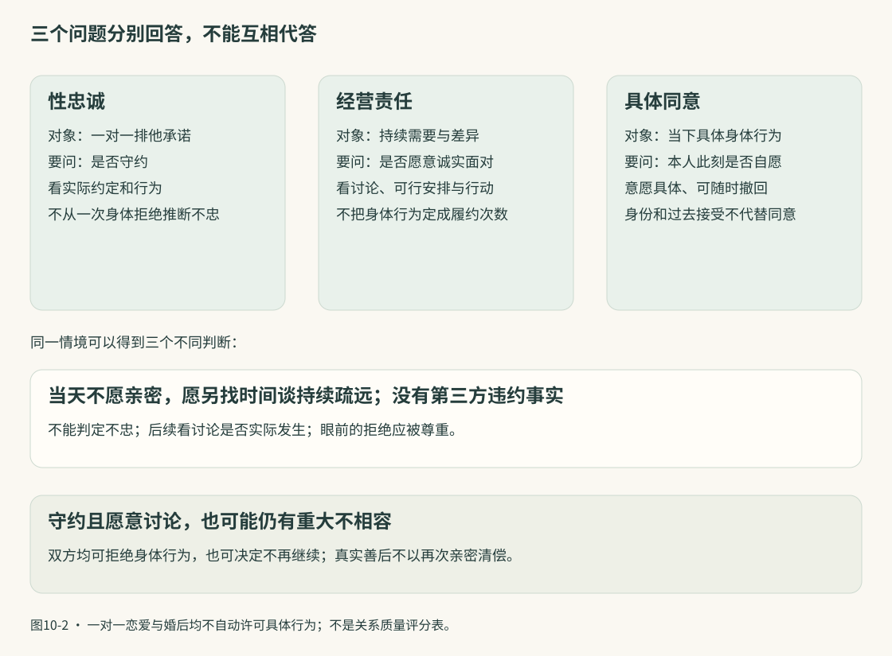

[图10-2](#figure-10-2)中的三条线需要分别看。一个人遵守了排他，不表示伴侣任何时候都须答应；一个人拒绝了今天的行为，也不自动表示不愿经营关系。反过来，双方曾经认真谈过需要，仍不能把谈话写成未来身体行为的自动授权。

结婚也不改变这一点。婚后的亲近和共同生活值得持续经营，但婚姻身份不能替任何一次身体行为取得同意，更不能用照护、收入或过去的付出购买这种权利。

可以用三个独立提问拆开一次争论：是否违背一对一排他承诺？是否愿意面对持续存在的差异？此刻是否自愿？例如，一位伴侣当天很疲惫、不愿亲密，同时愿意另找合适时间谈最近的疏远；没有第三方违约事实。眼下应尊重拒绝，后续看约好的讨论是否发生，不能把三个问题合成“不爱了”的结论。

经营也不等于协商出一个必须交付的次数。可以谈什么相处让双方更舒服，压力和生活安排是否挤压了亲近，有没有双方都愿意的表达方式；需要专业解释的健康问题，另由相应专业人员帮助。愿意尝试的安排，仍受当下同意约束，不以完成指标为由压过身体感受。

另有一对伴侣已经多次提到持续差异，甲愿意把困扰说清，乙却一再用“你无权问”终止所有讨论，也不给其他可接受的时间或方式。没有证据证明乙有第三方违约，乙对任何具体行为仍有拒绝权；但对共同处境持续不回应，是另一个可以评价的经营问题。甲可以据此判断自己是否还愿继续，而不能把评价经营的理由变成索取身体的资格。

暂时说不出口，与长期不愿面对，仍需区分。羞耻、疲劳、以往不愉快的谈话，可能使人一次无法表达。若愿意换时间、用简短文字或在双方接受的帮助下讨论，并且后来真正参与，这就是不同的新事实。若只不断承诺“以后再说”而没有实际回应，另一方也不必无限等待。

在[情境B](#chapter-10-case-b)中，赵禾把婚姻方向看得很重，陆安诚实承认现在不能作出这项选择。赵禾想过之后说：“我想找一个也想走向婚姻的人。你还没想定，我不愿这样继续了。”陆安没有把已有亲密拿来挽留，也没有为避免分开而临时许诺。赵禾结束了这段恋爱。难过和留恋仍在，诚实没有把分离变得轻松，却让双方不必靠虚假共识维持关系。

再看一个不同的情况：双方都守排他，也愿意诚实谈，但一人把持续的性亲密视为长期伴侣关系的重要部分，另一人明确不希望有性生活；两人都不愿接受彼此提出的替代安排。这里可以没有欺骗，也没有谁必须被证明有缺陷，却仍可能存在重大不相容。收入、善意或其他合拍之处，不能替双方宣布这一差异已经消失。

“我不能接受这样的长期关系，决定分开”，与在每次被拒绝时说“现在不配合就分手”，不能只看句子里有没有分手二字。前者是在承认差异后处理自己的选择，后者把退出威胁反复用作当场服从的条件。具体看是否允许当前拒绝、是否停止逼迫，以及是否真正承担结束关系的决定，而不是让对方靠身体配合换取关系暂时保留。

本书讨论成年人自愿的一对一关系。排他承诺不能由一方自行改变，拒绝打破排他不需要证明自己更有道理；实际违约也不能用后来的提议追认。[K.3：一对一排他、拒绝与违约边界](#unit-K-3)帮助记录已确认的承诺、实际行为与当前选择。

尊重身体自主和保留择偶、退出权，可以同时成立。愿意处理差异时，可借[I.1](#unit-I-1)只谈当前的一件事；确认无法继续时，依[J.5](#unit-J-5)分别处理结束与善后。无论最后选择是什么，当下的身体同意都不能成为交换筹码，也不必通过否认真实需要来维护它。

#### 10.5 性健康与生育：把行为后果纳入共同决定

**把身体意愿、健康知情、生育计划和实际承担分开确认，让共同后果得到讨论，也保留本人决定。**

“我们以后要孩子”，可以是一份共同向往，却还没有回答今天是否愿意怀孕、采取什么身体安排、谁有时间照护，以及工作和开支怎么改变。把这些问题分开，不是在给爱情降温，而是让向往有机会落进双方真实愿意、也有条件承担的生活。

首先确定这次究竟要作什么决定。准备某项身体行为，需要知道与这项行为有关的健康信息与保护条件；讨论将来生育，还涉及双方意愿、可能影响选择的健康问题及现实承担。不能因为将来想结婚，就把当前愿不愿意怀孕略过去；也不能因为生育愿望一致，就默认照护资源已经存在。

| 需要分开的决定 | 谁能表达和决定 | 需要共同谈清什么 |
| --- | --- | --- |
| 健康知情 | 本人说明实质相关事实，专业人员解释适用范围；另一人据此作自身选择 | 哪些信息影响眼前行为或共同生活，尚缺什么 |
| 具体身体及避孕相关选择 | 身体当事人决定自己的意愿，不能被关系身份替代 | 双方可接受的行为条件；不同意或信息不足时是否暂缓 |
| 生育方向与生活计划 | 双方分别表达是否愿意参与该计划 | 时间、居住、工作和费用安排，哪些尚无共识 |
| 新增照护与资源承诺 | 实际承担者本人认领，不能代替另一人或父母答应 | 谁做什么、能做多少、资源是否可用及不足怎么办 |
| 已形成的责任 | 依真实行为、既有承诺及具体制度分别判断 | 怎样履行或合理调整，不能因拒绝新计划就一笔抹去 |

共同讨论后果，不意味着身体变成共同财产。一个人不愿接受某种涉及自己身体的安排，可以拒绝；另一人也可以不愿在相应条件下发生行为。此时可以暂缓，而不是由一人悄悄改变条件，或要求对方为了“共同未来”放弃决定。避孕方式、是否愿意生育与后果承担，需要分别确认；具体方法的适用性交由专业解释。

健康知情也不以“把所有隐私交出来”为目标。已知事实若实质影响当前身体安全、重要婚育选择或共同承担，应适当说明；需要什么程度的信息，应跟当前决定相称。可能涉及传播、治疗、日常功能、照护与费用的问题，分别请相应专业人员解释，不能凭病名把一个人的全部生活能力判断完。

拿到一份资料后，先看它究竟回答了什么。普通体检报告与针对具体暴露、计划行为所需要的判断，不是同一个问题；检查结果也不是对忠诚的证明。资料的日期、适用范围、解释者和仍未回答的事项，都比笼统说“检查过了”有用。具体检测项目、时点及结果解释，需要围绕本人情况取得专业支持，不能靠双方的信任补齐。

例如，另一对伴侣准备增加身体亲密，一人说最近做过体检，但尚不能说明手中资料是否回答了双方正在关心的问题。两人目前知道的是“资料适用性不清楚”，而不是“已经安全”或“对方患病”。他们可以先暂停相应行为，由本人带着具体问题咨询，再在必要范围内说明能回答什么、仍有哪些未知。

若一方不愿提供相关信息，另一方可以保留未知并拒绝对应行为；拒答本身不等于疾病证据，也不赋予强制检查或索取完整病历的权利。信息只为必要知情与选择使用，不用于羞辱、传播或索取其他权限。求助时同样尽量减少无关披露，而不是把隐私要求变成禁止寻求可信支持。

再看甲与乙关于近期生育的分歧。甲希望近期自己怀孕，乙明确表示目前不愿进入育儿安排，也不能接受甲设想的“甲暂停工作、乙承担全部家计”。两人此前说过将来想有孩子，但没有就这项近期计划形成一致；现在只在讨论，尚未采取相关行动，也没有怀孕事实。

甲的生育意愿值得被听见，却不能替乙认领新增的全部经济与照护安排。乙可以说明自己不接受什么，也不能因此取得替甲作身体决定的权力。眼下需要澄清的是，这只是时间和资源未谈妥，还是生育方向已经根本不同。若没有双方可接受的方案，就不要把近期共同计划当作已成立，更不能指望怀孕以后对方自然配合。

如果双方已有其他被认可并实际发生的责任，仍要另行处理；“我不接受这个新增安排”不等于“此前承诺全部失效”。反过来，愿意承担某项既有费用或有限照护，也不自动表示同意生育、继续恋爱或结婚。[J.2](#unit-J-2)处理责任来源，[D.3](#unit-D-3)和[K.2](#unit-K-2)帮助把健康、知情与照护问题整理清楚，不替任何人作身体决定。

开放式性关系存在法律、生理健康和心理健康风险。本书不展开这类安排的讨论或实践方案；一对一排他承诺不能由一方自行改变，任何人都可以拒绝有关提议。

风险提醒不等于对某个人已经违法、患病或受到心理损害的判断。私人幻想、双方范围内的身体偏好与已经发生的实际行为仍须分清；不能凭一个词补出行为，也不能借事后提议取消已经发生的违约。

拒绝打破排他，不欠对方“更开明”的证明。当前承诺和实际行为可用[K.3：一对一排他、拒绝与违约边界](#unit-K-3)核清；确认无法继续时，可以结束关系，既有责任另行处理。

#### 10.6 风险专节：绑定遮蔽判断、身份施压、失配与健康信息缺口

**以当前事实判断亲密是否支持关系，及时处理被遮蔽的分歧、身体与身份施压及知情缺口。**

亲密之后仍想留下，本身不是危险信号。值得辨认的是，你留下的理由是否还能与现在的事实对照：是不是仍有喜欢、回应和共同参与，还是只剩“既然已经发生，就不能再承认问题”。前者可以支持继续；后者需要把被搁置的疑问重新放回决定里，而不是责备自己曾经愿意。

一条需要关注的链条是：已有亲密经历，被解释为不得改变的身份；为了维持这份解释，不敢表达疑问；关键事实因此没有处理；随后又通过同居、婚约或更多身体行为增加绑定。这不是每个人必经的过程。若亲密后仍能说不，双方也愿意处理新事实，链条就没有按这个方向运行。不能仅因一个人依恋较深，就认定其没有判断能力。

另一种循环发生在这样的条件下：一人为了避免指责而勉强配合，施压者把配合当作索取有效；受压者因担心再次被要求，开始回避靠近或减少表达，而施压者又把这种退避解释成“变心”，进一步加重索取。只有这些环节有事实支持，才能说循环已经形成；不能仅凭一次身体拒绝认定循环，也不能把受压后的退避与施压平均归责。阻断不能靠受压者再配合一次来证明感情，而要停止以指责逼迫配合，恢复真实拒绝的空间；出现可信危险时，独立支持优先。

| 目前有何事实 | 当前应辨认什么 | 相称的行动与重看条件 |
| --- | --- | --- |
| 资料适用性、实际排他状况或经历理解尚未明确 | 信息不足，不能填成安全或有罪 | 暂缓依赖该信息的行为，以相称方式补充；信息仍不足时保留拒绝 |
| 双方愿意面对具体差异，有可接受的调整空间 | 可协商的问题，不靠一方迎合解决 | 选一项双方愿意的安排，看真实执行及各自体验；没有改善再判断 |
| 重要需要、一对一排他原则或具体边界已说明，双方仍无法接受共同安排 | 重大不兼容；不必先证明人格有错 | 停止依赖虚假共识的升级，分别决定是否继续并处理真实善后 |
| 已有强迫、偷拍、泄露隐私、可信威胁或严重身体控制 | 真实危险或已发生侵害 | 保护自主与安全，取得现实可用支持；不把继续对话或重复受害设为前提 |

四类判断不是从轻到重的一张统一评分表。未知也可能对应不能贸然承受的后果；不兼容即使没有恶意，也足以使人停止升级；一次严重强迫不需要重复发生，才值得保护自己。新的事实可以改变判断，但“再信一次”不是新事实。

接着看[情境C的后续](#chapter-10-case-c)。赵禾拒绝立即订婚后，陆安又要求用再次身体亲密证明没有变心。赵禾说不，陆安仍指责“以前都愿意，现在就是耍我”。赵禾没有继续配合，结束了这次谈话；随后向一位可信朋友说明自己受到的具体要求，朋友实际愿意倾听。赵禾已经面对婚约与身体索取的施压，处理它不需要等到出现强行接触或实际健康损害。

拒绝之后仍有施压，是情境C新增的行为证据。即使在同一真实关系中曾有温柔，也仍须单独处理眼前的施压。朋友愿意倾听提供了一处独立参照，不等于施压已经停止，也不能保证后续拒绝都会得到尊重。是否愿意继续，由赵禾根据当前事实选择，不必先赢得陆安对整段故事的认同。

身体与生育相关控制，还应辨认两种不同机制。它们可以同时存在，但不能因为看到一种，就补出另一种已经发生；也不能只用“生育风险”四个字将差别盖掉。

| 机制 | 被改变或压缩的选择 | 独立虚构例与目前能确认的事实 |
| --- | --- | --- |
| 单方控制避孕或生育相关身体决定 | 本人选择保护条件、是否接受身体安排的空间 | 一方未经同意干预另一方已选择的避孕措施。已知干预事实足以处理自主侵犯；不需要等真的怀孕，也不推定已有医学损害 |
| 借怀孕、金钱或婚约固定关系 | 是否留下、是否结婚及如何退出的空间 | 已知怀孕后，一方以公开对方隐私相威胁，要求立即结婚。威胁与逼婚要求已经发生；是否已有财务、职业或其他损失仍需事实 |

第一种机制直接触及身体选择，后果还可能进入日常照护、费用承担和共同决策；哪些后果已经出现，要逐项确认。第二种机制用既有事实或资源依赖压缩关系去留，即使没有干预身体的事实，也应处理。怀孕需要面对的真实事项、已经认可的费用和照护责任，与必须继续恋爱或结婚，并不是同一项义务。

故意隐瞒实质影响当前身体选择的重要事实，也会绕过必要知情，使对方按错误条件决定。需要辨认具体隐瞒了什么、为什么与本次行为有关；它与拒绝提供无关病历不同。尚未查清的疾病或损害，不能补成已经发生的后果。

因此，谈合理的既有责任不自动构成控制；把已经认可的支持扣作“答应留下才处理”的条件，则要看具体承诺、依赖与施压事实。不能把所有责任讨论都叫绑架，也不能让真实责任成为支配身体或关系去留的理由。相关事实可借[J.2](#unit-J-2)辨认，具体法律义务另依地区、时间与真实情况核实。

有可信危险时，不必先把上述分类做完整，也不必当面对质或先独自离开才能求助。根据现实条件取得可信的个人、专业或紧急保护支持，减少继续受侵害的机会；后续安排应考虑报复、隐私与资源可达性。[M.4](#unit-M-4)、[M.7](#unit-M-7)及[J.4](#unit-J-4)帮助回看行为边界，不要求你先形成完美的自我叙事，才有资格保护自己。

普通差异的修复，同样不能用新的身体行为冒充。道歉与停止施压、处理费用或安排、恢复规则与信任、重新产生愿意亲近的感情，是不同的变化。积极回补可以是认真回应、恢复选择、共同完成双方愿意的事；再次性亲密从来不是修复必须交出的证明。

读完这一章，可将已经获得的信息带入[第十一章](#unit-11-1)：我们怎样对待真实需要与拒绝，是否有相称知情，面对差异能否共同处理，人生方向和现实安排是否支持继续。已有性经历不能替代这些依据，没有性经历也不自动否定适婚。走向婚姻所需要的，是对具体人和共同生活越来越清楚，而不是增加足够多、让自己难以回头的经历。

### 第十一章 确认适婚：想要的生活，能否已经一起开始

想到结婚，最吸引人的未必是某一天的仪式。可能是回家后能放心卸下疲惫，想分享的消息有人愿意听；可能是遇到事情不再独自筹划，仍有自己的空间，又知道两人正在为同一种生活努力。这些期待值得认真对待，也需要看看，它们在眼前这段关系里已经怎样发生。

本章把此前的经历放在一起：想要什么，靠什么实现，现有证据支持到哪里。判断适婚不是颁发个人合格证，也不是许诺未来不会改变；它是双方在有限了解下，对是否适合建立婚姻作出的审慎判断。关键住房、资金、婚育等条件可以提前协商，并随结果回来修正，不能等“通过”以后才首次发现决定性的分歧。

#### 11.1 我们希望婚姻创造什么：八类价值与功能

**把理想婚姻说成具体生活，才能辨认双方真正需要什么，以及关系已经创造了哪些价值。**

如果只问“你想要幸福的婚姻吗”，答案容易相同。如果分别描述一周普通生活，差异就具体了：有人期待下班后能一起吃饭，有人需要安静独处；有人盼着常与亲友相聚，有人更喜欢两人的小生活。有人愿意为事业暂时减少相处，也有人不能接受伴侣长期不在场。都说希望幸福，还没有说明怎样的生活会让各自感到值得。

不妨从三个普通时刻开始描述：忙碌的一天结束后，希望怎样相处；有一件让人高兴或为难的事，希望怎样回应；周末有限的钱和时间，愿意怎样安排。暂时不用找漂亮词。能说出“我希望你先听完，再问我要不要建议”，比笼统要求“情绪价值高”更容易让对方理解，也更容易看见实际回应。

本书用八类价值与功能帮助整理这些愿望。这里的价值，是关系为参与者创造的真实体验、安排与可能性；功能，是使这些生活结果持续发生的作用。分类帮助找出重要需要，不规定每个人排序相同，更不将一个人折成八项分数。

| 八类价值与功能 | 希望得到什么 | 它怎样进入普通生活 |
| --- | --- | --- |
| 欲望与吸引 | 愿意靠近、欣赏具体的人，期待浪漫与双方自愿的身体亲近 | 看见对方的魅力，愿意创造接触；不能用收入、责任或身份替本人宣布喜欢 |
| 亲密互动 | 能表达、被理解、得到适当回应，积累共同记忆 | 分享好消息或挫折，听清再回应，愿意一起做喜欢的事；投入要实际被感受到 |
| 共同生活运营 | 饭食、家务、时间与照护能运转，人也保有休息 | 事务有人发现、认领、完成和衔接；不能只在结果完成时忽略谁一直加班补位 |
| 资源协作 | 钱、时间、信息与社会资源能配合使用 | 对共同目标作可承担安排，尊重权限与贡献；可用资源不能靠想象或重复计算增加 |
| 风险共同体 | 遇到困难时有可承担的支持与调整路径 | 说明变化、共同减少负荷、调用确实可用的支持；不许诺无限救援，也不剥夺自主 |
| 承诺合伙 | 不只享受当下，也愿意守约、承担和维护未来 | 约定进入行动，改变及时说明；共同方向仍须双方持续选择，不能变成退出禁令 |
| 价值观同盟 | 重要目标与底线能共存，彼此理解做选择的理由 | 谈生育、事业、生活方式和责任取舍；不要求所有观点、兴趣和情绪完全相同 |
| 身份与声誉协同 | 伴侣身份得到相互认可，对外角色与关系边界可以协调 | 在实际亲友往来中怎样介绍、分享和承担说清楚；不要求以追求声望为人生目标 |

前两类可以口语化地叫“感情有依靠”，中间三类是“日子有规划”，后三类是“未来有希望”。这三句话只帮助记忆，不能把八类重新压成收入和情绪两项。有人需要共同探索的兴奋，有人看重危机时的协作；若这些需要一直没有被说出来，另一人再努力，也可能努力在不相干的地方。

回到[第八章的旅行修复故事](#unit-8-6)。旅行后的一次普通晚饭里，许青和程远愿意聊起沿河散步与岸边树影，也分享近况。两人得到的不是“又完成一次约会”，而是可以再次回到共同记忆，仍对眼前的人感兴趣。这个场景支持亲密互动有继续生成的机会，也触及吸引；它不能因为归进两类，就被重复计算成两份适婚证据。

再看[第九章希望借助父母支持解决住房的沈宁与梁川](#unit-9-5)。他们希望以后在本地共同生活，这同时涉及生活运营、资源协作与承诺合伙。他们期待的可以是通勤和日常安排有着落，彼此能实际参与生活。父母愿考虑住房支持只提供了一个待核的资源方向；钱怎么来、带什么条件、两人能否接受，仍决定这份愿望能否进入现实。愿望已经被说出，与价值已经实现，是不同状态。

再看一个独立虚构例。甲希望朋友知道双方是恋人，乙却不愿在公开社交平台发照片。起初甲把不发照片理解为不认可关系，乙觉得被要求公开全部私生活。谈清后，两人发现都愿意在必要亲友往来中介绍伴侣，只是不想公开私密内容。后来一次熟悉朋友的小聚中，他们自然说明了关系，差异得到实际处理，但没有因此形成婚约。

这个例子解释了身份协调可以落在哪里，也说明身份不一定靠公开程度证明。若另一人连必要往来中的关系定义都拒绝说明，便是不同事实，应继续问清原因与影响。不能只凭社交平台的一项习惯，直接裁定谁认真、谁不认真。

八类价值之间可以取舍，却不能由别人替你无限换算。想要常旅行的人，可能愿意改为频率较低、花费可承担的出游；需要基本尊重的人，不必因为对方收入高，就接受长期羞辱。认可资源是正当吸引来源，也不表示具体的人、普通相处和长期适配都已得到回答。

可以把自己最在意的两三项写进[附录E.1](#unit-E-1)，再回到[附录B.1](#unit-B-1)所描述的生活。对方没有提供某项偏好，不自动说明其人品差；但若它对你不可缺少，就要如实面对。关系值得建立，既需要有现实可得的好处，也需要这些好处是双方真正想要的。

#### 11.2 谁来实现这些愿望：六类组合能力及其现实基础

**共同生活的能力来自真实协作；互补、学习与服务支持，都需要本人参与和可用条件。**

“我们会把日子过好”，还需要回答谁去做、怎样协作。有时两个人分别很能干，一起处理小事却总在争夺决定权；有时各自只擅长一部分，能够清楚交接、彼此补位，反而能形成合用的安排。婚姻需要的是能在两人之间运行的组合能力，不只是履历上个人优势的相加。

六类组合能力描述实现生活愿望所需的主要行动。它们分布在两个人的参与、共同规则和现实支持之间，不要求每人独立完成所有领域。一项能力可以帮助实现多种价值，同一愿望也往往需要几类能力配合。

| 六类组合能力 | 需要做到什么 | 判断时要看见什么 |
| --- | --- | --- |
| 经济经营 | 理解可用收入、开支、储备及既有义务，作共同认可的安排 | 信息能对上，权限明确，支出与承担可落实；拥有较多钱不等于会共同安排 |
| 生活管理 | 组织家务、日程和必要照护，让任务有连续性 | 谁发现、计划、执行与核对，忙碌时怎样交接；最后完成不能掩盖单方持续透支 |
| 关系经营 | 产生和维护亲近，回应需要，处理分歧后的损伤 | 双方是否实际感到被理解，是否愿意靠近，修复是否有后续行动 |
| 共同决策 | 区分个人决定、共同事务与执行授权，使约定能执行和更新 | 不越权替对方答应，变动能说明，分歧有可接受处理；口才不能替代参与权 |
| 亲属协调 | 与亲属互惠往来，明确支持条件、责任及边界 | 本人能说明立场、面对必要谈话，不让伴侣承担全部融入与拒绝成本 |
| 风险应对 | 辨认实际暴露，准备可用支持，在变化后调整或恢复 | 有与现实条件相称的备用路径，知道何时求助或停止新增负担；不能只说自己心态好 |

这些能力在沈宁与梁川的住房安排里就会相遇。梁川能向父母询问支持条件，是亲属协调的一部分；两人是否理解资金性质与后续负担，涉及经济经营；谁有权决定住哪里、是否接受婚宴条件，涉及共同决策。任一项缺口，都不能只靠另一项优秀自动补齐。[第九章梁川说明不先预订婚宴的那通电话](#unit-9-5)提供了一项行动依据，尚未使住房路径成立。

遇到缺口，可以比较三种路径。**互补**是本人愿意认领擅长的事务，另一人也理解重要信息和交接；**学习**是承担者自己参与练习并逐步减少对他人督促的依赖；**服务支持**是使用确实能取得、可负担且本人接受的外部服务。路径可以组合，但它们都有时间、费用和组织成本。

[第8.6节中，许青与程远旅行后的餐厅安排](#unit-8-6)提供了一个小范围证据。程远认领预订，遇到餐厅临休、备选地点会影响返回时间时，先向许青说明，再共同选择附近餐厅，并按约完成见面。这次实际协作体现了生活组织和共同决策的改善；此前擅改住宿的行为仍须保留在判断中，一次改善也不能证明长期全部可靠。

若暂时做不到，可以缩小任务、学习必要步骤，也可以在确有条件时借助服务；不应把“以后会学”永远翻译成另一人来培训、提醒和兜底。外包也不消除全部组织责任：谁联系、确认可用性、支付和处理临时缺席，仍需要人承担。关键事务应有基本知情和备用路径，不要求人人精通，却也不能全靠一个人随时在场。

另一个虚构例中，两人各自在工作上都能统筹项目。共同安排一次周末活动时，甲认领交通，乙认领住宿，却各自按自己的偏好选择，费用和返程限制没有说清。个人执行力并未自动变成共同能力：他们首先缺的是共同认可的目标、资源范围和变更权限。解决这个问题需要形成实际协作，不是再比较谁更优秀。

[四系统](#unit-2-1)回答经营什么；[八类价值](#unit-11-1)说明为什么值得经营；本节六类能力说明怎样实现。接下来的[静态](#unit-11-3)、[现实](#unit-11-4)、[动态](#unit-11-5)三层判断，则整理这些愿望是否相容、方案是否可行、关系是否已有运行依据。它们是在看同一段生活的不同问题，不是四套必须逐项满分的考试。

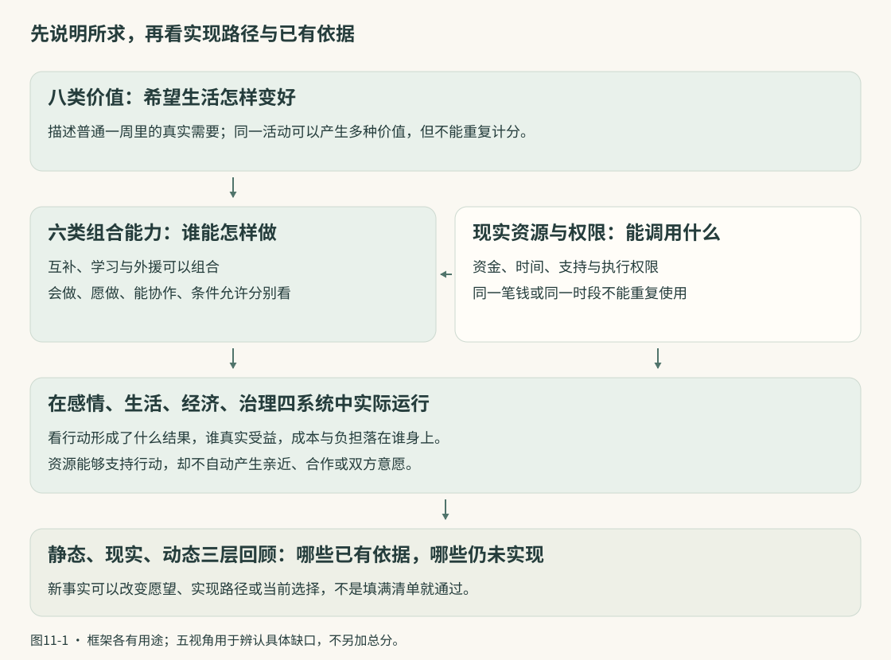

[图11-1](#figure-11-1)中的箭头表示实现与检验的关系，不表示八项价值与六项能力机械配对。钱和时间能支持行动，却不会自己变成回应与合作；一笔资源或同一段空闲，也不能在不同任务里重复使用。

只有在某项任务卡住时，再借[五视角](#unit-2-6)追问：本人是否愿意，是否理解责任，会不会做，资本也就是可调用资源是否足够，实际风险和已承担义务是什么。怕风险与辨认风险不是一回事；表现积极也不能补出不存在的时间、权限与资金。

另设一对希望未来育儿、但还没有育儿经验的虚构伴侣。他们整理现有工作与家务安排，发现若都照原工时工作，预想的照护时段没有人承担。甲愿了解本地服务的时段与费用，乙愿确认自己实际可调整的工时；目前这些询问尚未完成，不能记成支持已经到位。这使准备有了具体方向，却没有把照护能力提前认证。

尚未育儿的伴侣，不必先有孩子来证明能力。可以看已有的生活组织、相称照护经历与学习行动，也要核实将来可用的时间和支持。没有实践的部分仍未知，但可以有认真、可行的准备。一个愿意学习的人，也保有自己的负荷和选择；另一人没有无限改造或培训伴侣的责任。[附录E.1](#unit-E-1)帮助对齐价值与实现路径。准备应对照护、收入等变化时，[附录J.1](#unit-J-1)帮助核对关键功能、支持条件和仍未解决的缺口。

#### 11.3 静态适配：哪些不能抵销，哪些可以发展或共存

**适配要从当前意愿与现实条件判断，分清不能抵销的底线、可发展的能力和可共存的差异。**

静态适配，是把当前的意愿、重要需要和现实特征放在一起，判断它们是否有可共存的基础。这里的静态不表示人永远不变，而是暂时不把“将来一定会变好”算作已经具备的条件。先看今天的组合，再判断什么改变值得期待、又需要哪些真实依据。

首先有三个必要层次。第一是双方确实愿意让这段关系成立和继续，条件相近不能替代彼此选择。第二是基本安全、尊重与信任有相称依据，持续侵害自主不能用其他优势冲抵。第三是愿意且初步能够共同经营，不能只有一人长期维持，也不能仅凭“我婚后会负责”的自述认证。

这三个层次回答关系基础是否存在。具体差异怎样处理，则可分四类来看。它们的用途不同，不是三项加四项再设七道门槛；一项差异可能同时触及个人底线与基本适配，也不因此需要重复扣分。

| 条件的处理方式 | 主要问什么 | 一个具体落点 |
| --- | --- | --- |
| 底线条件 | 是否涉及不能接受的伤害或本人明确不能妥协的要求 | 强迫和持续羞辱不能用收入补偿；个人不愿接受的生活安排也应明说，但不冒充普遍道德标准 |
| 基本适配 | 对彼此、重大方向与关键需要，是否存在双方认可的组合 | 一方明确要孩子，另一方明确不愿成为父母，且都不接受替代路径，当前就不能假定婚育相容 |
| 可发展能力 | 缺口是否有人认领，具有学习、资源与执行路径 | 预算整理可以从本人实际记录与核对开始；不能只有另一人无限监督的承诺 |
| 可共存差异 | 是否可以在不损害重要需要的情况下保留不同 | 各有爱好、保留独处，也仍有双方愿意的共同活动与可承担分工 |

判断某项差异时，先看它造成什么影响，再看有没有双方可接受的安排，最后问所需改变由谁承担。不能按议题名称预先分类：饮食口味不同，有时各取所需即可，有时却牵连全部做饭劳动和无法接受的要求；同样说工作忙，有人愿协调并能腾出相处，也有人根本不愿共同生活。

两位条件相近、人生计划也相似的成年人，如果没有彼此靠近的意愿，可以认为对方不错，却不必强行成为伴侣。另一对虚构恋人，一人喜欢热闹，一人偏爱安静，但都欣赏对方，也愿意保留共同散步与各自活动。他们已经实际这样安排了几次周末，双方都感到自在；兴趣不同在当前条件下可以共存，不需要先改成同一种人。

若后来一人要求对方参加每一次聚会，另一人只能持续牺牲休息，判断就需要重看。改变结论的是负担和参与要求发生了变化，而不是“外向与内向本来就不配”。反过来，一项过去令人吃力的分工，在本人真正学会并承担之后，也可能不再是当前的能力缺口。

本书用“不可通约”提醒某些价值不能简单折成同一个尺度，用“不可妥协”说明个人不愿让步的边界，用“不相容”描述已知的重要意愿或现实条件存在冲突，当前无法形成双方可接受的方案。关键条件未明时仍是未知；没有判明不相容，也不要求继续了解。三个意思不能互换。亲近与收入无法按固定比例兑换，不表示所有收入不同的伴侣都不能共处；是否能接受，仍取决于双方具体需要和真实选择。

个人底线可以明确，也需要诚实承担其选择后果。你可以不愿接受长期异地，却不能因此宣布愿意异地的人都不负责；你也可以选择更重视某种生活资源，不必假装自己只看感情。问题在于是否说清自己需要什么，是否允许对方不同意，以及双方是否仍有可行的共同生活。

[第十章情境B](#unit-10-2)中，赵禾与陆安的亲密经历没有使婚姻方向自动一致。赵禾想以婚姻为方向了解，陆安尚不确定自己是否想进入婚姻；这与已想结婚、正在判断是否适合与眼前人结婚不同。吸引、恋爱中的真实快乐与适婚仍分别回答，不能用更多身体经历消除方向差异。

期待发展时，还要把另一人的意愿放进条件。对方未认可的改变，不能预支成共同未来；自己也可能在长期的鼓励、要求和退让中改变目标与表达方式。值得问的是，这种相处正在支持什么、压住什么，双方是否接受，而不是只计划怎样把另一人变成理想对象。

[附录E.2](#unit-E-2)可以保留当前基础与差异，[附录D.2](#unit-D-2)提供具体问题入口。记录应说明哪一项已有依据、哪项仍待确认、什么实际改变会影响判断。严重侵害先保护；已明确的不相容不靠经营口号稀释；可学习的短板也需要真实路径，而不是因它尚未完善就否定整个人。

#### 11.4 现实可行：愿意共同生活，还要有能够执行的路径

**可行的共同生活需要资源、时间和权限相互衔接，既不能重复使用，也不能依赖所有人始终完美执行。**

两个人都愿意结婚，并不使住处、时间和照护自动出现。反过来，没有达到某种统一的收入或有房标准，也不表示共同生活一定无路可走。现实可行要回答的是：在双方认可的生活目标与实际约束下，是否有可信、可执行、能容纳正常偏差的安排。

先把一周生活放进时间里，再把必要开支放进可用资源里。工作地点是否允许相处，通勤会占去多少余量，既有债务和照护需要由谁承担，住房及日常费用如何衔接，都可能改变答案。只看账面月收入，容易漏掉不可随意取消的支出；只看有人愿意做家务，也容易漏掉这个人已经没有空闲。

一个独立虚构例中，伴侣在纸上安排甲增加晚间工作来承担服务费，又安排甲同一时段亲自照护家人。每一项单看都像有负责人，合在一起却使用了两次同一段时间。另一个方案把一笔储备用来支付入住开支，又完整算作应急余量，也出现了重复使用。不能通过把表写满，使资源真的多出一份。

资源还要按状态区分。本人已有且有权安排的资金，与亲属愿考虑出资不同；明确但附条件的支持，与条件尚未说清也不同；预计奖金、尚未发生的继承，更不能先写成当前现金。实际提供者的意愿、权限、用途与可用时间，需要和拟议生活衔接。家庭看起来富裕，只能提示可以继续了解什么，不能证明自己能够调用多少。

沈宁与梁川目前的住房问题可以整理成几项，而不是再开一份全方位审查表。下表承接[第九章梁川向父母说明边界、询问支持的电话](#unit-9-5)，替代住房尚未落实。

| 关键事项 | 目前已有的依据 | 决定性未知与下一步 |
| --- | --- | --- |
| 共同生活方向 | 两人均希望本地共同生活 | 愿望还未构成具体住处、通勤和费用方案 |
| 父母住房支持 | 父母亲口愿考虑本地购房支持，不用于外地 | 金额、性质、时间、权限及其余条件未明确，未到账；梁川需继续向实际出资者问清 |
| 婚宴与参与要求 | 母亲提出大型婚宴及较多决定参与；梁川已表示不先替两人预订 | 是否硬性资助条件、可否协商仍未明；本人不要求大型婚宴不等于条件已解除 |
| 替代住房路径 | 两人愿意核算其他安排 | 尚无双方接受的房源、费用和可调用资源依据；要结合各自现有义务共同核对 |
| 当前可作的决定 | 尚未订婚，也未为共同住房付款、签约 | 可以继续有限协商与了解；不能依靠这项未知支持先承担付款或婚约前提 |

这里有三条不同的可能路径。若支持条件具体清楚、提供者确有相应权限与可用资源，而且两人都能接受，可以将它纳入可行方案。若条件不接受，但双方核实了自己可承担的替代住房和生活安排，可以修改原计划。若两条路径都没有形成可信依据，就暂缓依赖这些条件的推进，而不是把“总会有办法”当作第三笔钱。

租房也必须核实费用、住处可得性、通勤和双方接受程度，不能作为一句自动解决问题的话。买房同样不是唯一有承诺的形式。要比较的是现有条件下可执行的安排，而不是给居住形式排出道德等级。涉及具体产权、借贷、担保或出资法律性质时，交由相称的专业判断，不凭关系身份作结论。

还要分清前提尚未确定，与已确定安排有待实施。比如本人确有可支配资金、双方接受具体费用和支付时点，只是约定的付款日尚未到，不能一律写成“完全没有资金依据”。相反，亲属只说会考虑、金额和条件全不明，就还不能称作只差一次转账。两种状态决定的是不同的下一步。

一个方案也不能只在最乐观的一周成立。若每天都要求准时下班、没有疲劳、所有亲属服务随叫随到，一次普通变化就可能使任务落空。可调整的消费、能够暂时简化的事务、确实可调用的接续与休息余量，应当与目标一起考虑。余量不是要求富裕，而是承认现实的人不能永久完美执行。

不同家庭需要核对的问题不同。主要依靠工资的安排，重点看实际收支与必要义务；牵涉经营、担保或复杂家族责任的安排，还需确认责任主体、期限和可能影响。[附录F.1](#unit-F-1)与[F.3](#unit-F-3)帮助整理资金和预算口径，[F.5](#unit-F-5)进一步辨认抗冲击能力与重大义务；[E.2](#unit-E-2)、[E.4](#unit-E-4)将关键条件接回当前决定，不要求普通恋人照搬企业尽调。

如果方案变化使一人必须放弃原本不能妥协的生活方向，现实可行就会反过来改变静态适配判断。不能先宣布适婚，再要求双方把条件硬凑成那个结论。也不能因为没有找到路径，就声称已证明所有路径都不存在；当事人可以继续有限探索，也可以认为当前不值得再等。

#### 11.5 从已有经历判断亲密、合作、修复与社会支持

**已有经历能为亲密、合作、修复和支持提供有限依据；成功、反例与尚未经历的部分都要保留。**

到了这里，最容易出现的误判是：目标谈得很好，条件也似乎齐备，于是把将来的计划当作已经运行的生活。动态判断要回到实际经历：关系怎样使人靠近，事情怎样共同完成，变化怎样处理，外部关系究竟带来什么。已有经验提供有限依据，愿望和解释不能代替它。

这里将[许青与程远的旅行修复](#unit-8-6)和[沈宁与梁川的亲友往来](#unit-9-3)放在一起比较：前者已有一次越权后的处理及后续协作，后者已有融入行动，住房支持仍未落实。本节把四项机制带回同一份回顾。每项都找支持场景，也看反例与剩余未知；无需为每个格子重新设计一次活动。一个经历可以提供不同领域的信息，却不能因被重复引用就变成多次成功。

| 动态机制 | 已有场景支持什么 | 反例或限制，以及仍未知什么 |
| --- | --- | --- |
| 亲密生成 | [许青、程远愿分享近况、共同回忆旅行](#unit-8-6)，普通相处仍有积极价值 | 一次愉快不保证所有时期都能连接；若只有昂贵刺激或单方哄慰，依据就不同 |
| 合作增信 | 旅行准备中双方[认领任务](#unit-8-3)、[补充接驳信息并调整路线](#unit-8-2)，[出行后来完成](#unit-8-6) | 程远曾未经同意变更住宿，不能抹掉；完成旅行不证明所有重大任务都能合作 |
| 扰动恢复 | [差额承担与结算处理，参与问题得到回应；后来餐厅临休时，程远先说明再共同调整](#unit-8-6) | 费用解决与信任、感情不必同步；一次后来守约只提供有限改善证据 |
| 社会支持 | 沈宁、梁川有[两次新的双向朋友圈活动](#unit-9-3)、[正常家庭交流](#unit-9-1)；梁川[实际表达过一项边界](#unit-9-5) | 朋友未确认资金或照护后援，父母购房支持未落实；关系融入不能替资金条件作答 |

看许青与程远，不能只保留旅行顺利的结尾，也不能只保留越权的片段。原先变更造成的费用与参与受损，后来的认责、实际结算及一次自然情境中的改善，属于同一条经历。它们支持“这次问题有处理，后续出现一项改变”，还不足以支持“以后再不会越权”或“已经适婚”。

同样，沈宁与梁川的亲友往来已有具体积极体验：参与成本下降，有可分享的话题，彼此也不只进入同一人的圈子。这些是真实生成，不必因为购房条件未明而全部抹掉；但朋友愿一起散步，不自动变成愿借钱、提供住处或长期照护。社会连接、可用支持和实际权限应分别记录。

判断运行时，还要同时问谁受益、谁承担。例如一次共同活动按时完成，若有人从安排到查漏全程独自兜底，另一人只享受结果，这次产出并不能支持双方已经能稳定合作。若双方自愿分工，负担可承担、贡献有回应，也不能仅因工作量不对半，就判定一方被利用。

“我们从没吵过”需要进一步解释。在一个虚构例中，双方尚未遇到影响彼此的重要决定，平静只说明接触范围有限。另一个例中，一人说出不同意见就遭羞辱，于是很少再说，平静依赖表达受压。若双方能说明不同需要、一起调整，事情妥当解决后也仍愿靠近，才有另一种运行依据。外观相似，参与方式和负担却不同。

不要为了补证据而故意制造困难。隐瞒信息、假装经济危机，或要求先同居、先有性行为，都可能制造额外后果，也不等于得到了自然情境中的可靠材料。已有严重侵害，更不需要通过重复取样才承认。对没有经历过的育儿、疾病照护或长期失业，只能依据现有基础与可行准备作有限判断。

观察一次修复，也不只是记录“复合了”“又一起出门了”。要看具体事务有没有处理，决定规则与信任有何变化，双方是否重新产生积极感情。三层可以不同步：愿意完成一项事务的人，仍可能不愿继续爱情；感情回暖，也不代表未履行的责任已经消失。

有些夫妻分享自己经过多年磨合才学会合作，可以提供启发，却不能证明所有不相容都值得熬下去。留下来的组合本就可能与退出的组合不同；经营中的学习与最初的选择都可能参与结果。判断眼前的人，仍需看当前愿望、真实行动、承担成本与可接受改变，不能用别人的结局保证自己的未来。

把上述材料写入[附录E.2](#unit-E-2)时，可以引用[附录A.2](#unit-A-2)已有的少量记录，不必另造全量档案。特别保留“尚未观察到”和“出现过反例”。这会让判断更清楚：不是因为两个人已经做过很多事就该结婚，而是这些经历究竟支持怎样的共同生活，双方此刻是否仍愿选择它。

#### 11.6 我们凭什么相信这些判断：重大信息、自然观察与剩余未知

**重大判断须分清本人意愿、实际行动、可调用资源和剩余未知，并把核实限定在当前决定所需范围。**

关系实际怎样运行，与我们知道多少，不是同一件事。一个人可能确实愿意承担，却还没有提供行动依据；一项资源可能存在，却不属于两人可以使用的范围。信任可以使人愿意了解，仍需要分清本人表达、实际事实与尚待实现的方案。

重大事项主动告知、自然多场景观察、对关键事实的相称核验，各有用途。意愿要听本人，不能由亲友替其答应；承诺是否履行，要看相应行为；资金或居住方案能否成立，要核对条件与执行路径。尊重本人说“我愿意”，不等于凭这一句话认证未来可靠，也不意味着需要先证明其内心动机才能处理已发生的失信。

| 材料的状态 | 沈宁与梁川当前可写的内容 | 应当怎样使用 |
| --- | --- | --- |
| 已表达的意愿 | 两人希望本地共同生活；梁川本人不要求大型婚宴 | 作为本人选择的信息，不代替资金或住房条件 |
| 已发生的行动与原话 | 梁川已打电话说明不先预订；父母说愿考虑本地购房支持，母亲表达婚宴期待 | 确认的是这次表达与行动，不扩大为长期边界成熟或款项可用 |
| 解释与猜测 | 母亲是否把大型婚宴作为出资硬条件 | 尚未明确，不能凭“她应该不会真在意”补答案 |
| 待核前提 | 金额、性质、时间、其他条件、权限及替代住房依据 | 说明谁去问、何项决定前需明确，仍无结果则保留暂缓 |
| 无法完全消除的未来未知 | 此后收入、家庭需要与关系选择可能变化 | 准备调整与复核，不用无限监控追求永久保证 |

这个区分也帮助避免重复取证。几位亲友转述同一位出资者的一句“以后会帮”，仍然来自一个源头，不能算作几次独立资金确认。相称核验应接近真实来源和当前问题，而不是不断搜集使自己安心的转述。已有明确资料也要看日期与范围，不能把一次有效回答扩展成对未来一切情况的承诺。

哪些私人事项需要告知，应看对当前决定的实际影响。普通聚餐饮酒，与已经反复因饮酒失约、失控并影响共同任务，不是同一种材料；后一种情况需要面对具体行为和后果，而不是只争论是否喜欢喝酒。本书不由这些片段作医学诊断，必要的健康解释仍需适当专业支持。

保存一件私人旧物，也不等于正在违背排他；若实际仍在秘密经营一段与当前约定冲突的关系，现实关联就变了。要求说明影响共同选择的事实，与要求交出所有过去、全部账号和每次聊天，不是同一个范围。第三人和职业资料的保密要求，同样不能因恋爱身份而被一并取消。

信息接收者也有责任。重要健康或家庭资料应只用于必要知情，不拿来羞辱或向亲友扩散。自愿、有限且可撤回的位置共享可以帮助协调行程，却不能证明忠诚；拒绝这种方式也不能自动作为背叛证据。若某项必要事实始终无法在合理范围内确认，可以拒绝升级，但不必编出一个人格结论。

一次核验最好有明确的结束位置。就[沈宁与梁川尚未明确的住房支持](#unit-11-4)，目的不是证明谁家更可靠，而是判断能否依赖这笔钱作住房安排；梁川需要向实际提供者问清关键条件，双方再判断是否接受。在作相关婚约前提或付款承诺之前，这些条件应有足够依据。若答复仍模糊，当前结束核验的结果可以是“不据此推进”，而不是不断扩大调查。

得到清楚答复，也不表示之后永不重看。若支持条件、双方意愿或执行安排改变，就回到受影响的一栏；不必每次从头盘问所有历史。[附录D.1](#unit-D-1)、[D.2](#unit-D-2)、[D.3](#unit-D-3)用于把重要问题问清，[E.2](#unit-E-2)用于整合所得。诚实拒答与编造答案应区分，当前未知与无法保证未来也应区分，才能既尊重隐私，又不以信任之名跳过决定性事实。

#### 11.7 从判断到决定：适婚判断与关键协商相互校验

**适婚判断与关键协商相互校验；条件有据、关系已有协调运行且双方愿意，才进入正式承诺安排。**

到要作决定的时候，不需要把前面的每个概念重新问一遍。回到眼前这对人：重要愿望是否可以共存，生活路径是否有可信依据，普通相处与真实合作是否已表现出基本协调，重要问题有没有双方接受的处理，而两人是否仍愿意共同生活。

[静态](#unit-11-3)、[现实](#unit-11-4)、[动态](#unit-11-5)三层各有不能省掉的作用。彼此喜欢不能补出资金，纸上预算不能认证合作，几次共同活动也不能让重大方向自动相容。它们共同支持一个有范围的判断，不能平均成总分。某一层发现新问题，可能需要回到另一层修正，而不是坚持此前已经给出的“通过”。

住房、生育、定居与必要家庭安排，都可以在判断过程中提前协商。适婚判断帮助明确哪些条件重要，关键协商检验它们能否被双方接受和落实；协商结果再改变判断。不能先无条件认定适婚，再把足以改变决定的未知留给“婚事细节”。

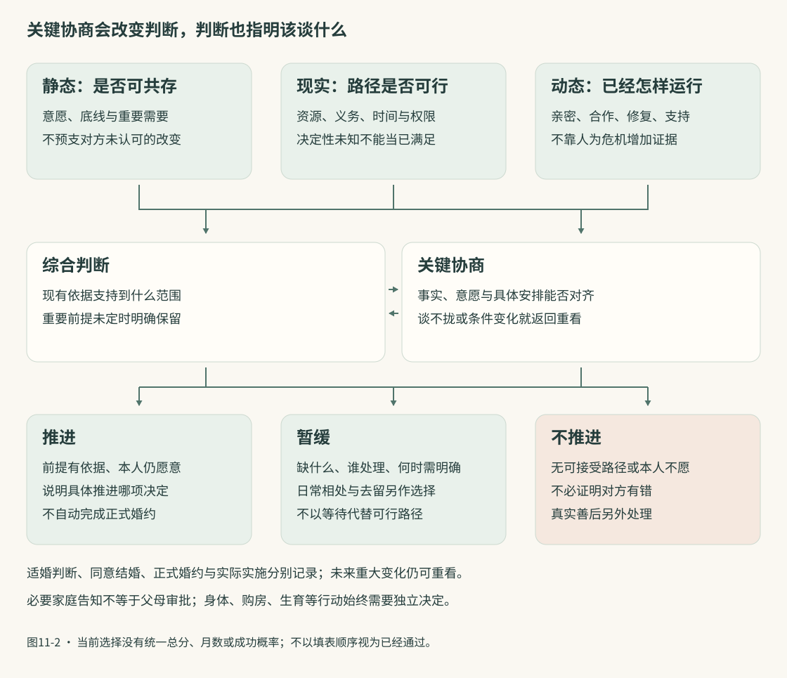

[图11-2](#figure-11-2)把判断、明确选择与正式承诺分开。证据支持适宜，不等于本人已经同意；本人愿意，也不代替条件有依据。[正式订婚](#unit-2-3)依本书口径包含清楚婚约、必要家庭告知和婚礼安排，登记、居住与财务行动还要分别实施。父母知情不是审批资格，无法安全联系的情况按现实条件处理。

以[沈宁与梁川尚待明确住房路径的情况](#unit-11-4)为例，他们目前已有本地生活愿望，一些相处与亲友互动有积极依据，梁川也实际表达过边界。但决定性的住房路径尚未成立，不能把“如果资助条件可接受，就能考虑推进”写成“已经适婚，只差父母转账”。条件核实之前，这仍是需要确认的前提；本章也没有足够材料替他们宣告其他领域全部通过。

从这一时点出发，比较两种可能走向。它们用于理解新事实怎样改变选择，尚未发生。第一种：两人实际核对自己的可支配收支、现有义务和一处可承租住房，确认费用、通勤与日常分工可接受，不再依赖尚未明确的父母资金。住房这一缺口因新方案得到处理，可以带着其余证据继续完成婚约前的关键协商；它本身仍不认证所有适婚条件。

第二种：出资者明确将双方都不接受的大型婚宴与决定参与作为资助条件，两人核对后也没有当前可承担的替代方案。原先依赖资助的路径就不能成立，应暂缓或放弃相应婚姻推进。继续恋爱、等待何种变化，还是结束，是需要各自选择的问题；不是证明谁更爱，也不预设最后总会结婚。

在没有决定性未知、已有运行与现实依据，而且双方明确愿意的情况下，可以确认适婚并进入正式承诺安排。仍有能改变决定的关键前提，则明确暂缓什么、需要谁补什么信息或行动；当前无双方认可路径，或一人不愿继续，也可以决定不进入婚姻。[附录E.3](#unit-E-3)展示三种结论，[E.4](#unit-E-4)记录协商与实施，[A.3](#unit-A-3)帮助确认当前处于哪个节点。

暂缓需要一个可辨认的新条件，而不是无限期等对方变好。例如等实际提供者说明支持条件，或核对双方认可的替代居住方案；不必统一规定等几个月。若没有可执行的下一步，或者当事人不愿承担继续等待的成本，就应承认这一点。当前不适婚不自动否定过去的感情，已经投入多年也不能要求对方继续投入。

还可用[第二章的四种关系结构](#unit-2-5)回看背后的机制。**搭伙生活**提示目前主要维持了哪些便利、是否缺少双方在意的共同生成；**寄生套利**要看具体收益与责任是否长期被单方利用，不能由暂时依赖判定；**共损锁定**要看相互消耗及退出困难，而非仅有争执；**共同生长**则看重要价值与未来能力是否在可承担投入下形成。它们不是给两个人各贴一个永久人格标签。

最后用[五个观察视角](#unit-2-6)回顾已有事实，不增加一套测验：

| 视角 | 决定前问自己与对方什么 |
| --- | --- |
| 意愿 | 我们是否主动选择长期共同生活；压力、已有投入和身份期待是否压住了真实的不愿意 |
| 意识 | 是否理解婚姻也带来角色、付出与责任；理解是否已体现在讨论和行动中 |
| 能力 | 生活、合作、沟通、修复与调整的现有表现，能支持拟议生活到什么范围 |
| 资本 | 经济、时间、身体、社会与情绪资源哪些实际可用，能否支持起步和可预见责任 |
| 风险 | 重大问题是否足够透明，处理或隔离路径是否可行，剩余后果是否自愿且可承担，有无足以否定当前决定的事实 |

回答可以不完美，却需要诚实且与现实相连。确认适婚是对组合的判断，同意结婚是双方明确选择，正式婚约是把承诺与必要安排说清；三者不自动发生，也都不剥夺以后依据重大新事实更新选择的权利。

#### 11.8 风险专节：条件代替运行、表面平静与婚约冲动

**个人优势、表面平静和既有投入，都不能代替共同运行与关键条件的证据；重大失信须处理当前关系。**

一个人条件很好，容易让人提前相信共同生活也会很好；两人多年没有分开，容易让人觉得婚姻只是顺理成章。需要警惕的是证据被换了：个人优势代替共同实践，未分手代替值得继续，已选婚期代替关键条件已经成立。

用两个独立的虚构组合比较。第一组各自资源与事业条件优越，但相处至今没有实际共同安排事务，也没有面对过会影响双方的决定。不能据此说他们不会合作，只能说相关依据不足。第二组条件普通，已经有多次双方认可的日常合作，但准备依赖的住房资助仍只是口头愿望。不能因为他们朴实、愿意努力，就把资金条件补成已满足。

第一组需要在自然生活中增加与当前决定有关的相处和协作，第二组需要核实关键资源、必要时修改生活方案。他们并不需要互相比谁更值得结婚，也不能用更多约会去回答住房资金从哪里来。个人条件和共同实践都可能重要，问题在于它们各自能证明什么。

当错误证据遇到婚期压力，后果可能沿一条具体路径扩大：以为条件很好就不用再谈分工，于是开始预订、付款或安排迁居；新增事项占据更多时间与资金，未明确的责任落到一个人身上；这个人提出问题，又被说成临近婚期还不配合。原本只是尚未形成的协作，因此可能变成已发生的经济负担、参与受损与感情消耗。

这条路径中，不是每一对都会发生所有后果。应当确认已经作了什么承诺、谁支付或承担、哪些拒绝受到压制，再决定停止什么新增投入。不能只说“婚约冲动”，而不处理实际费用、知情权和分工；也不能因为已经花了钱，就让后续选择失去空间。

外部条件也会直接改变可行性，不必先有谁判断失误。例如一对虚构伴侣在原本可承担的方案下准备共同生活，后来一人的实际收入下降。两人及时说明变化，重新核对必要支出，减少已共同认可的非必要安排，并暂停尚未承担的大额新开支。这样做提供了协作与调整的证据，但还要核对余下资源能否覆盖生活，不能仅因态度好就宣布缺口已填平。

亲属支持撤回、现实服务停止，同样可能使方案需要更新。伴侣即使明确反对外部干预，也不一定能让原有资源继续存在。判断应同时看新的约束与本人如何应对，不把所有困难归为不努力，也不把“外部原因”当成可以隐瞒、越权或转嫁全部负担的理由。

| 当前事实 | 判断方向 | 对应行动 |
| --- | --- | --- |
| 关键资料不清，或运行经验不足 | 信息不足，无法作出相应结论 | 明确缺口，做相称核验或自然实践；暂缓依赖它的新增绑定 |
| 技能或分工有缺口，但本人愿认领且有现实改善条件 | 可发展的短板或可治理问题 | 选一项可行调整，看实际执行、负担和反馈；没有变化就重看 |
| 重要需要、方向或现实后果已明确且不能接受 | 重大不兼容或不可承担 | 停止相应升级，选择调整目标或不进入婚姻，不用高条件抵销 |
| 重大欺瞒、强迫、威胁或自主剥夺已有事实 | 按具体行为与严重性处理 | 已证实重大身份或婚姻、伴侣承诺欺瞒时，立即暂停当前交往或结束，并处理既有后果；存在侵害或可信威胁时优先保护、限制暴露并求助，不要求反复验证才行动 |

若发现实际欺瞒，补齐数字只是其中一部分。对方曾在错误信息下作出的决定、由此产生的费用或依赖，以及未来规则与信任，都需要另外处理。若只有没有依据的担心，则应以相称了解澄清，不能用调查之名无限扩张监控。已知事实与未知不能互相冒充。

本书要求正式恋爱已有基本合作与多系统协调的依据，不要求婚前提前完成全部育儿、长期照护或完整家庭预算。未来总有不能消除的未知，也仍能对当前重大障碍作判断；在缺少依据时暂缓，并不否定爱情，在证据支持时增加投入，也不等于保证永不出错。

[下一章](#unit-12-1)把这些判断中足以影响婚姻的条件进一步谈实。双方可带着一份当前决定和少量关键前提进入，而不必带着一张越来越长的考试卷。协商使方向与安排更清楚，也可能让人改变原来的判断；正式订婚应当建立在这样的可执行共识上。

### 第十二章 婚事关键协商与正式订婚：把未来变成明确婚约

#### 12.1 哪些事情必须在正式订婚前说清

**凡会改变结婚意愿或核心生活安排的条件，都应在正式婚约前说清，并有与承诺相称的现实依据。**

谈到结婚，令人期待的未必先是一场婚礼。也许是下班后不必再赶着分别，能在同一张桌上吃饭；也许是遇到重要选择时，知道有个人愿意认真听，并一起承担后面的日子。把这些期待说得具体，会让两人更接近想要的生活。具体以后，也才能发现彼此想的是不是同一件事。

“都想有个家”，可能分别意味着在本地单独居住、与父母同住、尽快生育或暂时保留各自的生活方式。这些愿望没有在一句话里自动相容。若某个答案会改变你是否结婚，或者改变你愿意进入的核心生活安排，它就应在正式婚约之前谈清。

可以用一个问题筛选：**如果答案与我的预想不同，我还愿意按现在的方案结婚吗**？这比罗列所有能想到的问题更有用。婚期方向、居住、重要财务义务、生育和照护、父母支持的条件、礼俗与个人重要要求，都应放到这个问题下判断。

不同事项需要不同程度的明确。决定婚后留在哪座城市，要有现实路径；选定礼服的每一种颜色，通常不需要成为婚约的前提。但如果某个仪式安排涉及本人不能接受的公开身份或身体要求，它也可能成为关键条件。重要与否取决于真实后果，不只取决于事项的名字。

| 当前要谈的事 | 正式婚约前应说清什么 | 可以留到哪里继续处理 |
| --- | --- | --- |
| 婚期与初期居住 | 双方接受的方向、现实可用时间和住房路径；是否同住父母、是否迁居 | 在已认可范围内联系办理、预订和搬入；具体行动前复核 |
| 重大财务与支持 | 现有债务和其他重要负担怎样影响生活；需要谁的资金，条件及权限是否明确 | 已核可信安排的到账与支付；不能把来源未知写成只待付款 |
| 生育、照护与工作 | 当前意愿是否相容，已知责任由谁承担，是否预设辞职或亲属帮助 | 面对新经历、新需要再作具体选择；不提前许诺无限承担 |
| 礼俗与仪式 | 哪些表达重要，费用能否承受，有何附带条件，谁接受与负责 | 无关核心选择的款式、装饰及具体联系 |
| 双方特别在意的要求 | 是否已经听清；若不能满足，是否仍愿进入该生活 | 愿意调整的范围与重谈条件，不能用沉默当接受 |

继续看沈宁与梁川的住房协商。[第九章中](#unit-9-5)，他们只知道梁家愿考虑本地购房支持，母亲希望婚宴隆重并参与决定。金额、性质、提供时间和完整条件还不清楚。[第十一章比较过不同可能路径](#unit-11-7)，目前这些住房方案都还没有落实。

沈宁想先谈将来住处，梁川却提起要不要找个日子告诉亲友。她停了停：“我也想认真往前走。可如果那笔钱意味着一定要一起住，咱们现在还没说好。”梁川起初觉得这像把父母的好意当成麻烦，随后意识到，他自己也只是在猜父母最终会怎样安排。

他们先把问题缩成几件：支持给谁，是赠予意向还是需要偿还；是否要求共同居住；哪些婚宴要求是期待，哪些是出资条件；不用这笔钱，是否还有能承受的居住办法。梁川负责问实际出资者，沈宁不替他解释父母，也不把询问本身当成承诺会有好结果。

有些事实应向掌握资料的人核对，有些意愿只能由本人表达，最后的组合才是协商。如果父母只能接受同住，两人可以判断是否也愿意；如果不愿意，就比较别的真实方案；如果没有可行替代，就暂缓依赖这项资源的婚姻安排。三种结果都应返回适婚判断，不能只保留能够按期办婚礼的那个答案。

谈关键事项也不等于从零重审全部过去。已经确认的义务和偏好，可以引用原来的讨论；只检查它是否仍然适用。精力有限时，先谈足以改变决定的问题，再处理执行细节。[附录E.4](#unit-E-4)的分栏页可以只填当前住房这一行；[附录D.2汇总的34项重大事项](#unit-D-2)用于按需查缺，不要求重新问完才允许继续生活。

一个实用的区分是：住房资助附带条件未知，属于决定性前提；双方都能接受的桌花尚未选，属于执行细节；未来工作变化后的通勤安排，属于出现新事实时重谈。若现在就已收到工作调动通知，第三件事也可能立即变成前提。分类服务当前事实，不是一张永不变化的清单。

也不要把“关键条件先清楚”理解为所有实施都必须提前完成。可信的方案可以支持承诺，付款、登记和入住仍要分别办理。相反，尚未形成婚约也不表示任何责任都不存在：此前共同认可的安排、已作出的明确承诺及由此形成的实际依赖，仍按事实处理。

#### 12.2 住房和父母出资：资金、产权、居住与治理分别协商

**住房协商要分清资金、财产权利、实际居住和日常治理，逐项确认后再判断是否接受整套生活。**

“家里帮我们买房”听起来是一项安排，实际至少包含四件事：谁提供什么资金，财产权利怎样安排，谁实际居住，以及一起生活后谁决定什么。把它们揉成一句话，每个人都可能觉得自己已经说清，后来却发现所说的不是同一套生活。

父母想用积蓄给孩子一个起点，子女想离父母近一些，伴侣期待有属于两个人的日常。这些愿望可以相容，也可能在“近一些”和“住一起”上分开。不能由愿望出发，自动推出某个人已经同意所有后果。

| 分开的四件事 | 要确认的事实和意愿 | 不能从什么直接推出来 |
| --- | --- | --- |
| 资金 | 实际谁出资、有无处分权限；金额、用途、时间、是否需偿还、附带什么条件及变动空间 | 愿意帮忙不等于已承诺确定金额，承诺不等于到账与实际可用 |
| 财产权利 | 意向赠予一人、双方还是借款；拟登记和相应负担怎样安排，具体法律表达与效果如何 | 谁拿着账户、谁付过一笔钱，不单独回答全部产权与责任 |
| 居住 | 实际哪些人居住、从何时开始、预期多久、空间怎样使用；相关权利与安排是否支持 | 给钱不等于已经获得任意入住安排；获准居住不等于可以处分别人的房屋 |
| 日常治理 | 装修、采购、作息、探访、家务与未来育儿，哪些共同决定、哪些授权个人 | 出资多少不自动换算成对两人全部生活的投票权 |

四栏不是为了否认帮助，而是使帮助成为各方都知道自己在参与的安排。父母不能被要求无条件交出财产；子女也不能一面接下明确条件，一面计划婚后不认。两人同样不必为了得到住房支持，交出对婚姻、身体或全部日常的决定权。

梁川后来与父母继续谈。母亲说，希望买房后从入住起就住在一起，既方便照应，也好参与家里安排；婚宴仍希望大办并主要由父母拿主意。父亲在这次谈话中也明确认可这些条件，并表示购房支持意向是给梁川个人，不是借款。具体金额与提供时间却仍未完整说定。

这是新的信息：此前只有含混期待，现在两位出资者表明了条件。但是，口头称“给儿子”还没有替他们完成具体法律安排，也没有把资金变成可用。若要采用这条路，仍需继续核对来源、权限和相应文件。先知道自己是否愿意接受同住，可以避免为一条根本不接受的路径继续投入精力。

梁川说：“我想在本地，是想平时方便见面。我原来没有想到要从一开始就住一起。”回去之后，他把父母说的话完整告诉沈宁。沈宁不接受共同居住及这套决定方式；梁川也明确自己希望新家单独生活。两人终于知道，这不是沈宁需要适应一笔已经确定的好意，而是他们都不接受的方案。

他们告知父母，不按这套购房支持继续安排。父母并没有因此立刻赞同，母亲仍觉得租房不稳妥，也不理解为何要多花这笔钱。梁川没有把不同意说成父母恶意，更没有答应先收支持、以后再想办法改变条件。好意可以是真的，接受这份好意的代价也可以超过两人的意愿。

接下来，“自己租房”才从一句态度变成工作。两人分别整理可支配收支和已有义务，看起步资金能否覆盖押付租金、必要搬置与正常生活余量；比较房源实际报价、通勤时间、日常家务负担，并向相应出租方了解可租条件和权限依据。他们没有把两家的口头赠款加进可用余额。

看过实际房源、比较这些成本后，两人找到当前资源能够承担、双方也接受的本地独立租住路径，不需要任何一方辞职迁居。他们才决定以此作为新家的住房方向。此时尚未签约、付款或入住，具体签约前仍要核对当时的房源、条款及权限，不能把今天的可用选择理解为永久保留。

这一变化增加了他们的选择空间，也意味着以后需要承担租金支出。它不证明租房天然优于接受支持。另一对伴侣可能都愿意与父母同住，并在空间、费用和日常决定上形成可执行约定；那也是一种需要按真实条件判断的方案。关键是有关人是否知道并接受具体生活，而不是某种住房形式显得更独立。

如果查完以后发现替代方案承担不起，就不能只剩一句“为了爱情总有办法”。可以在本人愿意的范围内重谈居住或规模，也可以暂缓。接受哪种成本不是谁更勇敢的竞赛；任何一方都无须先用负债、辞职或无限让步证明自己想结婚。

涉及父母现有房屋时，权限还需更仔细。例如父母允许两人居住，不代表两人可以把房屋出售或长期转给别人使用；反过来，伴侣二人同意某种产权安排，也不能替没有参与的实际权利人作决定。[附录H.1](#unit-H-1)帮助辨认具体事项涉及谁，[D.4](#unit-D-4)则把购房、借款或担保从婚约身份中单独拿出来判断。

重大财产安排需要留得下、看得懂的记录，并按实际情况取得专业意见。可带着出资来源、各方真实意图、拟登记方式、偿还或居住安排及现有材料，询问哪些表达能形成相应效果，条件变化又会影响什么。本书不提供通用产权比例，也不把一个转账备注当成解决全部争议的办法。

同住、装修或未来育儿的日常决定，则要另行讨论具体参与范围。产权问题得到回答，不等于治理已经完成；在治理上有共同意见，也不能代替真实财产权利。钱、房和关系各有需要说清的部分，分开谈，才更容易把支持留下，把误解减少。

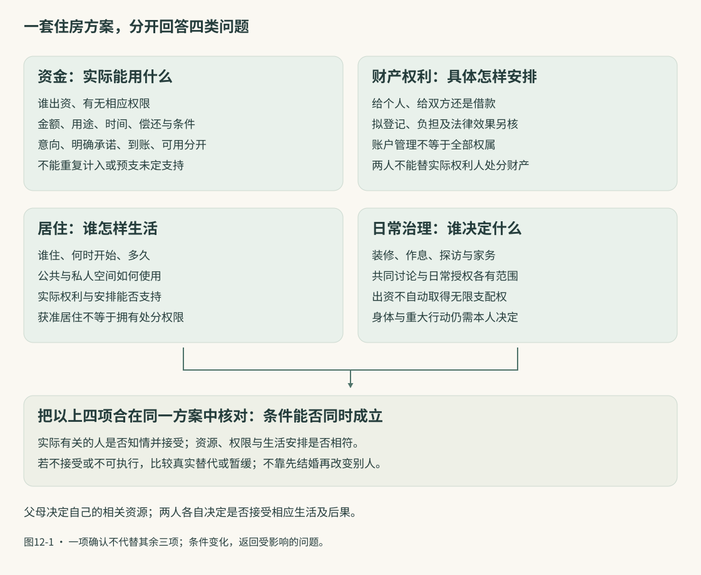

#### 12.3 婚礼、彩礼和嫁妆：表达承诺，不购买支配权

**婚礼与礼物可以表达心意、支持生活，但须量力且意愿真实，不能换取身体或无限生活支配权。**

住房方向明确后，沈宁和梁川终于能把一些注意力从“到底住哪里”移到“我们想怎样开始”。沈宁希望有一小段认真说话的仪式，和重要的人留张合照。梁川更在意聚餐时能坐下来聊天，不想整晚忙着赶场。他们发现，两人都不需要一场很大的宴席，但都不想让这个日子只是办完一项手续。

仪式有它的价值。有人珍惜被亲友看见的承诺，有人希望接续家庭记忆，有人想为共同生活留下一个明确起点。这些偏好应被认真听见，不必先证明比住房或储蓄更“实用”。与此同时，举行仪式需要钱、时间、组织劳动和有关人的参与，意义不能使这些成本消失。

先谈希望表达什么，再谈如何实现，会比先问“通常该花多少”更有帮助。合照、亲友见证、两人的承诺与家庭习惯，未必只能由同一种规模完成。也可能两人确实看重较隆重的庆祝，并有可承受资源；费用更高不自动虚荣，费用更低也不自动更真诚。

沈宁的母亲希望多请些亲属，梁家则仍期待大型婚宴。两人先各自听清家人在意什么，再说明当前住房和婚礼只能使用自己的可用资源。他们认可小型仪式和聚餐，保留沈宁重视的合照，也让梁川有时间陪伴亲近的人。双方家庭并非全部满意，他们没有用一句“大家都高兴”遮住这个结果。

比较规模时，两人把住房起步、正常生活储备和婚礼支出分开。留作搬入和必要生活的钱不能再次全部写成婚礼预算；未来可能收到的礼物，也不能用来填补现在必须支付的缺口。他们只在已核可承担范围内选择，不为与亲友比较而新增债务。具体联系与付款留到安排认可后处理。

彩礼和嫁妆同样需要从笼统名称走向实际内容。本书主张把它们放回表达心意、支持新家起步的礼物位置：各方按自身条件和意愿付出，贵重程度与能力相称，不以攀比或负债作为诚意标准。这是本书提出的规范，并不是对所有地方习惯或现行法律效果的描述。

若父母愿意支持，也要尊重其正常生活与财务安全。子女不能因为将要结婚，就把父母未同意的储备列作新家庭资本。双方家庭可以共同支持两个人，也可以表达对自己子女个人的赠予意向；究竟给谁、用于什么，以及相应法律安排，应明确后再落实，不能由伴侣代替出资者决定。

| 一笔礼物或支持要说清什么 | 可以怎样问 | 这能避免什么混淆 |
| --- | --- | --- |
| 谁提供、由谁作决定 | 这是您本人能决定的安排吗，还涉及谁的权利 | 一个人热情答应，却动用了无权承诺的资源 |
| 拟给谁、用于什么 | 是给个人，还是给双方；希望用于起步、仪式或其他事项 | 接收账户与实际赠予意向被当成一回事 |
| 什么条件与承担 | 是否需要偿还，有没有其他要求；本人是否愿意接受 | 把附带条件藏在“按规矩办”里 |
| 何时可用、怎样实施 | 目前只是意向，还是已有明确安排；落实前还需核什么 | 将预期礼物算成已经可花的钱 |

沈宁父亲表达愿给女儿个人一份礼物。沈宁把这一意向告诉梁川，没有直接写进两人的婚礼共同预算，也没有因由谁暂时管理账户就认定财产归属。礼物尚未实际交付，具体安排还需按真实意图与适用规则核实；两人的婚礼方案不以它到账为前提。

如果有人担心未来家务、育儿或职业中断带来的负担，可以进一步把需要拆开。减轻家务可比较设备、服务和仍需谁承担协调；未来养育可以准备真实储蓄；共同认可的工作调整，则应讨论条件出现时的支持、本人发展及恢复选择。这些安排解决具体需要，不能被一笔说不清用途的礼金自动替代。

预备资源与已经发生的损害不同，前置安排也不等于买下一项未来身体行为。某笔支持可以按清楚条件准备，但不能因此要求必须生育、永不改变职业或永久留下。双方都可能面对不确定性，也不表示双方风险必定相等、所有钱应对半，或应互收一笔押金；还是要回到实际责任、付出和可承受后果。

在此基础上，仍要防止把“可协商”变成随时贬损另一人的理由。一方先同意某项仪式，后来发现负担过大，可以说明事实、提出缩减并承担已有安排的善后；不能在亲友面前突然说对方贪心，好像先前的认可从未存在。削减预算能解决支出，不能自动修复这种羞辱。

婚前个人财产也不必为了证明诚意全部转为共同财产。钱由谁保管、谁能作日常支出、财产权利如何，仍是不同问题，[附录F.1](#unit-F-1)会进一步说明账户和资金功能。无论采用何种安排，礼金都不购买身体、尊严、对新家庭的无限治理权，也不成为某一方单方面免除对父母照护责任的筹码。

若后来不再结婚，礼金或其他财物如何处理，要根据具体事实与适用规则核实，不能一律判定返还或不返还。[附录J.5](#unit-J-5)区分关系选择与善后联系。愿意认真处理财物，和是否继续婚约，是两件必须分别面对的事。

#### 12.4 建立家庭的关键原则：先形成能执行的共识

**起步原则要能指导具体事务，明确参与、资源和责任，也允许按真实负担与新条件共同调整。**

住房和仪式说清后，仍有一个容易跳过的问题：我们实际要怎样过最开始的日子？搬进同一住处，会多出采购、清洁、费用、来访和时间安排。若只剩“以后互相体谅”，每件事还是可能等到某个人受不了才被看见。

不用在婚前编完一整套家庭规章。先确认能指导第一阶段的几项原则：居住与工作如何兼容，怎样保留共同时间，基本财务怎样处理，家务与已知照护由谁承担，生育方向是什么，亲属如何参与。这些原则应能回答下一件具体小事，又允许在真实生活中调整。

共同时间可以先落在一件双方愿意、也负担得起的常规安排上，比如留一个晚上一起吃饭、散步或聊天。重要的是彼此知道何时能相处，而不是保证每次都兴致高昂。忙碌或疲惫时可以改约，也给个人休息留出位置；若总是同一人等待或让步，就要重新看安排是否合适。

基本财务先接清起步时会用到的部分：哪些费用共同承担，谁按什么约定提供资金，何时实际可用，由谁支付并让双方核对；日常范围内怎样授权，新增重要支出怎样重谈。个人合理消费也应有自主空间。这样，到第一笔房租或共同采购要支付时，双方知道钱从哪里来、谁处理，而不必临时猜测对方会兜底。

沈宁和梁川已经选择初期独立租住，并保留各自工作。他们讨论工作日晚饭时，梁川先说“谁有空谁弄”，沈宁问：“可我先到家，不代表我每次都有精力想吃什么。”两人于是约定轮流认领晚饭安排，可以在认可的范围内做饭或外食；一人做饭时另一人收尾，忙得无法按约完成就提早说明。

他们还没有共同入住，这只是可执行的起点，不是已经证明分工公平。它比“谁有空谁做”多说明了发现任务、作决定和完成收尾的责任，也给临时忙碌留下调整空间。运行以后，仍要看实际负担和本人反馈，而不是用“你以前同意过”挡住新问题。

原则之所以有用，在于能分清哪些事本人可决定、哪些需要共同商量、哪些还涉及第三人的真实权利。并非每个受影响的人都能否决全部安排；也不是凡以个人选择为名，就可以把后果无条件交给伴侣。

| 事项 | 参与范围与当前办法 | 什么变化需要重谈 |
| --- | --- | --- |
| 正常朋友往来与兴趣 | 各自保持自主；涉及原已承诺的共同时间，及时协调 | 不在原约定范围的长期占用或新共同负担 |
| 日常家务及小额采购 | 按认可标准和权限认领，超出范围先说明；具体方法可留给负责人 | 任务量、费用或健康工作条件明显改变 |
| 初期居住、财务与照护 | 涉及双方实际生活与承担，由两人共同讨论 | 新债务、长期留宿、重大收入变化或新增照护 |
| 父母自己的房屋和资金 | 实际权利人决定其相关部分；两人决定是否接受支持及后果 | 支持条件或资源可用性改变，不凭亲情推定持续授权 |

这也是最小必要参与的含义：把真正有关的人请进相应问题，不把所有亲属请进每一项决定。长辈关心两人的生活，可以表达意见；若事项不涉及其真实权利或已承担的任务，关心并不自然变成审批权。父母自有财产又不能被两人私下约定重新分配。

对沈宁和梁川而言，租住后父母探访应提前商量，留宿需要两人接受相应时间与空间安排。梁川负责向自己父母说明，不把规则说成“沈宁不让”，也不替她承诺随时可以长期住进来。若父母需要照护，就另谈真实需要、各自责任与可用办法，不能把所有未来情况预装进一次普通来访。

双方也说明了现有重要义务，并将其纳入起步方案。他们愿意将来养育孩子，但没有决定立即开始，更没有把沈宁辞职或父母免费帮忙当成默认条件。具体启动仍须有当时的真实意愿、准备和身体选择；若工作或健康发生变化，就重新讨论谁能做什么、有什么资源，而不是援引一句“你答应过想要孩子”。

把已知责任说明白，与要求无限保证是两回事。已有持续支出或照护任务，应进入现在的时间和资金安排；尚未发生的疾病或育儿体验，不适合用“无论怎样我都一个人承担”封口。认真承诺可以包含在变化时诚实说明、共同寻找办法和处理已形成的责任，却不能使人的能力无限。

另一种常见冲突是，一方决定换工作后，顺手把另一人的新任务也决定了。一个人可以有自己的职业方向，但如果新工作意味着长期出差，原来由其承担的接送、家务和照护不会自动归给伴侣。需要改变的是共同安排，不能只通知“以后辛苦你了”，再把对方不接受解释成不支持成长。

若新计划确实要求一人迁居、减少工作或离开熟悉支持，还应谈清过渡收入、发展机会、实际支持与恢复选择。补偿可以回应部分代价，却不能买下永久牺牲，更不能保证原岗位和原生活随时能够回去。[附录G.4](#unit-G-4)区分个人主责与共同后果，[G.2](#unit-G-2)帮助把具体授权和交接写清；婚后亲属协作可继续使用[H.4](#unit-H-4)。

现在无需为所有未来写答案。可以先约定：已认领的事会履行；能力或条件变了会说明；新增重大后果重新取得有关人的同意；没有共识时暂停相应新投入，并判断是否仍愿采用这套生活。这样，规则才是双方可以依靠和修改的安排，而不是一方保存下来的承诺凭证。

#### 12.5 正式订婚：婚约明确、双方父母知情、婚礼安排确定

**正式订婚要有清楚婚约、明确告知双方父母及足以启动落实的婚礼安排；告知仍按现实情形处理。**

“我们以后会结婚”可以是一份认真愿望，也可以只是对某一天的想象。它还没有告诉双方，究竟认可了什么安排，接下来谁能据此行动。公开求婚的场面也不能独自回答这些问题：如果接受了某个戒指，却仍不知道将住哪里、用谁的钱，两人可能只是共同进入了一场尚无现实基础的庆祝。

本书把正式订婚界定为三项内容：**双方形成清楚婚约，明确告知双方父母，并确定婚礼安排**。这里的安排要足以启动落实，不要求每个执行细节都选完。这是本书区分关系节点的口径，不是替各地法律或所有人的习惯下定义。

| 三项内容 | 实际完成什么 | 不由它自动完成什么 |
| --- | --- | --- |
| 清楚婚约 | 双方明确同意结婚，理解并认可核心生活和婚礼安排 | 不把相互喜欢、认可适婚或已有性经历当作默认婚约 |
| 必要家庭告知 | 父母明确知道两人已作出的选择和与其有关的真实安排 | 不要求全体批准，不自动让父母进入全部共同治理 |
| 婚礼安排确定 | 婚期、规模、资源承担和重要形式已有共识，具体任务可开始落实 | 不等于已登记、付清、举行仪式、入住或日常运行成熟 |

在沈宁和梁川的故事中，住房已经有不依赖父母购房款的可行路径，婚礼核心方向和初期生活原则也说清了。他们按相称方式核对了本次决定相关的现实身份、重要义务和资源，未把仍不清楚的父母出资当成自己的资本。此前普通相处中的喜欢、活动协作以及这轮讨论，也为判断提供了实际经历。

两人据这些材料认为，现有条件足以支持拟议生活，双方也仍然愿意与对方结婚。这个判断针对他们准备采用的规模与安排，并不说明任何一套更昂贵、更依赖他人的生活都可行，也不保证未来永不变化。决定性缺口若仍存在，就不能用相处中的好感将它略过；先补足或改变方案，才讨论正式承诺。

他们对照工作安排，选定了婚礼的周末，查询了相应小型场地的可用选择、费用范围及基本条件。没有签约付款，但已知道在认可范围内有能够继续落实的路径。对于实际登记的时间和办理事项，两人另列具体核对任务，不假定婚礼办完就自动完成登记。

坐下来确认时，梁川说：“我想和你结婚。咱们按现在商量的，先自己租住，婚礼就请亲近的人。”沈宁答应，也把自己接受的安排再说了一遍。她不是因为父母终于满意才答应，他也没有把“答应结婚”理解为以后各项安排都不必再问。

随后，两人分别明确告知双方父母。梁川的父母知道了婚约、住房方向和婚礼规模，仍然不满意租住与小办，但已听清真实决定。沈宁也向父母说明同一套安排。两人不再分别对两家许诺相互冲突的版本，也没有将父母的保留意见伪装成赞成。

婚礼的联系和筹备任务也已认领：梁川继续联系场地与餐食条件，沈宁联系仪式和合照安排；各自在共同认可的范围内询问，新增重要费用或改变规模须一起重谈。至此，清楚婚约、必要告知和足以启动落实的婚礼安排都已形成。执行并未完成，[后面还要把它们逐项变成实际结果](#unit-13-1)。

父母离世、无法联系或联系存在现实危险时，家庭告知不能被执行成强迫恢复接触的程序。按实际情形说明哪些无法完成、哪些有必要通过适当方式处理，不伪造已经通知，也不把取得不可能的批准当作结婚资格。更不应为完成这一节点而主动暴露危险中的准备与去向。

[三正](#unit-1-5)可以用于检视这里的行为：**心正**是结婚意图真实，不把婚约主要当成换取服从的手段；**名正**是双方知道自己确认了婚约及其内容；**行正**是告知、安排与后续行动相符。这不是读心测试，要看表达、事实与实际行动有没有相互支持。

婚约使人可以据此计划时间、准备资源，也因此增加认真履行、及时说明变化和合理善后的责任。它没有取消下一次具体选择。身体亲密、共同居住、借款购房、生育和辞职迁居仍须各自判断；已经订婚，既不能自动放行，也不应让双方继续把所有共同投入都当成毫无分量的口头试探。

对沈宁和梁川而言，下一步是分别落实住房、婚礼和家庭起步，而不是重新证明自己配不配进入关系。[A.3](#unit-A-3)帮助区分节点，[E.4](#unit-E-4)保留判断、协商、婚约与实施的实际状态。新事实出现时可以返回；没有新变化的已认可任务，则应认真向前履行。

#### 12.6 婚约怎样变更：避免沉没成本变成强制结婚

**婚约变化要重新确认意愿与可行安排，并处理真实依赖和已有事务；善后未完不取消拒绝结婚的权利。**

婚约值得认真，是因为它会让人据此安排生活。有人请假、联系亲友、准备钱，有人为了共同方向放弃别的选择。若承诺者把这些依赖当作全与自己无关，婚约便很难支撑合作。但承认其分量，也不能推出当事人此后只能结婚。

可变更与可随意对待并不相同。新事实使原安排不再可行时，及时说明并处理后果，是对承诺负责的一部分。调整某项安排、延期和解除婚约，又是不同选择：有人愿意采用新方案，有人仍愿结婚但需要时间，也有人已经不愿继续。不能靠一个“变卦”的词替代对事实和意愿的辨别。

为看清婚约形成后的变化，另作一个假设：两人当初选择父母支持购房，金额、性质、时间和原条件曾明确，资源与权限也有可信依据；两人接受后形成正式婚约。梁川后来支付了一笔双方认可的场地预付款，原预订说明已保存。这与[前文实际选择自行租住的故事](#unit-12-2)是两种独立情况。

此后，实际出资者又要求大型婚宴并主要决定相关安排，而原条件不包含这一要求。两人都不接受，住房支持尚未到账，当前也没有已核实的可承担替代。此时不是先认定“反正已经订婚”，而是承认原方案依赖的关键资源条件已经变了。

两人先暂停新增预订，梁川按原说明向场地询问改期与取消选项，尚未得到答复。预付款已经付出，但到底可以退多少、改期需要什么、是否还涉及其他费用，都不能凭不舍或愤怒来确定。预付金额不自动等于最终损失，双方提出某种分担方式也不等于具体法律责任已经确定。

| 可能的方向 | 需要什么才成为真实方案 | 不能用什么替代 |
| --- | --- | --- |
| 缩减或更换安排 | 资源、住房和仪式仍有双方接受且可执行的组合；实际转换成本可承担 | 只把宴席缩小，却没有解决住房资金缺口 |
| 调整婚期 | 双方仍愿结婚，缺口有可信的补足路径，知道何时依什么新事实重看 | 无来源地说“再等等父母总会答应” |
| 解除婚约 | 本人不再愿意，或不愿继续承担当前方案与等待；另行处理已发生事务 | 先证明所有可能路径都失败，或先得到另一人和亲友批准 |

表中是三种需要分别判断的方向，不表示当下三条都已可行。若两人愿意延期，但资金何时可能获得仍没有依据，就应把它写成未解决的等待，而不是新方案已经落实。本人愿不愿继续等待，也要单独说清，不能只问钱够不够。

如果在这一独立情境中，沈宁已经不愿结婚，梁川仍希望保留婚约，就不能把“双方尚未对解除达成一致”解释为沈宁必须照原计划结婚。她可以明确自己的决定；梁川可以悲伤、提出问题，并就真实事务寻求处理，但不能把费用、亲友颜面或既往亲密变成强制理由。

接下来可以把两张不同的清单分开。第一张说明关系选择：是否继续、是否愿采用新安排、愿意怎样联系。第二张说明已经发生的事务：谁需要知道计划改变，哪些预订要联系，财物由谁保管，有什么承诺或真实依赖尚未处理，哪些信息应继续保密。

在本例中，场地事项由掌握原预订资料的梁川继续查询，不能因为提出解除的是沈宁，就让她去处理自己没有权限和材料的全部事务。两人可各自通知此前由自己联系的亲友，只说明必要事实，不以公开隐私争取支持。是否已有应承担的费用，要结合真实约定、参与和实际结果判断，不自动对半，也不一概归给提出结束的人。

若还有迁居、照护或收入上的真实依赖，应另按[附录J.2](#unit-J-2)、[J.3](#unit-J-3)处理有限过渡。结束关系不把已有责任抹掉，但依赖全部解除、对方恢复心情或补偿全部完成，都不能成为获得拒绝结婚资格的条件。财物返还和其他法律争议则应按真实事实取得相应专业意见，不从本例推出统一规则。

公开程度越高，通知和善后可能越费力，却不使他人获得对婚姻意愿的所有权。诚实说明变化会令人失望；为了避免一时失望而继续制造新的支出、期待和依赖，也有后果。可承担地处理已经发生的事，比用继续结婚遮住问题更能保留真实选择。

如果后来双方又想复合，应重新看意愿、导致变化的问题以及已经发生的行动。怀念、短期示好或尚未退完的一笔钱，都不单独证明原问题消失。[第十七章](#unit-17-1)会展开退出与重建；这里先保留一条清楚界限：事务仍有联系，不意味着亲密身份已经恢复。

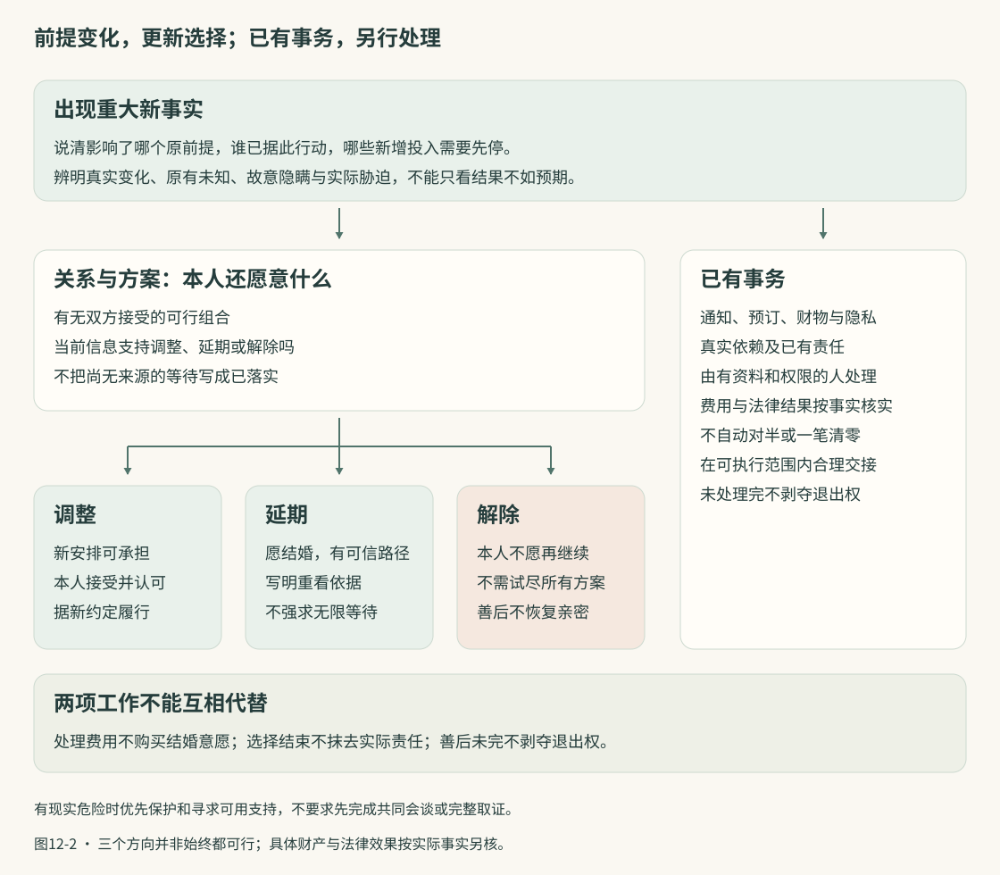

#### 12.7 风险专节：隐藏条件、资源换权与婚约绑架

**婚事中的未知、真实不相容、失信和胁迫须分别处理，既有投入与资源支持都不能剥夺当前选择。**

筹备婚事的压力，有时来自任务多，有时来自资源不足，也有时来自有人利用婚期和已经发生的投入压缩选择。它们都可能让人难受，却不能用同一种办法处理。晚一点选好餐具，与订婚后才知道必须辞职照护某位亲属，不是同一层面的问题。

先看关键条件是怎样出现的。一个人原先确实不知道某项支持会变化，后来及时告知，和他早已知道却刻意等到公开婚讯、支付费用后才揭示，是不同事实。不能由结果不如预期就断言欺骗；也不能在已经有明确隐瞒行为时，把全部问题解释成双方表达不够好。

另设一个匿名情境：一方已经知道父母出资要求伴侣辞职承担照护，却仍以“住处解决了”推动公开婚讯。伴侣后来才听到条件，对方又说“人都请了，总不能现在让大家难堪”。此时，旧承诺使别人开始行动，而决定性条件被延后告知；公开期待又被拿来限制对方拒绝，问题已经超出住房预算。

这种过程可以从经济进入治理，再影响感情。先有依赖不明资金的计划，接着是已通知亲友和已付费用；等到条件揭示，拒绝似乎会让一人承担全部损失或羞辱。若受压者因此不再表达，表面顺利未必代表达成共识，可能只是拒绝的代价被提高了。这个机制需要看具体行为，不能凭家庭背景或谁出钱多就认定存在。

| 当前看到什么 | 先辨认哪一种问题 | 相称的下一步 |
| --- | --- | --- |
| 金额、性质或权限还没有问清 | 信息缺口；不能假定已经安全，也不直接推定恶意 | 问实际掌握信息的人，暂缓依赖未知的承诺和支出 |
| 条件已清楚，但本人根本不接受 | 真实不兼容，未必有人作恶 | 比较本人愿意的可行替代，或不再推进；不要求无限让步 |
| 已经发生越权、改口或失约 | 分别看行为严重性、责任、可执行调整和本人意愿 | 处理实际损害、知情参与和信任后果，依侵害性质、可承担性与本人意愿决定修复或结束；已证实重大身份欺瞒、隐瞒现存婚姻或冲突性伴侣承诺，则立即暂停当前交往或结束，不能仅推迟新增投入 |
| 以可信威胁、限制人身或公开隐私施压 | 现实危险或严重侵害 | 优先保护与寻求可用支持，不以婚期、全家会面或先完成善后为前提 |

资源与权限含混，还可能不靠明显威胁发生。出资者一句“我出了钱，就全听我的”，可能把原本只谈住房的帮助扩大到工作、亲属往来和生育。应先核真实权利及已经接受的条件，再拒绝无依据的扩张。尊重父母自己的财产，与拒绝其获得对两人身体和全部日常的支配，是可以同时成立的。

但不要把所有范围有限的附带安排都叫控制。例如，父母明确只愿提供本地居住支持，双方听清后可以接受或不接受。若他们没有同意给其他用途的钱，子女不能因不满意而认定对方剥夺了自己的既有财产。真正要看的是：哪些权利确实存在，条件是否及时真实表达，谁能自由说不，以及是否已有应处理的承诺与依赖。

回到[沈宁与梁川实际完成的住房协商](#unit-12-2)：父母表达的支持条件与两人愿望不合，两人核对了可承担替代并选择不用那笔购房支持，已有事实并未表明父母蓄意隐瞒或严重胁迫。[第12.6节的独立条件变更情境](#unit-12-6)则要按新增要求及已发生的付款，重新判断资源、婚约和善后。

如果争议中已经出现羞辱或否认参与，谈成金额也不等于全部解决。比如一方先在亲友面前贬损伴侣，后来同意降低婚礼支出，经济压力可能减轻，但对方仍需要知道：先前贬损是否被承认，今后的共同决定能否被尊重，必要的对外误解是否得到纠正。感情是否恢复，还要看本人体验与后续相处，不能由付过钱的人宣布完成。

相反，实际资源变少之后，若当事人及时说明，双方停止原来不能承担的新增支出，重新确认意愿和方案，并认真处理已发生责任，这可以是负责任的调整。不能因为婚期变了，就把原先的认真全部改写成欺骗；也不能因为出发点认真，就忽视调整后仍未解决的缺口。

当前是否继续，最终要落在受影响的具体行动上。原基础仍在、条件明确可行、双方仍愿意，可以按认可范围落实；方案需要改变，就重新协商资源与授权；决定性前提仍靠猜测，就暂缓相应绑定；本人不愿或后果不可接受，可以解除并合理善后。安全受到威胁时，不要求先完成普通协商流程。

这些判断不以礼金数额、家庭阶层或婚期远近自动定性，也不要求读者先在风险表里找到一个标签。关键协商阶段可用[附录M.7](#unit-M-7)查漏，正式订婚后的落实与变更转用[附录M.8](#unit-M-8)；[E.4](#unit-E-4)保持状态清楚，[J.4](#unit-J-4)与[J.5](#unit-J-5)帮助分别准备支持与处理退出；它们都不替当事人作继续结婚的决定。

[沈宁与梁川已形成明确婚约](#unit-12-5)，接下来要将它落实。新的任务是把已认可的钱、房、时间和责任逐项接到实际生活，同时保留遇到重大变化时重新判断的能力。[第十三章](#unit-13-1)从这里开始：安排怎样真正完成，筹备中的劳动怎样承担，婚约又怎样成为可以共同生活的起点。

## 第四部分 从婚约落实到长期共同生活

### 第十三章 落实婚约，建立家庭：从约定到实际运行

#### 13.1 把婚约变成行动：明确任务、授权和变化条件

**把任务交出去，也要交清结果、信息、资源与授权；具体完成和变化反馈才让婚约进入履行。**

一张筹备清单上写着“场地、餐食、仪式、合照、住房、搬入”，每项后面都有人名，看起来已经分好工。真正开始联系，问题却接连出现：需要先确认多少人，报价含哪些服务，谁能接受替换，问到什么程度才算完成？清单分掉的是名称，未必分掉了真正的工作。

继续看[已经形成婚约的沈宁与梁川](#unit-12-5)。他们决定使用自己的资源独立租住，并以认可的小型仪式和聚餐开始。梁川原负责场地餐食，一段时间工作不便联系，沈宁同意接手这轮场地联络。总费用边界和基本规模并没有改变，缺的是交接后的具体取舍与授权。

沈宁把问到的选项发给梁川。他说这套服务不合适，那种安排太赶，另一个又觉得不够好，却没有把哪些结果真正重要说清。她每次重新问、整理、提醒，再等他的意见。梁川觉得自己只是在认真把关，沈宁承担的却不只是几通电话，还包括记住他的零散偏好、转译给对方及反复返工。

她说：“你让我去联系，可我不知道问到什么就能定。每次你说不行，我又得从头讲。”梁川先答“你把新的发来我看看”，这仍没有解决问题：如果每个细节最后都要由他临时审定，沈宁得到的只是跑腿责任，没有完成任务所需的决定空间。

负责一件事，需要同时得到相应的信息、资源与权限。并不是交给谁，谁就能任意花钱；而是双方把必要结果、已有约束和可自行处理的范围说清。若仍希望共同确认某个关键选择，也应给出可做到的回应方式，不能无限拖着让执行者一直催。

| 场地联络这件事 | 两人重新说清的内容 | 什么能证明本轮完成 |
| --- | --- | --- |
| 前置条件 | 沿用既定日期、小型规模、总费用边界与短仪式、合照的需要 | 对方按这些条件提供当前可用选择，不把旧报价当永久保留 |
| 主责与协助 | 沈宁处理本轮联系和信息汇总；梁川提供自己应确认的相关资料，在约定空闲时集中回应 | 资料实际给出，问题得到答复，不只是双方口头说支持 |
| 可自行处理的细节 | 在认可范围内安排询问顺序、确认在原约定内、不新增费用或重要共同后果的普通细节 | 不再把每个联系动作送回来逐项审批 |
| 需要一起决定的变化 | 新增重要费用、改变婚礼时间或规模、形成新的付款与签约承诺 | 先共同认可，再由有权限的人落实，不用预订制造既成事实 |
| 本轮结果 | 服务范围、当前费用和限制取得书面答复，未定事项如实列出 | 两人知道采用哪项选择、哪些还没完成；问到资料不等于已经付款签约 |

两人补上这些内容后，梁川先补齐己方来宾的确认情况，沈宁取得了清楚的服务答复；梁川也在约好的时间看完并回应，没有再临时加进未说过的非必要要求。仍有一项餐食内容漏问，沈宁发现后追问补齐，才共同确认这一轮选择。他们没有因此变成不会遗漏的人，只是遗漏终于有了具体处理办法。

这类简表的价值，在于把反复记忆和猜测变少。对于已经认可、没有新后果的小事，负责人可以做完再告知；涉及原先需要共同决定的事项，就先取得认可；只是联系顺序之类的普通方法，不需要另一人批准。[附录G.2的权限与交接卡](#unit-G-2)可以只填这一件任务，不必把婚礼的每个动作都登记。

还要看任务之间的依赖。先询问场地需要日期和大致规模，确定餐食可能需要相关人数信息，搬入又依赖房屋实际可交接。前一项未提供，后一项就无法按原计划完成。此时应回到缺失的资料或决定，不把等待都记成执行者拖延。

对于双方都难以维护的复杂安排，可以减少选择、删去并不重要的项目，或使用确实可获得且承担得起的服务。但请人帮忙并不会自动完成两人的意愿确认，也不能把尚未答应的朋友写成负责人。协助有边界，亲友不因来参加婚礼就默认承担全部筹备劳动。

授权也有明确限度。确认某项颜色或联系时段，不等于可以擅自新增共同债务、把居住改成与父母同住，或决定另一人的身体安排。[附录E.4](#unit-E-4)用于识别新事项究竟还是执行细节，还是已经改变原来接受婚约的前提。后者应返回有关决定，不靠赶进度放行。

本轮场地联络结束后，沈宁说，她不再需要每天追问梁川究竟想选什么。梁川也看到，自己集中把必要意见说清，比不断说“不太好”更能参与。省下的精力可以用来期待那天，而不全消耗在检查对方是否又忘了一件事上。下一步，仍要看这些认可的安排能否真正落实。

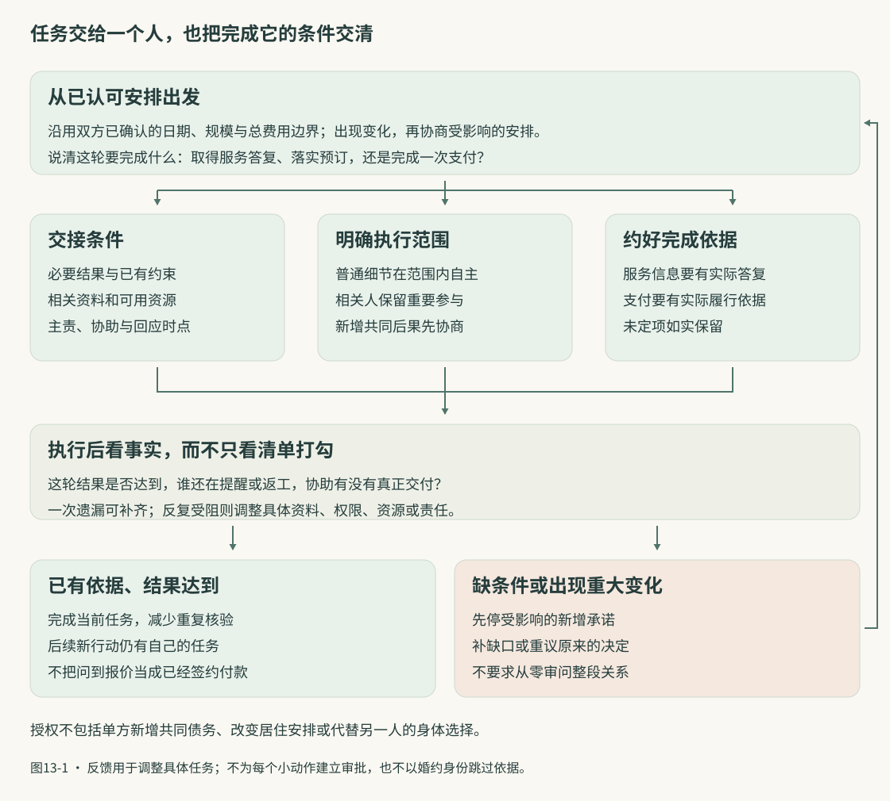

#### 13.2 住房、资金和文件真正到位：核对实施事实

**实施前须核对资源、权限和条件当前是否到位；原有认可不能代替这一次签约、支付或交接的依据。**

谈妥一项安排之后，最容易省略的词是“现在”。现在这笔钱能不能用，现在这处房屋能不能交接，现在的资料是否支持即将发生的行动？原来讨论认真，并不保证所有实施条件会在同一天自然到位。

核对可以从下一笔要付的钱、下一份要签的安排，或即将发生的搬入开始。先看它依赖什么来源、什么条件、什么时候可用，需要谁提供资料或完成手续，再看这些条件当前是否成立。范围围绕这一项行动，不是因为紧张又把伴侣全部历史重新查一遍。

| 资源的当前状态 | 对眼前行动意味着什么 | 不能怎样记 |
| --- | --- | --- |
| 只表示愿意考虑 | 尚不能确定数额、时间或条件，不能据此作依赖它的支出 | 写成自己的可用余额 |
| 已有明确承诺 | 继续核对履行时点、条件和实际来源，安排相应依赖 | 直接记为到账或已经付给供应方 |
| 已到账但受限 | 确认用途、实际权限及可动用范围 | 因在某个账户中就任意挪用或重复计入 |
| 当前确实可用 | 可以按本人认可的用途和权限考虑行动，仍需实际履行 | 把可用资金与已经完成支付混为一项 |

两人[已经决定不采用父母购房支持](#unit-12-2)，不能到筹备紧张时又悄悄算进来。沈父愿给女儿的个人礼物仍只是意向，也不是婚礼共同预算的来源。已核可用的自有资金，则还要分清哪些供住房起步，哪些供仪式，哪些留作必要生活；同一笔钱不能同时填进几个缺口。

住房也有类似区别：看过房、知道对方愿意出租、形成认可的安排、完成必要手续和付款、实际能够交接，不是同一个状态。聊天中说“可以住”，不能替代应核的权限、约定与实施事实；谁保管文件，也不能单独回答产权和责任怎样成立。

接下来出现了一个新变化。两人原拟在婚礼前搬入，签约付款前复核房源时，出租方告知可交接日期需比原先预期晚一周。此时还没有签约或付款，不能把预期改变直接写成已经确定的法律违约；但对两人的居住计划而言，变化已经真实发生。

他们先不承诺新的搬家日期，分别核实现有住处能否继续用到新交接日、会多出哪些支出，工作和通勤是否受影响。确认以后，两人知道原住处可继续使用，新增费用能纳入已有余量，也不会挤掉必要生活款或重复占用婚礼资金。这才有了一个可供选择的一周过渡，而不只是“先凑合一下”。

一周是这个故事的事实，不是可以忽略问题的统一标准。若另一对伴侣必须在原日期腾出住处，又没有真实可用的过渡，几天也可能改变原方案。是否能够继续，要看需要怎样承接、谁有资源和权限，以及本人愿不愿接受这些后果。

再比较[第12.6节的独立条件变更情境](#unit-12-6)：父母出资的金额、性质、时间与条件原曾明确，双方接受并形成婚约；后来出资者新增婚宴规模和主要决定权的要求，两人都不接受，资金尚未到账，也没有已核实的可承担替代。这里不存在[此前已经核实的自筹租住路径](#unit-12-2)。

第三人的条件一变，原计划的可行性就可能直接受影响，并不需要新人先答应新条件才算影响。此时应暂停依赖这笔支持的新增签约和支付，重新讨论条件或其他真实资源；不能让其中一人为了不误婚期，无声借钱补齐。这一情境原有的场地预付款及退改问题另按已发生事实处理，不能算作新的住房资源。

两条情境回答的是不同问题。前者已找到可承担的过渡，仍要确认本人是否接受并落实；后者关键基础仍未恢复，不能说只差做完手续。把“先等几天”用于两者，会掩盖资源与意愿上的差别。

文件暂时拿不出来，也需要具体辨认。可能是负责的人尚未提供、办理尚未完成，也可能原先的说法根本不实。可以问清所缺文件支持什么事项、由谁提供、在什么行动前取得；在答案不足时暂缓相关行动。若已证实故意隐瞒住房或资金条件，就须处理由此形成的依赖、损害及信任后果，不能只催补资料；是否继续，按具体侵害、可承担性和本人意愿判断。若证实的是重大身份欺瞒、隐瞒现存婚姻或冲突性伴侣承诺，则应立即暂停当前交往或结束，并处理既有后果。

实际登记、租购房、赠予和借款，应向相应办理机构或具备适任资格的专业人士确认真实要求与效果。整理现有材料、各方意图、资源来源和拟采取的行动，比索取一份看似万能的通用模板更有用。这里不代替具体合同审查，也不提供一条聊天记录即可形成全部权利的结论。

核对也应有停止扩大范围的时点。如果这项行动需要的事实已经相称明确，条件没有新变化，本人也认可可承担后果，就依约执行，不因焦虑不断追加无关材料。若仍有决定性缺口，则明确暂缓的是哪笔支付、哪次签约或哪项办理，以及下一步需要什么事实；不必笼统宣布整段感情都冻结。

[附录E.4](#unit-E-4)记录变化返回了哪一栏，[D.1](#unit-D-1)与[D.2](#unit-D-2)帮助区分所知与所猜，[F.2](#unit-F-2)进一步处理现金流和可动用资源。工具的作用是让眼前行动有依据，不是让“检查得很认真”代替实际决定。对选择自行租住的沈宁与梁川，资金和过渡住处已有可行答案，接下来还要说清，他们是否愿意按这套调整后的安排走到公开节点。

#### 13.3 登记、仪式与家庭身份：分别完成各自任务

**登记、仪式与共同生活各有任务，分别完成并确认本人意愿；公开期待不能替代当前可行条件。**

收到房源日期变化的消息时，婚礼已经临近，几位亲友也按原计划到了本地。回看那一刻，沈宁承认自己最先担心的不是多住几天，而是“现在提出有变化，会不会让大家觉得我们连这点事都办不好”。尚未查清能否过渡，她就差一点把不安压下去，决定先不说。

这份压力有现实来处。别人已经花了时间和差旅成本，两人也投入了筹备劳动；变化可能需要解释、重新联系或调整日程。但如果因为不想让人失望，就把住房问题藏起来，他们失去的是共同判断当前安排能否继续的机会。

梁川听清之后，没有只说“别多想”。两人一起回到实际条件：原住处是否能继续使用，新增费用由何处承担，搬入延后是否改变本人愿意结婚的基础。这些核对带来了[上一节已经明确的过渡方案](#unit-13-2)。他们随后各自确认，愿意接受这一周的搬入调整，婚礼仍按已认可安排继续。

这里能够继续，不是因为亲友到了，而是原来的生活方向仍成立，过渡住处和成本有依据，双方也接受新的时间安排。若没有这些条件，就不能用同样的故事劝另一对伴侣放心结婚。对于把特定居住条件视为决定性前提的人，新的缺口可能需要连同登记或仪式一起重看。

登记、仪式和共同生活各自完成不同任务，可以有不同的时间安排。将它们分开，不是削弱婚姻的意义，而是避免某一项完成之后，其他重要问题就失去被看见的机会。

| 要完成的事 | 它实际解决什么 | 应看到的实施依据 |
| --- | --- | --- |
| 登记与相关办理 | 按适用制度形成相应身份与责任 | 相应办理实际完成并核对结果，不把预约、准备材料或仪式照片当完成 |
| 仪式及社会告知 | 表达双方承诺，让有关亲友理解这项共同选择 | 本人愿意的形式真实举行，相关通知与实际计划一致，不伪造全体赞同 |
| 共同居住与生活 | 把住处、费用、作息和责任变成每天的运行 | 房屋能实际使用，入住与任务真实发生；地址相同不等于合作自然成熟 |

具体办理要求和法律效果，应按真实地区、时间和个人情况确认。对当事人而言，可列一项身份办理任务、一项有关亲友的通知任务和一项生活启动任务，分别记状态。完成其中一项，可以减少相应未知，却不能把其余两项的负责人、资源或本人意愿省掉。

两人向相关亲友说明搬入时间有调整，不再给别人一个“婚礼之前所有事都已办完”的印象。他们按认可范围完成婚礼所需的联系、确认和支付，并按实际适用的要求完成登记、取得和核对办理结果。之后，小型仪式与聚餐按安排举行。

沈宁认真说了想说的话，也留下与重要的人同框的合照。梁川终于不用忙着比较另一家婚礼有多隆重，可以在桌边听亲友聊天。此前对规模的保留意见并没有全部消失，但仪式仍承载了两人愿意公开表达的选择。这份意义不需要靠抹去所有分歧才能存在。

过渡期间，两人仍各住原处。等到新房实际能够交接，他们再次核对当前条件和权限，按共同认可的安排完成相应签约、支付与钥匙交接，才搬入新家。到这时，[第十二章选定的租住路径](#unit-12-2)才真正成为可以使用的新家。

如果这段过渡没有实现，新的任务是及时评估改变了哪一项基础、谁还需要什么保障，而不是拿登记结果要求另一方继续接受无限变化。已经办理身份，不证明所有后续安排都能承担；相关选择、制度程序和已发生责任仍需分别处理。

公开节点前的确认也不应变成当众提问、逼人立即给出满意答案的表演。可以在有实际讨论空间时问清：现在仍愿意吗，最近有什么足以改变决定的新事实，现有安排是否依然可接受？普通紧张可以说出来；明确不愿意，也不能因台下已有亲友而被重新解释成默认同意。

若需要延期或停止，已发生的差旅、预订和组织投入确实要面对。谁联系相应事项、哪些费用需核、怎样向有关人说明，都是具体善后；不以先赔清全部费用才允许拒绝。尊重亲友的付出，也包括不继续用虚假的进展诱使他们增加投入。

[附录E.4](#unit-E-4)把三项状态分开，[J.5](#unit-J-5)将关系选择与善后事务分开。对于沈宁和梁川，登记、仪式与搬入已经先后完成。接下来，新的身份不会替他们洗好一只锅，也不会自动让两个人在同一个家里都觉得自在。

#### 13.4 新家的启动期：把日常安排做出来，而不只是搬到一起

**共同居住要让完整任务和可接受标准真正运转，减少提醒与返工，并把省下的精力还给生活和相处。**

第一批物品放进新家时，许多愿望会突然变得可触摸：两个人的杯子在同一层架上，晚饭不用再计算谁赶末班车，忙完一天可以坐在同一盏灯下。也会出现很具体的不适：东西放在哪里、什么时候安静、厨房由谁收尾。期待共同生活，与尚未形成共同习惯，可以同时存在。

沈宁和梁川原来认可“一人做饭，另一人收尾”。开始运行后，梁川把收尾理解为洗碗，洗完便觉得已经做完；沈宁看见台面仍被东西占着、锅具未收妥、厨余还在，又逐项提醒。她不明白为什么说好的事还要自己盯，他则觉得做了还总被检查。

如果只把这件事解释成一个人爱干净、一个人不爱干净，就会漏掉任务的定义。梁川确实做了洗碗动作，沈宁也确实仍承担发现、说明和核对其余事项的劳动。把执行动作分出去，不等于完整任务已经交出去；双方对“完成”的理解不同，也不必先归结成某个人不愿经营。

他们先说清共同需要的结果：第二天做早餐时，必要锅碗可用，有一块能直接操作的台面；当晚厨余得到处理，不把收尾继续留给第二天先起的人。至于先洗碗还是先整理、用哪一种顺手的方法，则留给当晚负责人决定。

沈宁还希望柜门每天擦一遍。梁川觉得这样增加了不少时间，两人没有把它混进已确认的必要结果，而是另谈实际需要、频率和谁愿承担。共同标准不必自动服从最高偏好，但“你更在意，所以全部归你”也不是合理分工。两人都要使用的空间，不能因为一人先看见问题，就把全部责任交给那个人。

| 厨房收尾的起步安排 | 本例约定 | 发生异常时怎么办 |
| --- | --- | --- |
| 必要结果 | 次日早餐所需锅碗与操作空间可用，当晚厨余处理完 | 看哪个结果没达到，不从一个细节扩大为全盘人格评价 |
| 完整主责 | 梁川认领自己的收尾时段，包含发现、安排、完成与自查 | 不是等沈宁列出所有动作以后才执行 |
| 方法与时点 | 在不影响另一人休息的前提下自行安排，按认可的当晚时点做完 | 改变共同结果或把劳动转给对方，需要重新说明 |
| 通知与回看 | 知道工作会影响完成就提早说；回看是否减少提醒、返工和次日耽误 | 反复做不到就改时间、任务或支持，不只重复认错 |

后来两次轮到梁川收尾，他都自行完成，沈宁第二天准备早餐时无需先整理，也不用再发消息提醒。第三次他因工作忙，提前说明可用时间，两人改成接受的简餐，他仍完成该次收尾。调整没有靠沈宁默默把全部工作接走，也没有把一次忙碌写成新的道德问题。

沈宁说，轻松的地方不只是厨房整齐，而是自己不必一直在脑中挂着“还有哪一步”。梁川也觉得，知道双方认可的结果以后，不用每做一步都猜她会不会再来纠正。他们的一次晚饭后，终于有余裕坐下喝茶，听对方讲当天遇见的小事。整理本身没有自动制造爱情，少掉的协调负担让相处有了真实空间。

这仍只是几次自然运行的改善，不能证明整个家庭分工已经公平，也不能保证以后不会反复。回看时至少看双方反馈、必要结果和实际负担，而不只看清单是否勾完。若省出的时间马上又被新的任务填满，改善是否真正回到承担者身上，也需要重新看。

起步期的其他事项可以沿用这个思路：物品空间留出各自能使用的位置；作息和共同时间考虑工作与休息；共同费用有基本承担与核对办法；访客按已认可范围商量；需要独处可以说明，而不是把同住理解为随时都应陪伴。先做出少量能坚持的默认安排，必要时再补。

共同居住不要求两个人立即统一所有习惯。一人回家后想先安静一会儿，不自动意味着感情变淡；若它持续挤掉双方原来期待的相处，则要具体讨论时间怎样留出来。选择方法与保留个人空间，可以和承担共同结果并存，不必变成谁必须完全像谁。

再看另一种居住方式：有的伴侣选择与父母同住。共享厨房、作息和访客安排时，应让真实使用者及相关权利人参与，谈清哪些是公共结果、哪些空间应保有私人边界、谁承担哪些任务。不能由新人私下定完一套规则，就认为父母会照着执行。

分住有时能减少反复摩擦，但要有房源、钱、时间和实际可接受的过渡，不能只把“搬出去”当成家庭独立的证明。暂时没有可承担的替代时，可以先调整部分空间、时段或任务；若有现实侵害，则另行考虑保护与支持，不能用缺钱要求受损者无限忍受。

[附录G.1](#unit-G-1)与[G.2](#unit-G-2)用于检查完整任务与授权，[H.4](#unit-H-4)处理婚后亲属协作。这里先让新家的第一批日常能够运行，长期分工与家庭财务将在[第十四章](#unit-14-1)展开。一个可持续的起点，并非一方永远提醒另一方表现好，而是彼此逐渐知道哪些事可以依靠，哪里变了能够再说。

#### 13.5 从筹备冲突恢复合作：别把婚礼办完当作问题结束

**补齐当次付款只解决一项事务；推责造成的信任与参与损伤，还需认责、更正和实际合作来处理。**

事情终于办好，有时会让人长出一口气；有时，钱已到位、服务也确认了，受伤的一方却不再愿意一起讨论。只看待办事项，会觉得他在拖着不翻篇。若回到过程，可能发现待办清单从来没有包含那次贬低、失去的参与权或已经发生的失信。

从筹备到入住，事务完成都不等于合作已经恢复。下面看另一对准新人余舒与何峥的筹备冲突。两人认可了一笔当次应付的场地费用，资金原本可用，何峥负责按约转出，却没有在约定时点完成。亲属问起，他把拖延解释成“余舒一直加要求，所以还定不下来”。余舒实际并没有提出那些新增要求。

后来，何峥把同一笔应付场地款付给供应方，对方确认收到了。这一笔款此前未转出，现在确实完成；没有余舒先代垫，也没有第二次赔付或整个婚礼已经结清的事实。他觉得事情解决了，余舒却减少参与筹备，问到后面安排时只说“你看着办”。

先辨清来源，会改变接下来的处理。本例不是两人当前承担不起，也不是场地临时加价；当次款项可用却未按约执行，之后又用不真实的归因把责任推给余舒。钱补到位，只解决当次支付。把它继续解释成“大家最近都忙”，会漏掉已经发生的两项行为。

余舒不只是担心钱，她还要面对亲属怎样看待自己，以及自己提出正常意见会不会再次被说成添麻烦。减少参与可能与这些经历有关，不能只据这个反应断言她不想共同经营；也不能替她认定所有感情都已消失。先听她本人说清，现在哪些事不愿继续，哪些条件下还愿意参与。

| 修复的不同层次 | 本例已经处理什么 | 仍需面对的事实 |
| --- | --- | --- |
| 当次事务 | 应付场地款已到账，供应方确认收款 | 其他未完成事项仍逐项落实，不能将这一笔当全账结清 |
| 规则、信任与共同体认同 | 付款完成本身尚未修复这一层 | 未按约执行、向亲属错误推责；余舒是否能按真实信息参与，是否仍被当作共同承担的人 |
| 感情与积极连接 | 尚不能由付款推定恢复 | 本人是否愿相处、是否感到被尊重，有没有后来真实生成的积极体验 |

[第8.6节的七步修复](#unit-8-6)在这里仍适用，而不是另加一套“筹备期修复法”。先有能够说清问题的条件，再核对当次事实、解释和感受，辨认责任与权限，处理本次损害，并约定以后如何行动。看见实际执行之后，才在双方愿意时重新创造积极连接；不能把一起庆祝当成先行收取的原谅。

从这次迟付与推责出发，可以比较两种不同的后续回应。愿意修复的走向中，何峥承认：“钱是我没按约转，不是你一直加要求。我不想当时解释自己耽误了，就把原因推给你，这话不对。”承认本意中的逃避，没有把行为改成无害。他问余舒是否愿意由他向当时听到说法的人更正，她同意纠正这件事，不同意把两人的全部争执公开。

何峥随后向有关亲属说明，延误在自己，余舒没有提出他之前所说的新增要求。更正回到了原来传播错误信息的人那里，没有转而要求余舒挨个解释，也没有借道歉展示她的私密反应。至于每个听者是否已经完全改变看法，不能由他说过一次就宣布完成。

两人又重新确认后续任务。何峥承担场地联络和资料核对，余舒参与直接影响其仪式、合照及共同费用的重要选择，不再被默认负责提醒所有人。何峥实际提供了付款确认和服务信息；后来出现一项不增加原费用的餐食替换，他先询问余舒是否接受，得到认可后向供应方落实，没有擅自替她答应。

余舒愿意参与这次选择，也看到自己不必先反复催问才能得到信息。这个行动为重新合作提供了一点依据，却不替她决定信任已经全部恢复、应该重新热情或继续所有亲密。她可以接受一项补救，仍保留对后续关系的判断；他也应继续履行已认可的任务，不以未立即获得亲近为由收回责任。

再看另一种反应：如果何峥坚持“钱都付了，你还想怎样”，拒绝承认原来的推责，也继续把重要安排替余舒定好，付款以外的损伤就仍未得到处理。她可以暂停受影响的新增承诺，重新判断婚约，或不再继续；不需要先用更多耐心使他愿意承认问题。

一次疲惫争吵不等于关系整体失效，但也不能把所有重复问题都当成暂时疲惫。要看行为是否停止，责任是否被承认，新的安排有没有真实执行，以及当事人是否仍愿参与。已有严重胁迫时，不要求双方先完成这段修复；具体保护和退出另走相应路径。

婚礼如果后来举行，会完成一项仪式任务，不会自动补齐这几层结果。婚礼如果需要调整，也不证明两人此前所有感情都是假的。筹备的结束只是让一些任务退出日常，已经受损的信任和已经形成的责任，仍需要按自己的时间与条件处理。

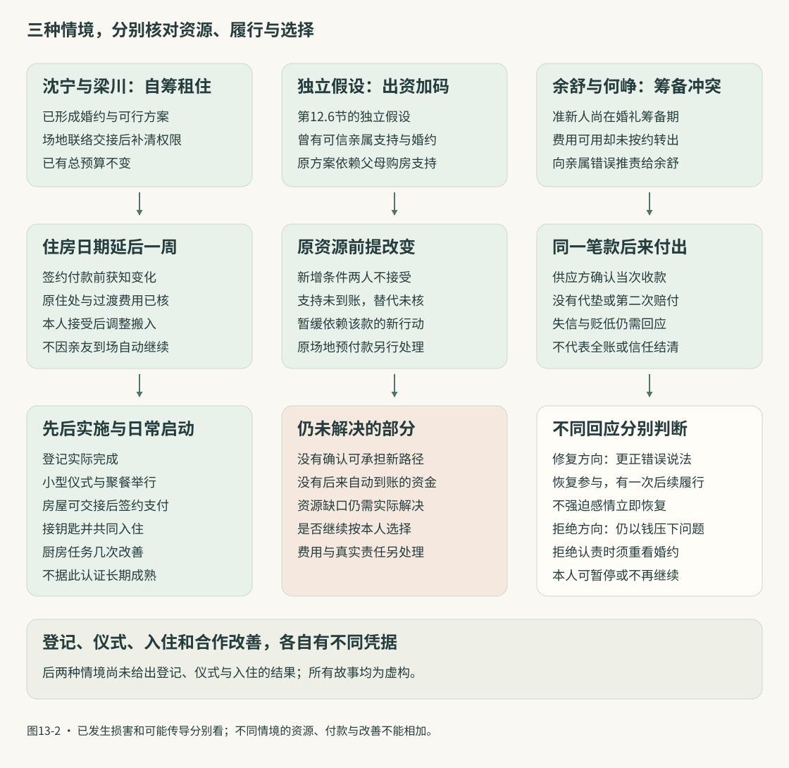

[图13-2](#figure-13-2)分别对应[沈宁与梁川从任务交接](#unit-13-1)到[新家启动的经历](#unit-13-4)、[第12.6节的支持变更假设](#unit-12-6)，以及本节余舒与何峥的筹备冲突；三种情境的资源与结果分别判断。

#### 13.6 风险专节：承诺未落实、临时加码与筹备中的权责失衡

**筹备风险要按当前条件和具体行为处理；可行过渡支持调整，重大欺瞒与胁迫不能降为赶进度的问题。**

临近办理、付款或搬家时，人容易将“按时完成”当成唯一要保住的目标。若原条件已经变化，继续赶进度却可能让本来可以调整的小问题变成新的依赖。风险判断要跟着实际条件走，不能因为已经有婚约，就把登记、购房、借款或共同居住一并放行。

本章中有四种值得区分的过程。资源未按原时间落实，先影响能够做什么；出资条件加码，会改变本人接受什么以及谁有何权限；组织劳动长期集中，会影响谁不断补缺和维持运行；以婚期施压，则可能使本来可以拒绝的选择越来越难说出口。它们可能交织，但不是一件事的四个名字。

| 已知条件或行为 | 可能怎样传向其他方面 | 应在哪里处理 |
| --- | --- | --- |
| 住房或资金未按原安排可用 | 若无真实过渡或余量，可能挤占生活资源、增加临时劳动或债务 | 核当前可用条件与替代，不让一人默默承担全部缺口 |
| 出资者新增条件 | 原方案依赖该资源时，可行性与权限争议一起出现；不接受条件也已经受到影响 | 说明变化，重看是否愿意及有无可承担路径，暂停依赖未定资源的行动 |
| 一人负责所有提醒与返工，另一人只否决 | 若长期不变，组织负担可能扩大，并使共同参与越来越困难 | 交清任务、标准、权限与信息，看实际减负，不只劝执行者少计较 |
| 用亲友到场、费用或身份要求照办 | 拒绝代价被提高，沉默可能被当成同意，原问题被带入更深依赖 | 重新确认本人意愿；善后另行处理，现实危险优先保护 |

表里的传播都需要具体条件。住房迟一周，若有真实住处、可承担支出且双方愿意，可以通过调整避免更大损害；并不是日期一变，感情就必然受损。反过来，公开推责已经伤到参与和信任时，钱恢复可用也不会使这些后果自动倒退。

可以回到[沈宁与梁川获知住房延迟的那一刻](#unit-13-2)，区分以下四种情境。第一种有故事中实际确认的后续依据，其余是条件对照，不是两人后来又经历的事情。

**可承担延迟。**原住处可以继续使用，费用有来源，双方接受延后搬入，重要生活方向未变。相应行动是按新的时间落实并复核条件，不能将一次延迟直接写成对方不值得信任。

**资源或信息暂缺。**没有可使用的过渡住处，补足资源也无依据时，应暂缓相应搬迁、支付或办理，必要时重看婚约。本人不接受某个新居住方案，也不能靠别人一句“还有办法”代为同意；这本身尚不证明长期核心方向不相容。不为保持原日期而承担原先未同意的债务或长期牺牲。

**已经明确不相容。**若一人坚持婚后必须与父母长期同住，另一人明确不接受，双方听清后也没有彼此愿意的替代方案，缺的便不只是材料。即使住房和钱都到位，原方案仍不能据此推进。形成新的可接受安排后可以重看，也可以不再继续婚约；不能把一方迟早改变当作现成路径。尚未问清的要求仍属未知，普通偏好差异也不直接等于重大不相容。

**重大隐瞒或胁迫。**若有人明知无法提供住处仍隐瞒，要先控制依赖失真条件的行动，处理实际损害与信任后果，依侵害、可承担性和本人意愿决定修复或结束。若已证实重大身份欺瞒、隐瞒现存婚姻或冲突性伴侣承诺，应立即暂停当前交往或结束。可信威胁、限制自由等严重侵害，则优先保护与寻求支持，不等资料补齐或身体伤害出现。

暂时拿不出材料，本身不能证明欺骗；资料未知也不等于风险轻微。资源或信息暂缺时，要说明缺什么、影响哪项行动；条件明确不相容时，要面对实际选择；隐瞒或胁迫已经证实时，则处理其行为和后果，不降格成普通延迟或沟通误会。

还有一种需要辨认的情况：资源其实充足，任务却不断停在同一个人身上。要看是工作冲突、信息没有交接、权限不够，还是本人持续拒绝承担。前几种可以尝试调整任务和条件；若改变条件之后仍拒绝履行，不能把持续损耗解释成另一人还没有找到足够温柔的说法。

继续推进所需的依据，也应当具体。一次新的支付，需要当前资金和授权；一项新的居住安排，需要可用住处及本人认可；对反复越权的担忧，需要看到重要决定重新开放参与并实际执行。不是让对方再说一次“我会对你好”，也不是要求永久证明不会犯错。

已经明确的普通事项可以关闭，不必为了安全感无限扩大最后审查。新的重大条件变化、重复失信或本人意愿改变，应打开相应问题；当前并没有新事实，就依已认可安排行动。这样才能既保留选择，也让真实承诺进入履行，而不把谨慎变成永远无法开始生活。

正式订婚阶段的查漏可参照[附录M.8](#unit-M-8)，[E.3](#unit-E-3)与[E.4](#unit-E-4)记录当前选择与状态，[J.4](#unit-J-4)与[J.5](#unit-J-5)分别处理支持准备和退出善后。这些工具不要求先完成整张表才暂停一项难以撤回的投入，也不把善后联系解释成必须保持亲密关系。

沈宁与梁川已经开始共同生活，但最初几次配合良好，还不是长久运行的答案。以后会有重复的家务、持续的账本、不同阶段的贡献与新的工作变化。[第十四章](#unit-14-1)从这些日常开始，讨论怎样用少量可执行的分工、财务与治理安排，让相处所需要的时间和精力不总被维持生活本身耗尽。

### 第十四章 把家经营起来：生活分工、家庭经济与共同治理

家里有饭吃、账单按时付，并不意味着两个人都过得从容。有时，一个人承担了大量事情，另一个人却连怎样完成一件小事也不能自己决定。好的日常安排，应当让需要的事情有人做，也让人有机会放下心里的待办，安心工作、休息，或坐在一起说些与任务无关的话。

#### 14.1 家庭治理：共同决定重要事项，日常执行适度授权

**重要共同事项需要真实协商，已认可范围内的执行则应保有自主；个人选择与共同后果分别处理。**

“既然交给我买，为什么每样都要问你？”郑闻站在货架前，把这句话发给宋晴。他已经按两人认可的需要和费用范围挑选，却接连收到“这个不行”“换一种”。宋晴觉得只是提一点意见，郑闻却不知道哪种选择才算数。原本不复杂的采购，变成了反复等待。

宋晴与郑闻此前已经完成过一次[采购任务的完整交接](#unit-14-2)，宋晴也少了催问。眼前是交接后的又一次采购：她否决的选择符合原约定，只是不合自己的新偏好。一次顺利交接并未消除所有旧习惯，原有授权仍需在日常执行中得到尊重。

两人的问题不必先判为谁不尊重谁。宋晴仍可以表达偏好，郑闻也不必把每件商品交回审批。他们需要分清：哪些结果已经共同认可，哪些方法属于执行者选择，哪些新要求会改变原来的任务。既然预算、用途和必要条件都没变，原有授权就应当能够实际使用。

宋晴后来说明：“我还是更喜欢那一种。不过这个也能用，你按说好的选吧，不用每样拍照。”郑闻完成了这次采购，宋晴接受了结果。删掉的不是她表达需要的资格，而是没有必要的逐件批准。此后若新增的偏好会增加费用或改变购买范围，再讨论是否纳入，不能事后把它当作早已约定的标准。

这里的家庭治理，是把参与决定、承担任务和调整安排连接起来。它首先要回答“这件事的哪一部分由谁决定”，而不是给两个人规定一个总负责人。

| 面对的部分 | 怎样参与和决定 | 需要重新讨论什么 |
| --- | --- | --- |
| 个人主责的选择 | 本人了解条件并作选择，伴侣可以表达需要和影响 | 由此改变的共同费用、居住、照护等安排 |
| 已认可的共同事项 | 双方对重要结果和各自投入形成可以实行的约定 | 新增重大义务、改变用途或超出原可承担范围 |
| 日常执行的方法 | 执行者在已有标准、资源和授权内选择 | 出现无法完成的条件，或方法开始造成新的重要共同后果 |
| 涉及第三人的资源或投入 | 由有权作决定的人确认，使用者说明用途与限制 | 支持者改变条件、原授权失效，或实际可用资源发生变化 |

事项的名称不能代替这一步辨认。“是我的工作”不意味着所有居住和生活后果都由自己说了算；“影响我们的家”也不意味着另一人可以决定你的整个职业。

另一对伴侣面临职业选择：甲得到异地工作的机会，尚未接受，乙明确现阶段不愿搬家。现在要核对的，是岗位实际条件、两地生活能否安排、现有费用和事务怎样接续，以及双方是否愿意接受这样的关系。甲可以选择职业，乙可以不随迁；任何一方都不能把自己的决定自动变成对方已经同意的共同方案。

双方尚未确认这些条件时，不能先按两人都会搬家订下共同支出，也不能用乙暂时没回复来认定他答应了。这不等于他对甲的职业有无限否决权。若最终找不到双方接受的共同生活方式，要面对这种不相容；已经形成的责任与善后，则另外处理。[附录G.4](#unit-G-4)可以帮助分开这些部分，不必把采购和迁居都纳入同一级审批。

父母也适用同样的区分。他们可以关心、建议，并决定自己的财产是否提供、在什么条件下提供；关心本身不产生夫妻日常事务的否决权。夫妻可以拒绝某项支持，却不能以建立独立家庭为由，先替父母承诺资金或时间。涉及身体的决定，更不能由“我也承担后果”直接推出支配权。

日常生活不需要每天重新谈一遍宪章。两人认可的惯例可以继续运行：谁负责什么，什么程度就算完成，范围内怎样自行处理，遇到什么变化应当说明。临时来不及回应时，能否沿用既定替代办法，也应在平时讲清；没有这样的授权，就不能把沉默补成新的重大同意。

经营意愿使两人愿意参与；角色分工把任务和权限交给具体的人；协商机制让原安排失效时有办法再谈。责任随变化重新认领，而不是把几年前的一次分工无限延长。可用的规则，最终应表现为少一些无谓等待、多一些可靠履行，而不是一人审批得越来越细、另一人越来越不敢决定。需要补齐授权时，用[附录G.2](#unit-G-2)的一张卡处理当前事项即可。

#### 14.2 家务与照护：分配完整责任，也给执行者自主

**分工应交接发现、计划、执行与跟进的完整责任，并给承担者相应条件，才可能真正减少组织负担。**

再看这对夫妻较早的那次采购交接。交接之前，郑闻买回了东西，宋晴仍觉得自己一直在忙：宋晴发现短缺，想好接下来需要什么，列单，提醒郑闻出门，等他回来后核对、收纳，再处理遗漏。郑闻确实做了采购动作，但宋晴仍握着整条任务线。

发现家里需要什么，不会因为没有拎重物就自动消失。准备、等待和不断被打断，也不是“顺便想一下”就没有成本。只把动作交出去，留下来的那个人仍不能放心离开。反过来，执行者若一直只收到零散指令，也难以知道自己究竟该对什么结果负责。

一次完整交接，应当从双方认可的需要出发，沿着事情实际发生的过程看，而不是先比谁做了几次。

| 任务环节 | 日常采购里实际包含什么 | 可以交清的条件 |
| --- | --- | --- |
| 发现需求 | 知道已有物品、剩余状况和近期特殊需要 | 能查看必要存量；各人及时说明只有自己知道的需要 |
| 计划 | 确定购买范围、时间、费用和可接受替代 | 已认可的预算、用途与必要限制，不靠另一人反复补指令 |
| 执行 | 按安排采购，遇到普通变化作范围内选择 | 有实际时间和可用支付方式，允许合适的方法不同 |
| 跟进与沟通 | 核对、收纳、处理缺货，说明尚未完成的部分 | 知道何时算结束，哪些异常需通知或重新协商 |

那次交接中，郑闻认领了这条完整任务线。他自己清点和安排，询问双方的特殊需要，买回后核对并收好；遇到一项缺货，他主动说明，两人决定暂不替换。宋晴反馈，那次少了催问。

郑闻也发现，过去他以为“很快就能买完”的事，原来还有一段准备工作。交接使这段工作显现出来，并不意味着从此应由他无限承担。下一步仍要看他能否在自己的工作与其他任务之间完成；宋晴需要说明个人特殊需求，也不等于重新接回全部计划责任。

完整责任不是独自包办。任务主责者可以得到协助，但协助应当是明确的一部分；接送、查一份资料，或临时帮忙收好东西，不自动让帮助者重新成为总协调人。同样，不能一边要求执行者承担结果，一边拿回每个方法的决定权。[上一节后来出现的逐件否决](#unit-14-1)，正说明完整任务交接之后，授权仍可能回缩。

照护的组织工作还可能包括预约、准备资料、核对时间、安排往返和后续生活。只比较“谁陪着去了一次”，就可能漏掉持续协调。这里需要本人同意共享的信息和实际可行的协助，不能因为谁负责预约，就让谁替被照护者决定所有个人事项。涉及专业处理的问题，另由相应专业人员核实。

分配任务时，真正有用的是当前工时、交通、精力、技能和已有负荷。收入较高的人未必总更忙，工作时间较短的人也未必随时有空。擅长者多做某些任务，可以减少学习和切换成本；但熟练不能自动变成无法退出的终身职位。另一人可以学习必要的部分，不必学会所有事情才算参与。

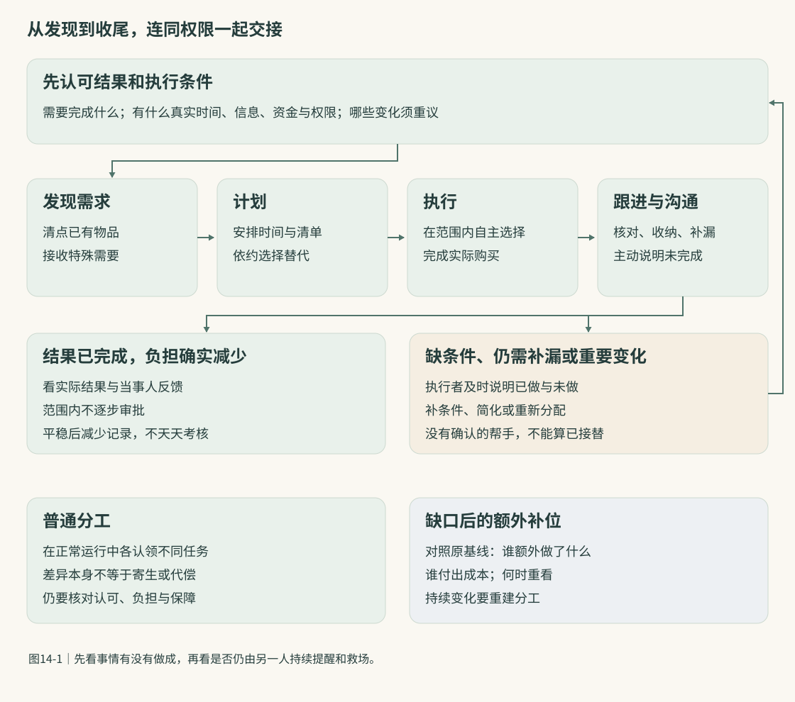

[图14-1](#figure-14-1)沿一件事看清任务与条件。交接后的观察不是追问对方每一步，而是看约定的结果是否完成、谁仍在不断提醒和补漏。若只换了表上的主责，原来的管理劳动还在，减负就没有真正发生。

普通分工与[家庭功能代偿](#unit-2-2)不同。一人更多挣钱、另一人更多承担照护，可以是双方认可的原有安排。家庭功能代偿指原有功能出现缺口后，由其他人、资源或替代办法额外补位；这里讨论的是功能维持，财务工具中的担保相关责任另按[附录F.5](#unit-F-5)辨认。它要和原来的基线比较，不能见到贡献不对称，就断言谁在牺牲、谁在寄生。

另一个临时生病的情境中，一方暂时不能完成原采购事务，恢复日还不清楚。伴侣明确愿意接下当次必要采购，两人先取消可延后的非必要整理，利用已有生活资源完成需要。补位者这次实际做完了，但这只说明当前缺口得到补足，不表示已接受今后所有采购。

两人约在下一次原定采购之前，重新看原主责者的实际能力、补位者多出的负担和必要任务。如果到时仍不能恢复，就再确定可承担的安排，不能用“快好了”延长一个未知期限。提前出现明显疲惫或必要任务无法完成，也应提前重谈，不必等到约定日期。感谢可以表达被支持的感受，却不能代替补位者所需的休息和资源。

可用储备、已确认的服务或愿意且能到场的其他人，都可能成为替代路径。写下名字不等于有人接手，付费服务也要有可用时段、预算和必要权限。若两种安排都依靠同一个已经忙不过来的人，纸上多一个选项并没有增加实际帮助。

有些变化会持续较久，需要重新建立分工，而不是不断请一个人“再撑一下”。重构可以是减去不必要任务、改变完成方式、重新认领，或引入确实可用的支持；不保证原有生活标准全部保留。[附录G.1](#unit-G-1)用上面的采购交接示范完整任务记录，[G.2](#unit-G-2)补权限与条件，[G.3](#unit-G-3)则进一步检查：事情继续做成之后，两个人的负担、收益和未来选择是否仍得到照顾。

#### 14.3 公平不是每项对半：同时看领域、整体与生命周期

**公平要让贡献回应真实需要，在领域、整体与生命周期之间核对，不能用一项优势抵销另一项重要损失。**

谁赚得多，谁就该少做家务吗？谁做了更多家务，就该在其他所有事情上得到补偿吗？两种问法都太快把不同贡献换成了同一张账，却跳过了人到底需要什么、承担了什么，以及安排是否真的被接受。

再用宋晴与郑闻作一个独立的分工比较，与[前面的采购故事](#unit-14-2)分别判断。两人税后月可用收入分别为12000元、8000元，共20000元。宋晴当时的工作和交通占时较长，郑闻较能安排时间；双方认可郑闻多承担日常组织，宋晴完整负责已认领的衣物清洗、收纳等任务。这里的差别依据实际时间和意愿，不是先按收入规定家务比例。

这段安排里，各自休息和个人学习的时段已经留出，轮到一人时由另一人承担约好的当时事务，两人都实际使用过。本月，两人的个人自主款各1000元已转到本人可用账户，合计2000元；与另1000元共同弹性额度合在一起，构成本例预算中的3000元弹性与自主安排。转拨没有增加预算，也不代表已经消费；额度内本人可以决定用途，无须逐笔申请。完整分配与现金流过程见[第14.5节](#unit-14-5)和[第14.6节](#unit-14-6)。两人均能了解共同计划与必要余额，并参与重要决定。

这些事实说明，不平均的任务分配可以有认可和现实支持。收入差不购买更多人格权利，也不取消收入较低者参与共同决定的资格。这些安排仍不证明所有风险、所有未来机会都已经得到保障。公平需要用三个尺度相互校正，不能用某一处安排代替整段生活。

| 尺度 | 具体看什么 | 在这个情境中要核对的事实 |
| --- | --- | --- |
| 领域 | 某个领域内谁贡献、谁受益，任务与权限是否匹配 | 日常组织是否包含提醒和跟进；衣物任务是否完整认领，而非另一人继续补漏 |
| 整体 | 合并看双方负荷、重要收益、风险、自主和参与空间 | 郑闻多承担组织后是否仍有可用休息；宋晴的工作和家务是否也可承担；自主资源是否实际可用 |
| 生命周期 | 随阶段变化追踪支持、机会和调整是否兑现 | 工作量改变或一人需要发展时，原安排能否改变，约好的个人时间是否真正交还给本人 |

领域公平不要求每个人采购一半、洗一半衣服。清楚的专业分工可以省下重复协调；真正要看的是责任有没有交全、必要支持是否到位，以及承担者能否表达限制。整体公平再往外看：家庭运转得不错，是否建立在一个人长期不休息、不能作选择之上？总收入增加或家里整齐，都不能独自回答这个问题。

生命周期尺度则把时间拉长。有一段时期多支持某个人，可以帮助其学习、恢复或应对工作；但“以后轮到你”需要实际路径。比如下一次学习时段由谁接下当时事务、相应资源是否可用、什么变化需要重谈。不能把不可确定的未来成功当作已经给付的补偿，也不能要求过去受过帮助的人，永久放弃自己的发展机会。

现在只改变这个情境中的一个条件：郑闻实际工作时段增加了，收入仍与原来相同，原来的家务组织仍全部照旧。几次下来，他反复错过早已约好的学习时间。宋晴起初回答：“我收入还是更多，我们也一直在存钱。”这两件事可以是真的，却没有回答他现在失去的时间。

这里需要的是“贡献—需求—回应”之间的对应。本书用结构性对等表达这种要求：不同的人可以以不同方式贡献，但双方的重要需要、得到的收益、承担的代价和调整空间，都要进入真实安排。一方做了有价值的事，不意味着这项贡献能自动满足另一方任何需要；多存钱不会自行变出可用时间，表达欣赏也不会完成已经堆积的任务。

郑闻说明自己想保留的是现有学习时段，并没有要求宋晴取消工作。两人重新看哪些家务必须保留，哪些可简化。宋晴也列出自己已承担的任务，避免用把全部压力移给她的方式解决。最终他们取消一项双方认为目前没必要的整理工作，由宋晴在可承担的时间内接下接下来两次采购全流程；郑闻暂不负责采购，保留其他原有责任。

这两次采购后来都由宋晴完成，郑闻也实际参加了对应的学习安排。宋晴反馈，少了那项整理后自己可以承担，并不是靠继续挤压睡眠补足。双方没有增加总体支出，也没有把采购算成郑闻今后必须逐次偿还的欠账。变化得到了一点实际回应，是否适合继续，仍要看新的工作安排和双方负担。

这项调整不同于[前面完整交接的采购例子](#unit-14-2)，它回应的是工时变化，没有规定采购永远该归某个人。改变的原因是这个情境中的工作量、需要和可用时间发生了变化。若只把任务重新写到另一个人名下，却仍要求郑闻发现、列单和催问，他要保留的时间就未必回来。

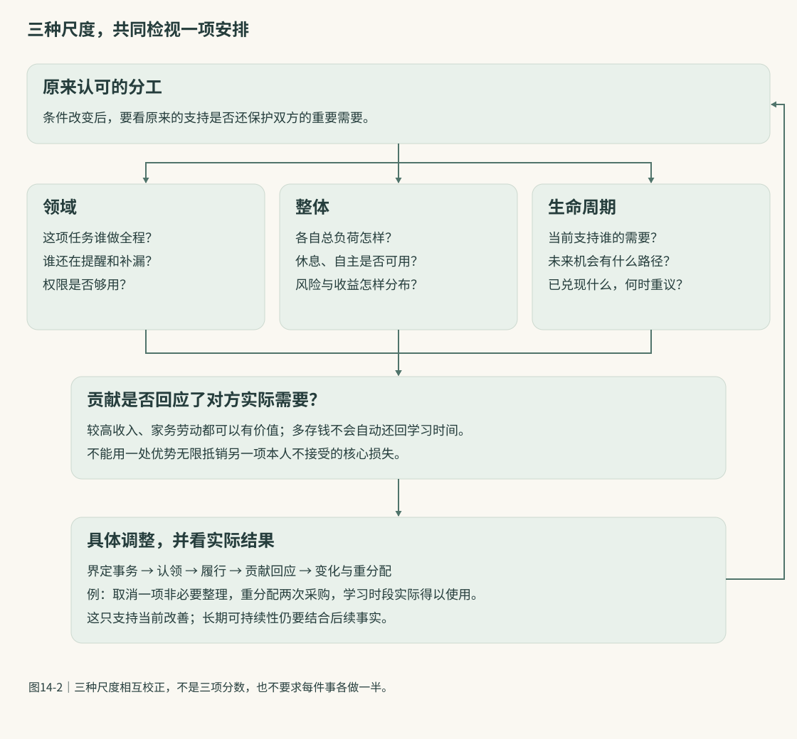

[图14-2](#figure-14-2)不是三项分数的加总。任何一处发现关键需要没有得到回应，都应回到具体安排；不能用另一处的优势一笔抹掉。例如，一方并不愿放弃职业，就不能只用家庭总收入更高来证明放弃是公平的。双方也未必能把某项核心损失折成钱，再达成共同接受的交换。

收入变化是重看分工的信号，工时、照护需求和身体负荷变化也一样；收入不变不等于生活没变。回顾不需要每晚清算。先选一项正在积累的不满，用[附录G.3](#unit-G-3)分别看领域、整体和生命周期，再沿责任的界定、认领、履行、回应、变化与重分配，找到可以实际执行的一处调整。

安排顺利时，可以少记录，把注意力还给生活。发现长期失衡时，则不必因为曾经自愿就否认今天的困难。过去的认可是真实的，变化后的重议也同样必要。[下一节](#unit-14-4)进一步讨论：当无偿贡献已经影响收入、职业连续性或未来选择，怎样让支持超出一句“辛苦了”。

#### 14.4 看见无偿贡献：感谢之外，还要有实际保障

**无偿贡献需要实际可用的资源、休息和发展支持；感谢与未来承诺不能代替当下选择空间。**

“这阵子多亏你，不然家里真顾不过来。”一句具体的感谢，能让照护者知道，别人看见了那些没有出现在收入单上的工作。但如果随后连一件自己需要的东西也要反复申请，这份被看见的感受，就很难解决现实中的局促。

另一对伴侣顾萱与邵成面对照护分工。邵成阶段性减少有偿工作，承担两人已认可、也符合亲属本人需要和意愿的日常照护。顾萱负责操作共同生活款项，常说他辛苦，却要求个人消费也先得到她的同意。邵成想买一件自用物品，解释了用途，又等她忙完回复，最后连自己是否有资格提这个需要都开始犹豫。

他们减工后的收入、必要支出和可用余量尚未在这个例子中给出，需要重新核对，不能照用另一对伴侣的账本。不过，核对现实约束与要求另一个成年人逐项讨钱，是两件不同的事。预算可以限制双方当下的选择，不能让收入较少的一方失去参与预算和表达需要的资格。

无偿贡献首先是在完成真实事务。让生活维持下来、让家人得到照顾，也可能让另一人更容易持续工作。感谢可以使这些投入获得回应，支持愿意继续合作；但承担者付出的不只是当日几小时。减少工作还涉及现有收入如何接续、技能和职业联系怎样维持、未来返回工作的条件是否存在。

这些后果不能只凭“为了家”一并认领。某人愿意多承担当前照护，不等于同时同意没有休息、没有自主资源，也不等于预先接受一切未来损失。若保障、养老安排或职业接续涉及具体制度和合同，应拿实际资料核实；不能从一项分工直接推断日后必然得到补偿。

| 需要保障什么 | 具体可以谈什么 | 什么事实才说明已经发生 |
| --- | --- | --- |
| 当前可用资源 | 必要生活支出与个人自主空间分别怎样安排，谁能在什么范围内使用 | 款项或相应权限实际可用，范围内无需每次请求许可 |
| 休息与恢复 | 哪些时段由谁接下必要事务，接替者是否愿意且能承担 | 承担者确实能够离开任务，而非休息时仍持续遥控和补漏 |
| 学习与职业接续 | 怎样维持技能和工作联系，何时了解重返或增加工作的条件 | 有可使用的时间和必要资源，并实际完成一项准备行动 |
| 持续风险与选择 | 现有保障、收入变化、支持终止时怎么办，哪些权利与义务还不清楚 | 相关条件已核实；尚未有依据的部分仍保留未知，不用口头保证填满 |

顾萱起初觉得“要用就说”已经很宽松。邵成需要解释的却是：每次都得等另一个人判断是否值得，和自己在约定范围内可以决定，感受与行动条件都不同。这里的问题不靠让邵成更感恩来解决，而要改变支出权限的安排。

在这个情境的改善方向中，两人先核清当时实际收入、必要义务和能留出的个人空间。认可范围内的一笔个人款，后来真正转到邵成能够使用的账户，逐笔批准取消。这笔款的金额未给出，重要的是它已可由本人依约使用；实际数额须由这对伴侣按自己的条件确认。

他们也没有把全部改变压在资金上。顾萱确认自己能接下两个明确的照护时段，按亲属的实际需要作好交接，后来确实完成。邵成把其中一个时段用于休息，另一个用于联系原有工作伙伴，了解之后接续工作的条件。顾萱反馈这次安排可承担；邵成也不必每隔一会儿回来处理自己刚交出的任务。

两次接替没有保证未来的岗位和收入，也没有解决全部长期保障，却让支持开始形成真实选择：他可以休息，可以了解机会，而不只被要求相信“以后会好”。有些风险还要继续核对，接替也要结合两人的负荷调整，不能把顾萱推入另一种无限承担。

如果双方真实资源有限，可以一起缩减非必要安排、重谈照护方式或核实可用支持。若有资源却持续以金钱封住表达、以失去生活来源威胁服从，就不能只归为节俭或预算习惯。此时需要处理实际控制和可获得的支持，保护自己不必等待对方完成一套共同修复。

日常保障也不能等到关系结束时才讨论。分离后的财产、补偿与救济，需要另看具体事实和适用规则，[第十七章](#unit-17-4)处理相应的善后问题；不能用“以后总会分给你”抵销今天持续失去的选择。[附录G.3](#unit-G-3)看贡献有没有得到需要的回应，[F.2](#unit-F-2)再检查承诺的资源是否真的可用，两个问题都不需要给每项家务定工资。

#### 14.5 家庭资金如何运行：共同责任与个人自主同时安排

**共同财务要同时落实责任、必要透明和个人自主；账户由谁操作，不等于决定资格或财产权利归谁。**

银行卡交给一个人，并不意味着家庭财务已经共同经营。可能由一人省心代办，也可能只有一个人知道钱去了哪里；区别要看另一人是否了解必要信息、能够参与决定，以及实际拥有怎样的使用空间。

回到独立的普通月财务例。宋晴税后可用收入12000元，郑闻8000元，两笔均已到账，共20000元。两人认可当月用途，由宋晴执行共同支付和转拨，郑闻能够核对相关用途与必要余额。[附录F.7](#unit-F-7)把这一月从入账到月底写全；本节先看谁在做什么决定。

一种做法是，把用于共同安排的收入汇到同一管理位置，再分出必要支付、计划预留和个人额度。另一种做法是，收入留在各自账户，各人依约支付并预留相应部分。两种方式都要能回答同样的问题：总共有什么可用资源，哪些责任已分配，哪笔实际付了，哪笔还留着，谁能改变用途。

账户多，不会自动使钱更清楚；账户少，也不必让一个人独占信息。在同一账户里标明不同用途，可以降低转账和维护负担。相反，若两人都以为同一笔费用由自己支付，即使都有完整的私人流水，也仍缺一次共同任务交接。

本书将资金安排看作六类功能。它们回答钱要服务什么，不是六种投资产品，也不要求开出六张银行卡。

| 资金功能 | 它解决什么问题 | 落到一项安排上 |
| --- | --- | --- |
| 日常经营 | 让生活与现有责任有持续支付来源 | 已认可的必要生活、债务偿付和当期共同活动怎样支付，不重复报销或漏付 |
| 年度计划 | 为可预见但不每月发生的费用提前准备 | 知道用途、预计支付时点与已经预留多少，不到付款时才发现没有钱 |
| 风险保障 | 为冲击留出可启用的支持 | 分清可用储备与保障安排，核实覆盖、条件和义务；不能把保障名称当作已经覆盖 |
| 长期目标 | 为跨年的重要选择积累资源 | 哪个目标、需要怎样的时间和投入，条件改变后如何重议 |
| 投资管理 | 管理准备配置的资产及其可用性、风险和执行责任 | 谁可作何种决定，哪些钱不能擅自动用；用途本身不推导应买何种产品 |
| 个人自主 | 让每个人保有不必逐项争取的日常选择 | 在认可范围内使用自己的额度；共同义务不能因此被隐去 |

这些功能会相交。为保障支付的费用可以在当期发生，应急资金也可能跨年保留；投资管理处理的是相关资产怎样持有和调整，不是所有家庭都要另外留一笔“投资款”。一笔钱可以从不同角度理解，但合计金额时不能因此出现两次。

在本例原预算中，共同弹性为1000元，两人个人自主各1000元。个人额度实际转到各自可以使用的账户后，各人在范围内自行决定；这并不意味着钱已消费。月底若需要核算总去向，可以确认实际支出总额与剩余额度，不必把全部私人购买逐笔提交审批。

宋晴负责付款和记录，郑闻不能只把“钱交了”当成财务责任结束。他仍需了解共同义务，在需要时参与变更，并认领可以承担的核对或接替任务；宋晴也不能因负责操作，就自行改掉另一人的自主额度。管理是一项工作，透明与参与不能全部依赖管理者的善意。

本例按已认可范围执行后，两人能从共同记录知道哪些款已付、哪些仍预留，不必为同一笔款反复询问或再次支付。个人额度也不再需要逐项请款。减少这些等待和疑虑，才有可能把精力留给生活；家庭财务不应成为每晚查账的例会。

共同预算需要知道会改变共同计划的事实，例如已经承担却尚未纳入安排的负债、资金暂时不能取用，或某项收入不再按时到位。尊重私人空间不等于隐去这些影响；相称透明也不等于可以无限查看对方全部消费与个人资料。按[附录F.2](#unit-F-2)先列当前计划真正依赖的来源、权限和义务即可。

还要留意账户之外的边界。谁把钱转到某处、谁负责使用，以及某项财产归谁，是不同问题。一次共同支付不能单独证明法律产权已经改变；亲属提供的款项也要按赠与、借款或其他真实条件核实，不能因为“都用于这个家”就任意处分。

在费用稳定、执行顺利时，沿用已认可的安排；收入、必要支出或权限改变时，再把相关部分拿出来讨论。[附录F.1](#unit-F-1)帮助区分功能、时间和账户，[F.2](#unit-F-2)说明来源与权限，[下一节](#unit-14-6)则沿时间看：留到以后用的钱，今天究竟算在哪里。

#### 14.6 三层时间安排：当期生活、年内预提与长期储备

**预算、内部转拨、实际支付与仍持有资金分别记录，并按用途和时点衔接，才能避免重复安排同一笔钱。**

有时两人看着账户里还有余额，以为这个月有余裕；过一阵子，一笔早就知道会发生的费用到来，才发现那笔钱已经另作他用。问题不一定是收入太少，也可能是付款发生的月份与准备资金的月份没有接上。

本书使用当期、年内、跨年三层时间安排。当期处理当前生活和已经到期的义务；年内把可预见却不按月发生的费用提前列出；跨年处理更长的目标与需要持续保留的储备。这是观察时间的方式，不是三种必须购买的产品。

风险储备可能随时用到，即使跨年保留，也不意味着适合变成短期不能取用的资金。年度计划遇到支付日期改变，同样要调整时间安排。用途、使用时点和可用性需要一起看，不能仅凭“长期”二字就给钱换一种配置。

沿[附录F.7的同一份普通月账本](#unit-F-7)，20000元已实际可用。两人先分出12000元必要支付、2000元年内预提、3000元应急与长期新增储备，以及3000元弹性和个人自主。这四部分恰好用完本月收入的安排额度，但不代表收入已经全部消费。

| 本月安排 | 金额（元） | 该分清的状态 |
| --- | ---: | --- |
| 必要生活与债务支付 | 12000 | 其中非债务必要生活及保障10000、最低债务2000；保障和债务不再另加一遍 |
| 年内预提 | 2000 | 本月为未来费用保留；只写预算不等实际留住，转到另一账户也不等对外支出 |
| 应急与长期新增 | 3000 | 应急2000、长期1000；是本月新增，不能与期初存量混算 |
| 弹性与个人自主 | 3000 | 共同1000、个人各1000；已获额度、已转拨、已消费是不同状态 |

计划预提，是先给钱确定未来用途；实际预留，需要这笔钱真的还在，并且没有同时被别的安排占用。内部转拨只改变存放位置。给家里另一个账户转2000元，不能一边把它记成已经花掉，一边又作为新的2000元收入记回来。

在本例的演示顺序里，必要12000元先实际支付，当前收入还剩8000元。再将年内2000、应急2000、长期1000实际转到相应位置，原收支位置剩3000元，另处持有5000元。此时总共仍持有本月收入中的8000元，不是只剩原账户的3000元。

两人个人额度共2000元随后转出，原收支位置剩共同弹性1000元，另处持有7000元。只有共同弹性与个人额度后来都确实花掉，普通月累计对外支付才到15000元，本月新增保留5000元。若某一笔还没花，应保留其实际余额，不把计划金额冒充支出。

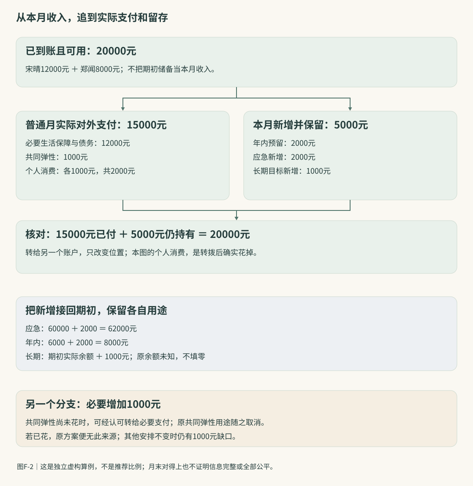

[图F-2](#figure-F-2-in-14-6)与[附录F.7的完整算例](#unit-F-7)共用，将本月收入的去向分开，再接回期初储备。它显示的是同一笔钱在不同位置的状态，不需要再增加一笔来源。

期初储备要另接一行看。本例应急原有60000元、年内专款原有6000元；本月各新增2000元，且没有从中支用，月底分别为62000元、8000元。长期目标原余额没有给定，只能说增加1000元，不能把原来未知的部分填零。年内8000元已有用途，也不能再完整算作应急备用。

再回到共同弹性尚未使用的时点，另设必要支付临时增加1000元。两人确认需要后，同意取消原共同弹性用途，将这笔尚未花掉的钱转入必要支付。调整后是13000必要＋2000年内＋3000新增储备＋2000个人自主＝20000。收入没有增加，代价是原共同弹性安排取消，其他分配才得以保留。

若共同弹性已经花掉，同样的必要增加就没有这条现成来源。保持其他安排不变，需求将是21000元，而本月收入仍为20000元，缺口1000元。接下来要核对哪些尚未执行的计划可调、哪些真实可用资源可以承担；不能一面保留所有目标，一面用“还有储备”把同一笔钱重复安排。

借款会带来新的义务，未到奖金和未收回应收款还不是现金，条件未明或尚不能落实的亲属支持也不能先拿来平账。已经确定、条件可接受且实际可用的支持，可以按其真实性质记录；家庭向外获取资源并不自动是失去独立，关键仍在真实性、权限和后果。

[附录F.3](#unit-F-3)可以在纸上完成月度计划与实际状态对照，[F.7](#unit-F-7)提供完整跟算过程。最少的回看，是核对当月真实收入、已发生支付、仍预留的钱及改变了的条件；有异常再细查，不要求每天重填全部项目。现金流能对上，是继续判断的基础；它是否有足够调整余地、有没有未列入的重大责任，则需要[下一节](#unit-14-7)进一步检查。

#### 14.7 财务健康与抗冲击：先看结构和短板，再看自检结果

**财务自检应找出具体负担、调整条件和重大未知；可计算的比率说明局部结构，不能合成适婚结论。**

两家收入相同，生活的余地也可能很不一样。一家已经承担较多不能立刻调整的支付，另一家保留着较多可选择空间；同样的收入变化，便会碰到不同约束。净资产相近也不代表能同时拿出现金：有的资源目前可用，有的需要等待变现，还有的受权利和用途限制。

因此，[前一节把账算平](#unit-14-6)之后，还要问：这些来源能否持续，义务是否完整，条件改变时有什么真实可行的办法。本书将“家庭财务常态自检”简称为FHS，将“家庭财务抗冲击自检”简称为RRS。它们分别帮助整理日常运行结构与冲击下的资源、责任，不是两张可以相加的婚恋成绩单。

| 观察方向 | 主要看什么 | 它不能单独回答什么 |
| --- | --- | --- |
| FHS：常态健康 | 收入稳定与集中、支出和债务负担、调整能力、实际执行 | 存款是否足以应付所有突发事件；两人是否值得继续相爱 |
| RRS：抗冲击 | 可用储备、生活成本锁定、一次性事件、保障和重大责任 | 危机会不会发生；其他方面良好能否抵销一项未知的重大义务 |

仍用宋晴与郑闻的独立财务例。税后月收入20000元，不含债务的硬刚性生活及必要保障10000元，最低债务偿付2000元。刚性支出率（FCR）把后两项相加后除以收入，得到60%；债务偿付收入比（DTI）只以债务2000除以收入，得到10%。具体口径见[附录F.4](#unit-F-4)。前一个比率已经包含债务，不能再加上后一个说他们负担了70%。

这两个数说明已列支付如何占用当月收入，不说明剩余部分都可以随便花：年内费用、未来目标和个人需要还在。它们也没有判断一份收入能持续多久。知道两个人分别收入12000和8000，仍不知道两项收入是否依赖同一行业、雇主或业务，更不能直接把人数写成风险已经分散。

另在明确的测算时点，假设可立即动用且未受限的资金为60000元；年内专款6000元不纳入这次应急口径。以应急必要月支付12000元计算，生存续航（SR）为5个月；以同一成本基准下普通月实际对外支付15000元计算，生活续航（MR）为4个月。这里用的是60000元时点，不是[附录F.7](#unit-F-7)月底新增后62000元的时点。

这样的续航，只描述在所列月支出不变、不另计收入补充和额外支出的简化条件下，这笔钱对应多少个月。它不是未来五个月绝对安全的保证，也没有把新发生的大额责任包含进去。若储备可用性、成本或义务改变，就要重新核对，不能拿着旧比率继续作决定。

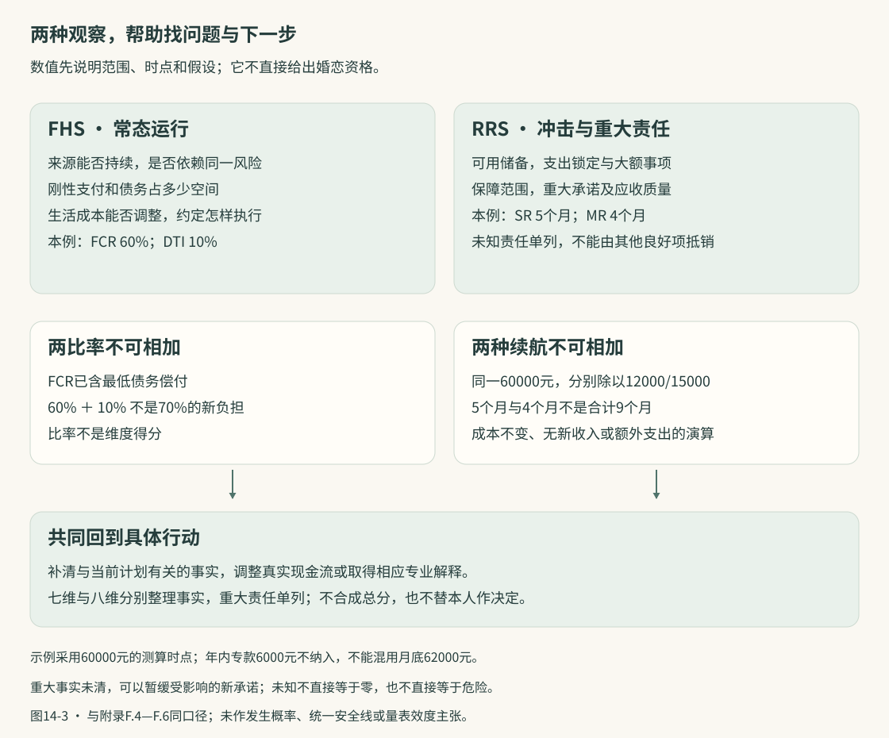

[图14-3](#figure-14-3)对应[附录F.4的常态观察](#unit-F-4)、[F.5的抗冲击观察](#unit-F-5)与[F.6的记录规则](#unit-F-6)；两种续航使用同一60000元测算时点。

未知有时比算出的比率更重要。没有查清一项经营担保的责任范围，不能把金额记零，再让充足存款抵销它。此处也不能反过来断言一定需要承担全部金额。要核的是谁作过什么承诺、责任在什么条件下发生、期限和可用资料是什么，以及需要怎样的专业解释。

[附录F.4](#unit-F-4)按七个方面梳理常态运行，[F.5](#unit-F-5)按八个方面检查抗冲击条件，[F.6](#unit-F-6)说明事实、计算与未知怎样记录。它们提供观察结构和口径明确的算例，不提供综合总分，也不是已验证的婚姻预测量表。自检的结果应落到行动：哪项资料缺失，哪笔支付已到期，哪种调整仍未经确认。

再设一个收入下降的假设：家庭当月实际可用收入为15000元，原20000元计划还未改变。两人的新收入各是多少、下降原因是什么，此处没有给定。若必要支付12000元保持，余下3000元要面对原先合计8000元的年内预留、新增储备及弹性自主安排，缺口就是5000元。

这时最需要的不是一个更低的分数，而是决定哪些安排可以改变、哪些义务仍须履行，以及动用储备是否有真实依据。取消某项本月预留，会改变未来的准备，不能假装年内责任也一并消失；压缩个人空间同样需要让当事人参与。[附录F.8](#unit-F-8)展开这个假设的调整问题，不替所有家庭规定同一削减顺序。

有的紧张来自短期收入变化，有的来自长期承担过量，也有的夹杂隐瞒和失去参与权。先比较这些解释，再按事实处理；经济功能遇到困难，不自动证明感情或共同体失败。相反，若已经有人受辱、被排除或持续透支，只修好现金表也不能宣布这些损害已经恢复。

自检可以从本人开始，围绕当前共同计划增加必要信息，不必把早期交往变成全量财务审查。算得出的部分准确计算，算不出的部分说明缺什么，重大责任单独处理。这样，工具才是在帮助选择，而不是用一个看似精确的数字代替生活。

#### 14.8 婚后亲属协作：礼仪、互惠、祖辈照护与资源分配

**亲属协作要让帮助范围、接替和费用真正落实，尊重各方自主，并以可承担的互惠支持长期往来。**

亲属的帮助不只是一种后备资源。孩子与祖辈熟悉起来，一顿有人愿意张罗的饭，一次不用独自奔忙的照护，都可能给家庭带来生活的厚度。要让这些往来能够持续，除了感谢，还需要承认：愿意帮忙的人，也有自己的时间、需要和决定。

许婧与贺川是另一对夫妻，有一个需要日常照料的孩子。许婧的母亲只答应在一个工作日白天的明确时段照料孩子，两人却以为她会一直待到他们下班。当天临近原约定结束，她说自己接下来另有安排，两人才发现，计划中的“有人照顾”漏掉了后半段。

这不是老人已经答应又反悔，而是夫妻把一段有限帮助扩成了全天待命。贺川核对当时工作，确认能够提前离开，随后回家接上；许婧当时不能离岗。当前照护没有留下空档，也不能因此认定原安排没有问题。一次临时接替解决了当天，下一次仍要把时段说清。

他们先看自己真正需要哪些时段、各自能承担什么，再向亲属提出具体请求。许婧问母亲的是“下次能否在这一段帮忙”，不是“以后都麻烦你了”。贺川也向自己父母说明当前安排，并未替他们承诺可随叫随到；他们尚没有确认具体照护时段，就不能写成已经具备的另一条后备。

父母参与越多，夫妻越需要自己承担沟通。许婧向母亲说明原来是两人没有接清时段，不把贺川说成不愿配合的人；贺川也向己方父母解释两人认可的安排，避免让许婧一个人面对两家不同期待。具体礼仪、探访和节日往来，可以说明各家习惯，再按现实条件决定，不必让父母彼此成为亲密朋友才算融入。

照护的主责与执行自主也要分开。父母需要作出主要育儿安排，向帮助者说清孩子当前所需、必要安全要求、联系与接续办法；在已经认可的范围里，祖辈可以安排活动顺序，不必每一步等待远程批准。若涉及新的重要决定，则回来确认，不能因为帮了许多忙就取得全部家庭决定权。

| 要接清的事情 | 需要各方确认什么 | 怎样看实际发生 |
| --- | --- | --- |
| 时段与接替 | 谁接受哪一段，结束时由谁接手，接替者是否确实可到 | 到点有人接上，帮助者可以按约离开 |
| 执行范围 | 必须遵守的结果和限制，范围内可自行安排的部分 | 不靠持续遥控完成，也不单方新增重要决定 |
| 费用与用品 | 哪些由夫妻准备和承担，哪些费用需要说明 | 所需已到位，帮助者不被默认垫钱或无限提供 |
| 休息与变化 | 哪些时段不提供帮助，忙不过来如何提前说明 | 拒绝或变更能够被认真处理，而非用亲情施压 |

下一次，许母只认可一个明确的白天时段，许婧确认自己能在结束时回来接手。必要用品和已约好的照护支出由夫妻落实，不让老人先垫着；其他时段由两人按已核条件承担。照护费用按这个家庭情境的实际需要另列；尚未确认的亲属或服务，不算已经可用的替代。

这次照护和接替后来按约完成。许婧回家时，孩子拿出和外婆一起折的纸，想让她看看。母亲说这一段自己可以承担，接着按原计划离开；这份认可只针对本次范围，不是承诺今后全天可用。夫妻感谢她具体做了什么，也知道那段踏实相处是在可承受的边界里发生的。

这样的回应有机会使下一次合作仍然出于愿意：帮助确实被需要，时间也得到尊重。它不是一种交换券，不能拿感谢购买更多服务；祖辈的旧贡献，也不构成要求子女在居住、职业或婚姻决定上无限服从的债权。

回应也不只发生在帮忙当天。长辈有自己的需要时，夫妻可以主动了解，在真实能力范围内提供关心和具体帮助；涉及伴侣的时间或共同资金，要先取得相应共识。互惠容许需要和投入随阶段变化，不是把每次帮助折价后逐笔偿还，也不是等到下次需要老人出力才联系。

养老与手足之间的分担，也要先看实际需要、能力、已有贡献和承诺。曾经由一人较多照料，可能留下现在需要接替或休息的负担；已答应的具体任务也不能在重新分配时假装不存在。两家父母的需要不同、可用支持不同，安排可以不同；尊严对等并不要求每笔金额相同。不能只用“他家上次出了多少”决定另一家现在应得到什么，也不能一人出面就替伴侣和兄弟姐妹许诺投入。

若共同资源要用于援助亲属，先说清具体需要、可承担范围、谁愿意做什么及何时重看；同住还须尊重相关住居权利人的实际权限、空间和日常需求。对尚未同意的手足或服务，保持未确认状态。[附录H.4](#unit-H-4)将礼仪、同住、育儿、养老分别列出协作入口，执行范围需要补清时可以借[G.2](#unit-G-2)处理当前事项。[第九章谈过的家庭经验与网络期待](#unit-9-2)，有助于理解分歧，却不能替本人答应投入。共同安排需要留出拒绝和调整的可能，才不至于把帮助慢慢变成难以开口的负担。

#### 14.9 风险专节：贡献不可见、资源控制与家庭功能单点依赖

**家庭运转正常仍须看负担与权利；真实接替需要可用信息、权限和资源，已发生控制不能只按效率问题处理。**

家庭出问题，有时并不是事情没人做，而是事情一直靠一个人额外扛着；也可能钱仍够用，另一人却逐渐失去表达和使用资源的空间。日常结果正常，不能替代对负担、权利和实际后备的检查。

先看四处具体线索。它们需要不同处理，不能一律归为钱不够、沟通不好或谁太敏感。

| 线索 | 先确认的事实 | 可以从哪里阻断 |
| --- | --- | --- |
| 贡献长期不可见 | 谁发现、组织、执行、补漏，自己的休息或发展是否持续被挤占 | 完整认领并重分任务，落实时间和资源保障，不只增加感谢 |
| 管理转为支配 | 谁能知道必要信息、参与决定、使用已认可资源，拒绝时有什么后果 | 恢复实际参与和自主；若已有胁迫，先保护而非继续讨好 |
| 重大义务不透明 | 缺哪些材料，属于尚未弄清，还是已经有故意隐瞒的事实 | 未知时补相关事实，暂缓受影响的新承诺；确认财务隐瞒或越权时，控制实际损害，处理知情参与与信任后果，依侵害性质、可承担性和本人意愿分流。若证实重大身份、现存婚姻或冲突性伴侣承诺欺瞒，按[婚后风险表](#risk-S7-07)立即处理当前婚姻安排，不能只推迟新增投入 |
| 关键功能只靠一条路径 | 某人或渠道不可用时，在需要的时间内能否接替 | 核真实信息、权限、资金和接替者，不能只在纸上增加名字 |

杜芸与邹原是另一对共同管理生活款项的伴侣。杜芸通常负责操作账户，在下一次既有必要付款前，有一段时间不能及时联络。邹原起初不清楚这项是否已经付过，于是不敢直接再付。他先查双方已有记录，核清应付与未付状态，再确认自己已有可用权限和对应资金，实际完成了那次支付，没有重复付款。

这说明必要记录和权限能够成为接替路径，也暴露了邹原此前不熟悉交接办法。已有事实也没有证明杜芸故意隐瞒；一段短暂联系不上，与刻意封锁信息并不是同一个事实。

单点依赖要进一步问：如果关键的人、信息或渠道不可用，必要功能会不会在相关时间内失去可执行路径，而且没有足够缓冲？若记录、权限和接替办法确实可用，就不能只因平时主要由一个人操作，便认定存在无法替代的危险。反过来，若只有他掌握信息，别人又无实际使用权限，“有事再问他”就不是独立后备。

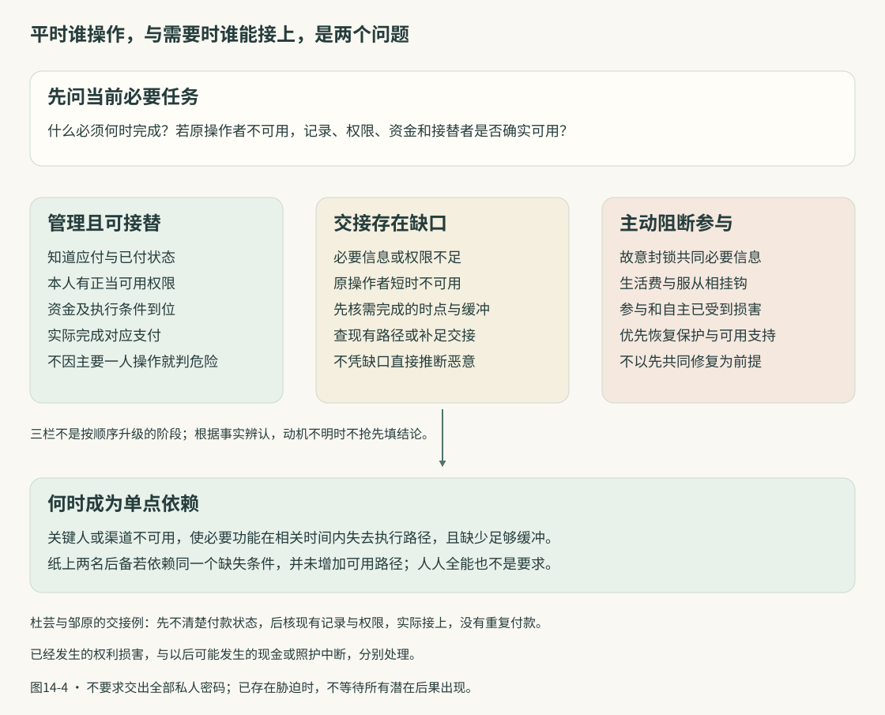

另设匿名对照：甲掌管共同生活款，明确拒绝让乙了解必要余额，还要求乙先接受自己的安排，才肯提供已经认可的生活费用。这时已经发生的损害，是乙被排除在共同事务之外，资源取得被用作服从条件。不能因为账面暂时有钱，就把它当作普通消费偏好差异。

如果乙因此不得不不断解释、退让，或不敢寻求支持，控制就可能继续压缩其选择。后续是否还会导致照护中断、就业受影响，需要看具体依赖，不能把可能的传播全部写成已经发生。但已经证实的参与剥夺和胁迫，无须等待所有后果出现才处理。

经济与生活之间也存在真实联系。收入缺口可能使原来可负担的服务无法继续，若替代任务全部压给一人，疲惫又可能挤压亲密和合作意愿；共同调整支出、任务与可用支持，可以在部分环节阻断这条路径。它不是每个家庭都会经历的必然链条，更不说明收入下降就必然失去爱情。

备用路径同样要按实际条件核实。两种照护安排若都依赖同一位无法到场的长辈，就不是两份可用支持；两条支付路径若仍依赖同一个不能取得的权限，也没有解决问题。无需让人人掌握全部技能，但关键事项应有可理解的记录、正当权限和在需要时确能接替的人或资源。

处理完钱，不等于处理完伤害。若先前已有羞辱、隐瞒或越权，恢复预算之外，还要承认发生了什么、恢复参与规则，并观察履行与信任的实际变化；感情是否回来又是另一个问题。沿[第8.6节](#unit-8-6)与[附录I.4](#unit-I-4)的同一修复口径，不让付款变成要求另一人立即原谅的条件。

信息不足时，核对真正影响决定的部分；已确认普通失衡且双方愿意、能够调整时，观察新的任务与保障是否落实；存在严重控制、可信威胁或现实侵害时，优先保护自主与安全，联系可信支持和适当求助渠道，不要求先共同修复或完整举证。[附录J.1](#unit-J-1)和[附录M.9：婚后共同经营与变化适应风险表](#unit-M-9)帮助辨认入口，不能代替本人对是否继续的选择。

生育、购房、新增负债或共同经营，还需要独立判断：当前义务是什么，真实资源和时间够不够，谁愿意承担怎样的后果。不能因为已经结婚、这月钱够花，或一次接替成功就自动放行。重大条件未清时可以暂缓相应承诺；明确不可接受或无法协调的安排，也不必靠无限投入证明自己已经尽力。

把家经营起来，是让两个人在完成必要事务之后仍有生活的余地。余地可以用来休息、相处和创造新的体验，却不会自动变成亲密。[下一章](#unit-15-1)继续讨论：熟悉、长期负荷与旧伤如何改变爱情，以及两个人是否仍愿意、也有条件重新靠近。

### 第十五章 成为家人，也继续相爱：长期亲密与关系恢复

熟悉给爱情带来一些初识时没有的东西。你不必每次解释自己的沉默，某个人知道哪件小事会让你高兴，也知道什么时候需要留下空间。但熟悉也会使人以为：对方应该懂，日常已经安排好，感情便可以暂时不管。

[上一章](#unit-14-1)讨论怎样让必要事务有可靠的承担者。本章接着问，事务之外，两个人是否还有愿意靠近的生活。这个问题既不能靠一场浪漫活动回答，也不能只凭某个疲惫的晚上下结论。

#### 15.1 熟悉之后的爱情：激情、亲密与承诺可以不同步变化

**长期爱情的几种动力会不同步变化，判断去留既要看真实意愿，也要看现实约束。**

设想一对已婚共居的伴侣，郑敏和杨维。最近工作都忙，郑敏晚上想说说一个终于解决的工作难题，杨维看着工作消息，只应了一声“挺好的”。她停了下来。他以为自己已经回应，她感到的却是，自己已经没有值得认真听的事情。

这次分享没有被好好接住，还不足以判断杨维从未爱过她，或已经决定退出。两人后来有一个空隙，杨维主动问起那件事的后续，郑敏也愿意讲。这补充了一点信息：分享意愿仍在。不过，一次接续也不能抵销长期忙碌的影响，更不证明其余时候的落空都已经处理。

[第六章6.2节](#unit-6-2)区分过激情、亲密和承诺。放到长期生活里，激情关乎被吸引和靠近的冲动，亲密关乎理解、信任与能够真实相处，承诺则关乎怎样选择和维持关系。这几方面可能一起变化，也可能不同步。一个人仍认真承担家庭事务，却难以表达亲近；两人仍喜欢聊天，却对未来共同生活失去共识。不能用其中一项替另两项作答。

因此，初识时的强烈兴奋减少，不必推出过去的感情是假的。能够在普通一天里分享某件小事，得到认真回应，也是一种积极价值。相反，若长期既无回应，也无重新靠近的意愿，“过日子就是这样”只是在替问题起一个习惯的名字，并没有说明两个人都能接受。

承诺还可以从留下来的动力细看。本书沿用奉献型承诺与约束型承诺的区分。前者指本人愿意维护这段关系、为共同生活付出；后者指离开会遇到的成本与限制，使关系继续维持。这是在区分动力，不是把人分成纯粹相爱与完全算计的两类。

| 观察到的事情 | 它能支持什么判断 | 还需要了解什么 |
| --- | --- | --- |
| 自主地认领任务、关心对方，并参与未来安排 | 当下有维护共同生活的行动 | 对方是否实际受益，投入是否可承担，亲密与共同方向如何 |
| 因住处、财物或其他现实条件暂时继续同住 | 当前存在离开的成本或限制 | 是否还愿相处、是否仍有感情，及本人怎样理解留下 |
| 两种动力同时出现 | 这段关系既有认可，也有现实约束 | 哪些是本人愿意，哪些是暂时没有选择，能否分别处理 |

另设一个匿名情境：有人已说不愿继续亲密关系，却因住处尚未安排而暂时同住。住在同一屋檐下，不能据此宣布双方仍在选择婚姻；但也不能反过来断言他已经没有任何留恋。感情、去留意愿与现实过渡可以同时存在，需要分别听清。

回到郑敏与杨维，眼前更值得辨认的是：沟通减少主要由于实际疲惫，还是愿意参与的动力在下降，又或过去未处理的失责使分享变得困难。这些解释可能并存，却会指向不同改变。若精力不足，增加长谈任务可能适得其反；若已有明显失信，仅仅早睡一点也无法恢复可信度。

辨认不靠猜心。可以从一次具体落空开始：那天发生了什么，对方当时能参与多少，有没有在后来兑现接续，双方是否还能说出近期愿意相处的经历。[附录I.1](#unit-I-1)可以帮助把眼前的一件事谈清，[附录A.2](#unit-A-2)则让人看见生活负荷、资源与治理怎样影响感情，不需要每晚检查全部领域。

持续时间也要与条件一起看。外部工作压力可能延续很久，不因名为“外因”就会自行过去；内部的一项分工冲突也可能通过实际调整得到改善，不因属于关系内部就必然无解。真正需要更新的是行动以后发生了什么，以及剩下的问题是否还有双方愿意、能够承担的处理路径。

婚姻里可以有安静，也可以有不同表达方式。只要两人确实认可，不必为了达到某种热恋标准制造项目；但一方已长期觉得孤独，另一方也不能用“我们还在一起”代替回应。存在一些好的部分值得认真看见，却不产生必须留下的义务。

#### 15.2 让亲密重新有发生空间：先减负，再增加可持续连接

**真实减负为亲密留下空间，合适回应让连接有机会继续，却不产生必须靠近的义务。**

杨维想做一点改变，提议周末去远处一家新店。郑敏直接说：“不想去，来回太累了。”他有点泄气：“那还能干什么？”她隔了一会儿才说：“我想先歇一下。不是不能一起待着，别再赶路就好。”

这次拒绝提供了比“不想约会”更具体的信息：她不接受这种耗时方式，仍愿意安静相处。不能据此认定所有疲惫的人都会喜欢散步，也不能要求拒绝者立刻给出完整替代方案。此时先理解真实限制，比继续寻找更精彩的活动有用。

郑敏晚饭后常要收拾厨房，还自行维持着每晚把全屋彻底整理一遍的习惯。杨维知道她在忙，却不清楚做到什么程度才算结束。两人看过日常任务后，认可暂停不必要的每晚彻底整理，保留基本清洁；杨维在自己确实可承担的饭后时间，完整接下厨房收拾、物品归位和必要用品余量核对。

这次认领包含方法与结束条件。郑敏不再先列好所有动作，也不在一旁不断验收；杨维知道哪些用品必须留意，普通整理可以按自己的方式完成。他原先已承担的其他责任也没有自动取消。这样的交接是否可行，要看他的全部负荷，不能只为让郑敏轻松就把另一人推入长期过载。

第一次实行后，厨房由杨维收好，郑敏真正停下来休息。她没有把省出的时间再用来完成已经取消的全屋整理，也没有马上变得兴致勃勃。休息本身已经是一项需要得到满足的结果，不是她接下来必须陪伴或亲近的预付款。

另一个双方都觉得合适的晚上，他们实际下楼走了一段。郑敏讲完那件工作趣事，杨维问了一个他没听明白的地方；后来他讲到路边小店的一处变化，她也接着说起自己的印象。这一次，两个人既说也听，不再只有安排家务和核对日程。它没有解决全部问题，却多出了一段愿意共同拥有的生活。

其中可以辨认一条有条件的循环：真实减负留下注意力；适合的回应让分享有价值；这样的体验增加下一次主动表达的机会。如果随后仍有合适回应，联结就有机会继续生成。任一环节都可能卡住——时间仍被工作占满、方式不合偏好，或某人已经不愿继续，增加活动便未必有用。

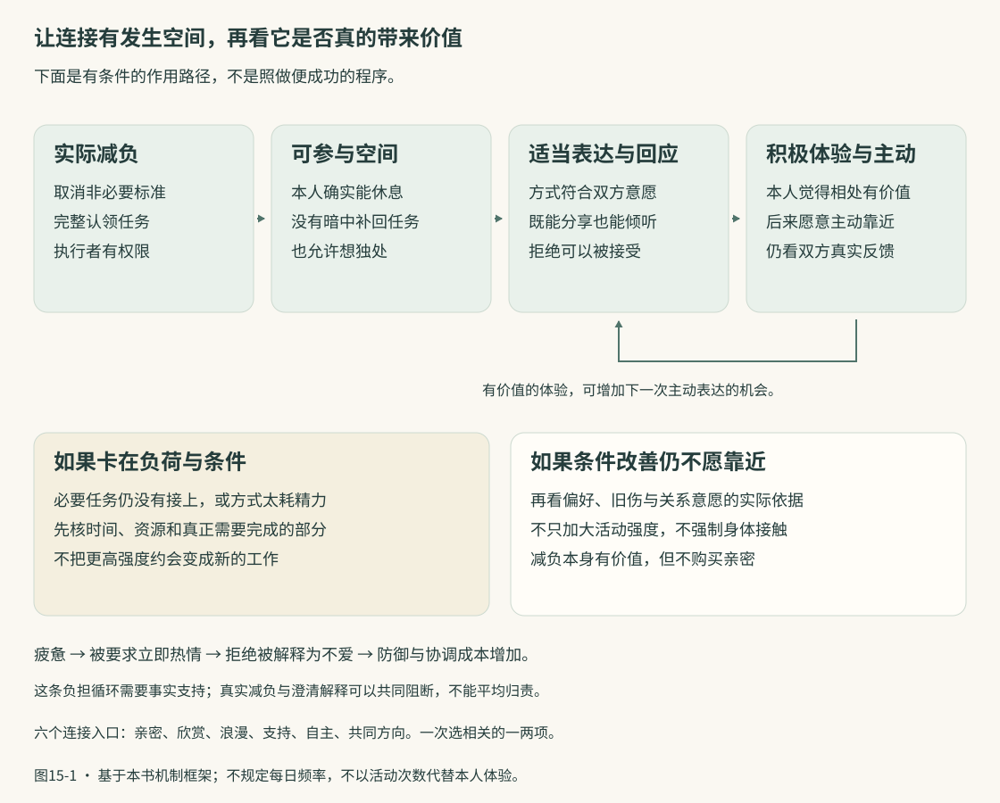

相反，疲惫时被要求立刻热情，容易让一次邀约变成压力；拒绝又被解释为不爱，对话转向防御，协调消耗进一步增加。这是需要查证的作用路径，不是所有拒绝背后的固定机制。减少任务与调整解释可以相互帮助，但解释变得温和，不能代替厨房真正有人收拾。

[第七章7.2节](#unit-7-2)说明了亲密怎样在合适的回应中积累；[附录C.4的六个日常经营入口](#unit-C-4)可以帮助挑选合适的连接，不必全做。

| 入口 | 长期生活里的一种具体做法 | 要看本人是否得到什么 |
| --- | --- | --- |
| 亲密 | 让一件想说的事得到完整回应，允许双方都有内容可讲 | 感到被理解，而不只是完成每日聊天 |
| 欣赏 | 说明你看见了哪项努力、能力或变化 | 欣赏能被接收，不是夸奖之后索取更多服务 |
| 浪漫 | 留意对方喜欢的细节，创造眼下愿意参与的小体验 | 仍有被记得和被吸引的感受，不靠价格证明 |
| 支持 | 接住一项实际需要，认领自己能承担的部分 | 负担确实减轻，而不是听完又让对方继续组织 |
| 自主 | 保留独处、朋友和个人发展的空间，接清原有责任 | 可以有自己的生活，且不是一人独自承受共同事务 |
| 共同方向 | 从近期经历谈一件想共同保留或改变的生活安排 | 对“我们怎样生活”有真实参与，不只重复口号 |

新的经验也不一定来自共同活动。一个人读到喜欢的内容、完成个人学习，回家愿意分享，都可能为相处带来新的东西。但个人发展不是不断缺席的理由，共同方向也不要求两人爱好相同。需要协调的是实际时间与责任，而非把彼此改成同一个人。

后来有个晚上，杨维工作结束得晚，两人取消了原先想去的散步。取消不需要补考，也不抹去已经认可的必要家务责任；真的无法接上时，要说明并安排，而不是让郑敏默默补回。偶尔调整与每次都推到以后是不同事实，要在实际经历中辨认。

身体亲近同样只能邀请，不能拿来验收减负是否成功。愿意一起走走不自动代表愿意拥抱、性接触或讨论所有旧事。对方没有当下意愿，先尊重这个事实；长期需要是否相容，可以另行认真谈，不能在眼前动作上强行取得答案。

若负荷已实际下降，对方仍持续不愿靠近，就要更新解释：剩余压力、活动偏好、旧伤与关系意愿，哪些有具体依据？这时不应只加大浪漫强度。改善条件能提供机会，却不能保证再相爱；[15.6节的再生判断](#unit-15-6)会保留这个结果。

#### 15.3 婚后外部吸引与忠诚：感受、边界、行为和选择分别看

**外部吸引不自动构成背叛，忠诚要依据双方认可的承诺和实际选择来判断。**

婚后被第三个人吸引，容易引出两个太快的判断：既然还能心动，过去的婚姻一定是假的；既然已经结婚，就不应有任何不能控制的感受。前者把眼前的新鲜体验扩成了对全部历史的解释，后者则把感受和行为责任混为一件事。

可以先承认本人有怎样的感受，再看实际选择。设一个独立的工作情境：某人欣赏同事的能力，也期待一起做事，目前仍在原本认可的工作交往范围内，没有作出与既有排他约定冲突的行动。这不足以判定违约，也不证明这份吸引永远不会影响选择。察觉它，可以成为重新想清边界的机会，而不是必须马上证明清白的罪证。

新吸引还只展示了特定场景中的一部分人。一起工作时的默契，不能直接证明日常生活、责任分担和长期方向同样相容；既有婚姻里的熟悉与可靠，也不能因此自动满足现在全部需要。两边都要看真实内容，不把激情、共同经历或沉没成本任意选一项当作最终答案。

忠诚判断落在具体承诺和行动。所谓“没有瞒你”，与“我们认可这样做”，不是同一回事。

| 可见程度与实际约定 | 怎样理解 | 当前需要核对什么 |
| --- | --- | --- |
| 公开，且在双方认可范围内 | 可以是正常交往 | 是否出现新的共同影响或边界变化 |
| 公开，却明确违反既有约定 | 公开不消除违约 | 违背哪项承诺，已经造成什么后果，本人是否接受继续 |
| 未逐次告知，但属普通私人或工作往来 | 未全面公开不自动是背叛 | 当前是否确有影响共同选择的重要事实，而非要求交出所有隐私 |
| 刻意隐去已经越过明确边界的行动 | 同时涉及原行动与信息上的失信 | 核相关事实，分别处理越界、隐瞒与现实后果 |

例如，另一个人公开称第三方为自己的恋爱伴侣，而他与原伴侣此前明确认可一对一排他，这就是公开发生的违约。不能靠“大家都知道”要求原伴侣追认。同样，原先认可的普通工作联系，并不因某次没有报备，就自动变成秘密关系。这里是两个独立对照，不用职业、出差或交往机会本身替代行为事实。

约定不清时，先说具体情境：哪些交往仍是各人的自主，哪些行动会改变现有排他承诺，哪些信息会影响对方的身体或生活选择。[附录I.1](#unit-I-1)可以帮助讨论当前分歧，[附录D.2](#unit-D-2)帮助找相关事实入口。不能把自己没说过的私人偏好追溯成对方早已接受的规则，也不能用“你没明确反对”替明知的重大越界开许可。

需求改变后，可以在一对一关系内讨论新的相处与经营安排，也可以决定结束并承担善后责任。讨论需要另一人真实愿意；未形成共识的共同安排不能先实施，更不能据此打破排他。现有不满可以解释选择的背景，却不授权秘密违约，也不能用既成事实迫使另一人追认。

透明的目的，是让与共同选择有关的事实能够被理解。它不要求强制定位、隔绝全部异性交往，或让一人持续检查另一人的手机。这样的做法可能压缩自主和真实表达，不能据此保证忠诚。若双方愿意共享某些具体信息，应当说明用途、范围和调整方式，不能把拒绝无限检查本身判作心虚。

已经有明确违约事实时，也不必为了展示开放理解而淡化损害。可以分别处理本人是否继续、实际责任和可行的修复条件；保护不以先查清所有动机为前提。对新的借贷、购房、生育或其他重大行动，仍用[附录D.4](#unit-D-4)独立判断，不能以加强绑定代替恢复可信度。

一段关系过去有过真实爱情，不保证今天仍适合继续；今天发生新的吸引，也不能倒推过去从未有爱。更有用的是看现在选择了什么、违背了什么、愿意承担什么，以及两人是否还有共同认可的下一步。

#### 15.4 失信之后为何补偿不够：修复承诺可信度与共同身份

**补偿处理了具体损失，信任仍要靠知情、参与和持续履行恢复，亲近意愿不能被索取。**

“钱不是已经补回去了吗，还要谈多久？”对说话的人，这可能意味着事情应当结束；对另一人，问题却是：下一次我作决定时，还能不能相信眼前的条件是真的？两人对“处理完了”的理解，可能根本不在同一层。

另设一对匿名伴侣甲和乙。两人明确认可一笔共同生活款用于既有安排，改变用途须先讨论。甲明知约定，却把其中一部分用于另一项个人支出，随后仍告诉乙原款留着。乙后来对照记录发现差异。这里已确认的是越权和隐瞒，不只是两人对消费价值意见不同。

乙不仅需要知道钱是否回来，还会重新理解过去的决定：“我是在假的余额上答应了安排，你知道，我却不知道。”这种解释有具体事实依据。不能要求她先换一种积极想法，便把原来的知情与参与缺口关掉；同时，也不能据一件事自动宣布此前每段共同经历都是利用。

这一事件直接影响了共同决定。甲让乙在不知真实用途的情况下继续安排生活，乙因而需要额外核对，也开始怀疑新的保证。钱款属于经济事务，能否共同理解并决定属于治理，受骗后的距离感属于感情体验。它们相互影响，却不由同一个动作一起恢复。

在这个情境的改善方向中，甲用本人确有可用余量补回原用途，款项实际到账；双方核对该笔用途与支付状态，受影响的原安排后来得到落实。这笔补款来自甲确有的个人余量，没有占用另一笔仍需支付的共同生活款。到这一步，能确认的是相应经济事务已有处理，不是乙从此不该再不安。

接下来，甲承认了自己做过的两件事：超出认可范围使用资金，以及明知实际状态却给出相反信息。他不能只为“让你不开心”道歉，因为那会把责任缩成乙的情绪。乙也不必先承诺原谅，才有资格得到事实说明与实际补救。

两人重看了共同资金的权限：原范围内照常执行，改变用途要先讨论，未得到回应不能先花；相关必要信息双方都能查看。[附录F.2](#unit-F-2)帮助把这些部分说清，而不是要求乙接管所有财务、每天检查全部流水。甲负有履行与及时说明的责任，不能把防止再犯的全部劳动交给乙。

[第八章8.6节](#unit-8-6)与[附录I.4](#unit-I-4)的七步仍是同一套：安全与稳定条件；分别陈述并交换事实、感受、解释和期待；确认冲突结构；处理本次事件；约定未来行为和责任；执行观察；重新创造积极连接。在这里，重点是核对各步有没有实际发生，而不是再发明一套“背叛之后”的流程。

其中，安全与自愿不是形式开场。若说明事实会引来威胁或报复，就不能照普通协商往下走；若本人已经不愿继续，钱款与其他善后仍可处理，不强制完成重新亲近。本例的改善方向以双方安全、自愿且有合作条件为前提；遇到威胁或报复时，转向[附录J.4的保护与支持准备](#unit-J-4)，不能照搬这一修复路径。

后来出现一次新的用途变更。甲在行动前说明想法，乙不同意，两人没有达成新的共识。甲没有执行，原用途保留。这条事实比再次保证“我懂了”多了一层意义：另一人真实说不时，原约定仍然有效。乙因此愿意继续观察，却没有表示自己已完全放心。

| 结果层次 | 这个阶段实际发生了什么 | 还不能宣布什么 |
| --- | --- | --- |
| 事务 | 原用途款实际补回，相关原安排得到落实 | 今后所有财务问题已经排除 |
| 规则、信任与共同体认同 | 越权和隐瞒得到承认，必要信息可见；一次新变更保留了乙的拒绝与参与 | 长期可靠已获证明，或乙已经恢复“我们始终是一队”的感受 |
| 感情 | 乙愿意继续观察，仍有距离和不安 | 已经原谅、恢复身体亲密，或承诺永远不再提起 |

共同体认同不是一句双方一起读出的宣言。它需要在“你的需要进入我们的决定”“我说不仍算数”“变化不会先瞒着我”这样的实践里重新获得依据。做出一项改变与对方开始相信这项改变，时间上也可能不同步。

责任方若觉得持续被怀疑很难受，可以表达自己的负担，也可以讨论合理的信息范围；却不能因此把信任恢复的期限单方规定好。受影响者也可以明确自己愿意了解什么、不愿承担怎样的监督。若唯一方案是永久互相监视，两人需要重新判断是否仍有可接受的合作条件。

感情重新出现时，可以是一段愿意分享的相处，也可以是一点不用强撑的靠近；它不能成为补偿的收据。没有这样的意愿，必要责任仍须处理，而继续关系本身可以重新决定。

#### 15.5 旧伤反复与负面解释：辨认余波、重演和结构衰退

**旧伤需要回应，新判断仍需具体事实；既不能把不安当作再犯，也不能把再犯说成敏感。**

沿[上一节的改善情境](#unit-15-4)，甲有一次比原来约定的时间晚回家。乙立刻想到那笔被隐瞒的支出，问得很急：“你是不是又没告诉我什么？”甲起初也不耐烦：“怎么又是那件事？”几句话之间，原本的晚归就带上了过去的分量。

这一次，甲此前已发过改变时间的消息，乙当时没有看到；后来两人对照消息和原安排，信息与甲说明的工作延迟相符，也没有发现新的必要事务遗漏或新的隐瞒。当前能说的是，这次迟到不构成已经证实的又一次欺骗，而不是从此已排除了所有未知。

乙的紧张仍是真实反应。它说明原事件的影响还在，不必因为查明消息存在，就要求她立刻轻松。甲可以承认先前的隐瞒使这类情境更难承受，同时把本次事实说清；乙也可以把“我很怕再被瞒”与“你这次已经骗我”分开。两种表达对当前事实的要求不同。

这种区分不会抹去原来的责任。若补回款项之后，原约定是否兑现仍没有说明，或必要资料始终查不到，旧问题可能本来就未处理完整。不能因为它被提过多次，就把所有提问统称翻旧账。相反，若本次只有旧不安被唤起，也不能把每次难过都新增记为一次已经发生的违约。

| 眼前出现什么 | 回到哪些事实 | 当前处理方向 |
| --- | --- | --- |
| 相似场景引出不安，未发现新违约 | 本次发生什么，旧安排是否落实，哪些担忧还没有回应 | 说明本次、接住余波，必要时回看原事件 |
| 原补救或约定一直没完成 | 哪项未执行，由谁承担，卡在意愿、权限还是资源 | 接着处理旧的未完成部分，不催对方宣布结束 |
| 有证据显示新的越权或隐瞒 | 新行为、原约定、相矛盾的信息及实际影响 | 作为新事件重新判断，不能只叫敏感 |
| 持续否认事实并压制核对与联系 | 已观察的否认、贬低、隔离及自主损害 | 优先独立支持与保护，不强制共同解释 |

另设一条替代分支：若乙这次发现新的付款记录，与甲先前明确表示“没有改变用途”相矛盾，甲也承认又私下改了用途，那么就有新的越权和隐瞒。处理方向需要随新事实改变，不能继续套用“旧伤触发”来安抚。这是与[上一节改善故事](#unit-15-4)相区别的另一条走向，不能把两个走向合并成同一段经历。

负面解释本身也可能形成循环。若每次普通失误都先被说成“你就是这样的人”，对方解释时又只想着摆脱指责，原本可以说明的事情便容易变成互相防御。下一次遇到含糊情形，两人更少预期会被善意理解，也更不愿分享；新的疏远又被用来证明最初判断。

这条循环要由具体互动支持，不能一见受伤者警觉就说她在制造问题。真实失责仍须认领，合理核对不等于敌意；同样，曾经受伤也不使所有新的推断都成为事实。回到“这次做了什么、留下什么影响、我还不知道什么”，可以减少把人格结论反复当作证据的机会。

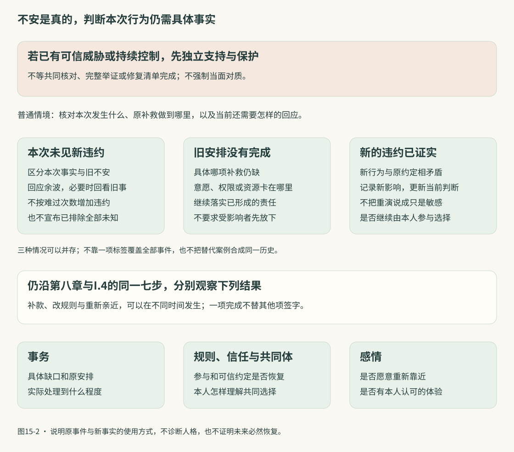

*[图15-2](#figure-15-2)沿用[第八章8.6节](#unit-8-6)与[附录I.4](#unit-I-4)的同一套七步；新事实需要重新判断，三层结果分别观察。*

还要把普通分歧与持续操纵分开。另设一个独立危险情境：一方反复否认双方可查的已发信息和已作决定，将对方指出的差异说成“你判断有问题”，并阻止其联系可信亲友核对。这里需要关注的是可观察的事实否认、判断贬低和信息隔离，以及它们怎样共同压缩对方判断与求助的空间。

这一组机制与通常所说的煤气灯操纵相联系，不是临床诊断。一次记忆不同、防御性的辩解，或对事实含义的不同理解，不足以据此定性；但持续控制也不能被改名为表达方式不同，要求双方各退一步。[附录J.4](#unit-J-4)提供独立支持的准备入口，不要求本人先赢得对事实的共同解释权。

回到没有威胁的普通余波，甲和乙可以讨论联络是否需要作有限调整：什么变化影响现有安排，怎样通知能被看到。它解决的是实际协调，不是以全天定位保证从此不再不安。[附录I.2](#unit-I-2)可以记录一件尚未处理的事和后来新增的信息，[附录I.4](#unit-I-4)则分别看事务、信任与共同体、感情，不让记录变成无限重审。

若反复尝试后，仍持续轻蔑、厌恶、回避共同生活，就要认真判断当前还剩多少合作意愿和可承担条件。一次晚饭愉快不能宣布这个模式已经消失；也不必等到证明它永远不可改变，才允许考虑停止。寻求适合的帮助与决定不再继续，都需要尊重本人实际处境，不能把坚持年限当作成熟程度。

#### 15.6 再生能力是否存在：从止损，到稳定，再到新的生成

**关系的再生要看真实行动是否带来可承担的改善与双方愿意的连接，不能只看关系仍在。**

“最近不吵了”，可以是一条有用的新信息，却还不是完整结论。可能是原来的问题得到处理，也可能是两人各自回避，或某个人已经不敢开口。要判断关系是否在恢复，需要知道安静怎样形成，以及安静以后有没有值得两人继续参与的生活。

本书用再生能力指向这样一种可能：在伤害停止或原有困难得到处理后，两个人能够靠真实可承担的行动，重新生成亲密、信任与合作。这不是一种仅凭谈话便能测出的能力，更不是给某类关系判定永久可救或不可救的标签。

有侵害时，先要停止继续发生的伤害；没有侵害、只是普通过载时，主要任务可能是减负与接续必要事务。不同起点都需要真实意愿、现实条件和实际行动。不要把所有降温写成已经受伤，也不要把一次停止争吵当作伤害已停止的证据。

| 观察的问题 | 可以支持判断的事实 | 与下一项的距离 |
| --- | --- | --- |
| 是否止住已有损害 | 具体侵害行为停止，受影响者能够拒绝和取得支持，不只收到道歉 | 停止继续受损，不等于过去后果已处理 |
| 必要事务和参与是否恢复 | 原缺口被实际接上，责任、权限和负担得到可承担的调整 | 事务能运行，不等于双方愿意亲近 |
| 是否重新生成积极价值 | 多次自然互动中出现双方主动、适合的回应与本人认可的体验 | 有积极片段，不证明所有问题或未来条件已经解决 |

这些是要分别观察的结果，不是必须依次通过的三关。小分歧可能很快处理，真实亲近也可能与仍未解决的事务同时出现；后者不能替前者免除责任。若出现新的严重侵害，应立即更新当前判断，而不是因为此前走过某一步就继续下去。

再看[郑敏与杨维的普通负荷主线](#unit-15-2)。后来的几个晚饭后，杨维按原认领收拾厨房，郑敏不再补做已经取消的整理。她确实有休息，杨维也反馈这段任务在当时工作安排下可以承担。这里先得到的是分工能够运行的证据，还不能据此替两人宣布感情已经回来。

新的部分出现在相处里。后来杨维回家主动说起郑敏此前讲的工作趣事，问她最近还有没有后续，她愿意接着聊；另一个周末，郑敏主动邀他去附近走走，他也愿意，后来两人实际出门，聊到彼此近期的一件新鲜事。她说这样的相处比较放松，他也觉得比赶远路更适合眼下生活。

这一组经历不同于某个人连续预约、另一人勉强配合。双方都有主动，也都有回应，相处不只剩任务讨论；这给继续尝试提供了当前依据。它仍有范围：工作负荷没有永久消失，后来是否持续可承担仍需观察，不能把几个片段写成永远恢复了热恋。

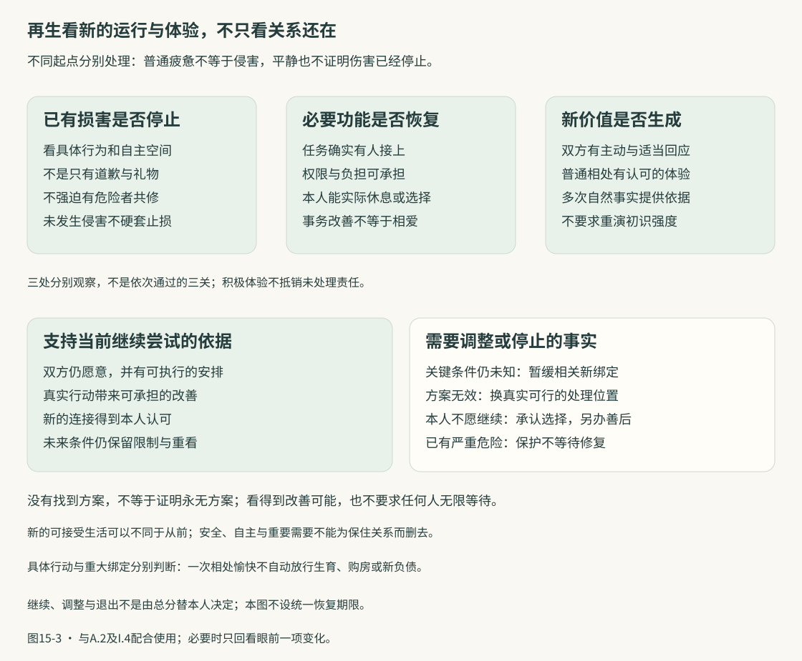

*[图15-3](#figure-15-3)可配合[附录A.2](#unit-A-2)的系统观察与[附录I.4](#unit-I-4)的三层结果使用；只选择与当前问题有关的部分。*

反例同样需要保留。另设一对匿名夫妻，原来不均的生活任务经过双方认可的调整，后来多次按约执行，必要事务能完成，各自也确有休息。其中一人仍明确表示，不愿继续这段亲密关系。没有给出新的背叛或危险事实，也不能因此把“不愿意”当成尚未发现的疾病或必须修好的错误。

对方可以难过，可以希望再谈一次；但任务已经改善，并不产生必须重新相爱的债权。现在能确认的是一部分合作条件恢复了，继续亲密的意愿没有形成。实际善后仍要讨论，不能把“你看，我已经改了”变成另一人必须留下的证明。

再生也不等于回到从前。原来的生活可能依赖某人不再愿意承担的标准，旧亲密节奏可能只适合当时的精力。新状态可以更少活动、更诚实地说明容量，也可以拥有更稳妥的共同时间。只要双方真实认可，并有能够维持的行动，它就不因为不同于热恋而失去价值。

反过来，不能为了让关系继续存在，就把安全、自主或一个人明确表达的重要需要从要求里删除。共同生活的目标是服务其中的人；能够勉强维持同住，不足以推定关系整体有效。[附录A.2](#unit-A-2)可以帮助并看感情、生活、经济和治理，[附录I.4](#unit-I-4)保留三层修复结果，不必再增加总分。

回顾时，可以只问最近出现了什么新事实：谁做出了原来没有的行动，谁实际得到一点空间，双方是否还愿意继续，尚未解决的部分会造成什么影响。有依据的改变要承认，没有发生的结果也不提前记账。无需每天审查彼此，却不能把长期没有行动无限解释为需要时间。

本书不规定统一恢复期限。时间、资源、承受能力和本人意愿，都构成当前现实限制。尚未找到可行方案，不等于已证明未来永远无解；同样，看得到某种改善可能，也不意味着当事人必须继续投入。是否继续与怎样负责地结束，最终仍是各人有权参与的选择，[第十七章](#unit-17-1)接续具体善后与重建。

#### 15.7 风险专节：把约束当爱情、把补偿当修复、把平静当恢复

**留下、补偿和平静各有不同含义，判断是否恢复必须回到实际行为、自主空间和本人意愿。**

长期关系中的误判，有时来自把一个真实的好变化放大得太快。款项确实补了，礼物确实送了，争吵也确实少了；问题在于，这些变化分别说明什么，哪些损害仍然存在。

| 容易作出的判断 | 先核对一个具体事实 | 不能跳过的反例或限制 |
| --- | --- | --- |
| 留下来就是仍选择这段爱情 | 本人是否愿意继续，现实退出条件怎样 | 暂时同住可能为了安排住处；有约束也不证明全部感情为零 |
| 补偿了就是修复完成 | 原事件怎样处理，参与和可信约定有没有实际恢复 | 钱回来之后，隐瞒和被排除的影响仍可能存在 |
| 平静了就是关系恢复 | 能否表达不满、拒绝与取得支持，任务是否真的接上 | 回避或恐惧也会使争吵减少；平静本身不够 |
| 示好说明伤害已经停止 | 原威胁和控制是否持续，实际自主是否回来 | 一次礼物可以与未解除的威胁并存，不购买下一次机会 |

最后一种情况需要单独看。设一个独立危险情境：一方曾在工作地点拦住另一方去路，又威胁如果向亲友求助就再次纠缠，后来送来礼物、为先前态度道歉。受影响者想相信关系会变好，也还没有确认可用住处和生活支持。她的期待是真实的，选择条件有限也是真实的。

此时不能把收到礼物或暂时留下，当成对原行为的认可。已发生的拦路、阻止求助的威胁，需要按这些具体事实处理；礼物不能证明后续威胁已解除，也不能据此确认她自由联系的空间已经恢复。是否还存在其他危险仍须结合实际情况，不能凭故事编出必然升级路线或复发概率。

一位可信朋友已通过她当前认为可接受的渠道表示，愿意倾听并协助联系适当资源。这是一项已经确认的有限支持：朋友是否能够提供住处、专业支持能否及时取得，都还没有确认，也不能保证当前联络渠道今后始终安全。[附录J.4](#unit-J-4)展示怎样据此辨认已可用和仍待确认的支持。眼前存在紧迫危险时，取得可获得的紧急帮助优先；不要求把记录填完、先公开对质或参加共同咨询。

这不是普通降温的处理逻辑。[郑敏与杨维的减负情境](#unit-15-2)里，有具体的工作与家务负荷，有双方愿意接受的调整；[后续相处](#unit-15-6)出现了真实减负和积极体验。它支持继续观察新的连接。危险例里，眼前的问题是已存在的威胁与自主受限，不能要求受影响者先更温柔、更多约会，看看对方会不会停止。

[共同生活款被挪用的失信情境](#unit-15-4)又是另一条路径。原款补回可以减少一个经济缺口，但隐瞒已经让另一人失去知情和参与；如果这些后果不处理，继续要求信任就会制造新的冲突。需要分别承担事务责任、恢复可信安排，之后再看本人是否愿意靠近，不让经济改善覆盖治理和感情。

普通落空也可能不断累积。一次没有回应，被理解成不在乎；表达转为指责，对方随之防御或退缩，下一次更难分享。这里可以核对实际负荷、改变回应和任务安排，尝试阻断循环。不能因为画出了循环便平均分配责任，更不能借此把某人的明确威胁解释为双方共同造成。

当新的积极体验出现时，可以享受它，也可以感谢实际改变，不必把每个愉快片段都审计一遍。但若需要据此作出重大决定，就应重新看持续行动、尚未处理的损害和双方意愿。一次旅行、一段短暂亲近或一份礼物，不足以自动支持生育、购房、新负债或更深的依赖。

本书的积极连接步骤，是在自愿和现实条件允许时重新创造价值，不是“伤害一次、哄好一次”的抵销办法。停止不当行为与承担既有责任，不以获得新的机会为交换；受影响者也无须表现出足够感动，才证明补救有意义。

当前事实尚不足时，可以暂缓受其影响的新绑定，核对相关部分；普通问题有双方愿意且可行的调整，就看行动结果；明确不愿继续或核心需要无法协调时，可以停止；严重控制或可信威胁则优先保护。[附录M.9“婚后共同经营与变化适应风险表”](#unit-M-9)提供对应入口，[附录I.4](#unit-I-4)、[附录J.4](#unit-J-4)与[附录J.5](#unit-J-5)分别承接普通修复、支持准备及退出善后，不能混成一个必走流程。

继续相爱需要机会，也需要真实选择。[下一章](#unit-16-1)把目光再往生活条件移一步：当职业、照护、收入与人生目标改变，旧的任务和支持怎样重新组织，使两个人有条件继续创造愿意共同生活的未来。

### 第十六章 当人生改变：目标重谈、角色转换与家庭韧性

当生活发生大变化，最难的有时不是事情变多了，而是两个人忽然发现：原来同意的生活，一方已经不再想要，或双方都还想要，却没有原来的条件继续过下去。

一个人想慢下来，另一个人害怕未来失去保障；一个人需要照护，另一个人的工作又不能停。他们未必失去了感情，但感情需要新的安排才能继续支持生活。本章从这些变化出发，讨论怎样让改变有真实的承接，也让每个人保留参与、拒绝和重新选择的空间。

#### 16.1 当目标改变：给未来的对方留位置

**愿望可以改变，共同后果仍需面对；重新商量未来，要同时保留个人选择与真实承担。**

“可我们当初不是这样说的。”这句话里可能有责怪，也可能有害怕。曾经共同选择的方向，让人愿意投入时间、放弃别的机会；对方现在想改变，自己失去的不只是一个计划，还有对接下来生活的预期。

姜悦和尹航面临一次职业与共同目标的调整。姜悦在一段已经结束的临时照护中，发现自己很难接受工作把时间全部排满。她开始希望降低工作强度。两人原先却约好先积累一笔共同储备，再改善居住条件，尚未签新的住房合同。

她说：“我以前真觉得多拼几年没什么，现在不想一直这样了。”尹航先问的是：“那原来商量的事还做不做？”她听出不满，回了一句：“所以我只能继续扛着？”两人此刻谈的其实不是同一个问题。她想确认自己还能不能改变，他想知道共同计划会失去什么、这些后果是不是只好由自己接下。

共同经历会让原本抽象的愿望变得具体。照护之前，一个人可能只想到职业发展的好处；真正经历时间被切碎、自己无法休息，才意识到可支配时间同样重要。这样的改变不必是对过去的欺骗，也不意味着现在的愿望一定比过去更成熟。需要面对的是：本人现在想怎样生活，已经形成的安排又会因此受到什么影响。

姜悦后来补了一句：“我还没辞职。我想换一种节奏，也知道不能直接让你把差额全补上。”尹航也说清，自己担心的并非她少赚就不值得尊重，而是原定储备积累如果中断，是否需要削减必要生活，或由他增加工作。愿望说清之后，讨论才有了可以分别核对的对象。

| 这次需要分开的事 | 谁能决定，接下来谈什么 |
| --- | --- |
| 姜悦希望怎样工作、怎样理解自己的生活 | 由姜悦表达和选择；尹航可以说明影响，不能取得对她职业的永久审批权 |
| 共同储备和居住计划能否调整 | 核对原承诺、真实需要与可调整部分，由相关当事人重新商量；不把未买的东西写成已有债务 |
| 改变后谁承担收入空档和家庭任务 | 看具体金额、时段与实际认领；尹航没有自动增加全部投入的义务，姜悦也不能默认后果有人兜底 |
| 眼下有没有可以实施的岗位或过渡方案 | 查询实际工时、排班、报酬、入职条件和衔接；“想换”还不是“已经找到” |

这张区分表也避免了另一种极端：为了证明尊重对方，就把所有现实后果都说成不重要。伴侣可以支持愿望，却不愿接受某种实现方式。例如愿意推迟居住改善，不愿承担未经核实的长期支出；愿意一段时间多做生活事务，却不能因此失去全部休息。拒绝一个方案，不必等于否定这个人。

他们询问后发现，一个表面工时较短的岗位需要频繁临时调班。它未必能带来姜悦最在意的可预期休息。这个新信息使她不再只盯着“工时少一点”，而开始比较真正可用的时间。尹航也看见，她希望改变的不是简单少付出，而是想让生活保留自己能够安排的一部分。

但理解没有立刻创造合适岗位。在本例中，她现阶段仍能短期留在原岗，两人同意先不增加新的大额居住支出，并核对必要支付、储备现状及可能的收入过渡；没有把尚未确定的未来收入填进去。下一次排班明确后，他们会用新信息再谈；若她的负担此前已无法承担，就提前调整，不能把“等信息齐全”变成无限维持原状。

这一步只形成了有限的共同安排，还没有完成职业转换。如果最终新工作只能显著减少收入，而现有必要任务无法靠其他资源维持，困难就仍然存在。此时可以重议生活标准、时间和长期目标，也可以承认双方不能接受同一种未来；不能靠要求其中一人更理解另一人，假装资源缺口已经消失。

有些变化更难通过调整方式兼容。另一个独立虚构例中，两人原来都不想生育，后来一人明确希望养育孩子，另一人仍不愿意。解释原因、了解真实承担，可能使人发现自己误解了对方，也可能确认分歧确实存在。如果双方经过理解后仍坚持相反方向，就不存在靠“各退一步”自动得到的共同方案。

共同目标不能通过投票替代身体决定，更多经济补偿也不能换取本人不愿意的生育。原先的承诺值得诚实说明和妥善回应，却不构成控制对方身体的权利。双方可以重新选择关系；是否继续，与已经形成的财物、生活依赖及其他善后事项分别处理。

如果难以说清自己的变化，可以回到[附录B.1](#unit-B-1)描写一个现在愿意过的普通星期，用[附录B.2](#unit-B-2)辨认哪些是方式偏好、哪些是当前核心需要。具体共同事项可从[附录D.2](#unit-D-2)选择相关条目，责任来源不明时再用[附录J.2](#unit-J-2)。不是把旧清单全部重填，而是把真正改变决定的那一处说清。

给未来的对方留位置，是允许眼前这个人继续参与定义自己的生活，也允许自己诚实回应受到的影响。它要求双方不把旧承诺用作封住变化的理由，也不把新愿望用作单方改写共同生活的通行证。

#### 16.2 角色如何重配：不要把暂时处境写成终身身份

**角色应随能力、需要和条件调整，临时补位要有承载边界，不能悄然变成终身身份。**

当照护需求突然增加，人很容易先接过事情，等生活勉强运转起来，才发现“这几天我来”已经悄悄变成“以后一直由我”。最初的帮助是真心的，后来的疲惫也是真的。不能用前者证明后者不该存在。

下面用郑敏和杨维说明一个独立的照护情境。杨维暂时需要生活协助：本周有两次必要外出需要陪同，晚饭后还需要有人帮忙取放生活用品。他仍能在精力允许时确认自己的需要、核对账单和处理部分在线事务。本例不设定全天看护，也不据此推断任何病情或恢复期限。

郑敏接手了两次陪同和部分组织。她已取得单位对本周两个下午调休的同意，确认本期收入安排不变、对应工作不会再挪到夜里补。这次调休的工时和收入条件已经落实，其他工作情境是否有相同条件，需要另行确认。外部生活协助服务只问过，名额、费用和启动时间还没有确认，不能拿来覆盖眼下的空档。

两次陪同后来实际完成了，约好的晚饭后帮助也有做到，必要事务没有因为等待服务而搁下。只是郑敏原本可以自行安排的休息被占用了，还多了联络和记住待办的负担。事情办完，说明这次补位有效，不说明它没有代价，更不能证明下周还能原样再来。

杨维起初说：“等我好了就不用这么麻烦了。”郑敏想听的却不是一个没人能保证的日期：“现在这些我能做，但我不能每周都这样调休。下周怎么办，我们得另外看。”这句话并不撤销已经做出的关心。它指出的是补位有期限，而需要未必按两人的预想结束。

角色重配可以先看五类任务，避免只把眼前最显眼的一项交出去。这里的“谁能做”包括时间、精力、技能、权限和真实意愿；没有工作不等于全天有空，需要照护也不等于失去所有能力。

| 任务 | 本例先核对的内容 | 不应默认的安排 |
| --- | --- | --- |
| 收入 | 本期收入安排已经确认；延长调休或改变工作后的收入另看 | 这一周没有减少收入，以后也一定不受影响 |
| 时间 | 外出、往返、工作和休息分别占用哪些时段 | 同一个下午同时工作、陪同，还能充分休息 |
| 照护 | 哪些确实需要到场，哪些本人仍能完成 | 需要一次陪同，就必须全天由伴侣守着 |
| 家庭组织 | 谁联络、核对信息、安排接续和处理变化 | 陪同者之外还有一个永远负责提醒的人 |
| 情感支持 | 怎样表达害怕、疲惫与感谢，彼此能回应到什么程度 | 被照护者必须持续乐观，照护者必须随时安抚 |

最开始，通常先保证不能等待的必要事务有人处理；局面稍稳，再看临时安排能维持多久；如果变化持续，就要重新设计工作、照护与生活。这是安排任务的三个时间窗口，不是病情阶段，也没有所有家庭通用的天数。长期重建的准备可能一开始就需要做，新的紧急问题也可能使人回到眼前的应对。

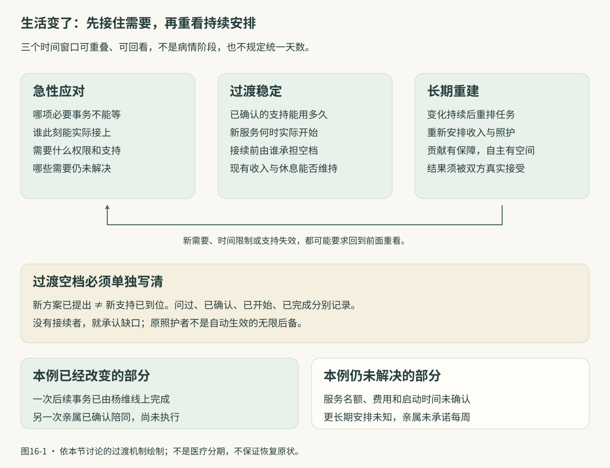

*图中每个窗口都要检查承担者、资源和启动条件。箭头表示需要随新事实调整，不表示生活必然按顺序恢复；新方案未接上之前，空档仍须单独处理。*

后来，杨维的协助需要比两人原先设想的持续更久，郑敏不能再取得同样的调休。如果仍把“再坚持一下”作为全部回应，就会把这次临时安排变成没有承载依据的长期安排。需要重看的不是她够不够有爱心，而是原来的时间路径已经不能继续。

他们先核实两项后续事务。一项经承办方确认，可以由杨维在线办理，他后来在可承受的时间内完成了；另一项仍需下周一个下午到场，时段不能调整。减少了一次陪同，确实减轻了任务，但不能据此宣布所有照护需求都能线上解决。

对仍需到场的一项，杨维的一位亲属明确愿意在那个下午上门、全程陪同并送回，杨维也愿接受。双方核对了往返时间、必要信息和现有可用费用范围。这是一项已经确认、尚未执行的支持；亲属没有答应之后每周接手。郑敏能继续承担原约定的晚饭后帮助，没有新增全天照护承诺。

目前的变化因此很有限：一项事务已经由本人完成，另一项有了下次的接续安排，更长期的需要仍未解决。服务询问没有变成实际名额，亲属的同意也没有变成已经履行。若亲属临时不能来，那个下午会重新出现空档；不能在表上自动把郑敏填回去，更不能假定杨维可以独自完成。

这时要及时联系当事人与承办方，在当前时段不能调整的前提下，核对是否还有适任帮助或其他可行的处理方式，以及无法按原安排完成会产生什么影响。若仍找不到路径，就如实保留未解的需要，并据实际紧迫程度寻找可获得的适当支持。写出这一缺口并不好看，却比写“家属负责”更接近问题所在。

[第二章2.2节](#unit-2-2)把功能缺口出现后的额外补位称为家庭功能代偿。这里谈的是谁接上生活任务，不是财务语境中的担保相关责任，也不同于原本双方认可的正常分工。郑敏这次增加陪同与组织，保护了必要生活；如果此后长期需要帮助，就应建立持续安排，不能让她永久处于“暂时替一下”的位置。减少不必要步骤、恢复本人能做的部分，也可能减轻总成本，不是所有任务都只能原封不动转给另一个人。

更紧密的依赖，不自动意味着关系偏离共同生长。在需要帮助时，能够保留选择、获得实际照料，并让提供者有保障和调整空间，也可以是两人共同生活的价值。相反，若因为一人暂时无法工作，就取消其必要生活资源和决定参与，问题已经超出任务分配。贡献变化不能成为羞辱或支配的理由。

被照护者也仍是参与者。杨维能说自己接受什么帮助，能在实际能力内处理部分事项；需要专业判断的能力与限制，则应取得相应解释，不由伴侣凭“我为你好”包办。他能多做一些以后，可以重新认领；希望增加自主并不是否认之前的照护，也不必用继续依赖来证明感激。

照护者同样需要恢复空间。新服务或亲属接上后，空出来的时间不能默认继续填入其他家庭任务。可以先让已经承受负担的人真正休息，再看职业和个人安排怎样恢复；否则任务表变了，实际处境可能没有变。恢复过去的分工也不是唯一结果，重要的是新安排能否被双方接受并持续承担。

把当前任务落到人，可用[附录G.1](#unit-G-1)；范围和交接不清时用[附录G.2](#unit-G-2)；贡献、保障与发展空间受影响时用[附录G.3](#unit-G-3)，并借[附录G.4](#unit-G-4)分清本人主责和可请求的支持。[附录J.1](#unit-J-1)用于核对关键功能与后备，[附录J.3](#unit-J-3)用于写清具体接续。只选眼下有用的部分，不需要同时维护六张表。

临时安排转入长期重构，常常不是等到某个固定日期，而是因为出现了足以改变判断的新事实：调休已无法续用，服务持续不可得，储备不能再承担，或必要帮助已成为经常需要。明确这些事实，才能把“我们再撑一撑”改成对现在生活真正有用的下一步。

#### 16.3 收入下降或经营失败：修复经济模式，不急于否定婚姻

**收入冲击需要重建可持续的收支与分工；经济困难和共同面对它的方式，应分别判断。**

收入变少之后，一句“这个月怎么办”，很容易被听成“你怎么这么没用”。提出问题的人在担心支付，回答的人却先感到羞耻；如果两人因此不再谈具体数字，原本已经减少的收入之外，又多了一层无法共同判断的困难。

先把两件事分开：原来的挣钱和支出方式能否继续，以及两个人还是否愿意、能够共同面对变化。经济模式失效会真实改变生活条件，不必等双方同意才发生；但它不自动证明感情虚假或整个关系失去价值。反过来，双方仍然相爱，也不会让必要支付自行得到满足。

韩静和蒋衡面临的是收入变化。蒋衡当期收入已经减少，何时恢复还不知道。他告诉韩静：“这次到账确实少了，我还不能保证下个月。”韩静先问哪些安排要改。蒋衡有些难堪，以为她在追究能力，后来才说出自己也担心储备撑不住。

这段对话没有把困难谈掉。它让两人能够开始核对同一份现实：现在确实收到多少，近期必须付什么，哪些支出尚可改变，已有储备中哪些能用。某位亲属说“到时候再看”，只能作为尚待确认的支持意向，不能填进当前现金；过去存过的钱，也要查现在是否仍在、是否另有已承担用途。

| 眼下是哪类问题 | 需要区分的事实 | 下一步才有针对性 |
| --- | --- | --- |
| 当期现金与支付时间不匹配 | 钱尚未到账，还是收入确实减少；哪些支付已形成义务 | 对齐真实到账、可用存量与支付时点，不把预计回款当现金 |
| 原生活成本长期难以维持 | 收入路径、必要成本和可调整部分，是否持续不匹配 | 重议成本与工作组合；一次动用储备只缓冲当期，不证明持续路径成立 |
| 存在复杂经营责任 | 涉及哪些主体、文件、权限、担保或受限资源 | 取得相应专业解释，先弄清责任范围，不能只按家庭日常预算理解 |

“暂时”也需要依据。一次到账延迟、收入持续下降、应收款无法确定收回，是不同情境。对恢复时间没有可靠信息，就写尚不知道；不能因为本人很希望尽快恢复，就让所有安排继续按原来的收入水平运行。

借用[第十四章14.7节](#unit-14-7)已经说明的宋晴与郑闻财务例，考察收入下降后的安排：假设当月实际可用收入由20000元降为15000元，原来的20000元计划还未调整。这个数字不属于韩静和蒋衡；后者尚未设定具体收入。原计划组成如下。

| 原计划用途 | 金额（元） | 收入减少后不能直接略去的问题 |
| --- | ---: | --- |
| 必要生活保障及债务 | 12000 | 本例暂按不变，债务已经包含，不能再加一次 |
| 年内预提 | 2000 | 对应未来哪项费用，能否延后，尚需确认 |
| 应急与长期新增 | 3000 | 减少准备会损失什么保障，尚未决定 |
| 弹性与个人自主 | 3000 | 哪些可调整，怎样保留真实需要，由本人参与 |
| 原计划合计 | 20000 | 比当前15000元收入多5000元 |

5000元是原计划的缺口，不是已经发生的逾期债务，也不是必须再借5000元。保留12000元必要支付后还剩3000元，但这3000元面对的是原计划里另外8000元的用途。把其中5000元从表上删除，可以使算术相等，却不会自动消除那些用途所对应的未来需要。

完整调整要说明哪些安排取消或延后、谁受影响、原先义务怎样处理，以及是否实际执行。[附录F.2](#unit-F-2)用于查钱是否能用，[附录F.3](#unit-F-3)和[附录F.7](#unit-F-7)区分计划、支付与留存，[附录F.4](#unit-F-4)—[附录F.6](#unit-F-6)帮助辨认结构和重大未知，[附录F.8](#unit-F-8)处理不同收入形式；不需要为了得到一个漂亮总分，把缺失的信息补成零。

回到韩静、蒋衡的透明合作方向。他们实际撤销了一项尚未下单的非必要购置，减少了一个计划需求；没有把这当成新增收入，也没有因此宣称全部缺口已补。蒋衡把已到账与预计收入分开提供，韩静据此调整近期安排。两人至少不再一个按旧收入作决定、另一个独自想办法遮住差额。

减少支出和增加收入，都可能改变家庭时间。若蒋衡增加工作，原由他承担的生活事务是否还能完成？若转由韩静接手，她的时间是否真的有余量？原来的付费协助若暂停，省下费用的同时由谁完成任务？钱没有花出去，不等于劳动消失。新工作或新服务开始前的收入、时间与费用，也需要单独衔接。

另一条独立的假设方向会把问题推向别处：蒋衡明知收入下降，却仍告诉韩静“跟以前一样”，又私自动用了另有共同约定用途的储备。韩静按旧信息安排采购，后来发现余额变化，只得重排。这里已经不只是少挣了一笔钱，还有一方失去知情和参与、原约用途被擅自改变的事实。

即使后来收入恢复，补回钱也不能代替解释隐瞒、处理越权和重新建立可信约定。可以借[附录I.4](#unit-I-4)分别看事务、规则与信任及共同体、感情的变化。蒋衡对收入减少感到羞耻，值得被理解；他为此提供错误信息，却仍须对造成的后果负责。韩静的不安也不能仅被要求靠“相信他一次”解决。

若涉及经营失败，不宜先把所有义务都叫作“我们家的债”。应带着具体材料弄清谁作了何种承诺、范围与期限、触发条件、哪些财产受限、哪些解释仍不明，再取得相应专业帮助。本书不凭婚姻身份认定某项法律责任，也不建议靠另一次高风险押注挽回旧损失。

困难中可以有尊重、互助和真实的亲近：如实说明一个坏消息后，仍能一起吃饭、讨论当周怎么办，而不是一人从此失去发言权。但这些价值与经济缺口需要分别看。没有找到足够资源时，不能宣布只要同心就可持续；对方有资源，也不等于必须无条件承接自己并未认可的全部新风险。

判断应随着实际变化更新：哪些必要支付已经接上，哪些只靠有限储备，新的收入路径是否真正开始，生活负担和信任有没有继续受损。如果原经济模式确实不能维持，就重建方式；如果共同承担已演变为长期隐瞒、羞辱或不可接受的单边转嫁，也要重新判断关系本身。

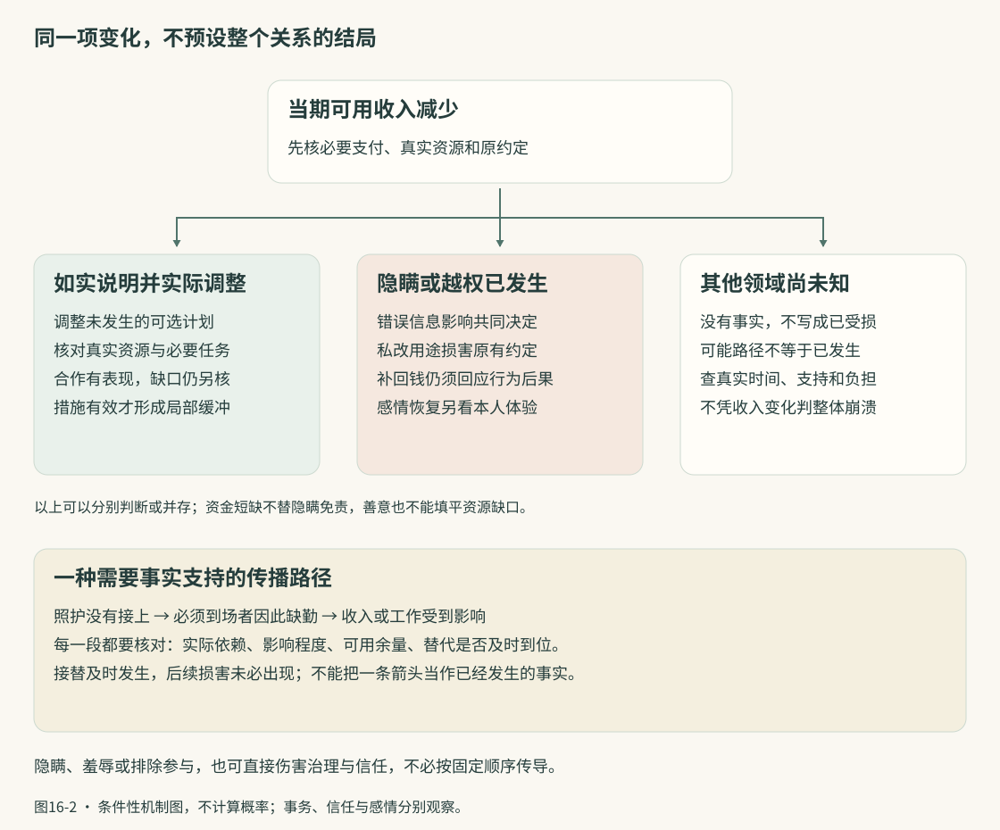

*同一项收入变化可以出现不同路径。图中只列有条件的联系；判断要分别记录已发生的损害、尚未证实的传播，以及真实措施能保护到哪里。*

#### 16.4 生育、疾病和养老：照护必须有持续承担的结构

**持续照护必须落实到具体时段、能力、资源和接续，关怀才能越过一时补位而长期成立。**

“有人帮忙”是一句容易让人松口气的话。可真正需要照护时，生活按时段发生：早上谁在，中午谁接，晚上谁能睡，负责联络的人什么时候工作。只在表上写一个名字，远远不够。

周蕾和段承有一个需要成人照料的孩子。两人在安排未来某一天时，周蕾有已确定的工作，段承打算接一项尚可拒绝的额外工作。段母愿来帮忙，他们便先按两人都出门安排，直到细问才发现，她只同意上午九点至十二点。

把工作和往返一起放进当天的时间表，空档就看得见了。周蕾需要八点半离家，十八点半才能回来；段承如果接那项工作，要八点出门，十八点回家。以下是实施前核对的原计划，不是孩子已经被独自留在家的经历。

| 时段 | 原计划中实际有谁在 | 核对后发现什么 |
| --- | --- | --- |
| 八点以前 | 两人都在，处理晨间生活与准备 | 准备用品、说明孩子当前需要，也占时间 |
| 八点至八点半 | 周蕾仍在，段承原拟出门 | 周蕾不能一边赶出门，一边无限等接替 |
| 八点半至九点 | 两人原拟都已离家，段母尚未到 | 有半小时无人接续，原计划不能这样实施 |
| 九点至十二点 | 段母明确愿意且能照料 | 这三小时不能被理解为全天 |
| 十二点至十八点 | 段母要离开，两人原拟仍在工作或路上 | 还有六小时缺口，其他亲属和服务未确认 |
| 十八点以后 | 按原工作安排段承先回来，周蕾随后到家 | 到家之后也还有接替、晚间照料和休息任务 |

这里不只缺少一个人，还缺少能够覆盖对应时段的真实能力。段承曾想边居家工作边照看，但核对那项工作的连续会议要求后，发现不能同时完成。人在家，不等于能随时中断工作；设备放在身边，也不等于有足够注意照料孩子。若安排依赖一个人在同一时段完成两项不能兼顾的任务，表格填满仍不成立。

这一日后来有了有限的解决：段承确认可以不接那次额外工作，两人核对必要支付不依赖这笔额外收入，同时推迟原拟的一项非必要物品更换。他实际留在家中，母亲仍按约在九点至十二点帮助，其他时段由他接上。周蕾按既定工作安排出门，孩子的照料没有出现原计划中的空档。

这不是没有代价的调度。他们没有取得那次额外收入，也放弃了原来想尽快更换物品的安排；段承承担了一天生活任务。母亲能按时离开，帮助才没有被悄悄扩成新的义务。一次完成说明这一天可行，今后两人都有不能取消的工作时段，接续仍要另找，不能把同一个办法无限复制。

持续照护要同时接上身体支持、时间、组织、费用与情绪劳动。谁知道当前需要，谁备好用品，谁收到变化消息，谁安排交接，谁承担费用，主要照护者怎样获得休息，这些都属于工作。[附录G.1](#unit-G-1)可用来查遗漏，[附录G.2](#unit-G-2)补必要要求和执行范围，[附录H.4](#unit-H-4)帮助亲属分别认领，[附录J.3](#unit-J-3)记录接续做到哪里。选择当前缺的一环即可。

涉及健康、康复或具体育儿安全要求时，需要取得适当的专业说明，而不是让家属凭经验互相压服。说明也要落到执行者能理解、能做到的任务，不能只留一句“按要求照护”。家庭在实际权限范围内授权协助，不因交给亲属就省略所需同意，也不把这种日常授权扩大成所有专业事务的处分权。

主要责任和执行自主可以相容。父母说清孩子的必要安排和不能突破的限制，照护者在已认可范围内选择活动顺序；新重要决定再确认。若每一步都要远程请示，负责照护的人可能一直等不到答复；若以“我付出最多”为由推翻其他人的正当参与，协助又会变成支配。

再看这对伴侣的另一种争议情境，与前面已经顺利接续的那一天分别看。两家最初争的是先收玩具还是先读书，后来变成“我们家出力多，所以应该听我们的”。段承没有与周蕾确认，就答应自己父母让周蕾提前接替，又要求她照办。她无法提前离岗，老人实际多等了一段，孩子仍由老人照看；周蕾则发现，两人原来的约定可以在她不知情时被别人改掉。

这时，一句“以后还是由老人带”并没有解决问题。方法分歧、资源不足、决定权限和已经发生的伤害，要找到各自的处理位置。

| 争议所在 | 要处理的具体事项 |
| --- | --- |
| 方法 | 在必要要求已满足的范围里，哪些顺序可以由执行者选择，不把个人习惯全部升级为底线 |
| 资源 | 谁在哪个时段能接替，等待增加了谁的负担；没有时间就改安排，不能靠催促产生时间 |
| 权限 | 谁可以作何种决定，段承不能替周蕾承诺提前离岗，也不能以亲属意见覆盖已有共同约定 |
| 已造成的关系伤害 | 承认越权及老人额外等待，纠正对周蕾的错误要求，用后续履行恢复约定的可信度 |

几处问题相互影响，但责任不因此平均分配。段承未经确认便承诺的行为，需要由他回应，不能只要求周蕾与老人各退一步。若随后按真实条件重新接替，照护功能可以改善；周蕾是否重新相信共同决定，仍要看之后的行为。接替完成与信任恢复不是同一个结果。

疾病与养老也需要这样的持续结构，但不能把育儿安排原样搬过去。需要帮助的成年人仍应在实际能力范围内表达自己的意愿；亲属、手足和服务各能提供什么，逐一确认。出钱者不因此代管所有决定，住得近的人也不自动拥有无限时间。不同家人的需要和已承担责任不同，不必为金额、次数完全对称而提供并不需要的帮助。

有时困难确实来自供给不足：附近没有合适服务，费用不可承担，家人无法取得所需时间。理解、感谢和较好的沟通可以减少额外损耗，却不能凭空补齐这些资源。此时应重新审视工作组合、生活安排和可获得支持；哪些尚不能落实，就明确保留，而不是赞美某个人一直撑着。

好的照护结构也让关系有机会回到日常。被帮助的人不必为每一个需要道歉，照护者可以真的离开一会儿，亲属能在愿意的范围内参与。它不保证所有困难都会缓解，却让关怀有了可以持续的条件，而不只是用某一个人的消耗维持眼前平静。

#### 16.5 抵抗力与恢复力：准备关键功能，而不是消除全部不确定性

**家庭韧性取决于关键功能能否接续与重组，后备要看实际可用条件，不能只数人选。**

准备，不是把未来全部想一遍。家里可能发生的事太多，而时间、金钱和注意都有限。更有用的起点是：眼下已经有人依赖哪项必要功能，如果它暂时做不到，会由谁承受什么后果？

[第二章2.2节](#unit-2-2)区分过抵抗与恢复。放到具体生活里，抵抗力看冲击到来时必要功能受损多少，恢复力看受损之后能否重新组织、达到双方可以接受的状态。前者可能靠准备减少中断，后者可能需要改变原来的方式。两者不能只用“家里还有钱”回答。

| 面对同一项照护需要 | 抵抗方面要看什么 | 恢复方面要看什么 |
| --- | --- | --- |
| 原承担者临时不能来 | 在需要发生的时段，是否另有已确认、适任的人或方式接上 | 中断后怎样重新安排接续、工作和必要事务，谁承担过渡 |
| 原方式不再持续可用 | 现有余量能缓冲到哪里，不把所有余量一次排满 | 是否能够形成新的长期分工，而非不断延长同一人的补位 |
| 服务存在但尚未获得 | 启动时间、适配与费用是否满足眼前需要 | 获得服务前有哪些空档，服务不合用时能怎样调整 |

接着[16.2节的照护情境](#unit-16-2)往后看。两人已整理好必要任务和时段，杨维同意郑敏在必要范围内直接询问生活协助服务。郑敏已经联系机构，当时的名额、费用和启动条件仍未得到确认。

郑敏后来收到机构回复：最早能够进一步确认的时间，已经晚于杨维那次必要外出。这不等于机构未来一定能提供服务，却足以改变眼前判断——不能等它来填本次的空档。亲属原来确认的陪同尚未取消，也尚未执行。

两人没有真的撤掉帮助去试验，而是拿现有任务单做了一次接替推演：如果该亲属临时不能来，谁在相同时段能完成上门、陪同、送回？郑敏能直接联络机构，杨维能说明需要，但联系方式和说明能力没有补出一个当时可到的人。这次核对的结果就是：本次有一条已确认安排，第二条可执行路径仍未建立。[附录J.1](#unit-J-1)将这次准备中已确认、尚待确认的事实分别记录，便于得到新消息后更新。

认识到缺口，可以使他们更早核对其他适任支持和办理方式的调整可能；不能据此保证最后一定找到替代。若没有，就应把未解的需要与实际后果留下，按紧迫程度处理。备用准备的意义，是使决定更接近现实，不是让表格强行给出令人安心的答案。

还有一种容易误判的情况：方案名称不同，依赖却相同。另作祖辈照护假设，“祖母来家里”和“把孩子送到祖母家”，如果都依赖同一位祖母，就不能因为地点有两个而算作两份独立保障。第二种方式还要核对接送、住所与本人意愿；一种已经答应，另一种只是在想象中，更不能一起计入。

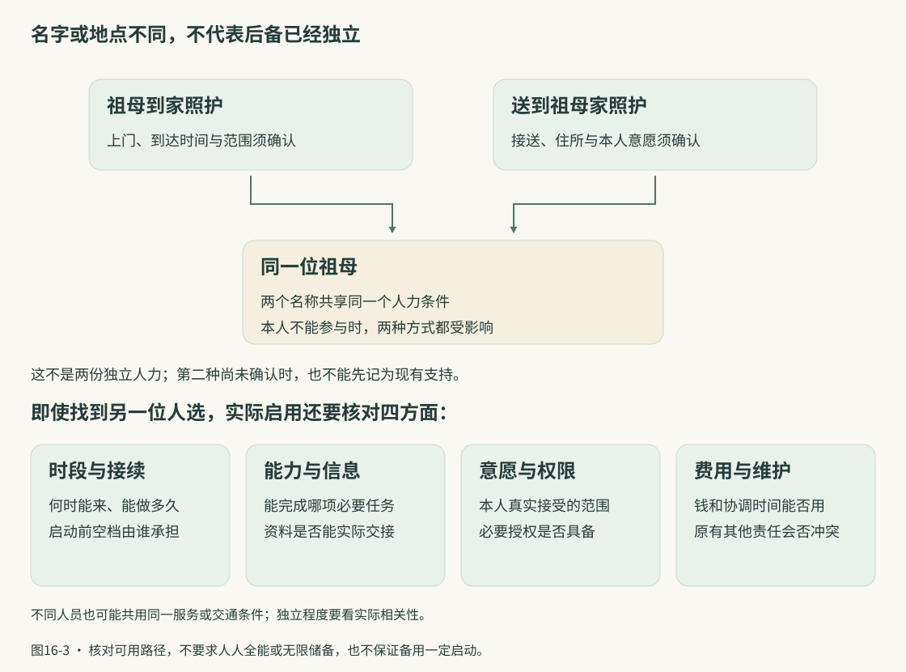

*上方两种照护方式共享同一位祖母，并非两份独立的人力。下方列出启用条件；找到另一个名字仍需逐项确认，不保证备用一定能接上。*

单点失效关注某个关键环节一旦不可用，相关时间内是否就没有足够的执行路径；共同原因失效则提醒我们，多条看似分开的路径也可能被同一变化同时影响。再作一个独立的收入假设：两人分别有工资，却都依赖同一项业务。业务收缩可能同时影响两份收入，不能只凭“有两个人挣钱”就断言分散了这种冲击。

这也不证明两人在同一行业就一定危险。应看实际关联、可用储备、成本和调整空间，而不是从标签编出崩溃概率。照护、收入、信息、授权各有自己的依赖，准备应指向当前真正重要的那一处。

适度交叉能力可以减少一些薄弱环节。例如，原来只有一人知道必要支付的时点和办理入口，后来在正当权限内把相关资料整理清楚，另一人也能按约完成这项事务，就不必让全部日常支付都等同一个人回来。了解必要流程，不等于共享所有私人密码，也不等于两人都必须掌握全部专业技能。

后备也有维护成本。一个人承诺能接替，可能要保留时间；一种服务即使合适，也可能需要费用、提前预约和必要信息。准备越多不必然越好：若维持备用本身挤掉了当前必要生活或休息，就应重新选择重点。可靠外援本来就是生活的一部分，不必为了证明家庭独立而拒绝可承担的支持。

[附录J.1](#unit-J-1)适合保留这次核对的少数关键事实，[附录G.2](#unit-G-2)可以补交接与授权，资金缓冲则回看[附录F.5](#unit-F-5)的既定口径。只在安排变化、得到新消息或即将依赖某项支持时更新，不必每天演练全部灾难。已经承担的重要责任不能靠“未来不可知”搁置，尚无现实关联的想象风险也不必占满生活。

新的安排不一定让关系回到过去。两个人可能不再维持相同工作组合，却能让必要事务完成、承担者有休息、本人仍认可这种生活。这样的恢复与适应值得认真看见；但如果表面功能只是靠一人持续透支维持，就还不能把“事情一直做完了”当作韧性。

#### 16.6 共同体与个人怎样一起更新：重新讲述，也重新行动

**共同体需要容纳成员的变化，新的理解要由真实时间、资源和行动支持，才不只是承诺。**

困难过去一部分之后，人未必想立即回到原来的生活。有人重新重视稳定，有人更想保留独立选择，有人发现过去觉得不重要的工作和朋友，其实支撑着自己对生活的感受。关系若只允许说“总算恢复正常”，就可能错过已经改变的人。

夏芸曾因持续照护暂时离开职场。那段时间，她和伴侣方骏认可由方骏承担主要收入，夏芸承担较多照护和家庭组织。如今她希望重新探索职业选择，方骏说支持，却仍习惯把晚间事务交给她。

她报名参加两次用于了解新方向的课程。两人已核对时段、所需设备和可承担费用，商定的课程费用也已实际支付。可课程快开始时，家里仍有人等她安排晚餐后的收拾、查找次日必需用品；她一边准备登录，一边想着还有什么没交代。支持在语言和资金上出现了，在时间上却还没有接上。

方骏说：“你安心去学就行。”她回答：“可我要先把每件事都安排好，才有办法安心。”这不是她不懂接受帮助，而是原来的组织角色仍在运转。课程出现在日程上，不代表那个时段已经从家庭待办里真正空出来。

他们随后检查那两次晚间安排。方骏确认对应时段没有重叠工作，也确实愿意承担饭后收拾和次日必需用品的核对准备；已有用品和执行权限可用。夏芸先提供必要信息，两人把完成要求说清，不再由她每次列单、提醒和最后验收。这个调整只覆盖当时确认的两次，不预先承诺所有将来课程都同样安排。

第一次还是有中断：方骏找不到一件用品，课中问了她。课后，两人把必要存放位置补清；第二次，他按已有信息完成事务，没有再把问题转回课堂里的夏芸。她完整参加了那次学习，后来也自己完成了对应作业。一次不完美的执行因此产生了具体改进，不必被解释成他故意不支持，也不需要由她永远补漏。

这里发生的变化，可以比“我们都支持彼此成长”说得更准确。

| 新理解想表达什么 | 需要什么实际行动来支持 |
| --- | --- |
| 过去的照护是共同生活中真实发生的贡献 | 承认她当时承担了什么、失去了哪些机会，不因暂时没有工资抹掉贡献 |
| 她可以重新探索职业，而非永久固定在家中 | 有真实可用的学习费用、时段和接续，相关决定仍由她参与 |
| 方骏也需要可承担的分工 | 核对工作、时间与能力，任务能够完成，后续新增需要另谈 |
| 这次学习是她自己的探索 | 她实际学习、完成作业和形成判断；伴侣不负责保证她取得理想结果 |

新的共同叙事，是两个人怎样理解走过的经历、各自的位置和接下来的生活。它可以容纳“那时我们靠更紧密的分工渡过了一段需要，现在要给职业探索重新留出地方”。但这句话的可信度，要由费用是否可用、时间是否被保护、任务是否真的接上来支撑。

也要把离岗的影响具体看清：哪些机会确实错过了，哪些技能需要补足，原来的岗位是否还有返回的可能。已经发生的损失要承认，尚未核实的影响也不能先当成定论。共同应对中得到支持和亲近，不会把这些代价变成没有发生；一段辛苦经历也不必被强行讲成让所有人都成长的礼物。能够认真听见代价，有时比急着赋予积极意义更有帮助。

夏芸完成作业后，对这一方向多了一点实际了解，却仍未获得工作机会，更没有证据说明可以恢复原岗位或收入。接下来要做什么，应依据她的学习结果、真实岗位条件和双方可承担的支持继续判断。外部机会不足，不能直接归为她不努力；个人需要学习和行动，也不能全部交给方骏代办。

如果她后来发现自己不喜欢这个方向，可以重新选择；已经支付的课程费用不是要求她必须从事某种职业的债权。新的探索仍有现实成本，下一步支持的范围需要重谈。若她暂时愿意保留更多照护、减少工作，也应看这是不是她真实接受的安排，以及资源、参与和未来调整空间是否得到保障。

依赖多少，不足以单独判断关系是在成长还是退步。一个人需要更多帮助时，仍可保有尊严与选择；一个人希望恢复自主，也不必因此被指责忘恩。真正需要关注的是：新的生活是否仍给双方带来重要价值，谁持续失去什么，已经说好的支持是否落到了现实里。

[附录G.3](#unit-G-3)可以帮助回看贡献、整体负担和不同阶段的保障，[附录B.1](#unit-B-1)可以重新描写现在想过的生活，[附录J.1](#unit-J-1)用来核对关键接续。一句“以后会补回来”不能无限替代当前安排；如果新故事始终要求一人压缩自己的生活，却没有真实改善路径，就需要重新判断共同体是否仍适合继续。

人无法保证未来的自己永远与今天相同。能够继续相处的关系，不只允许讲述变化，也为变化提供有限、真实、可重新协商的行动空间。这样，彼此留下的影响才不只是固定的角色，还可能成为继续理解和支持对方的能力。

#### 16.7 风险专节：变化单方化、照护透支与用新绑定掩盖旧危机

**应对变化要看谁承担实际后果，新的共同计划不能代替处理旧缺口，也不能取消个人选择。**

面对已经不好过的生活，一项新的共同计划很容易让人重新振奋：一起创业、再换一处住处，或者“有个孩子，我们就有共同目标了”。新的期待可以有吸引力，但不能因此跳过一个更具体的问题：原来的缺口由谁填，新计划又会增加什么？

变化本身不是背叛。失业、照护需求或服务减少，可以直接改变生活，无法靠双方先达成共识阻止。风险常常来自另一部分：有人在仍有选择时，把新安排先做成事实；有人把代价留给另一方，却继续用“支持我”“都是一家人”要求接受。

本章的几条支路，可以帮助区分已经发生什么，而不把每次变化都叙述成必然崩溃。

| 当前看到的事实 | 能作什么判断 | 仍要看什么 |
| --- | --- | --- |
| 段承不接一次额外工作，实际接上当天照护 | 这一日的空档得到处理，代价是放弃相应收入和推迟非必要购置 | 以后两人工作不能调整时是否有持续路径，不能由一次成功推到所有日子 |
| 蒋衡收入减少但仍如实告知，与韩静共同核对并调整计划 | 经济条件已经变化，合作仍有实际表现 | 缺口是否补足、能维持多久，不能假定感情已经崩溃，也不能说同心即足够 |
| 韩静与蒋衡的另一种情境：隐瞒收入变化并擅自改用储备 | 除经济问题外，知情、参与和原约定已受损 | 补钱之外是否回应越权与不信任，感情是否恢复由实际体验判断 |
| 亲属已同意陪同杨维此次必要外出，服务仍未落实 | 有限支持存在，更长期与替代路径尚不明 | 启动、取消与接续条件；未知不能写成低风险或已有保障 |

跨领域损害需要具体连接。照护空档迫使一人缺勤，缺勤又影响收入，是一条可能的传导；若接替及时到位，后续损害未必发生。羞辱、隐瞒和排除参与，也可能直接损害信任，并不总是先经过“钱不够、家务增多、感情变差”的顺序。[图16-2](#figure-16-2)中的箭头应由事实支持，不能替事实作证。

另外设一个匿名虚构情境：两人已发现本月必要支付还有缺口，平常交流也越来越少，一方提出共同开店，认为这样就会重新有奔头。眼下并没有核清投入、经营条件、责任范围与收入启动时间。这个计划也许表达了想继续的愿望，却尚未证明可以改善经济或关系。

先核对它增加的资金、工作时间、照护安排和可能义务，再看原来的支付与生活如何衔接。如果创业启动要先占用仅有的必要生活资金，还要求另一人接手全部家庭事务，那么“共同目标”实际上正把旧缺口与新风险同时集中到人身上。涉及经营或重大财务责任，具体材料需要相应专业解释，不能靠鼓励代替。

并非危机中所有新计划都不能做。边界清楚、目前可承担的了解和准备，可能帮助找到新路径；已经具备可核实条件的调整，也可支持恢复。关键是不以共同项目的名字自动放行新的大额义务，更不以后来偶然成功，倒推当初忽略重大未知就是合理。

生育提议则还包含独立的身体决定。两人都真正希望养育、条件也经过认真核对，与要求一个不愿意的人“生了就会顾家”，是不同情形。孩子不是检验或修复关系的工具；具体身体同意、健康知情和避孕生育安排不能被家庭目标替代。即使已经发生妊娠或形成照护责任，真实责任需要处理，也不产生继续亲密或维持关系的债权。

识别照护透支，也不能只等一人彻底倒下。如果临时支持不断被延长，休息与职业选择长期让位，提出限制又被说成不顾家，就要看谁拥有重新谈安排的实际空间。把主要承担者劝回“再忍一阵”，没有改变服务、时间和任务的缺口；只赞美其坚强，也不能算提供了保障。

当前能做的动作应与事实相称。必要信息缺失，就先核对并暂缓依赖它的新增承诺；资源不足，寻找真实可用的调整并承认剩余缺口；已出现隐瞒、越权或羞辱，分别处理行为与后果。出现可信威胁或持续强迫控制时，保护与独立支持优先，不能要求先完成一轮共同修复。

[附录M.9](#unit-M-9)“婚后共同经营与变化适应风险表”用于按具体事实辨认，[附录J.1](#unit-J-1)—[附录J.3](#unit-J-3)帮助整理准备、责任与接续，危险情形可用[附录J.4](#unit-J-4)，资金适配回看[附录F.8](#unit-F-8)。工具的作用是让下一步更清楚，不是再制造一套必须通过的考试。

继续的依据，应尽量落在已发生的改善和真实可执行的安排上，也要保留本人仍愿意继续这一点。未知可以继续了解，希望可以认真对待，但它们不能替已经落实的条件签字。核心目标不兼容、负担长期不可承担，或本人已不愿维持关系时，可以考虑调整或结束；不必把所有可能方案试尽。

[下一章](#unit-17-1)讨论的，正是如何把结束关系与必要善后分别处理。退出权不抹掉已经形成的责任，责任也不能变成无限占有一个人的理由。经营有继续创造生活的能力，也需要有面对无法继续时的诚实。

### 第十七章 当关系不再适合：退出、善后与重建生活

你可以在任何阶段来到这一章。也许只见过几次，也许已经共同生活多年。决定不再继续，不需要先把前面的经营方法全部试一遍；还有需要处理的事，也不等于只能继续做伴侣。

如果已经存在暴力、性强迫、跟踪、勒索或可信的报复威胁，先看[17.5节](#unit-17-5)与[附录J.4](#unit-J-4)。保护和寻求独立支持，不以当面谈清、保存完整证据或先离开成功为条件。下面关于普通分离的谈话与交接，只适用于相应接触可以承受的情形。

#### 17.1 为什么结束：不愿继续、不兼容、失效与危险分别处理

**结束可以源于不愿继续、不兼容、失效或危险；准确辨认原因，是为选择行动而非申请退出资格。**

“他也没有做错什么，我是不是没有理由离开？”这句话里藏着一个前提：只有查明对方犯错，自己的不愿意才算数。如果接受这个前提，人便容易为了拒绝而不断寻找罪证，或者为了证明自己厚道，一直维持已经不想继续的关系。

本书不采用这个前提。亲密关系需要当事人持续愿意参与；认真对待别人，包括诚实面对自己的意愿，以及处理已经发生的后果。结束可以令人失望，失望却不自动证明决定错误，更不自动把曾经的相爱改写为骗局。

先看四个彼此独立的虚构片段。它们都可能走向结束，但需要面对的问题并不一样。

| 眼前的事实 | 当前主要判断 | 下一步关注什么 |
| --- | --- | --- |
| 两次见面都愉快，对方礼貌、按约赴见，自己仍不想继续约会 | 没有继续意愿；没有必要补出对方的缺陷 | 清楚表示结束，处理真实遗留事项 |
| 两人仍相互喜欢，一人确定想养育孩子，另一人确定不愿，两人都不接受对方的生活方向 | 核心方向不兼容；好感没有消除分歧 | 不以默认对方日后会变为依据推进生育或婚姻 |
| 原定生活任务长期没有被承担，已明确提出并调整过安排，承诺仍反复落空，一人不愿再靠自己填补 | 共同生活持续失效；还需分清资源、安排与履行问题 | 看实际变化和本人是否仍愿参与，也可以决定结束 |
| 一方以报复威胁阻止另一方求助，并曾到工作地点拦阻其离开 | 已有现实危险，不能仅作沟通分歧处理 | 优先独立支持与保护，改变普通接触和交接方式 |

这些判断可以同时出现。例如，已经不愿继续，也仍需处理共同住房；发现危险之后，也可能还爱着对方。分类是为了选择行动，不是要求先选一个唯一正确的分手理由。第一例不需要增加恶劣事实，第四例也不需要等待长期功能失效才值得保护。

##### 把一时的痛苦和已经形成的决定分开

吵架时说“我再也不想见到你”，与平静后仍清楚知道不想继续，未必是同一件事。情绪告诉人此刻承受着什么，却不能独自回答：自己还愿不愿意参与、什么安排需要改变、对方实际做了什么。反过来，表达时很平静，也不证明一个决定已经想得完整。

在没有现实危险、本人也尚未决定的情况下，可以先停止争辩，把眼前冲突与去留分开。例如：“今晚我已经谈不下去了。我们先各自休息，周末只谈这次分工和我还愿不愿继续。”这是一项有限暂停，不是暗示关系一定恢复；若周末仍不愿继续，也不需要把暂停无限延长。

暂缓若要有用，应当等待具体信息或实际变化。是在核对一个被误传的事实，观察已经认领的任务能否执行，还是给自己一点空间辨认意愿？说清正在等什么、何时或遇到什么变化重看，比一句“再给彼此一点时间”更能避免原地消耗。没有人需要为了获得退出资格，先完成一次观察期。

功能失效也不能只用情绪浓度判断。一人近期疲惫，另一人感到被冷落，可能需要减负；已经多次明确认领任务，却继续把后果留给伴侣，涉及履行与承担。两个情境都可能令人难受，但对后续改变的依据不同。尚不清楚原因时，可以承认未知；已经知道自己不愿再参与时，不必等到原因全部查清才说不。

##### 曾经付出很多，未来仍要重新选择

投入会留下真实痕迹：一起熟悉的街道、为了对方调整的工作、已经告诉亲友的婚期。离开不只是失去一个人，还可能失去一套生活。害怕孤独、不甘心前功尽弃，或担心让家人难堪，都值得被认真理解。

但过去的付出已经发生。继续一年能够带来什么，要看这一年的现实条件、双方意愿和可执行安排；不能仅凭过去已经花了五年，推定再付一年就能追回损失。相反，也不必为了证明自己果断，否认那些年确实得到过理解、快乐和帮助。

一个可用的追问是：“如果暂不考虑向别人证明我没有选错，我还愿意过接下来这样的生活吗？哪些具体改变会影响我的选择？”答案可以是愿意接纳某些差异，可以是愿意调整，也可以是不愿意。亲友能提供信息与支持，却不能替当事人承受全部后果并作出意愿。

对方有改善可能，不等于你有义务等待；已经出现改善，也不等于感情必然恢复。拒绝继续无需证明对方永远不会变好。你仍应准确描述事实：可以承认对方已做的努力，同时说明自己的决定，而不必把努力说成全部虚假。

危险判断有另一条优先顺序。若威胁、拦阻或强迫已经出现，先处理现实暴露，不把“他是不是还爱我”“我是不是足够坚决”当作保护的门槛。即使仍犹豫、仍有联系，也可以寻求独立支持。安全需要与情感确定性不必同时完成。

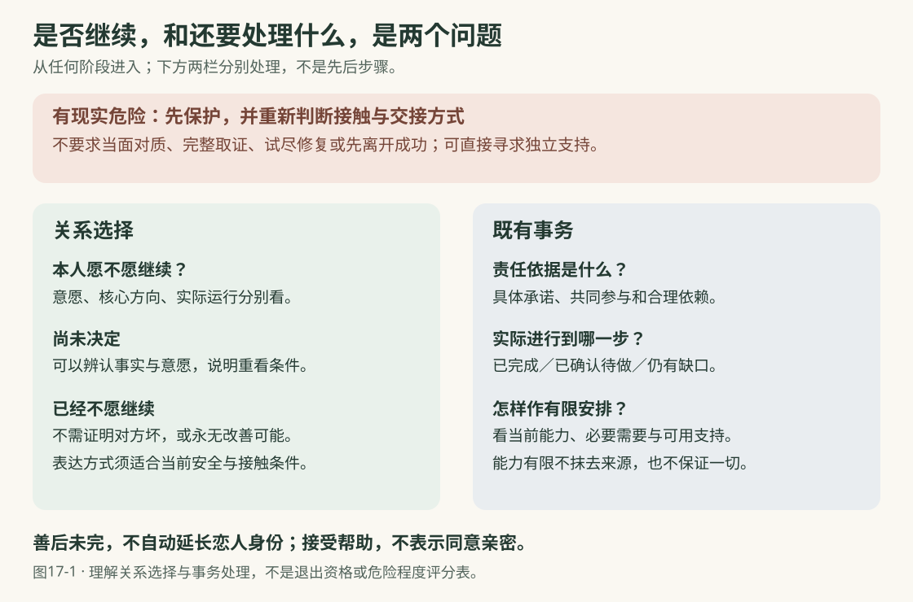

如果此刻只够回答几个问题，可以先确认：我是否面临现实危险，我已经决定还是仍需辨认，还有哪件生活事务不能被忽略。[附录J.5](#unit-J-5)帮助把它们放在不同位置；[附录M的使用说明](#unit-M-1)可帮助按当前阶段查相关风险。两者都不计算你有没有资格离开，也不要求一口气填完全部问题。

#### 17.2 阶段不同，退出任务不同

**退出任务取决于真实承诺、共同投入和已有依赖，关系阶段提供线索，却不能替代事实。**

“分手以后还需要做什么”，没有一个按交往年数自动递增的答案。相处很久，未必共同负担财物与生活；交往尚短，也可能已经共同迁居、借款或承担照护。阶段提示可能有哪些任务，真实发生的事才决定眼下需要处理哪些。

以下三个情境彼此独立，不是人人都会依次经历的关系路线。

一对约会对象只见过两次，其中一人还保管着对方借出的书，没有共同预订或其他安排。想停止的一方可以说：“谢谢这两次见面，我不打算继续约会了。书还在我这里，我们确认一下怎么归还。”不需要另外举行关系复盘会，也不必为拒绝准备足以令对方满意的人格评价。

归还物品仍要尊重双方可接受的方式，不能因为书尚未归还，就每天询问对方的行程或要求再次约会。若没有遗留事项，清楚停止后也无需为了显得友善而保持亲密频率。礼貌可以是明确，持续给出自己并无意接受的期待，反而会延长误解。

再看沈宁与梁川在[12.6节](#unit-12-6)中的独立婚约假设。这里的住房依赖父母支持，原条件曾明确，后来新增了两人不能接受的要求；资金尚未到账，也没有已经核实的可承担替代。梁川已付一笔双方认可的场地预付款，两人已暂停新增预订，梁川询问退改选项，尚未收到答复。

若沈宁已经不愿结婚，就不能因为梁川仍希望继续，而把她放回原定婚礼安排。与此同时，场地查询、必要通知与实际费用不能假装从未存在。掌握预订资料的梁川继续查询，双方分别处理自己负责的通知；没有资料或权限的人，不能仅因提出结束就被要求包办一切。

这里还不知道预付款可退多少，甚至不知道最终损失是否等于已付金额。谁承担什么，要依据真实约定、参与和结果处理，不能自动判为一人全付或各半。这个分支与两人后来按自行租住方案成婚的主线不同；不能把主线已经落实的住处、款项拿来填补此处的未知。

第三个情境是一对共同决定迁居的伴侣甲乙。甲乙共同认可迁居，乙据此辞去原工作并搬迁，甲有两个月过渡支持承诺，后来提出分手。即使双方没有结婚，乙的处境也不是一个只存在于想象中的未来。共同参与、明确承诺和已经发生的改变，给善后提供了具体依据。[附录J.2](#unit-J-2)与[附录J.3](#unit-J-3)分别帮助辨认责任来源和过渡安排。

相反，若只有一人私下幻想将来结婚，另一人没有作出相关承诺，也没有知情参与或认可其辞职迁居，便不能直接套用这份责任。需要核实的是当时各自知道什么、同意什么、据此发生了什么。不能仅凭“有过恋爱”填满所有责任，也不能仅凭“没有结婚”删去所有责任。

##### 用阶段找入口，再用事实删减

下面是检查入口，不是统一待办清单。同一人可能需要其中几行，也可能只有第一行里的一两件事。

| 当前阶段或实际状态 | 通常需要辨认的事项 | 只在相应事实存在时增加 |
| --- | --- | --- |
| 初识、普通约会 | 是否已清楚停止，物品与隐私怎样处理 | 真实借款、共同预订或明确承诺；不能用送礼换继续接触 |
| 排他了解 | 明确排他安排已经结束，不让对方仍按原约定理解关系 | 已经形成的共同事项；排他不自动变成婚约 |
| 正式恋爱 | 清楚说明关系决定及后续联系范围 | 借款、同住安排、照护、共同开支或其他实际依赖 |
| 任何阶段已经有重大共同投入或依赖 | 谁参与形成，哪些承诺尚未履行，近期生活怎样接续 | 住房、工作调整、照护及相应资料和资源；不只凭称谓判断 |
| 正式婚约 | 说明婚姻意愿已变，处理必要通知和已订事项 | 真实财物费用、住处与其他依赖；不把婚礼支出当作强制理由 |
| 婚姻 | 关系意愿与相应手续分别处理，核对真实权益与共同事务 | 有子女时的必要照护、居住、财物债务及适用程序，取得相称专业帮助 |

对排他了解与正式恋爱而言，清楚通知的价值在于让双方能按新事实作决定。它不意味着结束必须得到批准。信息无法可靠传达或接触有风险时，联系办法要另行判断，不能为满足某种“正式仪式”而增加暴露。

婚姻中的相应身份与权益，需要按适用事实和程序处理，不能把一句口头结束当成手续全部完成。这与任何人不能被迫继续身体亲密，是不同的问题。可以拒绝亲密、表达不愿继续，同时取得处理相关程序和实际权益所需的帮助；本表不裁定具体法律结果。

孩子若已存在，照护任务不会因为伴侣关系变化而消失；若没有子女，就把这一项删掉。共同债务是否存在、由谁承担，也须查真实资料，不能因为曾共同生活，就将一方所有个人支出都记到另一人名下。阶段提供线索，不能代替核对。

可以用两栏开始整理自己的情况。第一栏是“已经发生或明确承诺”，写一两件眼下最要紧的事；第二栏是“我或对方希望如此”，暂不把愿望变成已接受的义务。例如，“双方认可的预订已经付款”放在第一栏，“希望对方再陪家人吃最后一顿饭”放在第二栏。后一项可以请求，对方可以拒绝，不由前一项自动推出。

交接还要找对有资料、权限和现实能力的人。谁保管物品，谁订了场地，谁能够联系实际照护者，决定了事情怎样推进；提出结束的人不必承担所有操作，资源较少的人也不应被要求完成无从执行的安排。责任有争议时，把无争议的必要事项与需进一步澄清的部分分开，不用扣住前者逼迫后者让步。

[附录J.5](#unit-J-5)可将选出的事项整理为有限行动，婚约事项可接[附录E.4](#unit-E-4)，迁居与照护可接[附录J.2](#unit-J-2)、[附录J.3](#unit-J-3)。危险情况下先接[附录J.4](#unit-J-4)，再决定哪些事项可以延后、转交适当渠道或改变联系方法。善后任务的增加，改变的是需要处理的现实内容，不是让一个人重新取得支配另一人亲密意愿的权限。

#### 17.3 怎样说清结束，又不把协商变成无限拉扯

**清楚结束关系与认真处理遗留事务可以同时做到，说明理由不需要变成取得对方批准的辩论。**

有些结束迟迟说不出口，不是因为没有决定，而是怕亲眼看见对方受伤。于是先减少回复，再说工作忙，最后留下“等我状态好一点”。每句话似乎都比直接拒绝温和，却让另一人继续等待。若自己已经不打算继续，这种模糊就没有准确传达当前意愿。

在一般安全情形，一次表达可以包含三个部分：决定是什么，自己能真实说明的简要原因，还有哪些事需要处理。原因用于让对方理解，不是等待对方批准。也不必把积累多年的每一处不满整理成指控，直到对方同意自己不值得被爱。

看一个独立虚构例。甲已决定结束恋爱，仍有一笔向乙借的款项没有归还。两人对尚未归还这件事没有争议，具体归还安排仍需确认；这里不设金额、利息或其他条款。甲可以这样说：

“我想清楚了，不打算继续做恋人。现在我已经没有继续参与这段关系的意愿。我知道这会让你难过。借你的钱还没有处理完，我会把目前能归还的安排写清楚，我们只就这件事继续确认。”

这段话没有给出一个会令乙立即释然的理由，也没有证明甲处理得毫无不足。它的作用是减少误解：决定明确，欠款没有被否认，后续联系有具体对象。甲仍需面对真正的归还问题，不能把说过“会写清楚”登记成已经还钱。

##### 两次回复，守住同一个区别

乙很难接受，提出再一起吃顿饭：“你见到我，也许就会改变想法。我们吃完再谈钱。”甲可以回应：

“我不想再按约会的方式见面，也不能答应见面就重新考虑。钱的事我会继续处理，你可以把需要核对的记录发来；我也会说明现在实际能做的安排。”

后来乙发来一项待核对的转账记录，同时问周末能不能去以前常去的地方。甲的第二次回复可以更短：

“这笔记录我会核对，归还办法还没有确认好。周末的约会我不接受。后续我们用这个渠道处理借款，不再安排恋人之间的活动。”

这里展示的是两次表达，没有补出款项已经付清或乙已经接受的结局。甲不能因为不愿约会，就不回应必要的借款核对；乙也不能因为有一笔待还的钱，就要求甲持续接受追求。若归还安排仍没有着落，问题需要继续处理，而不是用重复同一句边界声明遮住拖延。

乙难过、想再谈一次，不因此自动被认定为控制。被拒绝的人可能反复回想快乐，也可能一时听不进去。需要进一步看的是：明确拒绝之后，是否仍不断突破联系边界，是否扣住必要财物、骚扰工作或威胁伤害。感受很强烈与侵犯别人，是两件需要分别辨认的事。

结束决定可以清楚，解释不必无限。若对方每次都要求把同一个理由辩论到满意，可以说明：“我知道你不同意我的解释，但我不会继续这段关系。还有哪些具体事务需要核对，可以单独写出来。”对方可以保留自己的理解，双方不必先达成一份关于这段感情的共同判词。

##### 简短，不等于敷衍真实后果

联系边界要够具体，才不会变成“有事再说”的无限入口。可以根据事项选择文字、约定一次有限谈话，或请适当的人协助交接。具体多久回应，取决于必要事务与各自能力，不设统一的即时回复义务。若约定了可承担的回应时间，就认真履行；不能用拖延让另一人放弃合理事项。

也不需要为了证明诚意必须当面说。异地、疲惫、容易反复争辩，以及实际安全条件，都会影响形式。第三方的作用可以是协助传达和办理，不能变成一群亲友轮番劝对方接受复合。对方没有同意，也不宜把私密经历公开给双方社交圈，让羞辱替自己完成拒绝。

尤其要避免不打算兑现的希望：“等你变好了，我们肯定还有机会。”“我现在离开只是考验你。”这些话把当前拒绝改写成未来奖励，使对方可能继续投入，也让自己以后难以准确表达。真正尚未决定，可以如实说尚未决定，并说明当前不接受哪些行动；已经决定结束，就不必用虚假的保留选项减轻当下内疚。

若联系中出现可信威胁，任务已经变化。此时不再以怎样把话说得更周全为核心，也不必继续亲自解释到对方平静。转向[附录J.4](#unit-J-4)与[17.5节](#unit-17-5)，借助实际可取得的支持，判断接触与事务安排。结束不是一场必须由表达更有技巧的人才能赢得的说服比赛。

#### 17.4 善始善终：既有依赖、共同利益与有限过渡

**退出不抹掉已形成的责任，善后也不恢复亲密权限；有限承担应依据事实、能力与实际接续。**

“我已经不爱了”能说明一项重要意愿，却不能说明两个人过去没有共同作过决定。另一句“你让我依赖了你”，也不能自动决定今后所有责任。善后要回到依赖如何形成、具体承诺是什么，以及眼下实际能怎样履行。

[第八章8.1节](#unit-8-1)与[附录J.2](#unit-J-2)已经介绍责任来源。放到分离时，可以先问：本人明确答应了什么？哪些安排是共同认可的？谁知情参与、接受了什么益处，对方据此改变了哪些生活条件？没有这些事实，不能凭单方想象建立结婚债权；存在这些事实，也不能用一句“都是你自愿的”全部推走。

责任来源与履行能力要按顺序看。先确定事情从哪里来，再核对已做什么、现在有何限制和其他必要责任。能力不足可能需要改变时间、方法或支持来源，却不能倒过来证明原承诺没有发生。责任存在，同样不意味着本人有能力完成一切。

##### 患病恋人：结束恋爱与这周的生活需要

先看一个患病恋人的生活协助情境。甲因病短期需要生活协助。乙答应本周两次送饭与一次必要事务陪同，甲据此暂未另找帮助。后来乙提出结束恋爱，自己的工作时段也发生冲突。本例没有设定病名、医疗急症或治疗任务，讨论的是已经认领的生活协助。

此刻有三种不同状态：第一次饭已送到；乙确认第二次仍能按原安排送，但尚未执行；原定陪同时段与工作冲突，乙无法承担，其他时间能否调整还不清楚。不能把它们合成“乙已经照顾过了”，也不能合成“乙什么都没做”。

甲愿意询问一位信任的朋友，朋友还没有答应。乙可以在甲授权后协助传达必要时段、地点和任务，不额外传播病情。付费服务是否存在、是否适合、是否负担得起，目前同样没有答案。把这些可能性写下来，是为了继续核实，不能当作已经完成交接。

乙可以说：“第二次饭我仍能按原来的安排送。陪同那次我工作冲突，不能去。你愿意问的朋友还没答复，我可以按你同意的范围帮忙说明。这些事没有都解决，但我不准备继续恋爱或进入婚姻。”这不是一句话解决困境，而是避免以关系希望替代现实帮助。

甲可以接受第二次送饭，也可以明确自己的其他需要；接受帮助不意味着同意复合或身体接触。乙若不能按原时段陪同，应及时面对由原承诺产生的缺口，而不是到时不出现，迫使甲自己承受全部后果。若到了必须处理的时点仍无人接续，就按实际情况寻找适任支持，不假定甲能独自完成，也不假定乙总能取消工作。

这份责任不来自“患病者因此取得婚姻权”，而来自本例的具体承诺与据此形成的依赖。如果病程延长，要重新辨认需要和可承担部分；本周几件事不会自动变成终身全部照护。若乙自愿做得更多，可以准确说明范围，避免对方把一次额外帮助理解为恢复原关系或永久接手。

##### 共同迁居：承诺余额不等于全部生活缺口

再看[前面那对共同迁居的伴侣甲乙](#unit-17-2)，与患病例不是同一对人。两人共同认可迁居，乙辞去原工作并搬迁；甲承诺两个月每月3000元过渡支持，没有保证就业。甲后来提出分手，乙尚未找到新工作。

第二个月约定提供支持的时点已到。甲收入下降，首月3000元、第二月部分1500元均已付并收到；总共已收4500元，仍有1500元约定支持未履行。双方愿在甲下一次收入信息明确时回谈，但没有保证收入恢复、余款到账或某个具体付款日期。

其后，乙的一位朋友确认可以提供三晚临时住处，乙愿意使用，尚未入住。这是一项有限支持的真实增加，不代表朋友已经接手长期住房，更不代表就业已解决。三晚只是本次确认的范围，不是本书规定的分手过渡期限。

| 此刻的事实 | 对善后有什么影响 | 不能顺手推定什么 |
| --- | --- | --- |
| 原过渡承诺合计6000元，实际已收4500元 | 剩余1500元仍需面对，不能记成已结清 | 不裁定具体法律债务，也不证明其他合理事项已全部解决 |
| 乙当前现金余额未知 | 近期基本生活需核对现有可用资源 | 不能把过去收到的4500元全当作手中余款 |
| 朋友确认三晚住处，乙尚未入住 | 可据已确认范围安排近期接续，并核对实际入住 | 不能写成已经搬走、长期有房或三晚后必能自立 |
| 原雇主是否重新录用未知，新工作未找到 | 留城或回原城市都需要核实真实条件 | 不能把“回去就好”当作已经可执行的方案 |

乙可以指出：辞职与迁居是共同认可的安排，不是自己单方面演出的未来。甲也需要准确说明当下能力，不能只报“收入下降”，就把剩余承诺和所有过渡问题一并取消。另一方面，乙尚未找到工作，不自动把甲的原有限承诺扩大为供养到满意为止。

这里有两条并行的工作。一条继续处理有依据的未履行部分，另一条核对乙眼下的住处、可用资源与选择。两者有关，却不能互相替代：即使1500元全部履行，也未必填平生活缺口；有朋友提供短住，也不等于甲的剩余承诺已履行。善后不应把不同来源的支持混成一笔谁也说不清的总账。

##### 有限承担需要真实范围，不是自动到期免责

有限过渡的“有限”，不是随手画一条期限，到了就不再看自己参与形成的现实后果。期限、任务和回看条件应有事实依据：原承诺范围是什么，必要事项什么时候发生，什么支持真的能接续，条件变化后由谁提出重看。无法保证结果，就如实留下缺口，不用保证来换取对方暂时平静。

也不能反过来要求一人保证对方康复、就业或重新幸福，才能获得离开资格。有些损失无法全部补回，有些帮助无人能永久承担。需要寻找可执行的相称安排，而非以一个无法达到的完成条件锁住关系。承担者自己的必要生活和已有其他责任，也应纳入现实判断。

涉及子女时，应根据孩子的实际需要维持必要照护、安排交接，由成年人通过合适的事务渠道处理彼此的争议。不能用突然撤掉照护来惩罚拒绝复合，也不让孩子承担传递复合要求、打探另一方生活的任务。

具体法定权益、对共同安排的公平善后，以及超出合理要求的自愿特别付出，应当分开。有合同、财产、债务或子女照护等问题，就依据真实资料取得相称专业帮助；不能从伦理表格直接判财物归属。自愿额外帮忙若后来形成新的明确约定和合理依赖，也要按新事实看，不能永远以“最初是自愿”取消责任。

善后可以继续，亲密权限不会因此恢复。不能扣住必要物品迫使人见面，不能以停掉原已认领的必要帮助惩罚拒绝，也不能以还需交接为由要求查行踪、恢复性生活或答应结婚。确实无力承担与拿资源迫人服从，需要看具体行为和条件，不能用同一个“有困难”含混过去。

[附录J.2](#unit-J-2)帮助辨认来源，[附录J.3](#unit-J-3)帮助核对认领与实际接续，[附录G.4](#unit-G-4)帮助区分个人主责和共同后果。只选眼前最重要的一件事就可以开始。善始善终不是让每个人毫无损失、毫无遗憾地离开，而是在有限能力中，不否认已经发生的事实，也不把处理事实变成继续占有另一个人的理由。

#### 17.5 危险关系的退出：先保护，再处理共同事务

**已有可信危险时，保护与独立支持先行；谈清、对质和完成交接，都不能成为求助门槛。**

“再谈清楚一次”有一个前提：这次接触不会使人进入已知的强迫与危险。在存在暴力、性强迫、跟踪、勒索、持续控制、重大欺诈或可信报复威胁时，这个前提不能照搬。对方若用威胁限制离开，问题就不只是双方还没理解彼此。

此时，普通结束中的某些建议会失去适用条件。当面表达可能增加接触，披露详细计划可能暴露准备，要求双方共同咨询可能把求助再次交由实施威胁者决定。它们不能成为保护的前置任务，更不能用来检验受影响者够不够成熟或诚实。

若已经发现欺诈，继续按对方要求转款、开放账户权限或透露更多私人资料，可能扩大原有损失。此时需要先辨认哪些财务和信息接触仍然存在，向独立、适当的支持渠道说明已知事实，再处理退款等事务；对方承诺“办完这一项就全部解决”，不能代替核实。单纯对金额有争议或担心被骗，则应保留尚未查清的部分，不能直接当作欺诈已成立。

##### 尚未离开，也可以开始获得支持

在[15.7节的危险情境](#unit-15-7)中，一方曾在工作地点拦住另一方去路，威胁若向亲友求助就再次纠缠，后来又送礼道歉。受影响者仍期待恢复，但住处、生活资金与具体保护安排尚未确认。

一位可信朋友已通过本人当前认为可接受的渠道，表示愿意倾听并协助寻找适当支持。这是一项实际可用的帮助，但朋友没有答应提供住房或长期费用，也没有保证该渠道以后永远安全。不能把“有人愿意听”写成“已经可以搬去朋友家”。

当事人可以先把拦阻、威胁与当前生活限制带给这位支持者，而不必先整理出完整的人格解释。可以说：“发生过这件事，我现在也没有确认好的住处。我还没有决定好全部安排，但需要有人帮我看现在能联系什么支持。”是否立刻搬离、怎样处理具体接触，需要结合当下危险与真实资源判断，不能由一句催促决定。

继续联系、暂时留下、接受礼物或仍感到眷恋，都不能倒推出本人认可了侵害。一个人可能同时希望对方停止威胁，又没有眼下可用的生活安排。应当看这些限制能怎样获得帮助，而不是要求先作出最果断的表现，才相信其处境。

礼物和道歉也没有删除原来的威胁。需要看的是拦阻与报复威胁是否停止，拒绝和求助空间是否真实恢复，以及哪些生活支持已经可用。没有这些事实，不能仅凭短期温和宣布已经安全；同样无需主动对抗或测试对方，以制造下一次事件来验证危险。

##### 已经离开，接触仍需另作判断

再设一个独立的危险假设，与上例不是同一条时间线：本人已经搬离，对方仍跟踪其日常活动，并以归还留在原住处的物品为由，要求单独回来见面。这里，搬离是已经发生的事实，跟踪与强迫单独见面也是需要面对的事实；不是推定所有分手都会发生这些事。

把东西一次拿齐，可能令人觉得终于可以结束。但如果取回方式把人带回已知危险接触，事务完成的便利不能覆盖这个问题。可以先辨认哪些物品影响眼下必要生活，哪些能延后，再结合可取得的独立专业或适当第三方支持，了解是否存在不必单独见面的处理方式。不能假定第三方已经同意、能够进入现场或足以保证安全。

涉及子女时，还要单独看孩子的实际照护与接触安排：谁目前能够照护，交接是否使孩子或照护者进入已知危险，哪些问题需要相应专业支持。不能只因成年人已经搬离，就推定孩子也得到保护；安排仍不清楚时应寻求帮助，不要求先把交接方案全部确定才保护自己。

同样的区分适用于财务、居住和其他共同事项。保护、权益处理与情绪恢复可以分阶段推进，未一次结清不代表退出失败。第三方或专业渠道是否可用、适合处理什么、需要哪些资料与成本，都要实际确认。

| 眼前需要辨认的部分 | 可以从已有事实开始 | 不必为此完成的任务 |
| --- | --- | --- |
| 行为与威胁 | 具体发生了什么，哪些行动被限制，目前还有什么可信威胁 | 先证明对方属于某种人格，或等到再次受伤 |
| 可取得的支持 | 本人愿意联系谁，对方确实能做什么，渠道当前是否可接受 | 先成功脱离，再允许求助 |
| 必要生活 | 住处、资金、照护与重要事务，哪些已有实际路径 | 把未确认的亲友或服务当成现成后援 |
| 信息与接触 | 对方已知哪些行程，能接触哪些实际渠道、资料或共同事务 | 为填全表格披露准备、冒险搜证或测试报复 |
| 事务处理 | 哪些紧迫，哪些可延后，什么适当渠道仍需确认 | 为了尽快结案，独自重返已知危险环境 |

记录只有在不会因此增加风险时才有帮助。可以只口头向适当支持者说明，也可以只保留眼下已经掌握且适合保存的必要信息；不要求制作一份可能被发现的完整表格。未知不等于安全，也不意味着本人应独自补齐所有未知。

若正处于紧迫危险，优先考虑当前能够取得的紧急帮助，不为读完本章或完成记录耽误行动。[附录J.4](#unit-J-4)提供可选的问题入口，具体保护办法仍取决于本人处境与当地实际可用支持。判断的重点是减轻现实暴露并取得帮助，不是证明自己已经成为一个不会犹豫的人。

#### 17.6 重建生活：既理解过去，也恢复未来的选择能力

**重建从恢复具体生活与选择能力开始；承认过去的得失，也保留重新获得幸福的可能。**

有时最难的不是宣布结束，而是第二天早晨。原来一起吃饭的人不在，习惯分享的消息没有去处，搬迁后的城市还很陌生。工作、房租、家务与想念同时涌来，人并不总有精力立刻为这段经历写出完整总结。

重建可以先从最先中断的一项生活功能开始。今天有没有可行的住处与吃饭安排，明天必须办理什么，能与谁保持一种自己愿意接受的联系。恢复这些事情，并不表示已经释怀；它让人在情绪尚未稳定时，也能逐步恢复一点可支配的生活。

继续[17.4节的共同迁居情境](#unit-17-4)。乙的朋友确认三晚短住，乙仍未入住，长期住处与就业未解决。乙随后做了两件事：乙与朋友核对了入住联络方式，并整理好一份本人可使用的求职履历。尚未投递申请，也没有新工作或原单位重新录用的结果；甲的剩余1500元支持仍未履行。

这两件事很小，却对应不同功能：临时住处更容易实际衔接，求职准备有了一项能够继续使用的材料。它们没有填平收入和长期居住缺口，也不应被夸成“终于靠自己站起来”。此刻仍需要核对现有资源与短住以后的选择，过去收到的款项也不能被当成完整可用余额。

乙同时觉得，在新城市失去了原来一起过日子的人，也失去了熟悉的社交节奏。朋友愿提供短住，不意味着还愿每天长谈、安排工作或包办生活。乙可以具体请求一次对方愿意的交谈，也可以重新联系自己想联系的人；是否得到回应仍需真实发生。支持网络不是列出几个名字就自动恢复。

##### 经验要带走，过度结论可以慢慢放下

这时容易出现两种解释：“既然分开了，过去全是假的。”或者：“我会走到这一步，说明我根本不值得被爱。”这些解释把一个复杂结果压成一个总判决，省去了继续辨认的辛苦，却也抹去了能帮助未来选择的差别。

乙可以承认，曾经的共同计划给过自己期待，也确实带来了迁居后的依赖；甲已提供过4500元支持，还有1500元未履行；关系已经结束，既不证明全部善意虚假，也不证明剩余事项应该算了。事实可以同时包含得到与失去，不需要选一个版本覆盖另一个。

回看关系的反向塑造，可以问得具体一些：我学会了什么，哪些事情变得过于依赖单一来源，哪些判断是在当时信息不足下作出的，哪些变化不是自己能够控制的？一项选择有可改进之处，不等于所有后果都应由自己承担；他人有责任，也不妨碍自己恢复今后行动的能力。

| 从经历中形成的说法 | 需要保留的经验 | 可以修正的过度推论 |
| --- | --- | --- |
| “以后绝不为任何人改变生活。” | 迁居、离职等决定应核对共同安排和过渡资源 | 不能由一次损失推出所有共同改变都不值得 |
| “得到对方保证，就不用再考虑退路。” | 明确承诺能提供责任依据 | 承诺不保证资源永远充足，也不代替本人了解依赖 |
| “只有马上找到更好的人，才算走出来。” | 想重新体验亲密是可以理解的愿望 | 新关系不是证明价值或解决现有住房、收入的必需途径 |
| “我以后要筛掉一切风险。” | 可以更新重要问题与投入节奏 | 没有一份清单能保证永不受伤，过度筛查也可能挤掉真实相处 |
| “遇到这样一个人，说明所有男性或女性都不可信。” | 保留对已经发生的失信或侵害的警觉，关注实际行为与拒绝边界 | 不能从一个人的行为推出整个群体的定律；新的具体对象仍按事实判断，不要求其替整类人自证清白 |

下一段关系的标准可以更具体：愿意共同迁居之前，哪些条件需要本人核对；对方能支持什么，不能支持什么；自己是否仍接受这些条件。这样的更新帮助作选择，而不是要求未来对象为前一段关系的全部损失提供无限保证。[附录B.1](#unit-B-1)与[附录B.2](#unit-B-2)可用于重新梳理人生方向、当前状态与可行寻找路径，不必立刻完成。

重建也不总是向前画一条直线。已经能正常工作，仍可能在某个熟悉地点难过；今天想见人，明天又只想安静。悲伤没有本书规定的完成期限，也不必把伤痛解释为成长才允许继续生活。若生活功能持续受影响，或自己需要更多协助，可以寻找适任帮助，无需先给自己下诊断。

[第一章1.3节](#unit-1-3)所说的“不唯一”，指的是能够与自己走入婚姻、共同幸福度过一生的伴侣，并不命定为某个特定的人。选择与经营同样重要：确认不合适或被拒绝，可以结束这一段并重新开始，未来幸福的可能并未随某个人的离开而消失。这也不要求立刻寻找新人，或保证下一段必然成功。

曾经幸福的部分可以留下，不能继续的决定也可以成立。恢复未来选择能力，不要求先彻底忘掉过去，更不要求立即寻找新人。能够照看一部分日常、准确说出尚需支持的地方，并逐渐重新决定怎样生活，已经是具体的进展。

#### 17.7 风险专节：退出报复、善后控制与重复损失

**结束后的风险仍要按实际行为处理，善后不应成为控制手段，复合则需要新的双向选择。**

关系结束以后，共同账户、住处、物品、亲友和照护任务可能仍使双方有接触。不再维持亲密关系的决定，不会自动关闭这些现实联系。风险判断因此要继续落在行为与接口上，不能只问“我们到底算不算已经分手”。

在[17.5节的独立危险假设](#unit-17-5)中，对方以归还物品为条件，要求已经搬离的人单独回来见面，且已有跟踪行为。物品成了强迫接触的手段。此时把取物说成“最后一次好好聊聊”，没有消除原来的暴露，应继续从独立支持与可行处理渠道判断。

另一个普通分离情境中，一人反复想念，给朋友讲起过去，也曾请求再谈一次；对方拒绝后，没有继续突破联系边界。难过与留恋可以很强烈，却不能与前一例等量定性。需要面对的事实，是有无持续越界、胁迫或实际损害，而不是谁表现得更不舍。

下面列出几种需要关注的机制。除已经说明的案例外，它们是条件情境，不是认定某个读者已经遭遇了所有风险。

| 具体行为或条件 | 为什么会造成重复损失 | 应辨认或改变什么 |
| --- | --- | --- |
| 扣住必要物品，要求单独见面才归还 | 把事务需要转成被迫接触 | 必要性与紧迫性、可用支持及其他适当交接办法 |
| 把既有照护或约定支持附加为必须复合 | 用现实依赖重新获取亲密决定权 | 原责任依据、实际履行能力与强迫条件分别处理 |
| 泄露私密信息、跟踪行程或发出报复威胁 | 接触已进入隐私与生活安全 | 已发生行为与未知范围，当前可取得的独立支持 |
| 让子女传话、刺探或承受选边压力 | 把成人关系争议带入孩子的生活与照护 | 成人之间的适当事务渠道，必要照护与真实责任 |
| 为尽快结束而未经了解就接受全部结清或放弃重要事项 | 迫切离开的愿望可能遮住实际后果 | 把紧迫保护与后续权益处理分开，取得相称帮助 |

没有证据说明所有账户或设备已受控制，就不把猜测写成事实；但已经出现可信威胁，也不必等其他入口逐个发生损害才求助。可以选当前仍开放、影响最大的一个接触面先看：谁会通过它联系自己，接触是否必要，能否换成更可承受的方式，哪些条件尚待支持者协助确认。

共同事务中的信息也应有用途范围。处理一笔费用，可能需要相应记录，不自动需要完整行程；安排必要照护，可能需要时段和交接信息，不自动需要对方批准新的私人生活。双方可以继续履行责任，而不恢复恋人之间曾经约定的日常分享。

##### 复合是一项新选择，不是善后的默认结局

想重新开始，可以是真实愿望。但怀念说明过去仍有分量，不说明导致分离的问题已经改变；赔偿或还款解决一项事务，不自动恢复信任；短期示好带来温暖，也不能单独证明今后的共同生活有了新条件。

另设一个普通分离的虚构分支。两人曾因生活任务长期落在一方而分开，现在都表示愿意重新了解。原先承担较少的人提出：“这次一定改，我们先搬回去。”截至此刻，只有新意愿与承诺，还没有实际执行的新安排。不能把重新同住当成证明改变的唯一办法，更不必先恢复全部绑定才能看行动。愿意重新了解，不等于已经复合。是否重新确认恋人关系、怎样约定排他、是否恢复同住，仍是需要分别说清的决定。

若双方仍愿接触，可以只选择眼下都接受的一项普通活动或有限合作，先说清范围，再看实际参与。之后是否继续，还要看导致分离的问题在相关情境中有没有变化；一次活动顺利，不足以推定长期任务已重配。观察可以逐步累积，也允许一方发现自己仍不愿继续。

再作一个对照：某些具体安排已经改善，但一人没有恢复亲密意愿。这时可以承认改善而不复合。对方无需证明所有未来可能都为零，才有资格拒绝；过去的共同投入、亲友期待与已经付出的补偿，也不能代替新的双向愿意。

若原来存在现实危险，普通活动和有限合作不能直接作为共同试验。先回到[17.5节](#unit-17-5)与[附录J.4](#unit-J-4)，看保护条件和实际威胁，不以“还有感情”撤掉独立支持。重新承担某项旧责任，也不等于危险已经解除，更不意味着必须重建亲密。

到这里，工具可以按问题选择：眼前有危险，先用[附录J.4](#unit-J-4)；需要安排分离事项，选[附录J.5](#unit-J-5)；责任来源不清，接[附录J.2](#unit-J-2)；照护或迁居尚待交接，接[附录J.3](#unit-J-3)；想了解当前阶段的具体风险，再查[附录M.2的七阶段索引](#unit-M-2)。无须把整套工具做完，才能开始下一步。

爱情能够成为值得期待的生活，其中有相互欣赏，也有日常照应、共同创造和自由选择。经营让这些价值更有机会持续，却不要求人用无限牺牲证明认真。可以继续，可以调整，也可以带着尚未消失的遗憾负责地结束。此后的生活仍属于当事人，下一项选择不必由旧关系替自己决定。

## 第五部分 工具箱附录

### 附录 A 阅读导航、系统观察与升级节点

#### A.1 按问题找到当前最需要的内容

不必先把全书读完，才处理眼前的一件事。找到最接近自己的问题，先读一个主入口；需要把事情记清时，再用列出的首选工具。次入口只是以后确有需要时的去处，不是同时交给你的作业。

有严重跟踪、强迫或可信报复时，可以直接进入[17.5](#unit-17-5)与[J.4](#unit-J-4)。保护不以完整证明、对方同意或成功共同修复为前提，也不以必须先离开为条件。若眼前有紧迫人身或医疗需要，先取得当地实际可用的适任帮助，不等读书或填表。

##### 怎样选入口

先辨认自己当前在作什么决定：是否继续一次接触、是否确认某种关系，还是要新增一项实际责任。同一句问题在不同阶段可能指向不同内容。下面每项只给一个起步动作；动作做完，再依据新事实决定是否需要继续。

##### 认识与约会

###### 网上看见很多人，为什么很少真正认识？

当前情境：尚在寻找或初识。正文先读[3.4 选择渠道：找到既可接触、又有机会相互选择的人](#unit-3-4)；首选工具是[B.3 渠道和探索方向比较](#unit-B-3)。

先做一件事：选一个目前能实际参与的渠道，记下它是否提供自然接触的机会。

出现具体金钱骗局线索或威胁时，停止相应暴露，按事实转向保护；不要继续用扩大接触来解决。相关次入口：[3.3 从零开始的互联网社交，缺少什么，需要补上什么](#unit-3-3)；[4.3 为什么网上聊得来，见面却未必产生吸引](#unit-4-3)。

###### 条件合适，见面却没心动，还要不要继续？

当前情境：初识或普通约会。正文先读[4.5 给吸引发展的机会，也能接受拒绝并校准自己](#unit-4-5)；首选工具是[B.4 有限行动后的策略校准](#unit-B-4)。

先做一件事：确认自己是否真愿意再作一次普通接触，拒绝也可以是完整答案。

拒绝后被持续骚扰或跟踪，转[17.5](#unit-17-5)/[J.4](#unit-J-4)；单纯没有吸引不等于对方危险。相关次入口：[4.1 注意、喜欢、欣赏、欲望与亲密期待：我被什么吸引](#unit-4-1)；[4.6 风险专节：光环、过快确信与将资源兴趣误作关系基础](#unit-4-6)。

###### 总是我主动，是否还要继续？

当前情境：约会中，尚未约定排他。正文先读[5.2 从回应到参与：判断关系是否正在两人之间生成](#unit-5-2)；首选工具是[C.2 双向情感生成与初步自持观察页](#unit-C-2)。

先做一件事：回看一次近期真实互动：对方是否主动投入了自己能够承担的参与。

有强迫、威胁或不能自由拒绝时，转[17.5](#unit-17-5)/[J.4](#unit-J-4)；已进入排他的，改用[排他了解中的普通相处入口](#unit-A-1-heading-8)。相关次入口：[5.7 节奏不同、降温或停滞时，增加信息而非延长空等](#unit-5-7)；[6.2 什么叫感情系统初步自持：从新鲜刺激走向普通相处](#unit-6-2)。

###### 收了礼物，就不好意思拒绝身体接触吗？

当前情境：约会或任何身体接触之前。正文先读[5.4 亲密可以逐步发展，身体接触需要独立且当下有效的同意](#unit-5-4)；首选工具是[K.1 具体同意、拒绝与经历意义](#unit-K-1)。

先做一件事：把自己当下是否愿意这一个具体动作说清；不愿意即可停止该动作。

无法自由说不或已受强迫时，直接转[17.5](#unit-17-5)/[J.4](#unit-J-4)，不先完成一张同意表。相关次入口：[5.5 分段投入与礼物：使善意可持续，不把付出变成债权](#unit-5-5)；[10.4 性忠诚、经营责任与具体同意，是三个不同问题](#unit-10-4)。

##### 排他与正式恋爱

###### 已经排他，每天问候，为什么仍像没在恋爱？

当前情境：排他了解，未必已确认正式恋爱。正文先读[6.2 什么叫感情系统初步自持：从新鲜刺激走向普通相处](#unit-6-2)；首选工具是[C.2 双向情感生成与初步自持观察页](#unit-C-2)。

先做一件事：找一段普通可承担的相处，看双方是否实际得到积极情感价值。

若对方以排他限制求助或用威胁逼迫升级，转[17.5](#unit-17-5)/[J.4](#unit-J-4)；普通联系不足另看实际参与。相关次入口：[6.1 从集中注意力到稳定互动：排他究竟要完成什么](#unit-6-1)；[6.8 正式恋爱确认：选择已经开始运行的关系](#unit-6-8)。

###### 两次说法不同，我该信哪一次？

当前情境：了解中，某项事实影响当前决定。正文先读[6.3 从社交形象认识真实的人：必要核验与行为观察](#unit-6-3)；首选工具是[D.1 五步使用与信息状态](#unit-D-1)。

先做一件事：指出会改变这次决定的那一处矛盾，先分清时点变化、含义差别与尚无解释。

核对会增加报复或暴露时，先转[17.5](#unit-17-5)/[J.4](#unit-J-4)；不靠侵入账号取得答案。相关次入口：[6.7 信息不足怎样处理：有限暂缓与新的证据](#unit-6-7)；[M.1 阅读方式：问题性质与信息状态分开](#unit-M-1)。

###### 确定恋爱后，辞职、同居或购房就该答应吗？

当前情境：已有恋人身份，面对新的高后果行动。正文先读[6.5 条件重大事项：把个人意愿、外部条件与决定权限拆开](#unit-6-5)；首选工具是[D.4 高后果行动独立决定卡](#unit-D-4)。

先做一件事：把眼前那项行动的真实前提与尚未落实的条件分开。

被扣留证件、强迫承担债务或可信威胁逼迫行动时，转[17.5](#unit-17-5)/[J.4](#unit-J-4)；无需先证明整个关系有问题。相关次入口：[2.3 六个关键节点：运行基础、明确选择与可承担责任一起看](#unit-2-3)；[11.4 现实可行：愿意共同生活，还要有能够执行的路径](#unit-11-4)。

###### 我想被理解，他却一直给办法，怎么办？

当前情境：正式恋爱或婚后普通交流。正文先读[7.1 对方此刻希望你做什么：分享、倾诉、求助与协商](#unit-7-1)；首选工具是[I.1 一事一议沟通卡](#unit-I-1)。

先做一件事：先说明这一次更希望分享、倾听，还是一起讨论办法。

若出现持续贬损并阻断独立求助、强迫或可信威胁，转[17.5](#unit-17-5)/[J.4](#unit-J-4)；不把侵害简化成回应方式不同。相关次入口：[7.2 亲密如何积累：需要、回应、反馈与再次靠近](#unit-7-2)；[8.4 从分歧看见结构：我们究竟在争什么](#unit-8-4)。

###### 一吵架就谈到所有旧事，该从哪里开始？

当前情境：具备安全与自愿条件的普通冲突。正文先读[8.6 七步修复：处理本次冲突，也恢复信任、认同与连接](#unit-8-6)；首选工具是[I.4 七步修复操作页与三层结果](#unit-I-4)。

先做一件事：先圈定眼前仍需处理的一件事。

出现可信威胁、强迫或报复，直接转[17.5](#unit-17-5)/[J.4](#unit-J-4)，不要求完成共同修复。相关次入口：[8.4 从分歧看见结构：我们究竟在争什么](#unit-8-4)；[15.5 旧伤反复与负面解释：辨认余波、重演和结构衰退](#unit-15-5)。

##### 适婚、婚约与家庭建立

###### 相处不错，也都想结婚，凭什么确认适婚？

当前情境：正式恋爱，准备综合判断。正文先读[11.6 我们凭什么相信这些判断：重大信息、自然观察与剩余未知](#unit-11-6)；首选工具是[E.2 静态、现实、动态综合回顾](#unit-E-2)。

先做一件事：选一项会影响婚姻决定的关键判断，核清它来自已发生的经历还是未来设想。

存在严重侵害时先转[17.5](#unit-17-5)/[J.4](#unit-J-4)，不能用其他条件抵销；决定性未知则暂缓受影响的推进。相关次入口：[11.5 从已有经历判断亲密、合作、修复与社会支持](#unit-11-5)；[12.1 哪些事情必须在正式订婚前说清](#unit-12-1)。

###### 父母出钱，是否就能决定我们怎样生活？

当前情境：讨论住房、出资或婚事条件。正文先读[12.2 住房和父母出资：资金、产权、居住与治理分别协商](#unit-12-2)；首选工具是[F.2 资金来源、用途、权限与责任](#unit-F-2)。

先做一件事：先把这笔支持的性质、实际条件与想取得的决定权限分开。

有可信报复、限制自由或强迫时，转[17.5](#unit-17-5)/[J.4](#unit-J-4)；普通条件分歧先看本人是否接受和是否有替代。相关次入口：[9.5 保持自主判断与决定：资源依赖与冲突中的行为](#unit-9-5)；[M.10 跨系统传播与实际修复案例](#unit-M-10)。

###### 已经订婚，答应的钱或住处还没落实怎么办？

当前情境：婚约明确，正在准备建立家庭。正文先读[13.2 住房、资金和文件真正到位：核对实施事实](#unit-13-2)；首选工具是[E.4 适婚—关键协商—正式订婚—家庭建立分栏](#unit-E-4)。

先做一件事：把一项决定性前提标成已落实、待落实或已改变，而非重复记下口头承诺。

临时加码伴随威胁或强迫时，转[17.5](#unit-17-5)/[J.4](#unit-J-4)；仅条件变化可回关键协商，不必因订婚继续追加。相关次入口：[12.6 婚约怎样变更：避免沉没成本变成强制结婚](#unit-12-6)；[13.6 风险专节：承诺未落实、临时加码与筹备中的权责失衡](#unit-13-6)。

##### 婚后日常与变化

###### 家务说好分了，为什么还要我一直提醒？

当前情境：婚后或稳定共同生活。正文先读[14.2 家务与照护：分配完整责任，也给执行者自主](#unit-14-2)；首选工具是[G.1 完整任务链清单](#unit-G-1)。

先做一件事：挑一项反复提醒的任务，看谁在发现、计划、执行和收尾。

若对方通过羞辱、威胁让你无法拒绝额外负担，转[17.5](#unit-17-5)/[J.4](#unit-J-4)；技能缺口和真实时间不足另行辨认。相关次入口：[14.3 公平不是每项对半：同时看领域、整体与生命周期](#unit-14-3)；[G.2 权限、标准、授权与交接](#unit-G-2)。

###### 明明有收入，为什么月月觉得钱不够？

当前情境：正在运行的共同财务。正文先读[14.6 三层时间安排：当期生活、年内预提与长期储备](#unit-14-6)；首选工具是[F.3 月度预算与计划预留模板](#unit-F-3)。

先做一件事：先对照本月实际到账与已发生支付，暂不把预计收入算进来。

若存在强迫借贷、扣住必要生活资源或现实报复，转[17.5](#unit-17-5)/[J.4](#unit-J-4)；普通收支缺口先核口径。相关次入口：[14.5 家庭资金如何运行：共同责任与个人自主同时安排](#unit-14-5)；[F.7 从入账到月末的完整算例](#unit-F-7)。

###### 账已还清，为什么仍无法信任？

当前情境：发生过失信或越权，钱款已有处理。正文先读[15.4 失信之后为何补偿不够：修复承诺可信度与共同身份](#unit-15-4)；首选工具是[I.4 七步修复操作页与三层结果](#unit-I-4)。

先做一件事：分别记下已处理的那笔事务与仍未修复的知情、参与或信任损害。

侵害或可信威胁仍在时，转[17.5](#unit-17-5)/[J.4](#unit-J-4)，不以补偿或示好自动回到普通修复。相关次入口：[8.6 七步修复：处理本次冲突，也恢复信任、认同与连接](#unit-8-6)；[M.11 更新判断与选择下一步](#unit-M-11)。

###### 日子能过，却好像越来越没有话说？

当前情境：长期相处中的降温或平淡。正文先读[15.2 让亲密重新有发生空间：先减负，再增加可持续连接](#unit-15-2)；首选工具是[C.4 日常经营六个入口](#unit-C-4)。

先做一件事：先看是否有一项实际负担正在挤占双方愿意交流的时间。

若沉默来自现实恐惧或不能自主表达，转[17.5](#unit-17-5)/[J.4](#unit-J-4)；短期平淡不自动等于关系失效。相关次入口：[7.3 幸福来自哪些体验：身体舒适、愉快情绪、连接与认同](#unit-7-3)；[15.6 再生能力是否存在：从止损，到稳定，再到新的生成](#unit-15-6)。

###### 收入突然下降，我们该怎样调整？

当前情境：收入变化已影响原计划。正文先读[16.3 收入下降或经营失败：修复经济模式，不急于否定婚姻](#unit-16-3)；首选工具是[F.8 不同家庭的适配与使用范围](#unit-F-8)。

先做一件事：按已经变化的收入重看当前必要支付和计划缺口。

若变化又伴随威胁、强迫举债等侵害，转[17.5](#unit-17-5)/[J.4](#unit-J-4)；收入下降本身不证明不爱或欺瞒。相关次入口：[14.7 财务健康与抗冲击：先看结构和短板，再看自检结果](#unit-14-7)；[J.1 变化情境与关键功能](#unit-J-1)。

###### 持续照护已经扛不住，怎样重新安排？

当前情境：生育、疾病或养老改变原有分工。正文先读[16.4 生育、疾病和养老：照护必须有持续承担的结构](#unit-16-4)；首选工具是[J.1 变化情境与关键功能](#unit-J-1)。

先做一件事：选一个即将发生的必要照护时段，核谁能够实际承担。

紧迫人身或医疗需要先取得相应即时帮助，不等工具填完；有强迫或报复再转[17.5](#unit-17-5)/[J.4](#unit-J-4)。相关次入口：[16.2 角色如何重配：不要把暂时处境写成终身身份](#unit-16-2)；[J.3 有限照护和过渡交接](#unit-J-3)。

##### 退出与重建

###### 不想继续了，但对方仍需要照顾，我能结束吗？

当前情境：关系决定与有限照护同时存在。正文先读[17.4 善始善终：既有依赖、共同利益与有限过渡](#unit-17-4)；首选工具是[J.3 有限照护和过渡交接](#unit-J-3)。

先做一件事：先把不再继续亲密关系的意愿，与已经形成的具体照护责任分开。

有现实危险时先转[17.5](#unit-17-5)/[J.4](#unit-J-4)，不能把全部接续完成作为停止暴露的前提。相关次入口：[17.1 为什么结束：不愿继续、不兼容、失效与危险分别处理](#unit-17-1)；[J.2 责任来源、事件阶段与伦理层次](#unit-J-2)。

###### 已经拒绝，对方仍跟踪或威胁怎么办？

当前情境：任何阶段，存在具体侵害或可信威胁。正文先读[17.5 危险关系的退出：先保护，再处理共同事务](#unit-17-5)；首选工具是[J.4 危险关系与支持准备](#unit-J-4)。

先做一件事：先从当下暴露中选择一项可获得的保护或可信支持。

这就是保护入口，不先安排解释、当面对质、共同填表或完整取证；具体紧急情况按当地可用帮助处理。相关次入口：[17.7 风险专节：退出报复、善后控制与重复损失](#unit-17-7)；[J.5 分阶段退出与重建](#unit-J-5)。

###### 关系结束以后，生活该从哪里重新开始？

当前情境：已结束或正在分离后的重建。正文先读[17.6 重建生活：既理解过去，也恢复未来的选择能力](#unit-17-6)；首选工具是[J.5 分阶段退出与重建](#unit-J-5)。

先做一件事：先确定眼前一项需要恢复的基本生活功能。

若跟踪、威胁或善后控制仍在，先转[17.5](#unit-17-5)/[J.4](#unit-J-4)；仍会想念不自动表示应该复合。相关次入口：[17.4 善始善终：既有依赖、共同利益与有限过渡](#unit-17-4)；[15.5 旧伤反复与负面解释：辨认余波、重演和结构衰退](#unit-15-5)。

##### 三次实际选路：为什么不把所有内容一起读

“总是我主动”如果发生在普通约会，先用[5.2](#unit-5-2)与[C.2](#unit-C-2)看对方有无真实参与；已经排他，却只有问候而缺少普通相处的积极价值，则从[6.2](#unit-6-2)开始。这样不是用消息条数判定爱，而是把尚待观察的事实找准。对方明确不愿参与时，也不需要不断追加观察机会。

“父母出钱是否能决定”在讨论住房条件时，先进入[12.2](#unit-12-2)与[F.2](#unit-F-2)，厘清支持究竟是什么。如果事实显示问题主要在伴侣能否自己决定、能否面对家人执行选择，再去[9.5](#unit-9-5)。出资者的真实权利与合理条件需要尊重，但不能由一笔资助推导全部生活权限。

“账已还清仍不信任”先进入[15.4](#unit-15-4)与[I.4](#unit-I-4)，不要求再算一遍全家财务。先确认哪笔事务确已处理，再看原来的隐瞒、越权或共同身份损害是否有对应行动。某笔事务处理完，不表示其他借款、约定或待办也已结束；当事人也可以承认改善而仍不愿继续。

##### 找不到完全一样的问题时

需要理解概念，查[L.1](#unit-L-1)；需要按阶段核具体情境，查[M.2](#unit-M-2)及[M.3](#unit-M-3)、[M.4](#unit-M-4)、[M.5](#unit-M-5)、[M.6](#unit-M-6)、[M.7](#unit-M-7)、[M.8](#unit-M-8)、[M.9](#unit-M-9)；需要更新已有判断，查[M.11](#unit-M-11)。不要为了套上一个编号而改写自己的事实，也不必因为表里没有原样的问题便怀疑自己是否有权拒绝。

已经说清并处理的小事可以结束。工具若没有带来新信息或可执行动作，先停下来检查自己是否在重复记录同一件事。让生活恢复普通内容，也是使用这本书的一部分。

#### A.2 四系统观察页：形成、功能、风险、损害与信息分栏

**围绕一个当前决定，把已经发生的事、未来风险和关键未知分别记录。**

当一个问题开始影响选择，而你还分不清“已经发生”“仍然未知”和“担心以后发生”，可以使用这张观察页。先读[第2.1节](#unit-2-1)和[第2.2节](#unit-2-2)；只需要一件事的最少记录时，直接用[A.4](#unit-A-4)即可。

不必每次把四个领域填满，也不用给伴侣评分。先写正在决定什么，再填写与决定有关的事实和下一步。表格按阅读宽度分成三部分，属于同一份记录。保留日期与观察范围，避免把不同时间的情况混成一个结论。

##### 怎样填

1. 选一个当前决定，例如是否继续约会、怎样调整共同开支。写明本次只观察哪段时间、哪些活动。
2. 区分个人条件、口头表示与共同做过的事。说明事实来自亲历、本人自述，还是双方尚有不同说法；不要求为填表进行无限核验。
3. 分别写当前功能、未来暴露、已发生损害与未知。没有观察到，写“未观察到”或“未知”，不要自行补成“没有”。
4. 从影响当前决定的关键缺口中，选一项可做的行动，写上承担者与回看条件。没有可承担的方案，可以暂缓该行动；不愿继续也可以结束，不必等表格全部填完。

形成程度可写：尚未形成、有限互动、重复协作、已有相对稳定安排、当前事项不适用。它描述共同功能形成到哪里，不给健康或人品分级。当前事项不适用，需要说明原因；不是用它遮住本来应当处理的问题。

##### 空白观察页

| 本次范围 | 填写 |
| --- | --- |
| 记录日期与观察期间 |  |
| 现在需要决定什么 |  |
| 目前明确的关系身份及相关约定 |  |
| 只观察哪些共同活动 |  |

**一、事实与形成程度**

| 领域 | 个人条件或口头表示，以及来源 | 两人实际共同做过什么 | 形成程度及依据 |
| --- | --- | --- | --- |
| 感情 |  |  |  |
| 生活 |  |  |  |
| 经济 |  |  |  |
| 治理 |  |  |  |

**二、功能、风险与损害**

| 领域 | 当前实际起了什么作用，双方分别怎样体验 | 哪种未来变化可能造成什么后果 | 谁已经受到什么损害，有何事实依据 |
| --- | --- | --- | --- |
| 感情 |  |  |  |
| 生活 |  |  |  |
| 经济 |  |  |  |
| 治理 |  |  |  |

**三、未知与下一步**

| 领域 | 对当前决定还不知道什么 | 是否有自然扰动；前后变化及仍受影响之处 | 下一步、谁承担、何时或什么变化后回看 |
| --- | --- | --- | --- |
| 感情 |  |  |  |
| 生活 |  |  |  |
| 经济 |  |  |  |
| 治理 |  |  |  |

自然扰动指真实发生的忙碌、变动或冲击。没有出现过就写“尚无相应经历”，不能写成已经验证抵抗或恢复能力，也不要制造考验。多领域使用同一资源时写清归属与作用，不把同一笔钱、同一段时间重复计算。

##### 已填示例一：初识后的看展合作

这份独立试填以林岚和周衡为例：假设两人刚完成一次普通看展活动，均表示相处愉快；此前讨论费用、各自承担门票，并分担路线和时间查询。此次没有临时变更，两人尚未确认排他或恋人身份，也没有共同账户；周衡未来的工作地点仍未确定。

| 本次范围 | 示例填写 |
| --- | --- |
| 记录与期间 | 示例活动结束后，范围仅限本次活动及前期安排。 |
| 当前决定 | 是否愿意继续安排一次普通约会，不作正式恋爱或适婚判断。 |
| 当前身份 | 从互联网认识、正在了解；没有排他或恋人约定。 |

| 领域 | 个人条件或口头表示 | 已有共同事实及形成程度 |
| --- | --- | --- |
| 感情 | 双方各自表示本次相处愉快，愿意再了解。 | 实际见面并互相交流；有限互动，尚无持续生成的充分经历。 |
| 生活 | 双方说明当前可用时间。 | 共同确定时段，分别查路线与时间并完成出行；一次有限协作。 |
| 经济 | 双方说明门票等本次费用可承担；未核对全部个人财务。 | 讨论本次费用并各自支付门票；有限活动预算协作，共同家庭经济尚未形成。 |
| 治理 | 双方同意重要变更提前告知。 | 时间与费用经过讨论；已有有限协商。没有变更发生，尚无告知约定的执行检验。 |

| 领域 | 当前功能与体验 | 风险暴露 | 已发生损害 |
| --- | --- | --- | --- |
| 感情 | 本次活动带来双方认可的愉快与进一步了解。 | 若把一次愉快当成长期可靠，可能过早增加投入。 | 本次未报告具体损害；其他情境尚未了解。 |
| 生活 | 一次共同活动按安排完成。 | 若工作时间变化，下一次安排可能受影响，备用尚未讨论。 | 本次未观察到未完成事务。 |
| 经济 | 当前活动费用已说明并承担，没有形成共同长期责任。 | 更高费用或持续开支是否可承担仍未知，不能沿用本次结论。 | 未报告本次费用损失；其他财务状况不在已知范围。 |
| 治理 | 双方意见进入本次决定。 | 变更告知只是约定，遇到不同意见或临时变化时如何执行仍未知。 | 本次无已知违约事件，长期履约情况尚待了解。 |

| 领域 | 关键未知与自然扰动 | 下一步及承担者 |
| --- | --- | --- |
| 感情 | 更多普通互动是否仍有双方认可的积极价值；无相应波动经历。 | 双方分别表达是否愿意再约；之后看实际参与，不规定必须见几次。 |
| 生活 | 工作时间变化后的可行安排；本次没有自然扰动。 | 提议下一次活动的人给出可行时段，另一人真实回应；在确认安排时回看。 |
| 经济 | 更大费用的承载及周衡地点变化的影响；本次未经历支出冲击。 | 当前只承担已说明的普通活动费用；新增费用由双方另行讨论。 |
| 治理 | 对改期和不同意见的实际处理；尚无扰动后恢复证据。 | 若自然发生变化，由提出变化的人及时告知，两人重新确认；不人为测试。 |

**怎样读结果：**这次愉快的活动与协作，可以支持继续了解。排他、恋人身份及更大投入仍需要各自的依据。共同家庭经济尚未形成，已有的是本次费用协作；接下来按实际接触补充信息即可，不用把尚未承担的家庭任务记为失灵。

##### 已填示例二：收入下降，四个领域未必一起失灵

再看另一对已婚伴侣。两人共同生活，近期实际可用收入下降；变化已彼此说明，必要事务目前仍能完成，也仍能表达担忧、给予支持。当前需要核对可用储备和未来支付缺口，已有信息尚不能说明是否会发生欠付。

| 领域 | 形成及当前表现 | 风险、损害与未知分别看 | 当前行动与回看 |
| --- | --- | --- | --- |
| 感情 | 已有持续互动；本次仍能互相表达并感到支持。 | 经济压力可能挤压相处；尚无事实支持“感情已经整体失效”。长期体验仍待观察。 | 双方保留可承担的普通相处，在负担变化时看是否受损；不以增加消费证明爱。 |
| 生活 | 已有分工，当前必要事务仍在完成。 | 若额外工作增加，休息与分工可能受影响；当前没有据此确认已发生过劳。 | 实际工作量变化时，由承担者说明负担，双方重排必要任务。 |
| 经济 | 已有共同支出安排；收入实际下降。 | 收入下降是已发生的资源变化；未来支付缺口尚未知，不能写成已经欠付或已经解决。 | 双方核对可用收入、必要支出、储备条件；形成近期可执行安排后再看。 |
| 治理 | 已说明变化，能够共同查看相关费用。 | 讨论已经发生，方案是否可执行仍未知；不能因坦诚就认定财务缺口消失。 | 明确谁核对哪些事项、何时形成安排；到约定时间看行动而非只看态度。 |

**怎样读结果：**收入下降已经改变经济条件，感情支持和共同决策仍在发挥作用。判断抵抗力，需要看关键功能实际受了多少影响；判断恢复力，需要看后续安排能否执行。若出现隐瞒或其他损害，再将对应事实补入相应领域。

##### 读完表格后，只留下必要的决定

不要把四栏平均成一个健康总分。先指出当前最重要的一项问题：它是已有功能受损、未来暴露，还是关键事实未知？再说明谁能采取什么相称行动，以及什么结果会改变判断。

其他领域的优点不能抵销严重侵害，局部困难也不能自动证明整体崩溃。愿望和计划可以保留，但要与已做过的事分开。记录已经足以支持当前行动时，可以停止填表；后续出现新事实再打开，不把它变成日常关系考核。

#### A.3 节点卡：运行基础、明确选择与可承担后果分开

**使用要点：按当前节点分别核对实际运行、双方选择和新增后果，关系身份不能替代具体行动的判断。**

当你们准备增加一项关系承诺，或者对目前进展有不同理解时，可以选用对应的节点卡。它帮助分清三件事：两人实际形成了什么，双方究竟愿意什么，新增加的责任与后果是否承担得起。填写只支持当前选择，不产生恋爱或婚姻资格证明。

六个节点与[第2.3节](#unit-2-3)保持一致。每次只选当前的一张，结合共用记录单填写；不用从第一张补考，也不必把没有发生过的情境填成已经验证。普通互动和自然变化提供信息，不制造冷落、冲突或风险来测试伴侣。

##### 共用空白记录单

| 需要分别回答的问题 | 填写 |
| --- | --- |
| 当前日期与节点；现在明确的身份是什么？ |  |
| 已经发生的共同运行：具体活动、双方实际参与和各自体验是什么？ |  |
| 这些依据来自哪里？哪些是亲历，哪些仅是自述，哪些说法尚不同？ |  |
| 双方各自愿意什么？哪些已经共同确认，哪些只是提议？ |  |
| 新约定包括什么，不包括什么？变化后怎样告知或重谈？ |  |
| 新增哪些时间、资源和责任？由谁承担，是否有实际条件？ |  |
| 哪些重要事实或决定性条件仍未知？会怎样改变当前选择？ |  |
| 若条件变化，哪些后果可以接受，哪些不接受？有什么真实可用的调整路径？ |  |
| 下一步：继续／暂缓／调整／退出；具体做什么，由谁做？ |  |
| 到什么时间或出现什么新事实后回看？未发生过的压力保留哪些未知？ |  |

不愿继续本身就是可以作出的选择，不必等对方同意退出。已形成的合理责任另行处理；“继续”也不代表所有具体行为均获同意。身体接触取决于当下具体意愿，同居、借贷、购房、迁居、生育等需要独立判断，不能用本卡统一放行。

##### 卡一：初识→持续约会

| 本节点重点 | 填写时看什么 |
| --- | --- |
| 运行基础 | 有真实接触，互动已开始带来积极体验；本人是否愿意再了解，对方是否也有回应。不能靠资料条件直接填写相处良好。 |
| 明确选择 | 双方愿意再见面或继续接触；一次邀请与接受的范围说清，不自动确认排他或恋人身份。 |
| 责任与承载 | 这次活动的时间、地点、费用与基本告知能否承担，安全和拒绝空间是否保留。 |
| 关键未知与下一步 | 尚不清楚的生活细节、长期目标可按后续决定逐步了解；先安排一项双方愿意、可承担的真实接触。拒绝或不愿再见也是有效结果。 |

##### 卡二：持续约会→排他了解

| 本节点重点 | 填写时看什么 |
| --- | --- |
| 运行基础 | 已有持续的双向兴趣与积极反馈，双方不只被动接受，也在创造接触。单方追求强烈、花费很多或口头热情不能代替它。 |
| 明确选择 | 双方是否愿意集中了解，并明确不与第三方发展浪漫或性关系；参与责任、变化及退出告知是什么。正常朋友、合理隐私和当次身体自主不因排他消失。 |
| 责任与承载 | 集中注意力后的相处能否负担；是否误将有限排他扩大成全部家庭式义务或长期经济责任。 |
| 关键未知与下一步 | 家庭功能无需已经成熟。能接受的未知继续了解，当前不可接受的障碍不能因排他愿望跳过；约定未形成前，各自减少其他接触不约束对方。 |

##### 卡三：排他了解→正式恋爱

| 本节点重点 | 填写时看什么 |
| --- | --- |
| 运行基础 | 普通、可承担的互动已反复带来双方认可的积极情感价值，双方愿意并能持续参与；有基本承诺和边界协作，不靠长期单方透支、内疚或恐惧维持。 |
| 自然波动 | 若已自然出现忙碌、疲惫或小波动，记下怎样说明、调整和重新连接。尚未经历则明确保留未知，不要求补做测试。 |
| 明确选择 | 支持当前决定的关键事实相对清楚，重大方向无当前不可接受障碍；双方明确愿意以恋人身份继续靠近。保持联系、遵守排他不等于已经确认恋爱。 |
| 责任与下一步 | 写清恋人承诺和可承担的参与，不自动许可同居、性亲密、借贷或婚约。若只剩“以后也许会喜欢”，或关键条件仍影响本人是否选择恋爱，可暂缓或结束。 |

##### 卡四：正式恋爱→正式订婚

| 本节点重点 | 填写时看什么 |
| --- | --- |
| 运行基础 | 共同目标和已知条件能够共存，婚姻方案现实可行；多个功能领域已有基本协调运行，而非只相信以后愿意努力。 |
| 判断与协商 | 适婚判断与婚事关键协商往返校验。把足以改变婚姻决定的条件单独列出，写清哪些已明确、哪些附带前提、哪些仍待落实。 |
| 明确选择 | 决定性条件足够清楚后，形成清楚婚约、必要家庭告知与婚礼安排；[本书定义](#unit-12-5)不替代当地法律含义，也不给父母普遍审批权。 |
| 责任与下一步 | 拟议居住、费用、婚育方向和主要责任有可执行共识；重要支持的条件不明时不当作已可用。依据新事实确认、暂缓、调整或不进入婚姻。 |

##### 卡五：正式订婚→婚姻与家庭建立

| 本节点重点 | 填写时看什么 |
| --- | --- |
| 运行基础 | 关键安排真实落实，已有协作可以应对准备期的实际变化。口头支持、合同或计划、已经到位且可用的资源分开记录。 |
| 明确选择 | 登记、仪式、居住与责任安排分别落实；双方仍然愿意，出现重大新事实时仍可重看决定。 |
| 责任与承载 | 各项实施会带来什么费用、时间、依赖和持续义务，谁有权限决定、谁负责执行。具体法律和专业事项另按真实条件核实。 |
| 关键未知与下一步 | 哪一项尚未到位，就处理该项或调整方案；不能用婚礼准备已投入许多，证明所有安排必须继续。仪式完成不代表家庭运行已经成熟。 |

##### 卡六：婚姻成立→长期共同经营

| 本节点重点 | 填写时看什么 |
| --- | --- |
| 当前运行 | 必要事务和重要价值是否持续，双方分别得到什么、承担什么，有没有长期透支或受损。 |
| 持续选择与协商 | 旧承诺怎样兑现，条件改变时如何重谈；需要的是持续生成、修复和适应，不是再获得一个身份等级。 |
| 新增责任与承载 | 生育、迁居、新债务、长期照护等分别判断；过去的婚姻选择不能代替现在每一项同意。 |
| 下一步与回看 | 选一项最影响当前生活的安排，明确调整、承担者和回看条件。可以维持、改变或结束关系，既有善后责任与继续婚姻分开。 |

##### 已填例一：持续参与之后，确认有限排他

三个独立示例分别展示不同节点的选择。例一中，正在约会的两人已有多次普通互动，双方分别发起活动，也都表达了继续了解的兴趣；不设统一次数门槛。其中一人未来工作地点仍未知。

| 记录项目 | 示例填写 |
| --- | --- |
| 当前节点与身份 | 持续约会→排他了解；此前在约会，尚未确认排他或正式恋人身份。 |
| 运行与来源 | 双方实际参与并分别安排过活动；双方各自报告愉快与继续了解的意愿。不是只凭一方对气氛的解释。 |
| 意愿与约定 | 双方愿意集中了解，已明确不再与其他人开展以恋爱发展为目的的约会；普通社交不受此约定限制。意愿改变时说明，不默认无限期排他。 |
| 新增责任与承载 | 为相处保留可行时间，履行已明确的有限约定；没有新增共同财务、迁居或婚姻责任。 |
| 未知及影响 | 其中一人的工作地点未确定，长期生活如何协调未知；双方当前接受继续了解，但没有承诺接受任何未来安排。 |
| 决定与回看 | 确认有限排他，继续普通相处；地点有新信息或任何一方改变意愿时重谈。正式恋爱另行判断。 |

本例呈现了约会排他这一部分，尚不是完整排他卡的示范。完整节点卡还须明确不与第三方发展性关系的承诺；这里未呈现的内容，既不算作已确认，也不据此认定两人从未谈过。约会约定不证明感情已初步自持或已经适婚，地点未知仍是后续的重要问题。

##### 已填例二：积极价值已有，恋人身份仍需明确选择

例二中的另一对伴侣正在排他了解，尚未确认恋人身份：双方在普通见面中仍会关心、分享和期待再次相处；一次自然忙碌后，两人说明了变化，调整到可承担的安排并重新连接。没有靠昂贵刺激或单方超额供给维持。其中一人未来的工作地点仍未确定。

| 记录项目 | 示例填写 |
| --- | --- |
| 当前节点与身份 | 排他了解→正式恋爱；排他约定已确认，恋人身份尚未确认。 |
| 运行与来源 | 双方都在普通相处中获得积极价值，有反复的真实参与；已发生的小波动中有说明、调整与重连。其他重大压力没有经历。 |
| 双方意愿 | 两人都倾向以恋人身份继续靠近，但须分别确认是否接受当前尚未确定的地点条件；倾向不记录成已经作出共同决定。 |
| 约定与新增责任 | 拟议为恋人关系中的持续参与与相关边界，不包括为对方辞职、迁居或承担共同债务。具体内容仍需共同确认。 |
| 关键未知 | 工作地点待定者未来在哪里，以及双方可接受范围。若另一方认为这一未知已经足以影响当前是否恋爱，不能由“其他方面很好”代替其决定。 |
| 可承受后果与下一步 | 双方说明在不新增迁居和财务绑定的条件下，是否仍愿选择恋爱；能真实接受并共同确认才进入该身份，否则暂缓或结束。地点确定后重新讨论相应行动。 |

本例把[感情初步自持](#unit-6-2)的依据与身份选择分开。已经发生一次重连，不等于所有恢复能力已被验证；已经有积极价值，也不能替当事人接受尚未明确的决定性条件。

##### 已填例三：住房支持仍未知，婚约需要保留前提

例三中的两人已明确恋爱并讨论婚事，日常已有相互关心、预算与分工协作。拟议共同居住方案依赖父母支持，但只听过“可以帮忙”，支持方式、条件、实际可用时间仍未说明。赠与、借款、产权及法律效力尚无明确依据。

| 记录项目 | 示例填写 |
| --- | --- |
| 当前节点 | 正式恋爱→正式订婚。 |
| 已有运行 | 有普通亲近及具体生活协作经历，可支持相应领域判断；不能替住房方案作答。 |
| 意愿与约定状态 | 双方有结婚意愿，仍在讨论决定性住房条件；尚未把完整婚约和落实安排当作已完成。 |
| 新增责任 | 若按当前方案推进，会依赖特定资金或居住支持；承担者、条件及持续后果未清。 |
| 关键未知 | 谁提供、提供什么、何时实际可用、附哪些条件；若支持不能落实，是否有双方可接受的其他方案。 |
| 下一步及承担者 | 由与相关父母保持沟通的一方先问清支持条件；双方再核对依赖与替代方案，不擅自代表父母承诺。 |
| 决定与回看 | 暂缓依赖这项未知条件的订婚决定；得到具体条件或形成另一可行方案后，再与适婚判断往返校验。 |

愿意提供资源的人可以决定自己提供什么，不因此取得决定两人是否结婚的权力。暂缓说明现实前提未清，不等于此前感情虚假；以后条件落实，也仍需双方真实愿意，而不是自动升级。

##### 使用之后

只保留本次作出选择所需的事实、约定和待办。身份成立、运行适宜、具体行动获准，分别记录。新信息出现时改的是对应判断，不必把整段关系所有优点和困难一并抹去。没有新增信息的反复填写，不会自动增加可靠性。

#### A.4 最少记录怎样使用

**使用要点：只记录影响当前决定的事实、约定和待办，处理完成后关闭，遇到新事实再更新。**

这张记录单服务于一件重要但容易记混的事，例如共同安排变更、承诺尚未落实，或一次事件留下了仍需处理的影响。它不负责判断对方是什么人，也不要求把每次不愉快都保存下来。

先用几分钟写下能够确定的事实，分开影响与解释，再留下最少的待办和回看条件。可以一个人整理自己掌握的部分；记录共同约定时，应当确实存在双方确认，不能把自己的期待写成对方已经答应。

##### 空白记录单

| 一件事，几项必要信息 | 填写 |
| --- | --- |
| 事件及日期／观察时间 |  |
| 已知事实：谁在何时做了什么？依据是亲历、自述还是尚有分歧？ |  |
| 对我／对共同事务有什么影响？ |  |
| 我目前怎样解释？还有什么未知？ |  |
| 下一步具体做什么？哪些已共同确认，哪些只是我的提议？ |  |
| 谁承担，是否有相应条件？ |  |
| 到什么时间，或出现什么新事实时回看？ |  |
| 回看结果：已完成／调整后继续／暂缓／结束；仍未解决什么？ |  |
| 记录状态：关闭，或因哪一项新事实重新打开？ |  |

只选影响当前决定的内容。敏感资料由当事人掌握，按需要最少共享；无需为填表交出私人原件、全部聊天或账户。若有危险或可能招致报复，先考虑记录与共享是否增加暴露，不把对方同意记录设为保护自己的前提。

##### 已填示例：共同出行临时改期

以下人物、日期和安排均为虚构。此例只处理一次变更，不代表对整段关系的判断。

| 项目 | 示例填写 |
| --- | --- |
| 事件及日期 | 2026-10-31，原定9时共同出发，当日改到11时。 |
| 已知事实 | 我们此前共同确认9时出发。我已准备好，对方8时50分提出改到11时，说明有临时工作；工作原因目前是其自述。此次没有提前共同确认变更。 |
| 实际影响 | 我空等了一段时间，原定上午的活动受到影响，也感到失望。未记录金钱损失，不据等待时间补算损失金额。 |
| 当前解释与未知 | 可能是突发工作，也可能是提前知道却未及时说明；目前不能确定。不能从这一件事直接推出不在乎。 |
| 待做事项及确认状态 | 已共同确认：本次缩短行程，双方都能接受；以后得知安排可能改变时尽早告知，再共同确认是否改期。未承诺以后绝不临时变更。 |
| 承担者与条件 | 提出变更者负责尽早告知；另一人说明自己能否调整。若无法调整，双方取消或另约，不默认一人必须等待。 |
| 回看条件 | 这次出行结束时，确认剩余影响是否已处理；以后真实发生一次安排变更时，才观察告知约定如何执行。 |
| 回看结果 | 本次调整已经完成，等待影响已谈清；未来告知约定尚无新事件可验证，不填写“长期可靠已证实”。 |
| 记录状态 | 关闭本次事件记录；以后有实际新变更时另记或关联原约定，不反复重算本次失约。 |

这张记录支持的行动是调整本次安排、确认以后怎样告知。它没有证明全部原因，也不需要靠查清全部动机才能处理影响。如果后来出现新的事实，例如明确得知对方早已知道却故意隐瞒，再按新信息更新，而不是永远坚持最初解释。

##### 什么时候不填，什么时候停止

一次很轻微的迟到，已经说明、双方也自然放下，没有后续待办，可以不填。某天想起旧事又感到委屈，可以讨论仍未恢复的感受，但这不自动构成一次新的违约；若确有新的行为，就按新事实记录。感受值得回应，事实也要准确。

待办完成、影响得到相称处理，或你已经作出不再继续这项安排的决定，就可以关闭记录。关闭不表示过去从未发生，也不强迫自己立刻恢复信任；它表示这张单子不再承担新的行动任务。若仍有具体未完责任，应单独留下，不以“已经翻篇”抹去。

记录开始变成每日打分、反复追问或羞辱对方的材料时，先停止这种用途。只保留当前确有作用的事项，必要时降低记录频率或换一种处理方式。工具的价值在于减轻记忆和协商负担，而不是让两个人随时准备证明自己无错。

### 附录 B 人生叙事、价值排序与择偶策略

#### B.1 人生叙事与共同生活想象

**把抽象的生活愿望写成具体场景，再说明实现它需要哪些条件与承担。**

当“稳定、自由、幸福”还说不清具体生活时，可以结合[第3.1节](#unit-3-1)使用这一页。先自己写几个场景，再自愿交换与当前决定有关的部分，保留不影响共同决定的私人经历。想法改变时，也可以重新填写。

##### 怎样使用

选一个普通星期和一种目前真正相关的困难，写现在的生活与希望增加的共同生活。每个愿望同时说明时间、资源或承担者；尚不清楚的留作未知。最后只选一个需要进一步了解或尝试的安排，不要求一次对齐全部人生。

##### 空白页

| 场景问题 | 我的具体描述 | 条件、限制或仍需了解的内容 |
| --- | --- | --- |
| 一个普通工作日与周末，我怎样生活，希望增加怎样的相处？ |  |  |
| 遇到一项重要困难时，我希望得到什么支持，哪些仍由我主责？ |  |  |
| 哪些个人生活、朋友联系或发展空间，我希望保留？ |  |  |
| 希望一起创造什么可感知的体验？ |  |  |
| 现有时间、资源和已承担责任，对上述愿望有何限制？ |  |  |
| 哪些想法可能改变？怎样的新经历会让我重看？ |  |  |

本次最想继续了解的一项：＿＿＿＿。下一步由谁、在什么可行条件下做：＿＿＿＿。出现什么变化后再回看：＿＿＿＿。

##### 已填例：两个人说的“稳定”是否一样

看一个虚构例子：甲和乙都想要稳定的关系，却还没有共同确认怎样安排。

| 场景 | 甲的表达 | 乙的表达 |
| --- | --- | --- |
| 普通一周 | 工作日希望保持较规律的休息，周末能有半天普通相处 | 希望有持续联系，不想每次需要说话都重新争取资格；具体频率可谈 |
| 重要困难 | 工作繁忙时希望对方理解，能约定晚些再谈；我负责说明变化 | 遇到难受的事，希望能得到回应；原来把稳定理解为对方随时有空 |
| 个人生活 | 想保留原有朋友和学习安排 | 想保留独处，也需要其他可信赖的支持来源 |
| 共同体验 | 能安心吃顿饭、聊聊最近发生的事 | 希望重要的好消息和烦恼能被认真听见 |
| 现实条件 | 有些晚间不能持续聊天，不能承诺随时响应 | 目前还不清楚自己在对方忙碌时能接受怎样的等待，也没核实其他支持是否可用 |
| 可能变化 | 工作安排变动后，相处时段需重谈 | 经过实际相处，可能更能分清及时说明与立即解决问题的区别 |

这份填写显示，两人都想要可靠联系，却对“随时支持”的理解不同。可以继续讨论一个候选安排：忙碌时怎样说明、什么时候能再交流，困难超出双方容量时还有哪些真实可用支持。等双方确实接受并说明各自承担之后，才能把候选方案记为共识。

如果乙仍只接受随时响应，而甲确实无法承担，就不能用“都是想稳定”掩盖差异；也不能仅靠改个说法宣布已解决。是否存在可接受方案，需要继续看意愿和现实条件。

##### 条件变化时怎样重填

如果甲后来更换工作、原本可用的周末不再稳定，就需要重看相处入口和责任安排，原来的期待也应得到回应。乙也可以改变自己的需要，但变化不自动给甲增加未认可的义务。已经形成的合理责任要另行协商，不能被新一版表格清零。

填写是否有用，看抽象词是否变成可讨论的生活，以及谁来承担、哪些尚未确认。若只是把“稳定”换成“安全感”，还需要再补一个具体场景。

#### B.2 四张短清单与不可妥协要求

**四张清单分开记录底线、长期需要、亲近意愿与自身条件，按实际经历调整。**

准备寻找、实践后修订偏好，或不知道该坚持哪项要求时，可以结合[第3.5节](#unit-3-5)使用。每项写实际影响、理由，以及可能让自己重谈的新信息，不必写满，也不汇成总分。

##### 清单一：不可妥协条件

只记目前真正影响本人是否进入或继续的事项，并把范围写清。个人可以坚持，但不能因此要求所有人作相同选择。

| 我目前明确不接受什么 | 对生活的影响及我的理由 | 什么情况下愿意重新理解或讨论 |
| --- | --- | --- |
|  |  |  |
|  |  |  |

虚构填写例：“我目前已明确不想生育，不接受以我将来一定改变为前提的婚姻安排。它关系到我的人生方向及现实承担。若我本人真实改变想法，可以重谈；不能仅因怕失去对方，就把仍未改变的意愿说成已经一致。”

##### 清单二：长期关系优先项

写希望长期获得的生活，以及它为什么重要。若写“收入高”“有时间”等条件，再补一句它要支持什么安排，不由一个标签推断全部生活。

| 我长期重视什么 | 希望实现的具体生活及理由 | 哪些其他路径也可能实现，哪些条件待核 |
| --- | --- | --- |
|  |  |  |
|  |  |  |

虚构填写例：“我重视相对规律的共同相处，希望工作日也能有可以安排的见面，不只靠远期旅行维系。不同职业都可以了解，但要看实际地点和时间；收入优势不能替我接受长期没有共同生活的方案。”

##### 清单三：初始吸引最低线

记录自己是否自主愿意以潜在恋人的方向继续了解，不制定统一外貌分数，也不要求第一次见面就有强烈激情。只有不讨厌，却并不愿继续，不必被填成合格。

| 我愿意继续靠近需要什么体验 | 当前具体感受，哪些只是推测 | 愿意怎样自愿了解；哪些接触并未同意 |
| --- | --- | --- |
|  |  |  |
|  |  |  |

虚构填写例：“我愿意再见，想知道这个人怎样理解生活，想到下一次普通交流有一些期待。还不能确认浪漫吸引会如何发展；愿意再约一次，不等于已经同意恋人身份或身体接触。”

##### 清单四：自身实际条件与可提供的相处体验

把自己能参与的生活写进来，包括真实资源、已经承担的责任和限制。不是给自己定价，也不是用优势兑换对方的感情。

| 我现在能真实提供什么、限制是什么 | 对相处有何影响；是否已留出资源 | 哪些可以调整，哪些不能预先承诺 |
| --- | --- | --- |
|  |  |  |
|  |  |  |

虚构填写例：“处理现有工作和个人事务后，我能为一次工作日晚间或周末半天活动留时，愿意参与安排并如实说明变化。做不到随时见面，也没有准备迁居。以后有更多可用时间，可以再谈；目前不能把未来理想时间写成已可用。”

##### 合起来怎样读

以上四例示范不同字段，不要求一个人照抄同一组答案。完成后，只检查有没有把一项优点拿去替另一项作答。例如收入可以支持某种生活，却不能证明本人已经愿意亲近；愿意再见也没有解决生育方向的分歧。

这里沿用[第3.1节](#unit-3-1)的区分：不可通约是不能简单用同一尺度换算抵销；个人不可妥协是本人当前不愿放弃；当前不相容是已知的重要意愿或现实条件存在冲突，当前无法形成双方可接受的方案。关键条件未明，记为未知；不从一句“价值不同”直接推定永远无解。无论是否已判明不相容，都可以选择不继续了解。

修订时留下旧表达、新表达和改变理由即可：＿＿＿＿→＿＿＿＿；因为实际经历或新信息：＿＿＿＿。不知道原因时先保留未知，不为配合某个人假造自己已经改变，也不以清单更长证明自我价值更高。

#### B.3 渠道和探索方向比较

**比较渠道实际提供的接触机会和成本，再决定下一项可承担的尝试。**

当接触很多却很少真正相遇，或准备调整社交途径时，可结合[第3.4节](#unit-3-4)使用。选少数确实能尝试的渠道，以已有事实比较；缺少信息就记未知，不填写臆测的平台成功率或统一分数。

##### 渠道比较空白页

| 要了解的问题 | 渠道甲：＿＿＿＿ | 渠道乙：＿＿＿＿ |
| --- | --- | --- |
| 能遇见哪些人？他们的关系目标已知多少？ |  |  |
| 是否有双方自愿的实际接触机会？地域、时间如何？ |  |  |
| 能看见什么行为、角色或社会背景？哪些仅是自述？ |  |  |
| 是否便于重复参与？交流是谁发起和回应的？ |  |  |
| 需要多少时间、费用和组织劳动，自己能否承担？ |  |  |
| 有哪些无效信息、隐私要求或不适合自己的暴露？ |  |  |
| 哪个缺口仍未知，会影响什么决定？ |  |  |
| 下一次可做什么；到什么情况就减少或停止？ |  |  |

##### 已填例：浏览很多与真实参与的区别

下面是一份独立的虚构填写例。一位填写者尝试了两条路径：一条目前只有资料浏览；另一条已经参加两次共同兴趣活动，并与参与者有过普通交流。参与者是否单身、是否有浪漫意愿，尚未了解。

| 问题 | 渠道甲：资料浏览 | 渠道乙：共同兴趣活动 |
| --- | --- | --- |
| 可遇见的人与目标 | 看到一些自述希望长期关系的人；未逐一核实 | 有共同兴趣的参与者；谁愿发展恋爱尚未知 |
| 真实接触 | 目前只有浏览，尚无已确认的正常见面机会 | 已实际参与两次并有交流；下次可否见到同一人仍需看活动安排 |
| 上下文 | 主要是资料和自述 | 看到部分现场参与及交流；没有因此掌握私人生活全部事实 |
| 双向启动 | 尚无足够互动，不能判断 | 活动中有互相接话；不能据此认定浪漫兴趣 |
| 投入 | 已花时间浏览，尚不清楚增加投入能补什么 | 交通、费用在本次可承担范围内；不承诺以后永远可用 |
| 噪声与暴露 | 资料数量多，容易花很长时间比较；暂不提供不必要私人资料 | 需尊重共同活动目的和他人边界；不是对所有参与者开展婚恋审查 |
| 主要未知 | 能否形成双方自愿的具体交流 | 对方是否有相近目标、是否愿意在活动外继续认识 |
| 有限下一步 | 若仍想使用，尝试一次与目标相近者的正常交流；没有回应不无限追问 | 在本人确实愿意参加的前提下继续活动，合适时自然了解目标与意愿；不将费用加码当作推进方式 |

渠道乙已经提供了一些真实接触和场景信息，谁愿意发展恋爱、彼此是否适合还要继续了解；渠道甲则可能帮助发现目标相近的人。比较时看眼下缺什么、自己能持续承担什么，不必判定一个永久优胜的渠道。

##### 三个探索方向记录

可围绕同一个人填写，也可以只记当前已有依据的一项。“方向相容”用于探索重要愿望，不等于已经确认适婚。

| 观察方向 | 已有的具体体验或信息 | 还不能判断什么；下一步是否愿意了解 |
| --- | --- | --- |
| 相处舒适：是否能放松、正常交流与表达不同 |  |  |
| 吸引明显：是否自主想进一步靠近这个具体的人 |  |  |
| 方向相容：重要生活愿望是否有可讨论的共同空间 |  |  |

例：“活动交流自在”可以支持舒适方面的一点认识，不能同时填成“有浪漫吸引”和“未来方向一致”。三个方向可以重叠，不给人定级，也不用凑齐固定数量的对象。

如果某条路径后来费用增加、活动不再提供正常交流，或自己不愿再参加，可以重新选择。没有出现伴侣不等于所有其他收获无效；社交也可以保留它本身的兴趣和友谊价值。

#### B.4 有限行动后的策略校准

**在新事实出现或有限尝试结束后，分清观察与推测，只选一两项可执行的调整。**

本页承接[第3.6节](#unit-3-6)的策略校准。也可以在同一障碍反复出现时使用，不必每次约会都填写，更不以每天复盘代替实际相处。

##### 空白复盘单

| 问题 | 我的记录 |
| --- | --- |
| 这次实际见到了谁，发生在哪些情境？没发生什么？ |  |
| 谁发起、回应、参与安排？哪些承诺已兑现？ |  |
| 哪项标准确实帮助理解了生活？哪项没有起到想象中的作用？ |  |
| 哪些事实支持继续、调整或不继续？ |  |
| 对没有进展的解释有哪些？哪些已知，哪些只是猜测？ |  |
| 为区分这些解释，是否有必要且相称的新信息或小行动？ |  |
| 只调整哪一两件事？谁做，资源是否可用？ |  |
| 什么新事实或有限尝试结束后再看？何时可以停止记录？ |  |

##### 已填例：有新体验，也保留重要未知

回到[第3.6节](#unit-3-6)时点的林岚与周衡：看展已完成，下一次散步尚未发生。

| 问题 | 林岚此时可以记录什么 |
| --- | --- |
| 实际接触 | 与周衡完成一次看展及短暂步行，之后又有普通交流；下一次散步已经商量时间，但还没发生 |
| 双向参与 | 双方参与活动安排和付款，之后都发起过话题，也都表达愿意再见 |
| 受到支持的标准 | 我重视能认真听见彼此、可以正常表达不同的相处，这次有一些具体体验 |
| 被修订的偏好 | 每次都安排密集新活动不是必要条件；普通交谈也能让我愿意继续了解 |
| 仍未知 | 周衡下一阶段的工作地点、持续相处情况及进一步的相容性；尚未确认排他或恋人身份 |
| 当前解释 | 这次有积极体验，支持再了解；不证明已经初步自持，也不证明长期安排会成立 |
| 一项行动 | 减少一些新开零散匹配，把可用注意留给已经约好的普通接触；保留地点问题，不提前迁居或新增共同财务 |
| 回看条件 | 下一次接触发生、有地点新信息，或任一方意愿改变时再看；没有新信息就不反复打分 |

这次修订改变了活动形式的偏好，没有删除本地发展的重要意愿。林岚自己的注意力收敛也没有给周衡增加排他义务。若下一次活动没发生，须记录实际原因和已知信息，不能把预约当作已完成。

##### 另一种结果：一次拒绝并没有说明全部原因

另看一次未约成的邀请：你提出下一次活动，对方说“这周排不开”，没有约定替代时间。已知的是本次没有形成安排，以及对方给出的说法；其真实时间限制、兴趣和长期目标，未必都清楚。

可以在自己仍愿意时，询问是否有另一个可行时段；也可以决定不再投入。不必为了确认原因而无限追问。没有替代安排，足以让你调整本次投入，却不自动证明自己没有魅力或对方蓄意玩弄。关于拒绝与重新选择，可以回看[第1.3节](#unit-1-3)。

如果一段有限尝试中反复只有远距离浏览、难以见面，可以先调整地域和渠道；若已能见面，却被明确告知目标不同，就处理目标差异。两种情况需要的动作不同，不能都变成“继续提升自己”。

##### 结束本次记录

写下一项决定及其依据即可：＿＿＿＿。有用的新信息仍缺少时，把未知留下，不编原因或比例。条件有关联，不能任意相乘得出成功概率；少数接触也不能代表整个群体。

当本次行动已经结束且没有新事实，关闭这张记录。关闭不取消已经明确的约定，也不证明以后一定可靠；它只是把精力留给生活。相关条件变化时再打开，而不是要求自己始终处于分析状态。

### 附录 C 吸引、约会与双向情感观察

#### C.1 邀约与共同活动准备卡

**安排尚不清楚时，用本卡说明活动、负担与选择，分清已经约定和仍待确认的部分。**

活动服务真实相处，不承担一次判断全部人格的任务。已有轻松默契的小安排不必每次填卡；首次或背景不足的接触，另留意交通、场所和能否方便离开。怎样提出邀请，见[5.1](#unit-5-1)。

不以高刺激、故意失约或秘密测试制造观察材料。先提出自己真实愿意的活动，再让对方有余地表达兴趣、调整或拒绝。

##### 空白准备卡

| 需要共同明确的问题 | 我的准备或提议 | 对方已经确认什么；还有什么未知 |
| --- | --- | --- |
| 想做什么？双方分别对活动哪一部分有兴趣？ |  |  |
| 哪一天、从什么时候到什么时候，在哪里见面？ |  |  |
| 怎样到达与离开？能否由本人决定结束，不依赖对方额外许可？ |  |  |
| 费用怎样安排？时间、精力和其他负担是否可接受？ |  |  |
| 如果不方便或没有兴趣，有哪些真实可选的替代？ |  |  |
| 怎样表达拒绝，拒绝的是活动还是其他具体行为？ |  |  |
| 若安排变化，由谁怎样告知，需要重新确认什么？ |  |  |

本次已经约定的部分：＿＿＿＿。尚未确认、因此不能当作已落实的部分：＿＿＿＿。

##### 已填例：一项可以拒绝的普通邀约

一人想约对方去公园散步，两人还在商量时间与地点。下表记录的是准备中的邀约。

*本页人物与情境为虚构。*

| 项目 | 邀约者的提议 | 受邀者当前的回应与剩余问题 |
| --- | --- | --- |
| 活动与兴趣 | 想在公共公园走走、聊天，活动本身没有特殊费用 | 表示也愿意普通散步；不是默认愿意其他亲密行为 |
| 时间地点 | 提议周六15—16时，或周日10—11时；公园具体入口再确认 | 周六不便，愿考虑周日；尚未最终确认，不能当已约好 |
| 到达与离开 | 各自核对交通和开放情况，可以自行到达和结束 | 交通及入口仍需各自确认，不预设必须由对方接送 |
| 费用与负担 | 以不超出双方可承担时间和费用为条件；若另有消费先说明 | 没有约定附加消费，不默认一方支付全部或产生回报义务 |
| 替代与拒绝 | 没有兴趣可以不去；若两天都不合适，再看双方是否愿另提方案 | 可以拒绝活动，不需为避免失礼而强行赴约 |
| 变化告知 | 发现原安排不可行时及时说明，再确认继续、调整或取消 | 具体时间与入口未定，不能以尚未成行认定失约 |

一种自然表达是：“我想找个时间在公园走走、聊聊天。周六下午或者周日上午，你有兴趣吗？不方便也可以，我们再看有没有别的安排。”这是提供信息和选择，不是让对方因为措辞礼貌就必须接受。

受邀者可以说：“周六不行，周日上午我再确认一下。”此时只有愿意考虑，尚未形成完整安排。若他说“这次不想去”，也不必追问到得到同意为止；是否还有其他接触意愿，需要看他实际表达的范围。

##### 活动或意愿变化时

如果场所临时关闭，先说明新事实，再讨论改地点、改期或取消。不能临时把双方认可的公共活动换成对方不愿接受的私密场所，并用“都来了”要求配合。对已经确认的安排有变化，及时参与处理，不把全部组织负担丢给另一方。

接受邀约不等于接受牵手、拥抱或其他身体接触；拒绝某次身体行为，也不自动取消所有普通交流。涉及什么决定，就确认什么意愿，不能用活动是否成功给身体同意代答；具体见[5.4关于身体接触的讨论](#unit-5-4)。

对首次或背景不足的接触，保留本人可用的交通、联系方式及退出安排，避免明知无法承担的费用与隔离条件。这些准备不保证绝对安全；若出现威胁或强迫，应按实际情况优先保护和获得支持，不以完成本次活动为目标。

结束后只记录确实影响下一步的体验或约定即可。一次愉快、冷淡或临时变化，不足以给整段关系作全部判断；相称的新事实可以帮助决定是否愿意再了解。

#### C.2 双向情感生成与初步自持观察页

**分别整理双向兴趣和普通相处的持续价值，为集中了解或确认恋爱提供具体依据。**

第一区对应[排他了解的选择](#unit-5-8)，关注双向生成；第二区对应[正式恋爱确认](#unit-6-8)，增加普通相处的积极价值、可承担投入与持续参与。现实中的这些过程可以重叠，不要求固定次数或月份。

本页不产生身份，也不许可具体身体或财务行为。记录亲历、对方自述及仍未知的部分；只看自然相处，不用故意冷落、撤回支持、制造冲突或高刺激活动补考。

##### 第一区：进入排他了解前，双向生成已有何依据

这里看的是持续的双向情感生成，不能只凭一次愉快活动的几个细节，就把持续性填成已确认。把实际接触前后连起来，看双方的兴趣、主动参与与再次靠近是否延续；经历不足时保留未知，不凑次数，也不制造考验。

| 观察问题 | 双方各自做了什么，具体情境是什么 | 来源、不同解释与剩余未知 |
| --- | --- | --- |
| 谁在主动创造接触？另一方是否实际回应和参与？ |  |  |
| 双方分别对这个人的什么表达兴趣，而不只是喜欢活动？ |  |  |
| 是否出现关心、记得对方的事、愿意分享等具体行为？ |  |  |
| 相处后是否都愿再次靠近？各自实际表达了什么？ |  |  |

如果这些依据支持继续集中了解，还要分别确认是否愿意排他，以及约定范围、参与责任和意愿变化后的告知。本人停止其他接触，不使对方自动承担排他义务。关系早期也不要求已经建立完整家庭功能。

##### 第二区：确认恋爱前，是否已有感情初步自持

| 新增要看的问题 | 已经发生的具体体验与参与 | 未经历、未知或需要调整的部分 |
| --- | --- | --- |
| 在普通、可承担的相处里，双方获得了什么积极情感价值？ |  |  |
| 时间、费用和组织劳动怎样分担？有没有一方长期透支才能维持？ |  |  |
| 双方能否持续参与，而非主要依赖催促、内疚或害怕失去？ |  |  |
| 若自然出现忙碌、疲惫或小波动，怎样说明、调整和重新连接？ |  |  |
| 双方现在是否自主希望以恋人身份继续靠近？关键事实与方向还有哪些问题？ |  |  |

[初步自持](#unit-6-2)不等于无需投入、表达始终对称或激情始终强烈。联系次数本身不能作答；要有普通相处反复产生的积极价值，以及双方愿意且能够参与。尚未经历的波动写“未经历”，不能直接写恢复能力已验证，也不因此要求制造考验。

也要区分平静和能够自由表达。如果一方为了避免不快，持续压下自己的需要与不适，表面没有争执不能证明双方都得到积极价值。需要了解未被表达或未被回应的具体问题，不能只靠“从来不吵架”填写良好运行。

##### 已填例一：有双向兴趣，普通相处的依据仍不足

本例中正在约会的两人已经多次接触，都表达兴趣，也都主动问过对方近况；但活动每次依赖一方支付超出其可持续负担的费用，普通活动还没有实际经历。工作地点等后续重要条件仍未知。

*本页两个情境均为独立的虚构示例。*

| 记录区 | 可以填写的内容 |
| --- | --- |
| 双向生成 | 有双方主动接触、问候和愿再见的具体表现；不是完全单方追求 |
| 普通积极价值 | 高消费活动中都愉快；尚不清楚普通、可承担相处能否反复带来积极价值，不能填“已经有” |
| 负担与参与 | 支付者明确说明长期难以负担；参与热情没有消除这个限制 |
| 自然波动 | 没有足够相关经历，恢复情况未知；不制造冷淡来检验 |
| 意愿及安排 | 双方想进一步了解，但排他范围、可承担活动与恋人身份尚未分别确认 |
| 当前决定 | 先诚实讨论活动和负担，提出本人真实愿意且能承担的普通安排；不据现有材料确认感情初步自持或正式恋爱 |

已有双向兴趣可以成为讨论有限排他的依据，但仍需双方真实愿意及明确范围；不能以“已经很热情”跨过可承担安排。改变消费来自真实负担，不是假装资源消失测试对方。若双方找不到愿意接受的相处方式，可以暂缓或结束，不必先给人贴上套利标签。

##### 已填例二：联系不密集，但普通相处有持续价值

再看一对已确认有限排他的伴侣。双方日常忙碌，联系并不密集，但都能关心具体近况，也共同安排普通散步与交流。一次工作变忙后，双方说明和调整了安排，后来重新接上交流；相处费用与精力均可承担。

| 记录区 | 可以填写的内容 |
| --- | --- |
| 双向生成 | 双方都提出过接触，也会回应、记得并关心对方的具体事情，不以消息条数比较爱意 |
| 普通积极价值 | 多次普通相处中都感到被听见、愿意分享，也期待继续靠近；不是只在高刺激活动中开心 |
| 负担与参与 | 双方明确目前安排能承担，各有真实参与；未靠长期催促或单方超额供给维持 |
| 自然波动 | 已发生的一次忙碌中有说明、调整与重连；其他重大困难仍未经历 |
| 选择所需条件 | 影响当前恋爱选择的关键事实已相称了解，双方接受目前生活方向；未提出婚约、迁居或共同财务安排 |
| 本人意愿与决定 | 双方都明确希望以恋人身份继续靠近，并分别说清愿意承担的参与和边界，据此共同确认恋爱 |

这个决定由实际运行、相应了解和双方选择共同支持，不由低频或高频联系本身支持。初步自持仍可能脆弱，需要后续经营；确认恋爱并未同时确认适婚，也没有证明全部压力下都可靠。未来身体行为与重大安排仍须独立判断。

##### 填完后怎样选择下一步

不要合计两个区的分数。可以分别写：“已知的双向生成是＿＿＿＿；普通相处的价值与负担是＿＿＿＿；未经历或影响当前选择的未知是＿＿＿＿；双方已经确认的是＿＿＿＿。”

结果可以是继续了解、围绕明确缺口调整或暂缓、确认范围清楚的选择，或不再推进。暂缓应指向具体新信息、实践或可用条件，不只是无限期等待。没有身体亲密经历不自动否定关系，某次身体经历也不替任何一栏作答。

#### C.3 礼物、节奏与身份沟通卡

**按礼物、节奏或身份选择一张卡，说清自己的意思与负担，如实记录对方的回答。**

礼物理解有差异、接触难以协调，或准备讨论身份时，选对应部分即可。没有表达的内容留空或标未知，不替对方填成同意。三张卡分别配合[5.5的分段投入](#unit-5-5)、[5.7的节奏调整](#unit-5-7)与[5.8的排他选择](#unit-5-8)使用。

##### 礼物卡：成本、价值与意义分别说清

| 需要说明的问题 | 赠送者的实际情况或表达 | 接受者的实际理解与选择 |
| --- | --- | --- |
| 这次付出是什么？普通赠礼、借贷还是已确认共同费用？ |  |  |
| 金钱、时间和安排成本怎样，赠送者能否承担？ |  |  |
| 对方是否喜欢、用得上或愿参与，有没有附加负担？ |  |  |
| 想表达感谢、好感还是共同纪念？双方理解是否相同？ |  |  |
| 如果关系没有发展，原先这项投入怎样理解？ |  |  |
| 是否暗含身份、身体或额外财务回报期待？哪些期待没有共同确认？ |  |  |

在这个虚构示例中，甲送乙一本书，甲想表达好感，乙以为是感谢自己之前的一次帮助。乙接受礼物时没有承诺恋爱。

| 项目 | 已填内容 |
| --- | --- |
| 投入性质与成本 | 甲说明是自愿赠送，不是借款，也不是共同费用；成本在本人可承担范围内 |
| 接受价值 | 乙对书有兴趣，愿意接受；没有因此产生恋人意愿 |
| 意义差异 | 甲在示好，乙原先理解为感谢，双方开始澄清这个差异 |
| 真实表达 | 甲：“我选它，也有想多了解你的意思。”乙：“谢谢你，我之前理解成感谢。我目前没有往恋爱方向发展的意愿。” |
| 结果 | 不追认乙接受过身份承诺；甲可以失望并停止追求。是否保持普通来往由双方另行选择，乙不以身体或恋人身份偿还 |

这份填写不要求双方永远维持原先的关系。若涉及真实借款或共同费用，按其具体约定和事实另行处理；本卡不判定法律效力。接受不合意的礼物也不是义务，可以在投入前说明不愿接受，避免继续增加误解和负担。

##### 节奏卡：这段观察将增加什么

| 需要讨论的问题 | 本人的当前答案 | 对方实际表达与尚未确定处 |
| --- | --- | --- |
| 我希望增加的是见面、交流、了解还是承诺？ |  |  |
| 目前真实能承担多少时间、费用、组织和情绪负担？ |  |  |
| 双方是否都愿意有新的具体接触？如何安排？ |  |  |
| 希望新增什么体验或事实，谁实际参与？ |  |  |
| 在什么新信息出现或活动之后，再谈各自选择？ |  |  |
| 若仍没有新增信息，继续、调整、暂缓或结束，哪些状态是本人愿意接受的？ |  |  |

回看[5.7中林岚首次提出排他的谈话](#unit-5-7)：当时两人尚未达成排他约定，准备通过下一次相处再了解彼此的意愿。

| 项目 | 当时可以填写什么 |
| --- | --- |
| 林岚希望 | 希望集中了解，想确认有限排他；仍愿再作一次普通接触，但不愿无限空等 |
| 周衡回答 | 愿继续见面，尚未确定排他，也无法保证每周同一时段；没有用含混回答冒充已经同意 |
| 新的行动 | 周衡查看近期安排后提出可行时段，林岚接受，准备一次较短散步 |
| 观察目标 | 看实际时间能否协调、相处是否仍有积极价值、双方的集中了解意愿有没有变化 |
| 回看条件 | 这次相处后再谈；不保证届时必须接受，也不按次数自动通过 |
| 当前结论 | 可在双方愿意的范围继续了解，当时尚未排他。若开放状态已不可接受，任何一方可停止，而不要求另一方配合升级 |

额外观察需要双方参与，不是一个人继续表演诚意。新的安排未落实时，不能填作已经得到新经验；若实际不愿继续，不必为了完成窗口继续见面。日常小问题可以只讨论一件，不要求全量重填。

##### 身份卡：这次究竟在确认什么

若准备讨论正式恋爱，可同时使用[C.2第二观察区](#unit-C-2-heading-2)，看普通相处的积极价值、负担与持续参与。这张卡帮助说清意愿及约定，不代替相应的实际了解。

| 要说清的问题 | 我的真实回答 | 对方明确回答及共同确认范围 |
| --- | --- | --- |
| 当前是什么状态？哪些只是单方理解？ |  |  |
| 这次提议开放了解、有限排他还是正式恋爱？ |  |  |
| 已有怎样的双向参与、积极体验与相应运行依据？ |  |  |
| 我本人现在是否愿意，不愿意或尚未确定的是什么？ |  |  |
| 若接受，具体承担什么；是否存在冲突性承诺？ |  |  |
| 意愿变化如何说明，哪些既有事项需另处理？ |  |  |
| 哪些身体、同居或财务安排仍须独立决定？ |  |  |

下面的例句帮助辨认不同提议各自表达什么。可以用自己的话说明，不必照读，也不以获得同意作为对话必须达成的结果。

开放了解可以说：“我愿意再认识你，但目前不想确认排他。你如果不想继续开放接触，也可以告诉我。”这里要允许对方真实地不接受，不用留下模糊未来维持其单方投入。

有限排他可以说：“我想集中了解你。这段时间不再和第三方发展浪漫或性关系，也认真安排我们之间的接触。你愿意接受这个范围吗？”本人停止其他约会只是个人选择；要有双方明确接受，才能记录为共同约定。

正式恋爱可以说：“普通相处中，我已经想以恋人的身份和你继续走近。我希望确认这个关系，也想听听你现在是否同样愿意、有什么重要期待。”这句话应与相应的实际运行和必要了解相连，不能用它越过感情尚未生成或决定性未知。收到“还不愿意”，不能改记为已确认。

身份卡的一个已填结果，可以参看[5.8中双方后来达成的约定](#unit-5-8)：双方在已有持续双向参与之后，清楚接受有限排他，说明不与第三方发展浪漫或性关系、合理优先接触及意愿变化告知。正式恋爱尚未确认，工作地点仍待澄清；身体行为和重大安排没有因此获得许可。

填完只保留一项准确结论：“本次共同确认＿＿＿＿；未共同确认＿＿＿＿；下一项需要实际了解或商量的是＿＿＿＿。”如果对方没有接受，正确结果也可以是暂缓或结束，不需要把拒绝说成某人有错。

#### C.4 日常经营六个入口

**一次选一两个入口，从真实经历与当前需要出发，尝试双方愿意且能承担的小改变。**

适合已有相处基础、想让日常更值得期待的两个人，配合[第七章的亲密循环](#unit-7-2)使用。不要求每周完成固定次数，也不以活动消费证明投入。

##### 先选一两个入口

| 入口 | 可以从什么具体问题开始 | 不用什么替代回答 |
| --- | --- | --- |
| 亲密 | 最近哪次分享让你觉得被听见？现在还有什么想说？ | 联系次数、消息长度，或必须公开全部隐私 |
| 欣赏 | 我看见你哪项具体努力或特点，愿意怎样表达？ | 空泛夸奖、强索赞美，或用表扬兑换服务 |
| 浪漫 | 什么形式会让你觉得被记得，眼下状态是否适合？ | 价格、场面与别人羡慕，或故意制造不安 |
| 支持 | 当前需要帮哪一件事，谁能承担到什么范围？ | 必须随时可用，或一次帮助后永久兜底 |
| 自主 | 哪些个人时间、朋友与选择需要保留，共同安排怎样接上？ | 监控行踪，或以独立为由取消已认可的责任 |
| 共同方向 | 哪段经历让我们更清楚想过什么生活，现在愿尝试什么？ | 同一句口号、尚未兑现的保证或单方面定义“我们” |

可以从已有的积极经历说起，也可以直接提出眼前需要。还没有相关经历，就写“未经历”；暂时想不起或无法判断，写“不清楚”；已经有过相关相处，却没有得到积极体验，就如实说明，不为填表编一段好。只有一方愿意参与时，不把这张卡变成其负责修好全部关系的新任务。

##### 小改变卡：空白版

| 字段 | 本次记录 |
| --- | --- |
| 选中的一两项入口、记录时点 |  |
| 已有的一段积极经历：具体发生什么，谁怎样体验？ |  |
| 当前一个真实需要，不替对方猜答案 |  |
| 双方愿意且能承担的小改变：谁在什么情境做什么？ |  |
| 疲惫或条件变化时怎样调整，哪些责任仍需处理？ |  |
| 实际反馈：哪里有用，哪里不适合，哪些尚未发生？ |  |
| 下一次保留、调整或停止什么，什么时候再看？ |  |

改变可以很小，但需要双方实际接受。做过什么与体验到什么分别写，不用“已经很努力”替另一方宣布满意；反馈也允许说不舒服或仍不清楚，感谢不是强制情绪劳动。

##### 已填例：从一小段认真听见彼此开始

回看[7.1](#unit-7-1)与[7.2](#unit-7-2)中许青和程远的实际经历，可以设想一种新安排：双方愿意时，试一次下班后约十分钟的交流。下面把已有体验与尚未实施的提议分开记录；时长可以按需要调整。

| 字段 | 许青与程远的示例填写 |
| --- | --- |
| 入口与时点 | 亲密、支持；回顾[7.1](#unit-7-1)—[7.2](#unit-7-2)的交流以后 |
| 已有积极经历 | 许青分享方案被采纳，程远调整为关注具体成就；后来一次烦闷交流中他听完再讨论办法，许青反馈更能理清想法；另一次延期后，他确实在次日主动接续 |
| 一个真实需要 | 下班后有时想把一件事说完，不必立即收到建议；双方都可以表达自己想说的内容 |
| 待尝试的小改变 | 若双方同意，可以试一次：下次都合适的一晚，先留约十分钟交流；想分享的人说眼前需要，接收者说明容量，先听再看要不要讨论办法，不按每人分钟数考核 |
| 容量变化 | 若当晚疲惫，说明能否缩短或另选双方接受的时间；只有真的能接续才约，不将每次都推成以后。紧迫事务另找当下可用支持 |
| 实际反馈 | 已有经历表明认真听完和兑现接续曾有帮助；新提议尚未执行，不能填成已经增加亲密。下一次分别记录体验，不要求交一份好评 |
| 保留与调整 | 保留具体说明和真实回应；若十分钟不合适，按需要与容量改动；若交流持续没有价值或只有一方承担，再看意愿、负荷与关系问题 |

这里真正要尝试的是更容易认真听见彼此的安排。十分钟只是缩小任务的一种示例，不能让计时器决定对方是否已经被理解，也不使任何一人承担每天必须提供的情绪服务。

##### 一次安排没奏效，先分清哪里不合适

遇到下面这些情况时，按实际结果区分原因，再选择相应调整；不必每次把所有可能性试一遍。

| 看到什么具体情况 | 先补问什么 | 可以怎样调整 |
| --- | --- | --- |
| 准备了热闹活动，对方明确说眼下想安静交流 | 是形式与需要不合，还是根本不愿见面？ | 若仍愿相处，换成双方愿意且可承担的方式，再看实际体验 |
| 双方想聊，但当晚一人确实难以集中精力 | 现在能参与多少，何时有真实可用的时间？ | 缩小或调整安排；后来是否接续，不能只看约定时语气好不好 |
| 需要已说清，也有可行条件，却持续只有一人愿意调整 | 对方是否仍愿参与，这个最低需要是否能够协调？ | 不再只增加技巧和付出；可以停止这项尝试，重新判断关系 |
| 拒绝某种安排后遭羞辱、威胁或隔绝支持 | 已发生什么，当前需要怎样的独立支持？ | 先处理侵害与保护，不拿更好的活动或更多感谢换取停止伤害 |

真实的正面反馈，可以让对方知道哪些行动值得保留；真实的不适，也可以帮助调整。一次好转不证明所有问题已解决，一次不合适不自动否定全部关系。回顾应增加理解、减少无效负担，让共同生活有更多可期待的内容。

### 附录 D 重要事实、重大事项与分段投入

#### D.1 五步使用与信息状态

**先明确准备作什么决定，再分别记录相关事实、本人意愿和方案所需的条件。**

只选影响当前选择的问题，不要求一次填完[D.2的全部34项](#unit-D-2)，也不把交换材料本身当作亲密程度。核实方法与正式渠道的使用范围，见[6.3](#unit-6-3)。

##### 五步怎样走

1. **按当前阶段选事项**：是继续见面、确认恋爱，还是准备同居、购房等具体行动？优先当前安全、现存冲突性承诺和即将承担的后果。
2. **各自说明已知内容**：本人知道什么、来自哪里、哪些尚不清楚；一方没有回答，不能填成默认接受。
3. **区别事实、意愿与方案**：事实需要相应依据，意愿由本人表达，方案还要有资源、权限和实际可行性。
4. **针对重要未知安排相称了解**：说清问题、方法、来源和边界，不通过侵入隐私消除不安，也不收集无关资料。
5. **决定下一步**：继续、调整、暂缓对应行动或结束，都要回到当前事实与本人意愿；需要回看时，说明什么新信息可能改变决定。

这五步是使用顺序；D.2的[A](#unit-D-2-heading-2)—[E](#unit-D-2-heading-34)是五组问题，两者不一一对应。

##### 空白单项记录卡

| 字段 | 填写 |
| --- | --- |
| 当前关系阶段与即将作出的具体选择 |  |
| 本次只处理什么问题，为什么影响这项选择 |  |
| 已知事实、来源、日期与支持范围 |  |
| 信息状态：本人陈述／有相称支持／待确认／未讨论／实质矛盾 |  |
| 我本人愿意什么、不能接受什么 |  |
| 对方实际表达什么，尚未回答什么 |  |
| 已有方案、所需资源、谁有权限，是否实际落实 |  |
| 重要未知是什么，谁能以何种合适方式增加信息 |  |
| 最迟在何项行动前处理；到时未解怎样选择 |  |
| 本次决定及下次回看条件 |  |

信息状态标在具体陈述旁，不给整个人打分。“有支持”需注明支持到哪里；不同意见单列为立场差异，不填成事实错误。本人陈述可以是真实信息来源，但不能只因重复多次就改成独立核实。

##### 已填例：恋爱确认前的工作地点未知

在[6.7的谈话时点](#unit-6-7)，林岚与周衡已排他、尚未正式确认恋爱，工作地点尚未确定。以下记录他们当时如何理解这个未知，以及准备怎样继续。

| 字段 | 当时的填写 |
| --- | --- |
| 当前选择 | 是否在地点仍未知时继续恋爱判断；不决定辞职迁居 |
| 重要性 | 林岚希望本地发展，周衡下一阶段安排可能影响能否同城 |
| 事实与来源 | 当前能在本地见面；本人自愿提供的相关工作通知支持预计下个月有一轮反馈，不支持最终地点已经确定 |
| 信息状态 | 当前见面已亲历；反馈时点有相关信息支持；结果和实际可选路径待确认 |
| 林岚立场 | 愿在目前范围继续了解，不预先答应辞职迁居或长期异地 |
| 周衡立场 | 愿争取本地，接受林岚没有答应跟随；愿望不等于方案已成 |
| 当前方案与权限 | 继续可承担相处；周衡向有权限的工作方了解选项，双方不替工作方决定结果 |
| 下一步 | 在反馈或相关迁居、离职决定前重谈；若延期，说明变化，不默认为继续等待 |
| 当前结论 | 目前双方可接受继续了解；定居未落实，高后果安排未获许可；本人若无法再接受未知，可以重新选择 |

##### 三种问题，三种方法

| 问题 | 合适的处理 | 不合适的替代 |
| --- | --- | --- |
| “目前是否有婚姻或冲突性关系承诺？” | 本人说明；婚姻状态按可用正式渠道及本人权限核实，其他冲突性承诺结合诚实表达与实际交往了解；分别注明已获支持与剩余缺口 | 用经常赴约证明全部身份真实，或用无权私查替代相称核验 |
| “你本人愿不愿在本地生活？” | 由本人表达，并讨论限制与可接受范围 | 要第三方证明其内心，或由父母替本人决定 |
| “如果以后同居，怎样落实？” | 单独核对双方意愿、居住权限、资源、责任与退出后果 | 将愿意恋爱直接记为同居方案已成立 |

在讨论同居的情境中，需要单独落实相应条件。拒绝披露超范围资料不自动证明欺瞒；不能接受某项重要未知时，可以暂缓对应选择，不必连带否定所有已经知道的事实。

#### D.2 五类问题的完整入口

**围绕当前决定，从34项中选择相关问题，分别处理事实、意愿与方案，不合计通过分数。**

从最相关的一两项开始，必要时再扩展，不要求对方一次完成整张表。填写得完整，不等于有了爱情，也不自动形成任何关系身份。可用正式核实渠道及其信息范围，见[6.3](#unit-6-3)。

##### 先找到相关入口

| 组别 | 用来回答什么 | 不能直接推出什么 |
| --- | --- | --- |
| [A1](#unit-D-2-heading-3)—[A8](#unit-D-2-heading-10) 关键事实 | 关于现实身份、条件和责任，哪些已知、哪些仍不清楚？ | 资料真实就一定愿意或适合恋爱 |
| [B1](#unit-D-2-heading-12)—[B5](#unit-D-2-heading-16) 普遍事项 | 双方对长期关系的主要方向是否可接受？ | 一般愿望相同就已经有可执行方案 |
| [C1](#unit-D-2-heading-18)—[C11](#unit-D-2-heading-28) 条件事项 | 具体生活条件怎样影响双方选择与落实？ | 本人愿意就能替资源控制者作决定 |
| [D1](#unit-D-2-heading-30)—[D4](#unit-D-2-heading-33) 背景线索 | 哪些差异值得进一步问成具体问题？ | 由家境、收入、职业或依赖直接划风险等级 |
| [E1](#unit-D-2-heading-35)—[E6](#unit-D-2-heading-40) 事件及行动 | 已发生的事或即将做的行动，现在需要怎样处理？ | 提出重大行动就已经实施侵害 |

这里的[A](#unit-D-2-heading-2)—[E](#unit-D-2-heading-34)是本工具内部编号，与风险表来源编码无关；例如[D3](#unit-D-2-heading-32)是资源依赖，[附录D.3](#unit-D-3)才是健康沟通页。一个问题可能关联几项，只记录一次，再注明关联入口，不反复盘问同一事实。

当前安全、现存婚姻或冲突性承诺、即将承担的高后果行动优先，不等固定阶段才问。使用顺序沿用[附录D.1](#unit-D-1)：选事项、说明已知、区分事实意愿方案、安排相称了解、决定下一步。普通接触不需要每日更新全表。

##### A1—A8 关键事实

###### A1 基本身份

**问题与时点**：“你的平台名字与现实使用的名字是什么关系？我们实际见面的是不是账号里这个人？”准备线下见面、披露敏感信息或确认排他时，按具体影响确认姓名、成年身份和本人对应关系；已有冒名线索则及时处理。

**分清与了解**：账号自填、本人说明、实际接触和相应资料是不同来源。可以了解本人能够使用的正式身份核实渠道；经同意查看相关资料时，只看必要部分，遮盖无关内容，注明它支持哪个问题。照片相像、平台认证或一次见面，都不能连带证明全部履历与婚姻状态。

**下一步**：说明仍缺哪一项，以及它是否影响这次接触。可以继续符合双方意愿的低后果了解，也可暂缓或拒绝相应选择。核实名字不取得证件副本、密码或实时定位权；若已有欺诈或威胁，不必查齐全部身份才保护自己。

###### A2 现存婚姻和冲突性承诺

**问题与时点**：“你现在是否有婚姻、恋人、排他约定，或与我们拟议关系冲突的承诺？你说结束了，具体结束的是什么？”在排他、恋爱确认或重大亲密前相称澄清；出现有关线索时，不等下一阶段再处理。

**分清与了解**：不想继续、已经分开、相关身份与事务已经处理，不是同一事实。婚姻状态可以按当地可用的正式服务与本人权限取得相应支持，不能以社保或个税材料当然代替。本人陈述、相关资料和实际交往形成的支持分别记录，注明日期和范围；行政或机构记录不能一并证明不存在其他冲突性私人承诺。几位朋友重复本人说法，仍可能只有同一个来源。

**下一步**：关键事实未清，可不继续相应发展，也可结束。已证实重大身份欺瞒、隐瞒现存婚姻或冲突性承诺，应立即暂停当前交往或结束，不只是推迟升级。不能假定私人有权查询所有记录，也不以秘密接触第三人或侵入账号补缺口。

###### A3 婚育史及抚养责任

**问题与时点**：“过去的婚育经历中，现在仍有哪些照料、费用、联系和安排需要承担？”认真考虑持续恋爱、婚姻，或即将同住、共同预算、与子女接触时，问清会影响当前选择的责任。

**分清与了解**：过去经历、现在履行的责任、将来想改变的安排分开写。通过本人说明、已经发生的日常安排及必要资料了解相关影响，不要求儿童或前任的完整私密记录。拟改变责任还涉及其他人的权益，不能只凭新伴侣同意就记为已办成。

**下一步**：明确这些责任对时间、资源和居住意味着什么，再看本人是否愿接受；与既有子女怎样共同生活转[C3](#unit-D-2-heading-20)协商。有婚育史不自动说明品德或关系风险，履责联系也不自动等于旧情未断，原有责任不因新恋情消失。

###### A4 真实居住、工作和交往条件

**问题与时点**：“你现实中住在哪里、怎样工作？哪些时段和条件能让我们实际相处？”安排见面、长期只能在单一受限情境接触，或讨论同城异地路径时使用，不只问每天能聊多久。

**分清与了解**：当前条件是事实，想调整的方向是意愿，已经获准或落实的改变才支持新方案。将本人说明与自然安排对照，记录一次变化及其解释，再看有无反复矛盾；只了解相关范围，不索要完整日程和实时行踪。

**下一步**：选择在真实条件下能做的接触；限制仍不清时，说明哪个决定不能推进，以及何时可能有新信息。保密、照护或隐私需求不直接证明欺骗；无法接受持续不明也可以停止。居住核对不授予强行入户或跟踪的权限。

###### A5 作为重要前提的职业学历及资源陈述

**问题与时点**：“你说有这项职业、资格或资源，具体指过去拥有、目前拥有，还是别人可能提供？”当它成为承诺、生活方案、索取投入的重要前提，或出现不一致时，核对这一项，不让每个约会对象提交全部履历。

**分清与了解**：学历经历与现有资格、家庭持有与本人支配、估值与可用资金分别写。在适当权限内，通过学历等事项的正式渠道、直接相关资料、公开信息或本人自愿说明确认具体命题；过去真实不证明当前有效，家里有房也不证明可以安排伴侣入住。

**下一步**：先把模糊陈述改成可以回答的问题，再决定是否仍以它为计划前提。资源不能使用时，调整相关方案；查证真实也不等于整个人可靠，条件普通也不由本工具自动淘汰。不能为获得确定感而越权查询。

###### A6 重大债务担保和持续义务

**问题与时点**：“现在有哪些债务、担保或持续支付？涉及谁，何时可能影响我们的生活安排？”当它影响基本生活方案，或将要同居、购房、借贷、担保、共同经营时使用；发现重大隐瞒时及时处理。

**分清与了解**：已明确的支付、可能触发的责任、本人估计和待专业解释的范围分别记录。核对必要文件的相关部分及实际支付，不用一个总额覆盖到期时间和负担。本人有权取得并愿意展示的征信或相关信用记录，也须看出具机构、事项和期间；银行与支付机构的不同记录不能混作同一种证明，更不能从一份报告、余额或还款记录推定再无其他义务。

**下一步**：用已知责任看当前方案能否承担，未知如何补充；拟新增借贷或担保另接[E4](#unit-D-2-heading-38)和[附录D.4](#unit-D-4)。有债务不自动是不诚实或不适婚，已知金额也不能代替对另一方是否承担法律责任的专业解释，不以“我们是一家人”补空。

###### A7 有实质影响的健康事实

**问题与时点**：“就眼前这项身体行为或共同安排，有哪些已知健康事实会改变做法？还有什么影响没弄清？”相关行为、照护或重大婚育安排之前处理，不把所有私人病史一并列为恋人必答题。

**分清与了解**：本人感受、专业资料、资料支持范围和未知影响分开，记录来源、时间及需要解释的问题。本人意愿不能由检查代答，诊断名称也不能直接推定生活能力。必要信息可以自愿提供到相关范围，不强制交换完整病历。

**下一步**：将具体问题带入[附录D.3](#unit-D-3)；若重要信息不足，可以暂缓受影响的行为。已经明确的生活限制再接[C8](#unit-D-2-heading-25)，不重复追问病名。拒答不是患病证据，一次结果不是永久健康或忠诚证明，本表不提供检查、治疗或生育结论。

###### A8 其他可合理核实的决定性个人事实

**问题与时点**：“如果这件事不是现在说的这样，会改变我哪一个决定？”前七项没有覆盖、但确实影响当前安全或重要责任时，才将问题写成具体命题，例如某项影响近期计划的安排是否已经确定，不能只问还有没有任何隐瞒。

**分清与了解**：先说明来源是本人陈述、可对应的资料还是传闻；再找与命题直接相关的信息，明确取得权限、支持范围及何时停止了解。未来保证、感情真伪和个人信仰不能包装成可由证件认证的事实。

**下一步**：事实仍不清，就写它对哪项选择构成缺口；若实际上是个人偏好、底线或共同生活期待，转[B组](#unit-D-2-heading-11)、[C组](#unit-D-2-heading-17)表达与协商。不因有兜底栏就要求无限披露，也不靠收集更多无关资料回避真正的问题。

##### B1—B5 普遍事项

###### B1 婚姻方向和时间底线

**问题与时点**：“你一般希望进入婚姻吗？对与我继续探索是什么想法？有没有对你很重要的时间限制？”出现长期交往意图时可先谈方向，在恋爱、适婚及婚约判断时按新情况更新。

**分清与了解**：一般愿望、对当前对象的倾向、已经接受的具体承诺分开。意愿由本人说，不让父母代答；参与行动能支持是否在认真探索，不能证明内心终身不变。尚未决定就如实记录，不填成方向一致。

**下一步**：谈清当前愿意投入到什么范围，以及差异是否可接受。时间底线改变，及时说明，不能让对方继续依据旧信息付出；诚实未定不等于欺骗，对方也没有等待义务。共同想结婚不证明已经适婚，更不自动构成婚约。

###### B2 生育立场

**问题与时点**：“你希望、不希望，还是尚未决定生育？这对你准备过的生活意味着什么？”方向足以影响是否继续时及时提出；适婚及具体身体、照护安排前再澄清，不能等重大绑定后才揭示已知的决定性分歧。

**分清与了解**：喜欢孩子不等于愿意生育养育。将本人愿望、身体方面专业未知、现实资源及共同方案分开；检查不代答意愿，想要孩子也不证明照护和资源已经可用。愿望后来变化，应如实更新，不能重写过去的表达。

**下一步**：说明目前双方能接受什么，未定之处影响哪项安排。根本分歧不能靠默认某人迟早让步解决，也不以生育证明爱。身体选择由本人作出，共同后果需协商，已经形成的责任另行处理，三者不能互相吞并。

###### B3 居住定居

**问题与时点**：“你想在哪生活？为什么重要？能接受怎样的异地，哪些条件会改变选择？”异地接触、工作地点未定时早谈方向，辞职、迁居、同住或建立家庭前再落实具体路径。

**分清与了解**：本人倾向、已存在的工作照护限制、尚未取得的机会和双方接受的临时方案分别写。相关工作安排可以支持某部分路径，想申请一个岗位不能写成已经获得。住房形式及产权要求转[C2](#unit-D-2-heading-19)，不靠同城愿望一并确认。

**下一步**：对未知设一个与实际行动有关的回看节点；当前能否继续交往和能否迁居分别决定。不可协调可能是现实不相容，不必判谁更不爱；同城目标不产生另一方迁移的义务，迁居付出也不购买永久关系。

###### B4 共同生活的基本经济可行性

**问题与时点**：“我们想过的生活需要哪些必要支付，原有责任有哪些，钱和支持真正从哪里来？”认真考虑长期生活时先看明显约束，同居、适婚及婚约前逐步具体，不只问收入多少或有没有房。

**分清与了解**：当前可用收入、受限资金、附条件支持和期待来源分开，用相称预算与责任信息看实际方案。未知写未知，不当零，也不当保证。按当前决定增加了解，不在排他阶段强制联合全量财务审计。

**下一步**：方案不足时，比较能否调整支出、取得真实支持或暂缓具体行动。普通亲友支持可以是正常资源，无须设统一财富门槛；现金流困难与欺瞒、支配分别判断。量表或财务数字不能发放婚姻资格，重大投入另接[E4](#unit-D-2-heading-38)。

###### B5 当前及未来的一对一排他规则

**问题与时点**：“我们是否已经明确不与第三方发展浪漫或性关系？普通交往的具体边界是什么，意愿变化或结束时怎样告知？”决定排他时说清约定，在正式恋爱、婚约或相关事实变化时重看；现存冲突性承诺先处理[A2](#unit-D-2-heading-4)。

**分清与了解**：把双方共同确认、理解不同和未讨论的范围分开。实际行为按当时认可的约定判断，不能事后单方追加义务；普通友谊也不能仅按性别列为违约。已经清楚承诺，不等于未来必定履行。

**下一步**：细则含糊就澄清，已知违约则处理事实与影响；任何人都可以拒绝打破排他的提议；若一对一排他原则已无法相容，可以停止关系。单方收敛寻找、一次亲密或送礼不自动建立排他；规则不授予监控、隔绝朋友或身体支配权，结束与财物善后分别说明。

##### C1—C11 条件事项

###### C1 婚俗礼金

**问题与时点**：“有哪些礼俗期待，是谁提出的？钱准备给谁、用来做什么，哪些已成为结婚条件？”足以影响婚姻或资金方案时，在正式订婚前说清；小型仪式细节可以随后细化，临时加码则重看受影响的前提。

**分清与了解**：本人希望、父母要求、传闻中的地方惯例和双方已经接受的安排分别记录。既看性质和用途，也看现实承担能力，不以一个总额代替全部条件。财物归属、返还等具体效果另列待专业解释的问题，不凭经验印象直接裁定。

**下一步**：对重要条件分别表达接受、不接受或仍需讨论，再看是否有双方愿意的可行方案。可以拒绝不可承担的要求，也需避免明知不能接受却先许诺。礼俗不同不直接证明套利，支付礼金不购买身体、尊严或无限家庭权限，也不单方免除已承担的照护责任。

###### C2 住房与产权要求

**问题与时点**：“你需要怎样的居住生活，是否坚持某种产权安排？资金由谁提供，谁有权决定使用？”若住房是决定性条件，尽早表达并在订婚前核对路径；实际签约、出资、登记或搬入前再检查实施条件。

**分清与了解**：四栏分别写资金、产权、居住和决定权限。个人要求与房屋现状、出资意向与可用资源不能互换；资料只支持相应事实，拟议权利安排及效果需按具体情况确认。父母允许本人暂住，不等于房屋已成为本人资产或同意伴侣入住。

**下一步**：没有可接受方案，可调整候选住法或暂缓依赖它的行动；替代路径也要核算，不能只写“以后租房就行”。不把买房设为所有人的适婚资格，不以两人自主处分第三方财产，也不由出资或产权一项推出全部家庭决定权。

###### C3 既有子女

**问题与时点**：“在现有责任基础上，介绍、见面、同住、照护和费用准备怎样安排？希望我承担哪些部分？”长期关系将影响子女日常，尤其准备介绍、搬迁或重排照护时使用，不只问一句能不能接受孩子。

**分清与了解**：现有事实沿用[A3](#unit-D-2-heading-5)，不重复取证；这里列本人意愿、新伴侣愿意参与的范围、相关者实际权限及尚未确认的变化，也了解子女能够表达的感受与实际需要。伴侣谈妥不等于所有相关者都已接受，具体法定身份与责任不能由本工具推定。

**下一步**：选择当前可以落实、尊重子女处境的接触和分工，不让初次见面承担立即认领家长角色的任务。子女不能被用来试探爱、争夺或传话；接受这段关系不等于承诺无限照护，也不取消既有抚养责任。

###### C4 持续亲属照护

**问题与时点**：“现在谁需要怎样的照护，谁在承担，占用多少时间、费用和组织劳动？以后希望我参与什么？”照护已影响交往、定居或预算时说明，新增角色、搬迁或支持来源变化前重新检查。

**分清与了解**：正在履行的安排、亲属单方期待、参与者已接受的责任、真正可用的服务分开。让实际参与者说明意愿和能力，必要健康影响取得相应专业解释；“还能请人”不等于已经找到可负担、可到场的服务。

**下一步**：对具体空缺安排承担者、资源和回看条件，而不是让最先答应的人无限补位。不能替所有亲属许诺劳动，也不因家里有老人就自动判定重大负担。现实困难要调整履行方式，但不能直接抹去已由承诺或合理依赖形成的责任。

###### C5 附条件第三方支持

**问题与时点**：“谁准备支持，能提供什么，什么时候可用，条件是什么？我们是否真的接受？”只要生活或婚约方案依赖这项支持，就在据此承诺前处理；实际使用、条件改变或支持撤回时再确认。

**分清与了解**：有能力、说愿意、条件已明确、资源已可用是四种状态。由实际提供者说明自身投入、权限和时间，资金还要弄清拟作赠予、借款或其他安排；若赠予，拟给一人还是双方，相关效果另获专业解释。伴侣代说愿帮忙，不能直接填成支持者已经同意。

**下一步**：将未落实来源列为待确认，不当现金使用；条件不可接受，就看不依赖这项支持的路径是否真实可行。支持者可以决定自身投入，接受者也可拒绝；拒绝援助不天然是控制，出资同样不自动购买婚姻、身体或全部日常决定权。

###### C6 异地或特殊职业

**问题与时点**：“距离、轮班、出差或保密要求，具体怎样影响见面和共同生活？哪些变化由你决定，哪些还需外部许可？”限制持续存在，或即将换岗、换驻地、迁居、承担新责任时讨论。

**分清与了解**：现有工作事实、预计变化、本人希望和双方接受的相处方案分别记。看自然执行与能够披露的相关安排，不要求违反保密义务证明忠诚；愿申请调整不等于组织已经批准，暂能异地也不证明团聚路径存在。

**下一步**：说明目前怎样见面、联系、分担来往成本，何时获得下一步信息。联系少不自动等于不爱或不忠，特殊职业也不能永久免除说明重大影响的责任。可以接受某阶段异地，也可以不接受无限等待或全部迁移成本。

###### C7 宗教文化及特别生活要求

**问题与时点**：“这些信仰或习惯会怎样影响饮食、节日、仪式、子女生活和亲属来往？你希望我参与哪些？”实际差异将改变共同活动或家庭安排时使用，不按标签启动整套价值观盘查。

**分清与了解**：本人实践、家庭期待、希望伴侣遵守的要求及相应时间资源分别写。对不熟悉的安排问具体内容、参加范围和能否拒绝，不用刻板印象代答；个人信仰由本人表达，涉及其他人或资源的方案仍需真实权限。

**下一步**：看是否存在双方愿意的相处办法，保留不同解释与实践。差异不必然不相容，有方案也不要求改信或假装认同；若关键要求不能接受，可明确拒绝。文化名义不替代身体同意，具体权利和程序问题另行核对。

###### C8 健康形成的具体限制

**问题与时点**：“已经知道的健康影响，会限制哪些日常、工作、居住、亲密或照护安排？需要什么调整？”承接[A7](#unit-D-2-heading-9)的事实，在准备相关共同安排或状态变化时使用，不重新要求完整病史。

**分清与了解**：实际功能表现、本人感受、专业解释的范围和拟用服务分开。支持资源须说明提供者、时段、费用及实际可达性；希望有人协助不算已经解决，未来恢复也不能先填作保证。

**下一步**：按当前具体限制讨论本人及伴侣分别能承担什么、哪些需要外部支持、哪些暂不能落实。合理依赖不自动是寄生，但伴侣不因身份成为治疗者或无限承担者。疾病不决定人格和婚恋资格，也不取消有限支持与自主退出的可能。

###### C9 个人不可妥协条件

**问题与时点**：“具体什么条件会使我不愿继续，它保护的是哪种生活需要？”足以改变恋爱或婚姻选择时诚实提出，不等另一方重大投入后才公布；自己的条件改变，也需要更新说明。

**分清与了解**：真实底线、重要偏好和暂未想清的要求分开。要求本身是个人立场，不需要替它找统计证明；若依赖一项事实，另核事实真假。对方没有同意，不能写成只待说服或默认接受。

**下一步**：双方分别决定是否愿接受及是否有真实方案。若已知的重要要求或现实条件存在冲突，当前无法形成双方可接受的方案，可记为当前不相容；尚未问清的内容仍保留未知。本人可坚持要求，对方也可拒绝，不将偏好直接改写为他人的道德缺陷；不能以隐瞒、羞辱或考验换取同意，也不把凡是谈不拢都叫“不可通约”。

###### C10 特别财产约定

**问题与时点**：“想约定什么财产或收益，为解决哪项现实问题？涉及谁的权利，各方理解一致吗？”实际转移、共同出资、重要职业牺牲或相关婚约前讨论，来源与条件改变时重看。

**分清与了解**：个人希望、共同意向、拟形成文本和已经完成的安排分别记。先核处置权限及相关事实，再就具体文本效果、可执行性和办理要求获得适当专业解释；签过字或聊过方案，不直接证明全部预期效果。

**下一步**：把未明的效果写成专业问题，在依赖它承担后果前解决或调整方案。本工具不提供万能签署文本；财产补偿不购买永久职业牺牲、身体权利或免除所有责任，账户管理、财产归属和共同决策权限仍分别处理。

###### C11 婚后财务管理机制

**问题与时点**：“哪些费用共同承担，钱怎么提供、管理和使用？什么额度或新责任需重谈，各自保留什么自主空间？”适婚及婚事协商时先明确起步原则，家庭运行后随收入、照护和义务变化调整。

**分清与了解**：现有收支、双方偏好、已接受的权限和尚未试行的方案分开。用同一资金口径试算，不把账户间转拨当消费，也不让一笔储备同时承担几个目标。共同资金池是选项，不是所有财产必须合并的命令。

**下一步**：先形成可执行的分担与支付安排，再根据实际运行回看。管理账户不等于控制整个人，透明不等于逐笔审查全部私人消费；影响共同计划的重要义务仍需诚实说明。收入高低不分配人格尊重，资金紧张也不自动证明关系失败。

##### D1—D4 背景线索

这一组帮助你从差异中找到具体问题。背景相近不自动安全，背景不同也不自动不相容；看实际条件和行为，不按出身给人分档。

###### D1 家庭社会资源差异

**问题与时点**：“双方家庭的消费、来往、期待和支持方式有什么实际差别，哪些影响了我们的参与？”差异开始影响活动、家庭融入或长期方案时使用，不以一句门当户对代替了解。

**分清与了解**：对家庭的印象、本人亲历、同源转述、真正可用支持分别记。通过具体活动和本人沟通校正判断，必要资源事实再接[A组](#unit-D-2-heading-2)、[C组](#unit-D-2-heading-17)；亲友重复同一传闻不增加独立依据，也不因背景差异调查全家。

**下一步**：将压力写成具体可处理的问题，例如活动标准使谁持续难以参与、某项支持是否可用。资源多不证明品德高，资源少也不意味着只能提供照护和情绪劳动；双方参与成本和尊重都需要被看见。

###### D2 个人收入资产消费差异

**问题与时点**：“差异怎样影响约会预算、生活标准、储蓄和个人空间？”一方持续透支以配合、计划需要共同支付，或钱开始改变决定权时讨论；普通偏好不同不自动启动全账户审查。

**分清与了解**：收入流量、资产流动性、既有义务和消费意愿分开。先用本人说明讨论相关预算，重大责任前再取得必要支持；同样资产额不等于同样可用现金。财务未知与已经观察到的施压是两个问题，不折成一个风险分数。

**下一步**：调整到双方真实愿意、能够承担的安排，或者承认当前生活标准难协调。收入差不自动是剥削，关注资源不自动是套利；富裕者不因此取得身体与人格支配权，资源较少者也不自动有无限索取权。

###### D3 对父母或第三方的资源依赖

**问题与时点**：“我们正在依赖哪些住房、照护、钱或职业机会，谁控制供给？停止后会发生什么？”共同计划使用该资源，或本人想作选择却不能落实时启用，不必等公开争执。

**分清与了解**：已经使用、已明确承诺、附条件待接受、仅希望获得的支持分别记录。具体条件交[C5](#unit-D-2-heading-22)，由实际提供者说明自己的投入；本人愿望不能代替供给方权限，口头声称独立也不能证明没有现实依赖。

**下一步**：支持变化时重看受影响的安排，替代资源需确实可用。外部撤回支持能够直接影响生活，不需本人先同意才发生后果；不能把所有损害归成边界没立好。依赖不自动说明失去自主，经济独立也不保证判断独立，合理拒绝援助不一律是控制。

###### D4 职业地域和既有责任差异

**问题与时点**：“我们的时段、流动要求和原有责任怎样接上，谁承担调整成本？”约会长期难落实、岗位或地点改变、照护责任影响计划时使用，不以职业名称高低代替生活条件。

**分清与了解**：现有条件、本人偏好、尚未获准的调整及已经承担的责任分别记。用可披露的事实说明限制，未来变动仍保留未知；本人愿尝试，不等于单位或亲属已经配合。具体异地方案接[C6](#unit-D-2-heading-23)，辞职迁居另用[附录D.4](#unit-D-4)。

**下一步**：看看哪项调整真正可做且本人愿意，无法协调时可以承认现实不相容。两个人都诚实负责，也未必有共同路径；不能要求一人用全部迁移代价证明爱。原有责任仍需处理，也不能无限扩张成拒绝任何协商的理由。

##### E1—E6 事件及行动

###### E1 已发现重大陈述矛盾或欺瞒

**问题与时点**：“具体哪句话与什么事实不一致，发生在何时，怎样影响我现在的选择？”重要矛盾出现就处理，不等下一阶段例行核验，也不从不舒服直接推导对方人格。

**分清与了解**：列原陈述、对应依据、未明之处及后来解释，区分记错、条件变化、含混和已证实误导。只补与问题有关的信息，不要求交出全部隐私自证清白；已经澄清的误会及时更新，不永久挂成嫌疑。

**下一步**：未清时可暂缓或不继续；证实重大身份欺瞒、隐瞒现存婚姻或冲突承诺，应立即暂停当前交往或结束。不要把确定的欺瞒反复降格成不会表达，也不把普通记错直接称操纵。诈骗、勒索或可信威胁优先保护，不等待动机完全证明。

###### E2 已发生重要违约

**问题与时点**：“原来接受的约定是什么，实际发生什么，造成了什么影响？”重要承诺落空、补救反复未落实，或新行动依赖其可靠性时使用；一次已经足够严重的行为不必等重复。

**分清与了解**：约定事实、执行偏差、原因解释、损害与补救分别记。能力不足、资源变化、拒绝承担和故意欺骗需要区别，原因不自动抹掉责任。单方尚未表达的新要求不能追溯为共同约定；基本安全与尊重也不因未逐项口头约定而被取消。

**下一步**：安全且双方仍愿意时，才进入[附录I.4](#unit-I-4)的七步修复；分别看事务处理、规则与信任及共同体修复、感情恢复。旧伤再被触发不重复计作一件新违约，道歉或还款也不自动恢复信任。受影响者可以结束，不以先承诺原谅或穷尽补救为资格。

###### E3 现实威胁或安全侵害

**问题与时点**：“已经发生了哪些强迫、跟踪、限制或报复？对方现在能怎样接触我和相关人，眼下有什么可用支持？”现实危险或可信威胁出现即可处理，不等关系确认、反复受害或完整举证。

**分清与了解**：直接经历、现有资料、可靠转述与尚未发生的担忧分别记。只在能够安全进行时保留相关事实，不为补证而继续接触；资料不完整不会抵销已存在的危险。无需先判断对方全部心理动机。

**下一步**：按当前处境寻求可靠支持、减少暴露，相关入口见[附录J.4](#unit-J-4)。填表不是保护行动的前提；不强制当面对质、共同咨询或披露自己的准备。具体可用支持与求助方式需按所在地和当下处境核实，没有一条统一路线能够保证安全。

###### E4 即将承担高后果投入

**问题与时点**：“我们具体准备做什么，目的是什么，谁有权限，哪些后果难撤回？”同居、共同购房、重大借贷担保、生育、辞职迁居等，在执行前单独判断；重要条件改变时重新看，不由身份升级自动放行。

**分清与了解**：已经支持的事实、各自意愿、尚未落实的前提和真正可执行的方案分别记。用[附录D.4](#unit-D-4)检查资源、责任、替代与退出后果；共同资源须有相关同意或授权，身体选择仍由本人作出，专业效果不能用乐观承诺补空。

**下一步**：可以不执行、暂缓，也可以在理解后果、真实愿意且条件可承担时执行。后果重大不等于禁止，提出行动也不等于侵害；已经公开计划或投入一部分，不证明剩余行动必须继续。共同购房尤其要分别看资金、产权、居住与决定权限。

###### E5 已观察到的不当家庭干预

**问题与时点**：“谁以什么行为影响了哪项决定，依据的是自己真实的权利，还是无关的服从要求？”家庭条件突然变化、有人被排除参与、反复受羞辱或控制时使用，不限于谈婚论嫁。

**分清与了解**：本人经历、伴侣转述、同源亲友评价和实际资源条件分别记。区别建议、合理拒绝出资、越界施压与可信威胁，再核本人立场和实际可选路径；一句站在伴侣这边，不等于外部约束已解除。

**下一步**：围绕具体权限与影响调整安排，替代资源也须现实可用。两人自主不能取消第三方权利，父母投入也不购买全部家庭权力；设置边界未能阻断外部伤害，不应全归因于本人不成熟。涉及威胁直接接[E3](#unit-D-2-heading-37)，不强求先完成家庭协商。

###### E6 身体边界侵害或当前性健康安全缺口

**问题与时点**：先分两问：“这次接触是否违背本人意愿，拒绝有没有被尊重？”“拟议行为的重要健康信息或保护安排还缺什么？”拒绝、不适或危险出现时停止相应行为；相关健康未知在行为前处理，不等身份升级。

**分清与了解**：本人当下意愿无需检测或第三方认证；健康资料才需要区分来源、日期、范围及专业解释。未知健康影响不等于已经强迫，未反抗、以前同意、恋人身份或一次检查，也不能替代本次身体判断。

**下一步**：信息不足可暂缓行为并使用[附录D.3](#unit-D-3)准备咨询；强迫、偷拍、泄露或勒索则接保护路径，不靠再次亲密修复。婚恋沟通不要求交换完整病历；具体检查、避孕或治疗方案，需要针对本人情况取得专业建议。拒绝一次接触不自动取消全部交往，但已要求停止追求或联系，就应尊重相应边界。

##### 一张可重复使用的单项记录

只为当前选中的事项复制这一张。事实可标“本人陈述／有相称支持／待核／未讨论”；实质矛盾另写具体内容。注明来源、时点和支持范围，不给整个人打一个信息等级。“不适用”说明没有当前关联，“未知”说明还不清楚，两者不同。

| 记录字段 | 本次填写 |
| --- | --- |
| 事项编号、记录时点、当前阶段 |  |
| 准备作什么具体决定，为什么这个问题重要 |  |
| 已知事实、来源、信息时点与支持范围 |  |
| 信息状态及具体矛盾；尚未讨论什么 |  |
| 我本人愿意、不能接受或尚未决定什么 |  |
| 对方实际表达什么，哪些还没有答复 |  |
| 现有方案、资源、责任与各方权限 |  |
| 仍待核、待谈、待落实的事项分别是什么 |  |
| 由谁以何种合适方式处理，最迟在什么行动前 |  |
| 当前继续、调整、暂缓或结束什么；未解时怎样选 |  |
| 什么新事实或意愿变化会使本次判断需要重看 |  |

没有答复不填成同意，没有资料不填成安全或有罪。可保存结论和必要依据，不为填表大量留存完整证件、账户、病历及第三人隐私；不得侵入账号、冒名或无权限代查。

##### 填写示例一：A1 基本身份

*本页人物与情境均为虚构。*

甲原以为乙的平台昵称是真名，见面后发现不同。乙说明那是昵称，愿在当面交流中展示有关身份资料的必要部分；甲没有复制资料。这个例子只处理姓名、成年信息与本人对应，不证明全部身份、职业或关系状态。

| 记录字段 | 本次填写 |
| --- | --- |
| 编号、时点、阶段 | [A1](#unit-D-2-heading-3)；本次线下见面后；开放了解，未确认排他 |
| 当前决定与重要性 | 是否愿继续一次普通见面；原来把昵称当真名，需要澄清是否认错了人 |
| 已知事实、来源与范围 | 乙本人说明昵称；本次经同意当面查看姓名、照片和成年信息，与眼前本人及其介绍在所看范围内一致；未留存完整证件 |
| 信息状态 | 昵称由本人解释；已查看部分与本人对应有相称支持；平台究竟核过哪些内容仍不清楚，不能扩大认证范围 |
| 甲的立场 | 愿在当前了解范围继续普通接触，不因资料对应就预先答应恋爱 |
| 乙的立场 | 愿继续见面，同意必要查看，不接受保存完整资料或交出账号 |
| 方案、资源、责任与权限 | 双方选一个都能参加的公共活动，各自安排出行；资料仍由本人保管，查看不增加其他权限 |
| 待核、待谈、待落实 | 本项原来的名字疑问得到解释；其他重要关系事实仍需按[A2](#unit-D-2-heading-4)等相关入口了解，未因这次查看全部解决 |
| 处理人、方式与节点 | 双方继续说明当前关系意图及必要事实；在确认排他或其他相关重要行动前处理相应缺口，不反复索取已经看过的无关材料 |
| 当前决定与未解出口 | 双方愿继续这一次普通接触；不据[A1](#unit-D-2-heading-3)确认排他或恋人身份。若出现新的重大不一致，再看受影响的选择，也可停止 |
| 重看条件 | 新的冒名线索、材料与本人不一致，或本人不再愿意继续；不是为了永久消除一切不安而不停加查 |

这张表支持的是范围有限的当前决定。名字与本人对应，不等于已经排除所有伪造可能性，更不证明婚姻状态、人格或未来行为；有相称支持，也仍允许不喜欢、不选择。如果甲只能接受更清楚的信息，可以不继续，不能因此强迫乙披露全部资料。

##### 填写示例二：C5 附条件第三方支持

赵舒与顾航已恋爱，希望在本地共同生活。顾航父母在共同讨论中表示，愿考虑资助本地购房，不支持将这项资助用于外地；金额、资金性质、时间和其他安排尚未确定。下面先看能否将这项支持纳入计划，再看是否已具备实际付款、签约的条件。

| 记录字段 | 本次填写 |
| --- | --- |
| 编号、时点、阶段 | [C5](#unit-D-2-heading-22)；听到父母本人说明后；已恋爱，尚在讨论住房方案 |
| 当前决定与重要性 | 能否把父母支持列为拟购房资金；当前想法依赖它，但只有意愿与用途限制 |
| 已知事实、来源与范围 | 父母亲自表示愿考虑本地购房支持，不支持用于外地；这支持其当前表达，不证明可提供多少或何时可用 |
| 信息状态 | 提供者意愿与一项用途限制已由本人说明；完整条件、资金性质、权限和实际可用性待确认；没有到账事实 |
| 赵舒的立场 | 愿讨论本地居住，能接受本地用途方向；还未接受未知的出资、产权、居住及其他条件 |
| 顾航的立场 | 也希望本地共同生活，愿继续询问父母；不替父母承诺一定出资，也不要求赵舒先接受未知条件 |
| 方案、资源、责任与权限 | 父母决定自己的支持；两人决定是否接受与怎样安排共同生活。尚未形成可执行购房方案，不能把预期资金当现金 |
| 待核、待谈、待落实 | 金额、资金来源及可支配权限、提供时间、赠予或借款等性质、拟给谁及完整条件；有关专业效果另外解释 |
| 处理人、方式与节点 | 顾航先向父母明确上述问题，涉及双方的条件在双方能参加的讨论中说明；在依据这笔支持作付款承诺前完成必要确认 |
| 当前决定与未解出口 | 将这项支持留在待确认来源中；可继续了解，暂不依据它付款。若无法确认或条件不接受，另找本人愿意且真实可用的方案，或暂缓购房 |
| 重看条件 | 父母提供更明确条件、撤回意愿、金额或时间变化，以及任一当事人改变接受意愿；每次只更新变化部分 |

这里已经知道“支持什么方向”，还不知道“可以实际用什么”。两人同意本地生活，不使资金自动可用；父母可以决定是否援助，两人也可不接受条件。不能把合理拒绝出资直接定为控制，也不因接受资金就把婚姻和全部家庭权限交给出资者。

##### 填写示例三：E4 即将共同购房

承接[上一例](#unit-D-2-heading-43)的同一时点。两人考虑能否开始实际付款、签约；没有新增资金到账、婚约或产权安排。此时把[C5](#unit-D-2-heading-22)的资金信息带入行动判断，避免重新盘问同一事实。

| 记录字段 | 本次填写 |
| --- | --- |
| 编号、时点、阶段 | [E4](#unit-D-2-heading-38)；准备决定是否实际付款、签约前；已恋爱，购房方案未落实 |
| 当前决定与重要性 | 是否开始这项购房行动；付款与承担责任可能难撤回，需要独立于恋人身份判断 |
| 已知事实、来源与范围 | 双方愿讨论本地共同居住；父母表达与用途限制沿用[C5](#unit-D-2-heading-22)，没有据此确认可用金额、性质或时间 |
| 信息状态 | 意愿已表达；决定性资金、具体方案及专业效果待明确；不是已经证明有人侵害或欺骗 |
| 赵舒的立场 | 想共同生活，但不愿在资源和责任不清时承诺付款；没有接受未谈过的产权或家庭权限安排 |
| 顾航的立场 | 愿推进了解与协商，接受先明确方案；愿望不代替自己或父母实际可承担的责任 |
| 可用资金 | 双方自身可投入范围需按真实资料核对；父母支持仍待确认，不计为可用现金；未知不填零或假定已落实 |
| 产权安排 | 拟登记、归属及相关责任尚未形成双方明确接受且经相应核对的安排；不从出钱、关系身份或口头称呼直接推定 |
| 居住安排 | 想共同住，具体房屋、入住条件、使用范围及第三方参与尚未明确；产权与实际居住不能合成一栏 |
| 决定权限与责任 | 父母控制自身投入；双方各自决定是否接受及承担共同安排。日常使用、费用、管理与新增责任尚待明确，任何一方不能替全部相关者同意 |
| 后果与替代 | 需在行动前理解拟承担成本及难撤回部分；可比较其他住法或延后，但租房等候选也需核算，不预定它必然可行 |
| 退出及变化后的安排 | 出资、权属、债务、居住与物品处理分别需说明，具体效果取得适当专业解释，不靠口头关系保证填空 |
| 待处理事项与节点 | 本人与父母分别澄清可用资源，双方协商居住、承担及权限；实际付款、签约前解决决定性缺口，不先做再补 |
| 当前决定与未解出口 | 暂缓依赖这些未知的付款和签约，继续收集必要信息及讨论方案；无法形成愿意且可承担的安排时不执行这一路径，不等于必须停止恋爱 |
| 重看条件 | 资源实际可用、条件和权限清楚、后果已理解且双方仍愿意，才重新判断能执行哪部分；单独听到一句保证不足以放行 |

这不是“恋爱还不够久”的问题，而是拟议行动所需的关键条件尚未成立。以后条件真的改变，结论可以改变；后果重大并不一律禁止执行。反过来，即使准备条件齐全，任何人也无需为了证明认真而接受自己不愿承担的行动。

##### 最后的确认页

讨论后只留下会影响下一步的内容，不给34项打一个通过总分。这里记录的是当前理解和选择，不是要求对方保证未来不变。

| 最后分别回答 | 当前记录 |
| --- | --- |
| 已经知道什么，各自支持到什么范围？ |  |
| 仍有哪些重要分歧、未知或未落实条件？ |  |
| 当前相处实际带来什么价值和负担，双方还愿意怎样参与？ |  |
| 本次可以继续的具体范围是什么，由谁真实接受？ |  |
| 哪些行动现在不做或暂缓，原因是什么？ |  |
| 下一次在什么新信息或实际行动前重看；未解时各自怎样选择？ |  |

资料与方向支持，可以帮助作决定，却不能制造恋人意愿或替代实际运行。本人不愿意时，可以拒绝；存在威胁时，可以先保护。表格没有填完、尚未证明恶意或对方没有同意，都不能被变成继续交往的强制条件。

#### D.3 健康影响与知情沟通

**整理与当前安排相关的健康影响、信息缺口和咨询问题，再结合本人意愿作决定。**

健康事实实质影响身体行为、共同活动、照护费用或婚育选择时使用，配合[6.6的讨论](#unit-6-6)。此页不作疾病排名、诊断或检查方案；只记录当前决定所需的内容，必要信息不等于完整私人档案。

先选一个当前安排，只填与它有关的已知和未知；再把需要专业解释的问题带去咨询；获得说明后，回到本人意愿与实际条件决定。没有相关问题的字段可以写“不适用”，不为填满而扩大披露。

##### 空白准备页

| 需要说明的问题 | 当前记录 |
| --- | --- |
| 正在考虑什么具体行为或安排？ |  |
| 本人已经知道什么实际影响，哪些只是猜测？ |  |
| 对日常功能、活动、照护和费用分别有什么影响？未知的是什么？ |  |
| 是否关系到当前身体安全或重要婚育选择？为什么？ |  |
| 现有资料来自哪里、何时形成、适用于谁和什么问题？ |  |
| 哪些问题需要有相应能力的专业人士解释？ |  |
| 本人愿意披露哪些必要信息，对方实际需要知道什么？ |  |
| 哪些仍是本人选择，不能由专业结论或伴侣代答？ |  |
| 谁能查看、是否有必要保留、怎样避免无关传播？ |  |
| 当前继续、调整、暂缓什么；什么新信息出现后重看？ |  |

##### 已填例：一项共同活动需要调整

在这个虚构示例中，一人说明，已有健康限制使长时间站立不舒服；原拟活动需要较长站立。目前得到的是本人关于活动限制的说明，具体医学原因与其他影响尚无相应专业资料可供判断。

| 字段 | 可以填写的内容 |
| --- | --- |
| 当前行为 | 是否参加原拟的长时间站立活动，不在本次决定婚育或长期照护 |
| 已知影响与来源 | 本次沟通中本人自述，长时间站立会不舒服；尚无可用于解释全部影响的专业资料 |
| 功能、照护与费用 | 对原活动的限制需要处理；其他生活功能、未来照护和费用未知，不填为没有 |
| 身体与婚育关联 | 当前要问该活动是否适宜；尚不能由这条自述推断婚育影响，也不假称完全无关 |
| 资料状态 | 专业资料的日期、范围尚未提供；不要求为一次活动交出完整病历 |
| 专业咨询问题 | 当前限制对该活动有什么影响？需要注意或避免什么？哪些说法已有依据，哪些需进一步确认？ |
| 意愿与隐私 | 本人愿说明与活动有关的必要限制，不愿公开全部病史；另一方可表达目前信息是否足以支持自己的参与 |
| 当前选择 | 暂缓原定活动；替代安排须本人愿意，并与相关影响的解释相符，不靠勉强参加证明感情 |
| 回看条件 | 获得所需专业解释或新的活动条件后再谈；一次顺利不能填成全部生活风险已排除 |

##### 带去咨询的问题

可以按需要选两三项：这份资料回答了什么、没有回答什么？结论适用于哪个行为和什么范围？是否有需要在行动前处理的问题？实际照护与费用还缺哪些信息？有哪些需要当事人自己作出的价值与意愿选择？专业人士是否能提供只包含必要影响的说明，而不披露全部记录？

检查和专业解释不能证明忠诚，也不取得本人对身体行为的同意。一次结果不提供永久安全保证；具体检查、时间和解释需依实际问题获得专业支持，不能由填写这张表自行确定。

若必要信息仍不足，可以暂缓受影响的行为，或者不接受某项共同安排。拒绝全部资料交换不自动说明有病、欺骗或不爱；同时，也不要求另一方在无法接受的信息状态下继续。保密安排不能被用来隐瞒会实质影响对方当前选择的已知事实。

#### D.4 高后果行动独立决定卡

**一次判断一项具体行动，分别确认意愿、事实、权限、资源与后果，形成明确的执行范围。**

用于同居、共同购房、重大借贷或担保、生育、辞职迁居等安排。恋人或配偶身份不能替代具体决定。不可逆不等于一律禁止，关键是理解后果、真实选择及具备可承担的条件；判断原则见[1.6](#unit-1-6)。

先写具体行动与各自意愿，再逐项查看事实、权限、资源和后果，最后给出本次决定。只填与该行动有关的条件；关键项未知就保留未知，不用其他优势补出答案，也不以全部字段填满代替自主判断。

##### 空白决定卡

| 字段 | 填写 |
| --- | --- |
| 具体行动、目的与准备执行的范围 |  |
| 已知事实、来源与重要未知 |  |
| 双方各自愿意什么，哪些尚未同意 |  |
| 哪些由本人决定，哪些需共同同意，谁掌握第三方权限 |  |
| 真正可用的资源、附带条件及尚未落实来源 |  |
| 谁承担哪些事务、成本、风险和持续责任 |  |
| 不可逆或难撤回部分，最坏的现实后果能否承担 |  |
| 不做、晚做或采用其他路径的实际选择 |  |
| 若关系结束或条件变化，居住、财物和责任怎样处置 |  |
| 当前决定：不执行／暂缓／执行到什么范围 |  |
| 行动前仍需核实什么，什么变化会触发重看 |  |

身体决定由本人作出，不交给共同投票；共同资源与共同责任也不能由一方先行处置。涉及第三方资产、专业事实或具体法律安排，先确认权限与适用条件，不用一句“我们商量好了”替第三方作决定。

##### 已填例一：父母支持未落实的共同购房

一对已经恋爱的伴侣想共同购房，方案依赖一方父母支持，但资金形式、条件与到账安排尚不清楚。

*本页两个情境均为独立的虚构示例。*

| 字段 | 当前填写 |
| --- | --- |
| 行动与目的 | 拟共同购房以安排居住；现在不把付款、产权、居住和婚约合成一次决定 |
| 现有依据 | 目前只有父母支持的口头表示，没有由此获得完整购房方案；拟议条件仍须核对 |
| 双方意愿 | 都愿讨论共同居住方案，但尚未接受所有出资条件和责任 |
| 决定权限 | 父母掌握自己的资金；双方各自决定是否接受及是否承担共同安排；出资不产生替当事人决定婚姻的普遍权限 |
| 可用资金 | 本人能投入多少须按真实资料核对；父母资金待明确，不计作已可用；未知不填零，也不填承诺数已落实 |
| 产权安排 | 拟归属谁、各自份额及相关责任尚未明确；不从付款者、管理账户者或恋人身份直接推定权属 |
| 居住安排 | 双方想共同住，但具体使用范围、入住条件及第三方能否参与尚未明确；居住意愿不等于已经取得相应权限 |
| 责任与不可逆 | 需确认谁出资、谁承担何种债务与费用；付款、签约等可能增加难撤回后果，不能在条件不清时先做 |
| 替代路径 | 查看双方能够真实承担且愿接受的不同居住方案；租房或延后只是候选，不预设必然可行 |
| 退出后果 | 出资、权属、居住和关系结束后的处理分别需明确，具体文本与效力取得适当专业支持 |
| 当前决定 | 暂缓依赖未知支持的付款和签约，先让资源控制者说明条件，再核算与协商；不把暂缓购房等于不愿恋爱 |
| 重看条件 | 资金性质、时间、条件、承担和权限有相称依据，双方仍真实愿意时重新判断，不只等一句保证 |

##### 已填例二：本人也愿意接受新工作的迁居

再看另一种安排：一人希望接受新城市的工作，并与伴侣在当地共同生活。入职条件、本人离职所需程序、可用住处及过渡资源，已经按相应范围核对。这个迁居决定有自己的职业动机和准备，依据超出了伴侣的一次邀请。

| 字段 | 当前填写 |
| --- | --- |
| 行动与目的 | 本人希望接受新工作并迁居，既有个人职业动机，也有共同生活期待 |
| 事实与范围 | 关键入职条件已向有权限的工作方核对；住处使用条件已明确；没有因此证明工作或关系会长期顺利 |
| 意愿与权限 | 本人自主决定职业选择；伴侣接受共同生活安排，但不取得支配其离职、工作或行动的权限 |
| 可用资源 | 个人可支配资源按实际预算能承担搬迁及过渡生活，来源已落实；未把伴侣口头无限供养当作可用保证 |
| 责任 | 两人已明确共同居住相关费用和事务的承担；个人职业责任与共同生活后果分别处理，不默认为另一方兜底所有结果 |
| 不可逆部分 | 原岗位未被承诺保留，回迁未必恢复原生活；本人理解并愿承担这项职业代价 |
| 替代与退路 | 可以不接受新工作或暂缓；执行后仍有本人可用的临时居住和基本生活安排，不把维持恋人身份当成唯一生存条件 |
| 当前决定 | 在这些已明确的条件下，本人可以选择执行迁居，双方按约处理共同事务；这不是保证不会遇到损失 |
| 重看条件 | 入职、住处、资源或本人意愿有实质变化时，重看受影响行动；不因已经说过愿意，就无视新事实 |

[第二例](#unit-D-4-heading-3)的可执行结论依赖明确写出的条件。若这些只是想象或口头愿望，结果就应改为补充准备或暂缓相应行动。[第一例](#unit-D-4-heading-2)也不是永远不能购房，而是当前方案依赖的关键条件尚未成立。

最后分别写下：“关系身份已经确认＿＿＿＿；本次行动只确认＿＿＿＿；仍未许可或落实＿＿＿＿。”不把关系进展当作全部行动一次放行，也不以风险存在本身禁止当事人理解后果后的自主选择。

### 附录 E 适婚综合判断与婚约落实

#### E.1 八类价值与六类能力对齐页

**使用要点：先说明各自想要的普通生活，再核对实现它所需的能力、权限和资源。**

这两张表对应[第11.1节的八类价值](#unit-11-1)和[第11.2节的六类能力](#unit-11-2)，分别帮助说明“想要什么生活”和“靠谁、靠什么实现”。先各自描绘一周普通生活，再挑真正影响选择的几项填写。不要求一次填完，也不把八类价值和六类能力加成十四科总分。

重视程度可以写最在意、可调整或还没想清，不必编号。对方的期待由本人说明，未说过的保留未知。同一能力可能支持多种价值，一项愿望也可能需要几种能力；不能机械配对，不能用别的优势替对方认定某项重要需要已经满足。

##### 空白表一：希望生活怎样变好

| 所求价值 | 各自重视什么，希望有何具体体验 | 已有哪段实际经验 | 差异、可接受取舍与尚未知 |
| --- | --- | --- | --- |
| 欲望与吸引 |  |  |  |
| 亲密互动 |  |  |  |
| 共同生活运营 |  |  |  |
| 资源协作 |  |  |  |
| 风险共同体 |  |  |  |
| 承诺合伙 |  |  |  |
| 价值观同盟 |  |  |  |
| 身份与声誉协同 |  |  |  |

##### 空白表二：实现路径是否存在

| 组合能力 | 谁愿意且能够承担什么 | 学习或外援路径 | 所需权限、可用资源与当前缺口 |
| --- | --- | --- | --- |
| 经济经营 |  |  |  |
| 生活管理 |  |  |  |
| 关系经营 |  |  |  |
| 共同决策 |  |  |  |
| 亲属协调 |  |  |  |
| 风险应对 |  |  |  |

##### 已填例：希望拥有的普通一周

以[住房支持仍未明确的沈宁与梁川](#unit-9-5)为例，设想他们用本页描述共同生活愿景：两人还未共同居住，希望以后本地共同生活，周中能有两顿不赶时间的晚饭，周末有一起散步和各自活动的空间。两顿只是这一设想中的期待，不是普遍频次要求。它尚未实现，仍需核对工作、通勤和生活条件。下表同时引用了[已经完成的亲友活动](#unit-9-3)与[梁川的电话沟通](#unit-9-5)，这些经历并非发生在同一周。

| 所求价值 | 希望的一周与各自重视程度 | 已有经验、差异及未知 |
| --- | --- | --- |
| 欲望与吸引 | 希望仍愿主动靠近具体的人；各自重视程度待本人说明 | 已有恋人身份，不能据此代填当前吸引，也不能用住房条件替代 |
| 亲密互动 | 两人都重视晚饭时有精力听彼此说话；具体时段可调 | 亲友往来有交流，日常两人亲密的具体经验还需本人补充 |
| 共同生活运营 | 希望饭食、收拾与休息能衔接，不让一人长期追着提醒 | 尚未共同居住，日常任务、工时与接续仍需核对 |
| 资源协作 | 两人都重视住处和通勤可承受，愿核算替代方案 | 父母仅表达愿考虑本地购房支持，金额性质等未知，不计为已可用资金 |
| 风险共同体 | 希望忙碌或突发情况时可以实际商量、得到可承担支持 | 朋友未确认住房、资金或照护承诺，备用路径仍待了解 |
| 承诺合伙 | 希望共同安排说清，变化及时说明 | 梁川已实际说明不替两人先预订；没有婚约，不能推全部事项已可靠 |
| 价值观同盟 | 本地共同生活方向双方认可，独处与共同活动都想保留 | 其他核心婚育立场未在这个示例补齐；不以本地方向代填全部一致 |
| 身份与声誉协同 | 希望自然参与亲友生活，不以昂贵聚会维持接纳 | 已完成双向朋友活动；对外角色协调有有限依据，不等于父母资助落实 |

再把“可稳定共同居住”这一愿望接到能力与条件，不要只在“资源协作”那一行勾选满意。

| 组合能力 | 本例已有表现与可认领路径 | 未完成或不能推定的部分 |
| --- | --- | --- |
| 经济经营 | 两人需要分别整理可支配收支和现有义务，再共同核算住房 | 本例没有这些数字或完整预算，不能填成可负担 |
| 生活管理 | 朋友活动中已有路线、交通和返程的实际安排 | 不等于共同居住分工成熟；本周生活设想仍需对照工时与任务 |
| 关系经营 | 亲友活动形成了实际交流和共同体验 | 不能替代两人对亲近、回应与相处负担的直接反馈 |
| 共同决策 | 梁川不先替双方答应婚宴预订，两人愿继续核算其他住房 | 未形成具体房源与费用共识，不把愿意核算写成已完成 |
| 亲属协调 | 梁川实际致电父母问条件并如实带回不完整答复 | 仍需继续问清；不能替父母保证出资或最终接受边界 |
| 风险应对 | 已辨认不能先依赖未知资助付款，准备比较替代 | 房源、费用、可用支持均未落实，不假定租房自然可行 |

##### 怎样解释结果

这份填写能支持两件事：所求生活变得具体；关键缺口落到了住房条件、实际资源和日常组织。它不能支持“双方已经适婚”，也没有要求两人先同居来填满空格。

下一步可先处理会改变决定的住房问题：由梁川向实际出资者继续问条件，双方各自整理现有负担，再核对一种双方愿意考虑的居住方案。这里是待执行安排，完成后再更新事实。资金多不等于有共同安排能力，愿学也不等于已经会；若始终只能靠一方监督和透支，应把负担带回[附录E.2](#unit-E-2)。

#### E.2 静态、现实、动态综合回顾

**使用要点：把当前基础、现实路径和运行经历分别回顾，让支持事实、反例与未知共同进入判断。**

本页把已有资料归入三层：静态看愿望和重要条件能否共存，现实看生活路径是否有依据，动态看真实相处与协作怎样运行。可以直接引用已有记录，不必为了填表重新安排所有活动，更不以制造危机、同居或性行为补足空格。

先选当前要作的决定，例如是否已具备进入婚姻的基础；再填与它相关的事实、反例和未知；最后写一句当前结论及前提，转[附录E.3](#unit-E-3)。空白或未经历不自动等于失败，也不能填成已经具备。

##### 七方面只作导航

| 想回顾的方面 | 回到哪一层、看什么 |
| --- | --- |
| 感情基础 | 静态看相互愿意；动态看普通相处是否生成双方认可的积极价值 |
| 安全与信任 | 静态看基本边界；动态核对履约、拒绝后的回应及已发生的损害 |
| 重大目标兼容 | 静态看方向；现实看共同接受的路径，不用愿望填平条件 |
| 现实生活条件 | 现实看资源、义务、工时、住处及制度条件 |
| 合作与修复能力 | 动态看实际认领、执行、处理偏差与后续变化 |
| 家庭自主边界 | 静态看可接受边界，现实看支持条件，动态看实际表达和执行 |
| 未来适应能力 | 现实看可用调整路径，动态看已有学习与变动处理；未来未知仍保留 |

七方面不是三层之外的另一套考试。同一事实可以帮助回答不同问题，不能重复计分或通过平均分抵销决定性障碍。

##### 空白回顾：静态基础与差异处理

[第11.3节的三个必要层次与四类条件](#unit-11-3)分别帮助判断当前基础和差异怎样处理。它们不是七道叠加门槛，也不要求所有差异只能归进唯一一格。

| 必要层次 | 支持的事实与本人表达 | 反例、未知及对当前决定的影响 |
| --- | --- | --- |
| 双方愿意使关系成立、继续 |  |  |
| 基本安全、尊重与信任 |  |  |
| 愿意且初步能够共同经营 |  |  |

| 差异的处理方式 | 当前具体事项与实际影响 | 双方接受什么、谁承担改变、什么事实会改变判断 |
| --- | --- | --- |
| 底线条件 |  |  |
| 基本适配 |  |  |
| 可发展能力 |  |  |
| 可共存差异 |  |  |

##### 空白回顾：现实路径

| 要分清的状态 | 本例条件、来源、权限与时间 | 缺口、负责人及当前行动 |
| --- | --- | --- |
| 已具备且可调用的条件 |  |  |
| 尚未确定的决定性前提 |  |  |
| 方案及未来执行事项 |  |  |
| 正常偏差余量与可用接续 |  |  |

已明确且有可信来源、只待约定日期实施的事项，不必一律填成完全没有依据；金额、性质或条件都不清楚，则不能写成只差到账。尚未发生的继承、重复使用的钱和工时，都不能填补当前缺口。

##### 空白回顾：动态依据

| 运行机制 | 哪个真实场景支持判断、谁受益 | 反例、谁承担成本及剩余未知 |
| --- | --- | --- |
| 亲密生成 |  |  |
| 合作增信 |  |  |
| 扰动恢复 |  |  |
| 社会支持 |  |  |

##### 已填例：住房条件还没有答案

回到[第九章沈宁与梁川电话沟通后的状态](#unit-9-5)：父母支持条件还未明确，替代住房尚无依据。[第11.7节的两种后续可能](#unit-11-7)和[附录E.1的一周愿景](#unit-E-1)尚未成为现实。

| 回顾位置 | 已有事实与有限依据 | 不能据此填入的结论 |
| --- | --- | --- |
| 静态：相互愿意 | 已确认恋爱，都希望本地共同生活 | 不能代替当前双方正式同意结婚 |
| 静态：安全尊重信任 | 梁川认领过漏传离开时间，并实际说明不先替两人预订 | 一项边界行为不等于所有领域安全或长期信任已证实 |
| 静态：初步共同经营 | 双方参加并分担过朋友活动的具体安排 | 不能填作完整家庭经营已经成熟 |
| 四类条件 | 本地方向已有共识；消费差异经较低负担活动找到部分共存方式；沟通和分工继续看行动 | 母亲提出婚宴期待不自动证明已发生严重侵害；婚育等其他重要方向未在本例补齐 |
| 现实 | 父母本人说愿考虑本地购房支持，不用于外地；两人尚未订婚或共同购房签约付款 | 金额、性质、时间、权限及其他条件未定，未到账；替代房源与费用无依据，不能填可行 |
| 动态：亲密生成 | 两次新的双向朋友圈活动有实际交流与参与 | 这是共同体验的一部分，不代替双方对日常亲近与重要需要的反馈 |
| 动态：合作增信 | 沈宁提供路线与街景信息，梁川核交通返程、另一次按约找休息店，活动实际完成 | 有限定任务合作依据，不认证所有高后果事务 |
| 动态：扰动恢复 | 漏传时梁川说明自己的责任，双方按原约定离开；误解购房时间后母亲承认误读 | 这两项变化没有解决全部家庭条件，也不是两人完整长期修复能力的证明 |
| 动态：社会支持 | 正常家庭交流、双向朋友活动和一次实际边界表达 | 朋友没有确认资金、住房或照护承诺；不能把融入当作资源已可用 |

##### 本例当前结论

已有的积极相处和部分协作值得保留，决定性的住房路径仍不清楚。当前不宜以未知资助为依据推进婚约前提或付款；下一步核对支持条件和可接受的替代方案，其他重要方向与运行依据仍需结合已有资料补充。这不是宣布两人全部不合适，也不是有条件地偷偷记作已经适婚。

将来育儿等尚未发生的任务，只能记录当前生活基础、学习组织能力与可信准备，不能通过先育儿来验证。若新事实表明资源可用、方案可承担，应更新现实栏；若发现明确侵害或根本不相容，也不必等待整张表填完，才保护自己、暂停或结束关系。

#### E.3 推进、暂缓与不推进记录

**使用要点：明确当前推进、暂缓或不推进的具体事项，写清依据、条件、下一步和已有责任。**

本页把已有判断转为当前决定。可以从[附录E.2](#unit-E-2)引用依据，只写足以改变选择的前提，不再全量打分。推进、暂缓和不推进都可能是有依据的结果；没有一项要求先证明对方坏，才能保留自己的选择。

“推进”还要说明推进哪件事：继续核对条件、确认适婚、形成正式婚约或执行一项已认可安排，不能混用。附带决定性未知的判断，仍需明确暂缓相应承诺；不能写成已经无条件通过。

##### 空白决定页

| 要说清的事项 | 当前记录 |
| --- | --- |
| 今天具体决定什么：推进、暂缓或不推进的事项 |  |
| 哪些真实相处、协作与条件支持这个决定 |  |
| 双方分别真实愿意什么；有谁尚未同意 |  |
| 结论依赖哪些已明确前提 |  |
| 哪些尚未知，是否足以改变决定 |  |
| 下一步补什么信息、实践或协商，由谁处理，在什么行动前完成 |  |
| 哪些新事实会使我重看，哪些成本我不愿继续承担 |  |
| 已发生的责任与事务如何另行处理 |  |

不需要统一等三个月或达到某个次数。需要核对资金来源，就等相关答复与依据；需要判断真实执行，就看自然出现的相应行动；已有严重侵害，则不以等待更多样本推迟保护。没有可执行下一步，或者一方不愿再等，也应如实写下。

##### 已填例一：有依据地推进

以下以沈宁与梁川比较三种相互独立的情况：例一和例三是假设，例二回到[第九章住房支持未明的实际时点](#unit-9-5)。

例一假设住房与其他核心条件均取得了新依据。它比[第11.7节只解决住房缺口的假设](#unit-11-7)增加了婚育方向、普通相处和协作等条件；推进判断依靠这些具体事实。

两人已实际核对各自可支配收支、既有负担和一处可承租住房，费用、通勤、日常分工及正常调整余量均可接受；方案不依赖父母购房资金。两人还明确希望以后生育，并认可相应时间方向与准备任务，尚未有育儿经验，不将准备说成已经会承担全部育儿。

普通散步和简单用餐已有多次双向主动与积极反馈，安排活动时双方都有实际承担；一次临时工作占用时间后，双方说明、调整，约好的活动后来完成。与当前选择相关的重要事实已相称核对，没有本例双方不能接受的已知障碍。核心婚礼规模、可承担费用和决定权限也已谈清，具体联系落实尚未完成。

| 决定字段 | 本例结果 |
| --- | --- |
| 当前决定 | 两人据现有条件确认适婚，也分别明确愿意结婚；下一步形成清楚婚约并完成必要家庭告知与婚礼安排 |
| 主要依据 | 本地居住有具体可行路径；普通亲密与实际协作有反复表现；婚育方向及核心条件可共存 |
| 明确前提 | 使用自己的可用资源，不预支父母资金；生活规模和既有负担与已核方案相符 |
| 尚未发生 | 尚未正式订婚；必要告知和婚礼安排未完成，未登记、举行仪式或共同入住；没有婚姻成功保证 |
| 下一步责任 | 双方确认婚约内容、分配必要告知和婚礼联系任务，重大变化共同重谈；具体身份与财务行动仍分别作决定 |
| 重看条件 | 资源、居住条件、核心方向或本人意愿改变，回看相应依据；不因已说愿结婚就忽略变化 |
| 真实责任 | 两人尚未共同购房付款；如有其他真实承诺与费用，按实际另记，不靠推进或退出一笔清零 |

这个结果来自本例明示的新事实，而不是只把“未知”删掉。一般的未来不确定性没有全部消失，仍可以有审慎推进；决定性前提不能用“以后总会落实”替代。

##### 已填例二：因关键前提未知而暂缓

回到[第九章电话沟通后的状态](#unit-9-5)。父母仅表示愿考虑本地购房支持，母亲提出大型婚宴与决定参与期待；金额、性质、时间、完整条件和权限未清，替代住房也尚无现实依据。

| 决定字段 | 本例结果 |
| --- | --- |
| 当前决定 | 暂缓以这笔资助为前提的婚姻推进和付款承诺，继续有限协商与相处 |
| 依据与意愿 | 两人希望本地共同生活，已有部分积极互动；这些不能补出住房资源，也不代替正式婚姻选择 |
| 关键前提 | 资助是否可用、条件是否可接受，或能否形成自己的替代方案 |
| 下一步 | 梁川向实际出资者继续问清条件；双方整理自己的可用资源和义务，核对可接受居住方案；相关承诺前完成 |
| 重看条件 | 取得可信资源与可执行方案后重看；若条件不接受或依然无路径，也可不再推进或等待 |
| 真实责任 | 当前未共同购房签约付款；支持未到账，不能把口头意向记成双方已获得的财产或直接折成已损失金额 |

暂缓的是依赖未知的决定，不要求冻结所有日常感情；任何一方也可以不愿继续等待。当前仍不能据此判断“已适婚，只差付款”。

##### 已填例三：重大方向不相容而不推进

第三种情况假设：沈宁明确希望未来育儿，梁川明确不愿成为父母；两人都已听清，也都不接受改变这一方向。当前没有怀孕。生育意愿不同，也不因此构成人格缺陷。

| 决定字段 | 本例结果 |
| --- | --- |
| 当前决定 | 不进入双方目前设想的婚姻；是否继续恋爱另由各自选择 |
| 依据 | 核心生活方向已明确且无双方接受的组合，不是尚未取得一份材料 |
| 不能替代的东西 | 住房资金、既有好感和亲密经历不能使生育方向自动一致 |
| 下一步与重看 | 不以劝服、意外怀孕或等待对方迟早改变作为计划；将来本人真诚改变意愿可另判断，但无人负有等待义务 |
| 真实责任 | 若有已形成的事务，另行合理处理；不通过结婚、性亲密或生育清偿 |

三个结果说明，等待本身不会使关键条件自动满足。不推进可以是清楚认识之后的结果；推进也仍是有条件、可更新的选择。

#### E.4 适婚—关键协商—正式订婚—家庭建立分栏

**使用要点：分开记录适婚判断、关键协商、正式订婚和实际实施，条件变化时回到受影响的一栏。**

本页避免把判断、约定、正式承诺和实际完成混成一件事。先选一项会改变结婚决定的条件，在四栏写出真实状态；再明确下一步由谁处理、需要什么资源与权限。已经说清的事项可直接引用，不必重新盘问全部历史。

四栏可以往返。关键条件不能等到实施时才首次出现，已经形成的婚约也不能遮住重大新事实。表格填写顺序不代表关系已按顺序通过；每项身体或高后果行动仍需独立选择。

##### 空白联动表

| 当前事项 | 适婚判断：它为何影响决定，目前有什么依据 | 关键协商：双方接受了什么，哪些未定 | 正式订婚：婚约、必要告知与婚礼安排的实际状态 | 家庭建立：登记、仪式、居住与责任如何实施 |
| --- | --- | --- | --- | --- |
| 居住及关键资金 |  |  |  |  |
| 婚育、工作与照护方向 |  |  |  |  |
| 婚礼及家庭边界 |  |  |  |  |
| 其他足以改变决定的事项 |  |  |  |  |

只对当前要处理的一项补充责任和资源，不必为每个婚礼小动作建立审批。

| 当前任务 | 谁本人认可并负责 | 所需资源、权限及依赖 | 已做与未做，在什么行动前需完成 | 变化后返回哪栏 |
| --- | --- | --- | --- | --- |
|  |  |  |  |  |
|  |  |  |  |  |

资金另写明是愿意考虑、已明确承诺、已到账、受限还是实际可用；不把这些状态统称为“家里出”。负责人不当然拥有全部决定权，执行授权也不能代替另一人接受新的费用或身体安排。

##### 已填例：支持条件改变，判断必须返回

再比较一种独立的条件变化情境。假设沈宁与梁川面对以下情况：父母曾明确一笔本地住房支持的金额、性质与相应责任、提供时间、用途及原条件，两人已有相关资源来源与权限依据，愿意把它纳入方案，原条件未包含指定婚宴的要求；尚未到账、未签住房合同、未支付相关筹备款，尚未正式订婚。

后来实际出资者新增要求：以举办大型婚宴、主要由父母决定相关安排作为出资条件。两人听清后都不接受，当前也没有已核实的可承担替代方案。这里改变的是此前赖以判断的资源条件，不是只差选择桌花颜色的执行细节。

| 栏位 | 变化后的真实记录 |
| --- | --- |
| 适婚判断 | 原住房方案依赖这项支持。新增条件不接受，替代无依据，当前方案的现实可行基础需要重看；其他相处价值不因此全部归零 |
| 关键协商 | 梁川向实际出资者确认变化，双方讨论接受范围；本例确认彼此都不接受。尚未取得条件调整结果，不记成已解决 |
| 正式订婚 | 尚未形成清楚婚约、完成必要父母告知及确定婚礼安排。暂缓依赖原住房方案的正式推进，不把出资者意见当婚姻审批权 |
| 家庭建立 | 支持未到账，住房未签约、未付款入住，登记和仪式尚未进行；不因已有讨论写成实施完成 |

| 当前任务 | 谁负责、有什么权限 | 当前状态与重看条件 |
| --- | --- | --- |
| 澄清支持变化 | 梁川负责询问实际出资者；能问清，不能强迫出资或替沈宁接受 | 新要求已确认；是否愿调整仍无结果 |
| 判断双方是否接受 | 沈宁、梁川各自决定，并共同讨论生活后果 | 双方均不接受；不能以先预订迫使反悔 |
| 比较替代方案 | 两人提供本人可支配资源与现有义务，核对双方认可的住房选择 | 目前没有已核实路径；租房或改变规模也必须有现实依据 |
| 决定下一步 | 由双方分别确认是否愿继续相关方向，不由父母出资自动代决 | 先暂缓；若得到接受的条件或可行替代，返回现实判断与关键协商，不直接跳到入住 |

本例尚无相关实际支付，不把预期支持直接写成已损失金额。若真实情境中已有合理依赖、费用或明确承诺，另按[J.2](#unit-J-2)辨认责任与善后；出资条件变动的具体法律后果需按真实事实与适用制度核实，不由本表裁定。

##### 正式承诺与实施各自完成什么

| 要确认的状态 | 怎样记录才准确 |
| --- | --- |
| 清楚婚约 | 双方明确同意结婚及核心承诺；“以后再说”或单方期待不算完成 |
| 必要家庭告知 | 按[本书口径](#unit-2-3)明确告知双方父母；知情不等于全体批准。离世、无法联系或联系有现实危险时按实际情况说明，不伪造已告知 |
| 婚礼安排 | 双方接受的安排足以启动落实；执行细节可保留负责人及完成方式，决定性条件不能留空 |
| 登记、仪式、共同居住 | 各自记录办理或实际发生状态；一项完成不代替另外两项，也不自动证明日常合作成熟 |
| 新变化 | 回到受影响的事实、意愿或方案；既有承诺需要合理处理，但不取消变更与退出权 |

本页得到的是当前事项的位置和下一步，不是单向通关结果。只有前提足够清楚、现实路径可行且双方真实愿意，才把判断与协商转为正式承诺；真正实施时还需确认条件没有被悄悄替换。

### 附录 F 家庭财务共同经营工具

#### F.1 资金功能、时间层次与账户结构

**使用要点：先看资金的用途、时点与可用性，再安排账户；同一笔钱不能因承担多种功能而重复计算。**

适合准备共同管理资金，却不知道该分多少账户，或明明看见余额却说不清哪些钱还能用的情况。先看钱要完成什么、何时用，再决定放在哪里。六类功能和三层时间是观察角度，不要求开十八个账户，也不把这张页变成投资配置方案。

##### 六类功能与三个时间位置

| 资金功能 | 主要用途 | 时间怎样看 |
| --- | --- | --- |
| 日常经营 | 当前生活、既有义务和已认可的共同活动 | 多数按当期安排；已经确定的后续责任仍需看支付时点 |
| 年度计划 | 可预见但不按月发生的费用 | 以年内预留为主；日期或用途变化时重新确认 |
| 风险保障 | 必要保障安排及冲击发生时可调用的资源 | 保障费用可在当期支付，储备可跨年保留，但仍须符合实际调用时间 |
| 长期目标 | 为跨年的重要选择积累资源 | 看未来时点与阶段投入，不把远期承诺当当前现金 |
| 投资管理 | 相关资产的持有、调整、可用性与执行责任 | 结合实际用途和约束，不因写了长期就自动采用某种产品 |
| 个人自主 | 本人在认可范围内自主使用的资源 | 可供当期使用，也可保留；转入本人账户不代表已经花掉 |

当期、年内、跨年可以同时观察同一种功能。一笔钱也可能同时服务风险保障与长期稳定，但它只有一个实际金额；给它多个功能说明，不能在汇总中算多份。必要保障费用、应急现金和投资资产还要按各自性质分开，不因名称相近混在一起。

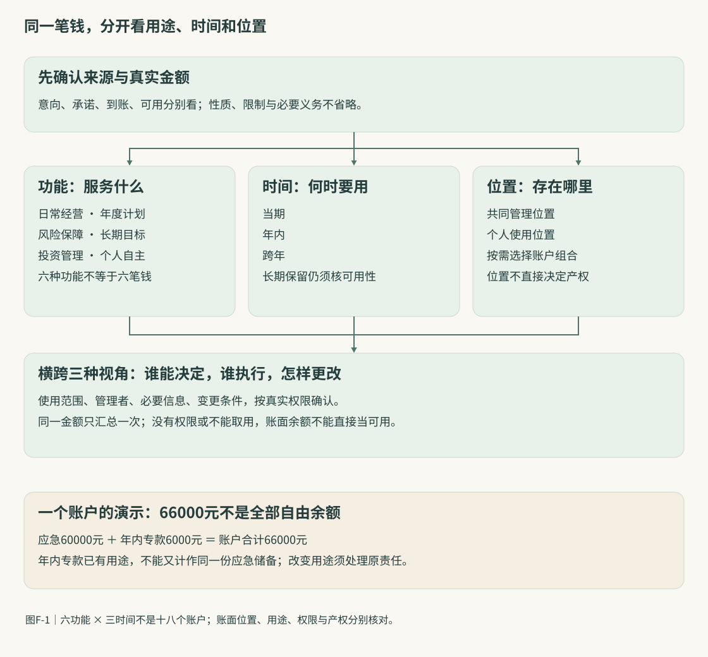

##### 空白整理页

选当前计划实际用得到的几笔钱，先确认来源与金额，再填写以下栏目。金额来自[附录F.2](#unit-F-2)，时间来自费用或目标的实际要求；账户只是存放位置，可以重复出现同一个名称。

| 唯一资金/用途标记与金额 | 服务什么功能 | 当期/年内/跨年及预计使用时点 | 实际账户或存放位置 | 权属已确认什么、还缺什么材料 | 谁管理、谁可作何种使用决定 |
| --- | --- | --- | --- | --- | --- |
|  |  |  |  |  |  |
|  |  |  |  |  |  |
|  |  |  |  |  |  |

再记一行：哪些钱目前不能取用，哪些已有指定用途，什么变化要重议。权属不清就写待核，不能用“夫妻共同管理”替代具体材料；不必为填这页公开与当前共同安排无关的全部私人资产。

##### 已填例：同一账户，不同用途

以下只改变宋晴与郑闻资金的存放方式，示范期初应急60000元与年内专款6000元可以放在同一个可用管理账户。它不是在[附录F.7](#unit-F-7)的其他账户之外又新增一份钱；两行仍是同样的两笔资金，合计66000元。

| 资金与用途 | 功能 | 时间与可用性 | 存放位置 | 权属信息 | 管理与使用决定 |
| --- | --- | --- | --- | --- | --- |
| 应急60000元 | 风险保障 | 跨期保留，当前可立即动用、未受限 | 示例同一管理账户 | 本例只说明资金用途；法律权属未给具体材料 | 宋晴执行依约管理，两人知情；启用或改变用途按共同认可的权限处理 |
| 年内专款6000元 | 年度计划 | 年内费用尚未支付，资金仍留存；用途已指定 | 同上，不再重复计账户总额 | 同上，不由账户位置推断归属 | 原用途内依约支付；转作其他用途须先重议原费用来源 |

这个账户显示66000元，不意味着66000元都能同时为同一场冲击兜底：其中6000元已经承担年内费用安排。当前应急口径仍是60000元。若决定改用年内专款，需要把原责任怎样支付一并说清，而不是把用途标签擦掉就当作增加了一笔自由资金。

这是账户摆放示例，实际家庭可以选择其他组合。财务清楚的标准是同一笔钱可被追踪、各用途不重复占用、权限可以实行，不是银行卡数量符合某个标准。

##### 再看收入来源，而不只数账户

另设匿名情境：一个人将同一份收入分别转入两个账户，两账户看起来各有余额。这增加了存放位置，并没有形成第二个收入来源。若原收入中断，两账户不会因此继续自动获得不同来源的补充。

同样，两个收入来源是否会受到共同冲击，需要看实际依赖；不能仅凭两张工资卡就下结论。这张工具先把来源、用途和账户分开，抗冲击判断再接[附录F.5](#unit-F-5)，不在这里补造概率或统一配置比例。

整理后，应能指出一笔当前可用的钱、一笔已有指定用途的钱，以及一项仍需核实的权限或条件。如果答案只剩“都在某人的卡里”，就回到[附录F.2](#unit-F-2)补来源与决定范围；如果用途已经清楚，再用[F.3](#unit-F-3)看本月怎样留出，而不继续增加账户和表格。

#### F.2 资金来源、用途、权限与责任

**使用要点：逐笔确认来源、到账、用途、权限和责任，只把当前确实可用的部分计入相应计划。**

适合共同计划依赖一笔钱，却不清楚是否已到账、能否使用、由谁决定，或是否附带其他义务时。先从当前计划必需的来源开始，一笔资金只建一条主记录；转到另一账户后更新位置，不另算新来源。本页是事实与权限整理工具，不认定合同效力或财产权属。

##### 最少使用步骤

先分开已收到的资金、尚待确认的支持和不能直接支付的资产。再核对实际可用性、用途与义务：已到账不一定能用于当前计划，金额确定也不等于本人有权支配。最后让真实提供者、管理者和受影响者确认各自能承诺的部分，尚无依据的内容保留未知。

涉及共有、受限或第三方权益时，用实际材料核对必要权限；关系中的口头认可不能替代所需的真实权限。事实可以由一人先整理，不能代替别人写同意，也不能把已经发生的争议单方面判为解决。

##### 空白来源卡：一笔一张

| 要确认的内容 | 本次记录 |
| --- | --- |
| 标记、核对日期与拟支持的计划 |  |
| 来源及金额：本人收入、共同来源或第三方；金额已知还是未知 |  |
| 当前状态：意向、明确承诺、已到账，实际证据是什么 |  |
| 性质：收入、赠与、借款、转拨、变现或其他；尚待核实什么 |  |
| 权属与权限：涉及哪些本人、共同或第三方权益，谁实际有权处分 |  |
| 可用性：何时可用，是否受限，能否用于这项计划 |  |
| 已有用途与必要义务：还款、指定支付或其他需履行的条件 |  |
| 管理者与存放位置：谁办理、谁能获得计划所需信息 |  |
| 使用授权：谁可在什么范围支付，哪些变化须重新同意 |  |
| 当前可计入多少：尚未确认或不能用的部分为何暂不计入 |  |
| 变更与下一步：谁核什么，在哪个相关承诺或付款前再看 |  |

不明金额写未知。明确存在但暂不纳入计划的来源，可以写“本计划当前不计入”，这不等于它的资产价值为零。只共享支持当前共同决定所需的信息；不能以透明为由要求交出全部私人流水，也不能以隐私为由隐去会改变计划的重大义务。

##### 已填例：沈宁与梁川的亲属支持，没有变成可用筹备款

回看[第12.3节沈宁与梁川筹备婚事时的情况](#unit-12-3)，他们尚未收到亲属款项。先看沈父提到给女儿个人礼物的意向：

| 字段 | 已填记录 |
| --- | --- |
| 当前计划与来源 | 婚事筹备时，沈父提出给女儿个人礼物的意向；属于第三方来源 |
| 金额与当前状态 | 金额、交付时间未给定；尚未到账，只能记录意向 |
| 性质及权属 | 表达为给女儿的个人礼物；具体材料和权属效果没有核实，不由意向推导共同财产 |
| 可用性和已有用途 | 当前未证明可用于共同筹备，不纳入已可用预算；不能先替沈宁承诺使用 |
| 管理与授权 | 未实际交付，管理安排未形成；沈父是否提供、沈宁收到后愿意怎样使用分别确认 |
| 义务与待核 | 具体条件未明确，不填写为无条件；不推定存在借款或债务 |
| 当前可计入与下一步 | 本计划当前不计入；如要据此作相关付款承诺，应先由有关本人确认金额、性质、时间、条件与实际权限 |

[梁川父母曾提出的购房支持](#unit-12-2)，有要求同住及主要决定婚宴等条件。两人不接受，也未收到资金，因此同样不计入当前可用来源。这不是“没有亲属支持就不独立”，而是这笔具体支持没有成为他们可接受、可使用的安排。后来采用的自筹租住方案，不反过来证明旧支持已经可用。

##### 已填对照：条件明确、接受且可用的支持怎样记

下面是匿名假设，另设亲属愿意赠与一笔专用于已认可共同费用的款项。金额依实际收款凭据记为A，提供者的处分权限已核实，使用条件已由相关本人明确接受，款已实际到账且可依约支付。A只代表这个独立例子中的一笔款项，不与其他算例合并。

| 字段 | 示例填写 |
| --- | --- |
| 来源、金额与状态 | 第三方支持A；金额与到账均有相应凭据，不重复把提供者转出和接受者转入算成两笔 |
| 性质与义务 | 按已核实的赠与安排记录；本假设没有还款义务，但仍有约定用途。真实个案不能据此推定相同法律结果 |
| 权限与可用性 | 处分和使用所需权限已核实，相关条件被接受；现在能用于指定费用，不等于可以自由转作其他用途 |
| 管理与授权 | 由明确认领的人办理指定支付，有关本人可核对用途和余额；超出范围重新确认 |
| 当前计入 | A计入对应来源一次；发生指定支付后记录已付及余下状态，不继续把全额当可用余额 |
| 重看条件 | 原用途、支持条件、实际可用性发生改变，或出现此前未披露的义务 |

这个对照表明，第三方资金并非一概排除。关键是把条件是否接受、权限是否成立、资金是否实际可用接起来。若只是“以后会给”，或到账后仍受限，就不能直接填入本栏的可用状态。

##### 非现金与未知项怎样显示

| 当前知道的事实 | 应怎样记录 | 还不能据此做什么 |
| --- | --- | --- |
| 房屋有估值 | 另记资产及相关权益、负担，变现条件待核 | 把估值全额当作今天可付的现金 |
| 有一笔应收但未收回 | 记应收及回收条件，收款时再更新 | 按预计收款填平眼前缺口 |
| 预期未来继承或奖金 | 记尚未实现的来源，不计当期可用现金 | 先形成必须依靠它履行的支付承诺 |
| 已到账但用途受限 | 记实际金额、限制和可使用范围 | 因账户看得见余额，就把它计入所有目标 |

填完后，只要能够判断当前计划能使用哪些来源、还缺哪项权限或信息，就可以停止。复杂权属、借款、担保等责任，需要带着具体材料进一步核实；本页帮助找出需要核实的问题，不用一个总数替你解决这些问题。

#### F.3 月度预算与计划预留模板

**使用要点：在同一月份和资金范围内对照计划、实际支付与留存，转拨不算消费，缺口如实保留。**

适合两人需要看清这个月有什么钱、已经承担哪些费用，以及哪些钱必须留到以后时使用。先做能维护的一页计划，有变化再更新实际状态；不要求每天重填，也不以固定比例评价家庭是否合格。[附录F.7](#unit-F-7)提供与本页相同的完整月度算例。

##### 先选月份和资金范围

月份：＿＿＿＿。核对时点：＿＿＿＿。本页包含哪些人、哪些资金：＿＿＿＿。由谁汇总、另一人如何核对必要信息：＿＿＿＿。

同一笔钱从甲账户转到乙账户，只更新位置，不增加总来源。借款、变现和动用期初储备都要保留其性质，不能都叫收入。若一项来源没有金额或尚不能确认可用，写未知或待确认，不用零替代。

| 来源或条件 | 金额/状态 | 已核实的依据、用途和义务 |
| --- | --- | --- |
| 本月税后实际可用收入：分别列来源 |  |  |
| 本月其他实际流入：性质分别说明，不与上述重复 |  |  |
| 本月决定动用的期初存量：来自哪项，原用途怎样处理 |  |  |
| 待收、未确定或受限来源：单列，不计当前可用合计 |  |  |
| 本次可用于分配的实际资金合计 |  |  |

期初资金只有决定纳入这次安排的部分才进入“本次可分配”合计，不能同时仍在原用途下全额保留。若部分来源未知，就不能声称已算出完整可分配总额。房产估值和未来继承不直接填现金来源；涉及复杂义务先用[附录F.2](#unit-F-2)核对。

##### 空白计划与实际去向表

| 用途 | 本次计划金额 | 截至核对时点实际对外支付 | 本次资金仍持有的金额与用途 | 转拨/限制/尚未发生的变化 |
| --- | --- | --- | --- | --- |
| 非债务必要生活（若已含保障，注明） |  |  |  |  |
| 必要保障（只列未计入上一行的部分） |  |  |  |  |
| 既有债务偿付（不再列入生活重复相加） |  |  |  |  |
| 年内计划预提 |  |  |  |  |
| 应急新增储备 |  |  |  |  |
| 长期目标新增 |  |  |  |  |
| 共同弹性 |  |  |  |  |
| 个人甲自主 |  |  |  |  |
| 个人乙自主 |  |  |  |  |
| 其他已确认且未重复的用途 |  |  |  |  |
| 合计 |  |  |  |  |

如保障已经包含在必要生活汇总内，保障行写“已含，不另加”，不是写成保障费为零。不需要的分类可以注明不适用，不能将不知道的金额改成不适用。个人消费按当前核算需要记录总额与剩余即可，不默认附全部私人明细。

计划未分配额＝本次实际可分配资金－计划金额合计。结果为正，表示尚有未安排部分；为负，表示当前方案缺口，不能先假定未到奖金填上。计划未分配为零，也只说明用途已排满，不说明钱都花掉。

实际核对时，在同一范围内看：实际可分配来源＝实际对外支付＋仍持有资金。已经转到其他账户的钱仍计入“仍持有”；若发生退款、转出给范围外对象或用途改变，应如实更新对应来源和去向，不能只改合计让表变平。

##### 已填例：宋晴与郑闻的普通月

这是[附录F.7](#unit-F-7)的同一份虚构账本：本月税后实际可用收入为12000＋8000＝20000元，均已到账。本次没有动用期初储备，也不另引入其他流入或收益。表中支付状态是这个演示月已经发生的事实，不是只因预算写下就视为完成。

| 用途 | 计划（元） | 本月实际对外支付（元） | 本月资金月底仍持有（元） | 状态说明 |
| --- | ---: | ---: | ---: | --- |
| 非债务必要生活与必要保障 | 10000 | 10000 | 0 | 保障已含，内部拆分未给定，不另加保障一行金额 |
| 最低债务偿付 | 2000 | 2000 | 0 | 只核现金支付，本金利息拆分未给定 |
| 年内预提 | 2000 | 0 | 2000 | 已实际预留，尚未为对应年内费用支用 |
| 应急新增 | 2000 | 0 | 2000 | 已转至对应位置，未支用 |
| 长期目标新增 | 1000 | 0 | 1000 | 已转至对应位置，未支用 |
| 共同弹性 | 1000 | 1000 | 0 | 本普通月实际对外支付 |
| 宋晴个人自主 | 1000 | 1000 | 0 | 先转给本人，后确实消费，不在转拨时多算一次支出 |
| 郑闻个人自主 | 1000 | 1000 | 0 | 同上，按本人使用总额记录 |
| 合计 | 20000 | 15000 | 5000 | 15000＋5000＝20000 |

计划按12000必要、2000年内、3000储备、3000弹性自主分组，同样等于20000。必要里的债务2000不能再加一次；个人两笔1000也不是在3000之外另给的钱。内部转拨未进入实际对外支付列。

##### 将新增留存接回期初

| 项目 | 期初余额 | 本月新增并保留 | 本例月末 |
| --- | --- | --- | --- |
| 应急储备 | 60000元 | 2000元 | 62000元 |
| 年内专款 | 6000元 | 2000元 | 8000元 |
| 长期目标 | 未给定 | 1000元 | 期初实际余额＋1000元 |

这张接续表的前提是原有资金当月未支用，新增部分确实到位。它不是另一张需要与本月20000收入再相加的预算。年内专款保留其用途，长期原余额保持未知，不能据这三行计算家庭全部资产。

##### 临时变更怎么记

| 触发事实 | 确实可调整的来源 | 双方接受了什么代价 | 变更后的计划与实际状态 |
| --- | --- | --- | --- |
|  |  |  |  |

[附录F.7的替代情境](#unit-F-7)中，必要支付多1000元，双方把尚未使用的共同弹性1000转入，其他分配不变。计划变成13000＋2000＋3000＋2000＝20000，原共同弹性用途取消。只有后来真付出，才更新实际支出；签字同意调整不等于已经付款。

若共同弹性已花，同一调整就不能成立；全部其他安排又保留时，所需21000与收入20000之间有1000缺口。表中保留缺口，再核其他可调整计划和真实资源，不伪造一笔收入，也不默默把专款改成自由余额。

填完后，应能沿一笔钱指出来源、当前用途、是否已付和剩在哪里。若总额平衡但仍有人不能使用自己的已认可额度，问题在权限；若保障或重大义务资料不全，问题在尚未掌握的事实。分别回到[附录F.2](#unit-F-2)和[G.3](#unit-G-3)处理，不让一张平衡表代替所有判断。

#### F.4 FHS 常态健康：梳理日常财务的七个方面

**使用要点：按七个方面找出日常财务的事实与缺口，只计算口径和资料充分的比率，不输出综合分数。**

家庭财务常态自检（FHS）用于整理通常情况下的财务运行：收入来自哪里、能否持续，刚性支付占用多少空间，条件改变时能否调整。先从影响当前计划的一项问题开始，记录已有事实、仍缺什么以及下一步。七个方面用于查缺和讨论，不是已经验证的预测量表，也不提供综合总分或适婚门槛。

##### 七维结构与用途

| 观察方面 | 可以检查的事实 |
| --- | --- |
| 收入稳定性 | 实际到账与中断记录、来源条件和变化，不能只据本月收入推定未来稳定 |
| 最大收入源集中度 | 主要支付来源及相互依赖；两人领薪不自动代表两个独立风险来源 |
| 低相关收入多样性 | 各来源可能共同受什么条件影响；没有资料就不凭行业名称给相关性分数 |
| 刚性支出率FCR | 不含债务的硬刚性生活支付与最低债务偿付，相对于同口径税后收入占多少 |
| 债务偿付收入比DTI | 最低月债务偿付相对于同口径收入的负担；不与已含债务的FCR相加 |
| 生活成本降级能力 | 哪些费用可实际减少、何时能改变、要承担什么代价；不是笼统说愿意节俭 |
| 财务纪律 | 已认可安排怎样执行、偏差是否说明、重要信息是否可见，不以某人的消费偏好作为唯一标准 |

七个方面各自回答不同问题，没有综合得分。一项比率也不能直接当作整个维度的表现，更不能抵销另一项尚未查清的重大义务。

部分维度会使用同一事实：收入稳定性、来源集中度和低相关多样性可能相互关联，FCR与DTI也共享债务信息；不能把七项看成七条独立的预测证据。

##### 从一处实际问题开始：空白页

选择当前需要处理的行，注明同一时点和统计范围。各人的私人信息按共同计划所需最少共享；若由一人先填，另一人的事实或同意未核实就留作未知。

| 维度 | 已知事实与时间口径 | 未知及资料来源 | 本次需要核实或调整什么 |
| --- | --- | --- | --- |
| 收入稳定性 |  |  |  |
| 最大收入源集中度 |  |  |  |
| 低相关收入多样性 |  |  |  |
| FCR |  |  |  |
| DTI |  |  |  |
| 生活成本降级能力 |  |  |  |
| 财务纪律 |  |  |  |

##### 可以演算的两个比率

FCR＝（不含债务的硬刚性生活支出＋最低债务偿付）÷税后月收入。必要保障按实际归入相应支付，已包含就不再重复加入。收入与支出要使用可比较的月度口径；不适用时先说明现金流，不为了得到数字勉强折算。

DTI＝最低月债务偿付÷税后月收入。这里是本书已保留口径，不以未付负债总额代替本月偿付，也不把其他场合的同名比率直接混用。

##### 已填例：只计算资料足够的部分

沿[附录F.7的独立普通月账本](#unit-F-7)：宋晴12000、郑闻8000税后月可用收入，非债务硬刚性生活及必要保障10000，最低债务2000。保障内部分拆、债务本金利息及两人职业来源细节没有给定。

| 维度 | 本例可确认什么 | 还不能确认什么、下一步怎样做 |
| --- | --- | --- |
| 收入稳定性 | 本月两项收入已到账，共20000元 | 未给连续记录和未来条件，不能写长期稳定 |
| 最大收入源集中度 | 两个人分别获得12000与8000元 | 未给雇主或业务依赖，个人收入份额不能说明两个来源是否独立，仍需核对共同依赖 |
| 低相关收入多样性 | 有两个个人收入条目 | 相关性资料不足；如计划依赖分散效果，要核实际共同风险来源 |
| FCR | （10000＋2000）÷20000＝60% | 说明已列刚性支付占比，不是60分；未列义务仍需核 |
| DTI | 2000÷20000＝10% | 债务已经在FCR分子内，不能加成70% |
| 生活成本降级能力 | [附录F.7的替代情境](#unit-F-7)在共同弹性未花时，可经认可改拨1000元 | 这只证明一条有前提的调整路径；若已花便失效，不能推定其他支出都可削减 |
| 财务纪律 | [附录F.7的普通月](#unit-F-7)依约完成了已列支付、转拨与记录 | 一个月不证明长期习惯；该例没有给重大遗漏义务已被全面排除的证据 |

接下来的行动取决于问题。例如，只为核本月用途，可先用[附录F.3](#unit-F-3)；若打算依赖两份收入承担新增义务，应补收入来源与共同冲击的事实。不是为了把七行全部填满，就调查与当前计划无关的所有资料。

##### 零、未知与不适用

| 情况 | 显示方式 | 仍可做什么 |
| --- | --- | --- |
| 本月税后收入确为0 | FCR/DTI本时点不计算，不显示无穷大或0风险 | 直接列必要支付、可用存量、其他真实来源和缺口 |
| 收入未给定 | 收入未知；比率不可计算 | 核实后再算，不把空栏补成0 |
| 只有部分债务资料 | 已知部分列出，整体DTI暂不确定 | 核相关实际义务；不能因已知部分很小就视为全部很小 |
| 统计期间或口径不可比较 | 口径不适用，暂不输出比率 | 先统一实际现金流范围，说明仍无法对齐的部分 |

本页不设统一安全阈值。较低比率未必意味着所有需要得到满足，较高比率也不能独自判定关系不可继续。先处理真实负担与调整条件，再看个人是否接受；抗冲击问题接[附录F.5](#unit-F-5)，不把两个工具合成一个分数。

#### F.5 RRS 抗冲击及尾部风险：不能用平均分掩盖重大义务

**使用要点：核对可用储备、成本与重大责任，分别解释两种续航，把重要未知单独留下。**

家庭财务抗冲击自检（RRS）关注平时收支表之外，资金和支持能否应对变化，以及是否还有可能带来重大后果的责任。“尾部风险”在这里提醒读者注意少见但严重的情境；本页没有这些事件的概率资料，不声称已测出发生机会或覆盖全部危机。

下面按八个方面整理当前条件，不提供综合总分，也不是已验证的预测量表。重大未知单列，不能由其他方面良好抵销。RRS检查冲击下的资源与责任，[FHS](#unit-F-4)检查常态运行，两者分别帮助确定需要核实或调整什么。

##### 八维及当前可用内容

| 观察方面 | 事实检查用途 |
| --- | --- |
| SR生存续航 | 可立即动用且未受限资金，对应应急必要月支付能支持多长的简化时段 |
| MR生活续航 | 同口径资金，相对于普通月实际总支出的覆盖月份 |
| 生活成本锁定 | 哪些支付短期不能改变、解约或改变需要什么条件；不是看本人想不想省 |
| 一次性大额事件应对 | 已知或需要考虑的重大事项，现有可用资源及明显缺口 |
| 保障覆盖核对 | 实际保障范围、限额与限制、期限和启动条件；分别核对，不合成单一分数 |
| 重大责任边界 | 谁已承诺什么，范围、期限和触发条件是否明确 |
| 担保代偿与连带 | 涉及相关承诺时，核材料、可能责任和可用资源；具体效果需专业解释 |
| 应收款回收质量 | 是否确有应收、收回条件和实际进度，未收款不能当已到账现金 |

“担保代偿与连带”一栏核对担保等承诺可能涉及的财务承担，具体责任须结合实际材料解释，不能把不同承诺都视为连带清偿。[第14.2节的家庭功能代偿](#unit-14-2)则指功能出现缺口后的额外补位，两处讨论的对象不同。

##### 空白事实与责任页

| 维度 | 当前事实及核对时点 | 可用/受限/未知 | 缺什么资料，下一步由谁核实 |
| --- | --- | --- | --- |
| SR |  |  |  |
| MR |  |  |  |
| 生活成本锁定 |  |  |  |
| 一次性大额事件 |  |  |  |
| 保障覆盖核对 |  |  |  |
| 重大责任边界 |  |  |  |
| 担保代偿与连带 |  |  |  |
| 应收款回收质量 |  |  |  |

对重大责任另留一行，不纳入平均：具体事项＿＿＿＿；已知承诺/材料＿＿＿＿；金额或范围＿＿＿＿；触发条件与期限＿＿＿＿；当前计划受何影响＿＿＿＿；需要的核实或专业解释＿＿＿＿。这些内容未明，就不能用“还有存款”关掉这一项。

##### 续航公式与前提

SR＝可立即动用且未受限资金÷应急状态月必要支出。MR＝同口径资金÷当前普通月总支出。本书算例中普通月总支出取实际对外现金支付，不把内部账户转拨再算消费；应急口径也须保留实际不能暂停的必要义务。

这两个比率以同一资金范围和明确的成本基准计算；它们不是可相加的月份。对变化后的月份，应更新可用资金、支出和责任，而不是延用旧分母。分母为零或未知不计算，资料不足则直接列可用资源及缺口。

##### 已填例：60000元时点的有限演算

本例沿宋晴与郑闻的独立财务设定，单独选用可动用资金为60000元的测算时点。年内专款6000元另列，长期目标资金原余额未给且未纳入本次应急计划。成本基准是应急月必要12000元、普通月实际对外15000元；没有将[附录F.7](#unit-F-7)月底的62000元代入旧时点。

| 维度 | 已填事实或计算 | 结果怎样解释 |
| --- | --- | --- |
| SR | 60000÷12000＝5个月 | 在必要支付按所列数额持续、不加收入补充或额外支出的简化条件下成立，不是安全保证 |
| MR | 60000÷15000＝4个月 | 使用同一60000，不与SR相加成9个月 |
| 生活成本锁定 | 已知必要支付12000元 | 未给每项变更期限与成本，不能认定12000可立即削减，也不能认定永远不可改变 |
| 一次性大额事件 | 本例未给完整事件和责任资料 | 保留未知，不据此宣布没有大额风险 |
| 保障覆盖核对 | 10000非债务必要支付中已含必要保障费用 | 具体覆盖和条款未知，支付了费用不等所有风险已有保障；核对实际覆盖与缺口，不转换为总分 |
| 重大责任边界 | 本例只给已列月度支付 | 其他承诺资料未给，不能补成全部已排除 |
| 担保代偿与连带 | 未给是否存在相关承诺的事实 | 记未知，不记0元；没有资料就不能认定存在或不存在相关承诺 |
| 应收款回收质量 | 未给应收事实 | 不计入当前现金，也不声称没有应收；需要时再核相关资料 |

这张页能支持的结论很有限而具体：已经给出的60000元，在两种明确成本基准下对应不同覆盖月份；另有多项事实尚缺。它不能支持“这个家庭抗风险合格”，更不把未知全部归为高危。

若另有经营担保的线索，先辨认确切文件、签署主体、权限、责任范围、触发与追索等待解释问题；不靠本表推断必然承担多少。查看与当前共同计划有关的材料，必要时取得相应专业意见；在决定性事实未清前，可暂缓受其影响的新增承诺，不必假装已有完整答案。

#### F.6 参考值、情境和未知的显示规则

**使用要点：数值连同来源、时点和范围一起记录，分清零、未知、不适用和不可计算，再据事实决定下一步。**

本页帮助区分已经知道的事实、可以计算的数和假设下的结果。[FHS](#unit-F-4)与[RRS](#unit-F-5)用于整理事实，不输出综合评分。算例中的数值用于说明计算，不能作为所有家庭通用的安全线。

##### 怎样显示，才不让空白变成结论

| 状态 | 建议怎样写 | 不能改写成 |
| --- | --- | --- |
| 已核实的数值 | 数值、单位、时点、范围及依据 | 不受时间和条件影响的永久事实 |
| 确定为零 | 0，并说明什么范围内已经确认没有 | 由空白或未找到资料推断为0 |
| 未知 | 未知：具体缺什么，何时需要核实 | 0分、0元、低风险或确定危险 |
| 不适用 | 说明该指标为何不适用当前事项 | 为避免补资料而把未知改成不适用 |
| 不可计算 | 说明缺项、分母为零或口径问题 | 无穷大安全、0风险或猜出的百分数 |
| 情境结果 | 先写假设，再写条件下的计算和未解决项 | 预计一定发生，或已经取得的改善 |

“未知”可以不填数值，但应保留文字状态。这样，一张表不会因为数值栏空白而被软件或读者默认补零。若之后事实改变，保留原时点与更新理由，不把不同月份拼成一份看似完整的现状。

##### 空白记录：只处理本次需要的一项

| 要记录什么 | 本次填写 |
| --- | --- |
| 事项/指标与用途：要支持哪个决定 |  |
| 资料来源及日期 |  |
| 核对时点、范围与单位 |  |
| 当前状态：已知、确定零、未知、不适用或不可计算 |  |
| 可以展示的值或明确的缺件原因 |  |
| 若为情境：改变了什么，哪些条件暂按不变 |  |
| 仍不能推断什么，下一步核什么 |  |

##### 已填例：相似空栏，不同含义

| 事项 | 已知条件 | 应显示的结果与下一步 |
| --- | --- | --- |
| 本月收入未填 | 没有足够资料 | 收入未知，FCR/DTI不可计算；先确认收入，不填成0元 |
| 本月收入确为0 | 仅此条件已核实，必要支付仍存在 | 比率不计算；列实际支付、可用存量和其他真实来源，显示缺口而非“无限风险” |
| 常态FCR | 税后20000、非债硬刚性10000、最低债务2000，同月口径 | 60%；这是比率，不是60分，且已包括债务 |
| FHS综合结果 | 已整理七个方面及上述部分事实 | 分别列事实、缺口和行动，不输出总分；填满各栏不等于信息全部准确或已经适婚 |
| RRS中的保障覆盖核对 | 有必要保障费用的汇总，具体覆盖条款未给 | 覆盖情况未知，无统一单一公式，不据保费金额给分 |
| 收入下降的假设 | 可用收入15000，原分配计划20000，其余暂不变 | 计划缺口5000；不是下降概率，也没有证明已找到可接受的调整方案 |

确定零可以是[附录F.7](#unit-F-7)某一时点“本月跟踪收入在当前收支位置剩0元”。它不等于全家资产为零，也不说明其他账户没有该月已转出的资金。把范围与数值放在一起，才不会让一个正确的零传递错误意思。

##### 怎样把记录接到行动

| 目前整理了什么 | 接下来怎样使用 |
| --- | --- |
| FHS七个观察方面 | 按[附录F.4](#unit-F-4)找出收入、支付与执行中的具体缺口，不给各方面加权排成总分 |
| RRS八个观察方面 | 按[附录F.5](#unit-F-5)核对可用储备、成本与重大义务，不用其他良好项抵销未知责任 |
| FCR、DTI、SR、MR | 口径、时点和资料充分时演算；条件改变后更新，各自回答限定问题 |
| 尚不清楚的重大事实 | 说明需要什么资料或专业解释，以及哪项新增决定须暂缓 |
| 已认可的调整方案 | 继续记录实际履行与结果；尚未实施就不写成缺口已经解决 |

取得新资料后，核对来源、范围和当前条件，再更新受影响的判断。工具应帮助安排眼前生活，不把一张填写完整的表当作预测婚姻质量的依据。

#### F.7 从入账到月末的完整算例

**使用要点：沿同一笔收入逐步核对去向，分清仍持有与已付出，再把本月新增接回各项期初余额。**

本例适合配合[附录F.3](#unit-F-3)练习：沿一笔月收入，分清计划、转拨、实际支付和剩余资金。宋晴与郑闻是虚构人物，金额只用于核算演示，不是推荐比例。

这里是一份独立普通月账本。[第14.3节的分工例子](#unit-14-3)停在个人额度已转、消费未知的时点；本页另给出普通月的支出结果，两种情境分别记录。

##### 先确认范围与期初

本月宋晴税后实际可用收入12000元、郑闻8000元，合计20000元，均已到账。本例约定汇到一个双方用于共同管理的收支位置，再按用途转拨；这只是账户安排，不说明全部个人财产的法律性质。其他已知储备另列，不把它们再算成本月收入。

| 期初项目 | 金额或状态 | 本例怎样处理 |
| --- | --- | --- |
| 应急储备 | 60000元，未受限、可立即动用 | 为风险用途保留；本例当月没有支用 |
| 年内费用专款 | 6000元 | 已有用途，不能同时算应急或随意消费的钱；本例当月没有支用 |
| 长期目标资金原余额 | 未给定 | 保留未知，只追踪本月新增1000元 |
| 其他资产、债务余额和账户余额 | 未给定 | 不填零，不据局部账户计算全家庭净资产 |

为看清资金走向，本次演示不另引入利息、投资收益、手续费或其他收入。本月最低债务支付另在支出中列出，但本金与利息的拆分没有给定，因此只核现金出去多少，不据此宣布净资产增加多少。

##### 两人怎样决定与执行

两人先共同认可用途、必要支付和自主范围。宋晴负责执行本例中的共同支付与转拨，并留下必要的用途和余额记录；郑闻能够核对，也参与变更决定。管理工作有主责，决定资格不因谁操作账户而改变。

个人额度转入各自可以使用的位置后，各人在认可范围内自主安排，不要求把每笔私人消费提交另一人审批。共同弹性的用途范围已获认可，由宋晴依约执行；若要改动储备用途、形成新的共同义务或超出预算，则另行协商。交接必要信息和正当权限即可，不靠交出全部密码维持透明。

##### 第一次核对：本月计划没有重漏

| 计划用途 | 金额（元） | 说明 |
| --- | ---: | --- |
| 非债务必要生活与必要保障 | 10000 | 保障已包含，具体拆分未给，不再加一次保障费用 |
| 最低债务偿付 | 2000 | 与上一行不重复 |
| 年内计划预提 | 2000 | 给可预见但不按月发生的费用留钱 |
| 应急储备新增 | 2000 | 本月新增，期初60000另列 |
| 长期目标新增 | 1000 | 本月新增，原余额未知 |
| 共同弹性 | 1000 | 在认可范围内使用，可以在未花前讨论调整 |
| 宋晴个人自主 | 1000 | 转拨给本人不等于已经消费 |
| 郑闻个人自主 | 1000 | 同上，不因收入较低而需逐笔申请 |
| 合计 | 20000 | 与实际可用收入一致 |

这也可以写成：20000＝12000必要支付＋2000年内预提＋3000新增储备＋3000弹性与自主。必要支付里的2000债务已经包含在12000中；两人的自主额度共2000，也已包含在最后的3000中。

##### 从入账到实际支付

下表只追踪本月这20000元，不混入期初储备。“其他位置仍持有”包括年内预留、应急新增、长期新增和已转出的个人额度；只是存放位置变了，钱仍在本例核算范围内。每行均满足：当前收支位置剩余＋其他位置仍持有＋累计对外支付＝20000。

| 本例演示步骤 | 当前收支位置中的本月资金（元） | 其他位置仍持有的本月资金（元） | 累计对外支付（元） |
| --- | ---: | ---: | ---: |
| 两笔收入均已到位 | 20000 | 0 | 0 |
| 实际支付必要生活保障10000与债务2000 | 8000 | 0 | 12000 |
| 实际转出年内预留2000 | 6000 | 2000 | 12000 |
| 实际转出应急新增2000 | 4000 | 4000 | 12000 |
| 实际转出长期新增1000 | 3000 | 5000 | 12000 |
| 实际转出个人额度，各1000 | 1000 | 7000 | 12000 |
| 共同弹性1000已经对外支付 | 0 | 7000 | 13000 |
| 两人个人额度各1000均已实际消费 | 0 | 5000 | 15000 |

表中的零，都是这笔已跟踪收入在指定位置或类别中的余额，不是声称该家庭其他钱全部为零。本例最后一行明确给出了个人额度已消费的假设事实；若你的额度只是转出、还没花，应该停在对应状态，不照抄这一行。

资金无需真的经过上述所有账户。它们也可以留在较少账户里，以用途记录分开；此时改变的是“哪一部分可供什么用”，不一定发生银行转账。无论怎样存放，同一笔钱都只能记一次。

[图F-2](#figure-F-2)与[第14.6节](#unit-14-6)共用：图中每笔金额均来自本页同一份普通月账本，期初存量与本月新增分别记录。

##### 第二次核对：月底剩下的是什么

普通月最终实际对外支付15000元，其中必要12000、共同弹性1000、个人消费共2000；本月新增并仍持有5000元，其中年内2000、应急2000、长期1000。两部分相加仍为20000，没有一笔钱因为内部转账而消失或重复出现。

| 用途 | 期初 | 本月实际新增 | 本月从该项支用 | 本例月底 |
| --- | ---: | ---: | ---: | --- |
| 应急储备 | 60000 | 2000 | 0 | 62000元，仍按应急用途保留 |
| 年内专款 | 6000 | 2000 | 0 | 8000元，仍有指定用途 |
| 长期目标 | 未给定 | 1000 | 0 | 期初实际余额＋1000元，不能写成总额只有1000元 |

这里没有把年内8000元同时列入应急62000元，也没有把期初60000元与月底62000元相加成两份钱。普通月剩下5000元，是本月收入中尚未对外支付的部分；它已有用途，不等于还可以再随意花5000元。

##### 替代分支：必要支付临时增加1000元

回到共同弹性尚未花出的时点，另设必要支付增加1000元。两人先确认这项新增确实需要支付，再共同同意取消原共同弹性用途，把仍在手里的1000元改作必要支付。个人额度、年内预留及新增储备保持原安排。

| 调整后的用途 | 金额（元） | 谁承受了变化 |
| --- | ---: | --- |
| 必要支付 | 13000 | 由共同弹性转入1000，不是收入增加 |
| 年内预提 | 2000 | 本例保持原计划 |
| 应急与长期新增 | 3000 | 本例保持原计划 |
| 个人自主合计 | 2000 | 两人原有额度保留 |
| 共同弹性 | 0 | 原共同弹性用途取消，不能再消费一次 |
| 合计 | 20000 | 全部资金仍有同一来源 |

如果调整后的支付都实际发生，本分支对外支付仍为15000元，但构成变成必要13000加个人2000；本月保留的5000和期末三项储备不变。这是替代普通月的另一条走法，不是在普通月15000支出之外又加一笔已经有来源的钱。

若共同弹性1000元已经花掉，再发生必要支付增加1000元，其他安排又全部保留，所需就变成21000元，对应本月收入的缺口为1000元。不能在表里再次划走已花的1000。需要另核哪些尚未支付的安排可调、哪些储备确实可用以及改变用途的后果；尚未确认之前，缺口就留在那里，不假定已有新借款或支持到账。

##### 用自己的事实跟算：空白追踪页

先选一个月份、统一时点及资金范围，与[附录F.3的来源分类](#unit-F-3-heading-1)一致。先填来源小表，再按实际事件追踪去向；金额不明写未知，不用零代替。

| 来源类别 | 截至核对时点纳入的累计金额 | 依据、性质及原用途或义务 |
| --- | --- | --- |
| 本月实际可用收入 |  | 分列真实来源，不重复计入其他流入 |
| 纳入本次追踪的期初存量 |  | 来自哪项储备；原用途及余额怎样变化 |
| 新增借款 |  | 实际到账金额、来源及待履行义务；不算收入 |
| 其他真实来源及性质 |  | 说明性质和依据，不与以上项目重复 |
| 本次资金来源累计 |  | 未确认的部分单列；不声称已取得完整合计 |

来源发生变化时更新小表，事件表的来源累计回接同一时点的来源合计。内部转出、转入用同一个说明相连，只改变位置，不新增来源。

| 日期与事件 | 本次资金来源累计 | 本次资金仍在各处的合计 | 本次累计对外支付 | 其中已有用途或受限的部分 | 核对依据/未确认 |
| --- | --- | --- | --- | --- | --- |
|  |  |  |  |  |  |
|  |  |  |  |  |  |
|  |  |  |  |  |  |

同一资金范围、同一时点应满足：**本次资金来源累计＝本次累计对外支付＋本次资金仍持有合计**。已包含的受限或已有用途金额是仍持有资金的组成，不再相加；尚未纳入的期初储备不能拿来配平。动用存量要同步扣减原用途下的余额，借款增加资金也留下待履行义务，两者均不增加本月收入。前面的普通月示例只有20000元收入，没有新增借款或动用存量。

下月回看时，先用实际期末余额作新的期初，再看年内费用是否临近、必要支付是否改变、原授权和个人空间是否仍能用。长期目标的真实期初、未确认的重大义务，仍需要相应资料。算得平只说明已列项目对得上，不证明信息完整、分配公平或抗风险能力充足；这些分别接[附录F.2](#unit-F-2)、[G.3](#unit-G-3)及[F.4](#unit-F-4)、[F.5](#unit-F-5)、[F.6](#unit-F-6)。

#### F.8 不同家庭的适配与使用范围

**使用要点：按实际收入与责任特征调整核对问题，保留义务和未知，找到可执行安排后再记录为已落实。**

同一组现金流字段，可以服务不同家庭；不能因为收入形式不同，就硬套同一个预算比例或评分门槛。本页调整的是核对问题与时点，[附录F.1](#unit-F-1)至[F.7](#unit-F-7)的基本口径保持不变：资金不重复、未知不填零、管理不等于独占权力。

##### 五种情境，改变哪些问题

| 情境 | 要增加或改变的核对 | 仍须保留什么 |
| --- | --- | --- |
| 工薪家庭 | 实际到账时间、必要支付时点、年内费用，不将未到奖金当现金 | 收入到位与已分配用途分别记录；预留不等消费 |
| 单收入家庭 | 该来源中断会影响哪些义务，真实储备与可用支持是什么 | 不按一个收入来源直接判危险；无偿贡献者的自主、参与和保障仍需实际落实 |
| 收入差距较大 | 谁能使用资源、谁承担组织与照护，变化后怎样重议 | 多出资不购买更多人格权利；不以总收入证明双方都受益 |
| 波动收入家庭 | 区分已到账、预计回款和未完成业务，按实际期间看现金与义务 | 不用最好月份代表长期能力，不把未收应收当可支付余额 |
| 有复杂经营责任的家庭 | 区分个人/共同/第三方资源，已承诺义务、担保、受限资产与必要权限 | 经营流水不直接等于家庭可用收入；责任效果需具体资料和相应专业解释 |

一个家庭可能同时属于几种情境。选与当前问题有关的行即可，不必为归类而扩充一套检查。两个人都挣钱，也可能依赖同一业务；只有一个人挣钱，也可能有实际可用的储备和调整路径。判断落在事实与承载上。

##### 空白适配页

| 需要确认什么 | 本次填写 |
| --- | --- |
| 当前共同计划与核对时点 |  |
| 哪种收入/责任特征影响本计划 |  |
| 实际可用来源，哪些仍预计或受限 |  |
| 已承担的最低支付与时间要求 |  |
| 原计划哪些可以改变、须谁认可、有什么后果 |  |
| 当前储备或外援能否使用，有无重复占用 |  |
| 双方自主、贡献保障与真实需要怎样保留 |  |
| 当前已实施什么，哪些仍未确认，何时重看 |  |

##### 已填例：15000元收入与20000元原计划

另设宋晴与郑闻的收入下降假设：家庭当月实际可用收入合计15000元，原计划保持20000元。没有给两人的新收入拆分或下降原因，这里改变的是收入条件，[附录F.7普通月](#unit-F-7)已完成的支付不能移入这个假设月。

| 当前项目 | 原安排（元） | 在此假设下知道什么 |
| --- | ---: | --- |
| 必要生活保障及债务 | 12000 | 暂按本月不变；保留后当月收入余3000 |
| 年内预提 | 2000 | 原用途仍需确认，未因收入下降自动消失 |
| 应急与长期新增 | 3000 | 原准备计划仍在，是否调整及代价尚待讨论 |
| 弹性与个人自主 | 3000 | 可否压缩、怎样保留实际需要，由本人参与判断 |
| 原计划合计 | 20000 | 比实际收入15000多5000 |

这里的5000是当前计划缺口，不是已造成5000元逾期债务，也不是必定要借5000元。先分清尚可调整的计划与已经形成的义务；再核实可用资源、使用权限和改变未来准备的后果。

把年内及储备新增合计5000全部从本月计划删除，算术上可以对上，但未来责任与保障不会随之消失；因此这不是本页给出的推荐办法。相同地，只喊少花一点，并没有说明哪笔可以改变。当前只完成了缺口识别，尚未确认减支、动用存量或新增支持，不能提前写成方案已执行。

下一步可以用[附录F.3](#unit-F-3)逐项重排，在同一张表上记录取消或延后的用途、谁受影响、双方认可了什么，再记录真实付款和留存。若可行路径还没有找到，应保留未解决状态，暂停依赖缺失资源的新增承诺；不把资金压力变成对另一人基本选择的无限控制。

##### 复杂责任怎样准备材料

若当前计划涉及经营担保或其他可能产生重大后果的承诺，先记录：具体文件与主体、权限依据、责任范围与期限、可能触发的条件、哪些资源受限，以及当前哪些解释仍不清楚。资料不足不填零，也不凭一句“我会处理”视为已排除。

这些字段帮助准备专业核实，不在此判定责任一定成立、金额一定是多少或应采取某种资产操作。等待核实时可以调整受影响的新安排，不必用别的高项或一个总分盖住未知。

##### 怎样理解本组工具

[附录F.1](#unit-F-1)至[F.3](#unit-F-3)、[F.7](#unit-F-7)及本页帮助管理资金、核对现金流和适配实际情境；[F.4](#unit-F-4)至[F.6](#unit-F-6)帮助从不同方面识别负担与未知，并按明确口径计算四项比率。这些是事实整理与讨论工具，不提供综合总分，也不是已验证的婚姻预测量表。

使用时不要求家庭具有同样的收入、账户或分工。所需资料和资源随当前决定而定；核对结果仍应由本人结合真实意愿、已有责任和可承担后果作判断。

### 附录 G 家庭分工、共同决定与责任

#### G.1 完整任务链清单

**使用要点：沿发现、计划、执行和跟进辨认完整任务，看组织负担是否真正交出、承担条件是否足够。**

适合一件经常漏掉、总要提醒，或看起来分工了却仍由一人操心的事务。先选一项，沿着发现、计划、执行和跟进看实际工作。主责可以求助，协助也不自动取得全部决定权；目的不是逐分钟算劳动，而是减少反复组织与补漏。

##### 从一项任务开始

先说需要完成什么结果，再分别回忆最近一次是谁发现、安排、动手和收尾。找出没人认领或长期集中在一人身上的环节，约定一个可承担的调整。下次自然发生时，看事情是否完成、总负担是否下降，而不只看谁做了更多动作。

##### 空白清单

| 需要写清什么 | 本次记录 |
| --- | --- |
| 任务与结果：为什么需要，做到什么程度即可 |  |
| 谁发现需要：怎样知道该开始，哪些变化要关注 |  |
| 谁计划：确认条件、准备材料、安排时间和顺序 |  |
| 谁执行：实际完成哪些工作，有什么自主范围 |  |
| 谁跟进与沟通：检查、收尾、异常说明与交接 |  |
| 主责认领：本人是否理解并愿意承担完整结果 |  |
| 协助：谁愿意提供什么，到什么范围 |  |
| 可替代支持：已经确认什么，什么还不能算可用 |  |
| 真实负担：时间、提醒、等待、协调和恢复空间 |  |
| 何时重议：什么变化需说明，当前可怎样减负 |  |
| 实施后：结果怎样，谁仍在补漏，下一次改什么 |  |

时间可以写“大约一段下班时间”“需要反复打断工作”，不必为填表精确计时。负担尚不清楚就保留未知；不是所有付出都能换成统一单位，但反复提醒和等待仍是实际工作。

##### 已填例：采购不只是照单买回

这里记录[第14.2节宋晴与郑闻那次采购交接](#unit-14-2)。原先宋晴清点、列单、提醒、核对，郑闻按单购买。两人发现，执行动作虽被分出，宋晴仍承担组织全程。采购范围与费用额度已经共同确认，具体金额未给出。

| 环节 | 原来怎样做 | 本次认领与实际反馈 |
| --- | --- | --- |
| 任务需要 | 保持双方已认可的日常食材和用品可用 | 只处理已有需求，不以大采购证明勤快 |
| 发现需要 | 宋晴清点后通知郑闻 | 郑闻认领清点，实际先看家中已有物品，再询问双方本周特别需要 |
| 计划 | 宋晴列完整清单、提醒什么时候买 | 郑闻自己形成清单和安排，宋晴说明个人需要，不再负责替他组织全部步骤 |
| 执行 | 郑闻照单买回 | 在已有范围和额度内采购；超范围的新要求先讨论，不能自行借贷来完成 |
| 跟进与沟通 | 宋晴核对遗漏、收好物品、追问缺货 | 郑闻核对并收好；本次遇到一项缺货，主动说明，经双方选择暂不替换 |
| 主责与协助 | 名义上郑闻负责买，实际管理仍由宋晴承担 | 郑闻承担本次完整任务；宋晴只协助说明她知道的特殊使用需要 |
| 替代支持 | 默认买不了时由宋晴补上 | 没有已确认替代者；做不了时先说明，不能把协助默认为永久兜底 |
| 真实负担 | 宋晴多次提醒和检查，具体分钟数未记录 | 本次采购和收尾完成；宋晴反馈少了催问，郑闻发现自己比原来多承担了准备工作 |
| 重议与结果 | 忙不过来时常到最后才说 | 若预见无法按需要完成，提前说明已做与未做部分，共同选择简化、改期或另找实际可用支持 |

这个结果只支持一次新的认领确实执行了，不能证明长期分工已经公平。郑闻增加了组织工作，宋晴的负担有所减少；下一次要看安排能否继续、双方是否需要调整其他任务，不能把原隐形劳动永久转给一个新的人而不问负荷。

##### 照护任务需要补看的环节

照护若涉及预约、资料和接续，还应按实际需要辨认：谁确认时间与必要材料，谁陪同，谁传递本人同意共享的信息，谁处理之后的生活安排。这里只识别事务，不给治疗建议，也不假定伴侣能够替本人作全部医疗决定。

| 易漏的工作 | 需要确认什么 |
| --- | --- |
| 预约与准备 | 当前实际需要、已确认时间、资料由谁准备，不把尚未预约当完成 |
| 当次协助 | 谁本人愿意且能够到场，需要什么权限和现实支持 |
| 跟进与接续 | 剩余事务是什么，谁明确接受，尚无接续的缺口怎样处理 |

如果事情完成了，但仍由原来那个人不断提醒、核对和救场，完整任务尚未真正交出。若责任已经认领却缺必要信息或权限，接[附录G.2](#unit-G-2)补齐；若长期贡献、收益或保障不对等，则接[附录G.3](#unit-G-3)，不能只用一句感谢结束讨论。

#### G.2 权限、标准、授权与交接

**使用要点：把结果标准、执行自主和变更边界一次说清，按已有授权行动，超出范围再取得同意。**

适合已经有人认领事务，却仍不知道哪些可以自己决定、哪些要回谈的情况。一次确认共同结果、必要限制和执行自主，通常比反复请示每个动作更省力。已有有效授权可按约延续，重大变化或越范围的新行为需要重新确认。

##### 先确认结果，再安排方法

由实际有权决定的人共同说明结果要求与资源，执行者确认是否能承担。在范围内自主选择方法，对需要通知和需要重新同意的情况分别约定；做不到或不再愿意承担时，说明现有进度、费用与接续需要，不靠悄然消失退出任务。

##### 空白卡

| 字段 | 本次约定 |
| --- | --- |
| 任务、主责与授权依据：谁认可，谁有权决定相关事项 |  |
| 结果标准：什么算完成，哪些限制不能漏掉 |  |
| 可自主范围：哪些方法或小变化无需再批准 |  |
| 必要资源与支持：时间、费用、资料和权限是否实际可用 |  |
| 需要通知的异常：通知什么，最迟在何种影响发生前 |  |
| 需要重新同意的变化：费用、时间、他人权利或共同责任改变 |  |
| 交接资料：已做、未做、已支出、临近事项及可用资料 |  |
| 停止或调整授权：本人怎样提出，必要事务如何接续 |  |
| 实施反馈：结果、负担与参与权是否符合约定 |  |

##### 已填例：晚餐可以换方法，不能偷偷换条件

以下为独立虚构情境。两人希望工作日晚上七点半前吃上晚餐，一人偏好口味清淡，另一人在意省时；双方当日已认可的餐食不含香菜。本次新增食材或外食费用合计不超过八十元，做饭与外食都可以。金额和时间只是这个案例的选择。

| 字段 | 示例填写 |
| --- | --- |
| 主责与依据 | 甲自愿认领安排晚餐，乙认领餐后收拾；两人共同确认结果，乙无需再替甲逐项挑方法 |
| 结果标准 | 七点半前可用，餐食与份量双方愿意接受，不含香菜；八十元包含本次新增食材或外食及相应配送费用 |
| 可自主范围 | 甲可在已有条件内选择做饭或外食，也可选择已知双方接受的可替代菜品，不必逐项等待批准 |
| 必要资源 | 双方已说明当日时间和偏好，预算可承担；付款方式已确认，不需要新增借贷或动用另有用途的资金 |
| 需要通知 | 方式从做饭改为外食时说明，使乙知道何时吃饭、怎样收拾；通知不等于在范围内重新申请批准 |
| 需要重谈 | 会超出八十元、明显晚于七点半，或无法满足已确认饮食要求时，先说明可选方案；未收到答复不等于接受超范围安排 |
| 异常交接 | 若甲无法完成，说明已有食材、订单、费用和还缺什么；乙是否接手另行确认，不默认兜底 |
| 调整或停止 | 任一人发现安排长期不合适，可提出改法或不再接受后续授权；已经产生的订单和合理善后仍另行处理 |
| 实际反馈 | 当天甲临时加班，发现做饭赶不上；在现有授权内选择双方接受、总价含配送六十八元的外食并告知。餐食在约定时间前到达，乙按约收拾，两人反馈这次省下了准备时间 |

本次不需要乙重新批准外食，因为方法在原授权内；若甲选择超过预算的餐食，即使声称更健康，也要先重谈。已经有需要遵守的健康或饮食限制，应明确其具体要求与可行办法，不能由一人借健康之名替另一人决定一切。

六十八元是本例实际新支出，八十元是上限，不能把剩余十二元算作额外收入或谁的欠款。本例没有据此判定某份餐食的营养效果，也没有把一次按时吃饭写成整体分工已经合理。

##### 用这张卡辨认哪里需要改

| 看到的情况 | 应先处理什么 |
| --- | --- |
| 方法不同，但符合共同标准 | 保留执行自主，不因不合个人习惯不断返工 |
| 关键限制从未提供，做完才被否定 | 补足必要信息，分清新情况与原本知道却未说明的条件 |
| 标准不断抬高或改变 | 重新确认需要和实际资源，不能把全部新增成本归给执行者 |
| 任务已清楚，执行者持续不履行也不说明 | 处理履约与意愿问题，不再只增加提醒或给出更详细命令 |
| 涉及第三方财产、身体或重大新负担 | 按真实权限另行确认；日常采购授权不含借贷，也不授权身体控制 |

合理核对保护共同决定，微管理则可能把实际自主收回。判断要看必要性、范围与真实后果，不只看有没有询问。若安排使人既承担责任又无法作任何决定，或反过来以主责名义取消其他人的参与，都需要重新调整。

#### G.3 结构公平与角色变化

**使用要点：在条件变化后核对任务、需要和实际收益，用可承担的调整回应具体损失。**

适合工作、收入、照护或精力发生变化后，原分工仍照旧；也适合家里看似运转正常，却有一人持续失去休息、自主或发展空间的情况。从一件正在造成负担的事开始，不必记录全家每分钟的劳动。这是本书编制的回顾工具，不是给伴侣打分的量表。

##### 怎样使用这一页

先各自说清最近真正困难的一处，用已有事实填写相关栏。自己可以先梳理，但另一人的需要和同意要由其本人表达；未得到答复就写未确认，不能代填成同意。再看领域、整体、生命周期三个尺度中，哪一处还缺信息或没有得到回应。

选一项双方愿意且能承担的调整，把任务、权限和必要支持说清，在下一次实际运行后看结果。若只作出承诺，结果栏仍写尚未实施。平稳的事项不必持续打卡；工时、收入、任务、可用资源或负担变化时，再打开这一页。

##### 三种尺度的空白回顾页

| 需要写清什么 | 本次记录 |
| --- | --- |
| 当前困惑与时段：哪件事反复发生，最近有什么变化 |  |
| 领域：涉及哪些任务，各是谁发现、计划、执行、跟进；谁还有提醒补漏 |  |
| 领域：各人有什么权限、资源和协助；认可的结果是什么 |  |
| 整体：双方有偿工作、家务组织和其他已承担责任怎样叠加 |  |
| 整体：双方当前最需要什么，实际得到什么，有哪些仍未确认 |  |
| 整体：各自可用的资源、休息、自主、决定参与和风险保障是什么，缺口在哪里 |  |
| 生命周期：当前在支持谁的什么需要，原来约好什么时段、条件或发展机会 |  |
| 生命周期：哪些支持已兑现，哪些仍是承诺，什么变化需要重谈 |  |
| 不能用另一项贡献抵销的需要：本人是否接受相关损失，尚无什么共处方案 |  |

只填与问题相关的领域即可。钱、工时和提醒次数可以分别记，但不必把它们换成同一个单位。未知不是零；“都为了家”也不能代替各人实际得到的资源、空间与保障。

##### 把回顾变成一次调整

| 责任循环中的位置 | 要记录什么 | 本次记录 |
| --- | --- | --- |
| 界定事务与责任 | 当前要保留什么必要结果，依据哪些共同约定或已形成的责任   |  |
| 实际认领 | 谁愿意承担哪段完整任务，谁协助；需要什么资源和执行自主   |  |
| 履行 | 做了什么，尚未做什么，是否仍由别人提醒、安排或收尾   |  |
| 贡献回应 | 回应的是对方哪项真实需要；其本人是否实际得到所需   |  |
| 变化与重分配 | 在什么时间或事实出现时重看；超出可承担范围时如何先减负   |  |

不要把“谁负责提醒大家填这张表”变成另一项永久工作。可以在一次谈话中共同记几行；各自负责更新自己认领的事项和异常，另一人不承担持续追踪全部任务的义务。

##### 已填例：原来合理的分工，工作量改变后怎样调整

这里整理[第14.3节的独立分工比较](#unit-14-3)，与[附录G.1的采购交接](#unit-G-1)分别判断。宋晴与郑闻月税后可用收入为12000元、8000元；本页不据此推算全部家庭收支，也不给家务折算价格。先看原安排，再只改变郑闻的实际工作时段，收入仍按原基准。

| 尺度与事实 | 原来已认可且在运行的安排 | 工作量改变后的事实与判断 |
| --- | --- | --- |
| 领域：具体分工 | 郑闻较能安排时间，多承担日常组织；宋晴完整承担已认领的衣物清洗收纳等任务 | 郑闻工作时段增加，采购的发现、计划、执行和跟进仍由他承担，旧分工未改 |
| 整体：负荷与休息 | 宋晴工作及交通占时较长；双方轮流使用已约好的休息和学习时段，另一人承担当时约好的事务 | 郑闻反复错过学习；宋晴的原工作和家务仍在，不能把全部压力直接移给她 |
| 整体：资源与参与 | 原预算中每人1000元自主额度已实际转至本人可使用账户，两人均可了解共同计划与必要余额，并参与重要决定 | 金额不变，有自主额度仍不能补上已经失去的学习时间；未知消费不填为已花；共同储蓄的动用条件、未来减少工作时的保障在本例中未给资料，仍需另核 |
| 生命周期：兑现与重议 | 双方过去实际使用过个人时段，不只是一句以后有空再说 | 原支持已不足以保护郑闻当前的学习安排，需要重新认领当时事务，不能只承诺将来补偿 |
| 贡献是否回应需要 | 较高收入、家务组织和完成衣物任务都是真实贡献 | 宋晴起初以收入较高和共同储蓄回应；郑闻需要的是可使用的时间，这一需要尚未因此得到回应 |

两人的自主额度共2000元，加上1000元共同弹性额度，构成原有3000元弹性与自主预算，不额外增加支出安排。已转到可用账户是转拨事实，不等于消费已发生；本页不据此推算全家月末余额、全部资产或法律产权。

##### 这次怎样实际运行责任循环

| 环节 | 已填记录 |
| --- | --- |
| 界定事务与责任 | 保留必要生活采购，也保留郑闻原已约好的个人学习时间；双方共同确认一项整理工作当前可取消 |
| 实际认领 | 宋晴核对自身可用时间后，认领接下来两次采购全流程，沿已有范围和费用授权执行；郑闻暂不负责采购，保留其他原有责任 |
| 履行 | 宋晴实际完成两次采购，没有把清点、列单和催问留给郑闻；没有增加总体支出 |
| 贡献回应 | 郑闻实际参加了对应的两次学习安排；宋晴反馈，取消那项非必要整理后能够承担，没有靠挤压睡眠完成 |
| 变化与重分配 | 两次结果只支持当前调整有所帮助；若工作时段继续增加、学习仍被打断或宋晴开始超负荷，提前重谈。更长期安排尚未证明可持续 |

##### 怎样理解结果

这张表没有判定谁贡献更多，也没有宣布他们从此整体公平。能够确认的是：一项原来可接受的安排，在条件变化后产生了新的损失；双方通过删减非必要工作和重新认领，实际让两次学习时间回到郑闻手里。判断改善靠的是这些事实，不是收入高低或表格填满。

如果宋晴只答应“以后我多做点”，履行栏应写尚未实施，不能提前填成郑闻已有空闲。如果她只是去购买，仍由郑闻清点、列单、催问和收尾，就需要继续查看管理负担是否真的减少；不能因为有人多跑了一趟，就把原问题标为解决。

另一个需要单独辨认的情况是：本人不接受放弃某项职业或学习机会，双方又未找到可行替代。共同储蓄增长不能自动抵销这项损失。可以继续寻找具体方案，也可以承认目前没有共同接受的安排；本页不要求为维持关系给一切标价。

若贡献长期没有得到回应，或一人持续掌握资源、阻断另一人表达和选择，不能只把表格填得更细。回到实际权限、可用支持与个人选择处理；保护自己不以双方完整填表为条件。无偿贡献的持续保障接[第14.4节](#unit-14-4)，资金实际可用性接[附录F.2](#unit-F-2)；这些问题都不能由本页替代。

#### G.4 个人主责与共同责任

**使用要点：分开本人选择、可请求的支持与已经形成的共同责任，逐项说明谁愿意且能够承担什么。**

适合双方不知道可以要求什么支持，或一谈个人选择就把共同责任一并推走的情况。选一个具体决定，先看谁在作决定、已有何种安排、谁会承担后果，再辨认责任。[第7.5节的三类责任](#unit-7-5)帮助辨认各部分由谁承担，不把一件事永久塞进唯一类别。

##### 三类责任分别看

| 类别 | 可以讨论什么 | 不能据此要求什么 |
| --- | --- | --- |
| 共同责任 | 双方已认可的事务、共同承诺与实际参与形成的依赖，怎样认领、履行和调整 | 以共同体名义占有另一人的全部时间、资源或身体决定 |
| 个人主责并可获得支持 | 本人负责的职业、学习、健康管理和情绪调节，伴侣能在什么范围协助 | 把支持变成永久代办，或要求伴侣保证本人所有选择都有好结果 |
| 个人核心责任 | 怎样理解自己的价值、人生意义与选择，如何在真实经验中形成判断 | 要求另一人提供全部人生意义，或获得定义、管理本人核心人格的权限 |

一个事项可以同时包含不同部分。职业选择由本人主责，但共同迁居、共享资金和已经认可的照护安排需要分别协商。参与讨论共同后果，不等于取得对本人职业或身体的无限否决权；个人自主也不能抹去自己参与形成的依赖。

##### 一页辨认：空白版

先各自写清希望得到什么，再核对已有事实与安排。支持者只认领实际愿意且能承担的部分，未解决的共同后果如实留下。条件改变时回来调整，不把这张表当最终判决。

| 字段 | 本次记录 |
| --- | --- |
| 具体决定：本人想做什么，现在到哪一步 |  |
| 共同责任：已有何种承诺、共同实践或合理依赖 |  |
| 个人主责：哪些行动和选择仍由本人完成 |  |
| 个人核心责任：哪些意义与评价不能要求伴侣代管 |  |
| 可以请求的支持：谁愿意做什么，时间和能力边界 |  |
| 共同后果：哪些费用、生活任务或已承担责任需重谈 |  |
| 尚未知的条件：什么需要核对，什么尚无人同意 |  |
| 下一步与重议条件：谁做什么，何时或在何种行动前再谈 |  |
| 回看：支持是否到位，负担是否改变，是否仍由本人选择 |  |

##### 已填例：考虑外地工作，共同生活怎样接续

这是独立虚构情境：两人已共同生活，并按双方认可的安排分担住处费用和日常事务。甲正在考虑一个外地工作机会，尚未接受；岗位条件、迁居费用及支持仍待确认。乙明确目前不愿迁居。甲希望得到支持，又担心如果选错，就说明自己没有能力。

| 字段 | 示例填写 |
| --- | --- |
| 当前决定 | 甲在了解机会阶段，未离职、未接受新工作、未执行搬迁；不能把考虑中写成已落实 |
| 共同责任 | 现有生活费用与任务安排仍存在；若甲离开，不能让乙毫不知情地独自承担全部缺口 |
| 个人主责 | 甲核对岗位条件、判断自己的职业需要并作选择，不能要求乙替自己决定或承担全部结果 |
| 个人核心责任 | 甲的价值不由乙一次赞同或拒绝定义；不要求乙保证自己永远不会后悔 |
| 可请求支持 | 乙愿意找一个双方有空的时段，听甲比较方案并指出自己知道的共同后果；不承诺跟随迁居或放弃本人的安排 |
| 需共同处理 | 原有居住和费用怎样过渡、日常任务如何重配、是否都愿接受异地，以及谁实际承担变化成本 |
| 尚未知 | 工作与搬迁条件未核清，第三方支持未确认，不能填成已有收入、住房或照护后援 |
| 当前下一步 | 甲先取得必要信息；双方在接受涉及共同安排的新承诺前重谈。本次未形成共同迁居或长期异地共识 |
| 当前回看 | 支持只在已说明的范围内得到认可，尚未实施；下一次记录实际信息与行为，不把愿意倾听当作已经同意搬家 |

这一页没有替甲决定留还是走，也没有要求乙无限等待。若最后没有双方可接受的共同路径，可以不再继续关系；已经形成的财物或生活善后仍另行处理，不能把全部交接完成设为结束恋爱的资格。

##### 情绪支持也有同样的区别

在另一个独立情境中，一人求职受挫，希望伴侣听自己说一会儿。倾听、一起梳理下一步，是可以请求的支持；本人仍需按实际能力处理自己的申请、选择和情绪。需要更多帮助时，可以寻找适任的其他支持，而不要求伴侣成为唯一解决者。

若伴侣原已答应帮助整理一份资料，也不能只用“这是你的职业问题”取消已有承诺。此时要分别处理：资料协助是否仍可履行，不能履行怎样说明；最终求职选择和成败，又由谁承担。支持有限与责任存在可以同时成立。

使用后应能说清三件事：哪些请求可谈，哪些需要本人继续负责，哪些共同后果仍未解决。若只剩一方包办所有决定，或者一方以个人自主为名把既有成本全部留下，说明仍需要回到具体承诺、权限与实际负荷，而不是再换一个类别名称。

### 附录 H 社交网络与亲属协作

#### H.1 网络影响与支持图

**只画与当前事务有关的联系，标清谁能决定、支持的状态，以及哪些影响已经发生。**

一件事牵涉亲友、组织或资源提供者，却分不清权限和可用帮助时，可以使用本图。先选当前事务，只画与它有实际关系的人，可以使用代称。节点多不说明支持强，不必把全家和所有朋友都放进来。

##### 最少四步

1. 写出正在决定或处理的事项，以及当下关系阶段，不先给整个家庭评级。
2. 标相关人物或组织，再连出具体的信息、资源、照护、义务或决定关系。亲近程度不能代替某项实际承诺。
3. 每条线写方向、范围及状态：已经发生、已确认可用、仅提议或尚未知。本人愿望、对方实际同意和结果分别记。
4. 用六通道查有没有漏掉相关影响，再分别看四种结果。留下最需要确认的一件事，不把图画完作为行动前提。

[六条家庭影响通道](#unit-9-2)是：身份及经济风险、养老照护负担、可用支持资源、生活习惯、成长经历与沟通方式、父母干预和边界。只选与当前事项有关的部分；不知道某种影响是否存在，就保留未知，不能为了填满而推断。

##### 空白连线页与状态卡

当前事项：________　阶段与时点：________

| 从谁出发 | 什么联系、往哪个方向、根据什么事实 | 连到谁或哪件事 |
| --- | --- | --- |
|  |  |  |
|  |  |  |
|  |  |  |

对关键的一条线再用下面的卡，其他不影响当前决定的关系可以略过。

| 要辨认的内容 | 记录 |
| --- | --- |
| 人物或组织，以及正在使用的身份 |  |
| 真实资源、已承担义务或依赖；具体通过哪条家庭通道影响生活 |  |
| 谁能对什么作决定，依据是实际权利、共同约定还是明确授权 |  |
| 支持是否可用：本人是否同意，范围、时间、条件与实际到位情况 |  |
| 已知干预：具体做过什么；哪些只是担心、传闻或尚未知 |  |
| 四种结果分别看：风险、相处兼容、积极生成、危机缓冲 |  |
| 下一步由谁核对什么，条件变化时怎样回来 |  |

##### 已填图：沈宁与梁川当前的住房讨论

记录[9.5中梁川与父母通话之后](#unit-9-5)的状态。父母愿考虑本地购房支持，但金额、性质、时间和其余条件未落实；母亲表达希望大型婚宴，是否可协商仍未清楚。梁川已经说明不先预订、不替两人答应；两人尚未订婚或为共同住房签约。

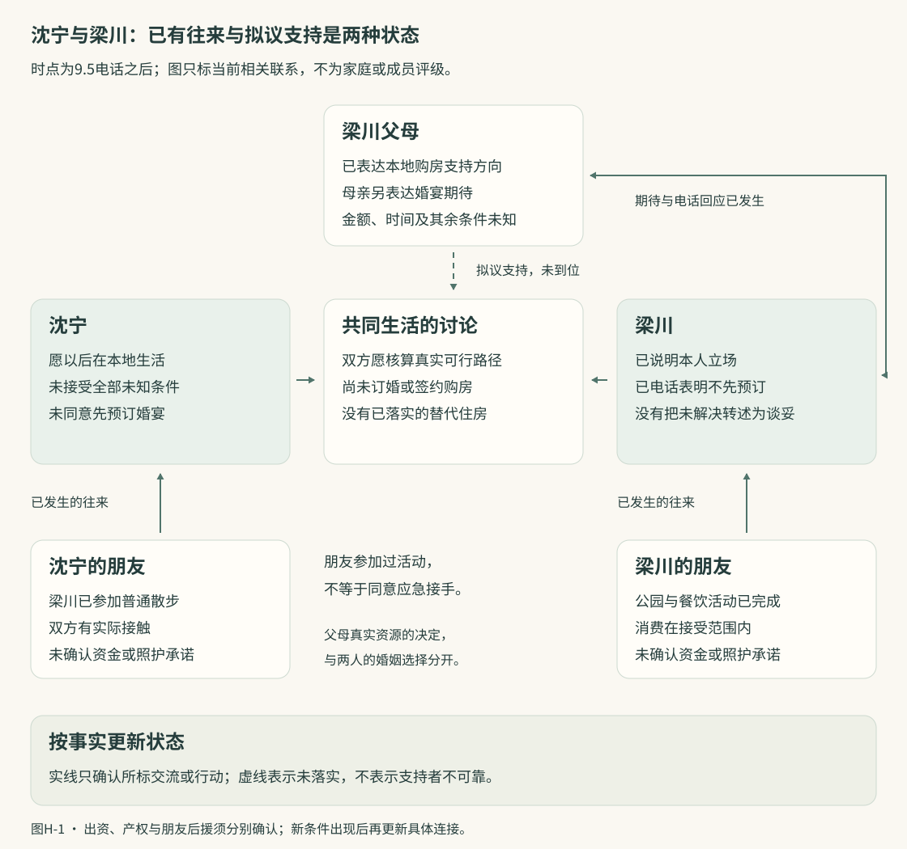

图中的虚线表示拟议支持尚未落实，不表示支持者不可靠；实线表示所标的交流或行动已经发生，不表示所有相关条件已经通过验证。

| 联系 | 当前可确认的内容 | 不能扩张为什么 |
| --- | --- | --- |
| 父母向梁川、沈宁表达支持方向 | 已亲自表示愿考虑本地购房支持，不用于外地 | 已到账、必然按时提供，或全部附带条件都已被接受 |
| 母亲提出婚宴期待，梁川回应 | 母亲希望大型婚宴和较多决定参与；梁川已说明不先预订，未得到完整条件 | 父母已经承诺妥协，或母亲的每项期待已经成为双方约定 |
| 沈宁与梁川讨论未来生活 | 双方希望留在本地，愿核算其他住房安排；无已落实替代房源与资金方案 | 两人已具备独立购房能力，或必须等父母同意才能决定是否继续恋爱 |
| 与双方朋友的实际往来 | [9.3两次不同圈子的活动](#unit-9-3)实际完成，参与范围可承担 | 朋友已答应提供住房、资金或长期危机支持 |

| 状态卡 | 本例填写 |
| --- | --- |
| 关键依赖与通道 | 潜在购房支持涉及可用支持资源、父母干预和边界；家庭午饭时段另涉及生活习惯。父母养老照护等其他义务尚无相关信息 |
| 决定接口 | 父母决定愿提供什么自己的资源；两人分别决定是否接受，并共同讨论生活安排。具体出资权属效果未核，不在图上裁定 |
| 风险 | 若在关键条件未知时先签约付款，安排可能无法承接；当前没有资金已经撤回或可信威胁的证据 |
| 相处兼容 | 午饭时间误会已有调整；婚宴和住房条件仍未形成可执行共识 |
| 积极生成 | 共同照片话题、双方圈子的实际参与，已带来新的交流与再次往来意愿 |
| 危机缓冲 | 购房支持尚不能记为当前可调用资金；朋友参加过活动，也不能自动记为后备照护或住处 |
| 下一步 | 梁川继续向有权决定的父母问清相关出资条件，双方核算其他真实路径；没有新信息前不实施依赖这些条件的付款 |

这张图说明了哪些联系已经运行，哪些仍是可能性。两人不需要把所有亲友都争取成赞成者，也不能把一个尚未答应帮助的人当成免费后备。

##### 图怎样反映外部变化

一项已经被实际依赖的住房支持若被撤回，即使两人都反对，资源线也已改变。应更新可用条件与受影响安排，不只修改“本人态度”。尚未到位的意向支持则仍是待确认，不能记成已经撤回。

相反，自愿、可承担且已到位的短期照护，可能减少真实负荷，给两人留下合作余力。依次记录谁同意、做了什么、谁的负担确实减少；不把有钱、有空或“应该帮忙”当成提供者已经接受任务。

##### 两个容易画错的地方

几位亲友转述同一故事，要保留同一信息源，不能当成几份独立证据；同源也不证明内容必假。私人赠礼与受托组织权力则要分线标注，家属不能因为认识负责人就替公司承诺岗位或资源。

这是一张当前事务图，不是家庭人格测验。新事实会改变线的状态，严重侵害不必等待全图完成才保护自己。已经自然运行的小事不必反复绘制，重要依赖、权限或支持变化时再更新。

#### H.2 跨差异的双向融入

**从一次真实往来中辨认参与、尊重与负担，选择具体调整，让双方都能带着自己的身份融入。**

两人的生活方式、资源或熟人网络差异较大时，用本页回看参与是否可持续。八个节点与[9.3](#unit-9-3)一致，是找具体事实的入口；不要求每项完美，也不计算“配不配”的总分。基本尊重无需先用贡献交换。

先选最近一次真实往来，再挑最相关的节点填写。先记发生了什么，再记想改什么；说好要做与后来确实完成分别记录。没有相关事实的节点可以留空并注明原因，不用制造活动来测试全部项目。

##### 八节点与空白记录

| 节点 | 实际事实 | 准备采取的行动 | 谁承担何种负担 | 仍未知或需回看的地方 |
| --- | --- | --- | --- | --- |
| 具体认同 |  |  |  |  |
| 平等尊重 |  |  |  |  |
| 方向相容 |  |  |  |  |
| 资源与控制分离 |  |  |  |  |
| 消费可持续 |  |  |  |  |
| 双向融入 |  |  |  |  |
| 贡献可见 |  |  |  |  |
| 变化重谈 |  |  |  |  |

费用之外，还要看时间、组织、解释规则和维持表现的负担。对方确实愿意承担一项费用可以被接受，不自动形成身份或服从债权；资源较多者也不因条件较好就必须无限付出。

##### 已填示例：两次不同圈子的普通活动

回看[9.3中沈宁与梁川的两次活动](#unit-9-3)结束后的信息。一次是两人与梁川的几位朋友先在公园走走，再到费用事先可接受的店吃饭；另一次是梁川参加沈宁与朋友原有的散步。两次都实际完成，能说明当时的参与方式与可承担范围，不能据此判断两人的收入或资产规模。

| 节点 | 已有事实 | 下一步及负担、未知 |
| --- | --- | --- |
| 具体认同 | 沈宁的街景知识与兴趣进入交谈，梁川的交通安排回应了真实需要 | 行动：继续围绕本人真正感兴趣的内容往来。负担：不要求准备表演。未知：一次话题投缘不证明所有价值取向相同 |
| 平等尊重 | 沈宁能说开销安排，梁川参加不熟悉的圈子时可以提问 | 行动：不同意见出现时仍允许表达。负担：熟悉圈子的一方补必要背景。未知：重大冲突时的尊重仍需看实际行为 |
| 方向相容 | 两人都希望以后在本地生活 | 行动：相关住房条件另行核对。负担：共同承担必要了解。未知：本地方向不代答全部适婚及婚事安排 |
| 资源与控制分离 | 本次活动采用双方接受的方式，没有据此取得替对方决定其他事项的许可 | 行动：新增资源支持另问条件。负担：谁提出谁说清可提供范围。未知：父母潜在购房支持的其他条件仍未落实 |
| 消费可持续 | 沈宁不接受原较贵聚餐的频次，新的这次费用范围可承担且实际按此进行 | 行动：下次按当时资源重看。负担：不靠借款或掩饰困难跟上。未知：不保证任何频次今后都可维持 |
| 双向融入 | 梁川的朋友与沈宁的朋友分别有一次实际接触 | 行动：保留双方原有生活，不要求每次一起参加。负担：各自承担必要介绍。未知：没有来的朋友不自动被判为排斥 |
| 贡献可见 | 沈宁提供路线与街景信息；梁川核对交通、回应返程和休息需要 | 行动：看见实际投入，之后重新分工。负担：不让同一人永久负责全部组织。未知：不由单次成功宣布长期公平 |
| 变化重谈 | 已从开销不适重新安排过一次活动 | 行动：工作、费用或身体条件改变时再说明。负担：不要求一方每天全量记录。未知：未来变化尚未发生，没有预先兑现 |

结果支持的是，两边都出现了可承担的真实参与，也有具体内容被彼此记住。没有证实的是未来全部圈层接纳、永久可持续的消费方式或婚姻可行性。可以继续自然往来，也可以保留不参加某些活动的空间。

##### 特殊重叠另记一栏

如果感情同时连接职业、企业或组织资源，补下面的记录，不把正常交往直接变成特权承诺。

| 当前角色与具体资源 | 谁确有决定权限，依据是什么 | 会影响谁的权益 | 可用的独立信息或处理渠道 |
| --- | --- | --- | --- |
|  |  |  |  |

例如[9.6的职业关系情境](#unit-9-6)中，乙可以赠送自己买的书，却没有被单位授权安排恋人甲的岗位；乙的父亲参与工作评价，也需按真实组织职责行事。不能把“愿帮你问问”填成组织已经承诺，也不能为证明爱情要求甲放弃正常职业选择。

##### 判断下一步

相处增加了内容、负担可承担，就可以在本人愿意时继续；只是形式上参加、代价不断积累，就回到具体活动和权限调整。核心方向明确不相容或存在强迫时，不能靠增加融入任务无限拖延判断。

重视对方的资源不自动等于套利，需要看是否也关心具体的人、真实相处与责任。基本尊重不能按贡献计价，贡献也不能永远不可见。这张表要帮助两个人更容易带着自己的身份参与，而不是把一方训练成另一方圈子的合格附属。

#### H.3 改善父母负面印象与验证自主

**并行回看父母的具体担忧是否随事实更新，以及本人能否在实际资源和权限内执行自己的判断。**

伴侣父母表达反对，或自己一直在证明却不知道问题是否变化时使用，配合[9.4](#unit-9-4)与[9.5](#unit-9-5)。父母暂时满意，不等于自主已经成立。

先记最相关的一句原话和当时情境，不将推测补成完整动机。再区分误解、真实条件与不尊重，选择由谁说明、是否需要一次普通接触，或应直接处理边界。只观察自然发生的相关变化，不人为制造一次家庭冲突来考试。

##### 两栏回顾：空白版

当前事项与时点：________

| 父母的具体担忧与事实变化 | 本人的自主条件与实际行动 |
| --- | --- |
| 原话、实际要求、发生场景：________ | 本人怎样判断，愿接受什么、什么不可接受：________ |
| 哪些事实支持，哪些是误解，什么仍未知：________ | 时间、资源、实际权限与其他责任：________ |
| 由谁沟通；是否需要一次双方愿意的低压力接触：________ | 本人准备承担什么，谁尚未同意，代价由谁承担：________ |
| 实际发生了什么，对方理解或行为怎样改变：________ | 真实分歧中已怎样表达、拒绝、执行或承担后果：________ |
| 哪些担忧仍未解决，新事实后怎样回看：________ | 替代是否真实可用，什么条件下暂缓或调整：________ |

两栏不是一一交换条件，不必“先让父母改观，才能要求伴侣行动”。一项真实生活担忧可以与不当表达同时存在：条件仍要处理，羞辱也不能因此被合理化。

##### 已填示例：按各自时点回看交流

按[家庭午饭](#unit-9-1)、[住房谈话](#unit-9-4)、[后来与父母通话](#unit-9-5)的顺序，回看沈宁与梁川的经历。两人已恋爱，希望以后在本地共同生活，尚未订婚或为共同住房签约。

| 父母的具体担忧与事实变化 | 本人的自主条件与实际行动 |
| --- | --- |
| 第一次午饭，母亲问“才来就走啊”；她原先不知道沈宁事先与梁川约好两点前离开 | 梁川承认自己漏传时间，说明按原约定离开；沈宁没有为证明诚意取消自己的朋友安排。这次边界得到实际执行 |
| 下一次午饭前，母亲主动问方便时段；饭中父亲与沈宁通过街景照片产生具体交流 | 两人提前说清时间，沈宁有自己的参与内容。已建立有限正常往来，不证明未来重大分歧都会顺利处理 |
| 母亲后来误以为两人马上买房；梁川和沈宁说明尚无买房决定及婚期，母亲承认误读、不再按原时间表催促 | 梁川先解释本人判断，沈宁说明自己没有要求先给房。误会减少，资源缺口仍在；不能把不再催促当作房款已落实 |
| 母亲表达希望大型婚宴和较多决定参与；[9.5电话时](#unit-9-5)仍未给出完整资助条件，也未明确婚宴要求可以怎样协商 | 梁川本人不要求大型婚宴，已说明不先预订、不替沈宁答应。两人愿核算其他住房安排，但房源、费用和可调用资源尚未确定，替代仍未落实 |

本例可以确认的改善，有时间信息被接收、普通兴趣进入往来，以及“马上买房”的误读得到修正。不能确认的，是父母接受全部边界、资金已可用，或两人已经有不依赖支持的完整住房路径。

接下来，梁川继续向有权决定的父母询问与当前支持有关的金额、性质、时间和条件；两人另核对自己能够承担的生活安排。父母的完整财产隐私不必因此全部公开，但关键支持若仍不能确认，就不能作为相关付款与婚约准备已经可执行的依据。

##### 对照：真实住房担忧与持续贬低

另一个家庭中，长辈担心没有稳定住处，听到具体可承担方案后愿意更新意见。处理对象是居住条件及其证据，双方可以继续明确安排；不需要额外证明谁人格更优秀。

若已澄清相关事实，长辈仍反复以出身贬低伴侣，要求其当众认错又不许解释，问题便不能只记录成“印象仍待改善”。需要另记具体行为、后果及接触边界，不再把更贵礼物或更多展示列为受影响者的必做任务。

| 真实发生的新信息 | 可以据此调整什么 |
| --- | --- |
| 事实更正后，对方确实改变原要求或解释 | “包含误会”得到支持；继续看尚未解决的现实条件 |
| 可行条件出现，对方仍不断增加无关门槛 | 不再只按信息不足处理，辨认接受范围与是否还有继续投入的理由 |
| 伴侣只说会保护，却反复替本人答应或安排同样暴露 | 不能把口头立场记成已经执行；看具体权限、可用替代和本人是否仍愿参与 |
| 出现可信威胁、严重强迫或现实危险 | 转向独立支持与相称保护，不用先完成低压力接触、当面对质或本表全部记录 |

##### 怎样读这张表

本人能够拒绝未经同意的承诺、说明真实限制、处理自己认领的事项，是自主的一部分。它不要求与父母断联或全部经济脱离，也不保证隔绝所有外部约束。若本人缺少能力，支持可以有限展开，不能由伴侣永久接管所有决定。

完成条件不是全体父母都满意，而是相关事实、可接受范围和实际行动变得清楚。已经有普通合作的部分可以继续；尚未落实的关键条件就保留未知并暂缓依赖它的安排。本人不愿继续时，无需先证明自己尝试了所有说服方式，已形成的具体事务另行善后。

#### H.4 婚后礼仪、同住、育儿和养老

**使用要点：把亲属参与落实为本人认可的时段、权限和接替安排，有限帮助不能自动扩大为全天义务。**

适合亲属愿意参与，却未说清提供到哪里，或两人觉得“都为了家”，各方却越来越累的情况。先选一个具体事项，分别询问本人真实意愿和可用投入。夫妻不能替全部亲属承诺，某人提供帮助也不因此获得整个家庭的决定权。

##### 四类事项分别补什么

| 事项 | 要明确的实际条件 | 不可默认的部分 |
| --- | --- | --- |
| 礼仪与往来 | 各家期待、可用时间、费用、由谁沟通和安排 | 父母必须彼此亲密，或伴侣独自满足两家所有礼仪 |
| 同住 | 相关权利人的权限、居住空间、费用、作息和调整办法 | 出资即有全部决定权；夫妻能替住居权利人同意所有安排 |
| 育儿 | 孩子当前需要、父母主责、照护时段、执行范围、接替与休息 | 祖辈全天待命，或帮助者必须每一步等批准 |
| 养老 | 各方真实需要、能力、既有贡献和承诺、手足及服务可用性 | 两家金额必相等，兄弟姐妹必平分，外部服务随时到位 |

##### 空白协作页

各方只认领自己愿意且能做到的部分。信息不够时写未确认；现实变化发生时重看，不把本页当作永久服务合同或法律责任判断。

| 需要写清什么 | 本次记录 |
| --- | --- |
| 具体事项与目前需要，谁是受影响者 |  |
| 各方本人意愿、可提供的时段/资源、尚未答应的部分 |  |
| 夫妻各自主责：必要事务怎样连续完成 |  |
| 本人对己方亲属怎样沟通，哪些意见需共同回应 |  |
| 实际执行者的范围：必要要求、可自主方法、新决定如何确认 |  |
| 费用、用品、休息：谁准备，是否已到位 |  |
| 临时变化：谁可以实际接上，哪些后备还不可用 |  |
| 贡献怎样回应，何时回顾并重新分配 |  |
| 运行后：实际做了什么，谁仍在补漏，各方是否仍愿意 |  |

##### 已填例：祖辈的一个时段，不是全天承诺

[第14.8节的许婧与贺川](#unit-14-8)有一个需要日常照料的孩子。许母原只认可一个工作日白天的明确时段，夫妻误以为可以一直到他们下班。当天贺川核实工作可提前离开，实际回家接手，避免照护空档。

| 字段 | 后来重新确认并实际运行的安排 |
| --- | --- |
| 当前需要 | 下次仍有一段白天照护需要；夫妻先核自己的工作与接替条件 |
| 各方意愿 | 许母只同意下一次明确时段；贺川父母未确认具体时段，不列为已可用后备 |
| 夫妻主责 | 许婧确认可在结束时接手并实际做到；其他时段由两人按已核条件承担，不转成老人默认义务 |
| 对己方沟通 | 许婧向母亲说明两人此前误把有限帮助扩成全天；贺川向自己父母说明当前安排，不由许婧替其承诺 |
| 执行范围 | 先说清孩子所需、必要安全与联系办法；许母在认可范围内安排活动顺序，新重要决定再确认 |
| 费用与休息 | 所需用品和已商定费用由夫妻落实，具体金额未列出；许母可按原时点离开，不默认垫钱或无限加时 |
| 变化与后备 | 已确认这次由许婧接上；若她的可用时间变了，需要提前重安排，未确认的亲属和服务不算已接替 |
| 贡献回应 | 夫妻感谢实际帮助，承担约好的费用与接替；不把感谢当购买下一次照护的凭据 |
| 实际结果 | 下一次照护与接替完成，许母反馈本次范围可承担；长期帮助仍需本人愿意，没有永久全天承诺 |

这个结果支持“这一次安排接上了”，不证明以后所有时段都有保障。最初的缺口来自夫妻扩大理解，不是许母违背原承诺；修正应落在时段、接替和费用，不能要求老人通过牺牲自己的安排证明爱孩子。

##### 两家需要不同，怎样保持尊重

另作匿名养老对照：一家当前需要有人协助日常事务，另一家并无相同需要，却期待子女增加来往。可以分别核对时间、资源和本人期待，形成不同安排；不必为了金额或次数对称而创造不需要的帮助，也不因一方不缺钱就忽略其相处需要。

共同资源援助亲属时，先由夫妻确认可承担的范围，再由相关本人了解亲属的需要和真实权限。兄弟姐妹尚未接受的分担不写成已落实，付费服务也要有实际供给和可用条件。个别人的承诺不能代表所有人的同意。

##### 使用后看什么

若事情完成，却由某位老人持续等到无人接替，或由伴侣独自面对两家的批评，原来的沟通与责任仍有缺口。回到本页修改具体任务；贡献不只靠夸奖回应，实际休息、费用和执行自主都要看。

帮助减少或停止，也会改变现实条件，不因夫妻没有选择接受这种变化就自动消失。重新安排必要事务，保留各方意愿和权限；已经存在威胁或严重侵害时，保护本人及孩子不以填完协作页为前提。

### 附录 I 分歧理解与冲突修复

#### I.1 一事一议沟通卡

**围绕一件具体事件，分开事实、感受、解释与期待，交流后再确定实际要处理的问题。**

双方愿意讨论，却把事实、难受和猜测挤在一起时，可以用这张卡整理。一次先说清一件事；简单情况可以直接说，不必先填表。表达不完整、语气不够平静，也不使本人失去被倾听和拒绝不愿接受安排的资格。

##### 六项怎样使用

本人先从知道的部分写起，再听对方的说法。事实有分歧就核对，暂时查不清就留下未知；感受与解释分别保留。交流后才归类直接议题，未达成共同归类时可以分别记录，不能由一人替双方宣布共识。

| 记录项 | 本人先记 | 交流后补充或确认 |
| --- | --- | --- |
| 身体状态（可选）：此刻是否疲惫、难以继续，或有其他需要说明的状态 |  |  |
| 情绪感受：我现在怎样感受，不替对方诊断内心 |  |  |
| 具体事件及是否触界：何时发生什么，涉及哪项已有约定或选择权，哪些尚不清楚 |  |  |
| 个人解释与猜测：我怎样理解这件事，哪些只是担心或推测 |  |  |
| 希望的回应及可执行调整：希望先被怎样回应，想具体改变什么，谁有权和能力处理 |  |  |
| 交流后共同归类的直接议题：当前主要处理什么，仍有哪些不同认识 |  |  |

身体状态可不填写，也不用给感受找一个专业名称。对方说自己想帮忙，可以记录为本人说明的意图，再与行为和其他事实对照；不能因为说出了本意，就把它当成已被独立证实的内心事实，更不能据此取消已经造成的影响。

##### 已填例：预订变更以后，先说清各自在谈什么

以下记录[第八章许青与程远当晚的谈话](#unit-8-6)，范围是开始交换信息、直到确定直接议题。此时费用与未来安排仍在讨论；后续处理和执行结果见[I.4](#unit-I-4)。

| 字段 | 许青这一侧 | 程远这一侧及交流所得 |
| --- | --- | --- |
| 身体状态（可选） | 未单独记录，不从生气推断身体状况 | 未单独记录；两人已把讨论约到当晚有空时 |
| 情绪感受 | 生气，感到自己被排除在共同安排外 | 急于解释自己的决定；具体情绪名称没有单独记录，不由旁人替填 |
| 具体事件及是否触界 | 住宿原定600元，程远先改成800元才告知，提出各多出100；变更超出了原共同预算与授权 | 对照订单和通知可确认先后；原款600已退、新款800已付，住宿净增加200，不是两笔付款都成为损失 |
| 个人解释与猜测 | 担心以后共同约定也会被绕过；这是对未来的担忧，不等于长期模式已经证实 | 自述想改善住宿体验，原先以为做好再说即可；好意说明不抵销未先商量的事实 |
| 希望的回应及可执行调整 | 先确认自己有权拒绝新增费用和变更，再讨论是否接受现有安排 | 起初只想讨论升级值不值得；交流后看见还需处理决定过程，具体费用归属及未来安排继续谈 |
| 共同归类的直接议题 | 主要是规则责任：授权范围与共同参与；次要涉及消费财务：差额由谁承担 | 可以同意处理这些具体问题，不必先对程远全部人格或内心动机形成同一判断 |

这张卡的结果，是知道双方原来在回答不同问题。许青并非只问住宿贵不贵，程远的解释也没有自动回答参与权为何被绕过。此时仍需要实际安排；把问题讲清楚，不等于费用、信任与感情已经恢复。

##### 谈不下去时，改变的是什么

若只是疲惫或信息不够，可以说明暂停、要补什么，以及何时或什么条件下再谈；有时间敏感的事务先按实际权限处理。若一方持续否认已核清的行为，不能只让受影响者继续改措辞。存在可信威胁、强迫或现实报复时，转向[J.4](#unit-J-4)的独立支持，不要求共同填写本卡。

同一件事可以涉及不止一种损害。一事一议是为了使本次范围清楚，不能用来禁止说出同一机制下尚未处理的旧问题。需要继续辨认主要议题时看[I.2](#unit-I-2)，需要实际修复时看[I.4](#unit-I-4)；不是每次交流都必须依次填完所有工具。

#### I.2 十类议题与轻量记录

**选择当前主要议题并说明理由，只记录影响理解、安排或保护的内容，区分余波与新事件。**

分类用来找到眼前要处理的对象，不给关系或人格评分。必要时增加一两个次类，并写清关联。已经自然说开、双方都放下的小摩擦可以不记录；这不是永久保存负面材料的任务。

##### 十类完整索引

| 议题类别 | 主要在问什么 | 一个具体入口 |
| --- | --- | --- |
| 生活习惯 | 日常方式、节奏和偏好怎样相处 | 作息、清洁、食物口味或个人物品摆放 |
| 消费财务 | 费用、资金安排与实际经济后果是什么 | 外食超预算、共同支出如何核对 |
| 沟通情绪 | 怎样表达、接收与回应当前体验 | 想倾诉却不断收到建议，暂停后是否接续 |
| 吸引亲密 | 对彼此的兴趣、靠近意愿和亲密体验怎样 | 希望更多共同时间，但不能据此取得身体许可 |
| 规则责任 | 谁认领任务、谁能决定，变化怎样重谈 | 备餐总由一人组织，预订者越过授权 |
| 诚信履约 | 已表达的信息和已认可的承诺怎样进入行动 | 约定是否兑现，是否隐去与共同决定有关的事实 |
| 价值观 | 对重要事物的评价与取舍有哪些差异 | 怎样看待节俭、照护和对他人的责任，而非只是不喜欢一道菜 |
| 人生目标 | 希望过怎样的生活，核心方向能否兼容 | 定居、职业、生育等愿望及相应安排 |
| 世界观信仰 | 对世界、意义或信仰的理解怎样影响生活 | 是否要求伴侣遵循本人信仰及其实际共同后果 |
| 客观资源与环境 | 当前时间、资源、条件和外部约束是什么 | 工作时段、住处条件、真实可用支持或功能限制 |

类别之间可以有关联，但数量不能累计成伤害分数。一次资源变化可能同时牵动财务、任务和情绪；这说明有几个需要分别处理的对象，不表示关系自动变得更危险。严重性仍按实际行为、后果与选择空间判断。

##### 轻量记录：空白版

先用一句话标识这件事，例如“那次晚餐分工讨论”，需要时补日期。后续沿同一件事记录新信息，避免把每次想起都当成另一场违约。只保留对理解、安排或必要保护有用的信息。

| 字段 | 本次记录 |
| --- | --- |
| 这件事：具体发生什么，当前知道与不知道什么 |  |
| 主类及理由；必要时增加次类 |  |
| 目前的安排：谁愿意做什么，条件和权限是否可用 |  |
| 已处理：哪些已实际完成，哪些只是约定 |  |
| 余波：仍有什么体验、负担或后果，是否属于原事件 |  |
| 重谈条件：新事实、未处理损害或方案失效时怎样回来 |  |
| 当前状态：仍在处理、暂缓并有条件、已关闭，或不再继续 |  |

##### 已填例：争的是外食，主要问题却在组织负担

下面是独立虚构例。甲这一周多次准备晚餐，觉得累；乙提议今晚外食，尚未下单。两人原已同意近期控制外食费用，甲因此担心花费，乙则以为甲只是坚持必须在家吃。实际说开后，甲更在意的是自己一直负责想吃什么、准备和收尾。

| 字段 | 示例记录 |
| --- | --- |
| 事件 | 一次晚餐讨论，外食只是提议，没有已发生的擅自消费；甲说明本周备餐与组织负担 |
| 主类与次类 | 主类规则责任：谁承担完整晚餐任务；次类消费财务：在当前预算内选择。不能仅凭争执就归成价值观不合 |
| 本次安排 | 双方同意接下来两次自然晚餐由乙负责提出可承担方案、准备和收尾，甲提供个人需要，不再负责全程提醒 |
| 后来的实际执行 | 后来这两次晚餐按约完成，乙主动安排，甲反馈准备压力有所减少；本次未记录具体费用，不能据此判断长期家庭收支 |
| 余波 | 之后想到之前的疲惫，甲仍有一点烦；当前没有新增失约事实，沿原事件看体验与是否还遗漏负担 |
| 重谈条件 | 再次需要甲反复提醒、费用安排失效，或发现原来还有未处理的负担时回看；有新的具体违约再另记事实 |
| 当前状态 | 这次任务调整已执行；双方可按实际需要关闭事项，不要求甲先保证以后再也不会难受 |

如果甲眼前最关心的是一笔超预算的实际付款，主类可以是消费财务；若只是对口味或吃饭方式偏好不同，可能主要是生活习惯。若有真实健康或资源限制影响选择，则先明确那些具体条件。类别跟着问题走，不能把“吃饭”固定在某一类，也不凭分类作医学判断。

##### 区分余波、未完事项与新事件

| 后来出现什么 | 怎样记录更准确 |
| --- | --- |
| 想起原事件仍难受，但没有新违约 | 记作原事件余波，需要时谈体验，不自动再计一次过错 |
| 原费用、负担或权限问题其实没有处理 | 原事项尚未完成，继续处理；不能用“别翻旧账”把它关闭 |
| 后来再次出现具体越权或失约 | 记录新的行为、后果与证据，说明与旧事的关联，而非只靠旧印象下结论 |

已关闭不意味着删除一切有用信息或放弃必要保护，也不意味着永远不能重开。新事实出现可以重新判断；没有新的需要时，就让记录停下来，把注意力还给眼前的生活。

已有可信威胁、强迫或现实报复时，先按[J.4](#unit-J-4)取得独立支持，不必为了分类完整而继续共同讨论。

#### I.3 重大问题双坐标矩阵与六步初始化

**分别说明问题的持续影响与可持续共处的难度，用新信息和实际结果更新各自判断。**

一个分歧反复影响生活，双方却对“有多重要、还能怎样共处”认识不同时，可以使用本页。它帮助把理由和条件说清，不用坐标自动决定去留。直接安全威胁、强迫或可信报复先转向[J.4](#unit-J-4)，不进入普通矩阵；本人已经不愿继续，也不必先完成定位。

##### 两条轴各问一件事

**横轴**：以当前资源、意愿和条件形成可持续共处方案的难度。向右表示眼下更难找到双方能够接受并实际维持的方案，不表示对方更难被自己改造。

**纵轴**：问题持续存在，对重要需要、正常生活与权利的影响。向上表示对本人重要生活的影响更大，不等于生气声音更大，也不由议题名称预先决定。

可用“较低、中间、较高”的描述，也可直接写理由；没有足够事实时写“尚无法定位”并注明缺什么。不设数字阈值，不把两人的位置取平均。位置差异可能来自需要、实际负担、信息或可用选择不同，不自动证明有人说谎。

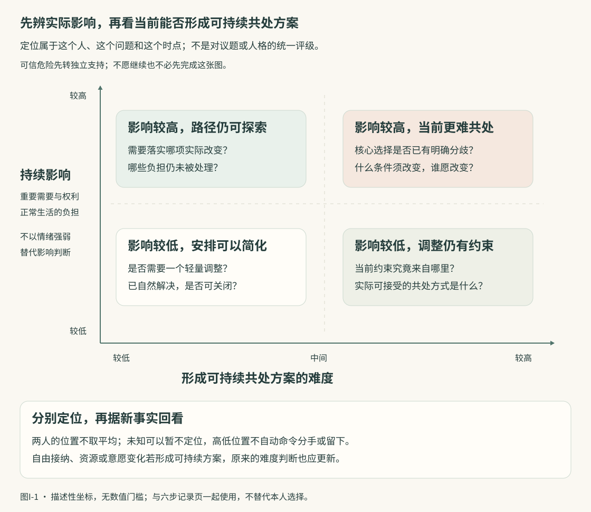

*区域只帮助提出问题，不是处理结论。自由接纳、资源增加或意愿改变，若确实形成可持续方案，原来的难度判断也应更新；本人是否愿意仍须分别看。*

##### 六步初始化与空白定位页

选一件现实议题使用本页。第三步可各自先写，第四步再交换；只想澄清一件小事时，不必整张填写。位置改变要有新信息或新体验，不能仅因另一人要求便把影响填低。

| 六步 | 写清什么 | 本次记录 |
| --- | --- | --- |
| 1. 选择现实议题 | 当前哪项安排或分歧需要处理，不先给整个人下结论 |  |
| 2. 描述场景 | 发生什么，影响谁，哪些事实已知、哪些尚未确认 |  |
| 3. 各自定位 | 甲、乙分别说明影响及理由、共处难度及理由；不清楚的部分可空缺并标明 |  |
| 4. 交换原因与方案 | 是否在谈同一损害；有什么真实可行方案，需要谁愿意、谁承担成本 |  |
| 5. 记录共识或分歧 | 已接受什么，未接受什么，准备怎样行动；暂缓要注明重开条件 |  |
| 6. 新事实或实践后回看 | 实际结果怎样，哪条轴的判断需要调整，尚不知道什么 |  |

##### 已填例一：做饭还是外食，影响为何不同

下面是一个独立的虚构晚餐情境。甲近期经常晚归，还承担多数备餐，休息受到影响；乙起初认为只是今晚去哪里吃。两人都愿调整，也有办法在现有可承担预算内简化餐食，但尚未实践新的分工。

| 六步 | 示例填写 |
| --- | --- |
| 1. 议题 | 忙碌工作日晚餐怎样安排，既能吃上饭，也能保留休息 |
| 2. 场景 | 甲反复准备、收尾，乙原先没有充分了解这部分负担；不存在已经下单超支的事实 |
| 3. 各自定位 | 甲：持续影响较高，因为休息不断被挤掉；共处难度暂看中间，需要实际分担。乙：起初影响较低、难度较低，以为偶尔外食即可；这是其初始理解，不是最终事实判断 |
| 4. 交换原因与方案 | 乙了解到甲谈的是反复负担，修正了对影响范围的理解。双方选择下一次忙碌日晚餐由乙认领安排与收尾，在现有预算内简化，不把组织仍留给甲 |
| 5. 共识或分歧 | 两人都认可这次试行，具体效果未发生；若时间、费用条件变化，先说明，不默认甲补上 |
| 6. 实践后回看 | 后来这次晚餐完成，甲获得实际休息，双方认为这次路径可用。它降低了对该次安排困难的判断，但能否持续仍待自然生活观察，不把一次成功写成长期负担已解除 |

本例中的变化来自补足信息和实际分担，不是说服甲“别把吃饭看得太重要”。若乙始终拒绝参与、预算又没有余量，横轴的判断可能不同；若双方本就轻松分担，只是偶尔口味不同，纵轴也可能更低。都是吃饭，不能使用同一个固定位置。

##### 已填例二：居住方向，先辨是否存在共同路径

另设两位正在考虑未来共同生活的人。甲明确只接受长期留在甲城，乙明确只接受长期留在乙城；两人当前均不接受长期异地或轮流居住，尚未为共同新住处签约或付款。这些是两人已经表达的选择，无需再推断全部动机，便能讨论当前是否有共同路径。

| 六步 | 示例填写 |
| --- | --- |
| 1. 议题 | 未来在哪里长期共同生活，当前有没有双方接受的路径 |
| 2. 场景 | 两人的城市方向不同，各自立场已经说清；共同新住处尚未实施，不能把签约当作推动共识的方法 |
| 3. 各自定位 | 两人都认为持续影响较高，涉及核心生活方向；当前共处难度较高，因为讨论过的主要路径均至少被一方明确拒绝 |
| 4. 交换原因与方案 | 澄清双方愿调整与不愿调整的部分，没有把一方迟迟不同意解释成仍可默认迁就；没有假定未知工作或亲友支持会自动创造新方案 |
| 5. 共识或分歧 | 记录目前没有双方接受的共处方案，停止推进依赖该共识的新签约。本人可据此选择结束，不必等待全部理论可能性被排除 |
| 6. 新事实后回看 | 暂无改变立场或可行条件的新事实，不把多谈几轮算进展。若本人自愿改变选择，或出现真实新条件，才重新判断，不承诺必然协调成功 |

如果同属居住议题，但双方都愿在同一城市，只是在两个都能承受通勤的街区之间选择，就可能处于较低难度。仍要看真实费用、时间和需要，不能因此把所有同城差异都判为小事。矩阵定位的是这个组合、这个时点的安排，不是“居住问题”的普遍等级。

##### 从位置回到本人能够作的选择

可行结果包括解决问题、在自由知情下接纳差异、实际隔离某项影响、暂缓并保留重开条件，以及结束关系。高影响或高难度不自动命令分手，低位置也不要求本人必须留下。

若当前只缺一个可以查清的关键条件，就先明确谁取得什么信息、在什么行动前回来；不能把信息不足直接当作不相容。反过来，已经明确不愿接受的核心选择，也不能无限改名为“再了解一下”。这张图的作用，是使选择依据更清楚，而不是延迟本人本来有权作出的决定。

#### I.4 七步修复操作页与三层结果

**围绕安全且双方愿意处理的分歧，记录七步中的实际行动，分别观察事务、可信规则与感情恢复。**

小事可以自然说清并结束，复杂问题才用详细记录，不要求每栏填满。七步与[正文8.6](#unit-8-6)一致；完成表格不证明已经修复，也不要求受影响者先承诺留下或原谅。

先记本次事项与需要辨认的时点。区分已知事实、本人解释、尚待执行的约定和已经出现的结果，尤其不要把后来成功的行动倒写成当初就已经可靠。可信威胁、强迫或现实报复先转向独立支持，不进入普通共同修复。

##### 七步操作页：空白版

| 步骤 | 本步要留下什么 | 当下记录 |
| --- | --- | --- |
| 1. 安全与稳定条件 | 当前能否自主表达和停止；普通过载如何暂停、何时或什么条件下回谈；紧迫事务怎样处理 |  |
| 2. 分别陈述并交换事实、感受、解释和期待 | 哪些事实可核对、哪些仍未知；各自如何体验和理解；想得到什么回应与结果 |  |
| 3. 确认冲突结构 | 下面四层有哪些依据，主要原因是什么，谁应对具体行为负责；调整意愿与实际条件如何 |  |
| 4. 处理本次事件 | 实际责任怎样承担，损失和必要事务怎样处理；本人是否接受现实安排，有什么仍未解决 |  |
| 5. 约定未来行为和责任 | 改变什么、谁认领、哪些权限与资源可用；何时重谈；是否有真实共识而非单方宣布 |  |
| 6. 执行观察 | 哪些已行动，是否停止新增损害；有没有实际改善、未处理后果或新事实；哪些仍不能下结论 |  |
| 7. 重新创造积极连接 | 双方是否愿意恢复理解、欣赏和共同活动，有什么实际体验；不把礼物或身体亲密当作赔付 |  |

某一步无法继续时，先看卡在哪里。事实未清，可以相称核对；资源不足，需要重配真实条件；拒绝停止已确认的侵害，不能只靠改话术。对方不愿继续关系时，必要善后仍可另行处理，不把第七步变成强制复合。

##### 第三步需要时展开：结构、原因与责任

| 四层结构 | 当前事实依据、本人体验或尚未证实处 | 需要处理什么 |
| --- | --- | --- |
| 本次事实与利益 |  |  |
| 个人解读与尊严感受 |  |  |
| 重复权责机制 |  |  |
| 共同体认同 |  |  |

没有依据的层次可写“尚未证实”或“本次未发现”，不强迫每场分歧都有深层问题。感到受轻视不直接证明蓄意羞辱，本人说出好意也不消除已经发生的越权。

原因可从误解、需求、资源、责任、行为模式、核心目标不兼容中辨认主要部分。它们帮助找处理位置，不是六个必须全部选中的诊断；明确的不愿接受，也不能永远改写成没听懂。

| 责任与调整条件 | 当下记录 |
| --- | --- |
| 谁做了什么，依据哪项事实或已形成的责任判断 |  |
| 谁愿意改变什么，哪些尚未被本人认领 |  |
| 实际有哪些时间、资源、权限或支持，缺口是什么 |  |
| 哪些相互反应可以调整，哪些责任仍不能平均分摊 |  |

##### 三层结果观察页：空白版

可以在不同时间补记，不以一起打勾为目标。若尚未实施，就记约定与未知；不要把一次兑现推成长期稳定，也不要因事务已经处理就要求不适立刻消失。

| 结果层次 | 已有行动与实际体验 | 仍未解决或未知 | 重看条件或是否可关闭 |
| --- | --- | --- | --- |
| 事务 |  |  |  |
| 规则、信任与共同体认同 |  |  |  |
| 感情 |  |  |  |

##### 完整填例：从预订争议到一次新的自然安排

回看[第八章的预订争议](#unit-8-4)及[后续修复](#unit-8-6)。起点是程远未经事先同意，把住宿从600元改为800元；原款已全退、新款已付，净增加200元。许青的不满既涉及费用，也涉及共同参与。

| 步骤 | 已经发生的内容与当时限制 |
| --- | --- |
| 1. 安全与稳定条件 | 当时没有威胁或强迫事实，主要是争执加剧。两人停止新增收费预订，约当晚有空时通话并实际回谈；许青可以仍生气，不必先说没事 |
| 2. 分别陈述并交换事实、感受、解释和期待 | 对照预算、订单、退付状态和通知，核清先变更后告知。许青担心以后仍被绕过；程远自述想改善住宿体验。意图是本人说明，不当作独立核实的内心事实，也不抵销影响 |
| 3. 确认冲突结构 | 事实利益是追加200元及行程安排；个人体验是许青感到被排除；长期重复越权尚未证实；共同安排感受损。原约定明确，当前主要处理越过授权的责任，而非平均归责于双方都激动 |
| 4. 处理本次事件 | 程远认责道歉，已付800元中的新增200元由他单独负担，不再重复付款。许青知情后愿保留现有两间房并成行；两人重新接受约定范围内的出行支出上限2200元，其中共同分担部分不超过2000元，个人承担差额200元；上限不是实际消费额 |
| 5. 约定未来行为和责任 | 在原认可范围内自主执行；超费用、时间或基本条件先回谈，提供变化与可选方案，未答复非同意。程远认领关键变更告知，许青不在已同意范围内逐步接管；暂不据此增加重大绑定 |
| 6. 执行观察 | 旅行实际完成、费用依约核对。后来餐厅临时休息，远处备选会超已约返回时间，程远预订前说明，双方选附近可行店并按时结束。可确认一次自然变更中规则得到执行，长期可靠仍待真实生活观察 |
| 7. 重新创造积极连接 | 后续晚饭中许青主动回忆旅行沿河散步，程远回应树影等细节，两人分享近况。此时确有双方愿意的积极体验，不等于她必须完全原谅、同意身体亲密或已经适婚 |

程远愿处理差额、许青仍愿讨论，费用与安排也有可行空间，这些条件使本次修复可以尝试。如果存在持续控制，或者根本没有可用资源，同一套对话并不能消除这些障碍，仍需按实际条件选择。

| 三层结果 | 当前证据 | 不能扩大成什么 |
| --- | --- | --- |
| 事务 | 费用归属已经落实，旅行完成，后续餐厅安排按约执行 | 所有生活责任今后都不会出问题 |
| 规则、信任与共同体认同 | 越权得到承认，变更范围重申，下一次实际保留许青参与，她表达更愿继续共同安排 | 一次执行已经证明长期稳定，或不许再询问有关新变化 |
| 感情 | 愿再见面，重新交流愉快回忆与近况 | 不适已全部消失，或继续相处就必须升级关系 |

这份填写的关键，是记录不同时间发生的行动。费用分担在讨论中确定，旅行后来完成，新的餐厅变化又提供了一条执行事实，积极连接还要看两人当时是否愿意。不能把这几段时间压缩为一次完美谈话的效果。

##### 不适用分支：出现可信威胁时

另有一人在预订争议中，为迫使伴侣接受变更，威胁公开其私密信息。此时优先考虑现实暴露、可独立联系的支持与相称保护，转向[J.4](#unit-J-4)；不要求受影响者继续展示材料、共同填表、当面对质，或先证明完整动机。

同样，不愿继续关系的人可以停止共同修复，不必证明所有方案都已无效。物品、费用或有限照护等已经形成的事务另行处理，不能借善后恢复恋人权利。

##### 什么时候关闭，什么时候回来

已经处理且不再有需要跟进的小事可以关闭。新事实、原损害未处理或方案失效时回来；新的具体违约记新行为，旧不适再被触及则先看原事件的余波，不能自动重复计次，也不能强迫本人不再难受。工具应帮助把事情处理完，使生活重新有别的内容。

### 附录 J 风险准备、照护责任与退出安排

#### J.1 变化情境与关键功能

用于已经承担的照护、必要支付、居住或其他重要事务发生变化时。也可选择一项确实相关的变化提前准备。一次只看一项关键功能，不为所有想象中的困难写预案；填写结果不决定关系是否合格。

先写这次需要保住什么，再找当前真正依赖的人、信息、权限和资源。把“考虑过、问过、答应了、已经做到”分开，只把已确认可调用的部分列为现有支持。最后看新安排启动前谁在承担，以及哪项变化出现就要重看。

抵抗力看冲击发生时，必要功能能否少受损；恢复力看受损之后，能否重新安排并达到可接受状态。准备一个可以接替的人有助于减少中断；中断以后重排任务、取得适任支持，可能帮助恢复。两者都需要条件，不能用后备数量或账户余额直接代替判断。

##### 空白准备页

本次事项：________　记录时点：________　实际参与确认的人：________

| 要写清的问题 | 本次记录 |
| --- | --- |
| 变化情境：什么已经发生，什么只是准备考虑 |  |
| 受影响功能：哪项必要结果可能做不到，最迟何时需要 |  |
| 关键承担者：当前由谁完成，依赖哪些必要资料和权限 |  |
| 真实可用支持：谁明确同意什么；哪些还只是人选、询问或承诺未落实 |  |
| 启动时间与空档：支持何时能开始，开始前谁能做什么，还有哪里无人接续 |  |
| 维护成本：费用、时间、协调、学习和其他责任占用，是否实际可承担 |  |
| 共同原因风险：哪些看似不同的路径，其实依赖同一个人、渠道或资源 |  |
| 可承担准备：现在能完成哪一步，谁有权限，完成后仍不能证明什么 |  |
| 应急安排与长期调整：眼前怎样处理，持续变化后哪些原安排需要重建 |  |
| 重看与失效：什么消息或时点到来就更新；支持失效时如何说明并处理缺口 |  |

允许一行写“尚未确认”或“目前没有可用安排”，再标明下一步核实什么。不要为了填满而把亲属写成默认接手者，也不必向所有参与者共享全部私人资料。若记录或共同讨论会增加危险，可先使用独立支持，不以完成本页为行动条件。

##### 已填示例：照护接续看起来有两条路

这份示例接续[16.2节郑敏与杨维的照护情境](#unit-16-2)，记录机构尚未回复时的准备。杨维仍需在下周一个下午外出办一项必要事务，需要全程陪同；该时段不能调整。郑敏不能继续原来的两个下午调休。杨维的一位亲属已经同意这次上门、陪同、送回，杨维愿意接受，双方已核对时间、必要信息及可用费用范围，尚未执行。

他们还想到“请这位亲属帮忙联系服务”。看起来多了一种办法，但服务没有确认，联系人仍是同一个人。为继续核实，杨维和郑敏已整理了必要任务与时段，杨维同意郑敏在必要范围直接询问服务；郑敏已经联系机构，名额、费用和启动时间仍未收到确认。以下记录不把这些询问写成新增照护容量。

| 要写清的问题 | 本例填写 |
| --- | --- |
| 变化情境 | 协助需要延长，郑敏不能继续同样调休；不是郑敏已经辞职，也没有设定新的疾病诊断 |
| 受影响功能 | 下周那个下午的必要外出，须有人上门接续、全程陪同并送回；不能只找一个在目的地等候的人，就当往返也已解决 |
| 关键承担者 | 原来两次由郑敏陪同且已经完成；这次由已同意的亲属接续，杨维本人参与确认需要与可接受方式 |
| 真实可用支持 | 亲属明确答应这一次，尚未履行；未承诺以后每周。委托亲属找服务只是设想，直接询问机构也尚未获得可用服务 |
| 启动时间与空档 | 亲属确认在该次出发前上门并承担全程；不把这一承诺写成已经到场。本例未设定此前还需全天看护；后续另一次需要仍未安排 |
| 维护成本 | 本次亲属所需时间、往返及现有可用费用范围已核对；不是亲属永久免费待命。服务费用未知，不能记为零或已能负担 |
| 共同原因风险 | “亲属亲自来”与“亲属代联系服务”都依赖同一个联系人，后者还没有执行者。若该亲属无法参与，不能声称第二条可以立即接替 |
| 可承担准备 | 必要任务及时段已整理；杨维授权郑敏在需要范围询问，郑敏已直接联系机构。这减少了只经亲属联络的依赖，没有证明名额和适配已经解决 |
| 应急与长期调整 | 眼前执行已确认的这一次接续；若需要持续，另核后续任务、各人可用时间、费用和服务。郑敏不能继续同样调休，不能把她永久列为最后兜底者 |
| 重看与失效 | 亲属安排变化、机构回复、任务或时段变化时，由收到消息的人及时告知相关者。若本次接续取消，立即说明空档，核对其他适任帮助及办理方式的调整可能；未解决就仍记缺口，不填虚构接手者 |

##### 怎样读这份结果

这份记录支持的结论是：一项必要事务有了有限、已确认但未完成的接续；还没有第二条已确认可执行的路径。直接联系机构增加了获取信息的渠道，只有取得适配、可负担且能按时启动的服务，才可能增加实际支持。多记一个电话号码，不等于多了一个能照护的人。[16.5节](#unit-16-5)接着说明机构回复到来后，为什么仍不能把服务算作本次可用支持。

如果亲属按约完成本次陪同，可以把本项记为已完成；这会增加一次实际履行的依据，不自动证明之后每次都可用。如果临时取消，功能仍有缺口；找不到替代时，应继续面对其实际影响，不能用“不一定出问题”抹掉需要，也不能要求郑敏必须牺牲工作填上。

对资金问题同样如此。收入下降时，先列当前必要支付及其到期时间，再核对实际可用的收入、储备与支持，辨认哪些支付仍缺来源。储备是否能用，要看用途、权限、流动性及已有承诺；未到账的支持不等于现金，同一笔钱不能同时覆盖多个支出。可回看[附录F.5](#unit-F-5)和[附录F.8](#unit-F-8)，不在本页重新发明计算规则，也不推算家庭崩溃概率。

准备的价值是减少已知的薄弱处，不是制造一份绝不会失败的保证。下一步可以很小：核对一次真实可用时段，让必要资料在正当授权内可交接，或确认原来以为存在的后备其实尚未落实。哪些事实真的改变了可执行路径，就更新哪些；无需每天重填全页。

#### J.2 责任来源、事件阶段与伦理层次

在照护、共同迁居或结束关系时，人们容易把几个问题挤在一起：“既然现在需要更多，你就应一直承担”；或“既然我已经没有能力，过去答应的就不算数”。本页把责任从哪里来、事情走到哪一阶段、可以合理要求什么分别辨认，再讨论如何履行。

它用于理清具体安排，不裁决一个人是否值得被爱，也不替代按地区与事实核对具体法定义务。无需为了决定是否继续恋爱，把所有责任计算完；但已经形成的事务不能只用身份改变一笔抹去。

##### 三个坐标，不是一架越来越重的责任梯子

下表按列独立阅读，不按行配对：来源、阶段与伦理层次回答的是三个不同问题。

| 责任来源：依据是什么 | 事件阶段：眼下在处理什么 | 伦理层次：合理要求到哪里 |
| --- | --- | --- |
| 明确承诺：本人认领了哪些具体事项、范围和条件 | 紧急：有哪些不能拖延的现实需要 | 基本关怀：在安全、可达和可承担范围内回应现实需要，不以是否仍相爱作为全部判断 |
| 共同认可安排：双方实际共同决定了什么 | 短期：原先约定的支持是否还能持续，怎样安排 | 承诺责任：认真处理已认领、被依赖的事项；条件变化时及时说明并处理后果 |
| 知情参与、受益及合理依赖：知道什么、怎样参与或接受益处，对方据何改变生活 | 持续：需求、负荷和可用资源是否已经变化 | 公平善后：对共同安排形成的真实成本与过渡需要，结合参与、依赖和能力作相称安排 |
| 单方期待也要辨认，但它本身不等于另一人已经承诺或参与 | 交接：哪些事项还由谁承担，实际接续到哪一步 | 自愿特别付出：超出可合理要求范围的额外支持由本人选择，不能因曾经付出就自动无限续期 |

表格每一行不是三栏之间的固定配对。例如，明确承诺可以在短期、持续或交接阶段出现；公平善后也不只发生在分手当天。实际事件可能同时包含几种来源和几类合理要求，不能用一个最高标签压过全部条件。

事件持续更久，通常意味着需要重新辨认需求和承载条件，不自动意味着义务越来越大。自愿特别付出若后来形成新的明确约定，并使对方产生相称依赖，也要按新的事实重新看；“最初自愿”不是随时抹去后来安排的理由。

##### 三栏辨认表：空白版

先选一件具体事项，在三栏分别写事实与理由，不必把上表每个类别都选上。对方说过什么、自己期待什么以及尚不清楚什么分开记。

本次事项：________　记录时点：________

| 责任来源与具体依据 | 当前事件阶段及需要 | 相关伦理层次及可合理要求的范围 |
| --- | --- | --- |
|  |  |  |

再补下面的履行情况。能力限制会影响可行安排；它不能倒过来证明从未形成责任，也不能被写成要求本人完成不可能任务的理由。

| 履行与现实条件 | 当下记录 |
| --- | --- |
| 已经实际回应或履行什么，哪些仅是计划 |  |
| 当前可承担什么，有什么明确限制，哪些能力信息仍未知 |  |
| 已有其他责任及必要生活需要是什么 |  |
| 还缺哪些事项，谁愿意认领，资源是否真实可用 |  |
| 下一次在何种时间或新事实出现时回看，由谁发起 |  |

##### 已填示例：共同计划迁居后的有限过渡

这份示例对应[17.4节的共同迁居情境](#unit-17-4)，记录朋友尚未确认短住支持时的情况。甲乙共同认可迁居计划，乙据此辞去原工作并迁居。甲明确答应提供两个月过渡生活支持，每月3000元，没有承诺保证乙找到工作。后来甲提出结束恋爱。

记录时点是第二个月约定提供支持的时间已经到了：首月3000元已付并收到；第二月甲收入下降，当前确认能立即提供的1500元也已付并收到，剩余1500元还未履行。乙尚未找到新工作，接续住处与亲友支持均未确认。这些是本例事实，金额与期限不是通用标准。

| 责任来源与具体依据 | 当前事件阶段及需要 | 相关伦理层次及可合理要求的范围 |
| --- | --- | --- |
| 共同认可迁居；有具体的两个月生活支持承诺；乙据此改变工作和居住安排 | 既处于原支持期，也进入分离后的过渡。先辨认剩余支持和现实生活缺口，不直接假定必须留在原关系里 | 承诺责任与公平善后并存；要求认真处理未履行部分和真实过渡。支持不产生结婚或继续恋爱的债权，也不自动覆盖乙此后全部人生损失 |

| 履行与现实条件 | 本例填写 |
| --- | --- |
| 已有回应 | 约定总额6000元，已提供4500元，剩余约定支持1500元未履行；不能再把已付4500元记成甲尚待提供的未来支持 |
| 当前能力 | 收入下降是本例事实；已立即提供1500元不等于所有资产与未来能力都已查明，也不等于后来必能恢复收入 |
| 其他责任 | 甲有必要生活开支，具体余量仍须按实际情况核对；乙当前生活开支及已有个人资源也未完整记录，不把未知填零 |
| 仍待处理 | 剩余1500元怎样履行尚无共识；乙生活缺口可能与这个数不同，不能拿承诺余额代替完整过渡需要 |
| 回看安排 | 双方愿在甲下一次收入信息明确时回谈剩余支持；必要生活问题若更早出现，及时说明并寻找实际可用支持。此项约定还未执行，不能登记成已解决 |

乙收下部分支持，只能说明这笔支持已经收到，不代表同意全部结清、放弃其他合理事项或恢复恋人身份。甲现在不能完整按原约定履行，需要面对尚未完成的部分；也不能因此被要求维持恋爱、立即结婚或承担无限期生活费用。

这里的1500元只表示原约定中尚未提供的部分，不是法律债务裁决。是否另有法定义务，不能从这张伦理辨认表直接推出。具体过渡怎样安排，可继续用[附录J.3](#unit-J-3)，并把新的确认和实际到位分别记下。

##### 对照例：只有单方婚姻想象

另一个独立情境中，丙自己设想将来会与丁结婚，丁没有作出相应承诺，也没有知情参与或认可丙据此辞职的计划。后来丁拒绝继续关系，丙不能只凭“我一直以为会结婚”，把自己的期待写成丁已经接受的全部责任。

这也不意味着丙面临的真实困境不存在，或丁一定毫无相关责任。需要另看是否还有没有写出的具体承诺、参与和受益事实，眼下是否有能相称回应的紧迫需要；不能从“没有婚姻承诺”直接推出其他事实全部为空。

##### 读完结果后怎么用

把能够落实的事项交给具体人，把没有共识、资源不足和信息未知分别保留。来源不明先核对相称事实；来源明确但履行困难，讨论现实安排；明确拒绝已认领事项，则面对责任分歧。不要一概写成沟通不够。

持续感情、婚姻决定和身体同意，不能被承诺、既往投入或依赖购买。若已有可信威胁或强迫，优先独立保护和求助，不必为了证明公平继续共同填表。退出关系与处理具体事务可以分别进行。

#### J.3 有限照护和过渡交接

用于照护安排改变、共同迁居后的分离，或其他已经形成真实依赖的过渡。它把愿意帮助落实为具体事项，也把无法承担、尚未同意和仍有缺口的地方留下。结束恋爱与必要善后可以分别推进，不以全部交接完成作为离开的资格。

先选当前需要处理的少数事项，查明原安排，再填写谁能承担及接续状态。不要因为还有人需要帮助，就默认原承担者必须无限持续；也不要用突然撤走已经认领的必要支持来惩罚对方。紧迫需要先按实际情况寻找适任帮助，不能等表格填完才行动。

##### 空白交接卡

本次事项：________　记录时点：________　双方愿意采用的事务联系渠道：________

| 要写清的问题 | 当前记录 |
| --- | --- |
| 当前有什么具体需要，哪些不能等待，哪些可以调整 |  |
| 已经形成什么责任：具体承诺、共同安排或合理依赖的依据 |  |
| 本人已经做了什么，接下来能做什么，范围与限制在哪里 |  |
| 哪些接续者被提到，谁已经真实同意，谁仍只是可能人选 |  |
| 需要什么资源和必要信息，提供者是否同意、资源是否能调用 |  |
| 每项现在处于哪种状态：仅提出、已确认可用、已开始、已完成或仍有缺口 |  |
| 何时或什么变化出现时重估，谁发起；当前无法解决的部分如何明确告知 |  |
| 是否有危险或强迫，需要改用独立支持与安全的事务处理渠道 |  |

“找到一个名字”“问过某人”“对方答应”和“支持实际到位”是不同状态。接续也要听被照护者或受支持者的意愿，不能擅自替其接受安排。共享信息以必要、本人授权为前提，不因好心就向亲友公开隐私。

##### 已填示例一：患病期间的短期生活协助

这份示例对应[17.4节患病恋人的生活协助情境](#unit-17-4)，按[8.1节的责任区分](#unit-8-1)核对具体承诺和接续。这里讨论生活协助，不据此确定病情、治疗方案或法定义务。甲因病短期需要生活协助，乙曾答应本周送两次饭、陪同处理一次必要事务，甲据此暂未另找帮助。后来乙提出结束恋爱，自己的工作时段也发生冲突。

| 要写清的问题 | 本例填写 |
| --- | --- |
| 当前需要 | 仍需第二次送饭和一次事务陪同。陪同原时段无法由乙完成，是否可调整时间尚未确认；本例未设定医疗急症 |
| 责任依据 | 乙明确答应本周的具体任务，甲据此安排生活。关系结束不会让这些事实消失，但这不是永久照护承诺 |
| 已做与可做 | 第一次送饭已完成；乙确认还能按原安排送第二次，尚未送达。乙无法按原时段陪同，已提前说明；不能把愿意解释记为该任务已履行 |
| 接续者是否同意 | 甲愿意询问一位信任的朋友，朋友还未答应。乙可在甲授权后协助说明必要任务；当前不能将朋友列为已有后援 |
| 资源和信息 | 第二次送饭所需时间和费用可承担；陪同所需时段、地点和工作内容由甲确认后提供必要部分，不额外披露病情。付费服务是否存在、适用且付得起仍未知 |
| 交接状态 | 一次送饭已完成；第二次已认领、待执行；陪同仍有缺口。没有任何依据写成“全部交接完成” |
| 重估条件 | 朋友回复或原事务时间有变化时重看；若到必须处理的时点仍无人接续，明确缺口并据实际情况寻找其他适任支持，不假定乙能取消工作或甲能独自完成 |
| 危险例外 | 本例没有可信威胁。若出现强迫、威胁或现实报复，改用独立支持，不以继续面对面协商作为必要条件 |

填写结果是有限、分项的：有一项已经完成，有一项确认能做但尚未完成，还有一项需要找实际路径。乙可以不进入婚姻，也不必等所有缺口消失才结束恋爱；甲也不因接受这次帮助而承担复合或身体亲密义务。

如果需要延长支持，应把新需要、甲在当前状态下能参与的部分、乙真实能力与其他可用支持重新看。原来的“一周几件事”不能不经讨论就变成持续全部照护；写出限制也不等于已为缺口找到了接续。

##### 已填示例二：共同迁居后分离

沿用[附录J.2](#unit-J-2)迁居分支，保持同一笔账：两个月各3000元的约定，首月3000元和第二月部分1500元均已收到，仍有1500元未履行，乙尚未找到新工作。甲提出结束恋爱。这里记录随后新增的确认：乙的一位朋友已明确同意提供三晚临时住处，乙愿意使用，但尚未入住。

三晚是这位朋友本次真实愿意提供的范围，不是退出关系的标准期限。它也不能被扩写成亲友已经承担长期住房和求职保障。

| 要写清的问题 | 本例填写 |
| --- | --- |
| 当前需要 | 近期住处、基本生活和求职过渡。长期留城或回原城市的选择尚未确定，交通、后续住房等具体条件仍待核对 |
| 责任依据 | 双方共同认可迁居，甲有两个月具体支持承诺，乙据此辞职并迁居；不能只用“是乙自己辞职”抹去共同安排，也不把乙未来全部风险都转给甲 |
| 已做与可做 | 甲已支付4500元，其中包含第二月已收到的1500元；另有1500元约定支持未履行。双方愿在收入信息明确时回谈，履行路径仍未确定，不能写成未来保证到账 |
| 接续者是否同意 | 朋友已确认三晚住处，乙愿接受；这是新增加的确认。没有确认其他亲友愿长期接手，也没有证据说明原雇主愿重新录用乙 |
| 资源和信息 | 短住地址、可入住时点与必要联络由乙和朋友确认；甲只在乙授权且确有必要时参与。乙现有现金余额及费用缺口仍需本人核对，不能把过去收到的4500元全当成此刻尚未使用的现金 |
| 交接状态 | 既有付款已完成；三晚住处已确认可用、尚未使用；剩余支持、短住之后的居住安排和就业仍有未完成部分 |
| 重估条件 | 入住安排改变、短住期将结束或收入信息明确时，分别回看对应事项。不将“等收入恢复”当作已经确定的日期，也不让当前必要生活问题等到那时才被看见 |
| 危险例外 | 目前没有威胁事实。若有人用资金或住处迫使对方恢复关系，应另看强迫和安全问题，不能因存在善后需要默认同意亲密接触 |

这次更新增加了一个有限可用支持，没有把全部过渡变成已完成。继续联系可以只围绕具体事务，不表示恢复恋人权利；接受部分支持也不表示乙同意所有事项已经结清。

公平善后需要面对真实依赖、双方参与和当前能力，不保证受支持者不承受任何损失。反过来，“不保证全部损失”也不能成为否认具体承诺的口号。对未完成部分保留准确记录，比写一份实际上无人能执行的完整方案更有用。

##### 使用后的三个判断

已完成的事项可以结束跟踪；已经确认但未开始的事项保留执行条件；仍有缺口的事项明确写出未知、限制和下一步，而不是随意填一个接续者。无需每天重复核查全部生活，关键变化出现时再回来。

没有安全共同讨论条件时，不要求面对面交接、披露准备或独自承担所有协调。可用[附录J.4](#unit-J-4)寻找独立支持，具体手续与必要照护依真实情况另行核对。本卡不规定统一离开路线，也不把完成任何记录当作保护自己或拒绝继续关系的前提。

#### J.4 危险关系与支持准备

用于已经观察到威胁、强迫、跟踪、隔离或其他严重侵害，需要辨认眼前支持条件的人。可以独自使用，也可以在本人愿意的情况下与可信支持者讨论。它不是共同修复问卷，不要求让实施威胁的人同意填写或知道准备内容。

若正面临紧迫危险，先考虑当前能够取得的紧急帮助，不要为完成记录耽误行动。不清楚全部经过、尚未离开或仍有感情，都不妨碍寻求支持。具体保护方式需要结合当地可获得的资源和本人处境，本页不提供保证安全的固定路线。

##### 按眼前需要选一两项

先用具体行为说明现在担心什么，避免把全部精力用于证明对方属于哪种人格；再看什么支持已经可用、什么仍未确认。记录本身若可能增加暴露，不必保留一份可被看到的表，也不要求披露给伴侣。可以只把当前问题带给适当的独立支持者。

| 可选提示：空白页 | 当前知道什么 | 已可用的支持或下一项需确认什么 |
| --- | --- | --- |
| 已观察到哪些行为？何时发生，实际影响是什么？ |  |  |
| 眼前是否有紧迫威胁，哪些必要行动受限？ |  |  |
| 目前能以什么可接受方式联系谁？本人愿意且对方能提供什么？ |  |  |
| 必要生活、居住、资金或照护有哪些现实需要？ |  |  |
| 对方能接触哪些私人信息、共同财务或联络渠道？ |  |  |
| 已有信息中，哪些可以在不增加风险的条件下保留？ |  |  |
| 哪些具体事务可通过独立专业或其他适当渠道了解？ |  |  |
| 还有什么未确定，准备行动本身是否会增加风险？ |  |  |

任何一栏未知，都不能自动写成安全，也不代表本人必须独自查清。尤其不要为补证据而冒险对质、测试对方会不会报复，或强行取得别人的私人资料。已有的可信威胁足以成为求助理由，不以收齐清单为门槛。

##### 已填例：礼物出现，还不能确认威胁已解除

这份示例沿用[15.7节的危险情境](#unit-15-7)，与普通失信修复案例分别判断。一方曾在工作地点拦住另一方去路，之后威胁若向亲友求助就再次纠缠，后来送礼道歉；受影响者仍期待恢复，也受现实离开条件限制。当前没有事实证明威胁已经解除或其联系与选择空间恢复。

| 字段 | 本例实际可以填写的内容 |
| --- | --- |
| 已观察行为 | 已有工作地点拦路行为，后来以再次纠缠阻止求助，再出现送礼和道歉；礼物不删除原行为与威胁 |
| 当前危险与限制 | 威胁的后续状态未清；本人不能仅凭短暂温和就宣布已经安全 |
| 可联系支持 | 一位可信朋友已通过本人当前认为可接受的渠道表示愿意倾听、协助联系适当支持；不保证此渠道今后永远安全 |
| 必要生活资源 | 住处、可用资金和有关生活安排尚未确认，不能把朋友愿倾听写成可立即入住其家 |
| 隐私与财务接触面 | 具体范围仍需结合本人已知情况辨认；不凭猜测宣称所有设备或账户已被控制 |
| 可安全保留的信息 | 只考虑已掌握且不会因此增加风险的信息；未给保存条件，不编造已有完整证据包 |
| 具体事务替代渠道 | 朋友可协助了解适当支持；专业服务是否可联系、时间与费用尚待确认，不写成已获得保护 |
| 未确定部分 | 威胁是否持续、可用资源与具体保护安排仍有未知；本人无需先填齐才寻求帮助 |

这份填写只确认了一项有限支持：有人愿意倾听并协助寻找资源。它不证明已经脱离，也不证明搬离就是此刻唯一可行方案。下一步取决于紧迫程度和本人真实条件，可以向当前可获得的适当支持说明具体威胁与限制，获得对处境的协助判断。

##### 哪些变化仍不足以宣布恢复

送礼、道歉、暂时不争吵或一次愿意听话，都不能单独证明胁迫已停止。要分别看威胁行为、实际拒绝与联络空间、现实资源和新的损害；不以对方自称已经改变代替这些事实，也不编造再次发生的概率。

不要求先共同咨询、当面对质或参加亲密活动，才能使用本页。愿意继续观察与需要保护可以同时存在；暂时留下不等于认可侵害，接受礼物也不产生继续关系或身体接触的义务。

合理善后与是否继续另行处理。已有物品、财务、照护或子女事务，可以带着具体事实寻求相应专业帮助；本页不裁定法律权利，也不让全部交接完成成为退出资格。需要阶段导航时接[第十七章](#unit-17-1)与[附录J.5](#unit-J-5)，当前支持准备不等待它们全部完成。

#### J.5 分阶段退出与重建

用于已经决定结束，或正在辨认去留、需要整理现实事项的人。阶段帮助找入口，实际承诺、共同安排和依赖决定需要做什么。不是交往越久就欠得越多，也不是未结婚就没有善后责任。

若有现实威胁、跟踪、暴力、性强迫或其他严重侵害，先用[附录J.4](#unit-J-4)寻求适当独立支持。本页的普通通知、交接和联系安排不能直接套用，也不要求先填表、谈清或离开成功。记录本身可能增加暴露时，不必保存这张表。

##### 最少用法

先选自己当前阶段与真实事项，删掉不适用的部分。接着分别写“关系决定”“未完事务”“生活需要”，每栏只取眼前最重要的一两件。最后区分已经做了、已确认但未做、仍未落实，留一个有实际意义的回看条件即可。

拒绝继续不需要对方批准。对方未接受决定，或某项事务尚未解决，都不自动恢复恋人权限。具体法律程序和权益依地区、真实资料及事实另核，本页不代作裁决。

##### 按阶段与事实选择入口

| 阶段或事实 | 表达与联系 | 需要处理的实际事项 | 不从身份自动推出 |
| --- | --- | --- | --- |
| 初识、约会 | 已不愿继续时清楚停止，不用模糊希望维持等待 | 物品、隐私；有真实借款或预订才增加相应事项 | 每次短暂接触都要复杂谈判或赔偿全部期待 |
| 排他了解 | 明确排他安排结束，选择可承受的通知方式 | 已发生的共同事项 | 已经订婚、必须继续亲密或必须接受解释 |
| 正式恋爱 | 区分结束决定与有限事务联系 | 借款、同住、照护、共同开支等实际存在的部分 | 关系延续须等所有事务结清或对方同意 |
| 任何阶段有重大依赖 | 既有责任与亲密意愿分别说明 | 共同迁居、工作调整、长期照护等的来源、能力与过渡 | 单方幻想产生婚姻债权，或无限保证全部人生损失 |
| 正式婚约 | 说明婚姻意愿及安排变化，必要范围通知 | 已订事项、实际费用财物、居住及其他真实依赖 | 预付款等于最终损失，或提出结束者承担一切 |
| 婚姻 | 本人意愿、实际接触与相应程序分别处理 | 真实财物债务、居住、子女照护及适用手续 | 口头结束即手续全部完成，或手续未完就必须亲密 |

危险不是最后一个阶段，而是可能改变任何一行处理方式的情况。物品或资金尚未处理，不要求本人单独赴约、披露准备或冒险搜证。子女若存在，应维持必要照护，不作为传话、刺探或强迫复合的工具；没有该项事实就删去该栏。

##### 本次安排：空白版

记录时点：________　眼下最要紧的一件事：________

| 要回答的问题 | 只写当前知道或愿意的内容 |
| --- | --- |
| 当前是怎样的阶段？实际发生过哪些共同安排？ |  |
| 是否有已观察到的危险或可信威胁？需要何种独立支持？ |  |
| 本人的决定或尚未决定之处是什么？当前不接受哪些行动？ |  |
| 怎样表达或传达，后续联系只处理哪些事项？此方式是否适合当前情境？ |  |
| 未完事务依据是什么：承诺、共同认可、参与受益或合理依赖？ |  |
| 具体事项、谁有资料与权限、本人能承担什么？ |  |
| 哪些已完成，哪些已确认但待执行，哪些仍缺资源、意愿或信息？ |  |
| 必要生活最先恢复哪一项？什么还需外部支持？ |  |
| 下一步谁实际愿意做什么？什么时间或变化触发重看？ |  |
| 若有人提出复合：新的双向意愿和实际改变分别是什么？尚缺什么？ |  |

未提出复合时，最后一栏可不填。已有威胁时，不为完成其余栏目继续普通协商。责任来源或过渡复杂时，分别接[附录J.2](#unit-J-2)、[附录J.3](#unit-J-3)，不在这里扩成一份每天必须维护的总账。

##### 已填例：共同迁居后分离

这份示例沿用[17.4节的共同迁居情境](#unit-17-4)，与患病照护案例分别判断。甲乙共同认可迁居，乙已辞职搬迁，甲有两个月每月3000元的过渡支持承诺；甲已提出结束恋爱，乙尚未找到新工作。记录时点接续到[17.6节的生活重建](#unit-17-6)。

| 字段 | 本例实际可以填写的内容 |
| --- | --- |
| 阶段与共同事实 | 恋爱中已经共同认可迁居、辞职与有限支持，实际依赖需要处理；没有婚姻、子女或新增借款设定 |
| 危险与支持 | 本例没有威胁事实。朋友已确认三晚短住，不能据此推定长期住房或全部问题已安全解决 |
| 关系决定 | 甲不愿继续，乙接受支持不等于同意复合或所有事项结清；未完成善后不延续亲密义务 |
| 表达与联系 | 原关系决定已表达；本表建议后续围绕剩余支持和必要交接确认，具体联络安排尚未在案例中确定，不能填成已达成共识 |
| 责任来源 | 共同认可迁居、具体支持承诺及乙据此改变工作居住；不只凭乙有困难认定甲负责全部未来生活 |
| 已履行与未履行 | 原承诺6000元，已收4500元，剩余1500元未履行；收入下降是事实，其他资产与未来履行能力未完整查明 |
| 交接状态 | 三晚住处已确认，乙愿用、已核入住联络方式，仍未入住；长期住房和就业没有落实，乙当前现金余额未知 |
| 已恢复的小功能 | 乙已整理一份可使用的求职履历，尚未投递；这不表示获得录用，也没有解决收入缺口 |
| 下一步与回看 | 双方原已愿在甲下一次收入信息明确时回谈剩余支持，尚未执行；近期生活有变化应更早面对。入住实际安排、短住期将结束及求职新信息分别触发相应核对，不把收入恢复写成确定日期 |
| 复合 | 没有新双向意愿或相关实际改变的事实，不因仍联系、收款或留恋而登记为复合 |

本次结果是：已有两类有限进展，同时仍有明确缺口。过渡款项部分履行、短住得到确认，与下一份工作和长期住处是不同事项。过去收到的4500元不能直接填入当前可用余额，未付1500元也不能代表全部生活缺口。

下一步可以从本人最紧迫、实际能推动的一件事开始。某项尚无人认领，就保留未落实状态，寻找适当支持；不能为了表格好看，把朋友写成全程后援，也不能把合理善后全部完成设为拒绝关系的前提。

##### 两个缩小使用范围的对照

短暂约会例：只见过两次，尚有一本借来的书，没有共同预订或其他安排。填写“停止约会”和“确认还书方式”即可；没有依据增加迁居、婚约、长期照护等任务。还书办法未确认，就留作待办，不以再次约会交换归还，也不必填写复合观察表。

婚约例：回看[12.6节的独立假设](#unit-12-6)，梁川已付双方认可的场地预付款，新增资源条件不被接受；已暂停新预订并询问退改，供应方尚未答复。若沈宁不再愿结婚，仍可只联系场地事项和必要通知。金额、可退数与最终责任未明，不能当作已结清；继续处理费用不等于恢复婚约或亲密。

这三例不是一套递进步骤。所需任务随事实不同而变化，选择其中适用的部分就足够。

##### 怎样读复合一栏

有怀念、有道歉、有还款，与有新的双向意愿、导致分离的问题已出现实际改变，应分开记。只写承诺，没有执行事实，就还不能填成已改变；一项事务改善，也不能保证感情或信任恢复。

一方不愿重新开始，不需证明未来永无可能。双方愿意时，也不必直接恢复同住、共同财务或其他重大绑定。先判断当前愿意接受什么、需要看什么事实；原有危险则先接[附录J.4](#unit-J-4)，不能用普通共同活动测试保护是否必要。

本页使用后的目标，是清楚一项关系选择、一件真实待办和一处生活需要。能据此行动或取得适当帮助即可，不以所有格子填满、对方同意或找到下一位伴侣作为完成标准。

### 附录 K 身体自主、健康知情与排他边界

#### K.1 具体同意、拒绝与经历意义

**使用要点：把当前身体意愿与关系身份、经历意义分别说清，拒绝无需等待填表或取得批准。**

本页用于一次具体身体决定，或经历之后一次尚未说清的期待。它不是永久许可书，也不需要签字交给伴侣。可以只口头使用一两句；如要记下，只留自己愿意保存的必要信息，不必描述私密细节。

##### 先停下，再说清眼前的选择

愿意、不愿意和暂不确定，都可以直接表达。看到后退、僵硬、犹豫或其他不适，先暂停并留出距离，再确认；不能等待对方完成表格，或等到明确反抗才停止。

- “我愿意继续约会，但现在不想接吻。”
- “刚才愿意，现在想停一下。”
- “这件事我还没想清楚，今天先不继续。”
- “我很珍惜之前的经历，但它不表示我已经答应结婚。”

这些话不是必须照读的台词。意思够清楚就可以，不必保证下次接受，也不必先给出对方认可的理由。表达不完整不影响拒绝成立；已经有强迫或可信威胁时，优先保护和求助，不靠更精巧的话术换取停止侵害。

##### 空白页：只填当前有用的行

同一行里的愿意也只适用于所说明的具体范围。对方的意思应以对方表达为准，未问到就写未知，不替其填写同意。

| 这次分别在决定什么 | 我的意愿与具体范围 | 对方已表达什么，或仍未知 | 当前要停止、澄清或保留什么 |
| --- | --- | --- | --- |
| 约会与继续联系 |  |  |  |
| 收取或赠送礼物 |  |  |  |
| 排他约定 |  |  |  |
| 恋人或婚约身份 |  |  |  |
| 当前具体身体行为 |  |  |  |
| 舒适、不适及暂停表达 |  |  |  |

经历后的意思尚未清楚时，再选填下表；不需要每次亲密后做一次全量回顾。

| 只就这次经历说明 | 我的回答 | 对方已说明的意思，或待确认的问题 |
| --- | --- | --- |
| 我感到什么，想珍惜什么 |  |  |
| 我以为它意味着什么承诺 |  |  |
| 实际共同说清过什么 |  |  |
| 哪项新事实或疑问影响下一步 |  |  |
| 当前决定，以及另需处理的真实责任 |  |  |

##### 已填例一：想约会，不想接吻

宁悦与秦立是一对恋人。宁悦仍愿继续约会，但现在不愿接吻。秦立先停止靠近，再听宁悦说明；两人继续聊天，没有形成下次必须接受的约定。

| 字段 | 这次已知与已做 |
| --- | --- |
| 约会与身体意愿 | 宁悦愿继续约会，不愿当前接吻；两项没有混为一项 |
| 对方回应 | 秦立实际停下，留出距离；没有用恋人身份追问索债 |
| 已有身份 | 恋人身份没有因一次身体拒绝自动取消；也不反过来授权 |
| 当次结果 | 继续聊天；不保证之后愿意什么，不推出长期全部可靠 |

使用时记录的是实际停止与后续回应，而非一句“我尊重你”。约会与身体接触的区别见[5.4节](#unit-5-4)，失落不产生身体安慰或下次许可的义务，见[10.3节](#unit-10-3)。若本人拒绝进一步联系，也应尊重停止联系的要求。

##### 已填例二：经历重要，身份期待不同

回看[第10.2节情境B](#unit-10-2)中赵禾与陆安澄清经历意义的时点。两人已确认恋爱与排他，没有婚约。赵禾以为亲密意味着两人已共同选择以婚姻为方向了解；陆安珍惜恋爱和经历，却仍不确定自己是否想进入婚姻。此处不同于已经想结婚、只待判断两人是否适婚。

| 字段 | 这次填写 |
| --- | --- |
| 感受与意义 | 赵禾既有快乐与留恋，也有失落；陆安确认亲密和恋爱有价值 |
| 共同确认过什么 | 恋人身份及排他；没有双方共同确认的婚姻方向，更没有婚约 |
| 仍需判断什么 | 赵禾能否接受陆安尚未确定自己是否想进入婚姻；不能由已有经历补成一致 |
| 当前行动 | 先听清各自意思，不通过更多身体亲密或直接订婚消除差异 |
| 后来的决定 | [第10.4节中赵禾选择结束恋爱](#unit-10-4)；不是此前经历无价值，也不须对方先批准 |

本页得到的是当前意愿和信息差异，不是亲密程度得分。诚实的差异需要选择，明确的施压需要处理行为，健康知情缺口转[附录K.2](#unit-K-2)。真实责任按[附录J.2](#unit-J-2)另行辨认；经历无法退回未发生，不意味着未来只能沿原方向继续。

#### K.2 健康、避孕生育与专业咨询准备

**使用要点：围绕眼前决定整理必要信息和专业咨询问题，未知保留未知，咨询意愿不等于安排已经落实。**

本页帮助准备一次必要知情沟通或专业咨询，不提供检查清单、避孕操作或诊疗方案。先说清自己即将作什么决定，再选填真正影响这项决定的内容；未涉及的行可略过，未知保留未知，不填成没有风险。

实际身体行为前的必要知情与保护，应在行为前处理。手中有资料不等于它已回答当前问题；具体筛查是否适合、项目与时点如何确定、结果有什么限制，需要医疗专业人员解释。对相关事实尚不清楚，可以暂缓相应行为，不必先证明对方患病。

##### 空白准备页

先填“决定”和“关键缺口”，带着它们向合适的专业人员咨询；取得解释后，再更新对应行。只共享对方作必要知情选择需要的信息，不以本页索取完整病历或强制检查，也不默认允许向第三人传播。

| 要说明的问题 | 目前知道什么，依据是什么 | 尚缺什么、下一步由谁处理 |
| --- | --- | --- |
| 这次要决定的具体行为或婚育安排 |  |  |
| 哪项健康信息实质影响这次决定 |  |  |
| 已有资料的来源、日期与适用范围 |  |  |
| 哪些传播、治疗或功能影响需专业解释 |  |  |
| 是否需要针对具体情况的筛查；项目、时点和解释由谁确认 |  |  |
| 双方接受的保护条件是什么，是否落实 |  |  |
| 避孕相关身体选择：各自愿意什么，哪些尚未确认 |  |  |
| 生育意愿：当前、将来与时间期待分别是什么 |  |  |
| 若出现计划外后果，需要讨论什么、联系什么支持 |  |  |
| 费用、照护、工作与居住：谁认可了什么，资源是否可用 |  |  |
| 必要共享的最少信息，以及隐私边界 |  |  |
| 现在继续、暂缓或拒绝什么；什么新信息会使我重看 |  |  |

不必一次解决所有未知。把“等以后再说”改为“在这项行为之前，需要回答哪一个问题”，有助于找出当前缺口。能否继续，还要看必要信息是否充分、各自是否愿意，以及保护安排是否落实。如果始终不能在合理边界内取得足够信息，可以继续保留拒绝；另一方的隐私权不要求你承担自己不愿承担的未知。

##### 已填例：资料尚不能回答当前问题

一对伴侣甲、乙准备增加身体亲密；甲自述近期做过普通体检，但目前没有说明资料的具体日期、范围及其是否适用于双方关心的行为。甲愿意咨询，尚未预约或取得专业解释；没有给定病名、检测结果或实际暴露细节。

| 字段 | 当前填写与决定 |
| --- | --- |
| 要决定什么 | 是否在必要知情和保护条件明确后进行拟议的身体行为 |
| 已知与缺口 | 只知道甲自述近期体检；资料范围、日期和当前适用性仍未知，不写成已排除风险 |
| 拟询问题 | 请专业人员根据真实情况解释：现有资料回答了什么；本次还需什么信息或筛查；时点、结果限制和保护问题应怎样理解 |
| 来源与行动状态 | 尚无专业答复；甲愿带资料咨询，但未预约、未完成。未来答复注明提供者、日期及适用范围 |
| 保护与避孕相关选择 | 尚未确认的内容先保留未知；不能以“最近体检过”替代双方实际愿意的安排 |
| 生育和照护 | 本例未给出生育计划及照护承诺，不补填为一致；若影响该行为决定，需要另谈 |
| 最少共享 | 只共享影响乙当前选择的必要结论、范围和仍存未知；不要求甲交出完整病历 |
| 当前结果 | 双方暂缓该身体行为；没有判定甲患病、撒谎或不忠，亦未把咨询意愿当作咨询已完成 |

试填后能够明确的是“现在暂缓什么、还需要谁回答什么”。没有足够信息，不能勉强得出一个健康总分。专业解释到位之后，还要看各自意愿和安排是否落实；一份结果不替双方决定未来所有行为，也不证明忠诚。

##### 生育计划的另一个试填片段

另看[第10.5节的生育计划情境](#unit-10-5)：甲希望近期自己怀孕，乙当前不愿进入育儿安排，也不接受由自己承担甲暂停工作后的全部家计。两人以前说过将来想有孩子，现在仅在讨论，未采取相关行动，没有怀孕事实。

| 要分开的内容 | 本例结果 |
| --- | --- |
| 本人身体意愿 | 甲可表达希望近期怀孕；乙不能替甲决定身体。具体医疗问题没有给定答案 |
| 共同生育方向 | 当前并无共同认可的近期计划；过去说将来想有孩子，不足以填成现在一致 |
| 新增任务与资源 | 乙没有接受全部新增家计与育儿安排，也未承诺他人照护；不得写成资源已落实 |
| 下一步与既有责任 | 澄清是时间资源可调整，还是方向不相容；不在虚假共识上推进。若有已形成责任，另按[附录J.2](#unit-J-2)核对，不因拒绝新安排清零 |

本页帮助分开身体选择、共同安排和已形成责任，不裁定具体医疗方案或法律义务。共同后果需要面对，仍不能形成对另一人身体的所有权；本人自主，也不代表可以替别人许诺新增照护。

#### K.3 一对一排他、拒绝与违约边界

**使用要点：分清已确认的排他承诺、提议和实际行为，保留拒绝与结束关系的选择。**

本页用于核清一对一关系中的承诺、边界与违约，不以填写代替当事人决定。开放式性关系存在法律、生理健康和心理健康风险；本书不展开相关安排的讨论或实践方案，简短说明见[10.5节](#unit-10-5)。

一对一排他不能由一方自行改变。任何人都可以拒绝打破排他的提议；拒绝不需要先研究全部专业问题，也不需要证明对方已经实施。若已有强迫、威胁或隐私侵害，先处理现实危险，不要求继续共同填表。

##### 分清承诺、提议与行为

| 现在掌握的内容 | 怎样判断 | 保留的边界 |
| --- | --- | --- |
| 是否已共同确认一对一排他 | 核对浪漫与性排他承诺，以及普通交往的具体边界 | 没有形成约定，不事后单方追加义务；尚未排他也不等于已经背叛 |
| 有人提出打破排他的提议 | 提议不使现有承诺失效，也不证明已实施 | 可以直接拒绝；不需要以身体接触或接受提议维持关系 |
| 已发生的具体行为 | 依据当时的承诺、实际行为和相关后果辨认违约 | 不用后来提议追认，不凭幻想、过往经历或标签补出事实 |
| 当前是否继续 | 分别面对本人的意愿、实际损害及现实条件 | 可以结束；必要善后与继续亲密分开 |

##### 排他与违约记录页

只记与眼前决定有关的事实，不索取全部私人资料。双方理解不同或材料不足时保留未知；一方明确拒绝后，不把反复劝说当作必须完成的步骤。

| 记录事项 | 本次填写 |
| --- | --- |
| 当前关系阶段；哪些浪漫与性排他承诺已经共同确认 |  |
| 普通朋友、工作来往的具体边界；哪些仍未说清 |  |
| 当前只是提议，还是已有实际行为；依据是什么 |  |
| 本人拒绝什么；拒绝是否得到尊重 |  |
| 已确认的违约、隐瞒或施压；实际影响与仍未知的部分 |  |
| 需要停止的行为、处理的损害及现实可用的支持 |  |
| 当前是否继续关系；既有费用、照护或其他责任怎样另行处理 |  |

排他承诺不授权监控、隔绝正常朋友或支配身体。与当前决定相关的健康知情，可借[附录K.2](#unit-K-2)整理；任何一次具体身体行为，仍需本人当下自愿同意。

##### 已填例：拒绝打破排他，选择结束

谢彤与江岩已认可一对一排他。江岩提出打破这一承诺的提议，谢彤拒绝；双方随后说明，江岩不愿继续一对一关系，谢彤只接受一对一。谢彤决定结束恋爱。这里没有已经实施的第三方行为，也没有威胁或隐私泄露事实。

| 记录事项 | 本例填写 |
| --- | --- |
| 原承诺 | 双方已认可一对一排他，提议没有使原承诺失效 |
| 已发生什么 | 提议、拒绝及双方意愿的明确表达；不能写成已经实施的违约 |
| 当前选择 | 谢彤选择结束，不需要先证明江岩人格有缺陷，也不欠再次协商的义务 |
| 事实边界 | 不推定存在违法、健康损害或未交代的性经历；若后来出现新行为，再按新事实判断 |

守约、经营责任与当下同意的区别见[10.4节](#unit-10-4)。结束后的真实责任按[附录J.2](#unit-J-2)辨认，必要交接可用[附录J.3](#unit-J-3)安排，不通过身体接触或新的关系承诺清偿。

### 附录 L 术语、模型来源与使用边界

#### L.1 概念层次与核心模型索引

这份索引帮助查找概念、辨认相近说法及返回主讲位置。简释说明本书怎样使用这些词，不代替正文的机制、案例与边界。所列章、节号可直接跳转，不是页码；查到定义之后，仍须结合具体事实理解它的用途。

##### 先辨认概念在回答什么

| 层次 | 回答的问题 | 例子与使用边界 |
| --- | --- | --- |
| 价值目标 | 希望关系把生活带向哪里？ | 共同生长是追求方向，不能用愿望证明已经实现。 |
| 运行结构 | 实际怎样分配功能、收益、责任与调整空间？ | 四系统、四种典型关系结构分别描述功能和组合，不是同一套分类。 |
| 解释机制 | 哪些行动和条件使结果产生、延续或变化？ | 亲密循环、责任循环、反馈与代偿用于解释过程，不能只看名称断定原因。 |
| 行为原则 | 面对选择，哪些做法和边界应被维护？ | 五条行动原则、七条伦理主张是规范立场，不是经过测量便能证明的事实定律。 |
| 操作工具 | 此时怎样记录、讨论和行动？ | 观察页、节点卡与任务单支持有限决定，不授予恋爱、婚姻或身体行为的资格。 |

同一模型可能跨层次使用，须把用途说明白。例如“共同生长”表达目标，“共同生长型”描述一种实际结构；能否这样描述，要回到具体运行。[附录L.3的进阶观察视角](#unit-L-3)可帮助追问机制，按需要选择即可。

##### 一、理解关系的目标与参与原则

###### 01 人生叙事与关系反向塑造

**层次与含义**：价值目标及解释机制。人根据经历理解自己、安排未来，也会在关系中改变期待、解释、能力和依赖。变化可能有益，也可能受损；共同经历本身不保证成长。

**辨别与例子**：得到支持后更敢表达需要，与为了避免争执逐渐不敢表达，都是关系反过来塑造人的路径。好的关系提供成长条件，不替代个人努力，也不要求先完全成熟才能参与。

**主讲**：[1.1](#unit-1-1)—[1.2](#unit-1-2)。**应用**：[7.6](#unit-7-6)、[10.1](#unit-10-1)—[10.3](#unit-10-3)、[16.1](#unit-16-1)、[16.6](#unit-16-6)、[17.6](#unit-17-6)。

###### 02 爱的三体问题：喜欢吸引、恋爱、婚姻

**层次与含义**：概念区分。喜欢与吸引回答是否愿意靠近；恋爱关系涉及共同确认及持续情感运行；婚姻共同体进一步要求可实施的长期生活、功能与责任。三者相关，不能互相代答。可能共同幸福度过一生的伴侣，并不命定为某个特定的人；选择与经营同样重要，不合适或被拒绝后仍可重新开始。

**辨别与例子**：两人相处愉快，却对定居与婚育没有当前可接受方案，不能由喜欢直接推出适婚。“三体”是本书的表达，不是物理规律；也不是爱情三角所关注的激情、亲密、承诺，后者在[6.2](#unit-6-2)作为辅助视角使用。

**主讲**：[1.3](#unit-1-3)。**应用**：[6.8](#unit-6-8)、[11.3](#unit-11-3)、[11.7](#unit-11-7)。

###### 03 独立与共同经营、三条成长原则、投入逻辑

**层次与含义**：目标、原则及投入方式。独立指保有人格判断、基本选择及获得支持和重新组织生活的路径，不等于经济彻底分离或人人全能。三条原则是人格独立、共同经营；合理分工、动态协商；互爱互信、保留余地。

四种投入逻辑分别看此刻体验、逐笔对价、欺骗性套利或持续共同经营。即时体验可以有价值，费用可以明确；欺骗性套利则利用虚假身份、意图或投入信号谋取单方利益。共同经营容纳互补、时间差及重谈，同时要求回应和兑现。

**辨别与例子**：职业转换期间自愿支持伴侣，且负担、保障和后续安排明确，可以保持合理依赖；不能仅因一方暂时不挣钱就判断其寄生，也不能用“独立”否认已认可的支持责任。

**主讲**：[1.4](#unit-1-4)。**应用**：[5.5](#unit-5-5)、[8.1](#unit-8-1)、[14.3](#unit-14-3)—[14.5](#unit-14-5)、[16.2](#unit-16-2)。

###### 04 五项品质与三正

**层次与含义**：参与要求。责任承接承诺和合理依赖；忠诚遵守认可的边界；尊重承认人格、感受与选择；透明诚实说明影响共同决定的重要事实；共同体把共同生活、共享成果与合理共担风险纳入行动。

**三正**：心正、名正、行正，即意图、名义、行为相匹配。它检查表达、身份与承担，不读心，不是五项品质之外又一组人格测试。

**辨别与例子**：可以坦诚表示只愿有限了解；不能以确定婚约的名义索取相应投入，却持续回避责任。重要事实透明不等于交出全部隐私，忠诚也不等于接受监控。

**主讲**：[1.5](#unit-1-5)。**应用**：[5.1](#unit-5-1)、[6.8](#unit-6-8)、[12.5](#unit-12-5)、[14.1](#unit-14-1)、[15.4](#unit-15-4)。

###### 05 五条行动原则与七条伦理主张

**层次与含义**：行为原则。五条行动原则分别是依据行动和兑现更新判断；在投入中保留基本生活与选择能力；重大绑定前形成相称了解、明确意愿和可行安排；分担与真实能力、贡献、需要和风险相称；面对分歧处理具体问题并保留尊重与修复空间。

七条伦理主张是：不把伴侣工具化、单方套利；人格平等、尊重双方感受与需要；行为及责任与关系阶段和明确约定相称；重视责任、忠诚和重要事实透明；不通过操纵、强迫或羞辱维持关系；主动经营、不等待自动改善；保留退出能力和权利。

**辨别与例子**：普通分歧可先协调出双方都能接受、未必各自满意的方案；这不证明爱已消失。修复是可选择的共同工作，不能成为结束关系前必须通过的考核，更不要求受侵害者先完成共同修复才能保护自己。

**主讲**：[1.6](#unit-1-6)—[1.7](#unit-1-7)。**应用**：全书的表达、承诺、治理、身体自主与退出。

##### 二、观察关系如何生成和运行

###### 06 三处观察位置与“3+1”结构

**层次与含义**：结构。基础层看价值观、人生叙事、自主意愿与共同体认同；核心层看实际共同运行；周围环境看外部支持、义务、信息和约束。三处观察位置可以相互影响，不是只能逐层传递的因果等级。“3+1”指感情、生活、经济三个功能系统，加上贯穿其间的治理系统。

**辨别与例子**：共同出行既包含体验，也涉及时间、费用及决定权。同一事件可跨系统；风险不是第五系统。某人自己很会安排生活，不等于两人已形成分工；未形成共同财务，也不等于财务合作失败。

需要细看时，还可以分别观察个人、互动、功能、共同体和环境，切换问题的范围。它们与三处观察位置用途不同，不是五层管理机构或建设工序；时间贯穿各处。[附录L.3](#unit-L-3)进一步说明如何保留具体承担者、实际联系和变化。

**主讲**：[2.1](#unit-2-1)。**应用**：全部阶段章、[A.2](#unit-A-2)。

###### 07 良性循环、渐进生成、自持与可存续

**层次与含义**：解释机制。真实互动改变体验、信任、资源和下一次参与意愿，关系由此逐步形成。“正反馈”指自我强化，未必有益；“负反馈”指抑制偏差，未必有益。良性循环才明确指向有益的持续过程。

**辨别与例子**：关心得到回应，双方更愿参与，是可能的良性循环；猜疑促使监控、监控增加隐瞒，也可能自我强化。结果应更新下一步判断，不能以既成绑定或投入多年证明继续升级正确。

**主讲**：[2.2](#unit-2-2)。**应用**：[6.2](#unit-6-2)、[11.5](#unit-11-5)、[15.6](#unit-15-6)、[16.5](#unit-16-5)。几个运行术语须分别看：

| 术语 | 本书所问 | 不能用什么代替 |
| --- | --- | --- |
| 有效 | 双方重视的关系价值，能否在安全、自主和可承受负担下实现？ | 任务完成但一人长期受损。 |
| 自持 | 在合理外部交换与普通可承担投入下，必要功能和重要价值能否持续？ | 无需投入、完全不靠外援，或仅因惯性仍有联系。 |
| 稳定 | 一段时间内有关状态、行为或安排是否持续，变化幅度如何？ | 稳定就必然健康；压抑也可能维持表面平静。 |
| 可存续 | 在给定现实条件与时间范围内，是否存在双方可接受、能够执行的继续路径？ | 只是很难退出，或必须人人永久完美才能维持。 |
| 抵抗力 | 冲击来时，关键功能能否少受破坏？ | 只看财富或备用数量。 |
| 恢复力 | 受损后能否恢复或重建可行安排，需要多久、由谁承担？ | 只停止争吵，却未解决功能缺口和持续伤害。 |

感情初步自持还须有普通、可承担相处中反复出现的积极情感价值，双方愿意并能持续参与。已自然出现的波动可提供重连依据，未经历的情境保留未知；不制造测试，也不以频繁联系代替价值。

###### 08 六节点、三要素与重大行动独立判断

**层次与含义**：过程观察与工具。六节点为初识→持续约会、持续约会→排他了解、排他了解→正式恋爱、正式恋爱→正式订婚、正式订婚→婚姻与家庭建立、婚姻成立→长期共同经营。每次分别看运行基础、明确选择与可承担后果。

**辨别与例子**：排他根据持续双向兴趣与参与形成有限约定；正式恋爱还看感情初步自持与共同身份选择。排他了解不是正式恋爱，已婚也不是新重大行动的总授权。婚后持续经营更不是再升一级身份。

适婚判断须与关键协商相互校验。正式订婚按本书约定包含清楚婚约、必要家庭告知与婚礼安排，不是各地法律定义，也不赋予父母普遍审批权；仪式、资源落实与家庭运行继续分别看。

**主讲**：[2.3](#unit-2-3)。**应用**：[5.8](#unit-5-8)、[6.8](#unit-6-8)、[第十一章](#unit-11-1)、[第十二章](#unit-12-1)、[第十三章](#unit-13-1)、[A.3](#unit-A-3)、[D.4](#unit-D-4)。

###### 09 菱形演进模型的两轴与重心

**层次与含义**：解释性观察图。两轴是吸引—责任、体验—经营。吸引支持靠近，体验提供相处价值，责任承接承诺与依赖，经营通过安排与调整支持延续。连续观察才能讨论重心怎样变化。

**辨别与例子**：夫妻任务安排尚能执行，却少有欣赏和亲近，可用此图提出需要补充体验的问题，再辨认暂时负荷或持续疏离。四端点不是四系统，也不是零和配额；图形面积和象限不能变成精确分数。

**主讲**：[2.4](#unit-2-4)。**应用**：[第七章](#unit-7-1)、[第八章](#unit-8-1)、[第十四章](#unit-14-1)、[第十五章](#unit-15-1)。

###### 10 四种典型关系结构

**层次与含义**：运行结构，分别看主要连接、收益负担及调整空间。

- **搭伙生活**：主要依靠生活便利与资源合作，未必满足某一方期待的亲密或共同发展。双方知情自愿接受，不自动构成危险。
- **寄生套利**：一方持续获益并转嫁主要成本、风险和责任，通过欺瞒、工具化、拒绝合理互惠或阻断调整维持结构；不能仅凭负担不对称判断。
- **共损锁定**：互动持续制造或加重损害，依赖、社会压力或控制又阻碍调整和退出。它描述损害与受困，不推定双方责任相等。
- **共同生长**：相爱与共同生活意愿得到实际合作支持，核心需要有回应、贡献有保障、个人保有主体性，并能随处境调整；允许照护期和发展不同步。

**辨别与例子**：照护期一方收入下降，另一方自愿多承担且有保障与重谈，不因此成为寄生。共同经历困难也不等于共损锁定。四种是典型组合，可能混合或变化，不是互斥穷尽的人格标签。

**主讲**：[2.5](#unit-2-5)。**应用**：[11.7](#unit-11-7)、[14.3](#unit-14-3)、[15.6](#unit-15-6)、[17.1](#unit-17-1)。

###### 11 经营三层与五视角

**层次与含义**：经营结构与分析视角。三层是经营意愿、角色分工、协商机制：是否参与，任务权责如何安排，变化后如何启动重谈。五视角是意愿、意识、能力、资本、风险，分别看想不想、是否理解、能否执行、可用资源及真实暴露与义务。

**辨别与例子**：任务没完成，可能是没有认领、不会执行、缺时间资源或权限，也可能持续拒绝承担。分辨原因才能安排下一步；资本不限于金钱，风险不能缩成风险意识，五视角不生成总分。

**主讲**：[2.6](#unit-2-6)。**应用**：[8.2](#unit-8-2)、[11.2](#unit-11-2)、[11.7](#unit-11-7)、[14.1](#unit-14-1)、[16.2](#unit-16-2)。

###### 12 社会焦点与互联网场景差异

**层次与含义**：场景与生成机制。“社会焦点”在本书中指让人围绕共同活动、角色或兴趣反复接触的场景。典型平台增加发现机会，但不自动提供重复活动、生活上下文或自然社会联系，需要双方逐步建立。

**辨别与例子**：同样看见许多人，无法安排真实交流与能够持续共同活动，是不同的接触条件。可见、可接触、双向选择、持续生成分别判断；线上情感可以真实，熟人信息也可能失真，不按渠道直接认证人品。

**主讲**：[3.3](#unit-3-3)—[3.4](#unit-3-4)。**应用**：[4.3](#unit-4-3)、[5.3](#unit-5-3)、[9.1](#unit-9-1)。

##### 三、亲密、责任与社会关系怎样互相支持

###### 13 安全合作底座与幸福生成

**层次与含义**：生成条件与机制。可信、可协商、可退出使参与更安心；对具体伴侣的偏好、积极互动与善意解释、共同叙事和未来方向，支持继续靠近。需要表达、相称回应、识别反馈和再次参与可以形成循环。

**辨别与例子**：没有欺骗不等于已获得亲密与快乐，快乐也不能抵销持续伤害。身体舒适、情绪愉快、关系连接、价值与身份认同是四类体验，不是昂贵活动才能提供。容量有限时应调整回应，不要求随时可用。

**主讲**：[7.2](#unit-7-2)—[7.3](#unit-7-3)。**应用**：[11.5](#unit-11-5)、[15.2](#unit-15-2)、[15.6](#unit-15-6)。

###### 14 共同叙事与兑现

**层次与含义**：意义形成及行为反馈。两人解释共同经历、理解“我们是谁、往哪里去”，并用后续行动支持或修正这一理解。共同叙事不能由一人宣布，也不能免除事实核对。

**辨别与例子**：“我们会相互支持”需要在具体安排中落实。可以接纳被忽视的感受，同时核对某次失约的事实和解释；不能只改讲法而保留持续失责，也不能用对事实的纠正否定全部感受。

**主讲**：[7.6](#unit-7-6)。**应用**：[10.2](#unit-10-2)、[15.4](#unit-15-4)、[16.6](#unit-16-6)。

###### 15 责任循环与三类责任

**层次与含义**：责任形成和调整机制。共同定义事务与责任→形成责任认同→实际履责→识别贡献→环境变化→责任重分配→再次认同。责任来源先看承诺、知情共同参与、认可和合理依赖，再判断范围、已有履行、能力及过渡安排。

三类责任是共同责任；个人主责并获支持，如职业、健康管理与情绪调节；个人核心责任，如自我价值与人生意义。边界看共同安排及实际后果，不把所有困难外包，也不以“你的事”否认已经参与形成的依赖。

**辨别与例子**：伴侣可以提供求职信息和支持，却不能代替本人决定职业与承担全部人生意义。共同照护曾被明确认可，能力变化后要重谈履行方式；不能倒推责任从未形成，也不能要求无限承担。

**主讲**：[8.1](#unit-8-1)、[8.3](#unit-8-3)。**应用**：[14.1](#unit-14-1)—[14.4](#unit-14-4)、[16.2](#unit-16-2)、[17.4](#unit-17-4)、[G.1](#unit-G-1)、[G.2](#unit-G-2)、[G.3](#unit-G-3)、[G.4](#unit-G-4)、[J.1](#unit-J-1)、[J.2](#unit-J-2)、[J.3](#unit-J-3)、[J.4](#unit-J-4)、[J.5](#unit-J-5)。

###### 16 冲突结构、七步修复与三层结果

**层次与含义**：解释机制及操作过程。冲突可分别涉及本次事实与利益、个人解释与尊严感受、反复权责机制、共同体认同。再看误解、需求、资源、责任、行为模式或核心目标，并结合调整意愿和空间判断。

七步保持同一口径：安全与稳定条件；分别陈述并交换事实、感受、解释和期待；确认冲突结构；处理本次事件；约定未来行为和责任；执行观察；重新创造积极连接。步骤帮助组织工作，不要求危险中先与对方共同走完。

**辨别与例子**：三层结果分别是事务、治理信任及共同体、感情。擅自动用共同资金后归还款项，可能处理了事务损失，但后两层仍需分别看。共同循环不等于平均归责，道歉或一次愉快活动不能买断责任。

**主讲**：[8.4](#unit-8-4)—[8.6](#unit-8-6)。**应用**：[13.5](#unit-13-5)、[15.4](#unit-15-4)—[15.6](#unit-15-6)、[I.1](#unit-I-1)、[I.2](#unit-I-2)、[I.3](#unit-I-3)、[I.4](#unit-I-4)、[M.10](#unit-M-10)。

###### 17 家庭六通道、跨圈层八节点与实际自主

**层次与含义**：外部影响及合作机制。家庭六通道为身份及经济风险、养老照护负担、可用支持资源、生活习惯、成长经历与沟通方式、父母干预和边界。分别看风险、日常兼容、互惠与积极体验、困难缓冲四种实际结果。

跨圈层八节点为具体认同、平等尊重、方向相容、资源与控制分离、消费可持续、双向融入、贡献可见、变化重谈。它们相互支持，不是八道录取条件。基本尊重无需先用贡献购买。

**辨别与例子**：父母撤回已依赖的住房支持，即使当事人反对，也可能直接改变生活条件。边界调节部分影响，不保证隔绝全部约束；基本自主不是全无依赖，获得外援也不自动交出共同决定权。

**主讲**：[9.2](#unit-9-2)—[9.5](#unit-9-5)。**应用**：[11.5](#unit-11-5)、[第十二章](#unit-12-1)、[14.8](#unit-14-8)、[16.4](#unit-16-4)、[H.1](#unit-H-1)、[H.2](#unit-H-2)、[H.3](#unit-H-3)、[H.4](#unit-H-4)。

###### 18 性亲密的绑定、身份与叙事影响

**层次与含义**：体验及有条件的变化机制。性亲密可以创造快乐和连接，也可能改变依恋、经历意义、身份期待与退出成本；具体人、情境和解释可能不同，不能从性别直接推出必然结果。

**辨别与例子**：一人将经历理解为关系升级，另一人并未作出同一承诺，需要说明差异；共同身份不由一人定义。经历的分量不产生继续性亲密或结婚的债权，没有性经历也不自动否定适婚。

性忠诚的约定、亲密经营责任和当下具体同意分开。健康知情、避孕与生育后果也须分别处理；干预身体选择与利用怀孕等绑定关系，是需要分别辨认的损害路径，不能用一句“注意风险”代替。

**主讲**：[10.1](#unit-10-1)—[10.3](#unit-10-3)。**应用**：[11.3](#unit-11-3)、[11.7](#unit-11-7)、[12.5](#unit-12-5)、[D.4](#unit-D-4)、[K.1](#unit-K-1)；身体和生育边界见[10.4](#unit-10-4)—[10.6](#unit-10-6)。

##### 四、从适婚判断到长期经营

###### 19 八类价值、六类能力与三层适婚判断

**层次与含义**：价值、实现能力及综合判断。八类价值是欲望与吸引、亲密互动、共同生活运营、资源协作、风险共同体、承诺合伙、价值观同盟、身份与声誉协同；它们帮助表达所求，不是八个同权分数。

六类组合能力是经济经营、生活管理、关系经营、共同决策、亲属协调、风险应对。来源可以是互补、学习和真实可用的服务，不要求每人全能。四项动态观察是亲密生成、合作增信、扰动恢复、社会支持；它们不是另一套系统。

三层适婚判断分别回答静态适配、现实可行、动态运行：重要愿望能否共存，方案能否落实，关系是否已基本协调运行。四系统说经营什么，八类价值说为什么，六类能力说如何实现，五视角帮助查明依据，不能机械一一对位。

**辨别与例子**：个人条件与人生方向相配，仍不能代替共同生活方案和已有协作。婚前未经历的育儿任务看可行准备，未知保留；决定性住房条件未清时不能先无条件确认适婚，再首次讨论它。

**主讲**：[11.1](#unit-11-1)—[11.7](#unit-11-7)。**应用**：[第十二章](#unit-12-1)、[第十三章](#unit-13-1)、[E.1](#unit-E-1)、[E.2](#unit-E-2)、[E.3](#unit-E-3)、[E.4](#unit-E-4)。

###### 20 结构性对等与三种公平尺度

**层次与含义**：原则及运行结构。结构性对等看贡献—需求—回应是否成立，不只问做了多少，也问对方实际需要什么、得到了什么。领域、整体、生命周期分别看某项分工、当前生活组合和跨阶段安排，再相互校正。

**辨别与例子**：一人多照护、一人多挣钱可以互补，但还须有可用资源、休息和发展机会、决策资格及保障。“以后会补偿”不能无限延期，某项优势也不能无限抵销另一项核心需要。

**主讲**：[14.3](#unit-14-3)。**应用**：[14.4](#unit-14-4)、[16.2](#unit-16-2)、[17.4](#unit-17-4)、[G.3](#unit-G-3)。

###### 21 财务功能、时间层次与常态／抗冲击自检

**层次与含义**：资金结构与工具。六类功能是日常经营、年度计划、风险保障、长期目标、投资管理、个人自主。按当期、年内、跨年安排时间，分别落实日常支付、可预见年度费用预提及长期和风险储备；功能不是六个必开账户。

常态健康自检FHS关注收入、刚性支出、债务和调整空间；抗冲击自检RRS关注流动储备、事件、保障和重大责任。两者用途不同，不相加为婚恋资格。本书用它们整理事实与未知，不提供综合总分，也不把它们当作经过验证的婚恋预测量表。

**辨别与例子**：年内专款不能又全数算入随时可动用的应急储备；同一笔内部转账不是新增收入。存量与本期流量分开，承诺、预期收入与实际可用资金分开，未知不能填零，也不能被其他方面的良好表现盖住。

**主讲**：[14.5](#unit-14-5)—[14.7](#unit-14-7)。**应用**：[16.3](#unit-16-3)、[F.1](#unit-F-1)、[F.2](#unit-F-2)、[F.3](#unit-F-3)、[F.4](#unit-F-4)、[F.5](#unit-F-5)、[F.6](#unit-F-6)、[F.7](#unit-F-7)、[F.8](#unit-F-8)。

###### 22 正常分工、代偿重构与真实可用备用

**层次与含义**：功能维持及适应机制。正常分工按已有可行安排协作；这里的家庭功能代偿，是在功能出现缺口后额外补位，可能来自伴侣、亲属、服务或调整目标；重构则改变原有任务、资源和角色组合，不只是长期加班补缺。

**辨别与例子**：约好一人接送、一人做饭，是正常分工；接送者临时无法参与，另一人额外接手，是补位。补位持续不可承担时，要重排任务或寻找实际可用支持，不把暂时处境固化成终身身份。

备用须看权限、启动时间、维护成本及共同原因。两条照护路径实际依赖同一个人，不能只按数量算作独立保障。合理阶段性依赖可与共同生长并存，改变分工也须照顾承担者的感受与恢复空间。

**主讲**：[14.2](#unit-14-2)、[16.2](#unit-16-2)、[16.5](#unit-16-5)。**应用**：[16.3](#unit-16-3)—[16.6](#unit-16-6)、[J.1](#unit-J-1)、[J.2](#unit-J-2)、[J.3](#unit-J-3)、[J.4](#unit-J-4)、[J.5](#unit-J-5)。

##### 五、遇到容易混淆的判断，从这里返回正文

| 要区分的内容 | 统一用法与简例 | 主讲入口 |
| --- | --- | --- |
| 不可通约／个人不可妥协／当前不相容 | 不能用同一尺度换算抵销；本人不愿放弃某项要求；已知的重要意愿或现实条件冲突，当前无法形成双方可接受的共处方案，是三种不同判断。关键条件未明时保留未知。收入不能兑换亲密意愿，但两人也可能协商出不同生活方案。 | [3.1](#unit-3-1)、[11.3](#unit-11-3)、[B.2](#unit-B-2) |
| 可见／可接触／双向选择／持续生成 | 看见账号不等于能真实相遇；愿意认识也不等于彼此选择；选择之后仍要共同参与。条件交集会约束机会，不能凭空将比例相乘或由一次拒绝推断整体价值。 | [第三章](#unit-3-1)、[第四章](#unit-4-1) |
| 核验事实／表达意愿／协商方案 | 工作地点等陈述可作相称核验，是否愿恋爱由本人诚实表达，如何居住须协商并落实。没有第三方证书不否定本人意愿，有愿望也不证明计划可行。 | [5.6](#unit-5-6)、[6.3](#unit-6-3)—[6.7](#unit-6-7)、[11.6](#unit-11-6) |
| 感受／事实／期待／解释／共同身份 | 接纳失望不等于承认对方全部因果判断；解释可以讨论，事实可以核对；希望成为恋人不等于双方已经确认身份。 | [6.9](#unit-6-9)、[7.1](#unit-7-1)、[7.6](#unit-7-6)、[10.2](#unit-10-2) |
| 身体同意／个人选择／共同义务／授权 | 身体同意具体、当下且可撤回；个人核心选择本人决定；共同资源与新增共同义务须共同同意或明确授权。受影响不自动获得支配身体或全部否决的权力。 | [1.6](#unit-1-6)、[9.5](#unit-9-5)、[10.4](#unit-10-4)—[10.5](#unit-10-5)、[14.1](#unit-14-1) |
| 危险／不兼容／可治理问题／未知 | 已有严重侵害或可信现实威胁、重大方向无共处方案、在安全自愿与实际条件下可调整的问题、信息尚缺，应分别回应。重点关注不是确定危险，未知也不能当成低风险；家庭标签不直接证明其中任何一项。 | [按问题找到风险入口](#unit-A-1)、[M.1](#unit-M-1)、[M.2](#unit-M-2)、[M.3](#unit-M-3)、[M.4](#unit-M-4)、[M.5](#unit-M-5)、[M.6](#unit-M-6)、[M.7](#unit-M-7)、[M.8](#unit-M-8)、[M.9](#unit-M-9)、[M.10](#unit-M-10)、[M.11](#unit-M-11)、[M.12](#unit-M-12)、[M.13](#unit-M-13) |
| 保护／共同修复 | 存在威胁时先保护和获得合适支持，不要求先反复受伤、完整证明、当面对质或先离开。共同修复取决于双方自愿、安全与可行条件，不能要求受侵害者用冒险取证证明资格。 | [5.4](#unit-5-4)、[8.7](#unit-8-7)、[17.5](#unit-17-5)、[J.4](#unit-J-4) |
| 退出／合理善后 | 不愿继续无须先证明对方坏、永远不能改变或已经尝试所有办法；结束不等于责任清零，善后未完也不恢复恋人身份及亲密权利。 | [第十七章](#unit-17-1)、[J.5](#unit-J-5) |
| 工具可执行／要求完美 | 一次任务失误可能涉及技能、资源、权限或意愿，要看具体事实；有限记录帮助处理关键决定，不要求每天全量评分、无尽协商或人人全知。 | 全书，[A.2](#unit-A-2)、[A.3](#unit-A-3)、[A.4](#unit-A-4) |

查到名称之后，仍须回到当前发生了什么、双方各自愿意什么、哪项安排有条件落实。名称的作用是减少混淆，不能替具体人和具体关系作出决定。

#### L.2 理论借鉴与本书的使用边界

本书同时使用概念借鉴、条件机制、价值原则和操作工具。分清这些用途，才能知道一个说法可以帮助自己判断什么，又不能替什么作答。下面说明十九类相关内容的采用范围，并给出正文入口。

本书借鉴爱情三角、社会焦点等既有概念，相关原始文献尚未逐项核验，以下说明采用范围与本书的整合方式。借用概念不代表原理论支持本书的全部解释；效果、比例和专业结论仍需相应证据。虚构情境只用于说明事实与选择，不作为研究样本。

##### 分清一个说法的用途与依据

| 用法 | 可以帮助什么 | 还需要什么依据 |
| --- | --- | --- |
| 概念借鉴 | 把原来混在一起的体验或条件分开观察 | 采用范围应明确，不以名称替代原理论的全部定义与证据 |
| 条件机制 | 解释某些行为和限制怎样产生影响 | 具体连接、实际先后及竞争解释；示例不保证普遍效果 |
| 本书的价值原则 | 说明尊重、自主、责任与退出等立场 | 论证是否自洽及怎样适用于事实，不能冒称多数人的行为规律 |
| 操作工具 | 帮助记录、协商和选择有限行动 | 使用条件与执行结果；能够填写不等于经过测量或预测验证 |

定义清楚、推理自洽、机制有事实依据与效果经过研究，是不同层次的要求。一个有用的提问框架，可以帮助发现缺口；它仍不能据此承诺关系一定改善。具体法律、健康与安全事务需要对应专业依据，不能由一般婚恋模型越级回答。

##### 逐项采用范围

###### R01 爱情三角

本书借用激情、亲密、承诺三个观察方向，分别辨认靠近的动力、理解与分享，以及维护已经接受的关系约定的意愿。这一概念借鉴帮助补充观察，不把三项相加为恋爱分数，也不把它与喜欢吸引、恋爱、婚姻的“爱的三体问题”混同。

三种体验可以不同步变化。由一次心动、一次负责或一段亲近，不能独自推定全部关系已经成熟。本书没有据此提供原理论的完整测量方法、类型成功率或婚姻预测；相关定义与实际经历应分别看。

阅读入口：[第6.2节](#unit-6-2)、[第1.3节](#unit-1-3)。

###### R02 社会焦点

“社会焦点”在本书中用于理解反复接触的场景：人围绕共同活动、兴趣或角色，有机会逐渐形成联系。平台上的可见性与实际可接触、重复互动、双向选择不同，活动场景也不会自动带来爱情。

这里采用的是组织接触机会的有限视角，不复述原理论的全部命题。熟人未必更诚实，线上情感也可以真实；渠道比较须回到实际机会、参与条件与核对成本，不能由概念直接推出某渠道的成功率。

阅读入口：[第3.3节](#unit-3-3)、[第3.4节](#unit-3-4)。

###### R03 社会网络与信息独立性

社会联系既可能传递支持，也可能传递误解和压力。判断一条信息时，要追问它来自谁、经过哪些人、是否仍出自同一个陈述；多人重复同一来源，并没有因此增加独立核实。

这是一种证据结构区分，不表示转述者必然不可信。网络中的位置也不能直接证明人品或控制力；看支持时还须确认提供者的意愿、能力和实际范围。传播广、联系多与资源真能调用，是不同事实。

阅读入口：[第6.3节](#unit-6-3)、[第9.2节](#unit-9-2)、[附录H.1](#unit-H-1)。

###### R04 回应与好消息分享

本书用需要、回应、实际体验与再次参与解释一种有条件的亲密生成路径。分享好消息、倾诉困扰、请求帮助和协商安排，对回应的要求可能不同；回应须被体验为合适，才可能支持继续靠近。

这是条件机制的说明，不是固定话术的效果保证。接收者可以感谢，也可以说明不舒服、没有帮助或此刻无法参与。书中的对话和减负案例是理解过程的示例，不能作为实验样本或普遍效应量。

阅读入口：[第7.1节](#unit-7-1)、[第7.2节](#unit-7-2)、[第15.2节](#unit-15-2)。

###### R05 共同体验与相处价值

共同活动既可能创造本身值得珍惜的体验，也能让人了解具体参与和协作。活动要与兴趣、时间、费用、精力和双方意愿相容；看见什么行为，就只据此判断它实际支持的部分。

新奇、高刺激、普通相处与合作任务不能一概当作同一种作用。一次旅行顺利不证明所有生活安排可行，也不必制造危机才能了解对方。这里提出的是行动建议，没有最佳约会次数、固定月份或活动效果排名。

阅读入口：[第5.3节](#unit-5-3)、[第8.6节](#unit-8-6)。

###### R06 七步修复与三层结果

七步修复是本书整理的操作框架，用于让安全条件、事实与感受、冲突结构、本次处理、未来责任、执行观察和积极连接各有落点。它不是直接署于某位外部学者的一套原法。

事务、规则与信任及共同体认同、感情的恢复可能不同步。补款、道歉与重新亲近不能互相代替。相关沟通研究即使支持某个环节，也不能自动证明整套七步有效；危险或本人不愿继续时，不强制完成这套共同工作。

阅读入口：[第8.6节](#unit-8-6)、[附录I.4](#unit-I-4)、[第15.4节](#unit-15-4)。

###### R07 控制与煤气灯用语

本书关注反复否认可核事实、贬低对方判断、阻断独立核对与求助等行为，及其怎样压缩自主空间。“煤气灯操纵”用于理解这一类作用机制，不用来诊断人格或疾病。

一次记忆不同或解释分歧不足以据此定性；持续控制也不能被改称为普通表达差异。行动判断落在已观察的行为、实际后果和可信威胁，不以先确认专业标签、读懂动机或取得双方一致解释为条件。

阅读入口：[第15.5节](#unit-15-5)、[第17.5节](#unit-17-5)、[附录J.4](#unit-J-4)。

###### R08 性亲密、依恋与叙事

本书同时讨论性亲密带来的快乐、连接与经历分量，以及依恋、身份期待和叙事压力可能发生的变化。这些路径受具体人、经历和解释影响，不由某个性别或单一生理名词推出必然结果。

在已有相应了解时审慎决定重大性亲密，是本书的行动建议，不是生理研究证明的统一时间表。经历不可从历史撤销，不意味着以后的同意不可撤回；对经历意义的重视也不产生身体或婚姻债权。

阅读入口：[第10.1节](#unit-10-1)、[第10.2节](#unit-10-2)、[第10.3节](#unit-10-3)。

###### R09 类型标签与心理测量

类型或测验可以成为偏好讨论的起点，但人格可靠性、重要事实和实际关系运行需要各自的依据。测量是否稳定、对某项用途是否有效、能否预测婚恋结果，不能合并成一个“准不准”。

本书不替所有版本的MBTI等工具作统一有效或无效的结论，也不提供类型配对表、临床诊断或忠诚概率。要采用具体测验，需看对应版本、测量目标和用途证据；一个标签不能替本人意愿或长期行为作答。

阅读入口：[第6.3节](#unit-6-3)。

###### R10 群体偏好与个人选择

人们自述重视什么、现实中有哪些可选对象，以及最后选择了谁，提供的信息不同。群体平均结果还要结合内部差异、人生阶段、地域、时期与测量方式理解，不能直接套到每个人身上。

本书没有提供足以确定某群体偏好比例或条件权重的数据，也不把未经核实的比例相乘成择偶概率。即便有可靠的群体比较，也不能由平均偏好推出某个人应当喜欢谁或终身维持某种外貌、收入与角色。

阅读入口：[第4.2节](#unit-4-2)、[第3.5节](#unit-3-5)。

###### R11 “3+1”与开放系统视角

感情、生活、经济三个功能领域，加上贯穿其间的治理，是本书组织婚恋观察的框架。人、功能与外部环境分别看，具体资源、信息和行动把它们联系起来；风险不另列为第五系统。

开放系统视角提醒我们保留外部交换、不同承担者与变化，但不能直接证明婚恋定律。用这套框架时，要看它是否帮助解释实际问题，是否漏掉重要需要或竞争解释；不把示意图当作统一预测方程。

阅读入口：[第2.1节](#unit-2-1)、[附录L.3](#unit-L-3)。

###### R12 反馈、代偿与恢复

正反馈在本书中指自我强化，负反馈指抑制偏差；两者的技术方向与对人的价值分别判断。关怀与敌意都可能强化，压制异议也可能使表面争吵减少，因此稳定本身不足以证明健康。

家庭功能代偿指缺口后的额外补位，区别于正常分工及财务中的担保相关责任。补位有成本、时段与持续条件；恢复须看实际功能和承担者处境。应核时间顺序、资源和替代解释，不把循环画出来就当作因果效应已被验证，也不平均分配责任。

阅读入口：[第2.2节](#unit-2-2)、[第16.2节](#unit-16-2)、[第16.5节](#unit-16-5)。

###### R13 六节点与适婚整合

六节点、八类价值、六类能力和四项动态观察，是本书整理的审慎判断框架。它们分别帮助理解关系选择、所求价值、实现条件及已有运行依据，不能机械一一配对或相加评分。

适婚判断与关键协商相互校验；决定性未知不能当作已经满足，关系身份也不能替某项重大行动授权。这不是人人必经的仪式，更不是保证照做就幸福的预测模型。不同现实路径可以采用其中相关部分，不为凑节点制造冲突或绑定。

阅读入口：[第2.3节](#unit-2-3)、[第11.3节](#unit-11-3)、[第11.7节](#unit-11-7)、[附录A.3](#unit-A-3)。

###### R14 自主、责任与退出

保留退出权、尊重身体自主、处理既有合理责任，是本书明确采用的关系伦理。结束不需要证明对方坏或永远不能改变，也不以对方批准、依赖全部解除或善后全完成为资格。

这些规范不等于对多数人实际行为的描述，也不是各地区法律规则。承诺、知情参与和合理依赖帮助辨认责任来源，能力决定可行的履行方式；两者分别看。它们既不产生无限照护要求，也不让一句“已经分手”抹掉未完事项。

阅读入口：[第1.7节](#unit-1-7)、[第17.4节](#unit-17-4)。

###### R15 健康、生育与专业信息

本书帮助分清具体身体同意、与当前选择有关的健康信息、生育意愿和现实后果。干预他人身体选择，与利用怀孕等事实强迫结婚或留下，是两种需要分别辨认的控制方式。

这里不提供检查窗口、治疗效果或避孕方法的统一处方。具体问题需要与本人情境相适应的专业解释；拒绝回答不证明患病，一次检查也不保证以后始终安全。知情与隐私范围应围绕当前行为和后果确定。

阅读入口：[第6.6节](#unit-6-6)、[第10.5节](#unit-10-5)、[附录K.2](#unit-K-2)。

###### R16 出资、财物与法律关系

本书把资金来源、用途、权属或居住安排、实际可用性与日常治理权限分开。例如，父母说愿意出资，不代表钱已到账，也不自动使全部共同生活由出资者决定。

这些是事实和决定权限的区分，不裁定某次赠与、借贷、婚约支出或产权安排的法律效力。口头表示不能代替核对具体条件，也不意味着一切口头约定都无效。需要效力或责任判断时，应结合地区、时间、文件和真实行为取得相应专业意见。

阅读入口：[第12.2节](#unit-12-2)、[附录F.2](#unit-F-2)、[第17.4节](#unit-17-4)。

###### R17 FHS/RRS与局部财务比率

家庭财务常态自检（FHS）与家庭财务抗冲击自检（RRS）是本书采用的财务事实整理工具：前者保留七个常态观察方面，后者保留八个抗冲击观察方面。它们帮助整理事实、缺口与重大责任，不提供综合总分，也不是已验证的婚姻预测量表。

FCR、DTI、SR和MR只在输入充分、时点与口径明确时作局部演算；比率、覆盖月份与测量分数不同。能复算不证明能预测，一项表现良好也不抵销另一项未知。保障覆盖核对查看具体范围、限额与限制、期限和启动条件，不合成单一分数。

阅读入口：[第14.7节](#unit-14-7)、[附录F.4](#unit-F-4)、[附录F.5](#unit-F-5)、[附录F.6](#unit-F-6)、[附录L.3](#unit-L-3)。

###### R18 危险判断与支持渠道

已发生的侵害或可信威胁可以成为寻求独立支持的依据，不要求先反复受伤、完整举证、当面对质或成功搬离。普通协商、共同咨询与交接，须先看是否会增加现实暴露。

本书的保护原则不构成一条保证安全的离开路线。实际支持是否可联系、愿意和能够提供什么、是否及时、费用与联络条件怎样，都须按具体处境确认。一个愿意倾听的人，不自动成为可入住的住处或已经到位的专业保护。

阅读入口：[第17.5节](#unit-17-5)、[附录J.4](#unit-J-4)。

###### R19 风险分类与书内工具

L1、L2、L3是本书的处理入口，分别面向真实危险或严重侵害、重大不兼容或不可承受风险，以及有现实改善条件的问题。信息不足和重点关注分别说明知识状态与观察方向，不能与三个入口相加评分。

九十行情境是查找与辨认工具，不是抽样得到的发生率或危险预测量表。多个来源不多算几次侵害，未知不能冲淡已经成立的事实。应同时检查条目的适用条件、具体行动和本人意愿；反复羞辱不能因没有威胁就默认可共同修复，已证实的重大欺瞒也不能只处理新增绑定。

阅读入口：[附录M.1](#unit-M-1)、[附录M.2](#unit-M-2)、[附录M.12](#unit-M-12)、[附录L.1](#unit-L-1)。

##### 怎样使用这些边界

如果一句话说“有这种安排，关系就会更好”，先辨认它是希望达到的目标、有前提的机制解释，还是已经比较过不同安排的经验结果。一次减负后交流变轻松，可以帮助理解路径；若负担没有减少、本人没有积极体验，或另一种解释更符合事实，就应缩小或改变原判断。

也要让证据只支持它能够支持的部分。讨论回应的研究不能自动替七步整体背书，说明某个比率怎么算，也不能证明哪个数值适合结婚。不能只加一个“可能”，便继续使用没有依据的比例、诊断或专业结论。

本书的三体问题、菱形重心、四种结构、经营三层与五视角、责任循环、家庭影响通道及适婚整合等，定义和应用见[附录L.1](#unit-L-1)；工具范围与更细的观察方式见[附录L.3](#unit-L-3)。这些组合是本书的组织方式，借用某个概念不等于整套方法都来自同一理论或已获得整体实证支持。

#### L.3 工具适用范围与进阶观察

理解一个问题、组织一次行动和研究一个模型，不需要使用同样多的材料。正文帮助你看清情境与理由，工具帮你留下必要信息，进阶观察进一步辨认结构、依赖与可检验的问题。三者可以相互支持，但复杂程度不代表可靠程度，也不要求读者先学会全部模型再生活。

##### 正文、工具和进阶观察各做什么

| 内容位置 | 当前用途 | 读者可以怎样用 | 不替代什么 |
| --- | --- | --- | --- |
| 大众正文 | 解释困惑、条件、行动及实际后果，保留重要反例与边界 | 按[A.1](#unit-A-1)找到眼前的一件事，理解后作相称选择 | 本人的喜欢、同意，以及具体专业判断 |
| 观察与行动工具 | 将事实、意愿、责任、执行与未知分开，减少遗忘和重复争论 | 只填与当前决定有关的部分，事情处理完可停止 | 量表验证、完整取证、对方必须参与或关系应当继续 |
| 进阶观察 | 分别看状态、连接、成本与变化，提出可以检验的解释 | 从[进阶观察](#unit-L-3-heading-4)选当前问题需要的视角，核对具体人、条件与行动 | 已测得的因果关系、预测结果或统一婚恋资格 |

三种用途可以单独使用。先理解眼前的问题、形成可执行的下一步即可；需要追问依赖和机制时，再使用较细的观察，不必每天维护一份完整关系模型。

##### 可用工具的范围

| 工具组 | 当前能帮助什么 | 使用限制 |
| --- | --- | --- |
| [A](#unit-A-1) 阅读、系统与节点 | 按问题找到内容，区分形成程度、运行、选择及新增责任 | 六节点不是七风险阶段，身份不自动放行具体行动 |
| [B](#unit-B-1) 寻找与校准 | 整理生活想象、底线偏好、渠道和有限行动后的变化 | 不把人变成总分，不造条件交集的成功率 |
| [C](#unit-C-1) 互动与生成 | 准备邀约，观察双向参与、普通相处价值与日常经营 | 频率和投入不能代替积极体验，记录不能制造喜欢 |
| [D](#unit-D-1) 重大信息与行动 | 按用途核事实、意愿和方案，完整保留34项事项入口 | 不要求初识全填，不以未知推有罪，也不无限调查 |
| [E](#unit-E-1) 适婚与协商 | 综合价值、能力、运行与关键前提，区分判断、婚约和实施 | 其他优点不抵销决定性障碍，未落实不填已满足 |
| [F](#unit-F-1) 家庭财务 | 整理资金功能、流量、责任与可以计算的局部比率 | 不提供综合总分或统一婚恋资格线，未知与重大责任单独保留 |
| [G](#unit-G-1) 分工与公平 | 分配完整任务和权限，重看领域、整体及生命周期负担 | 不以每项对半作唯一标准，也不使不对称永久免于调整 |
| [H](#unit-H-1) 社会联系与亲属 | 看实际支持、影响、融入和共同生活边界 | 出资不授全部权限，名义支持不等于当前可用 |
| [I](#unit-I-1) 协商与修复 | 聚焦议题，确认权责，使用同一套七步并分层看结果 | 普通修复须有安全和自愿条件，不能平均侵害责任 |
| [J](#unit-J-1) 变化、照护与退出 | 准备关键功能，辨认责任来源、有限过渡与独立支持 | 能力有限不抹责任来源，善后未完不取消退出权 |
| [K](#unit-K-1) 身体与后果 | 确认当下具体同意、必要信息，以及一对一排他、拒绝与违约边界 | 不提供性行为教程或医疗处方，不以身份和经历取得身体权限 |
| [L](#unit-L-1) 概念与来源 | 查定义、整合方式、证据状态和使用范围 | 索引齐全不等于理论已经验证 |
| [M](#unit-M-1) 阶段与风险情境 | 使用90行完整表、传播案例、来源与判断更新页 | 不是危险预测量表；来源数不多计事件，未知不是低风险档 |

功能性工具提供说明、空白页和情境填写；导航、解释和索引页则按各自用途组织。填写例子说明信息怎样支持一次选择，不证明工具能够准确预测长期结果。一个人先整理自己的判断是可行用法，但不能把自己替对方填出的意愿当作双方共识。

##### 同一条传播链，保留不同深度

沿[M.10](#unit-M-10)第三个独立虚构案例：乙名义上认领两晚育儿事项，却仍由甲列单、提醒和检查。甲实际少休息，自己的工作材料推迟；疲惫又被乙解释为不关心，交流减少。孩子始终有人照护，不能因为存在传播路径就补写孩子受伤、甲失业或所有家庭功能崩溃。

正文需要把这条链讲清，也要保留实际责任：乙有可用时段却没有接过完整任务；甲的疲劳不应只被要求靠好态度解决。后来首晚交接仍漏项，第二晚才独立完成，甲得到一次连续休息。这些差别比“重新分工后好了”更有用。

工具只需留下当前有用的部分。若眼下要处理提醒劳动，[G.1](#unit-G-1)可以指出这项任务链仍落在谁身上；以后需要更新判断时，[M.11](#unit-M-11)再记录哪些已经执行、哪些未恢复。两张工具不是必须同时填写，更不需要每天把所有领域重查一遍。

研究可以继续追问任务依赖、时间冲突、解释变化与交流的先后；也应考虑工作压力等其他解释。即使这例安排后来较好，也没有提供可用于所有家庭的系数、效应大小或长期成功率。对实际人的判断，仍须回到其当时信息、行为和体验。

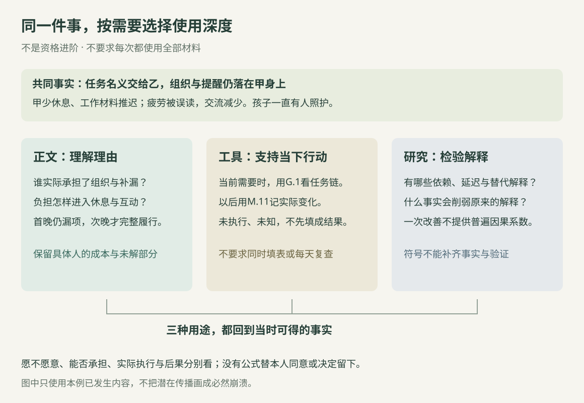

[图L-1](#figure-L-1)以[附录M.10的育儿例](#unit-M-10)说明不同用途，图中的任务链与判断更新分别对应[附录G.1](#unit-G-1)和[附录M.11](#unit-M-11)。三处不是从低级到高级的关系资格，也不要求依次完成。每一处都要回到具体事实；增加符号不能把尚未知的事变成已知。

##### 怎样把关系看得更细，而不丢掉具体的人

先把状态、结构、观察和行动分开。状态是此刻的可用资金、实际负荷和参与意愿；结构是任务、权限和人与人怎样连接。双方看到的信息可能不同，各自也只能决定自己的行动。外部条件和过去经历会影响下一步，却不能据此假定存在一个能够随意操控两人的总指挥。

例如，甲看见晚餐按时准备好，乙却知道自己为此推迟了工作。如果只用“晚餐完成”表示家庭状态，就漏掉了承担者的代价。比较方案时，应使用当时已知或能够取得的信息，不能把后来才收到的服务答复、收入或愿意帮忙的人，提前当成已经可用。

###### 多层有向网络：谁向谁提供什么

“网络”在这里是实际联系，而非抽象的人脉数量。先列与问题有关的人、服务或任务，再分别看情感、资源、信息、责任和社会联系。每条联系写清谁提供、谁接收、具体内容、条件、时间、实际可用范围及信息依据。同一个人愿意倾听，不代表也能提供住房、资金或现场照护。

联系有方向，也可能不对称。甲愿向乙提供信息，并不证明乙已经把自己掌握的必要信息告诉甲；亲属愿帮助联络机构，也不等于机构已经接受服务请求。多人参与的任务可以单独列出来，避免把“大家会帮忙”误写为每个人都已经承担完整责任。

在[16.5节](#unit-16-5)的照护情境中，亲属确认本次陪同，郑敏能直接询问机构，是两种不同联系。后者减少了经亲属转问的信息依赖，却没有增加一个能在所需时段到场的照护者。把这些联系画成箭头时，应保留这种区别；同一条粗细不能同时表示现金金额、工时与信任。

###### 四种账户视图：同一件事，从四处看

这里的账户是观察视图，不是四个银行账户，也不是四份可以相加的关系资产。

| 视图 | 记录的重点 | 容易被遗漏的部分 |
| --- | --- | --- |
| 个体 | 各自的资源、需要、恢复、负荷、职业机会与自主 | 家庭任务完成，是否以某个人持续透支为代价 |
| 关系与联系 | 双向预期、回应、分工和共同安排 | 一方认为已经支持，另一方是否实际得到需要的帮助 |
| 功能系统 | 感情、生活、经济和治理的必要功能、依赖与余量 | 哪项缺口尚在，由谁补位，哪里有可用调整 |
| 整体 | 共同价值、跨领域影响、负担分布及可行路径 | 某一处改善是否把代价全部转移到了另一人或另一领域 |

同一笔现金只记录一次归属和余额，在其他视图记录它支持了什么、谁能决定怎样使用。家庭储蓄既能支持必要支付，也能带来安心感，并不因此变成两份储蓄。信任可以从个人体验、双向关系和合作功能分别观察，却不能加成三份可兑换资产。

现金可按一致口径核对收支，时间则受具体时段约束：同一下午不能无条件同时用于工作、陪同和休息。今天少睡的一小时，不会因为下月多出一个空闲小时就自动消除影响。亲密和尊严也没有本书提供的统一计量单位，不能用多送几次礼物抵销一次严重侵害。

###### 三种动态视角：维持、调节与改变安排

| 观察视角 | 要问什么 | 不能替代什么 |
| --- | --- | --- |
| 存量、流量与状态变化 | 现有什么，某段时间增加或消耗了什么，任务和恢复怎样变化 | 收支能维持，不等于双方仍愿共同生活 |
| 反馈与调节 | 谁发现偏差，怎样解释，是否形成可执行调整，哪里有延迟 | 说清问题不等于已经有资源或愿意行动 |
| 适应与演化 | 旧办法不够用时，能否改变目标、分工、支持来源和实际连接 | 换了结构不等于它对双方就正当、有效或可持续 |

三者可以同时发生，不是三个新增系统或必须依次完成的阶段。重排分工能立刻改变时间使用，资源紧张又可能让沟通更困难；一次实际纠偏可能积累新的合作习惯，也可能仅解决本次缺口。要看行动以后的变化，不从模型名称直接推出结果。

还应并看当期收益、已经付出的损耗和未来能力。收入增加却长期挤掉休息与学习，可能留下新的薄弱处；使用部分储备支持恢复或培训，也可能增加之后的选择空间。它们没有统一单位，不宜相减成“净幸福”。必要资料足够支持眼前选择即可，不要求每个人全知、理性或精力无限。

###### 有限时间可存续：在给定期限内，现实中是否还有可行路径

可存续判断必须说明考察多久、面对什么条件、哪些需要必须维持，以及行动是否真实可执行。路径要使用实际可用的资源和承担者真实愿意提供的支持，并满足安全与自主约束；帮助者不愿提供的支持，不能算可调用资源。所谓“有限时间可存续集合”，是在这些前提下仍存在可接受、可执行路径的起始状态范围。本书用它整理问题，不计算数值边界或存续概率。

以[16.2节](#unit-16-2)—[16.5节](#unit-16-5)的必要外出为例，亲属本次陪同已经确认但尚未执行；若按约履行，这次接续有路径。若亲属临时取消，服务又来不及启用，就仍缺第二条可执行路径。不能凭“总会有人帮忙”宣布准备充分，也不能由这次缺少后备推出所有未来照护永远无解。

面对多种不确定情况，还要区分两件事：事后每种情况都能想出一个办法，与当时确有一套能依据已知消息及时调整的办法。前者可能偷用了未来信息。一个只能在错过时点之后才获知的服务，不能算作当时已经存在的保障；备用有无启动时间、权限和维护成本，也要一起看。

可存续回答现实条件下“有没有路”，不授予任何人要求当事人留下的权力；即使存在这样的路径，本人仍可选择不继续。关系有效性还要看这条路是否持续实现双方重视的价值，愿意继续也不证明关系已经健康。可以自愿调整生活标准和分工，却不能为让模型有解而删去安全、自主或明确的重要需要；资料不足时，保留未知。

###### 解释需要接受什么检验

若判断“完整交接让照护者恢复了一点交流意愿”，应分别看任务是否真交出、休息是否真增加、交流是否实际发生，以及同时还有什么变化。工作压力减轻、身体状态改变或其他支持到位，都可能提供竞争解释。没有观察到的环节不能靠箭头补齐。

恢复也有时间差：必要事务接上之后，疲劳和信任可能尚未恢复。不能把延迟统称为不愿改变，也不能因此无限等待没有实际行动的承诺。记录谁做了什么、何时出现何种变化及仍未恢复的部分，比增加术语更有用。

##### FHS与RRS：两种财务事实自检

家庭财务常态自检（FHS）看通常情况下的收入、支出、债务和调整能力；家庭财务抗冲击自检（RRS）看变化来临时的可用资金、保障与重大责任。两者帮助定位需要核对或改变的事实，不提供加权总分，也不判定谁具有婚恋资格。

FHS保留七个方面，RRS保留八个方面。维度没有被换成高低等级或星级；一项未知不能因其他方面表现良好而被盖住。具体填写与案例分别见[附录F.4](#unit-F-4)和[附录F.5](#unit-F-5)。

| FHS观察方面 | 要理解的内容 |
| --- | --- |
| 收入稳定性 | 实际到账、变化和中断条件 |
| 最大收入源集中度 | 当前主要来源，以及它与其他来源的实际依赖 |
| 低相关收入多样性 | 看似不同的收入是否仍受同一种变化影响 |
| 刚性支出率FCR | 已列必要生活及最低债务支付相对于收入的负担 |
| 债务偿付收入比DTI | 最低债务支付所占比例，不与已含债务的FCR相加 |
| 生活成本降级能力 | 哪些成本真能改变、何时改变及其代价 |
| 财务纪律 | 约定怎样执行，偏差如何说明，信息与参与是否真实 |

| RRS观察方面 | 要理解的内容 |
| --- | --- |
| SR生存续航 | 同口径可用资金对应应急必要支付的覆盖月份 |
| MR生活续航 | 同一笔资金对应普通月实际支出的覆盖月份 |
| 生活成本锁定 | 短期难以改变的支付及其变更条件 |
| 一次性大额事件应对 | 相关重大事项的真实需要、可用资源和缺口 |
| 保障覆盖核对 | 覆盖范围、限额与限制、期限和启动条件，用于辨认保障及缺口，不计总分 |
| 重大责任边界 | 已作承诺的范围、期限、触发条件及未明部分 |
| 担保代偿与连带 | 涉及相关承诺时，核对材料和可能责任，取得具体专业解释 |
| 应收款回收质量 | 收回条件与进度，未收款不当作已到账现金 |

财务语境中的担保相关责任，与[家庭功能代偿](#unit-16-2)不同。前者关注具体承诺、文件及可能承担的责任，不能把各种责任都统称为连带清偿；后者指必要功能出现缺口后的额外补位。两种情境都须看实际承担条件，但不能互相套用结论。

##### 可以计算的部分，怎样解释

| 指标 | 本书当前保留公式 | 计算前必须明确 |
| --- | --- | --- |
| FCR | （不含债务的硬刚性生活支出＋最低债务偿付）÷税后月收入 | 同口径月度收入和必要支付；保障已包含便不再加一次 |
| DTI | 最低月债务偿付÷税后月收入 | 用本期最低偿付，不用全部未付债务余额；不与已含债务的FCR相加 |
| SR | 可立即动用且未受限资金÷应急状态月必要支出 | 同一时点可用存量与应急口径，不重复动用专款，不忽略不能暂停的义务 |
| MR | 同口径资金÷当前普通月总支出 | 本书算例采用实际对外现金支付，内部账户转拨不再算消费 |
| 保障覆盖核对 | 逐项核对，不设统一单一公式 | 核保障范围、限额与限制、期限和启动条件；付过费用不证明全部责任已有保障 |

这些公式按本书说明的用途和口径使用，不假定其他场合的同名指标也采用相同分子与分母。输入未知、分母为零或口径不适用时，应说明为何不能算；未知不填零，也不显示无穷大安全或猜测的低风险。

沿用[14.7节宋晴与郑闻的独立测算](#unit-14-7)：税后月收入20000元，非债务硬刚性生活及必要保障10000元，最低偿付2000元。FCR为60%，DTI为10%；后者已在前者分子内，不能相加成70%，更不是60分或10分。这些数值表示支付比例，不转换为综合评分。

再取另行声明的60000元可用存量时点，应急必要月支付12000元、普通月实际对外支付15000元。SR为5个月，MR为4个月，使用的是同一笔钱，不能相加成9个月。这只是按上述支出基准保持不变、不计新增收入或额外大额支付作的覆盖换算，不是实际安全期限。年内专款6000元另列；长期资金原余额未知，未纳入该测算，也不拿[F.7](#unit-F-7)月底62000元替换旧时点。

这说明了在给定条件下怎样核算，没有证明该家庭“抗风险合格”。实际收入、支付和责任变化后要更新情境；完整月度资金流看[F.7](#unit-F-7)，调整情境看[F.8](#unit-F-8)。本页不据示例金额推荐每个家庭都采用同样配置。

##### 事实自检、测量与预测，是不同用途

知道收入是否到账、资金是否受限、谁承担必要支付，已经能帮助处理实际问题；它不要求先算出一个总分。能够按明确口径复算比率，只证明计算在给定输入下成立，不能证明某个比率能预测婚姻幸福或长期安全。

如果要把事实记录发展成测量工具，还需要说明它测量什么、题目和输出怎样对应、资料缺失怎样处理，以及不同情境下是否可靠。若进一步声称预测结果，则需要与预测对象、时间范围和使用人群相匹配的证据，不能用算例或相邻理论代替。

本书提供的是按需使用的事实自检与行动工具。输入未知或口径不适用时，可以保留未知并先处理有依据的事项；不能为得到完整结果，临时猜权重、补分或设一条统一的婚恋资格线。参考条件与未知显示见[附录F.6](#unit-F-6)。

##### 使用到什么程度就可以停

如果眼前问题已经明确，下一步可执行，就不必继续加表。没有工具替当事人决定应当喜欢谁、原谅多久或是否留下；一个模型不能说明的部分，也不需要由更多术语填满。需要新的事实便补事实，需要专业解释便问对应问题，需要作个人选择时保留本人的权限。

理论借鉴与使用边界见[L.2](#unit-L-2)；现有概念与主讲位置见[L.1](#unit-L-1)。进阶观察帮助提出更准确的问题，不成为证明关系合格的新考试。

### 附录 M 婚恋关系各阶段风险清单与完整逐行速查表

#### M.1 阅读方式：问题性质与信息状态分开

这份表帮助你找到眼前需要理解或处理的事。读到某一行，不等于那件事已经发生；找不到对应问题，也不等于一个人已经通过可靠性检查。先从现实中困扰你的一件事出发，再查相关条目，比把九十项逐一套到对方身上更有用。

表中的L1、L2、L3是处理入口，不是给整个人或整段关系排高低的分数。“信息不足”说明当前知道多少，“重点关注”提示接下来留意什么；它们与问题性质回答的不是同一个问题。

##### 先读表中的这些词

| 表述 | 它回答什么 | 据此可以怎样行动 |
| --- | --- | --- |
| L1 真实危险／严重侵害 | 是否已有具体侵害或可信现实威胁 | 优先保护与独立支持，不等完整举证、反复发生或普通协商成功；具体办法依当下处境 |
| L2 重大不兼容／不可承受风险 | 已明确的核心方向、现实负担或严重背约，是否无法接受或协调 | 暂缓受影响的推进，面对是否继续、改变安排或结束；不靠其他优点抵销 |
| L3 有现实改善空间的问题 | 已有具体问题，当前是否安全、自愿且有实际合作与资源条件 | 可以尝试相称调整，观察真实执行；不表示必须修复，也不将愿意改变记成已经改变 |
| 信息不足，无法判断 | 哪些相关事实、本人意愿或实际表现尚不清楚 | 补充会影响当前决定的信息，必要时暂缓相应行动；未知不归入最低风险档 |
| 重点关注 | 哪些行为、条件或传导可能值得留意 | 写清要看什么，依据新事实更新；它本身不是已确认危险，也不是第四档评级 |

没有L4“低风险档”，也没有把五种表述相加的总分。一个情境可以同时包含多种问题：住房条件未知，已经发生的欺瞒需要处理，本人也可能已不愿继续。未知不能把已经成立的事实冲淡，已知的一项问题也不能自动填满其他领域。

其中，已证实重大身份欺瞒、隐瞒现存婚姻或冲突性伴侣承诺，应立即暂停当前交往或结束，并处理既有暴露与后果，不能只推迟下一步升级。这不把所有L2问题都规定为同一种处理；其他不相容或负担问题，仍按具体事实、本人意愿与现实可行安排决定。

反复羞辱、越过明示边界或操纵评价，不能只因未出现暴力或威胁就默认放进L3。应看具体侵害、严重越界及本人意愿，分别选择保护、停止或确有条件的调整。

L3尤其需要按现实条件理解。有人表达一次遗憾、愿意以后注意，不足以证明已具备改善条件。需要看对应事务由谁承担、时间与资源是否可用、是否能尊重拒绝，以及后来是否真正执行。若本人已不愿继续，不必为了配合这个标签先完成一轮修复。

##### 从陈述矛盾到判断：中间缺的是事实

看一个独立虚构情境。两人正在约会，乙在交友介绍中写长期在本地工作，交谈时却说大部分工作时间在外地。甲考虑是否继续了解，也被提议未来辞职迁居。现在能确认的是两种陈述不一致，不能直接确认其原因，更不能把拟议迁居当作已经发生。

甲可以询问介绍指什么时点、目前实际在哪里工作，并在本人知情和愿意提供的相称资料范围内核对。眼前不必查完整履历，也不该偷取私人账号。对辞职迁居这种决定而言，工作地点与真实生活方案尚未清楚，就暂缓依赖这些条件的行动。

接下来有两个互斥的假设方向：

| 新增事实 | 怎样更新原判断 | 仍然不能推出什么 |
| --- | --- | --- |
| 乙说明介绍为旧信息，双方相称核对后确认工作地点已调整，资料可以对应 | 原先“当前两份说法无法对应”的疑虑得到澄清；按真实新地点讨论意愿与方案 | 资料澄清不证明未来城市一定相容，更不代表甲已经同意辞职 |
| 乙承认目前仍主要在外地，明知甲的本地要求，仍故意说长期在本地，以促使甲按其提议辞职迁居 | 不再只有未知；存在影响重要选择的故意不实。甲可立即暂停当前了解或结束，按已确认的失信处理，不仅是等待补资料 | 不必自动作刑事结论，也不把尚未辞职写成已经遭受收入损失 |

第一支是原疑虑被事实澄清，不是先认定欺骗再宣布“修复成功”；第二支是具体欺瞒得到确认，也不是仍以动机不明无限等待。两支都没有完成迁居或形成婚约。实际后果和下一步，须继续按该支路自己的事实判断。

再看一个不同情境：对方已经以报复威胁阻止你求助，自己却还不知道其内心究竟是害怕失去还是想要控制。动机可以未知，威胁已经可见。此时先处理现实危险，不能为了查清心理解释而继续暴露。[附录J.4](#unit-J-4)和[第十七章17.5节](#unit-17-5)提供独立支持入口。

##### 逐行怎么读

完整表保留七列。“情境”是适用条件，“当前判断／重点关注”要和这些条件一起读；不能只截取一个标签。最后一列说明什么新事实会改变当前处理，并不等于前面已经出现那些更严重的事实，也不表示每项问题都要继续发展才处理。

“来源索引”的[A1](#source-M-A1)—[A8](#source-M-A8)、[B1](#source-M-B1)—[B12](#source-M-B12)只帮助追溯原来的背景类别与互动类型，不代表某类人必然危险；它们与[附录D.2](#unit-D-2)重大事项的[A](#unit-D-2-heading-2)—[E](#unit-D-2-heading-34)编码不是同一套，详见[附录M.12](#unit-M-12)。一个事件引用几个来源，不会因此多算几份危险，也不能从条目数推出发生率。

“涉及领域与可能传导”需要特别留意。初识者还没有共同家庭，表中出现生活或经济，可能说的是个人资源、眼下互动或未来形成条件。只有确有行为与后果支持，才能记录某项共同功能已经受损，不能看到四个领域就宣布四个系统全部失灵。

例如，对方提出借款，而用途尚不清楚，可以关注个人资金暴露；尚未借出，就没有这笔借款已经造成的损失。若后来确认有隐瞒并改变了共同支付安排，再分别看经济事实、知情与决定权、信任及生活后果。可能传导与已经传导，要写在不同位置。

一次查表通常只需留下几句话：我亲见或相称核对到什么，哪些仍是自述或解释，当前决定为什么受影响，下一步要取得什么信息或采取什么行动。需要持续跟踪时使用[附录M.11](#unit-M-11)；不必为了每次约会保存一份全量档案，也不囤积无关敏感资料。

阶段性照护、收入差异、疾病、出身或一时依赖，都不能仅凭名称判为寄生、操纵或危险。要看真实认可、承担与回应、可持续负担、拒绝空间及具体后果。普通差异可能无需干预；没有发现危险，也不要求你接受不喜欢或不愿继续的关系。

资料澄清、原判断错误、问题实际改善与仍未落实，应分别记录。已解决的事项可以停止反复追查，有新事实或安排再次失效时再打开。表的作用是让当前选择更有依据，不是让一个人背上无法撤销的标签。

#### M.2 七阶段的任务与节点

风险表沿用七个S阶段，正文与[附录A.3](#unit-A-3)使用六个决定节点。前者帮助查找目前情境，后者帮助判断某次承诺是否可以增加。它们不是两套相互竞争的进度条，也不要求每个人把七阶段和六节点逐个补齐。

[S1](#unit-M-3)与[S2](#unit-M-4)分别关注被注意、初步筛选和浪漫兴趣，可以在同一场互动中出现，也都在[第四章](#unit-4-1)展开。正式恋爱、订婚与婚后经营又会包含多个具体决定。阶段与节点因此不能简单一一配对。

##### 七阶段查找表

| 阶段 | 当前主要任务 | 可能面对的下一决定 | 另行判断的高后果行动 |
| --- | --- | --- | --- |
| [S1](#unit-M-3) 吸引：被注意、初识与筛选 | 看见之外，还要看能否接触、本人是否愿了解，资料与实际回应如何 | 是否继续接触或安排一次双方愿意的见面 | 个人信息披露、转账与账户授权不由资料优秀自动许可 |
| [S2](#unit-M-4) 两性吸引：浪漫兴趣与亲密期待 | 辨认对具体人的吸引，不把欲望、礼貌或强烈体验当可靠性证明 | 是否表达兴趣、接受具体互动；不自动成立身份 | 身体接触按当下具体同意判断，拒绝一次行为与拒绝继续交往分开 |
| [S3](#unit-M-5) 善意表达与约会 | 在真实互动中看持续双向兴趣、积极反馈与双方主动参与 | 是否共同选择排他了解，并说清范围、参与和结束告知 | 约会不自动许可同居、借款、共享账户或替人承担长期责任 |
| [S4](#unit-M-6) 排他了解期（排他性观察） | 在普通可承担相处中看积极情感价值、实际参与、初步承诺治理及自然波动后的连接 | 是否在关键条件相对清楚且本人能接受时，明确确认恋人身份 | 遵守排他不等于同意性行为、迁居、共同负债或婚约 |
| [S5](#unit-M-7) 正式恋爱至确认适婚、婚事关键协商 | 看静态相容、现实可行、多领域实际协作及外部影响；让适婚判断与关键协商往返校验 | 决定性条件明确后，是否形成清楚婚约、必要家庭告知与婚礼安排 | 住房资金、财产权责、生育和职业变化均须按具体安排核对，不能等订婚后首次发现关键缺口 |
| [S6](#unit-M-8) 正式订婚后的婚约落实与家庭建立准备 | 把约定变成真实可用的住处、资金、时间、权限与责任；新事实出现时更新判断 | 登记、仪式、居住及相应实施分别作决定 | 订婚不自动放行签约付款、登记、共同负债与生育，不用已花的钱替代当前意愿 |
| [S7](#unit-M-9) 婚后共同经营与变化适应 | 持续创造积极价值，维护生活、经济与治理，处理真实变化和损害 | 维持、调整、修复、重配责任或必要退出，没有统一的新身份终点 | 生育、迁居、创业、抵押、长期照护等仍分别判断，不由配偶身份一次性授权 |

这张表中的身体同意不能被任何共同决定替代。共同资源和新增共同义务需要相应共同同意或已有有效授权；讨论其后果，也不意味着谁能替另一个人决定身体。身份成立、运行是否适宜与某项具体行动是否可承担，始终分开。

##### 与正文六节点怎样对应

以下对应[附录A.3](#unit-A-3)既有六张节点卡，不增加新的编号或考试。

| 正文节点 | 常用风险阶段 | 这里最容易混淆什么 |
| --- | --- | --- |
| 初识→持续约会 | [S1](#unit-M-3)、[S2](#unit-M-4)，并接[S3](#unit-M-5)真实互动 | 被看见、被吸引、愿意再见不是同一事实；[S1](#unit-M-3)/[S2](#unit-M-4)可同时出现 |
| 持续约会→排他了解 | [S3](#unit-M-5)进入[S4](#unit-M-6) | 排他需要持续双向兴趣与实际参与，并经双方明确选择；不只是单方追求够久 |
| 排他了解→正式恋爱 | [S4](#unit-M-6)进入[S5](#unit-M-7) | 初步自持要有普通相处的积极价值；联系频繁或遵守排他本身不够 |
| 正式恋爱→正式订婚 | [S5](#unit-M-7)进入[S6](#unit-M-8)，同时提前查[S6](#unit-M-8)关键事项 | 适婚与关键协商相互校验；决定性资源未知不能先当满足再订婚 |
| 正式订婚→婚姻与家庭建立 | [S6](#unit-M-8)中的分项落实，并接[S7](#unit-M-9)实际运行 | 计划、已确认可用和实际到位不同，登记、仪式与同住也不同 |
| 婚姻成立→长期共同经营 | [S7](#unit-M-9)持续使用 | 是持续生成、修复与适应，不是婚后还有人人必过的下一身份 |

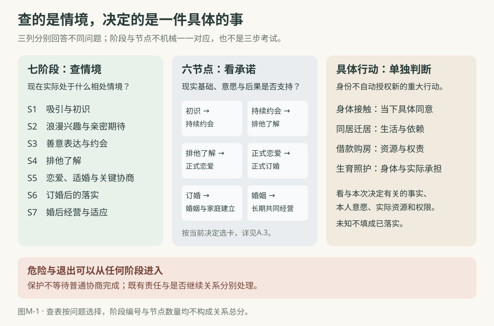

*[图M-1](#figure-M-1)中的六节点详见[附录A.3](#unit-A-3)；图示不替代具体行动的独立判断。*

##### 排他之后，增加的是什么依据

看一组独立虚构情境。两人明确约定排他，最近每天联系，却只是机械问候，一方从未表达普通相处中是否愉快，也没有一起安排新的接触。此刻可以确认有排他约定和一定联系频率，不能直接填写“感情已初步自持”或“恋人身份已确认”。

若双方仍愿了解，可以选择一次各自能承担的普通见面，分别表达体验，再看后续是否仍有双向参与。这是拟议行动，不是一次见面就能完成全部判断。若只剩一方靠昂贵活动、反复请求或内疚维持，便需要面对实际运行，而不是再增加一个身份名称。

反过来，已经在多次普通相处中得到双方认可的积极价值，双方也能持续参与，并不要求人为制造争吵补出一个修复样本。自然出现过忙碌或小波动，就看实际怎样说明、调整和重新连接；尚未经历的情境保留未知，按[6.2节](#unit-6-2)判断当前是否有足够依据。

##### 婚约前后，哪些事项要往返查

另设一组已恋爱、准备讨论婚事的情境。拟议住处依赖父母支持，但出资者只说“会帮忙”，方式、条件与可用时间都未明确。[S6](#unit-M-8)表虽然名为“正式订婚后”，[S6-02](#risk-S6-02)至[S6-04](#risk-S6-04)的资金、权属与附带条件，此刻已经需要提前查阅。

这不意味着必须在订婚前完成所有婚后操作，而是区分决定性前提与后续实施。影响是否接受方案的出资条件不能等婚约成立后再第一次询问；已明确方案下的具体交接，则还需在实施时确认到位。后来资源或意愿变化，也可以回到适婚判断、调整或解除，不能用阶段序号阻止重看。

父母知情按本书的婚约定义安排，不等于父母审批，也不自动赋予亲属对所有共同事务的决定权。父母离世、失联或联系存在现实危险时，按真实处境安排必要知情与支持，不以流程完整为由强迫恢复危险联系。具体法律含义另依适用情况，不由本表定义。

##### 只查与当前决定有关的部分

第一次见面不必提前填完家庭资金与育儿安排；已经结婚，也不必为了使用风险表退回[S1](#unit-M-3)重新审核全部身份。先说清“现在要决定什么”，再选相关阶段和条目。已有真实危险可以从任何阶段直接进入[附录J.4](#unit-J-4)与[第十七章17.5节](#unit-17-5)，退出也不要求把表查到最后一页。

同一个主题在不同阶段再次出现，新增的应是实际责任与暴露。例如，早期了解对方是否愿意有孩子、婚约前讨论主要生活安排、婚后面对一项具体生育提议，需要的信息和行动并不相同。重现用于处理新的决定，不是把同一个担忧累计成越来越高的危险分数。

#### M.3 S1 吸引：被注意、初识与筛选

被看见、被吸引和能够成为伴侣，是不同的事。本阶段的十一项情境帮助辨认资料、接触与初步判断，不要求初识时验证整个家庭的运行能力。关注某种外貌或资源本身，不等于轻浮或套利。

先读[附录M.1](#unit-M-1)的判断口径，再从眼前行为找一行。下表编号用于定位具体情境，来源索引用于查找相关背景与互动类型；“可能传导”不表示已有共同家庭或损害。需要对照观点时回到[4.6节](#unit-4-6)，渠道与接触机会另见[第三章3.4节](#unit-3-4)。

##### 本阶段完整逐行表

共11项：[S1-01](#risk-S1-01)至[S1-11](#risk-S1-11)。条目数量只用于查找和核对，不代表发生率、概率或严重程度。

| 编号 | 情境 | 来源索引 | 当前判断／重点关注 | 涉及领域与可能传导 | 处理与观察 | 推进或重新判断条件 |
| --- | --- | --- | --- | --- | --- | --- |
| S1-01 | 公开身份、基本资料前后不一致，尚无独立证据 | [A1](#source-M-A1)/[B1](#source-M-B1) | 信息不足，无法判断 | 个人信息与接触安全；后续治理可信度、感情判断 | 核对公开信息及自然交谈的一致性；不因猜测公开指控；保持线上隐私边界。 | 资料矛盾核实后按事实判断；条件不合按本人意愿决定。已证实重大身份欺瞒、隐瞒现存婚姻或冲突性伴侣承诺，立即暂停当前交往或结束，并处理既有后果；具体诈骗、侵害或可信威胁按L1，不等待刑事级证明。 |
| S1-02 | 对方强调职位、财富、学历或社会地位，形成单一光环 | [A8](#source-M-A8)/[B3](#source-M-B3) | 重点关注：单一资源信号是否遮蔽对具体人的了解，是否影响接触对象的构成；不能据此判断人格或动机 | 感情期待与择偶判断；后续资源和权限安排 | 将资源优势与人格、互惠意愿分别评价；展示真实而多面的生活，观察对方是否也关注本人、尊重边界并愿意共同参与。单一资源展示可能改变来接触者的构成，不能据此断言全是套利者。 | 证据不足时单项资料真实性归信息不足，无法判断 |
| S1-03 | 尚不清楚婚姻目标、生育意愿、排他观念 | [A5](#source-M-A5) | 信息不足，无法判断 | 未来生活方向与治理基础；不合可能影响感情 | 优先用非盘问式问题核对方向性条件；尚未同意深度交换时尊重私密。 | 双方明确且无法协调：L2 |
| S1-04 | 年龄、地域、生活状态等客观条件可能与自己目标冲突 | [A8](#source-M-A8) | 信息不足，无法判断 | 未来生活可行性、经济投入与关系意愿 | 确认实际情况、允许合理差异，不把统计偏好当作道德判断。 | 明确不可接受的定居/时间窗口冲突：L2 |
| S1-05 | 对方家庭条件、教育或社会经历不熟悉 | [A3](#source-M-A3)/[A7](#source-M-A7) | 信息不足，无法判断 | 个人背景信息；有现实联系时才涉及生活、经济与治理 | 仅作为待了解信息，不以出身、教育水平、过去受害经历作危险判断。 | 出现可核实的暴力或现存威胁：L1 |
| S1-06 | 短期内高频示好、迅速承诺长期未来 | [B1](#source-M-B1)/[B4](#source-M-B4) | 重点关注：情感节奏与现实了解是否相称，热情本身不能证明操纵 | 感情节奏；可能推动过早承诺与个人资源投入 | 观察节奏是否被尊重、陈述与行动是否相符、是否催促资源或身份投入。仅因热情不要求降温；出现具体压力时限制不相称的承诺。 | 出现可核实的失信、催迫或越界后再判相应问题；已确认重大不兼容按L2，可信的侵害或威胁按L1。 |
| S1-07 | 利用财富、名额、投资机会或急难故事要求先转钱 | [B2](#source-M-B2)/[B1](#source-M-B1) | 重点关注；交易真实性信息不足，无法判断 | 个人财产安全；后续经济合作与信任 | 将资源机会或求助请求与恋爱好感分开，核实与实际决定有关的事实，暂缓未经核实的转账、代收款和账户授权。 | 不能因故事感人就忽略现实暴露；具体欺诈、勒索、侵占或可信威胁按L1；仅存在请求不直接断言犯罪。 |
| S1-08 | 明确拒绝后出现持续跟踪、可信威胁或严重骚扰 | [B12](#source-M-B12)/[A7](#source-M-A7) | L1 真实危险／严重侵害 | 人身与自主安全；感情、正常生活可能受损 | 按具体危险优先保护自身，组织可信支持和必要专业帮助；不机械要求当面拒绝或单独接触，不为取证继续暴露。 | 无需等待关系发展或重复发生 |
| S1-09 | 反复嘲讽、羞辱、越过明示边界，但未出现严重威胁 | [A6](#source-M-A6)/[B7](#source-M-B7) | 已有反复羞辱和边界侵犯，不默认L3；严重越界且不可接受时按L2，可信威胁或严重自主剥夺按L1 | 尊重与边界功能；感情及独立判断可能受损 | 可以停止该次互动或结束了解，不必反复争辩来证明自己值得尊重。只有安全、自愿且有实际改善条件时，才可选择L3调整，观察行为是否真正停止；不要求先尝试修复。 | 威胁、强迫、恐吓或持续骚扰按L1；反复羞辱未停止或已超出接受范围时，不能只因没有严重威胁继续按普通沟通处理。 |
| S1-10 | 单凭外貌/资源等特点便形成“命中注定”的确定判断 | [B3](#source-M-B3) | 重点关注：强烈判断是否有足够依据，不从主观心动直接推出危险 | 个人判断与感情期待；可能带动生活、资源绑定 | 把主观强烈体验与了解程度、长期适配分开。心动支持继续了解，不支持放弃判断；尚未排他时可保留正常选择，已明确的承诺仍应遵守。 | 重大现实目标已冲突而仍要求高投入：L2 |
| S1-11 | 被吸引后快速暴露住址、工作证件、行程或家人信息 | [B4](#source-M-B4) | 重点关注：已披露信息的用途、可撤回性与实际暴露，尚不等于已遭侵害 | 个人隐私与安全；可能影响日常生活和后续信任 | 遵守最小披露原则；个人信息分阶段、经同意交换。对已经披露的内容，辨认用途和仍开放的接触面，减少无必要的后续披露；可撤回的授权另行处理，不把提出删除要求当成资料已经消失。 | 隐私被用于威胁或敲诈：L1 |

##### 使用过程：单一光环之外，增加真实相处

这是独立虚构例。甲被乙展示的职位与生活条件吸引，已经开始想象共同旅行；两人只在线上聊过，尚未核实资源，也没有借款、婚约或共同生活安排。适合先查[S1-02](#risk-S1-02)，并与[S1-10](#risk-S1-10)对照。

| 观察步骤 | 本例记录 |
| --- | --- |
| 已有信息 | 甲确实被这些展示吸引；具体资源主要来自乙自述，两人尚无线下相处 |
| 当前判断 | 重点关注：一项优势是否被扩展为对全部人格和未来的确信；资料真实性另保留未知 |
| 还缺什么 | 对具体人的兴趣、普通互动中的双向参与，以及会影响具体决定的事实 |
| 实际行动 | 两人后来共同选择可承担的公共场所见面，各自安排往返；见面实际发生，乙询问甲的日常兴趣，甲也愿意继续聊 |
| 怎样更新 | 增加了一次普通互动与双方兴趣的信息，没有核清全部资源，也没有证明长期可靠；愿不愿再见由双方另选 |

这次行动不是装穷或撤去资源来测试乙。甲仍可以欣赏乙的条件，也获得一点展示以外的信息。一次见面愉快既不放行转账，也不需要因资源未知取消所有普通接触；若之后出现与某项决定相关的新陈述或压力，再查对应条目。

若眼下已经是明确拒绝后的跟踪或可信威胁，直接接[S1-08](#risk-S1-08)与[附录J.4](#unit-J-4)，不需要先完成上面的相处过程。

#### M.4 S2 两性吸引：浪漫兴趣与亲密期待

浪漫兴趣与身体期待可以使人愿意靠近，却不自动证明人格可靠、身份已经成立或某项接触获得同意。这十项情境同时关注真实回应、边界与容易扩大的推断。强烈心动可以保留，具体行为仍分别选择。

先找发生的是含糊、明确拒绝、实际施压还是严重侵害，不用一张“吸引力高低”表替代判断。普通发展回接[第四章](#unit-4-1)、[第五章](#unit-5-1)；身体自主和相关知情问题接[第十章](#unit-10-1)与[附录K.1](#unit-K-1)—[附录K.3](#unit-K-3)。

##### 本阶段完整逐行表

共10项：[S2-01](#risk-S2-01)至[S2-10](#risk-S2-10)。条目数量只用于查找和核对，不代表发生率、概率或严重程度。

| 编号 | 情境 | 来源索引 | 当前判断／重点关注 | 涉及领域与可能传导 | 处理与观察 | 推进或重新判断条件 |
| --- | --- | --- | --- | --- | --- | --- |
| S2-01 | 把欲望、被关注感或强烈情绪误当作人格可靠 | [B3](#source-M-B3)/[A8](#source-M-A8) | 重点关注：强烈体验与可靠性判断是否混同，后续事实仍需了解 | 感情判断；后续承诺、生活和经济安排 | 区分欲望、喜欢、欣赏、依赖、长期经营意愿；延后不可逆决定。 | 当事人对最低亲密意愿明确不一致且不可接受：L2 |
| S2-02 | 一方热烈追求，另一方缺乏双向吸引或仅礼貌回应 | [A8](#source-M-A8) | 回应含糊时信息不足；已明确不愿发展时尊重结论，不再当作等待验证 | 感情生成；边界与关系意愿判断 | 直接而不施压地确认是否愿意继续。礼貌、赴约或收礼不自动等于浪漫兴趣；明确拒绝后停止追求，不把培养感情设成对方义务。 | 明确拒绝后仍追求，按已发生的拒绝边界侵犯处理，不能默认L3；应停止相应追求与联系。持续骚扰、跟踪或可信威胁按L1。 |
| S2-03 | 身体亲密边界未谈妥，双方对触碰和性关系意义理解不同 | [A5](#source-M-A5)/[B4](#source-M-B4) | 信息不足，无法判断 | 身体自主和亲密安全；感情、边界及未来生活责任 | 分别确认当下愿意的接触与节奏；同意必须真实、自愿、具体且可以撤回。沉默、僵住、醉酒失去清晰判断、过去同意或恋人身份均不能代替当下同意；不清楚时暂停确认。 | 明知拒绝仍强迫接触或性行为：L1 |
| S2-04 | 单方面把陪同高奖励活动误判为喜欢自己 | [B3](#source-M-B3) | 重点关注：关注的是活动体验还是具体的人，不能据一次活动判定动机 | 感情判断；可能造成投入和身份期待错位 | 在平凡、低刺激场景观察对人的关注，而不是仅凭共同体验下结论。 | 无须对所有好感都做人格审计 |
| S2-05 | 诱导高消费、贵重礼物和转账以换取浪漫回应 | [B2](#source-M-B2)/[B5](#source-M-B5) | L3 已有具体问题；仅在安全、自愿且有现实改善空间时尝试治理 | 个人经济资源；感情回应可能被交换要求取代 | 拒绝交换式亲密要求；设置赠与与消费上限，不借贷表达诚意。 | 若只有消费偏好差异，另判断预算和意愿；存在实际施压、债务化或失信时处理具体问题，敲诈、胁迫或欺诈按L1。 |
| S2-06 | 以“真正喜欢我就应该……”索取隐私、身体接触或资源 | [B5](#source-M-B5)/[B7](#source-M-B7) | 已有施压或边界侵犯；严重强迫控制或自主剥夺按L1，其他情境才评改善空间 | 个人自主；感情与边界治理可能受损 | 拒绝把喜欢转成身体、隐私或资源债务；确认能否自由拒绝并获得尊重。已出现可信危险时先取得独立支持，不以反复解释换取停止侵害。 | 威胁或强制性行为：L1 |
| S2-07 | 刚产生吸引便要求删除其他社交或宣称默认排他 | [B4](#source-M-B4)/[B6](#source-M-B6) | L3 已有具体问题；仅在安全、自愿且有现实改善空间时尝试治理 | 社交自主与边界治理；感情可能转为服从压力 | 明确尚未约定排他；排他需要双方选择，也不授权隔绝正常社交。拒绝单方施加的义务，依据是否尊重拒绝及实际控制行为决定下一步。 | 持续控制、隔离、恐吓：L1 |
| S2-08 | 双方的一对一排他期待与具体边界尚未明确 | [A5](#source-M-A5)/[B6](#source-M-B6) | 信息不足，无法判断 | 关系承诺的治理基础；感情和生活目标 | 确认是否愿意形成一对一排他承诺、当前已认可哪些边界；未形成排他不自动等于背叛，不按性取向或过往经历推断忠诚。 | 明确、稳定且无法协调：L2 |
| S2-09 | 自我价值因对方冷热回应而剧烈波动 | [B7](#source-M-B7)/[B3](#source-M-B3) | 重点关注：自己的情绪与生活受影响程度；不能据此确认对方在操纵 | 个人情绪与日常功能；不能据此确认对方实施控制 | 回看自己的情绪、生活与支持条件，并观察对方具体行为；保持正常生活与外部支持，不凭冷热感受给对方定性。 | 若出现持续羞辱、边界侵犯等事实，按具体行为处理；现实强迫、威胁或严重自主剥夺按L1。 |
| S2-10 | 发生明确拒绝后继续反复追求、纠缠 | [B12](#source-M-B12)/[B4](#source-M-B4) | 已有拒绝边界侵犯；持续骚扰、跟踪或可信威胁按L1，不强制继续普通协商 | 个人安全和拒绝边界；感情互动与日常生活 | 已明确拒绝继续追求或要求停止联系时，停止相应追求与联系，不以等候、礼物或再次表白施压。拒绝一次身体接触不自动等于拒绝继续约会；具体行为先停止，是否继续交往另行确认。 | 持续骚扰、跟踪、恐吓：L1 |

##### 使用过程：拒绝一次拥抱，不自动回答全部关系意愿

这是独立虚构例。约会结束时男方想拥抱，女方明确说“今天不想拥抱”，男方立即停下，没有换一种动作再试。女方仍愿意站着聊一会儿。这里查[S2-03](#risk-S2-03)，并用[S2-10](#risk-S2-10)区分具体行为拒绝与继续交往的意愿。

| 观察步骤 | 本例记录 |
| --- | --- |
| 已有信息 | 女方拒绝本次拥抱；男方已经停止；双方继续了一段谈话 |
| 当前判断 | 本次身体边界已明确并得到回应，不因拒绝就认定女方没有任何好感，也不因继续聊天判定可以再碰触 |
| 还缺什么 | 是否愿意以后再约会，须由双方分别表达；下一次身体意愿仍不能预填 |
| 实际行动 | 本次没有发生被拒绝的拥抱；之后的谈话没有用餐费、礼物或失望要求补偿 |
| 何时重看 | 新邀请按具体回应决定；若女方明确不愿继续追求，应停止相应追求；若出现强迫或可信威胁，按实际行为转保护 |

这不是要求每次拒绝都伴随完整解释。身体动作先停，不以“先说清究竟喜不喜欢”作为尊重的条件。一次尊重拒绝也不提供对所有未来行为的保证；后续愿意接触什么，仍由当时的真实意愿决定。

若另一情境中对方已经明确拒绝继续交往，就不能套用“只是拒绝一次触碰”来延续追求。礼貌、收礼与过去亲密都不能推翻当前拒绝。

#### M.5 S3 善意表达与约会

约会开始提供实际参与的信息：不仅看对方如何描述自己，也看小约定是否履行、变化怎样说明、拒绝能否被尊重。十三项情境帮助把热情、事实、责任与新增暴露分开，不把约会变成全面调查。

先关注与当前决定相关的方向和事实。出现共同账户、借款或同居提议时，需要独立核对；尚未涉及的家庭安排不用提前审计。表中不同问题的解释回接[5.9节](#unit-5-9)。

##### 本阶段完整逐行表

共13项：[S3-01](#risk-S3-01)至[S3-13](#risk-S3-13)。条目数量只用于查找和核对，不代表发生率、概率或严重程度。

| 编号 | 情境 | 来源索引 | 当前判断／重点关注 | 涉及领域与可能传导 | 处理与观察 | 推进或重新判断条件 |
| --- | --- | --- | --- | --- | --- | --- |
| S3-01 | 婚姻/婚育状态、工作与重大履历无法合理对应 | [A1](#source-M-A1)/[B1](#source-M-B1) | 信息不足，无法判断 | 治理可信度与感情判断；既有责任可能影响生活、经济 | 按当前决定所需范围，通过合法、双方知情或公开可获得的可靠资料核对。能依法用正式记录确认的重要事实优先确认；记录有范围与时效，不等于可以私查全部隐私。渠道与核实范围见[6.3节](#unit-6-3)和[附录D.1](#unit-D-1)。 | 已证实重大身份欺瞒、隐瞒现存婚姻或冲突性伴侣承诺，立即暂停当前交往或结束，并处理既有暴露与后果，不仅是推迟升级；具体诈骗、侵害或可信威胁按L1。 |
| S3-02 | 收入、消费、借款等表述不一致，或频繁提出借钱 | [A2](#source-M-A2)/[B2](#source-M-B2) | 重点关注：财务陈述矛盾与借款要求的事实、用途和压力；尚不能直接定为诈骗 | 个人资金和既有义务；后续经济合作与信任 | 分开约会消费与借贷、代持、投资或担保责任。在相关关键事实不清或后果不可承担时暂缓对应安排，不以恋爱意愿代替核验。 | 重大诈骗或强迫转账：L1 |
| S3-03 | 不了解原生家庭负担与边界 | [A3](#source-M-A3) | 信息不足，无法判断 | 未来生活、经济与亲属治理；需要具体传导事实 | 通过自然交谈了解亲属依赖和家庭决策方式；不以家世推断风险。 | 发现持续不当索取且无法设界，足以危及生活：L2 |
| S3-04 | 是否结婚、生育、居住及职业规划仍未对齐 | [A5](#source-M-A5)/[A8](#source-M-A8) | 信息不足，无法判断 | 未来生活、经济安排与共同治理基础 | 尽早核对方向性问题，记录不可谈判项与可协商项。 | 确认重大目标不可兼容：L2 |
| S3-05 | 无法在普通场景兑现小承诺、尊重时间和安排 | [A6](#source-M-A6)/[B9](#source-M-B9) | L3 已有具体问题；仅在安全、自愿且有现实改善空间时尝试治理 | 生活合作与履责；反复失信可传至治理和感情 | 在自然的低成本协作中观察履约、说明、补救与后续变化。看跨场景的反复表现，同时区分一次意外、能力不足与拒绝承担；不故意设局测试。 | 长期反复且拒绝改善，超过接受范围：L2 |
| S3-06 | 个人重大健康或照护义务尚不清楚 | [A4](#source-M-A4) | 信息不足，无法判断 | 个人健康与未来照护；生活、经济和共同决定 | 当相关于亲密安全或婚育规划时按需要自愿讨论，尊重隐私与事实核验边界。 | 对现实安全有明确严重威胁：L1；关键计划不可兼容：L2 |
| S3-07 | 长期婚姻的自述与只索取短期性或金钱的行为表现明显不一致 | [B1](#source-M-B1)/[B2](#source-M-B2) | 重点关注；真实意图尚不能单凭推测确认 | 感情与治理可信度；个人身体或财产可能受损 | 比较长期意愿陈述与具体参与、履责、拒绝边界和资源要求。真正改变想法与以虚假承诺获取性或钱不同；重要信息未清时暂缓相应投入，具体欺骗或侵害无需靠读心才可处理。 | 确认意愿不相容按L2；有具体失信或越界则处理该行为；明确欺诈或强迫侵害按L1。 |
| S3-08 | 以送礼、餐费和“追求投入”向对方索要身体或承诺 | [B5](#source-M-B5) | 已有以投入索取身体或承诺的施压；先尊重拒绝，身体胁迫、敲诈或严重自主剥夺按L1；不默认必须共同修复 | 个人身体自主与资源；边界和感情被债务化 | 礼物、餐费与追求投入不购买身体同意或继续交往。拒绝不合理对价要求，必要时结束约会；真实财物争议另行处理，不以交出身体或承诺清偿。 | 身体胁迫、敲诈：L1 |
| S3-09 | 过快同居、共同负债或共享账户的要求 | [B4](#source-M-B4)/[A2](#source-M-A2) | 重点关注：推进是否超出已了解程度、是否自愿及后果是否可承担 | 个人财产和生活安排；未来经济、治理依赖 | 分别核对同居、债务、账户权限的具体事实、责任和可回撤性。未充分了解或无法承担时暂缓对应安排，不将共同账户或借贷当作爱与信任的证明。 | 不可协调的推进目标：L2；强迫与盗取：L1 |
| S3-10 | 约会时贬低、当众羞辱或反复操纵评价 | [B7](#source-M-B7)/[A7](#source-M-A7) | 已有羞辱或评价操纵，按具体侵害与本人意愿处理；不因未见威胁默认L3，严重且不可接受时按L2 | 感情与独立判断；边界治理可能被侵蚀 | 可以停止互动或结束约会，避免陷入争辩式自证。仅在安全、自愿且有实际改善条件时选择L3调整；要看羞辱与操纵是否真正停止，不要求继续受辱以验证。 | 持续恐吓、孤立或严重侵犯自主按L1；反复伤害没有停止或本人不愿继续时，不以尚有改善可能要求留下。 |
| S3-11 | 早期分歧演变为辱骂、威胁或报复 | [B8](#source-M-B8) | 辱骂等行为已需处理，不直接归L3；仅安全、自愿且有真实改善条件时可调整，可信威胁、强迫或严重报复按L1 | 感情与治理；可信威胁涉及人身安全和正常生活 | 先辨认已经发生的行为和紧迫程度；安全条件下讨论责任与沟通边界，存在可信危险则先保护，不要求继续协商验证。 | 暴力或可信的严重人身威胁：L1 |
| S3-12 | 公共场所、交通、住宿及约会安全无法保障 | [B4](#source-M-B4)/[B12](#source-M-B12) | 当前安排缺少可承担的安全或自主离开条件，应先调整或停止该次安排；具体侵害或可信威胁按L1 | 个人安全与退出能力；严重后果可影响多个系统 | 选择安全、可自主离开的场所和交通方式，向可信亲友告知行程（自愿）。 | 跟踪、非法限制自由、性侵犯：L1 |
| S3-13 | 双方吸引不足但借“条件合适”持续推进 | [A8](#source-M-A8)/[B11](#source-M-B11) | 重点关注：浪漫意愿是否尚在发展，是否被条件或身份压力替代 | 感情生成；身份压力可能扭曲治理和后续生活选择 | 检查最低双向喜欢与亲密期待；可给有限观察窗口，不以身份压力推动承诺。 | 已明确一方不愿继续，不以继续观察为前提；确认重大目标不兼容时按L2。 |

##### 使用过程：一次漏做之后，观察什么变化

这是独立虚构例。两人约好由甲周五前确认周六活动地点，甲忘了，也没有说明；乙等消息并花时间重新查找，活动因此需要改安排。没有额外付款、危险或反复失约的设定。可以查[S3-05](#risk-S3-05)。

| 观察步骤 | 本例记录 |
| --- | --- |
| 已有信息 | 一项明确任务未履行，乙实际多花了查找时间；原因由甲自述为忘记 |
| 当前判断 | 已有履约与告知问题；是否属于长期模式仍未知，不直接定为全面不可靠 |
| 当前可做 | 甲承认漏做并核对双方剩余时间，两人选择了仍能承担的新安排；没有要求乙负责以后全部提醒 |
| 实际后续 | 另一次自然约会中，甲认领提前确认开放时间，实际完成并及时告知，乙不再替这项任务查找 |
| 怎样更新 | 记录这一项新的履约与乙负担减少；不据一次表现宣布长期稳定，也不把原来漏做永远保留为当前未解决任务 |

一次说明不是执行，实际补救和后来履约才增加了可用信息。本例不说明以后一定可靠；若自然相处中仍反复漏做、让乙收拾后果，就按新事实重新看。若乙已不愿继续，也不必为了确认完整模式而再安排几次约会。

其他条目可能改变优先顺序。若不是忘记地点，而是故意控制交通、不允许对方离开，便不能把它降格成同一种安排失误；若以花费索要身体或身份，财物与亲密意愿分别处理。

#### M.6 S4 排他性观察

排他了解使原有兴趣进入更集中的相处，但不等于已经确认恋爱。十项情境关注约定是否清楚、双方是否实际参与、信息怎样核验，以及有限承诺是否被扩张成控制。稳定联系与普通相处中的积极价值要分别看。

本阶段的主要解释在[6.9节](#unit-6-9)。关键资料未知，可以作相称核对；已证实重大身份欺瞒、隐瞒现存婚姻或冲突性伴侣承诺，则应立即暂停当前交往或结束，面对既有暴露，不能只说以后暂不升级。保护不以获得全部账号、定位或对方承认全部事实为前提。

##### 本阶段完整逐行表

共10项：[S4-01](#risk-S4-01)至[S4-10](#risk-S4-10)。条目数量只用于查找和核对，不代表发生率、概率或严重程度。

| 编号 | 情境 | 来源索引 | 当前判断／重点关注 | 涉及领域与可能传导 | 处理与观察 | 推进或重新判断条件 |
| --- | --- | --- | --- | --- | --- | --- |
| S4-01 | 排他定义不一致：社交、暧昧、前任接触和线上交往边界含糊 | [A5](#source-M-A5)/[B6](#source-M-B6) | 信息不足，无法判断 | 承诺与边界治理；误解可影响感情信任 | 明确哪些行为算违反约定，避免事后单方追溯定罪。 | 一对一排他原则已明确无法相容：L2 |
| S4-02 | 一方要求对方排他，自己却持续寻找其他对象 | [B6](#source-M-B6)/[B1](#source-M-B1) | 先依已形成的约定确认背约；严重且不可接受时按L2 | 已形成的排他治理；违约损害感情和信任 | 核对双方当时实际接受的排他范围及行为，不以单方要求自动产生另一方义务。已确认背约时暂缓新增绑定，结合实际后果和继续意愿决定修复或结束。 若已证实隐瞒现存婚姻或冲突性伴侣承诺，立即暂停当前交往或结束，既有后果与必要责任另行处理，不能只暂缓新增绑定。 | 仅对约定存在疑问时先补信息；治理是否仍有空间须看现实条件与行动。具体侵害、严重强迫或可信威胁按L1。 |
| S4-03 | 以承诺排他换取同居、性行为、转账或身份利益 | [B2](#source-M-B2)/[B5](#source-M-B5) | 已有交换式施压；身体或资源强迫按L1，其他情境分别判断自愿与实际改善空间 | 身体及资源自主；治理与感情可能被交换条件扭曲 | 排他承诺只产生双方明确认可的排他责任，不自动许可性行为、同居、转账或交出权限；每项重大行为单独选择，拒绝不构成欠债。 | 有证据的敲诈、性胁迫、诈骗：L1 |
| S4-04 | 以排他名义强制手机密码、定位、社交隔绝 | [B7](#source-M-B7)/[B6](#source-M-B6) | 已发生边界侵犯；若构成持续强迫或严重自主剥夺按L1 | 自主与边界治理；感情、社交和生活可能受损 | 区分自愿有限透明与强制要求，保留独立信息和支持；已出现强迫控制时先保护，不以再协商密码或定位作为唯一处理。 | 跟踪、威胁、控制人身自由：L1 |
| S4-05 | 身份、婚育史、重大负债和持续关系义务仍不明 | [A1](#source-M-A1)/[A2](#source-M-A2)/[B1](#source-M-B1) | 信息不足，无法判断 | 当前判断与后续生活、经济、治理基础 | 对影响当前交往及下一项决定的事实作相称、自愿的核验，尊重合法隐私；正式渠道及记录边界见[6.3节](#unit-6-3)和[附录D.1](#unit-D-1)。 | 关键事实未清，暂缓依赖它的高后果投入。已证实重大身份欺瞒、隐瞒现存婚姻或冲突性伴侣承诺，立即暂停当前交往或结束，并处理既有后果；不可承担责任按L2具体判断，诈骗、侵害或可信威胁按L1。 |
| S4-06 | 双方对未来生育、定居、事业和家庭责任难以达成一致 | [A5](#source-M-A5)/[A8](#source-M-A8) | 事实与立场未清：信息不足，无法判断；已确认核心不可协调：L2 | 生活方向、经济责任和治理；感情不能自动消除分歧 | 明确冲突是否根本且不可妥协；不把排他作为迫使对方改变的工具。 | 仅因尚未讨论则归信息不足，无法判断 |
| S4-07 | 重大边界冲突后拒绝承认事实、不断重写约定 | [B7](#source-M-B7)/[B8](#source-M-B8) | 已有事实与约定争议；若反复歪曲事实并严重侵蚀独立判断或自主，按L1处理 | 治理事实基础与独立判断；继而影响感情信任 | 区分普通记忆差异、解释不同与持续歪曲可核实事实。安全条件下核对当时约定和行为；出现煤气灯式叙事操纵、隔离或强迫时，保留独立信息与支持，不要求先说服对方承认全部事实。 | 若已有可信强迫控制或严重自主剥夺，安全优先；不必同时存在身体暴力才处理。一般争议能否改善看事实澄清与实际行动。 |
| S4-08 | 彼此没有稳定的善意投入、线下交往或合作反馈 | [B11](#source-M-B11)/[A8](#source-M-A8) | 重点关注：是否暂时受环境影响，还是持续缺少双向感情与自持 | 感情自持；空壳身份可能扩大投入与退出压力 | 看普通可承担投入下能否持续双向参与并产生积极情感价值，已自然出现的波动后能否重新连接，以及接触场景是否扩展、关键未知是否减少。可约定具体回看任务，不因月数到期草率推进或终止，也不以无限延长时间替代新证据。 | 已明确双方无法满足最低关系需求：L2 |
| S4-09 | 一方过度依赖、无法对家庭或前任作自主决定 | [A6](#source-M-A6)/[A3](#source-M-A3) | L3 已有具体问题；仅在安全、自愿且有现实改善空间时尝试治理 | 治理自主；影响生活、经济安排与感情 | 观察面对真实分歧时能否独立判断、表达选择、执行决定并承担后果。支持其本人主动的改变，不预支未来成熟，不由伴侣接管人格成长。 | 长期无法承担必要关系责任：L2 |
| S4-10 | 结束排他了解的告知及其后交往状态不清 | [B12](#source-M-B12)/[B6](#source-M-B6) | 信息不足，无法判断 | 身份与退出治理；含糊可能引发信任与安全问题 | 说清如何结束排他了解并通知彼此；结束之后是否再认识他人，与仍在排他关系内的行为分开，不追溯惩罚约定外行为。 | 结束后持续骚扰、跟踪或可信威胁：L1；普通悲伤或一次请求再谈不据此定性，仍应尊重拒绝。 |

##### 使用过程：排他名义还在，参与条件已经明确

继续[附录M.2](#unit-M-2)的独立匿名排他例。原来可以确认排他约定与每天问候，实际相处和积极价值的依据不足。这里增加一项新事实：甲提出一次双方可承担的普通见面，乙明确说只愿继续日常问候，不愿安排见面或其他共同活动；甲明确不接受长期维持这种交往方式。

| 观察步骤 | 本例记录 |
| --- | --- |
| 已有信息 | 双方对现阶段愿意投入什么已有直接表达，不再只有甲猜测乙为何冷淡 |
| 对应条目 | [S4-08](#risk-S4-08)；结束告知再接[S4-10](#risk-S4-10)，不能靠重复确认排他替代实际参与 |
| 当前判断 | 甲所需的普通相处与乙当前愿意参与的范围不相容；不据此认定乙欺骗、利用或人格有缺陷 |
| 实际行动 | 甲已清楚表达不再继续排他了解，没有用同居、转账或身体亲密来换取参与 |
| 怎样重看 | 未来若有新的双向意愿与实际条件，另作新选择；当前不需等待乙证明永远不会改变，也不自动形成恋人身份 |

这段交往尚未确认正式恋爱，也没有涉及共同财物或照护。选择停止，是对已明确意愿与当前需要的回应，不需要先证明对方危险，也不是清单给乙判了一个总分。

如果只是近期日程未对上，或者对方愿意提出另一项可行活动，事实就不同，不能直接套用本例。表格使人注意缺口，最终仍需本人表达与真实行动。

#### M.7 S5 正式恋爱至确认适婚、婚事关键协商

正式恋爱中的任务，逐渐从能否产生感情，扩展到能否把亲密、生活、资源与共同决定协调起来。十四项情境关注已经发生的合作与失责，也帮助提前查婚约所依赖的条件。恋人身份不能替尚未核实的住房、资金或责任作保证。

适婚判断与关键协商相互校验，需要时提前查[附录M.8](#unit-M-8)。普通照护、合理分工或暂时资源不足，不自动证明寄生；关键在真实认可、实际保障和变化后的回应。不同主题可分别回接[第七章](#unit-7-1)至[第十二章](#unit-12-1)，不必一次审查全部未来生活。

##### 本阶段完整逐行表

共14项：[S5-01](#risk-S5-01)至[S5-14](#risk-S5-14)。条目数量只用于查找和核对，不代表发生率、概率或严重程度。

| 编号 | 情境 | 来源索引 | 当前判断／重点关注 | 涉及领域与可能传导 | 处理与观察 | 推进或重新判断条件 |
| --- | --- | --- | --- | --- | --- | --- |
| S5-01 | 关系定义、未来结婚/生育时间表严重不一致 | [A5](#source-M-A5)/[A8](#source-M-A8) | 已确认重大且不可协调：L2；尚未澄清意愿或可行性：信息不足，无法判断 | 生活方向与共同治理；反复拖延可能损伤感情 | 分别陈述底线、可调整范围和时间约束；无法协调则停止婚姻升级。 | 尚无充分事实则信息不足，无法判断 |
| S5-02 | 家人强烈干涉，伴侣无法维护共同决策边界 | [A3](#source-M-A3)/[B10](#source-M-B10) | L3 已有具体问题；仅在安全、自愿且有现实改善空间时尝试治理 | 亲属治理；可向经济、生活和感情传播 | 在实际亲属互动中验证边界执行；明确经济与决策事项归属。 | 持续严重干涉且拒绝改善、风险不可承受：L2 |
| S5-03 | 家庭成员的暴力、威胁或侵占等行为已形成现实接触危险 | [A7](#source-M-A7)/[A3](#source-M-A3)/[B10](#source-M-B10) | L1 真实危险／严重侵害 | 个人与家庭安全；生活、经济、治理及感情可能受波及 | 优先取得可信支持与相称保护，减少现实危险接触；只在不增加风险时保留已掌握的必要资料，不为取证继续暴露。相关权利与责任按具体事实取得专业帮助。 | 仅有传闻或出身背景则信息不足，无法判断 |
| S5-04 | 一方财务状况恶化、借贷、担保或资金融通不透明 | [A2](#source-M-A2)/[B9](#source-M-B9) | 关键财务事实未清：信息不足，无法判断；已确认结构压力：依可调整性判断L3或L2 | 经济真实条件；隐瞒可传至治理与感情 | 核对与当前安排有关的真实负担和责任，控制不必要的暴露；若已经发生隐瞒或越权，同时处理治理与信任损害。重大专业事项按需求助。 | 不可承担的重大隐性债务：L2；盗窃、诈骗：L1 |
| S5-05 | 家务、照护、出行与职业支持长期由一方承担 | [B9](#source-M-B9)/[A6](#source-M-A6) | 重点关注：分工是否自愿、可持续且得到实际支持，不能只因单方承担就判定失衡 | 生活负荷与资源分配；可能传至感情和治理 | 核对分工是否共同认可、负担是否可持续、贡献是否被回应及是否有休息与保障。明确可执行的完整任务与调整条件；正常照护和阶段不对称不等于寄生，持续拒绝回应与治理才需重评。 | 持续单方承担且明确拒绝共同治理：L2 |
| S5-06 | 一方没有经济/生活自主性，伴侣被迫充当父母或管理者 | [A6](#source-M-A6)/[B9](#source-M-B9) | L3 已有具体问题；仅在安全、自愿且有现实改善空间时尝试治理 | 生活、经济与自主治理；照料关系可能取代双向亲密 | 区分技能暂缺、现实资源不足与不愿承担本人责任。通过自然小任务观察自主履约和主动学习；可提供有限支持，但不以接管或改造对方作为关系成立的前提。 | 现实改善长期不足且超出承载能力：L2 |
| S5-07 | 既有慢性病、残疾或家庭照护义务使生活安排需要调整 | [A4](#source-M-A4)/[B9](#source-M-B9) | 重点关注：照护需要与现有资源是否适配，疾病或残疾本身不构成已确认的关系风险 | 生活照护、经济资源、支持分工和亲密空间 | 了解实际照护需要、双方能力与可用支持，协商可承担的安排；必要时专业核实，不把提出照护需要本身称为负担转嫁。 | 资源确实不足或分工不可持续时处理已出现问题；核心安排明确不可接受且无法协调按L2；条件适配时无需维持风险标签。 |
| S5-08 | 一方因“我为你牺牲”要求财务、人身或社交服从 | [B5](#source-M-B5)/[B7](#source-M-B7) | 已有以牺牲索取服从的施压；持续强迫控制或严重自主剥夺按L1 | 治理自主；经济和感情可能成为控制手段 | 历史贡献应被看见并合理善后，但不购买人身、身体或社交支配权。既有财务责任与关系去留分别处理；存在可信危险时优先独立支持。 | 性强迫、威胁、非法控制：L1 |
| S5-09 | 频繁小冲突演变为羞辱、敌对和反复翻旧账 | [B8](#source-M-B8) | 反复羞辱与实际伤害不能默认L3；严重且不可接受时按L2，可信威胁、强迫控制或严重自主剥夺按L1；仅安全自愿且有现实改善条件时可调整 | 感情与治理；反复冲突也可能影响生活和经济 | 安全且双方愿意时经[附录M.11](#unit-M-11)回引[附录I.4](#unit-I-4)的七步修复；区分本次事实利益、个人解释与尊严、反复权责机制、共同体认同。旧伤触发不自动算新违约；实际羞辱或威胁不能用“翻旧账”淡化。 | 可信威胁或暴力：L1；持续无修复：L2 |
| S5-10 | 发现暧昧线索，或发现出轨、秘密经营另一段亲密关系 | [B6](#source-M-B6)/[B1](#source-M-B1) | 仅有含糊线索：信息不足，无法判断；已确认严重背约且不可接受：L2 | 排他治理与感情信任；其他损害需分别观察 | 依双方已形成的排他承诺核实具体行为，不把未定义的暧昧直接定为背叛。确认违约后暂缓新增绑定，由当事人判断修复或退出。 若已证实隐瞒现存婚姻或冲突性伴侣承诺，立即暂停当前交往或结束，既有后果与必要责任另行处理，不能只暂缓新增绑定。 | 不因单纯怀疑实施监控；威胁/胁迫另判L1 |
| S5-11 | 强烈关注对方社会资源，关系难以超越外部回报 | [B3](#source-M-B3)/[B2](#source-M-B2) | 重点关注：对具体人和共同生活是否仍有真实兴趣，不以重视资源直接推断套利 | 感情动机与经济期待；可能影响权责治理 | 在自然发生的普通相处与合作中观察对具体人的兴趣、互相欣赏与责任投入；不故意装穷、撤掉资源或制造危机测试动机。 | 有证据的骗取利益：L1；明确目标不相容：L2 |
| S5-12 | 持续缺少情感回应、尊重和共同活动 | [B11](#source-M-B11) | L3 已有具体问题；仅在安全、自愿且有现实改善空间时尝试治理 | 感情生成；未处理负荷或违约可能来自其他系统 | 具体说明主观需求，采取双方认可的可执行改善安排与复盘。 | 双方明确最低需求长期无法满足：L2 |
| S5-13 | 人格评价控制、信息隔离、使对方失去自主决策 | [B7](#source-M-B7) | 持续强迫控制、严重剥夺自主时按L1；普通评价分歧不能据此归类 | 自主和治理；感情、正常生活与支持网络可能受损 | 识别具体事实、实际影响和可拒绝性，组织独立支持与相称保护；不要求先等待暴力出现，亦不凭单次不同意见认定操纵。 | 暴力、可信严重威胁、非法限制自由：L1 |
| S5-14 | 重大关系冲突后以财产、隐私或亲友声誉报复 | [B12](#source-M-B12)/[B8](#source-M-B8) | L1 真实危险／严重侵害 | 个人安全、财产与隐私；原冲突已跨领域传播 | 依现实威胁保护人身、账户、隐私与必要证据，组织可信支持并按需取得专业帮助；不为了对质或取证继续单独暴露。 | 若只是担心未来可能报复而尚无具体行为或可信威胁，记录待了解信息；一旦符合本行情境，不以普通争吵口径降格。 |

##### 使用过程：分工原先认可，负担后来改变

下面是一对恋人调整临时分工的独立情境。两人已恋爱并同住，乙连续晚班期间，甲按共同认可的临时安排负责更多晚餐与采购。起初甲能够承担，后来连续晚班比原先预计更久，甲实际休息被挤占，提出不能照旧维持。可查[S5-05](#risk-S5-05)，必要时接[附录G.1](#unit-G-1)的完整任务链清单。

| 观察步骤 | 本例记录 |
| --- | --- |
| 已有信息 | 分工曾获双方认可；持续时间变化后，甲休息已受影响，需要重谈，不只是担心未来可能辛苦 |
| 当前判断 | 已有具体负担问题；不从单方多做直接认定寄生，也不能用曾经自愿否认后来限制 |
| 已核条件 | 乙核对后续排班，确认有两个不连班的晚上，愿意在这两晚负责晚餐全程；未假定任何未确认外援 |
| 实际执行 | 第一个晚上乙已完成安排、采购和收拾，甲得到相应休息；第二晚已认领，尚未执行 |
| 重看条件 | 第二晚是否落实、后续排班或甲负荷变化时回看；长期安排仍未解决，不把一次休息当全面恢复 |

这里有真实改善，也有未完成部分。若乙只是说“你需要休息就告诉我”，所有组织仍由甲承担，就不能填成同一种结果。若以后工作继续变化，需要按新能力与资源调整，而不是预支乙永久有两个空闲晚上。

新的分工事实能支持对合作的判断，但不自动证明两人适婚，也不代替住房、婚育和其他决定性条件。若没有实际可用的调整条件，就保留缺口并判断可承担性，不能仅凭双方表达善意填为已经解决。

#### M.8 S6 正式订婚后的婚约落实与家庭建立准备

婚约成立后，要把已认可的条件接到真实生活。十三项情境关注资金、住处、权限、筹备劳动与变化后的选择；它们也应在订婚前的关键协商中提前查阅。订婚不能替代决定性条件，婚礼已经投入也不能取消拒绝。

本阶段回接[13.6节](#unit-13-6)与[12.7节](#unit-12-7)。每次只核对受影响的实施事项，分清原承诺、当前可用条件、实际执行和新出现的变化，不把正常延迟、重大不兼容、故意隐瞒与危险混为一类。

##### 本阶段完整逐行表

共13项：[S6-01](#risk-S6-01)至[S6-13](#risk-S6-13)。条目数量只用于查找和核对，不代表发生率、概率或严重程度。

| 编号 | 情境 | 来源索引 | 当前判断／重点关注 | 涉及领域与可能传导 | 处理与观察 | 推进或重新判断条件 |
| --- | --- | --- | --- | --- | --- | --- |
| S6-01 | 真实婚姻状态、既有子女与法定义务仍无法确认 | [A1](#source-M-A1)/[B1](#source-M-B1) | 信息不足，无法判断 | 婚约治理基础；既有义务可能影响生活与经济 | 在合法且双方知情的前提下核对结婚所需重要信息和正式材料；使用范围、时效及隐私边界见[6.3节](#unit-6-3)与[附录D.1](#unit-D-1)。 | 已证实重大身份欺瞒、隐瞒现存婚姻或冲突性伴侣承诺，立即暂停当前交往或结束，并处理既有暴露与后果，不能只暂停婚礼推进；具体诈骗、侵害或可信威胁按L1。 |
| S6-02 | 婚前资产、共同购房、赠与、债务及担保边界模糊 | [A2](#source-M-A2)/[B9](#source-M-B9) | 信息不足，无法判断；重点关注重大权属与责任条件 | 经济与权责治理；不确定和争议可损害感情 | 书面梳理资产权属、债务与双方贡献；重大事项请具当地资格的法律专业人士审核。 | 重大不可承担财务负担：L2；伪造/侵占：L1 |
| S6-03 | 彩礼、嫁妆、婚礼支出与长辈赠与附带条件不清 | [A2](#source-M-A2)/[B5](#source-M-B5)/[B10](#source-M-B10) | 信息不足，无法判断；重点关注用途、承担与附带条件 | 经济资源、家庭治理和感情；附带条件可能放大依赖 | 逐项确定付款人、用途、归属、返还条件与双方自愿性；保留证据。 | 以婚礼承诺实施敲诈/诈骗：L1 |
| S6-04 | 父母出资、房屋产权或子女安排被用来换取家庭控制权 | [A3](#source-M-A3)/[B10](#source-M-B10)/[B7](#source-M-B7) | L3 已有具体问题；仅在安全、自愿且有现实改善空间时尝试治理 | 资源与治理权限；可传至生活、感情及自主 | 区分资金性质、实际产权或居住权益与小家庭日常治理。尊重真实权利与合理互惠，不因出资自动授予全部决定权；重大权属不清时取得具体专业意见。 | 严重胁迫、敲诈：L1；根本不可协调：L2 |
| S6-05 | 生育、定居、职业、父母养老义务仍存在不可协调的分歧 | [A5](#source-M-A5)/[A4](#source-M-A4)/[A8](#source-M-A8) | L2 已确认重大不兼容／不可承受风险 | 生活、经济和共同治理；感情不能替代真实协调 | 不要期待婚后自然解决；暂停或终止婚约升级，重新评估未来计划。 | 只是资料未充分则信息不足，无法判断 |
| S6-06 | 重大疾病、照护责任、预期生育安排缺乏必要信息 | [A4](#source-M-A4) | 信息不足，无法判断 | 个人健康与照护信息；生活、经济、亲密和决定条件 | 以知情、自愿和实际生活影响为准讨论；不要求无关医疗隐私。 | 确认重大冲突且不可接受：L2；具体安全胁迫：L1 |
| S6-07 | 订婚冲突中发现持续说谎、反复失信或严重行为历史 | [A7](#source-M-A7)/[B1](#source-M-B1)/[B8](#source-M-B8) | 历史及当前关联未清：信息不足，无法判断；当前具体问题再按危险、不可接受或治理空间分流 | 治理可信度与感情；涉及资源时还影响经济与生活 | 分别核对历史是否真实、是否与当前决定有关，以及现在是否存在说谎、违约或现实危险。严重历史不自动证明当前可治理，也不因时间过去就忽略仍然存在的威胁。 若已证实隐瞒现存婚姻或冲突性伴侣承诺，立即暂停当前交往或结束，既有后果与必要责任另行处理，不能只暂缓新增绑定。 | 可信现实侵害或威胁按L1；已确认严重且不可接受的背约按L2；已有具体问题且有现实改善空间才评L3。 |
| S6-08 | 订婚过程一方坚持绝对决策权、拒绝共同预算与协商 | [A6](#source-M-A6)/[B9](#source-M-B9) | L3 已有具体问题；仅在安全、自愿且有现实改善空间时尝试治理 | 共同治理；经济和生活安排可能被单方控制 | 核对既有共同决定权限，处理已经发生的越权；利用正常筹备事项观察实际履责，不人为制造共同决策试验或冲突。 | 长期拒绝平等参与且无法接受：L2 |
| S6-09 | 将既往恋爱投入、礼金或亲友压力当作“必须结婚”的债务 | [B4](#source-M-B4)/[B5](#source-M-B5) | L3 已有具体问题；仅在安全、自愿且有现实改善空间时尝试治理 | 自主与治理；经济投入和感情被用作强制理由 | 当事人可表达不再结婚的决定；财物、债务与已产生的合理责任另行核实并善后。补偿或他人同意不能成为取得拒绝结婚资格的条件，沉没成本不能替代明确选择。 | 威胁、非法限制人身自由：L1 |
| S6-10 | 持续出轨或明确违反双方排他承诺 | [B6](#source-M-B6) | 已确认严重背约且不可接受：L2；继续条件待决时先暂缓新增绑定 | 排他承诺与感情信任；婚礼安排不能抵销 | 暂停受影响的结婚安排，核对违约事实与实际后果；是否存在修复空间由现实条件、当事人意愿和已发生改变支持，不由一张表自动裁决。 若已证实隐瞒现存婚姻或冲突性伴侣承诺，立即暂停当前交往或结束，既有后果与必要责任另行处理，不能只暂缓新增绑定。 | 危害人身或财产：L1 |
| S6-11 | 婚前自然发生的情绪或财务分歧中出现极端控制、恐吓或肢体暴力 | [B7](#source-M-B7)/[B8](#source-M-B8) | L1 真实危险／严重侵害 | 人身自主安全；各系统可能因侵害受损 | 以保护安全、退出和专业支持为优先，停止推进婚姻。 | 无需以婚礼日期或双方家庭意见降低安全标准 |
| S6-12 | 短期关系看似稳定，却没经历财务分工或冲突修复 | [B11](#source-M-B11)/[B9](#source-M-B9) | 信息不足，无法判断 | 生活、经济与治理的实际基础尚未证实；也影响感情判断 | 检查既有适婚判断是否只有条件和想象，必要时暂缓结婚与新增绑定，补充自然合作、重要事实和实际调整经验。没有激烈争吵本身不是缺陷；不为补“修复样本”制造冲突或危机。 | 正式订婚不能代替多系统基本协调的依据；原来只是信息不足时，依据新取得的相关事实重估；若已确认存在运行缺口，则看相应调整和实际运行变化。不以婚礼筹备成功替代全部关系依据。 |
| S6-13 | 解除婚约后的财产、隐私、亲友压力及物品返还安排不足 | [B12](#source-M-B12) | 重点关注：哪些必要交接尚未确定、是否已有实际争议或威胁 | 退出治理、个人财产与隐私；可能外溢至感情和生活 | 将不再结婚的决定与实际财物、隐私和交接事项分开，核对已发生事实；按安全与争议内容选择相称协商、适当第三方或法律专业帮助，不以事先已有解除约定作为拒绝资格。 | 跟踪威胁、泄密勒索：L1 |

##### 使用过程：婚约改变，预付款与亲密意愿分别处理

回到[12.6节的独立婚约假设](#unit-12-6)，与沈宁、梁川按自行租住方案成婚的故事分别看。该假设中，父母支持购房的原条件曾明确，后来新增大型婚宴及主要决定权要求，两人不接受；资金尚未到账，也没有已核实的可承担替代。梁川已付一笔双方认可的场地预付款。这里看沈宁已不愿结婚、梁川仍希望继续的方向。

| 观察步骤 | 本例记录 |
| --- | --- |
| 已有信息 | 资源条件确已变化，婚姻意愿存在分歧；已付预付款，金额与最终可退数未设定 |
| 对应条目 | [S6-03](#risk-S6-03)、[S6-04](#risk-S6-04)帮助核资源与权限，[S6-13](#risk-S6-13)帮助处理婚约解除相关事项 |
| 当前判断 | 无法凭原婚期放行后续安排；本人不愿结婚与仍需查询财物结果同时成立 |
| 已做的行动 | 双方已暂停新增预订，梁川按保存的原预订说明询问退改，供应方尚未答复 |
| 下一步及重看 | 沈宁可以清楚表达决定，必要通知与真实费用分项处理；收到供应方答复后再核退改及实际责任，不先把全部预付款当损失或判定分担比例 |

当前尚未得到退款答复，也未确定具体法律责任或完成全部善后。掌握预订资料的人继续处理相应查询，不因为谁提出结束就让谁包办；普通财物争议可根据内容和可行性选择相称处理，有可信威胁时转独立保护。

联系场地或核费用，不表示恢复婚约、同意约会或必须接受亲密。若双方后来都想重来，需要另看新的双向意愿和实际条件，不能用仍有一笔钱未处理来代替。

#### M.9 S7 婚后共同经营与变化适应

婚后没有统一的下一身份要考取，但会出现新的责任、资源变化与具体决定。十九项情境帮助辨认哪些功能需要调整，哪些损害已经发生，以及何时需要保护或退出。经济模式失效、亲密下降和共同体失效不能自动互相推定。

按当前问题回接[第十四章](#unit-14-1)至[第十七章](#unit-17-1)。普通分工和阶段性多承担，要看真实认可与实际保障；新项目、迁居或生育则须分别判断条件和意愿，不能以改善关系的名义自动增加绑定。

##### 本阶段完整逐行表

共19项：[S7-01](#risk-S7-01)至[S7-19](#risk-S7-19)。条目数量只用于查找和核对，不代表发生率、概率或严重程度。

| 编号 | 情境 | 来源索引 | 当前判断／重点关注 | 涉及领域与可能传导 | 处理与观察 | 推进或重新判断条件 |
| --- | --- | --- | --- | --- | --- | --- |
| S7-01 | 既有法律、财产权属和债务安排不清，婚后发生纠纷 | [A1](#source-M-A1)/[A2](#source-M-A2)/[B9](#source-M-B9) | L3 已有具体问题；仅在安全、自愿且有现实改善空间时尝试治理 | 经济责任与治理；争议可损害感情和日常生活 | 共同核对适用法律与合同事实，完善财务清单及重大支出授权。 | 伪造、侵占、重大欺诈：L1；无法承受责任：L2 |
| S7-02 | 失业、投资损失、经营失败导致家庭现金流危机 | [A2](#source-M-A2)/[B9](#source-M-B9) | L3 已有具体问题；仅在安全、自愿且有现实改善空间时尝试治理 | 经济功能；压力可能传至生活、治理和感情 | 分别评估现金流、实际义务和可用支持，调整支出与分工并按需寻求专业帮助。经济模式失效不自动等于感情或共同体失败；若已有隐瞒、权责损害和照护透支，还须分别处理。 | 借机胁迫承担非法/不可承受责任：L1/L2 |
| S7-03 | 生育、育儿、父母老病引发家庭责任与职业冲突 | [A4](#source-M-A4)/[A5](#source-M-A5)/[B9](#source-M-B9) | L3 已有具体问题；仅在安全、自愿且有现实改善空间时尝试治理 | 生活与经济负荷；可能挤压感情并引发治理冲突 | 按实际需要、能力与可用支持重分育儿、照护、收入及休息；看领域、整体和生命周期公平。自愿照护仍需要资源保障，不能让长期职业与健康风险只落在一人身上。 | 双方根本性安排无法协商：L2 |
| S7-04 | 伴侣持续依赖父母决定共同事务，双方无法就家务、资产、子女或居住形成可执行安排 | [A3](#source-M-A3)/[A6](#source-M-A6)/[B10](#source-M-B10) | L3 已有具体问题；仅在安全、自愿且有现实改善空间时尝试治理 | 亲属治理；影响生活、经济及夫妻感情 | 按具体事项的真实权利与责任明确夫妻和亲属参与范围，由各自主要协调己方亲属。支持可以增强家庭能力，不能长期替代夫妻自己的决定、执行和修复。 | 长期不可治理且严重损害婚姻：L2 |
| S7-05 | 亲属的暴力、敲诈或侵占等行为已构成现实威胁 | [A7](#source-M-A7)/[A3](#source-M-A3)/[B10](#source-M-B10) | L1 真实危险／严重侵害 | 人身与财产安全；可向全部家庭功能扩散 | 优先保护人身与必要生活，取得当前可用的可信支持和适当专业帮助；资料仅在不增加风险时保存，不为取证继续暴露，也不要求先成功隔离威胁才求助。 | 只存在未核实传闻则信息不足，无法判断 |
| S7-06 | 财富、职位或照护状态变化后，原有权力与责任失衡 | [A8](#source-M-A8)/[B9](#source-M-B9)/[B5](#source-M-B5) | L3 已有具体问题；仅在安全、自愿且有现实改善空间时尝试治理 | 经济、生活和治理重新分配；影响尊重与感情 | 重设决策、经济和家务分工，保证对共同事务的参与权。 | 重大胁迫、财务控制或侵占：L1 |
| S7-07 | 故意隐瞒重大开支、债务、婚外关系或共同财产去向 | [B1](#source-M-B1)/[B6](#source-M-B6)/[B9](#source-M-B9) | 已确认隐瞒或违约；按实际侵害、可承担性和治理空间分流 | 经济或排他事件；隐瞒已经涉及治理与感情信任 | 核实相关事实并控制现实损害继续扩大；分别处理经济或排他事件、治理中的隐瞒越权，以及已经发生的感情和信任损害，按需取得专业支持。 若已证实重大身份欺瞒、隐瞒现存婚姻或冲突性伴侣承诺，应立即中止照常维持的相关亲密与合作安排，面对婚姻是否继续的决定，不能只暂缓新增绑定；必要生活、照护及既有责任另行接续。结束关系的选择与法律婚姻手续分别处理，不由本表直接宣布离婚，也不一律停掉全部财务。 | 明确不可接受的背叛：L2；重大侵占、诈骗：L1 |
| S7-08 | 出轨或明确违反双方忠诚与排他承诺 | [B6](#source-M-B6) | 已确认严重背约且不可接受：L2；继续条件待决时先暂缓新增绑定 | 排他治理与感情；后续生活经济安排须独立处理 | 以具体约定、行为与后果为依据，区分是否继续、具体责任和可能的修复条件；是否能修复须有现实依据，不能只凭道歉或反向要求受影响者接受。 若已证实重大身份欺瞒、隐瞒现存婚姻或冲突性伴侣承诺，应立即中止照常维持的相关亲密与合作安排，面对婚姻是否继续的决定，不能只暂缓新增绑定；必要生活、照护及既有责任另行接续。结束关系的选择与法律婚姻手续分别处理，不由本表直接宣布离婚，也不一律停掉全部财务。 | 暴力、胁迫、隐私勒索：L1 |
| S7-09 | 婚后出现对第三人的强烈吸引，将新鲜感误认作现有婚姻已经失去价值 | [B3](#source-M-B3)/[B6](#source-M-B6) | 重点关注：新鲜感、长期适配与现有承诺是否被混为一个判断 | 感情判断与排他治理；可能引发生活、经济重大变化 | 区分欲望、长期适配与既有承诺；在行动前澄清现有关系的可修复性和退出边界。 | 明确违约并造成严重信任破裂，且当事人明确不可接受：L2；继续条件待决时先暂缓新增绑定；胁迫或暴力：L1 |
| S7-10 | 一方为追求即时改善而要求仓促生育、共同创业、抵押或高杠杆融资 | [B4](#source-M-B4)/[A2](#source-M-A2)/[B9](#source-M-B9) | 重点关注：新安排是否自愿、经过实际评估且可承受，不能因是共同项目就自动安全 | 生活与经济责任；仓促决定可能损伤治理和感情 | 先讨论最坏损失、退出成本和谁承担义务；必要时请有资质的专业人士审核。 | 对方无法接受但被强制推进：L1；风险实质不可承受：L2 |
| S7-11 | 出现将关系用于获取资源的疑虑，并发现单方转移资产或筹划退出等行为 | [B2](#source-M-B2)/[B12](#source-M-B12) | 动机疑虑属重点关注；资产行为及责任需核实 | 经济事实与治理；动机推断须和实际行为分开 | 区分事实、动机推断与具体权利义务，核对相关材料，暂缓受影响的新增共同安排；资产处理按具体事实取得专业意见，不把单方操作普遍当作解决方法。 | 实际侵占、欺诈或威胁按L1；明确背约或不可接受的现实代价按L2；不能由关注资源或提出退出直接推断诈骗。 |
| S7-12 | 婚内性强迫、对子女施暴或以家庭成员安全作为控制手段 | [B7](#source-M-B7)/[B8](#source-M-B8)/[B12](#source-M-B12) | L1 真实危险／严重侵害 | 人身、身体与子女安全；严重侵害可能破坏整体关系 | 立即以受害者与子女安全优先；寻找可信支持、当地紧急与法律保护渠道。 | 婚姻关系不构成对强迫行为的同意 |
| S7-13 | 双方反复用消费、经济支持和情感劳动计算“欠债” | [B5](#source-M-B5)/[B9](#source-M-B9) | L3 已有具体问题；仅在安全、自愿且有现实改善空间时尝试治理 | 经济、生活贡献与治理；债务化可能侵蚀感情 | 区分合理债务、共同成本和不宜逐笔计价的日常关怀；共同安排预算、贡献与休息，用感谢和实际保障回应付出。赚钱不能抵销尊重，照护与礼物不能换身体或人身支配权。 | 强迫、剥削与限制自主权：L1 |
| S7-14 | 冷淡、羞辱、否定与情绪施压形成持续控制模式 | [B7](#source-M-B7)/[B8](#source-M-B8) | 已形成持续控制模式，不默认L3；持续强迫控制或严重剥夺自主按L1，其他严重且不可接受的侵害按L2；没有义务先尝试共同修复 | 感情与自主治理；持续控制可伤害日常生活和支持网络 | 结合反复行为、实际后果和能否自由拒绝辨认，保持独立支持。间歇善意或道歉后的短暂亲密不证明控制已停止；可信危险先保护，不能一概要求普通沟通或更多体谅。 | 暴力、可信严重威胁、强迫控制：L1 |
| S7-15 | 夫妻对抗长期化，冲突修复与协商机制失灵 | [B8](#source-M-B8)/[B9](#source-M-B9) | L3 已有具体问题；仅在安全、自愿且有现实改善空间时尝试治理 | 治理与感情；失效可能继续扩大到生活和经济 | 安全平等且双方愿意时经[附录M.11](#unit-M-11)回引[附录I.4](#unit-I-4)的七步处理具体议题，观察事务、信任与共同体、情感三层改善；反复无效时按需求助，不能把共同咨询作为必须继续关系的义务。 | 任何虐待、胁迫情境不以共同咨询替代安全措施：L1 |
| S7-16 | 性生活、情绪支持、共同活动及亲密感持续下降 | [B11](#source-M-B11)/[A8](#source-M-A8) | 重点关注：下降的持续程度、双方需求和现实负荷；短期平淡不直接判为失灵 | 感情功能；需回查生活、经济压力及治理因素 | 协商双方真实需求、负担与互动方式，观察改善是否双向发生。 | 长期无法达到双方最低需要且无法协调：L2 |
| S7-17 | 以“改善关系”为名实施不必要的监控、定位、查手机 | [B7](#source-M-B7)/[B6](#source-M-B6) | 已发生边界侵犯；严重强迫控制或可信威胁按L1 | 自主与治理；监控可进一步损害感情信任 | 区分真正自愿、范围有限、可调整的信息共享与强迫监控。用可核实行动和履责建立信任，不通过交出全部隐私证明清白；持续强迫或可信威胁时先保护，不要求先共同协商监控规则。 | 跟踪恐吓、非法获取个人信息：L1 |
| S7-18 | 发生离婚/分居争议，财产、住房与子女安排高冲突 | [B12](#source-M-B12)/[A2](#source-M-A2) | L3 已有具体问题；仅在安全、自愿且有现实改善空间时尝试治理 | 退出治理、经济和生活安排；安全与子女需要单独考虑 | 在不增加风险的前提下保留已掌握的必要资料，不冒险搜证；分清婚姻协商与相应程序，需要时分别取得适用的法律专业意见。 | 暴力、威胁、跟踪、绑架或重大侵占：L1 |
| S7-19 | 关系稳定但持续缺少共同目标与积极收益 | [B11](#source-M-B11)/[B9](#source-M-B9) | 重点关注：是否存在当事人不接受的持续功能不足，稳定安静本身不构成问题 | 感情与共同生活收益；具体目标及治理方式需了解 | 了解双方是否确实感到长期需要未被满足及其来源，按愿意且可承担的方式调整共同体验或目标；无需为短期平淡强行增加项目和复盘。 | 仅短期平淡无明显损害时不必强制干预 |

##### 使用过程：计划有缺口，不等于已经逾期或全部失灵

沿用[附录F.8](#unit-F-8)中宋晴、郑闻的独立收入下降假设：当月实际可用收入合计15000元，原计划20000元。没有设定下降原因或两人的新收入拆分，也不把[附录F.7](#unit-F-7)普通月已经完成的消费搬到这个月。可从[S7-02](#risk-S7-02)提示的现金流与承载问题进入，但不能把表中列举的失业、投资失败或现金流危机补成本例已发生事实。

| 观察步骤 | 本例记录 |
| --- | --- |
| 已有信息 | 原计划比收入多5000元；必要生活保障及债务12000元暂按不变，保留后当月收入余3000元 |
| 其他原安排 | 年内预提2000元、应急与长期新增3000元、弹性及个人自主3000元，合计8000元；不是都可无后果取消 |
| 当前判断 | 已识别原计划与本月收入不匹配，尚未确定可行调整；不称已新增5000元债务、逾期或必需借款 |
| 已做与未做 | 原例完成缺口识别；减支、动用存量、新增支持及其权限尚未确认，没有方案已经执行的事实 |
| 下一步与重看 | 依[附录F.3](#unit-F-3)逐项分清已形成义务与可调整计划、谁受影响及需要何种认可；有真实调整和支付信息后重看，暂缓依赖缺失资源的新承诺 |

这里没有隐瞒、越权、拒绝合作或感情破裂的设定。资金压力可以影响其他领域，但没有相应行为与后果就不填“已经全面失灵”。若后来实际出现隐瞒或强迫，再加上[S7-07](#risk-S7-07)或相关条目处理具体损害，不能拿经济压力为这些行为开脱。

把年内预提与储备新增共5000元全部删去，虽然账面上能对齐，也不说明未来责任与保障已经消失。选择怎样调整，需要实际核对；本例的工作到这里仍有未解决部分，不用一个漂亮总分代替。

必要时接[附录J.1](#unit-J-1)观察关键生活功能与可调用支持，接[附录M.10](#unit-M-10)查看有事实依据的传导和修复；已有危险直接使用[附录J.4](#unit-J-4)与[第十七章17.5节](#unit-17-5)。使用风险表的结果可以是调整原计划、停止新绑定或负责退出，不只有维持原方案这一种成功。

#### M.10 跨系统传播与实际修复案例

一个问题涉及钱、家人和感情，不等于三个领域已经一起失灵。需要顺着具体的人和行动，看看什么已经从原处传到了别处，靠什么传过去，又在哪里停了下来。这里的三个案例均为独立的匿名虚构情境，不与正文既有案例拼接；人物同称甲乙，也不是同一对伴侣。

“跨系统”指同一事件通过实际依赖、资源安排、信息或行为，影响其他关系功能。隐瞒也可能同时损害财务判断和共同决定，未必先伤钱、再伤规则、最后伤感情。写下先后只是帮助核对，不能强行给所有变化排成一条单向因果链。

##### 案例一：隐瞒债务，损害不止在还款缺口

甲乙共同生活。甲有一笔本人认领的借款，本期有须归还部分。甲知道还款会影响自己投入共同生活的钱，却在共同安排支出时告诉乙，没有其他相应支付安排。乙据此接受计划。后来甲先归还了本期借款，计划内一笔必要生活支出出现缺口。

乙用自己的可支配款暂时垫付，这项必要支出实际完成了；代价是乙原来的个人计划推迟。这里已经发生的是共同计划失真、临时垫补及个人安排受影响，不是家中所有必要支出都已经中断。本例不据亲密关系身份判定乙在法律上是否承担甲的借款。

乙看到相关记录后，甲承认自己知道实际情况却作了相反说明。这已经不是信息尚未补齐。乙后来不愿像以前那样直接讨论下一项共同计划，担心自己仍在不完整的条件下作决定。甲因羞愧减少说明，乙又更难核对下一次安排，两人的互动也实际减少了。

羞愧可以解释甲为何回避，不能替代应做的说明。乙的谨慎是隐瞒之后出现的反应，不能倒过来说成甲最初隐瞒的原因。两人后续互动相互影响，也不意味着原始责任因此各占一半。

| 观察位置 | 已经发生 | 仍不能推断 |
| --- | --- | --- |
| 经济安排 | 还款与共同计划冲突，乙垫付，个人计划推迟 | 全部债务无法偿还、已经失去工作，或全部共同财产有同样问题 |
| 信息与共同决定 | 甲故意给出不实信息，乙在错误前提下认可计划 | 此前每一次承诺都虚假，或必须查看甲全部无关私人信息 |
| 感情互动 | 乙不安、减少共同计划讨论，甲回避说明，互动减少 | 已经没有任何感情，或经济压力必然导致背叛 |

传播条件不是“有债务”四个字，而是还款实际占用了原计划中的资源，信息又未进入共同决定；临时缺口需要乙补位，补位还改变了乙自己的安排。如果甲事先说明，两人可能缩小共同支出，也可能发现根本无法接受现有条件，不必先制造一次受骗经历才能作选择。

发现之后，及时阻断也不只靠一句“以后坦诚”。两人先停止依据原来的可用资金假设追加非必要安排，核对这笔借款、本期支付及受影响的生活计划。甲已到账的个人资金在扣除必要开支后确有可支配余量，他据此返还乙的垫款，乙实际收到。这次返还来自甲确有的可支配余量，没有新增借款。

原必要生活支出先前已经由乙付过，返还只是处理垫付承担，不能再算一遍同项生活消费。本期应还款此前也已支付；剩余借款并未全部结清，后续负担仍须纳入安排。一次缺口处理了，不等于未来可用资金已经恢复到隐瞒之前声称的水平。

甲也明确承认：自己不仅少说了一笔钱，还让乙在失真的条件下参与共同决定。双方把与共同安排有关的必要信息放回可见范围，约定变更前说明，不把日常追问和防止再犯的全部劳动交给乙。乙可以决定自己是否接受这种继续观察的成本。

后来，甲想增加一项非必要支出，事前提出；乙不接受，新的共同安排没有形成，甲便未执行。这是一次真实的边界得到保留，能够支持“这次有改变”的判断。它不能证明甲今后一定不隐瞒，也不能要求乙因此立即放心。

到这一时点，事务层面已有垫款返还，后续债务仍存在；规则、信任与共同体认同层面，有认责和一次实际尊重拒绝，长期可靠仍待观察；感情层面，乙愿意继续了解变化，但不安仍在。赔付不是亲密的收据，继续相处也不是乙欠下的回报。

##### 案例二：借出资干预，搬走以后还要修复参与权

另一对共同生活的甲乙，本月得到甲母的一部分租金支持。资助按月自愿提供，没有作长期承诺，原先也没有约定由母亲支配两人的工作或全部周末。后来母亲以出了钱为由，要求乙取消一次已计划的周末培训，按她安排参加活动。

甲没有先同乙商量便代为答应，还在家庭群中说乙对家人不够上心。乙最终没有参加那次培训，又收到几位亲属依据同一说法发来的劝告。乙开始怀疑共同安排到底由谁决定，减少了同甲讨论下一次活动的意愿。

这里有三个已发生的变化：乙失去了一次原本愿意参加的活动；甲越过乙的参与，作出与其时间有关的承诺；片面的解释在亲属间重复，扩大了乙面对的压力。几个人都来劝，并不等于几份独立事实已经证明乙失当，也不证明所有亲属都存心伤害她。

父母可以决定是否继续提供未承诺的后续资助，合理的资助条件也应当事先明确讨论；这些都不能自动推出父母有权支配受助者的所有选择。甲更不能用“我也是夹在中间”抹去自己代答和传播片面评价的责任。

| 连接为何成立 | 本例实际结果 | 若持续下去才可能出现的后果 |
| --- | --- | --- |
| 住房对资助存在依赖，出资被用作扩大决定权的理由 | 一次培训未成行，共同时间安排被外部要求改写 | 更多工作、来往或生活选择受限；是否发生仍须看新行动 |
| 甲兼任与原生家庭沟通的主要通道 | 未先确认便代答，乙未充分参与 | 乙以后被长期排除在有关自己的决定之外 |
| 同一评价在亲属网络中重复 | 多位亲属依同一说法劝告，乙承受额外解释压力 | 进一步孤立或限制独立求助；当前没有设定这些事实 |

较早的阻断点，是甲先承认“我不能替乙答应”，再把资助本身的范围和双方的生活选择分开谈。已经发生之后，乙仍可拒绝继续承担原来的安排；甲需要修正自己造成的信息和参与缺口，不是让乙证明她懂感恩。

两人随后核对现有收入、必要支出、可用租住条件及搬迁成本，找到当前能承担的另一处住处，实际搬入，并停止接受后续租金支持。这个变化减少了原资助对住所的直接约束，却增加了两人自己承担的居住成本；不能把自主空间扩大写成所有生活负担都下降。

搬家也没有撤回群里已经发出的评价。甲在原来接收说法的群中明确说明，自己未经确认便代答，把乙的不同选择说成不关心家人不准确。乙没有被要求向所有亲属公开私事、自证清白，也不必以恢复亲热换取澄清。

之后，一位亲属仍沿用旧说法追问，甲当时再次说明，并停止了要求乙服从原安排的讨论。这个新情境提供了一条行动证据：外部压力再次出现时，甲没有继续让乙承担自己的旧说法。至于母亲是否已经全面改变，两人并不知道。

乙后来愿意同甲再讨论一项日常安排，但仍对“商量好以后会不会被替换”心有余悸。住房事务有了实际替代，沟通权限与外部叙事有了部分纠正，信任和感情仍未全部恢复。不能把搬家当成甲已经完成所有责任，也不能假定没有搬家的人便一定无法建立边界。那次未成行的培训是否还有乙愿意接受的补回机会，仍不清楚；不能把另住落实等同于这一后果也已处理。

本例能搬，是因为替代住处和当下负担经过核对并落实。现实中若暂时无处可去，就应如实处理依赖和限制，寻找本人能使用的支持；“离开就好了”不能代替条件。若出现可信威胁、限制人身自由或现实报复，应另走[附录J.4](#unit-J-4)的保护与支持路径，不要求先把家庭会议开完。

##### 案例三：育儿分工失衡，清单改了不等于疲劳消失

第三对甲乙已经结婚，有需要成人照护的孩子，两人均有工作。原先认可由乙负责两个晚上的孩子次日用品及相应收尾，实际却总由甲列清单、提醒、检查。乙有相应可用时段，但把“你告诉我，我就做”当成自己已经承担了这部分责任。

甲连续少休息，原定晚间完成的一份工作材料被推迟。孩子的必要照护一直有人承担，没有发生无人看护；也没有已知的职业处罚、收入减少或健康诊断。负担已经伤到甲的休息和工作安排，不需要等更严重后果出现才算问题。

乙想谈工作时，甲疲惫，只作简短回应。乙把这解释为甲不关心自己，减少邀请交流；甲又觉得自己除了补位，还被要求证明感情，因而更回避。原来的任务分配，经由实际疲劳和对疲劳的解释，进入了相处体验。

这里不能只教甲更温柔地回应。主要负担仍留在原处，再好的话术也不能补出休息。乙对情感回应有需要，可以表达；但需要不能变成甲承担更多组织、执行、安抚工作的理由。甲简短回应也不自动证明故意惩罚对方。

| 要核的功能 | 实际损害与承担者 | 不能用什么冒充修复 |
| --- | --- | --- |
| 育儿任务的持续完成 | 甲仍负责组织和补漏，乙的责任依赖甲不断启动 | 乙只完成被逐项提醒的动作，便宣布已经对半分担 |
| 休息与个人发展 | 甲少休息，自己的工作材料推迟 | 承认甲辛苦，但不给可用时间与实际替代 |
| 共同理解与感情互动 | 疲劳被解释成不关心，双方交流减少 | 要求甲先恢复积极情绪，才开始分担 |

阻断需要把完整责任接过去。两人核对两个晚上的可用时段、必要信息、可支配资源及孩子的基本需要，乙认领准备、执行、检查和收尾。甲一次性说明用品位置及必要标准，不继续承担永久提醒；合理范围内也由乙自主完成，不要求所有细节模仿甲。

第一次执行并不顺利。乙漏了一项，甲提醒时自己的休息仍被打断，乙随后补好。不能把这晚记成甲已经得到完整休息，也不能据此宣布任何交接都没有用。要看乙是否自己处理缺口，还是把检查工作原样交还。

第二晚，乙自己完成相应准备和收尾，甲实际得到一段连续休息；甲也在另外可用的时段完成了原来推迟的材料。到这里可以记录两项实际改善，却不能推出以后所有晚间均已安排妥当，或既有疲劳已经清零。

两人也谈到了先前的误解。乙承认，把甲在负担中的疲惫简化成“不爱了”，忽略了自己的实际责任。后来在孩子已安顿、仍有人照看的家中，甲愿意分享一件工作小事，两人觉得这次短谈轻松了一些。这是当时发生的积极连接，不是要求照护者表演愉快。

育儿事务得到一次更完整的履行，规则层面开始让认领与执行相符，感情层面出现一次较轻松的交流；长期分工是否可持续，仍需面对以后的工作变化和照护需求。[第十四章14.2节](#unit-14-2)与[附录G.1](#unit-G-1)—[附录G.2](#unit-G-2)讨论完整任务链及交接，[第十六章16.2节](#unit-16-2)与[附录J.1](#unit-J-1)讨论冲击下的补位和调整，这里不另建一套分工标准。

##### 三个案例共同说明：修复也需要实际传导

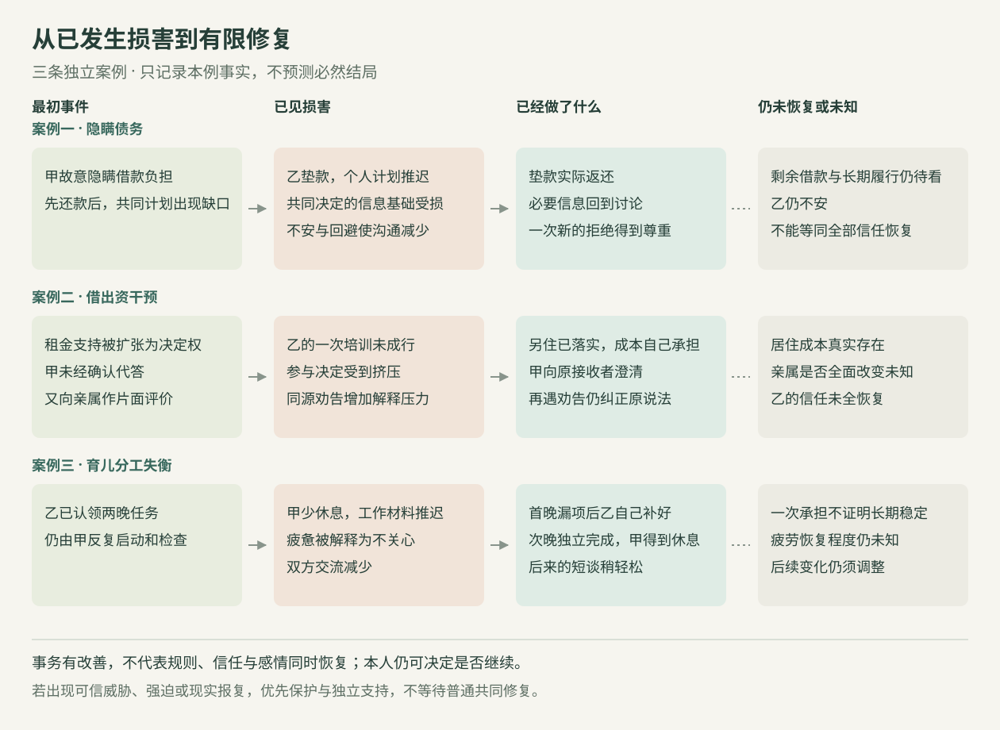

图中每一行都是一个独立案例，只画本例已发生的影响及后续行动，不表示任何隐瞒、资助或分工差异都会沿同一路径发展。右侧保留未解决部分，是为了让“有改善”与“已全部恢复”能够分开。

补钱要真正减少缺口或偿还垫付，权限调整要在下一次有人说不时仍有效，重排分工要给原承担者实际减负。有了这些传导条件，某项行动才可能进入规则、信任和感情；它们仍可不同步，也可能只修复其中一部分。

看自己的事件时，可以先写三句话：最初发生了什么；它借助哪项实际依赖或行为影响了谁；现在已经用什么行动改变了哪一部分。没有发生的后果放在“仍需观察”，不为显得严重而补写，也不因尚未全面恶化便忽略原损害。

更新判断用[附录M.11](#unit-M-11)；双方愿意处理普通分歧时回到[8.6节](#unit-8-6)与[附录I.4](#unit-I-4)同一套七步，再分别看事务、规则与信任、感情的结果。可信威胁、强迫或现实报复优先考虑独立支持。无论是否继续关系，已经形成的必要事务都可另行处理，修复不以恢复恋人身份为交换条件。

#### M.11 更新判断与选择下一步

这页用于一件仍影响当前选择的事。新信息既可能确认问题，也可能澄清疑虑；行动可能改善部分后果，也可能尚未奏效。记录的目的，是让下一步有事实依据，不是把一个人永久固定在某个等级。

##### 怎样填写，何时不用填

先写具体事项与时点，只收与这次决定有关的信息。亲见、相称核对、本人自述和自己的解释分开写；不知道就保留未知。口头愿意、已有条件、已经执行与实际效果也分开，不能因为方案听上去完整便把结果提前填上。

简单小事自然说清并处理完，就不必填表。若涉及可信威胁、强迫或现实报复，优先考虑当下保护和独立支持，转向[附录J.4](#unit-J-4)；不以对方共同签字、交代全部动机或成功协商作为行动前提。信息尚不完整，也可以先停止自己不愿承受的暴露。

##### 空白记录页

| 记录项 | 本次填写 |
| --- | --- |
| 事项、时点与当前要作的决定 |  |
| 原先依据什么，作了什么判断 |  |
| 新信息与来源；仍未知什么 |  |
| 原判断哪些保留，哪些需要改变，为什么 |  |
| 哪些是已发生的损害，哪些只是可能后果 |  |
| 已采取的行动、承担者与已见效果 |  |
| 新增损害是否停止；尚未执行或未解决什么 |  |
| 下一步：继续了解、暂缓相应行动、调整安排或结束；本人依据与意愿 |  |
| 什么新事实或条件变化，需要重新看 |  |

需要修复时，再按不同结果分别记下面三行。不需要修复的澄清事项，可以直接写“原疑虑已澄清”，不为了填表制造一段曾经存在的伤害。

| 结果层次 | 已有行动和实际体验 | 尚未解决或未知 |
| --- | --- | --- |
| 事务 |  |  |
| 规则、信任与共同体认同 |  |  |
| 感情 |  |  |

“不再恶化、能够稳定保持、出现积极修复迹象”是在观察进展；事务、规则与信任、感情是在区分结果领域，两者不能互换。一次停止越权可以记录为当次没有新增越权，不能据此宣布长期稳定；一次愿意交流也不能证明财务缺口已经填平。

##### 完整填例：垫款已返，判断改变到哪里

沿用[附录M.10](#unit-M-10)案例一已经发生的事实。甲隐瞒本人借款，乙曾垫补必要生活支出；后来垫款返还，一次新的非必要支出先提出来，乙不同意，甲未执行。剩余借款仍未全部结清，债务总额和具体法定义务也不能由这次返还推定。

| 记录项 | 本次填写示例 |
| --- | --- |
| 事项、时点与决定 | 在垫款已返、一次新支出未越权之后，判断是否继续了解变化，以及是否扩大共同支出 |
| 原先依据与判断 | 已确认甲明知真实情况却作相反说明；乙承担垫付并推迟个人安排。不能只凭口头保证，按原来虚假的可用资源扩大计划 |
| 新信息与来源 | 乙实际收到返还；甲已提供相关必要信息；乙亲历一次拒绝被尊重。剩余借款没有全部结清，后续长期履行尚不能确认 |
| 保留与改变 | 原来的故意隐瞒仍成立；“垫款尚未返还”已不符合当前状态，应更新。可确认一次履行与一次边界保留，不能改写成最初只是误会 |
| 损害与可能后果 | 已有垫付和个人计划推迟、知情参与受损、信任下降。乙的原个人计划是否恢复仍不清楚；未来再次隐瞒只是待观察，不能记成新犯一次 |
| 实际行动与效果 | 甲以已到账且核过必要开支的本人可支配余量返还；没有把必要支出重复计算，也没有把本期已还款再计一次。新支出未获同意，甲没有执行 |
| 停止与未解 | 本次未新增所述越权，垫款已处理；后续债务负担、持续履行和乙的不安仍在，不能以未见新事保证今后无事 |
| 下一步 | 乙愿继续观察；共同计划按真实剩余条件调整，暂不依据一次改善增加同类重大承担。继续相处不等于已经恢复全部信任 |
| 重看条件 | 到下一项实际还款或共同支付需安排时，核对与之相关的资源；若出现新不一致、新隐瞒、无法履行或乙不再愿意，重新决定 |

| 结果层次 | 当前能确认 | 仍不能确认 |
| --- | --- | --- |
| 事务 | 乙的垫款已收到返还，原必要生活支出此前已完成 | 剩余借款清零、所有被推迟的个人安排已恢复 |
| 规则、信任与共同体认同 | 甲承认责任，必要信息进入讨论，一次实际保留乙的拒绝 | 长期不再隐瞒，或乙已恢复原来的共同决定感 |
| 感情 | 乙愿继续观察，仍不安 | 已完全原谅、愿意身体亲密，或必须继续关系 |

这个填写不是替乙决定应该留下。换一个当事人，即使承认改善已经发生，也可以认为失信超出了自己愿意接受的范围。表格应准确记录事实与选择，不能把“存在改善”偷换成“必须给予机会”。

##### 对照一：澄清疑虑，不是修复已经证实的欺骗

[附录M.1](#unit-M-1)有两个互斥方向。其一，交友介绍是旧资料，后来相称核对显示工作地点确已调整，当前资料能够对应。可以关闭原先关于两份说法无法对应的疑虑，再按真实地点判断是否适合；不能写成“已证实骗人，但后来解释得好，降级了”。

另一方向中，乙承认明知甲希望在本地生活，仍故意作不实说明以促成辞职迁居。此时增加的是确认欺瞒的事实，不能继续只写“信息不足”。甲尚未辞职迁居，就没有该项已经发生的收入损失；甲仍可立即暂停当前了解或结束，不需要等迁居损失实际发生后才处理。

明确的核心条件仍不相容时，重估需要相应条件实质改变。例如实际生活地点与本人意愿都未改变，单有一次道歉不会让城市安排自动相容。资料真实、愿意修复、适合共同生活是不同判断。

##### 对照二：旧不适、实际再犯与短暂示好

原来受骗的人在相似场景中再次不安，可以说明旧损害尚有余波，值得回应；若没有新的不实或违约，不能仅凭这次不安再记一笔同类行为。反过来，新的具体隐瞒已有依据，也不能用“你只是想起以前的事”将它消掉。

在[附录J.4](#unit-J-4)所用的危险情境中，阻止独立求助的威胁之后出现礼物和道歉。示好本身没有证明威胁撤除、支持通道恢复或现实暴露消失，不能据此回到普通协商。保护与支持要按当前条件安排，不要求先把风险记录更新得完美。

##### 怎样接回修复，怎样关闭事项

双方安全、自愿且有现实合作条件时，回到[8.6节](#unit-8-6)与[附录I.4](#unit-I-4)同一套七步：安全与稳定条件；分别陈述并交换事实、感受、解释和期待；确认冲突结构；处理本次事件；约定未来行为和责任；执行观察；重新创造积极连接。这里记录变化与下一步，不另设第二套修复程序。

已处理且无须继续跟进的事项可以关闭，不因旧编号还在便反复审问。新事实、持续损害或安排失效时再打开；需要关注的，只是与当前决定有实质关系的部分。不规定统一约会次数或月数，也不制造嫉妒、撤回支持或人为危机来取得“测试结果”。

已有关系是否继续，与辞职、迁居、共债、生育等新的重大行动分别决定。若选择结束，必要费用、物品或有限过渡照护另按事实处理；仍需善后，不代表必须保留恋人权限。[附录J.5](#unit-J-5)提供按阶段退出与重建的入口。

#### M.12 来源编码与边界

这张表用来查“这一行为什么连到这些来源”，不用于给人评分。[附录M.3](#unit-M-3)—[附录M.9](#unit-M-9)的来源列保留[A1](#source-M-A1)—[A8](#source-M-A8)、[B1](#source-M-B1)—[B12](#source-M-B12)二十类；[S1-01](#risk-S1-01)这样的编号才指向七阶段表里的具体一行。来源类别、具体情境和当前判断是三个不同位置。

##### 二十类来源与当前入口

下表按“静态／动态”列出二十类来源，分别关注背景条件与互动过程。适用行号对应风险表中的具体情境，范围写法包含两端；正文入口提供主要讨论位置，最后一列说明怎样使用这些类别。

| 编码 | 来源类别 | 关注主题 | 对应风险条目 | 正文入口 | 使用边界 |
| --- | --- | --- | --- | --- | --- |
| A1 | 静态 | 身份真实性与法律关系 | [S1-01](#risk-S1-01)、[S3-01](#risk-S3-01)、[S4-05](#risk-S4-05)、[S6-01](#risk-S6-01)、[S7-01](#risk-S7-01) | [6.3](#unit-6-3)、[11.6](#unit-11-6) | 只核与当前决定有关的身份事实，正式记录也有范围与时效 |
| A2 | 静态 | 财务安全与经济结构 | [S3-02](#risk-S3-02)、[S3-09](#risk-S3-09)、[S4-05](#risk-S4-05)、[S5-04](#risk-S5-04)、[S6-02](#risk-S6-02)—[S6-03](#risk-S6-03)、[S7-01](#risk-S7-01)—[S7-02](#risk-S7-02)、[S7-10](#risk-S7-10)、[S7-18](#risk-S7-18) | [12.2](#unit-12-2)、[14.5](#unit-14-5)、[16.3](#unit-16-3) | 财务困难、责任不清与故意隐瞒分别判断，不以钱少定性 |
| A3 | 静态 | 家庭背景与外部关系 | [S1-05](#risk-S1-05)、[S3-03](#risk-S3-03)、[S4-09](#risk-S4-09)、[S5-02](#risk-S5-02)—[S5-03](#risk-S5-03)、[S6-04](#risk-S6-04)、[S7-04](#risk-S7-04)—[S7-05](#risk-S7-05) | [9.2](#unit-9-2)、[9.5](#unit-9-5)、[14.8](#unit-14-8) | 家庭背景不等于道德属性，观察具体接口和实际影响 |
| A4 | 静态 | 健康、生育与照护责任 | [S3-06](#risk-S3-06)、[S5-07](#risk-S5-07)、[S6-05](#risk-S6-05)—[S6-06](#risk-S6-06)、[S7-03](#risk-S7-03) | [6.6](#unit-6-6)、[10.5](#unit-10-5)、[16.4](#unit-16-4) | 健康状况和照护需要本身不是侵害，知情、承担与选择另核 |
| A5 | 静态 | 价值观与人生目标不兼容 | [S1-03](#risk-S1-03)、[S2-03](#risk-S2-03)、[S2-08](#risk-S2-08)、[S3-04](#risk-S3-04)、[S4-01](#risk-S4-01)、[S4-06](#risk-S4-06)、[S5-01](#risk-S5-01)、[S6-05](#risk-S6-05)、[S7-03](#risk-S7-03) | [6.4](#unit-6-4)、[11.3](#unit-11-3)、[16.1](#unit-16-1) | 重大不兼容可以无需任何人有错，关键条件实质改变才重估 |
| A6 | 静态 | 自主性与现实经营能力 | [S1-09](#risk-S1-09)、[S3-05](#risk-S3-05)、[S4-09](#risk-S4-09)、[S5-05](#risk-S5-05)—[S5-06](#risk-S5-06)、[S6-08](#risk-S6-08)、[S7-04](#risk-S7-04) | [3.2](#unit-3-2)、[9.5](#unit-9-5)、[11.2](#unit-11-2) | 现实能力与本人愿意分别看，不能预支未来成熟或由伴侣永久接管 |
| A7 | 静态 | 个人行为历史与危险倾向 | [S1-05](#risk-S1-05)、[S1-08](#risk-S1-08)、[S3-10](#risk-S3-10)、[S5-03](#risk-S5-03)、[S6-07](#risk-S6-07)、[S7-05](#risk-S7-05) | [6.3](#unit-6-3)、[17.5](#unit-17-5) | 核历史真实性、当前相关性和现实危险，不由受害经历推定危险人格 |
| A8 | 静态 | 双方吸引与现实适配 | [S1-02](#risk-S1-02)、[S1-04](#risk-S1-04)、[S2-01](#risk-S2-01)—[S2-02](#risk-S2-02)、[S3-04](#risk-S3-04)、[S3-13](#risk-S3-13)、[S4-06](#risk-S4-06)、[S4-08](#risk-S4-08)、[S5-01](#risk-S5-01)、[S6-05](#risk-S6-05)、[S7-06](#risk-S7-06)、[S7-16](#risk-S7-16) | [4.1](#unit-4-1)、[6.2](#unit-6-2)、[11.5](#unit-11-5) | 好感、双向吸引、关系运行与适婚不能互相替代 |
| B1 | 动态 | 信息不对称、欺骗与伪装 | [S1-01](#risk-S1-01)、[S1-06](#risk-S1-06)—[S1-07](#risk-S1-07)、[S3-01](#risk-S3-01)、[S3-07](#risk-S3-07)、[S4-02](#risk-S4-02)、[S4-05](#risk-S4-05)、[S5-10](#risk-S5-10)、[S6-01](#risk-S6-01)、[S6-07](#risk-S6-07)、[S7-07](#risk-S7-07) | [5.6](#unit-5-6)、[6.3](#unit-6-3)、[15.4](#unit-15-4) | 未知不等于欺骗；已确认故意不实也不能一直退回未知 |
| B2 | 动态 | 短期套利与关系套现 | [S1-07](#risk-S1-07)、[S2-05](#risk-S2-05)、[S3-02](#risk-S3-02)、[S3-07](#risk-S3-07)、[S4-03](#risk-S4-03)、[S5-11](#risk-S5-11)、[S7-11](#risk-S7-11) | [4.6](#unit-4-6)、[5.9](#unit-5-9)、[12.7](#unit-12-7) | 重视资源不自动证明套利，须看具体伪装、索取、越权与后果 |
| B3 | 动态 | 吸引力错判与择偶决策失真 | [S1-02](#risk-S1-02)、[S1-10](#risk-S1-10)、[S2-01](#risk-S2-01)、[S2-04](#risk-S2-04)、[S2-09](#risk-S2-09)、[S5-11](#risk-S5-11)、[S7-09](#risk-S7-09) | [3.5](#unit-3-5)、[3.6](#unit-3-6)、[4.6](#unit-4-6) | 这是判断与搜索机制，不能反过来证明被评价者一定有害 |
| B4 | 动态 | 关系推进失序与不可逆投入 | [S1-06](#risk-S1-06)、[S1-11](#risk-S1-11)、[S2-03](#risk-S2-03)、[S2-07](#risk-S2-07)、[S2-10](#risk-S2-10)、[S3-09](#risk-S3-09)、[S3-12](#risk-S3-12)、[S6-09](#risk-S6-09)、[S7-10](#risk-S7-10) | [2.3](#unit-2-3)、[5.8](#unit-5-8)、[6.8](#unit-6-8)、[11.7](#unit-11-7) | 阶段、任务与具体行动分开，身份不能替代重大行动的事实条件 |
| B5 | 动态 | 善意与情感投入债务化 | [S2-05](#risk-S2-05)—[S2-06](#risk-S2-06)、[S3-08](#risk-S3-08)、[S4-03](#risk-S4-03)、[S5-08](#risk-S5-08)、[S6-03](#risk-S6-03)、[S6-09](#risk-S6-09)、[S7-06](#risk-S7-06)、[S7-13](#risk-S7-13) | [5.5](#unit-5-5)、[10.4](#unit-10-4)、[17.4](#unit-17-4) | 已形成的现实责任应处理，善意不产生身体、服从或终身留下的债权 |
| B6 | 动态 | 忠诚、排他性与边界侵犯 | [S2-07](#risk-S2-07)—[S2-08](#risk-S2-08)、[S4-01](#risk-S4-01)—[S4-02](#risk-S4-02)、[S4-04](#risk-S4-04)、[S4-10](#risk-S4-10)、[S5-10](#risk-S5-10)、[S6-10](#risk-S6-10)、[S7-07](#risk-S7-07)—[S7-09](#risk-S7-09)、[S7-17](#risk-S7-17) | [6.1](#unit-6-1)、[10.4](#unit-10-4)、[15.3](#unit-15-3) | 先核真实认可的边界与行为，忠诚不等于具体性行为义务 |
| B7 | 动态 | 叙事操纵、情绪控制与人格侵蚀 | [S1-09](#risk-S1-09)、[S2-06](#risk-S2-06)、[S2-09](#risk-S2-09)、[S3-10](#risk-S3-10)、[S4-04](#risk-S4-04)、[S4-07](#risk-S4-07)、[S5-08](#risk-S5-08)、[S5-13](#risk-S5-13)、[S6-04](#risk-S6-04)、[S6-11](#risk-S6-11)、[S7-12](#risk-S7-12)、[S7-14](#risk-S7-14)、[S7-17](#risk-S7-17) | [7.6](#unit-7-6)、[10.2](#unit-10-2)、[15.7](#unit-15-7)、[17.5](#unit-17-5) | 分歧和记忆差异不自动等于操纵，具体威胁也不必等待读懂内心 |
| B8 | 动态 | 冲突升级、敌对化与修复失败 | [S3-11](#risk-S3-11)、[S4-07](#risk-S4-07)、[S5-09](#risk-S5-09)、[S5-14](#risk-S5-14)、[S6-07](#risk-S6-07)、[S6-11](#risk-S6-11)、[S7-12](#risk-S7-12)、[S7-14](#risk-S7-14)—[S7-15](#risk-S7-15) | [8.6](#unit-8-6)、[15.4](#unit-15-4)、[15.5](#unit-15-5) | 循环分析不平均责任，补偿、规则可信与感情恢复分层观察 |
| B9 | 动态 | 共同经营与家庭治理失败 | [S3-05](#risk-S3-05)、[S5-04](#risk-S5-04)—[S5-07](#risk-S5-07)、[S6-02](#risk-S6-02)、[S6-08](#risk-S6-08)、[S6-12](#risk-S6-12)、[S7-01](#risk-S7-01)—[S7-03](#risk-S7-03)、[S7-06](#risk-S7-06)—[S7-07](#risk-S7-07)、[S7-10](#risk-S7-10)、[S7-13](#risk-S7-13)、[S7-15](#risk-S7-15)、[S7-19](#risk-S7-19) | [14.1](#unit-14-1)、[14.2](#unit-14-2)、[14.5](#unit-14-5)、[16.2](#unit-16-2) | 分工差异不自动等于剥削，需看完整责任、真实认可和可持续条件 |
| B10 | 动态 | 家庭干涉与外部冲突传导 | [S5-02](#risk-S5-02)—[S5-03](#risk-S5-03)、[S6-03](#risk-S6-03)—[S6-04](#risk-S6-04)、[S7-04](#risk-S7-04)—[S7-05](#risk-S7-05) | [9.2](#unit-9-2)、[9.5](#unit-9-5)、[12.2](#unit-12-2)、[14.8](#unit-14-8) | 支持、权属、合理条件与日常决定权限分开，同源转述不多算证据 |
| B11 | 动态 | 幸福生成不足与关系退化 | [S3-13](#risk-S3-13)、[S4-08](#risk-S4-08)、[S5-12](#risk-S5-12)、[S6-12](#risk-S6-12)、[S7-16](#risk-S7-16)、[S7-19](#risk-S7-19) | [7.2](#unit-7-2)、[15.2](#unit-15-2)、[15.6](#unit-15-6) | 短期平淡不等于失效，持续缺少双方需要的生成才须按事实重看 |
| B12 | 动态 | 关系破裂、退出与善后 | [S1-08](#risk-S1-08)、[S2-10](#risk-S2-10)、[S3-12](#risk-S3-12)、[S4-10](#risk-S4-10)、[S5-14](#risk-S5-14)、[S6-13](#risk-S6-13)、[S7-11](#risk-S7-11)—[S7-12](#risk-S7-12)、[S7-18](#risk-S7-18) | [12.6](#unit-12-6)、[17.1](#unit-17-1)、[17.4](#unit-17-4)、[17.5](#unit-17-5) | 结束关系、停止危险暴露与必要善后分别处理，不以全部解决作退出资格 |

##### “静态”不是不会改变，“动态”不是一定更严重

这里的静态，主要帮助查找当时的身份、条件、能力和现实安排；其中很多内容会变化，也可能暂时未知。动态主要提醒观察互动、推进、解释和处理过程。二者是来源索引，既不是两个道德等级，也不是对一个人的终身定性。

例如，借款结构属于[A2](#source-M-A2)，故意隐瞒可涉及[B1](#source-M-B1)，越过共同决定又可能涉及[B9](#source-M-B9)。对同一事件标出三个来源，是从三个位置检查事实，不等于发生了三次侵害，也不能把三个标签相加当作严重程度或发生概率。

同样，[A4](#source-M-A4)中的照护需要可以是真实而正当的生活条件。是否能共同承担，需要讨论能力、资源和意愿；是否有人隐瞒、强迫或单方转嫁，则要另找行为依据。背景条件、具体行为、证据状态和实际后果不能挤成一个词。

##### 与D.2重大事项编码分开使用

| 看到的写法 | 应到哪里查 | 它在说什么 |
| --- | --- | --- |
| [来源M-A1](#source-M-A1) | 本节及[附录M.3](#unit-M-3)—[附录M.9](#unit-M-9)来源列 | 身份真实性与法律关系这一来源类别 |
| [事项D.2-A1](#unit-D-2-heading-3) | [附录D.2](#unit-D-2)重大事项核对表 | “基本身份”这项待讨论的重大事项 |
| [S1-01](#risk-S1-01) | [附录M.3](#unit-M-3)的具体风险行 | 某个阶段情境下，要看哪些事实及怎样分流 |

前两者虽然都出现A1，所处编码系统不同，不能据字面相同直接连成同一项。自己的笔记可以写全“[来源M-A1](#source-M-A1)”或“[事项D.2-A1](#unit-D-2-heading-3)”以免混淆。工具中的[附录D.2](#unit-D-2)并不因为条目与风险表相近，就意味着对方已经触发了风险。

##### 实际查一次：先定位，再回到事实

以[附录M.10](#unit-M-10)隐瞒债务的独立案例为例，可沿[A2](#source-M-A2)找实际经济结构，沿[B1](#source-M-B1)辨认已确认的不实，沿[B9](#source-M-B9)检查共同决定怎样被绕过。然后回到当前事实：谁知道什么、怎样行动、乙承担了什么、返还和后续边界执行到了哪里。来源越多，不会让尚未发生的损害自动成立。

要查某个来源在哪个阶段出现，先在上表找S行号，再读该行全部七列；要理解机制或处理过程，再去所列正文。表中某来源没有列到一个阶段，只表示现有90行没有在该处作此交叉标记，不证明现实中绝不可能出现相关问题。

没有发现对应编号，也不妨碍处理眼前明确的不愿意、不可承担或具体侵害。编号服务于查找，不是取得拒绝、求助或停止关系资格的考试。

##### 来源和知识边界

这二十类来源是本书整理婚恋风险情境时采用的背景与互动分类。它们帮助理解90条具体情境的关联，不是二十种必然发生的损害，也不增加风险等级或关系系统。补充机制见[附录M.13](#unit-M-13)，判断更新见[附录M.11](#unit-M-11)。

这一索引不是经验证的预测量表，也不能从列项多少得出某类人群的危险率。涉及具体法律关系、债务承担、健康、生育或紧急处置时，相关事实和适用条件需另外取得可靠的专业说明；来源名称本身不提供这些结论。必要核对仍应与当前决定相称，不收集无关隐私。

#### M.13 补充机制与正文入口

本节补充十二项理解婚恋互动的机制，并给出相应正文与风险条目入口。它们说明某些误判、依赖和压力怎样形成，不新增风险编号，也不提供发生率。对应S行仍须连同情境、事实状态和下一步一起读，不能只看机制名称便给人定性。

##### 可见不等于可接触、更不等于可成为伴侣

平台让你看见一个人，只解决了可见性。现实中能否接触、能否重复互动、是否相互选择、能否深化关系、进入真实社会联系并持续维系，还分别受意愿、机会、生活条件和投入限制。相似背景可能减少某些交流成本，却不是人人必须相同出身的资格要求。

如果每次比较都停在主页和条件，候选人看似很多，真实交往却没有增加。此时有用的问题是“下一次自然接触从哪里发生，对方是否也愿意参与”，而非继续扩大想象中的备选。这些观察环节也不同于本书七个关系阶段，不要求把每一次认识都变成固定流程。

入口：[S1-02](#risk-S1-02)、[S1-04](#risk-S1-04)、[S1-10](#risk-S1-10)；正文[3.3](#unit-3-3)—[3.4](#unit-3-4)及[3.7](#unit-3-7)。需要整理渠道时，回到[第三章3.4节的现实接触条件](#unit-3-4)。

##### 过多刚性要求与搜索疲劳

同时要求多个条件，会把选择限制在交集内；条件之间常有关联，不能把未经核实的单项比例相乘，算出某个人“只有万分之一机会”。真正需要核对的是，哪些关系到无法接受的生活，哪些只是偏好，哪些能够通过具体相处再了解。

搜索疲劳也不只来自人少。不断切换、比较和等待，会占用建立普通联系的注意力。如果所有精力都花在重新筛选，没有余量认识眼前愿意参与的人，增加候选未必增加了解。可以收敛渠道或休息，但不必为了提高数量而放弃明确底线，也不把疲惫解释成本人不值得被爱。

入口：[S1-03](#risk-S1-03)、[S1-04](#risk-S1-04)、[S1-10](#risk-S1-10)、[S3-13](#risk-S3-13)；正文[3.5](#unit-3-5)—[3.7](#unit-3-7)。

##### 社会距离与渠道质量

跨圈层的困难，通常要通过具体接口看：消费习惯能否协调，作息能否相接，彼此的朋友和家人是否有容纳空间，有没有双方都能参与的活动。背景差异可能增加成本，但背景相近也不保证尊重和合作；不能用一个阶层名称代替实际交往。

比较渠道时，可看目标相近的人是否常出现、是否真能接触、能否双向启动、信息噪声与现实危险、背景信息的可靠程度及核对成本。没有相应数据，这些只是观察维度，不是渠道成功率排名。一次昂贵活动也不能替双方解决平时没有交集的问题。

入口：[S1-02](#risk-S1-02)、[S1-05](#risk-S1-05)、[S3-03](#risk-S3-03)、[S5-02](#risk-S5-02)、[S5-11](#risk-S5-11)；正文[3.4](#unit-3-4)、[9.1](#unit-9-1)—[9.5](#unit-9-5)，社会融入工具见[附录H.1](#unit-H-1)—[附录H.3](#unit-H-3)。

##### 单一强信号改变接触构成

持续只展示财富、外貌或高刺激体验，可能让重视该信号的人更容易靠近，也可能遮住你的其他特点。这里说的是展示与回应之间的选择作用，不是“喜欢条件的人都是套利者”，更不能据某个追求者夸了一次外貌便判断其全部动机。

可以让真实生活有更多可见部分：普通兴趣、可承担的相处、怎样处理小事。随后观察对方是否对具体的你有兴趣，能否尊重边界并共同参与。自然说明预算与偏好即可，不必故意装穷、撤回支持或布置考验，来制造所谓的真心证据。

入口：[S1-02](#risk-S1-02)、[S1-06](#risk-S1-06)、[S2-04](#risk-S2-04)、[S5-11](#risk-S5-11)；正文[4.4](#unit-4-4)及[4.6](#unit-4-6)。

##### 情绪强度与了解程度不同步

心动、被追捧和共同经历刺激带来的兴奋，可以是真实的。它们回答此刻体验怎样，却不能单独回答对方是否可靠、普通生活能否持续，或双方是否适婚。强烈情绪与了解不足可以同时存在，不需要否认前者才能承认后者。

享受一次愉快相处之后，仍可把重大决定留给相应事实：普通约定怎样履行，拒绝是否被尊重，现实条件是否与陈述一致。不是必须先降温才算理性，而是别让“感觉很强”替代本来尚未获得的信息。

入口：[S1-10](#risk-S1-10)、[S2-01](#risk-S2-01)、[S2-04](#risk-S2-04)；正文[4.1](#unit-4-1)—[4.3](#unit-4-3)及[4.6](#unit-4-6)。普通互动怎样形成持续连接，见[6.2](#unit-6-2)与[第七章7.2节](#unit-7-2)。

##### 长期承诺包装与善意债务化

“想结婚”可能是真实意愿，也可能被用来促成眼下的金钱、身体或身份投入。需要对照的是实际参与、履责、资源要求及对拒绝的反应。后来改变主意与一开始明知不实却借承诺获取利益不同；未确定的未来，也不能全部预支成今天已经兑现的条件。

若一方把追求花费解释成对方必须亲密、留下或接受共债的理由，善意就被改写成单方债权。真实借款和已经形成的责任另按事实处理，礼物与照顾本身不产生身体许可。面对借贷矛盾、催促绑定或失约不补救，应定位具体问题，不靠一句“他也是为了我们”消掉它。

入口：[S3-01](#risk-S3-01)—[S3-13](#risk-S3-13)；正文[5.1](#unit-5-1)、[5.5](#unit-5-5)—[5.6](#unit-5-6)及[5.9](#unit-5-9)。后续善后责任与留下义务的区别见[17.4](#unit-17-4)。

##### 排他中的空壳身份与叙事控制

排他意味着双方认可的注意力与交往边界，并不自动产生感情自持。只有每日问候、没有新的互动或合作，时间延长也不会替两人完成了解。[附录M.6](#unit-M-6)的匿名例中，一方明确不愿增加共同活动，另一方已经结束排他。此时要按已经表达的选择处理，而非继续把排他身份当作恋爱进展。

含糊的约定可以澄清；已明确的事实和边界被反复重写，则要处理具体失信。若又阻止独立核对或求助，需按已见行为判断自主是否受损，不能以更深入绑定证明信任。普通记忆差异也不能只因双方争论就命名为操纵。

入口：[S4-01](#risk-S4-01)—[S4-10](#risk-S4-10)；正文[6.1](#unit-6-1)—[6.3](#unit-6-3)及[6.9](#unit-6-9)。共同叙事的作用与边界见[7.6](#unit-7-6)。

##### 性经历后身份与叙事压力

共同性经历可以带来快乐、依恋和记忆，也可能改变判断问题：原来在问“是否适合”，后来却只想证明“既然已经发生，就不能否定这段关系”。经历的意义值得认真对待，但它不是未来承诺的自动证据，过去的选择也不必靠持续投入来证明没有选错。

本书建议在恋爱中期或中后期、已有相应了解时审慎决定重大性亲密，理由是经历与后果的分量，不是用固定月份衡量道德。经历不能从历史中撤销，不等于往后的身体同意不能撤回，也不等于关系必须继续。不能以既往性经历贬低一个人的价值或取消其选择。

入口：[S2-03](#risk-S2-03)、[S3-07](#risk-S3-07)—[S3-09](#risk-S3-09)、[S4-03](#risk-S4-03)、[S6-09](#risk-S6-09)；正文[10.1](#unit-10-1)—[10.3](#unit-10-3)、[10.6](#unit-10-6)及[11.8](#unit-11-8)，具体同意记录见[附录K.1](#unit-K-1)。

##### 身体拒绝权与健康信息缺口

女性可以拒绝、暂停或改变对具体身体接触的决定，男性应当尊重，不以付出、身份或感情施压。这一要求依据的是本人的身体自主，也适用于男性拒绝接触的情境：任何一方的付出或期待，都不能替另一方作出同意。曾经同意、仍在恋爱、赴约或接受礼物，都不能替代这一次具体而自愿的同意。不清楚时应先停下确认，而不是把沉默当作放行。

相关健康信息不清时，可以暂缓受影响的行为，按具体需要寻求专业检查与解释。拒绝回答不证明患病，一次检查也不是永久安全保证。需要披露什么应与当前行为及后果有关，不能借健康之名获取全部医疗隐私；必要信息仍未清楚或安排无法被双方接受时，相关行为可能暂不具备共同基础。

入口：[S2-03](#risk-S2-03)、[S3-06](#risk-S3-06)、[S5-07](#risk-S5-07)、[S6-06](#risk-S6-06)、[S7-12](#risk-S7-12)；正文[5.4](#unit-5-4)、[6.6](#unit-6-6)、[10.3](#unit-10-3)—[10.5](#unit-10-5)及[附录K.1](#unit-K-1)—[附录K.3](#unit-K-3)。

##### 两种不同的生育与绑定控制

第一种直接侵蚀身体选择：未经同意改变另一方所依赖的避孕安排，隐瞒会影响其身体选择的重要事实，或强迫其接受生育相关的身体决定。重点是具体同意和自主受到怎样的干预，不是只看最后有没有怀孕，也不是推断某一性别天然更可能实施。

第二种把怀孕、金钱或婚约用来迫使对方留下，例如以公开隐私或现实报复逼迫结婚。它作用于退出与关系选择，可以与第一种并存，也可能单独发生。表达希望共同承担后果、提出真实责任要求，本身不等于控制；要辨认具体强迫与越权。

一个人拒绝发生在自己身体上的行为或不愿生育，不因对方失望就变成控制对方身体。目标无法相容时可以重新决定关系，不能以“共同决定”为名取消本人身体权限。同样，身体自主不表示已有生活、经济或照护后果无需讨论；处理真实责任，也不产生继续性行为或结婚的义务。

入口：[S2-06](#risk-S2-06)、[S4-03](#risk-S4-03)、[S5-08](#risk-S5-08)、[S6-09](#risk-S6-09)、[S7-10](#risk-S7-10)、[S7-12](#risk-S7-12)；正文[10.5](#unit-10-5)—[10.6](#unit-10-6)与[第十七章17.4节](#unit-17-4)，相关信息及专业咨询准备见[附录K.2](#unit-K-2)。

##### 排他边界与第三方性关系风险

开放式性关系存在法律、生理健康和心理健康风险。本书不讨论相关安排的选择或实践；一对一排他承诺不能由一方自行改变，拒绝有关提议不需要“更开明”的证明。

提议不等于已经实施，风险也不等于某个人已经受到具体损害。实际隐瞒或违约按当时承诺与行为处理，不能以事后提议追认；不愿继续时可以结束，既有责任另行处理。

入口：[S2-08](#risk-S2-08)、[S4-01](#risk-S4-01)、[S5-10](#risk-S5-10)、[S7-08](#risk-S7-08)、[S7-12](#risk-S7-12)；正文[10.4](#unit-10-4)—[10.6](#unit-10-6)与[附录K.3](#unit-K-3)。

##### 稳定、分工与共同生长不是同义词

仍在一起、很少争吵，可能来自有效合作，也可能来自回避、缺少选择或退出困难。判断稳定的质量，要看双方需要有没有被回应，是否能自主表达和调整，而不是只数关系维持了多久。短暂平淡也不需要被强行诊断成衰退。

一方挣钱更多、另一方照护更多，可以是双方真实接受的分工。阶段性依赖也可能合理；要进一步核对贡献是否被看见、负担是否可持续、承担者是否有休息和保障、角色能否随条件改变。不能依据收入差或一段低谷就贴上寄生标签，也不能用“分工不同”掩盖持续拒绝承担的事实。

共同生长不要求两人的收入、能力或社会位置同步上升。它关心两个人与共同生活是否仍有发展、调整和生成价值的空间；支持一方恢复，也可能是这段时间值得做的事。真正需要讨论的是支持的真实意愿、资源和持续条件，不是每期都证明双方同幅度进步。

入口：[S5-05](#risk-S5-05)—[S5-07](#risk-S5-07)、[S7-06](#risk-S7-06)、[S7-13](#risk-S7-13)、[S7-16](#risk-S7-16)、[S7-19](#risk-S7-19)；正文[2.2](#unit-2-2)、[2.5](#unit-2-5)及[第十四章](#unit-14-1)至[第十六章](#unit-16-1)，结构公平与角色变化见[附录G.3](#unit-G-3)。

##### 从机制回到当前选择

用本节时，只取与眼前事实有关的部分：它解释了什么行为或限制，证据在哪里，还有什么解释同样可能，下一步能获得什么信息或改变什么。没有依据的环节保留未知，已有侵害不等其余环节补齐才处理。需要更新决定时回到[附录M.11](#unit-M-11)，具体阶段行见[附录M.3](#unit-M-3)—[附录M.9](#unit-M-9)。

这些机制既帮助识别损害，也帮助看见可行的改善和仍值得继续的普通生活。模型不能替本人产生喜欢、同意或留下的意愿，工具也不要求把每次相处都变成检查。

